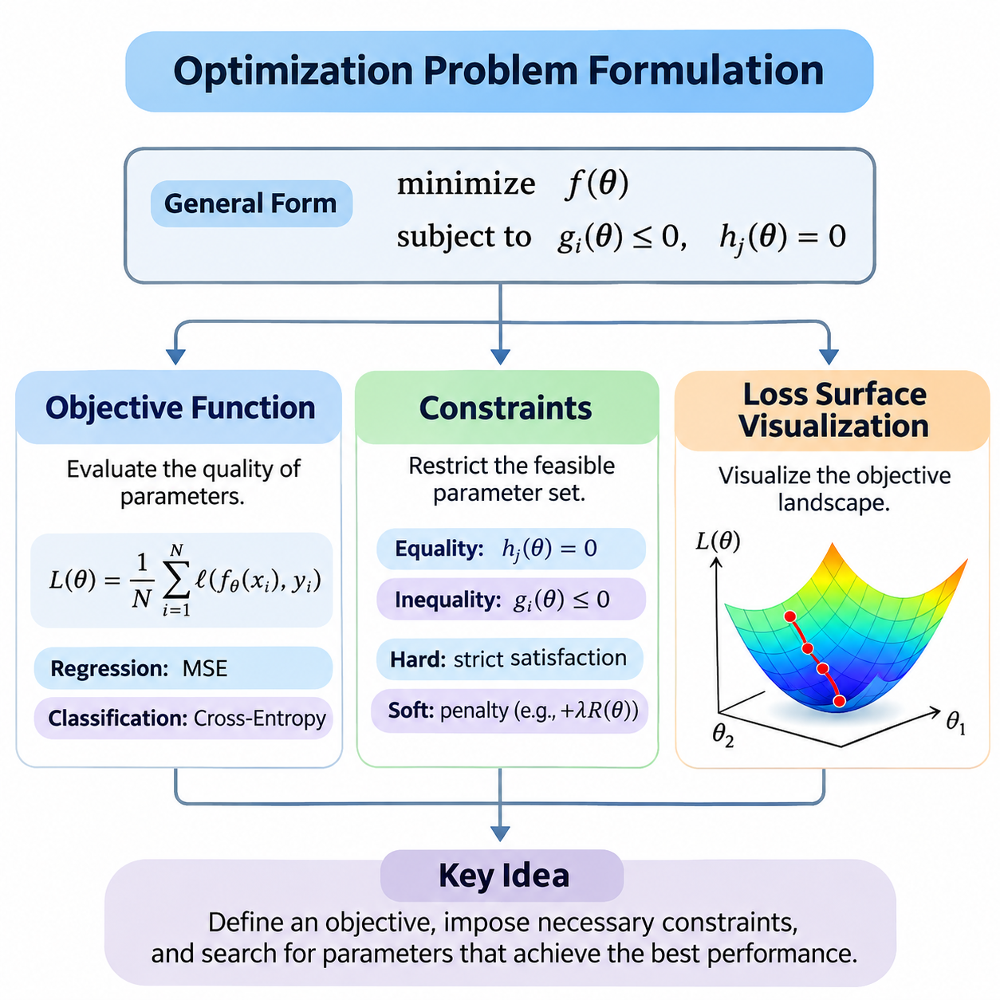
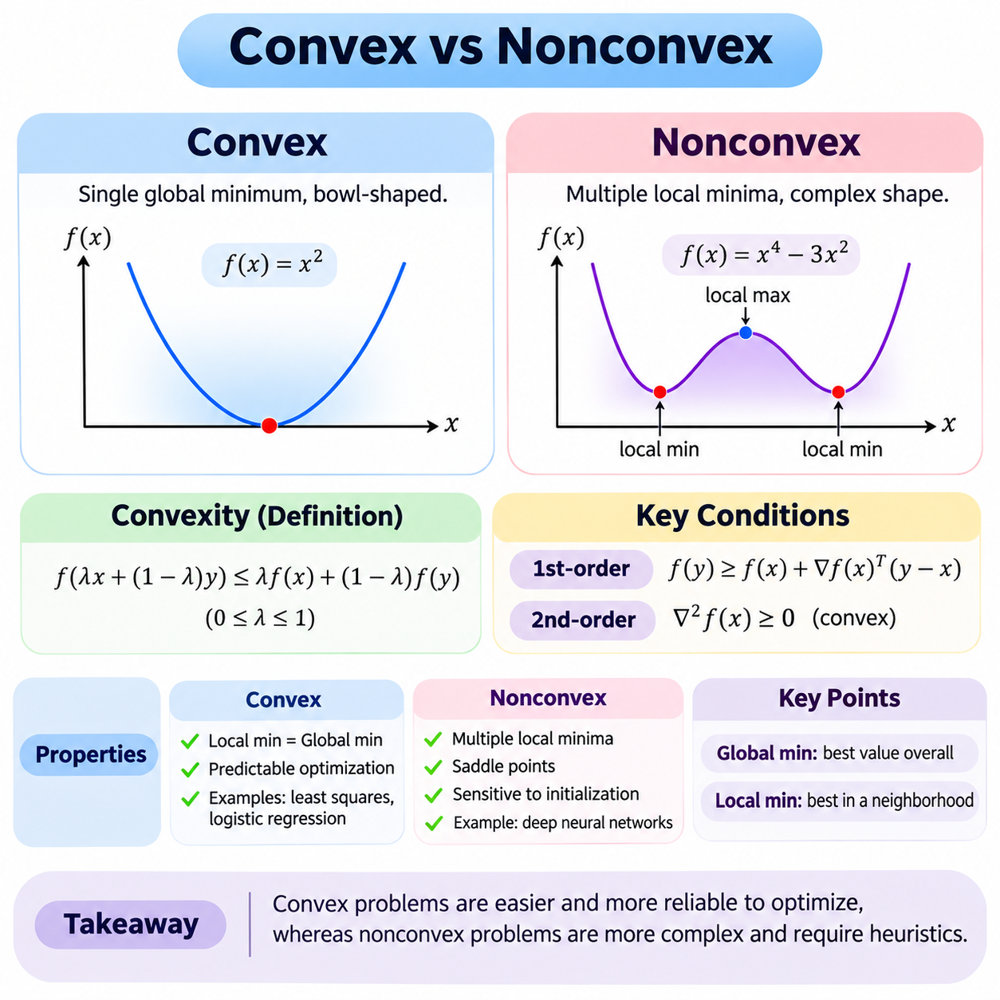
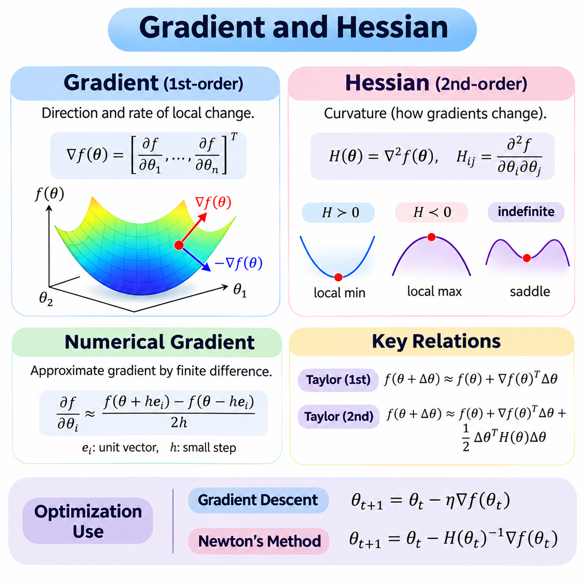
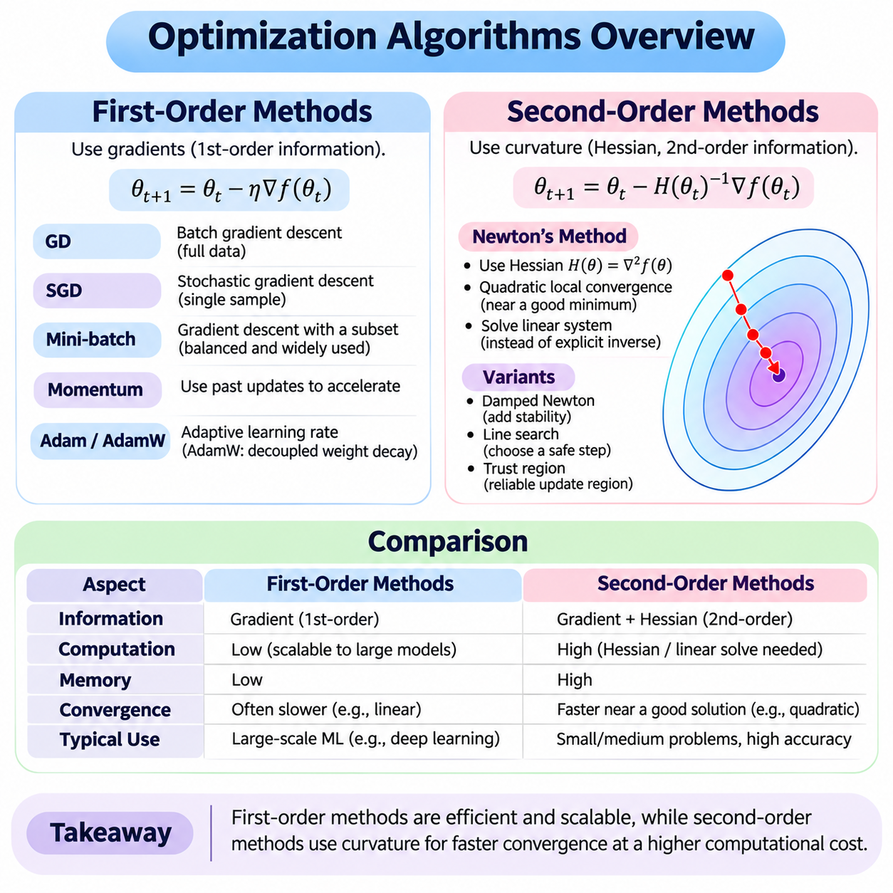
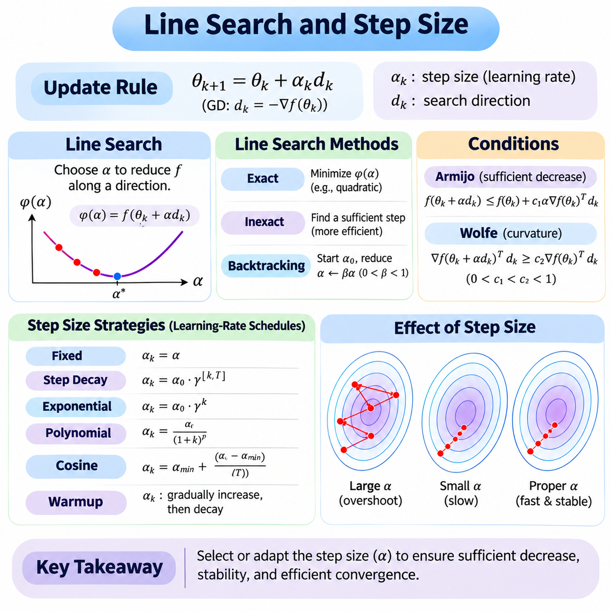
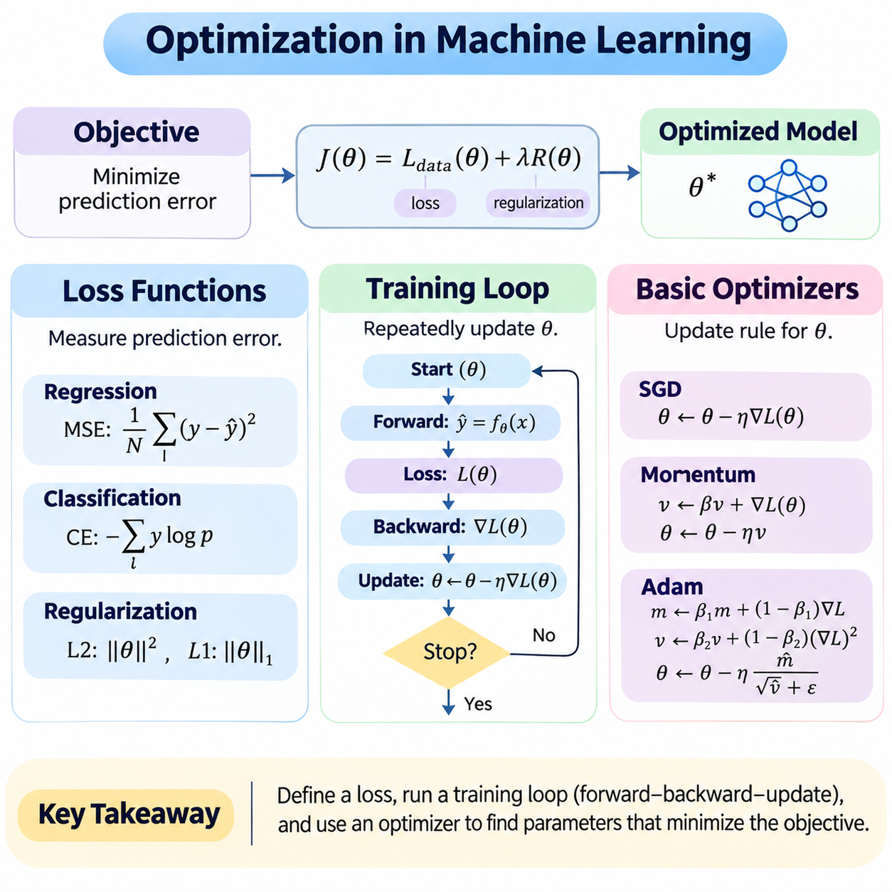

**Volume 06. Optimization and Generalization in ML**

# 01. Optimization Basics

## 01.00 Optimization Problem Formulation

{width="7.268055555555556in" height="7.268055555555556in"}

Optimization is a fundamental mathematical framework for machine learning, providing a systematic method for identifying model parameters that achieve a desired objective. During training, a learning algorithm searches through a parameter space to minimize prediction errors or maximize a performance measure. Formulating this process mathematically is essential because the objective, constraints, and structure of the search space determine which solutions are acceptable and how efficiently they can be discovered.

An optimization problem consists of decision variables, an objective function, and potentially a collection of constraints. In machine learning, decision variables usually correspond to trainable parameters such as neural network weights and biases. The objective function measures the quality of a particular parameter configuration, while constraints restrict the set of permissible solutions. Together, these components define the mathematical problem that an optimization algorithm attempts to solve.

A general constrained optimization problem can be expressed as minimizing f(θ) subject to gᵢ(θ) ≤ 0 and hⱼ(θ) = 0, where θ represents the parameter vector. The function f describes the optimization objective, while gᵢ and hⱼ represent inequality and equality constraints. When no explicit constraints are imposed, the problem becomes unconstrained optimization, although the objective function and model architecture may still impose implicit restrictions on possible solutions.

The objective function provides a quantitative connection between model behavior and the optimization process. For supervised learning, it typically measures disagreement between predicted outputs and ground-truth labels. Given a dataset containing N observations, the empirical risk can be expressed as L(θ) = (1/N)Σᵢ ℓ(fθ(xᵢ), yᵢ), where ℓ represents an individual prediction loss. Minimizing this average loss encourages the model to reproduce patterns observed in the training data.

Different learning tasks require different objective functions because prediction errors have different mathematical meanings. Mean squared error is commonly used in regression because it penalizes squared deviations between predictions and targets. Cross-entropy is widely used in classification because it evaluates predicted probability distributions against observed labels. Selecting an appropriate objective therefore requires understanding both the statistical assumptions of the model and the practical consequences of prediction errors.

The mathematical properties of an objective function strongly influence optimization behavior. Continuity describes whether small parameter changes produce small changes in objective values, while differentiability determines whether gradient-based methods can calculate local directions of improvement. Convexity provides stronger guarantees about the relationship between local and global solutions. Deep neural networks generally produce nonconvex objectives, making optimization substantially more complicated than minimizing a simple quadratic function.

An objective function may contain multiple terms representing competing requirements. For example, a learning system may minimize prediction error while penalizing excessive parameter magnitudes or computational complexity. A combined objective can be written as J(θ) = Ldata(θ) + λR(θ), where R represents a regularization term and λ controls its contribution. This formulation illustrates how optimization can balance data fitting against preferences for particular model characteristics.

The distinction between minimizing training loss and achieving useful predictive performance is especially important. A model can obtain a very low empirical objective value while performing poorly on previously unseen observations. This occurs when optimization captures noise or dataset-specific relationships rather than generalizable patterns. Consequently, objective formulation should consider the intended application, the available data, and the relationship between training measurements and real-world performance.

Constraints define the feasible region within which optimization is permitted to operate. In mathematical terms, the feasible set contains all parameter configurations satisfying every specified equality and inequality condition. The optimizer must identify a solution that minimizes the objective without violating these restrictions. Constraints can represent physical limitations, resource budgets, parameter relationships, safety requirements, or other conditions that must remain valid throughout the optimization process.

Equality constraints require a mathematical relationship to hold exactly, such as the requirement that probabilities sum to one. Inequality constraints establish upper or lower limits, such as restricting a parameter norm or limiting total resource consumption. In practical machine learning systems, constraints may also restrict latency, memory usage, energy consumption, or model size. These requirements become particularly important when deploying trained models on embedded hardware or resource-constrained devices.

Hard constraints and soft constraints represent two different approaches to controlling optimization. A hard constraint excludes any solution that violates a specified condition, regardless of its objective value. A soft constraint introduces a penalty for undesirable behavior, allowing the optimizer to trade some violation against improvements elsewhere. Penalty-based formulations are often easier to integrate into conventional training algorithms, but they do not automatically guarantee exact satisfaction of the original requirements.

Constrained optimization can also be studied using the Lagrangian formulation. For a problem with inequality constraints, the Lagrangian combines the objective with weighted constraint functions, commonly written as L(θ, λ) = f(θ) + Σᵢ λᵢgᵢ(θ), where λᵢ ≥ 0. These multipliers express how constraints influence the optimization objective. Under appropriate regularity conditions, the Karush--Kuhn--Tucker conditions characterize candidate optimal solutions through feasibility, stationarity, and complementary slackness.

Feasibility must be considered independently from objective minimization. An optimization problem is infeasible when no parameter configuration satisfies all constraints simultaneously. Even when feasible solutions exist, excessively restrictive conditions may prevent the model from achieving adequate predictive accuracy. Engineers must therefore examine whether requirements are mutually compatible and whether the resulting feasible region contains solutions capable of meeting the intended operational objectives.

In robotics and autonomous systems, optimization constraints frequently arise from physical dynamics and safety requirements. A motion-planning model may minimize travel time or energy consumption while respecting velocity, acceleration, and obstacle-avoidance limits. Similarly, an embedded perception model may optimize recognition accuracy under strict memory and inference-latency budgets. These examples demonstrate why optimization must often consider system-level feasibility rather than prediction accuracy alone.

The loss surface provides a geometric interpretation of the objective function across different parameter configurations. Each point in parameter space corresponds to a particular model configuration, and its associated height represents the objective value. Optimization can therefore be understood as searching this landscape for locations with sufficiently low loss. The geometry of the surface helps explain why certain optimization methods converge rapidly while others encounter slow progress or unstable behavior.

For a model containing two trainable parameters, the loss surface can be represented as a three-dimensional function with two parameter axes and one loss axis. Contour representations provide an alternative perspective by connecting parameter combinations that produce equal objective values. Circular contours often correspond to similarly scaled curvature in different directions, whereas elongated contours indicate directional differences that may complicate the optimization trajectory.

Loss surfaces can contain valleys, flat regions, saddle points, and multiple local minima. A local minimum has an objective value no greater than sufficiently nearby feasible points, whereas a global minimum achieves the smallest value across the entire feasible domain. Saddle points exhibit different curvature characteristics along different directions. In high-dimensional neural networks, these geometric structures influence training behavior and help explain why optimization trajectories can become slow or sensitive to initialization.

The gradient describes the local direction of greatest increase in a differentiable objective function. Moving in the opposite direction generally provides a first-order strategy for reducing loss when the step size is sufficiently small. The Hessian matrix describes second-order curvature and reveals how the gradient changes across parameter space. Together, these mathematical quantities connect the geometry of a loss surface with the behavior of optimization algorithms and their convergence characteristics.

Loss surface visualization becomes more challenging as model dimensionality increases. Modern neural networks may contain millions or billions of trainable parameters, making direct geometric representation impossible. A common approach selects two directions in parameter space and evaluates the objective over a grid of perturbations around a reference parameter vector. The resulting two-dimensional slice offers an interpretable approximation, although it cannot capture the complete geometry of the original high-dimensional objective.

The choice of visualization directions significantly affects the apparent structure of the loss surface. Random directions, normalized directions, and directions derived from optimization trajectories may reveal different geometric properties. Parameter scaling can also distort comparisons between models or layers. Therefore, visual interpretations should acknowledge that a plotted surface represents a restricted projection rather than a complete description of the optimization landscape.

A practical visualization experiment can begin with a simple linear regression model containing a weight and bias. By evaluating mean squared error over a grid of candidate parameter values, the resulting loss surface typically forms a convex quadratic bowl when the design matrix has full column rank. The minimum identifies the least-squares solution. This elementary example provides an intuitive connection between parameter selection, objective evaluation, curvature, and the mathematical definition of an optimum.

A second experiment can use a small neural network with nonlinear activation functions. By varying two selected parameters while holding the others fixed, the resulting surface may reveal irregular curvature and nonconvex behavior. Comparing this landscape with the quadratic regression example demonstrates how nonlinear model structures complicate optimization. Such experiments also clarify why optimization algorithms must operate effectively without assuming that every objective has a simple geometric shape.

Loss surface analysis can support debugging and training diagnostics. Abrupt increases in loss may indicate excessive learning rates, numerical instability, or poorly scaled features. Broad, nearly flat regions can correspond to weak gradient signals, while narrow valleys may require careful step-size selection. However, surface geometry alone cannot establish whether a trained model will generalize successfully, because predictive performance also depends on data distributions and model characteristics.

The interaction between objectives, constraints, and loss geometry determines the effective difficulty of an optimization problem. A mathematically simple objective can become challenging when the feasible region is complicated, while a nonconvex objective may still admit useful solutions through practical iterative algorithms. Successful formulation requires identifying meaningful performance measures, representing operational restrictions accurately, and understanding how parameter changes influence the resulting objective values.

In real-world machine learning development, optimization formulation should precede algorithm selection. Engineers must first establish what the model should achieve, which variables can be adjusted, which restrictions must be satisfied, and how success will be measured. Only then can an appropriate optimization method be selected. This disciplined approach transforms training from an isolated numerical procedure into a systematic process connecting mathematical objectives with reliable artificial intelligence systems.

## 01.01 Convex vs NonConvex

{width="7.268055555555556in" height="7.268055555555556in"}

Convexity is a fundamental property in mathematical optimization because it determines the structure of an objective function and the reliability of finding optimal solutions. Convex optimization problems possess favorable geometric properties that allow local optimization methods to identify globally optimal solutions under appropriate conditions. Nonconvex optimization problems, in contrast, may contain multiple local minima, saddle points, and complicated landscapes that make optimization more challenging.

A convex function is defined over a convex domain, where every line segment connecting two points in the domain remains entirely inside that domain. Mathematically, a function f is convex if f(λx + (1 − λ)y) ≤ λf(x) + (1 − λ)f(y) for every pair of points x and y and every λ between zero and one. This inequality means that the function value along a connecting line segment never exceeds the corresponding linear interpolation of endpoint values.

The geometric interpretation of convexity provides an intuitive way to understand optimization behavior. For a one-dimensional convex function, the straight line connecting any two points on its graph lies on or above the function between those points. A simple example is the quadratic function f(x) = x², which forms a smooth bowl-shaped curve. Its minimum occurs at x = 0, and the function increases as the variable moves away from this optimal location.

Convex functions may be differentiable or nondifferentiable, and this distinction influences the optimization techniques available. For a differentiable convex function, the first-order convexity condition states that f(y) ≥ f(x) + ∇f(x)ᵀ(y − x). This relationship means that the tangent hyperplane provides a global lower bound on the function. Consequently, a stationary point with zero gradient is a global minimizer when it lies within the unconstrained domain.

For twice-differentiable functions defined over an open convex domain, convexity is equivalent to the Hessian matrix being positive semidefinite everywhere. The Hessian describes second-order curvature and reveals how the gradient changes across parameter space. A positive semidefinite Hessian indicates that the function does not curve downward along any direction. Positive definiteness everywhere provides a sufficient condition for strict convexity and uniqueness of a minimizer when one exists.

Strict convexity strengthens ordinary convexity by requiring the defining inequality to be strict whenever two distinct points are combined with an interpolation coefficient strictly between zero and one. A strictly convex function has at most one global minimizer, although existence is not automatically guaranteed. Strong convexity imposes an additional quantitative lower bound on curvature and often supports stronger convergence guarantees for optimization algorithms.

Convex optimization appears frequently in classical machine learning. Ordinary least squares regression minimizes a convex quadratic objective, while logistic regression with a linear predictor uses a convex negative log-likelihood objective. Support vector machines also employ convex formulations under standard assumptions. These properties make it possible to analyze convergence, establish optimality conditions, and design algorithms with predictable mathematical behavior.

Nonconvex functions do not satisfy the convexity inequality throughout their domains. Their graphs may contain multiple valleys, peaks, flat regions, and complex interactions between variables. A simple example is f(x) = x⁴ − 3x², which contains two local minima separated by a local maximum. Unlike a convex function, a nonconvex objective may guide different optimization trajectories toward different solutions depending on initialization and algorithm configuration.

Nonconvexity is particularly important in deep learning because neural networks combine nonlinear transformations across multiple layers. The resulting loss functions depend on complex interactions among weights, biases, activation functions, and training examples. Even when individual operations have simple mathematical properties, their composition generally produces a nonconvex optimization landscape. Consequently, training deep networks rarely provides a general guarantee of reaching a global minimum.

The distinction between global and local minima is central to understanding optimization outcomes. A global minimum is a point whose objective value is no greater than the value at any other feasible point. A local minimum is optimal only within some neighborhood of its location. Every global minimum is also a local minimum under the usual neighborhood definition, but a local minimum need not be globally optimal when the objective is nonconvex.

For convex functions over convex feasible domains, every local minimum is also a global minimum. This result provides one of the strongest practical advantages of convex optimization. An optimization algorithm does not need to distinguish among separate local valleys because any genuine local minimum already achieves global optimality. However, numerical convergence still depends on factors such as conditioning, step-size selection, computational precision, and the properties of the optimization method.

A nonconvex function can contain several local minima with different objective values. An optimizer initialized near one valley may converge to a nearby minimum without discovering a better solution elsewhere. This behavior introduces sensitivity to initial conditions and optimization trajectories. Techniques such as random restarts, stochastic optimization, and carefully designed initialization strategies can improve exploration, although they do not generally guarantee global optimality.

Saddle points represent another important challenge in nonconvex optimization. At a saddle point, the gradient may vanish even though the location is not a local minimum. The function can increase along certain directions while decreasing along others. For twice-differentiable functions, a Hessian containing both positive and negative eigenvalues identifies a strict saddle point. Such regions can slow optimization algorithms that rely primarily on first-order gradient information.

Local minima in high-dimensional neural networks require careful interpretation. Different parameter configurations can produce similar predictive behavior, and symmetries in network architectures may generate multiple equivalent solutions. Moreover, low training loss does not necessarily imply strong generalization performance. The quality of a solution must therefore be evaluated using validation data and application-specific metrics rather than relying exclusively on its objective value.

Visualization provides an effective method for understanding the geometric differences between convex and nonconvex functions. A convex quadratic function can be represented as a smooth bowl with a single minimum, while a nonconvex polynomial may exhibit multiple valleys and peaks. Comparing these surfaces helps explain why optimization paths are relatively predictable in simple convex problems but potentially sensitive to initialization in nonconvex problems.

Two-dimensional contour plots provide another useful representation of optimization landscapes. For a positive-definite quadratic function, contour lines typically form nested ellipses centered around the unique minimizer. Their elongation reflects differences in curvature across directions. Strongly elongated contours indicate poor conditioning, which can cause gradient descent to oscillate or progress slowly unless the learning rate and parameter scaling are appropriately selected.

A nonconvex contour plot may display multiple separated basins, irregular boundaries, and saddle regions. Optimization trajectories beginning at different initial positions can move toward different basins of attraction. By overlaying successive parameter updates on the contours, it becomes possible to examine convergence behavior and understand how local geometry influences the search process. Such visualizations are especially useful for educational experiments and optimizer debugging.

A practical visualization experiment can compare f(x) = x² with f(x) = x⁴ − 3x². The first function is convex and has a unique global minimum at zero. The second is nonconvex and has two equal global minima at x = ±√(3/2), while x = 0 is a local maximum. Evaluating both functions over a common interval reveals the structural differences between a single-basin objective and a landscape containing multiple minima.

For a two-parameter example, the convex function f(x, y) = x² + 2y² produces elliptical contours and a unique global minimum at the origin. A nonconvex alternative, f(x, y) = (x² − 1)² + y², contains two global minima at (−1, 0) and (1, 0). Comparing these functions illustrates how the number and arrangement of minima influence optimization trajectories, even when the functions remain smooth and mathematically simple.

Visualizing neural network loss landscapes requires additional techniques because modern models contain many parameters. One approach selects two directions in parameter space and evaluates the training loss over a grid surrounding a trained parameter configuration. The resulting surface represents a low-dimensional slice of the full objective. Although informative, this visualization cannot establish the complete structure of the original high-dimensional landscape.

The apparent sharpness or flatness of a minimum is often examined through local curvature. Sharp minima exhibit relatively rapid loss increases along selected perturbation directions, while flat minima show smaller changes over comparable perturbations. These observations can provide insight into optimization sensitivity, but their relationship with generalization is not universal. Parameter scaling, model symmetries, and the chosen measurement procedure can substantially influence apparent sharpness.

Convex and nonconvex optimization also differ in their theoretical guarantees. Convex optimization supports powerful results involving optimality conditions, duality, and convergence rates under suitable assumptions. Nonconvex optimization generally provides weaker guarantees, often focusing on convergence toward stationary points rather than global minimizers. Nevertheless, modern optimization algorithms can produce highly effective solutions to large nonconvex problems, including deep neural network training.

Understanding convexity helps engineers select suitable algorithms and interpret training behavior. Convex objectives offer mathematical predictability, while nonconvex objectives provide flexibility for representing complex nonlinear relationships. Neither property alone determines practical model quality. Effective machine learning requires combining objective design, numerical optimization, initialization, validation, and computational considerations to obtain solutions that are both mathematically meaningful and operationally useful.

## 01.02 Gradient and Hessian

{width="7.268055555555556in" height="7.268055555555556in"}

The gradient and Hessian are fundamental mathematical tools for understanding how objective functions behave during optimization. The gradient describes the direction and rate of local change, while the Hessian characterizes the curvature of the objective landscape. Together, they provide first-order and second-order information that guides optimization algorithms toward stationary points and helps explain convergence speed, numerical stability, and sensitivity to parameter changes.

For a differentiable scalar function f(θ), where θ represents a vector of model parameters, the gradient is defined as ∇f(θ) = [∂f/∂θ₁, ∂f/∂θ₂, \..., ∂f/∂θₙ]ᵀ. Each component measures the partial derivative of the objective with respect to one parameter while holding the others fixed. The gradient therefore summarizes how small changes in individual parameters influence the objective value at a particular location in parameter space.

Geometrically, the gradient points in the direction of steepest local increase under the Euclidean distance metric. Its negative direction provides the steepest first-order decrease for a sufficiently small step. The gradient magnitude indicates the local sensitivity of the objective to parameter perturbations. A large gradient suggests rapid variation, whereas a small gradient indicates that the objective changes slowly in nearby directions, although it does not necessarily imply proximity to a minimum.

Gradient descent uses this information to update parameters iteratively according to θₜ₊₁ = θₜ − η∇f(θₜ), where η denotes the learning rate. The learning rate determines how far the parameters move along the negative gradient direction. If it is excessively large, optimization may overshoot favorable regions or diverge. If it is too small, convergence may become unnecessarily slow, especially in regions where the objective exhibits weak gradients.

The gradient also provides a first-order approximation of the objective through the Taylor expansion f(θ + Δθ) ≈ f(θ) + ∇f(θ)ᵀΔθ. This expression estimates how a small parameter perturbation changes the objective without evaluating the complete function again. Such local approximations form the mathematical foundation of gradient-based optimization and explain why derivatives can guide iterative improvement even when the full objective landscape is unknown.

A stationary point occurs when the gradient equals zero, indicating that no infinitesimal direction produces a first-order change in the objective. However, stationary points may correspond to local minima, local maxima, or saddle points. Consequently, a vanishing gradient alone does not establish optimality. Additional information about curvature or higher-order behavior is required to distinguish among these possibilities and understand the local geometry.

In machine learning, gradients are commonly computed using backpropagation, which applies the chain rule through a computational graph. Each operation contributes local derivatives that are combined to calculate the sensitivity of the loss to model parameters. Automatic differentiation frameworks implement this process efficiently, allowing neural networks with millions of parameters to obtain gradients without explicitly deriving every partial derivative by hand.

The Hessian extends gradient analysis by describing how first-order derivatives change across parameter space. For a twice-differentiable scalar function, the Hessian is the matrix H(θ) = ∇²f(θ), whose entries are Hᵢⱼ = ∂²f/(∂θᵢ∂θⱼ). Diagonal elements describe curvature along individual parameter directions, while off-diagonal elements capture interactions between pairs of parameters. Under suitable smoothness conditions, the Hessian is symmetric.

The Hessian appears in the second-order Taylor approximation f(θ + Δθ) ≈ f(θ) + ∇f(θ)ᵀΔθ + (1/2)ΔθᵀH(θ)Δθ. Unlike the first-order approximation, this expression incorporates local curvature and can describe how the objective bends in different directions. Second-order information is particularly valuable when the optimization landscape contains narrow valleys, strongly varying curvature, or interactions that make gradient-only updates inefficient.

The eigenvalues and eigenvectors of the Hessian provide a geometric interpretation of curvature. Positive eigenvalues indicate upward curvature along their corresponding eigenvector directions, while negative eigenvalues indicate downward curvature. Zero eigenvalues indicate directions with no second-order curvature at the evaluated point. Large differences in eigenvalue magnitudes reveal anisotropic geometry, where optimization sensitivity varies substantially across different parameter directions.

At a stationary point, a positive-definite Hessian guarantees a strict local minimum, while a negative-definite Hessian guarantees a strict local maximum. An indefinite Hessian, containing both positive and negative eigenvalues, identifies a saddle point. A positive-semidefinite Hessian alone does not guarantee a local minimum because higher-order terms may determine the function\'s behavior. These distinctions demonstrate why curvature analysis provides more information than gradients alone.

For a quadratic objective f(θ) = (1/2)θᵀAθ − bᵀθ, where A is symmetric, the gradient is ∇f(θ) = Aθ − b and the Hessian is H(θ) = A. If A is positive definite, the objective is strictly convex and possesses the unique minimizer θ\\\* = A⁻¹b. This example illustrates the direct relationship between gradient equations, Hessian curvature, convexity, and the mathematical characterization of optimal solutions.

Second-order optimization methods exploit Hessian information to adjust parameter updates according to local curvature. Newton\'s method uses θₜ₊₁ = θₜ − H(θₜ)⁻¹∇f(θₜ) when the Hessian is invertible. By accounting for curvature, Newton updates can converge rapidly near suitable minima. However, indefinite or poorly conditioned Hessians may produce unstable or undesirable directions, requiring damping, trust regions, or other safeguards.

Computing and storing a full Hessian becomes expensive as model dimensionality increases. For n parameters, the Hessian contains n² entries, making explicit construction impractical for many modern neural networks. Hessian-vector products provide an alternative by calculating curvature information along selected directions without materializing the complete matrix. These operations support scalable second-order approximations and curvature analysis in large optimization problems.

Numerical gradients provide a practical method for approximating derivatives when analytical expressions are unavailable or when gradient implementations require verification. Finite-difference methods estimate a derivative by evaluating the objective at nearby parameter values. The forward-difference approximation is ∂f/∂θᵢ ≈ [f(θ + εeᵢ) − f(θ)]/ε, where ε is a small perturbation and eᵢ is the unit vector associated with parameter θᵢ.

The central-difference method improves approximation accuracy by evaluating the function on both sides of the parameter. Its expression is ∂f/∂θᵢ ≈ [f(θ + εeᵢ) − f(θ − εeᵢ)]/(2ε). For sufficiently smooth functions, forward differences have first-order truncation error, whereas central differences have second-order truncation error. This makes central differences particularly useful for validating analytical gradients in small computational experiments.

Selecting the perturbation magnitude ε requires balancing truncation error and floating-point roundoff error. A large perturbation may produce an inaccurate approximation because the local linear assumption becomes less valid. An extremely small perturbation can cause subtractive cancellation when nearly equal function values are subtracted. Therefore, numerical differentiation should use a perturbation scale appropriate for the parameter magnitude, objective smoothness, and numerical precision.

Gradient checking compares numerical approximations with derivatives obtained through backpropagation or automatic differentiation. A common procedure perturbs selected parameters, evaluates finite-difference estimates, and compares them with the corresponding analytical gradients. Relative error measures help distinguish meaningful discrepancies from differences caused by numerical scale. This technique is particularly valuable when implementing custom neural network layers, loss functions, or differentiable physical models.

A simple gradient-checking experiment can use f(x, y) = x² + 3y². Its analytical gradient is ∇f(x, y) = [2x, 6y]ᵀ, and its Hessian is the diagonal matrix with entries 2 and 6. Evaluating finite differences at selected points should produce estimates close to the analytical derivatives when ε is appropriately chosen. Comparing forward and central differences demonstrates how approximation order affects numerical accuracy.

Numerical gradient checking also has practical limitations. Finite differences require additional objective evaluations for each tested parameter, making full verification expensive for large models. Stochastic operations, nondifferentiable functions, and changing model states can introduce discrepancies unrelated to implementation errors. Reliable tests therefore use deterministic inputs, consistent precision, controlled model behavior, and carefully selected parameter subsets.

The gradient, Hessian, and numerical gradient form complementary components of optimization analysis. Gradients provide efficient local directions for iterative updates, Hessians describe curvature and help classify stationary points, and numerical gradients verify derivative calculations. Understanding their mathematical relationships enables engineers to diagnose convergence problems, evaluate optimization algorithms, and develop reliable training procedures for machine learning and deep learning systems.

## 01.03 Optimization Algorithms Overview

{width="7.268055555555556in" height="7.268055555555556in"}

Optimization algorithms provide systematic procedures for adjusting model parameters to minimize an objective function or maximize a performance measure. Their behavior depends on the mathematical information used to determine each update. First-order methods rely primarily on gradients, whereas second-order methods incorporate curvature information. Understanding these approaches is essential for selecting algorithms that balance computational efficiency, convergence speed, numerical stability, and scalability.

First-order optimization methods use the gradient of an objective function to determine a direction of improvement. For a differentiable function f(θ), the basic gradient descent update is θₜ₊₁ = θₜ − η∇f(θₜ), where η represents the learning rate. The negative gradient provides a local descent direction, while the learning rate determines the update magnitude. Repeated updates gradually move the parameters toward regions with lower objective values.

Batch gradient descent computes the gradient using the entire training dataset before updating model parameters. This approach provides a deterministic gradient for a fixed dataset and model configuration, making optimization behavior relatively predictable. However, processing every training example during each update can become computationally expensive for large datasets. Consequently, full-batch optimization is often more practical for smaller problems or objectives with inexpensive gradient evaluations.

Stochastic gradient descent estimates the gradient using an individual training example or a randomly selected observation. Its updates are computationally inexpensive but contain sampling noise, producing fluctuating optimization trajectories. This randomness can support exploration of complex loss landscapes, although it also introduces uncertainty into convergence behavior. Appropriate learning-rate schedules are therefore important for obtaining stable optimization performance.

Mini-batch gradient descent combines the advantages of batch and stochastic approaches by estimating gradients from a subset of training examples. It reduces the variance of individual-sample estimates while allowing efficient parallel computation on modern accelerators. Mini-batch optimization is widely used in deep learning because matrix operations can exploit GPU hardware efficiently. Batch size influences memory consumption, gradient noise, computational throughput, and training dynamics.

Momentum-based optimization extends ordinary gradient descent by accumulating information from previous updates. Instead of responding exclusively to the current gradient, momentum maintains a running direction that reflects recent optimization history. This mechanism can accelerate movement along consistent descent directions while reducing oscillations across narrow valleys. Nesterov accelerated gradient introduces a look-ahead mechanism that modifies how gradient information contributes to the update.

Adaptive first-order methods adjust parameter-specific learning rates according to historical gradient statistics. Adagrad accumulates squared gradients and reduces effective step sizes for frequently updated parameters. RMSProp uses an exponentially weighted average to avoid continuously shrinking learning rates. Adam combines momentum-like first-moment estimates with second-moment gradient statistics, making it a widely adopted optimizer for neural network training.

AdamW modifies adaptive optimization by decoupling weight decay from the gradient-based loss update. This distinction is important because conventional L2 regularization and weight decay are not generally equivalent under adaptive parameter scaling. Decoupled weight decay provides more direct control over parameter shrinkage and is commonly used in modern deep learning. Nevertheless, optimizer effectiveness still depends on learning-rate schedules, model architecture, and task characteristics.

First-order methods are attractive because they require relatively little memory and avoid explicitly constructing curvature matrices. Automatic differentiation enables efficient gradient computation even for models containing millions or billions of parameters. However, first-order optimization may progress slowly when the objective is poorly conditioned or exhibits strongly varying curvature. Learning-rate selection and gradient scaling therefore remain central considerations for reliable training.

Second-order optimization methods incorporate information about the curvature of the objective function. The Hessian matrix H(θ) = ∇²f(θ) describes how gradients change across parameter space. By using this information, second-order methods can adapt update directions and magnitudes to local geometric structure. Such methods may converge more rapidly than first-order approaches near suitable solutions, although their computational requirements are generally higher.

Newton\'s method represents a classical second-order optimization algorithm. Its update is θₜ₊₁ = θₜ − H(θₜ)⁻¹∇f(θₜ), assuming the Hessian is invertible. In practical implementations, the corresponding linear system is usually solved without explicitly computing the matrix inverse. Near a nondegenerate local minimum with suitable smoothness conditions, Newton\'s method can achieve quadratic local convergence, making it highly effective for certain optimization problems.

The effectiveness of Newton\'s method depends on the quality and numerical properties of the Hessian. A positive-definite Hessian provides a locally meaningful curvature model for minimization, whereas an indefinite Hessian may generate directions that increase the objective. Poor conditioning can also produce unstable updates. Damping, line searches, and trust-region methods are commonly introduced to improve robustness when the local quadratic approximation is unreliable.

Quasi-Newton methods approximate curvature information without repeatedly constructing the exact Hessian. Algorithms such as BFGS update an approximation of the Hessian or its inverse using differences between successive gradients and parameter values. Limited-memory BFGS reduces storage requirements by retaining a small history of update information. These approaches offer a compromise between the inexpensive iterations of gradient descent and the curvature sensitivity of Newton\'s method.

The Gauss--Newton method is particularly relevant to nonlinear least-squares optimization. It approximates second-order curvature using the Jacobian of residual functions, avoiding certain expensive second-derivative terms. This approximation can be effective when residuals are small or the local model is sufficiently accurate. Levenberg--Marquardt extends this approach with damping, improving robustness in nonlinear regression, parameter estimation, and selected engineering applications.

Hessian-free optimization methods exploit Hessian-vector products rather than explicitly storing the complete Hessian matrix. Iterative linear solvers, such as conjugate gradient, can use these products to approximate curvature-aware update directions. This strategy reduces memory requirements and makes selected second-order techniques more practical for high-dimensional problems. However, repeated curvature computations may still introduce substantial computational overhead.

The distinction between first-order and second-order methods becomes particularly important when considering computational complexity. First-order methods typically require gradient storage proportional to the number of parameters, excluding additional optimizer states. Explicit second-order methods may require quadratic memory for Hessian storage and substantial computation for matrix factorization. Approximate curvature methods reduce these costs but introduce additional algorithmic complexity and approximation error.

Convergence behavior also differs between the two families. For smooth, strongly convex objectives, gradient descent with an appropriate fixed step size can achieve linear convergence, while Newton\'s method may achieve quadratic local convergence under stronger assumptions. These guarantees do not automatically extend to arbitrary nonconvex neural network objectives. In deep learning, practical convergence is influenced by stochastic gradients, parameter initialization, normalization, and optimization schedules.

First-order algorithms generally dominate large-scale deep learning because they scale effectively with model size and accelerator hardware. Mini-batch SGD and Adam-based optimizers can process large datasets through highly parallel tensor operations. Their comparatively modest memory requirements make them suitable for distributed training. Second-order methods are often more attractive for smaller models, scientific optimization, or problems where accurate curvature information provides substantial benefits.

A useful comparison considers the computational cost required to achieve a target objective value rather than the number of iterations alone. A second-order method may need fewer iterations but spend considerably more time computing each update. Conversely, a first-order method may perform many inexpensive updates while benefiting from efficient hardware utilization. Wall-clock training time, memory requirements, numerical precision, and implementation complexity should therefore be evaluated together.

Optimization robustness depends on more than derivative order. Learning-rate schedules, line searches, trust regions, gradient clipping, and preconditioning can significantly influence convergence. First-order methods may benefit from momentum and adaptive scaling, while second-order methods often require regularization of curvature estimates. In both cases, inaccurate gradients, poorly scaled features, and numerical instability can prevent effective optimization even when the underlying algorithm is mathematically sound.

Selecting an optimization algorithm requires matching its properties to the problem structure and available resources. Smooth convex problems with moderate dimensionality may benefit from quasi-Newton techniques, while large neural networks generally favor stochastic first-order methods. Nonlinear least-squares problems may be well suited to Gauss--Newton or Levenberg--Marquardt approaches. No single algorithm consistently provides the best combination of speed, stability, and solution quality across all applications.

Ultimately, first-order and second-order optimization methods represent complementary strategies for navigating objective landscapes. First-order methods emphasize scalability and inexpensive gradient-based updates, while second-order methods exploit curvature to improve local search efficiency. Understanding their mathematical foundations, computational tradeoffs, and practical limitations enables engineers to design reliable optimization pipelines for machine learning, deep learning, robotics, and scientific computing.

## 01.04 Line Search and Step Size

{width="7.268055555555556in" height="7.268055555555556in"}

Line search and step-size selection are essential components of numerical optimization because they determine how far an algorithm moves along a chosen search direction. Even when the direction is mathematically appropriate, an unsuitable step size can cause divergence, oscillation, or unnecessarily slow convergence. Effective step-size strategies balance objective reduction, computational cost, and numerical stability while adapting to the local geometry of the optimization landscape.

A general iterative optimization method updates parameters according to θₖ₊₁ = θₖ + αₖdₖ, where θₖ represents the current parameters, dₖ is the search direction, and αₖ is the step size. For gradient descent, dₖ = −∇f(θₖ), so the update moves opposite to the gradient. The search direction determines where the algorithm moves, while the step size determines the distance traveled. Both components must be selected appropriately for reliable optimization.

The step size strongly influences convergence behavior. A small step size produces conservative updates that may preserve stability but require many iterations. A large step size can accelerate progress across relatively flat regions, yet it may overshoot a minimum or move into regions where the objective increases. The appropriate value depends on local curvature, parameter scaling, and the smoothness of the objective rather than on a universal constant.

Fixed step-size strategies use the same learning rate throughout optimization. They are straightforward to implement and introduce little computational overhead. For a function with an L-Lipschitz continuous gradient, gradient descent with a suitable step size, commonly no greater than 1/L, guarantees nonincreasing objective values. However, fixed rates can become inefficient when curvature changes substantially across different regions of parameter space.

Line search addresses this limitation by selecting a step size using information about the objective along a proposed direction. Given θₖ and dₖ, it considers the one-dimensional function φ(α) = f(θₖ + αdₖ). The goal is to identify a positive α that provides acceptable improvement. This reduces a multidimensional optimization decision to a scalar search problem, although evaluating candidate steps may require additional objective computations.

Exact line search attempts to find the step size that minimizes φ(α) over an admissible interval. For simple quadratic objectives, an analytical solution may be available. For example, with f(θ) = (1/2)θᵀAθ − bᵀθ and a positive-definite A, the optimal step along a descent direction d is α\\\* = −(∇f(θ)ᵀd)/(dᵀAd). Exact searches can be expensive for nonlinear objectives and are therefore less common in large-scale neural network training.

Inexact line search seeks a sufficiently good step rather than the exact minimizer. This approach reduces computational effort while preserving useful convergence properties. A candidate step is accepted when it satisfies specified improvement criteria, often involving the current objective value, directional derivative, and local curvature. Inexact strategies are particularly useful when exact minimization along each search direction would be computationally impractical.

The Armijo condition defines sufficient decrease through f(θₖ + αdₖ) ≤ f(θₖ) + c₁α∇f(θₖ)ᵀdₖ, where 0 \< c₁ \< 1 and dₖ is a descent direction. Since the directional derivative is negative, the condition requires a meaningful reduction in the objective relative to the predicted first-order decrease. Armijo line search prevents acceptance of steps that are too aggressive to provide adequate progress.

Backtracking line search implements the Armijo condition through repeated step-size reduction. It begins with an initial candidate α₀ and evaluates the sufficient-decrease condition. If the condition fails, the step is multiplied by a contraction factor β, where 0 \< β \< 1. This process continues until an acceptable step is found. Backtracking is simple, robust for smooth deterministic objectives, and widely used in classical numerical optimization.

The Wolfe conditions extend sufficient decrease by introducing a curvature requirement. The standard Wolfe curvature condition is ∇f(θₖ + αdₖ)ᵀdₖ ≥ c₂∇f(θₖ)ᵀdₖ, where c₁ \< c₂ \< 1. Together with the Armijo condition, it discourages steps that are unnecessarily short. These conditions are especially relevant to quasi-Newton and conjugate-gradient methods, where step selection influences the quality of subsequent search directions.

Strong Wolfe conditions replace the standard curvature requirement with \|∇f(θₖ + αdₖ)ᵀdₖ\| ≤ c₂\|∇f(θₖ)ᵀdₖ\|. This limits the magnitude of the directional derivative after the update and can improve the stability of curvature-sensitive algorithms. Although Wolfe-based searches require additional gradient evaluations, they often provide more reliable step selection than simple fixed-rate strategies for smooth deterministic problems.

Step-size selection is closely connected to objective curvature. For a positive-definite quadratic function, directions associated with large Hessian eigenvalues exhibit steep curvature and generally require smaller stable steps. Directions with small eigenvalues permit larger movements but may produce slow progress under a uniform learning rate. This mismatch explains why poorly conditioned objectives can generate oscillatory or inefficient gradient-descent trajectories.

Learning-rate schedules provide an alternative to evaluating multiple candidate steps during every iteration. A step-decay schedule reduces the learning rate at predetermined milestones, while exponential decay applies a continuous multiplicative reduction. Polynomial decay gradually decreases the rate according to a selected power. These strategies are computationally inexpensive and useful when the overall training horizon is known in advance.

Cosine annealing adjusts the learning rate smoothly using a cosine-shaped schedule, often reducing it from an initial value toward a specified minimum. Warmup strategies begin with relatively small learning rates and increase them during early training. Warmup can improve stability when gradients and optimizer statistics are initially unreliable. Combining warmup with subsequent decay is common in large-scale neural network training, particularly for transformer architectures.

Adaptive optimization methods also influence effective step sizes. Adagrad, RMSProp, and Adam use historical gradient statistics to scale updates differently across parameters. These methods can reduce sensitivity to a single global learning rate, but they do not eliminate the need for careful hyperparameter selection. Their internal adaptation should be distinguished from line search, which explicitly evaluates candidate movements against objective-based acceptance criteria.

Stochastic optimization introduces additional difficulties because mini-batch losses and gradients vary between iterations. A candidate step that decreases the objective on one mini-batch may not decrease the full training objective. Repeated line-search evaluations can also become expensive when each trial requires a neural network forward pass. Consequently, predetermined schedules and adaptive optimizers are often preferred for large-scale stochastic training.

Step-size strategies should also account for numerical precision and gradient magnitude. Excessively large updates can amplify floating-point errors or produce unstable activations, while extremely small updates may become ineffective at limited precision. Gradient clipping can restrict unusually large gradients, although it does not directly replace step-size selection. Mixed-precision training may additionally require loss scaling and careful monitoring of numerical overflow or underflow.

A practical experiment can compare fixed learning rates and backtracking line search on f(x, y) = x² + 10y². The objective has substantially greater curvature along the y direction, producing elongated elliptical contours. Large fixed steps may oscillate or diverge, while small fixed steps may converge slowly. Backtracking can adjust the step according to sufficient decrease, illustrating how local curvature affects optimization behavior.

Another experiment can investigate learning-rate schedules during neural network training. Using the same architecture, dataset, initialization, and optimization budget, fixed, step-decay, and cosine schedules can be compared through training loss and validation performance. Recording gradient norms, update magnitudes, and wall-clock time provides additional insight. Controlled comparisons are necessary because differences in data ordering or random initialization can obscure the effects of step-size selection.

Evaluating step-size strategies requires more than measuring the final training loss. Convergence speed, stability, computational overhead, and generalization performance should be considered together. A strategy that decreases the objective rapidly may still produce unstable updates or poor validation results. Conversely, conservative steps may improve reliability but consume excessive computation. The preferred strategy depends on both mathematical properties and operational requirements.

Line search and step-size scheduling represent complementary approaches to controlling optimization progress. Line search adapts individual updates using objective information, while scheduling modifies learning rates according to iteration or training progress. Both seek to maintain useful movement without sacrificing stability. Understanding their assumptions and tradeoffs enables reliable optimization across convex problems, nonlinear engineering models, and large-scale machine learning systems.

## 01.05 Optimization in ML

{width="7.268055555555556in" height="7.268055555555556in"}

Optimization in machine learning is the process of adjusting model parameters to minimize prediction errors and improve performance on unseen data. A learning algorithm defines an objective function that measures the discrepancy between model outputs and desired targets. The optimization procedure repeatedly evaluates this objective, computes parameter gradients, and updates the model. Loss functions, training loops, and optimizers therefore form the computational foundation of supervised learning.

A loss function quantifies how accurately a model predicts a target for a given input. For a dataset containing N observations, empirical risk minimization commonly defines the objective as L(θ) = (1/N)Σᵢ₌₁ᴺ ℓ(fθ(xᵢ), yᵢ), where θ represents model parameters, fθ denotes the prediction function, and ℓ measures individual prediction errors. Minimizing this average loss encourages the model to capture relationships between inputs and outputs.

Regression problems frequently use mean squared error, defined as MSE = (1/N)Σᵢ₌₁ᴺ(yᵢ − ŷᵢ)². Squaring prediction errors makes the objective differentiable and penalizes large deviations more strongly than small ones. Mean absolute error instead uses absolute differences and is less sensitive to extreme errors. Huber loss combines quadratic behavior near zero with approximately linear growth for larger residuals, providing a compromise between smoothness and robustness.

Classification tasks commonly use cross-entropy loss to compare predicted class probabilities with target labels. For binary classification, the loss is L = −[y log(p) + (1 − y)log(1 − p)], where p represents the predicted probability of the positive class. Multiclass classification extends this principle through categorical cross-entropy. These objectives encourage high probabilities for correct classes while penalizing confident incorrect predictions.

The choice of loss function determines which prediction errors receive the greatest optimization emphasis. Mean squared error prioritizes large numerical deviations, while cross-entropy emphasizes probability-based classification accuracy. Specialized objectives may incorporate class imbalance, uncertainty, ranking relationships, or geometric consistency. Consequently, loss design should reflect the statistical properties of the data and the practical requirements of the application.

Regularization extends the training objective by discouraging undesirable model complexity or parameter configurations. A common formulation is J(θ) = Ldata(θ) + λR(θ), where R(θ) is a regularization term and λ controls its influence. L2 regularization penalizes squared parameter magnitudes, while L1 regularization encourages sparse solutions. These mechanisms can reduce overfitting, although their effectiveness depends on model structure and data characteristics.

In complex learning systems, the objective may combine several loss components. An object detection model, for example, may optimize classification, bounding-box regression, and localization quality simultaneously. A multitask network may assign different weights to several prediction objectives. The combined loss must balance competing requirements because an excessively dominant component can prevent the model from learning other important behaviors.

A training loop organizes the repeated operations required to optimize model parameters. Each iteration typically selects a batch of training examples, performs a forward pass, evaluates the loss, computes gradients through backpropagation, and updates the parameters. This sequence continues over many iterations until the training budget is exhausted or a stopping criterion is satisfied. The loop connects mathematical optimization with executable machine learning procedures.

During the forward pass, input tensors move through the model\'s computational layers to produce predictions. Each layer applies transformations determined by its parameters, and nonlinear activation functions enable the network to represent complex relationships. The predicted outputs are compared with target values through the selected loss function. The resulting scalar objective provides the numerical signal used to guide subsequent parameter updates.

Backpropagation computes gradients of the loss with respect to trainable parameters by applying the chain rule through the computational graph. Automatic differentiation frameworks store or reconstruct the information needed to propagate derivatives backward. The resulting gradients indicate how parameter changes affect the objective locally. These values must be calculated consistently with the forward computation to ensure that optimization follows the intended mathematical model.

The optimizer updates parameters using the computed gradients and its internal update rules. For basic gradient descent, the update is θₜ₊₁ = θₜ − η∇L(θₜ), where η is the learning rate. In mini-batch training, the gradient is estimated from the current batch rather than the entire dataset. Repeating these updates gradually changes the model\'s predictions and, under suitable conditions, reduces the expected training objective.

A basic optimizer can be understood as a small computational mechanism that receives parameters, gradients, and a learning rate. It calculates the next parameter values by subtracting scaled gradients from the current values. Although this operation is mathematically simple, implementation details are important. Gradients must correspond to the correct parameters, updates must use compatible numerical types, and unintended modifications to the computational graph must be avoided.

Modern training frameworks generally separate gradient computation from parameter updating. A typical iteration clears previously accumulated gradients, computes predictions and loss, performs backward differentiation, and invokes the optimizer update. Clearing gradients is essential when accumulation is not intended because many frameworks add newly computed gradients to existing gradient buffers. Explicit gradient accumulation can instead be used to simulate larger effective batch sizes.

Training is commonly organized into epochs, where one epoch represents a complete pass through the training dataset. Within each epoch, the dataset is divided into mini-batches, and the model performs one optimization update per batch unless accumulation or other scheduling is applied. Shuffling training examples helps reduce systematic ordering effects. The number of updates depends on dataset size, batch size, and the handling of incomplete final batches.

Batch size influences both optimization behavior and hardware efficiency. Small batches produce noisier gradient estimates but require less memory and allow more frequent parameter updates. Large batches improve parallel processing efficiency and may reduce gradient variance, although they increase memory consumption. The best configuration depends on model architecture, dataset properties, accelerator capacity, and the relationship between batch size and learning rate.

Learning-rate selection is one of the most influential decisions in training. Excessively large learning rates can produce unstable updates or divergence, while very small rates may slow convergence. Learning-rate schedules adjust the update scale as training progresses. Warmup, step decay, and cosine annealing are commonly used strategies. Adaptive optimizers such as Adam additionally scale updates according to historical gradient statistics.

Training stability requires monitoring numerical and optimization behavior throughout the loop. Gradient norms, loss values, parameter magnitudes, and update sizes can reveal exploding gradients, vanishing gradients, or inappropriate learning rates. Gradient clipping may limit unusually large updates caused by excessive gradient magnitudes. Mixed-precision training introduces additional considerations involving floating-point range, numerical scaling, and overflow detection.

Validation provides an independent assessment of how well the trained model performs on data not used for parameter updates. Training loss measures optimization progress on the learning dataset, while validation metrics estimate generalization behavior. A decreasing training loss accompanied by deteriorating validation performance may indicate overfitting. Early stopping, checkpoint selection, and regularization can help manage this difference between optimization success and predictive reliability.

A practical training experiment can begin with linear regression using synthetic data generated from a known relationship. The model predicts outputs through ŷ = wx + b, and mean squared error measures prediction discrepancies. Gradient descent adjusts w and b until the predictions approximate the underlying relationship. Comparing analytical gradients with automatic differentiation provides a useful verification of the implementation.

A second experiment can train a small neural network for classification using mini-batch optimization. The training loop evaluates cross-entropy loss, computes gradients, and updates parameters through SGD or Adam. Recording training loss, validation accuracy, and learning-rate changes reveals how optimizer settings influence learning. Repeating the experiment with controlled random seeds supports more meaningful comparisons between optimization strategies.

Reliable machine learning optimization requires more than minimizing a numerical objective. Loss functions must represent the intended task, training loops must execute gradient computations correctly, and optimizers must use stable update rules. Validation and monitoring connect mathematical convergence with practical model quality. Integrating these components produces a reproducible training pipeline capable of supporting regression, classification, deep learning, and more complex intelligent systems.
