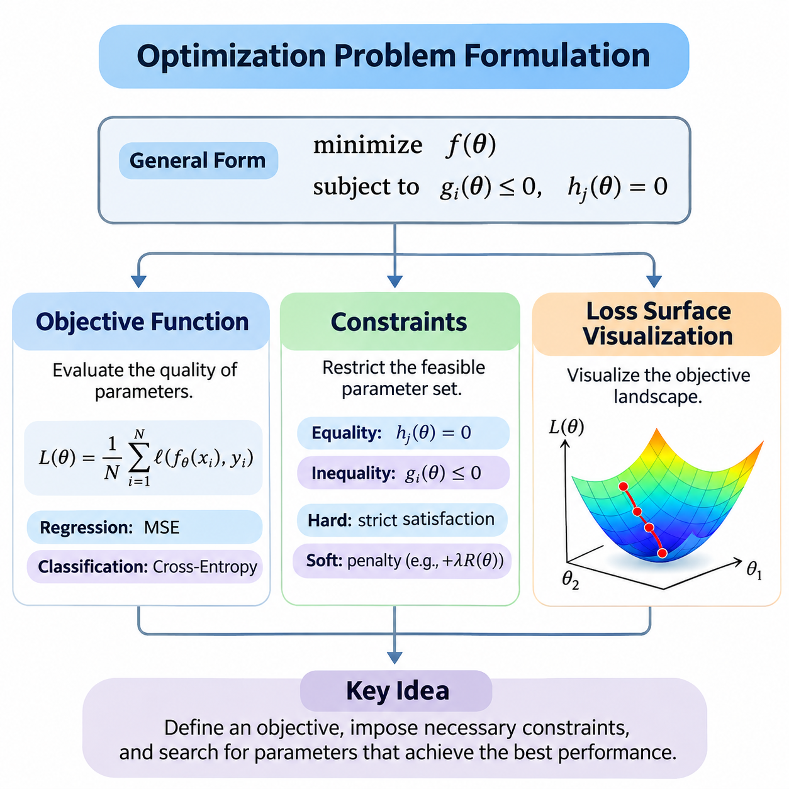
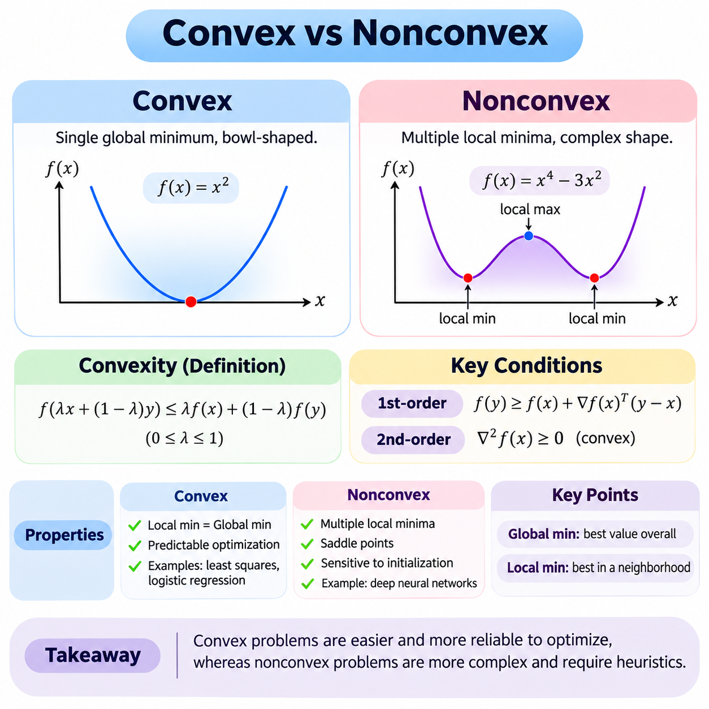
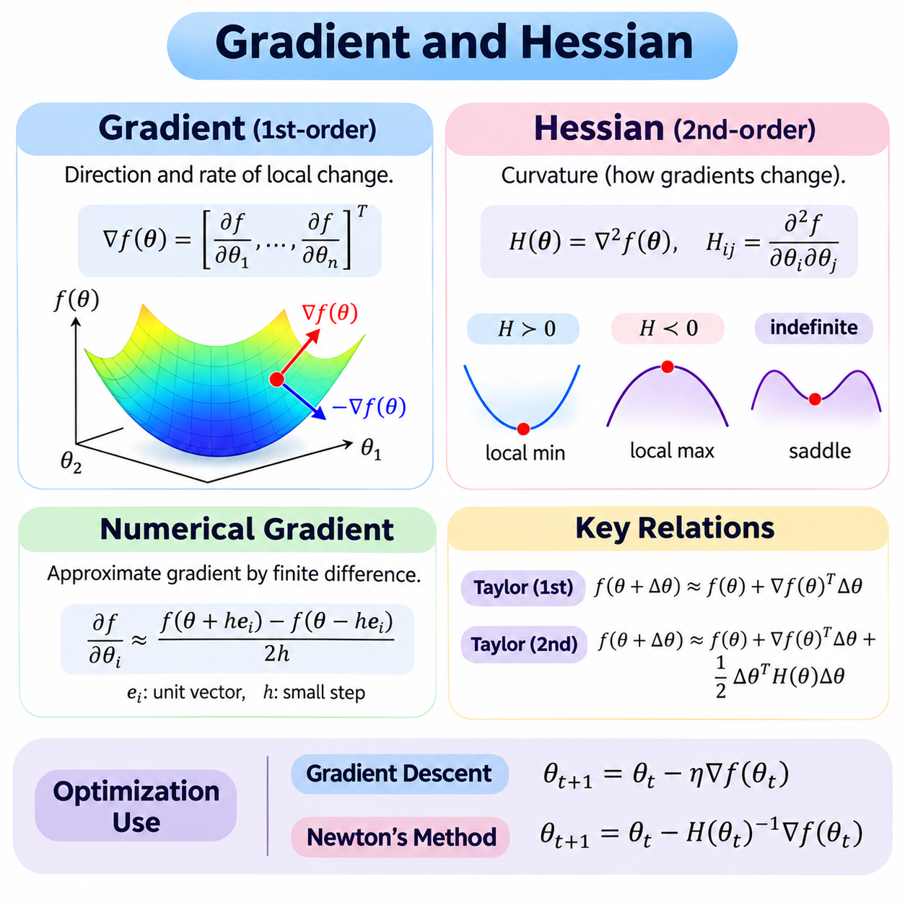
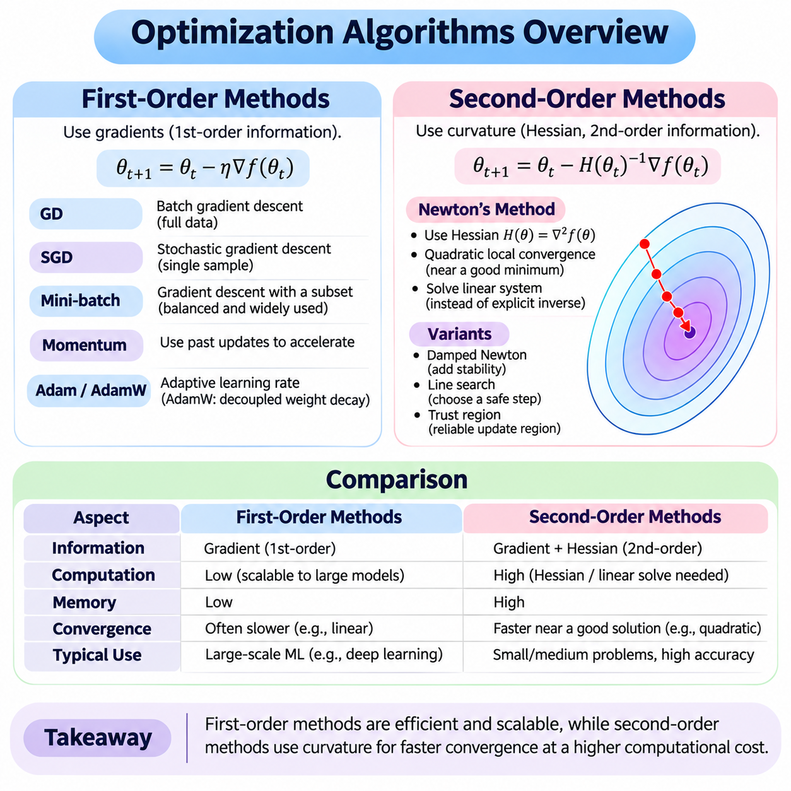
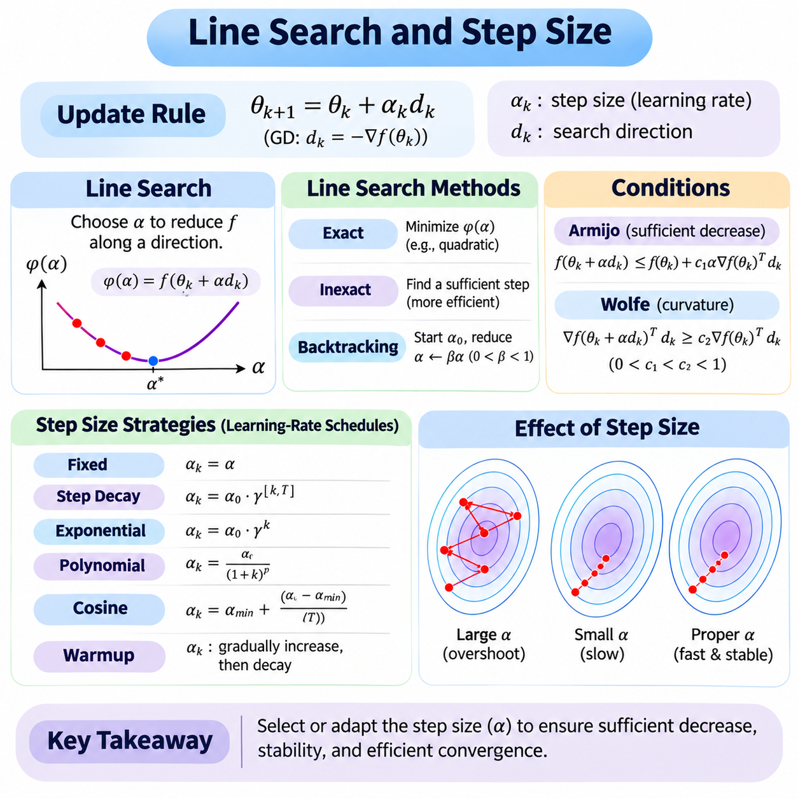
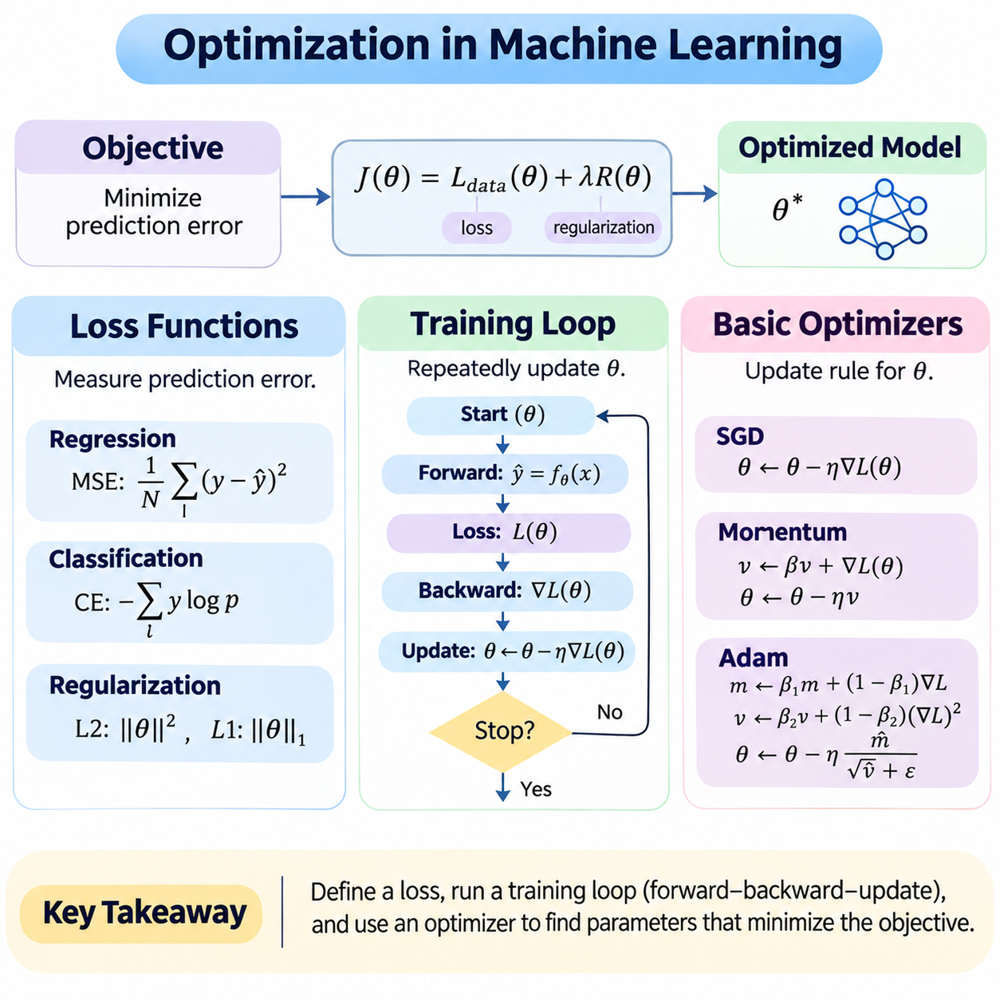

# 01. Optimization Basics

## 01.00 Optimization Problem Formulation

{width="7.268055555555556in" height="7.268055555555556in"}

최적화(Optimization)는 기계학습(Machine Learning)의 기본적인 수학적 프레임워크(Mathematical Framework)로, 원하는 목표를 달성하는 모델 매개변수(Model Parameters)를 체계적으로 식별하는 방법을 제공한다. 학습(Training) 과정에서 학습 알고리즘(Learning Algorithm)은 매개변수 공간(Parameter Space)을 탐색하여 예측 오차(Prediction Error)를 최소화하거나 성능 지표(Performance Measure)를 최대화한다. 이러한 과정을 수학적으로 정식화하는 것은 필수적이다. 목적함수(Objective Function), 제약조건(Constraints), 탐색 공간(Search Space)의 구조가 허용 가능한 해(Solution)와 이를 얼마나 효율적으로 찾을 수 있는지를 결정하기 때문이다.

최적화 문제(Optimization Problem)는 결정변수(Decision Variables), 목적함수(Objective Function), 그리고 필요한 경우 제약조건(Constraints)으로 구성된다. 기계학습에서 결정변수는 일반적으로 신경망(Neural Network)의 가중치(Weights)와 편향(Biases) 같은 학습 가능한 매개변수(Trainable Parameters)에 해당한다. 목적함수는 특정 매개변수 구성(Parameter Configuration)의 품질을 측정하며, 제약조건은 허용 가능한 해의 집합을 제한한다. 이러한 구성요소들은 최적화 알고리즘(Optimization Algorithm)이 해결해야 할 수학적 문제를 정의한다.

일반적인 제약 최적화 문제(Constrained Optimization Problem)는 gᵢ(θ) ≤ 0 및 hⱼ(θ) = 0이라는 조건 아래에서 f(θ)를 최소화하는 형태로 표현할 수 있으며, 여기서 θ는 매개변수 벡터(Parameter Vector)를 나타낸다. 함수 f는 최적화 목적을 정의하고, gᵢ와 hⱼ는 각각 부등식 제약조건(Inequality Constraints)과 등식 제약조건(Equality Constraints)을 나타낸다. 명시적인 제약조건이 없다면 비제약 최적화(Unconstrained Optimization) 문제가 되지만, 목적함수와 모델 아키텍처(Model Architecture)는 여전히 가능한 해에 암묵적인 제한을 부과할 수 있다.

목적함수(Objective Function)는 모델의 동작과 최적화 과정 사이에 정량적인 연결 관계를 제공한다. 지도학습(Supervised Learning)에서는 일반적으로 예측 출력(Predicted Outputs)과 정답 레이블(Ground-Truth Labels) 사이의 불일치를 측정한다. N개의 관측값(Observations)을 포함하는 데이터셋(Dataset)에 대해 경험적 위험(Empirical Risk)은 L(θ) = (1/N)Σᵢ ℓ(fθ(xᵢ), yᵢ)로 표현할 수 있으며, 여기서 ℓ은 개별 예측 손실(Prediction Loss)을 나타낸다. 이러한 평균 손실을 최소화하면 모델이 학습 데이터에서 관찰된 패턴을 재현하도록 유도할 수 있다.

서로 다른 학습 작업(Learning Tasks)은 예측 오차가 갖는 수학적 의미가 다르므로 서로 다른 목적함수를 필요로 한다. 평균제곱오차(Mean Squared Error)는 예측값과 목표값 사이의 편차를 제곱하여 벌점을 부과하므로 회귀(Regression) 문제에서 널리 사용된다. 교차 엔트로피(Cross-Entropy)는 예측 확률분포(Predicted Probability Distribution)를 실제 레이블과 비교하여 평가하므로 분류(Classification) 문제에서 일반적으로 사용된다. 따라서 적절한 목적함수를 선택하려면 모델의 통계적 가정(Statistical Assumptions)과 예측 오차가 실제 응용에서 갖는 영향을 함께 이해해야 한다.

목적함수의 수학적 특성(Mathematical Properties)은 최적화 동작(Optimization Behavior)에 큰 영향을 미친다. 연속성(Continuity)은 매개변수의 작은 변화가 목적함수 값의 작은 변화를 발생시키는지를 설명하며, 미분 가능성(Differentiability)은 경사 기반 방법(Gradient-Based Methods)이 국소적인 개선 방향을 계산할 수 있는지를 결정한다. 볼록성(Convexity)은 국소해(Local Solution)와 전역해(Global Solution)의 관계에 대해 더욱 강력한 보장을 제공한다. 심층 신경망(Deep Neural Networks)은 일반적으로 비볼록 목적함수(Nonconvex Objective Functions)를 형성하므로 단순한 이차함수(Quadratic Function)의 최소화보다 최적화가 훨씬 복잡해진다.

목적함수는 서로 경쟁하는 요구사항을 나타내는 여러 항(Terms)으로 구성될 수 있다. 예를 들어, 학습 시스템(Learning System)은 예측 오차를 최소화하면서 지나치게 큰 매개변수 값이나 계산 복잡도(Computational Complexity)에 벌점을 부과할 수 있다. 결합 목적함수(Combined Objective Function)는 J(θ) = Ldata(θ) + λR(θ)로 표현할 수 있으며, 여기서 R은 정규화 항(Regularization Term)을 나타내고 λ는 그 기여도를 제어한다. 이러한 정식화는 최적화가 데이터 적합(Data Fitting)과 특정 모델 특성에 대한 선호 사이의 균형을 조절할 수 있음을 보여준다.

학습 손실(Training Loss)을 최소화하는 것과 유용한 예측 성능(Predictive Performance)을 달성하는 것 사이의 차이는 특히 중요하다. 모델은 경험적 목적함수(Empirical Objective Function)에서 매우 낮은 값을 얻더라도 이전에 관찰하지 않은 데이터에서는 낮은 성능을 보일 수 있다. 이는 최적화가 일반화 가능한 패턴(Generalizable Patterns)보다 잡음(Noise)이나 데이터셋에 특화된 관계를 학습할 때 발생한다. 따라서 목적함수를 정식화할 때는 의도한 응용 분야, 사용 가능한 데이터, 학습 측정값과 실제 환경 성능 사이의 관계를 고려해야 한다.

제약조건(Constraints)은 최적화가 수행될 수 있는 실행 가능 영역(Feasible Region)을 정의한다. 수학적으로 실행 가능 집합(Feasible Set)은 지정된 모든 등식 및 부등식 조건을 만족하는 매개변수 구성의 집합이다. 최적화기(Optimizer)는 이러한 제한을 위반하지 않으면서 목적함수를 최소화하는 해를 찾아야 한다. 제약조건은 물리적 한계(Physical Limitations), 자원 예산(Resource Budgets), 매개변수 관계(Parameter Relationships), 안전 요구사항(Safety Requirements), 또는 최적화 과정에서 반드시 유지되어야 하는 기타 조건을 나타낼 수 있다.

등식 제약조건(Equality Constraints)은 확률의 합이 1이 되어야 하는 조건처럼 특정 수학적 관계가 정확하게 성립하도록 요구한다. 부등식 제약조건(Inequality Constraints)은 매개변수 노름(Parameter Norm)을 제한하거나 전체 자원 소비량을 제한하는 것처럼 상한 또는 하한을 설정한다. 실제 기계학습 시스템에서는 지연시간(Latency), 메모리 사용량(Memory Usage), 에너지 소비량(Energy Consumption), 모델 크기(Model Size) 등을 제한할 수도 있다. 이러한 요구사항은 임베디드 하드웨어(Embedded Hardware)나 자원 제약 장치(Resource-Constrained Devices)에 학습된 모델을 배포할 때 특히 중요하다.

경성 제약조건(Hard Constraints)과 연성 제약조건(Soft Constraints)은 최적화를 제어하는 서로 다른 두 가지 접근방식이다. 경성 제약조건은 목적함수 값과 관계없이 지정된 조건을 위반하는 모든 해를 배제한다. 반면 연성 제약조건은 바람직하지 않은 동작에 벌점(Penalty)을 부과하여 최적화기가 다른 성능 개선과 제약조건 위반 사이의 절충(Trade-off)을 허용하도록 한다. 벌점 기반 정식화(Penalty-Based Formulation)는 일반적인 학습 알고리즘에 통합하기 쉬운 경우가 많지만, 원래 요구사항의 정확한 충족을 자동으로 보장하지는 않는다.

제약 최적화(Constrained Optimization)는 라그랑주 정식화(Lagrangian Formulation)를 사용하여 분석할 수도 있다. 부등식 제약조건을 갖는 문제에서 라그랑주 함수(Lagrangian Function)는 목적함수와 가중치가 적용된 제약함수를 결합하며, 일반적으로 L(θ, λ) = f(θ) + Σᵢ λᵢgᵢ(θ)로 표현된다. 여기서 λᵢ ≥ 0이며, 이러한 승수(Multipliers)는 제약조건이 최적화 목적에 미치는 영향을 나타낸다. 적절한 정칙성 조건(Regularity Conditions) 아래에서 카루시--쿤--터커 조건(Karush--Kuhn--Tucker Conditions)은 실행 가능성(Feasibility), 정상성(Stationarity), 상보적 여유성(Complementary Slackness)을 통해 최적해 후보를 특징짓는다.

실행 가능성(Feasibility)은 목적함수 최소화와 독립적으로 고려해야 한다. 모든 제약조건을 동시에 만족하는 매개변수 구성이 존재하지 않으면 해당 최적화 문제는 실행 불가능(Infeasible)하다. 실행 가능한 해가 존재하더라도 지나치게 제한적인 조건은 모델이 충분한 예측 정확도(Prediction Accuracy)를 달성하지 못하게 만들 수 있다. 따라서 엔지니어는 요구사항들이 서로 양립 가능한지, 그리고 실행 가능 영역에 의도한 운영 목표(Operational Objectives)를 만족할 수 있는 해가 존재하는지를 검토해야 한다.

로보틱스(Robotics)와 자율 시스템(Autonomous Systems)에서 최적화 제약조건은 물리적 동역학(Physical Dynamics)과 안전 요구사항에서 자주 발생한다. 동작 계획 모델(Motion Planning Model)은 속도(Velocity), 가속도(Acceleration), 장애물 회피(Obstacle Avoidance) 제한을 준수하면서 이동 시간이나 에너지 소비를 최소화할 수 있다. 마찬가지로 임베디드 인지 모델(Embedded Perception Model)은 엄격한 메모리 및 추론 지연시간(Inference Latency) 예산 아래에서 인식 정확도(Recognition Accuracy)를 최적화할 수 있다. 이러한 사례는 최적화가 예측 정확도뿐 아니라 시스템 수준의 실행 가능성(System-Level Feasibility)까지 고려해야 하는 이유를 보여준다.

손실 표면(Loss Surface)은 서로 다른 매개변수 구성에 따른 목적함수의 값을 기하학적으로 해석할 수 있도록 한다. 매개변수 공간의 각 지점은 특정 모델 구성을 나타내며, 해당 지점의 높이는 목적함수 값을 의미한다. 따라서 최적화는 충분히 낮은 손실을 갖는 위치를 찾기 위해 이러한 지형을 탐색하는 과정으로 이해할 수 있다. 손실 표면의 기하학적 구조(Geometric Structure)는 특정 최적화 방법이 빠르게 수렴하는 반면 다른 방법은 진행 속도가 느려지거나 불안정한 동작을 보이는 이유를 설명하는 데 도움이 된다.

두 개의 학습 가능한 매개변수를 포함하는 모델에서는 손실 표면을 두 개의 매개변수 축(Parameter Axes)과 하나의 손실 축(Loss Axis)으로 구성된 3차원 함수(Three-Dimensional Function)로 표현할 수 있다. 등고선 표현(Contour Representation)은 동일한 목적함수 값을 생성하는 매개변수 조합을 연결하여 다른 관점을 제공한다. 원형 등고선(Circular Contours)은 일반적으로 서로 다른 방향에서 유사한 곡률 규모(Curvature Scale)를 나타내는 반면, 길게 늘어난 등고선(Elongated Contours)은 방향에 따른 차이를 의미하며 최적화 경로(Optimization Trajectory)를 복잡하게 만들 수 있다.

손실 표면에는 계곡(Valleys), 평탄 영역(Flat Regions), 안장점(Saddle Points), 여러 국소 최솟값(Local Minima)이 존재할 수 있다. 국소 최솟값(Local Minimum)은 충분히 가까운 실행 가능 지점들보다 목적함수 값이 크지 않은 지점이며, 전역 최솟값(Global Minimum)은 전체 실행 가능 영역에서 가장 작은 값을 달성하는 지점이다. 안장점은 서로 다른 방향에서 상이한 곡률 특성(Curvature Characteristics)을 나타낸다. 고차원 신경망(High-Dimensional Neural Networks)에서는 이러한 기하학적 구조가 학습 동작에 영향을 미치며, 최적화 경로가 느려지거나 초기화(Initialization)에 민감해지는 이유를 설명하는 데 도움이 된다.

기울기(Gradient)는 미분 가능한 목적함수에서 함수 값이 가장 빠르게 증가하는 국소 방향을 나타낸다. 충분히 작은 보폭(Step Size)을 사용할 경우 기울기의 반대 방향으로 이동하는 것은 일반적으로 손실을 감소시키는 일차 전략(First-Order Strategy)이 된다. 헤시안 행렬(Hessian Matrix)은 이차 곡률(Second-Order Curvature)을 설명하며, 매개변수 공간에서 기울기가 어떻게 변화하는지를 보여준다. 이러한 수학적 요소들은 손실 표면의 기하학적 구조와 최적화 알고리즘의 동작 및 수렴 특성(Convergence Characteristics)을 연결한다.

모델의 차원(Dimensionality)이 증가할수록 손실 표면 시각화(Loss Surface Visualization)는 더욱 어려워진다. 현대 신경망은 수백만 개에서 수십억 개의 학습 가능한 매개변수를 포함할 수 있으므로 직접적인 기하학적 표현은 불가능하다. 일반적인 접근방식은 매개변수 공간에서 두 방향을 선택하고 기준 매개변수 벡터(Reference Parameter Vector) 주변의 섭동(Perturbations)을 격자(Grid) 형태로 적용하여 목적함수를 평가하는 것이다. 이렇게 얻은 2차원 단면(Two-Dimensional Slice)은 해석 가능한 근사 표현을 제공하지만, 원래 고차원 목적함수의 전체 기하학적 구조를 포착할 수는 없다.

시각화 방향(Visualization Directions)의 선택은 손실 표면의 외형에 상당한 영향을 미친다. 무작위 방향(Random Directions), 정규화된 방향(Normalized Directions), 최적화 경로에서 도출된 방향은 서로 다른 기하학적 특성을 드러낼 수 있다. 매개변수 스케일링(Parameter Scaling) 역시 모델이나 계층(Layers) 사이의 비교를 왜곡할 수 있다. 따라서 시각화 결과를 해석할 때는 표시된 표면이 전체 최적화 지형의 완전한 설명이 아니라 제한된 투영(Restricted Projection)이라는 점을 인식해야 한다.

실용적인 시각화 실험(Visualization Experiment)은 가중치(Weight)와 편향(Bias)을 포함하는 단순한 선형 회귀 모델(Linear Regression Model)에서 시작할 수 있다. 후보 매개변수 값의 격자에 대해 평균제곱오차(Mean Squared Error)를 평가하면, 설계 행렬(Design Matrix)이 완전 열 계수(Full Column Rank)를 갖는 경우 손실 표면은 일반적으로 볼록한 이차 곡면(Convex Quadratic Bowl)을 형성한다. 최솟값은 최소제곱해(Least-Squares Solution)를 나타낸다. 이 기본적인 사례는 매개변수 선택, 목적함수 평가, 곡률, 최적점의 수학적 정의 사이의 관계를 직관적으로 이해하도록 돕는다.

두 번째 실험에서는 비선형 활성화 함수(Nonlinear Activation Functions)를 사용하는 소규모 신경망(Small Neural Network)을 활용할 수 있다. 다른 매개변수를 고정한 상태에서 선택한 두 매개변수만 변화시키면 불규칙한 곡률과 비볼록 특성(Nonconvex Behavior)을 나타내는 표면이 형성될 수 있다. 이러한 지형을 이차 회귀 모델(Quadratic Regression Model)의 사례와 비교하면 비선형 모델 구조(Nonlinear Model Structure)가 최적화를 어떻게 복잡하게 만드는지 확인할 수 있다. 또한 모든 목적함수가 단순한 기하학적 형태를 갖는다고 가정하지 않고도 최적화 알고리즘이 효과적으로 작동해야 하는 이유를 이해할 수 있다.

손실 표면 분석(Loss Surface Analysis)은 디버깅(Debugging)과 학습 진단(Training Diagnostics)을 지원할 수 있다. 손실이 갑자기 증가하는 현상은 과도한 학습률(Learning Rate), 수치적 불안정성(Numerical Instability), 또는 부적절하게 스케일링된 특성(Features)을 나타낼 수 있다. 넓고 거의 평탄한 영역은 약한 기울기 신호(Weak Gradient Signals)에 해당할 수 있으며, 좁은 계곡은 신중한 보폭 선택을 요구할 수 있다. 그러나 예측 성능은 데이터 분포(Data Distributions)와 모델 특성에도 의존하므로 손실 표면의 기하학적 구조만으로 학습된 모델의 일반화 성능(Generalization Performance)을 확정할 수는 없다.

목적함수(Objectives), 제약조건(Constraints), 손실 지형(Loss Geometry) 사이의 상호작용은 최적화 문제의 실질적인 난이도를 결정한다. 수학적으로 단순한 목적함수도 실행 가능 영역이 복잡하면 해결하기 어려워질 수 있으며, 비볼록 목적함수도 실용적인 반복 알고리즘(Iterative Algorithms)을 통해 유용한 해를 얻을 수 있다. 성공적인 정식화(Formulation)를 위해서는 의미 있는 성능 지표(Performance Measures)를 식별하고, 운영상의 제한을 정확하게 표현하며, 매개변수 변화가 목적함수 값에 어떤 영향을 미치는지 이해해야 한다.

실제 기계학습 개발(Real-World Machine Learning Development)에서는 알고리즘 선택(Algorithm Selection)에 앞서 최적화 문제의 정식화(Optimization Problem Formulation)가 이루어져야 한다. 엔지니어는 먼저 모델이 달성해야 할 목표, 조정 가능한 변수, 반드시 충족해야 할 제약조건, 성공 여부를 측정하는 방법을 확립해야 한다. 그 이후에 적절한 최적화 방법(Optimization Method)을 선택할 수 있다. 이러한 체계적인 접근방식(Systematic Approach)은 학습을 단순한 수치 계산 절차(Numerical Procedure)에서 수학적 목표와 신뢰할 수 있는 인공지능 시스템(Reliable Artificial Intelligence Systems)을 연결하는 체계적인 과정으로 발전시킨다.

## 01.01 Convex vs NonConvex

{width="7.268055555555556in" height="7.268055555555556in"}

볼록성(Convexity)은 목적함수(Objective Function)의 구조와 최적해(Optimal Solution)를 찾는 신뢰성을 결정하기 때문에 수학적 최적화(Mathematical Optimization)에서 기본적인 특성이다. 볼록 최적화 문제(Convex Optimization Problems)는 적절한 조건에서 국소 최적화 방법(Local Optimization Methods)이 전역 최적해(Globally Optimal Solutions)를 찾을 수 있도록 하는 유리한 기하학적 특성(Geometric Properties)을 갖는다. 반면 비볼록 최적화 문제(Nonconvex Optimization Problems)는 여러 국소 최솟값(Local Minima), 안장점(Saddle Points), 복잡한 손실 지형(Loss Landscapes)을 포함할 수 있어 최적화가 더욱 어려워진다.

볼록함수(Convex Function)는 볼록 정의역(Convex Domain)에서 정의되며, 정의역 내부의 임의의 두 점을 연결하는 선분(Line Segment)이 완전히 해당 정의역 안에 존재한다. 수학적으로 함수 f가 볼록하려면 임의의 두 점 x와 y, 그리고 0과 1 사이의 모든 λ에 대해 f(λx + (1 − λ)y) ≤ λf(x) + (1 − λ)f(y)를 만족해야 한다. 이 부등식(Inequality)은 두 점을 연결하는 선분 위의 함수값이 양 끝점의 함수값을 선형 보간(Linear Interpolation)한 값보다 크지 않음을 의미한다.

볼록성의 기하학적 해석(Geometric Interpretation)은 최적화 동작(Optimization Behavior)을 직관적으로 이해하는 방법을 제공한다. 일차원 볼록함수(One-Dimensional Convex Function)에서는 그래프 위의 임의의 두 점을 연결하는 직선이 두 점 사이에서 함수 그래프 위에 있거나 그보다 높은 위치에 존재한다. 대표적인 예는 이차함수(Quadratic Function) f(x) = x²이며, 매끄러운 그릇 모양의 곡선(Bowl-Shaped Curve)을 형성한다. 최솟값은 x = 0에서 발생하고, 변수가 이 최적 위치에서 멀어질수록 함수값은 증가한다.

볼록함수는 미분 가능(Differentiable)하거나 미분 불가능(Nondifferentiable)할 수 있으며, 이러한 차이는 적용 가능한 최적화 기법(Optimization Techniques)에 영향을 미친다. 미분 가능한 볼록함수에 대한 일차 볼록성 조건(First-Order Convexity Condition)은 f(y) ≥ f(x) + ∇f(x)ᵀ(y − x)로 표현된다. 이는 접평면(Tangent Hyperplane)이 함수에 대한 전역 하한(Global Lower Bound)을 제공한다는 의미이다. 따라서 비제약 정의역(Unconstrained Domain) 내부에서 기울기(Gradient)가 0인 정상점(Stationary Point)은 전역 최솟값을 갖는 지점이 된다.

열린 볼록 정의역(Open Convex Domain)에서 정의된 이계 미분 가능 함수(Twice-Differentiable Function)의 경우, 볼록성은 모든 지점에서 헤시안 행렬(Hessian Matrix)이 양의 준정부호(Positive Semidefinite)를 갖는 조건과 동치이다. 헤시안은 이차 곡률(Second-Order Curvature)을 설명하며 매개변수 공간(Parameter Space)에서 기울기가 어떻게 변화하는지를 나타낸다. 양의 준정부호 헤시안은 어떤 방향으로도 함수가 아래쪽으로 휘어지지 않음을 의미한다. 모든 지점에서 양의 정부호(Positive Definiteness)를 갖는 것은 엄격 볼록성(Strict Convexity)을 보장하는 충분조건이며, 최솟값이 존재할 경우 그 유일성(Uniqueness)을 보장한다.

엄격 볼록성(Strict Convexity)은 서로 다른 두 점을 0과 1 사이의 보간 계수(Interpolation Coefficient)로 결합할 때 볼록성 정의의 부등식이 엄격하게 성립하도록 요구함으로써 일반적인 볼록성을 강화한다. 엄격 볼록함수(Strictly Convex Function)는 최대 하나의 전역 최솟값(Global Minimizer)만 가질 수 있지만, 최솟값의 존재 자체가 자동으로 보장되지는 않는다. 강한 볼록성(Strong Convexity)은 곡률에 추가적인 정량적 하한(Quantitative Lower Bound)을 부과하며, 최적화 알고리즘의 수렴 보장(Convergence Guarantees)을 강화하는 데 활용된다.

볼록 최적화(Convex Optimization)는 전통적인 기계학습(Classical Machine Learning)에서 자주 등장한다. 일반 최소제곱 회귀(Ordinary Least Squares Regression)는 볼록 이차 목적함수(Convex Quadratic Objective)를 최소화하며, 선형 예측기(Linear Predictor)를 사용하는 로지스틱 회귀(Logistic Regression)는 볼록한 음의 로그우도 목적함수(Negative Log-Likelihood Objective)를 사용한다. 서포트 벡터 머신(Support Vector Machine) 역시 표준적인 가정 아래에서 볼록 정식화(Convex Formulation)를 활용한다. 이러한 특성은 수렴 분석(Convergence Analysis), 최적성 조건(Optimality Conditions)의 확립, 예측 가능한 수학적 동작을 갖는 알고리즘 설계를 가능하게 한다.

비볼록함수(Nonconvex Function)는 정의역 전체에서 볼록성 부등식(Convexity Inequality)을 만족하지 않는다. 함수 그래프에는 여러 계곡(Valleys), 봉우리(Peaks), 평탄 영역(Flat Regions), 변수 사이의 복잡한 상호작용이 존재할 수 있다. 간단한 예는 f(x) = x⁴ − 3x²이며, 하나의 국소 최댓값(Local Maximum)을 사이에 두고 두 개의 국소 최솟값(Local Minima)이 존재한다. 볼록함수와 달리 비볼록 목적함수(Nonconvex Objective)는 초기화(Initialization)와 알고리즘 설정(Algorithm Configuration)에 따라 서로 다른 최적화 경로(Optimization Trajectories)를 통해 서로 다른 해로 수렴할 수 있다.

비볼록성(Nonconvexity)은 신경망(Neural Networks)이 여러 계층(Layers)에 걸쳐 비선형 변환(Nonlinear Transformations)을 결합하기 때문에 딥러닝(Deep Learning)에서 특히 중요하다. 결과적으로 손실함수(Loss Functions)는 가중치(Weights), 편향(Biases), 활성화 함수(Activation Functions), 학습 데이터(Training Examples) 사이의 복잡한 상호작용에 의존한다. 개별 연산이 단순한 수학적 특성을 갖더라도 이들의 합성(Composition)은 일반적으로 비볼록 최적화 지형(Nonconvex Optimization Landscape)을 형성한다. 따라서 심층 신경망 학습에서는 전역 최솟값에 도달한다는 일반적인 보장을 제공하기 어렵다.

전역 최솟값(Global Minimum)과 국소 최솟값(Local Minimum)의 구분은 최적화 결과를 이해하는 데 핵심적이다. 전역 최솟값은 전체 실행 가능 영역(Feasible Domain)의 다른 어떤 지점보다 목적함수 값이 크지 않은 지점이다. 반면 국소 최솟값은 해당 위치의 특정 근방(Neighborhood)에서만 최적인 지점이다. 일반적인 근방의 정의에 따르면 모든 전역 최솟값은 국소 최솟값이기도 하지만, 목적함수가 비볼록인 경우 국소 최솟값이 반드시 전역적으로 최적인 것은 아니다.

볼록 실행 가능 영역(Convex Feasible Domain)에서 정의된 볼록함수(Convex Function)의 경우 모든 국소 최솟값은 전역 최솟값이기도 하다. 이는 볼록 최적화(Convex Optimization)의 가장 강력한 실용적 장점 중 하나이다. 최적화 알고리즘(Optimization Algorithm)은 서로 다른 국소 계곡을 구분할 필요가 없는데, 진정한 국소 최솟값이라면 이미 전역 최적성(Global Optimality)을 달성하기 때문이다. 그러나 수치적 수렴(Numerical Convergence)은 여전히 조건수(Conditioning), 보폭 선택(Step-Size Selection), 계산 정밀도(Computational Precision), 최적화 방법의 특성에 영향을 받는다.

비볼록함수(Nonconvex Function)는 서로 다른 목적함수 값을 갖는 여러 국소 최솟값(Local Minima)을 포함할 수 있다. 특정 계곡 근처에서 초기화된 최적화기(Optimizer)는 다른 위치의 더 나은 해를 발견하지 못한 채 가까운 최솟값으로 수렴할 수 있다. 이러한 동작은 초기조건(Initial Conditions)과 최적화 경로(Optimization Trajectories)에 대한 민감성을 발생시킨다. 무작위 재시작(Random Restarts), 확률적 최적화(Stochastic Optimization), 신중하게 설계된 초기화 전략(Initialization Strategies)은 탐색 성능을 향상시킬 수 있지만, 일반적으로 전역 최적성을 보장하지는 않는다.

안장점(Saddle Points)은 비볼록 최적화(Nonconvex Optimization)에서 또 다른 중요한 문제를 나타낸다. 안장점에서는 해당 위치가 국소 최솟값이 아니더라도 기울기(Gradient)가 0이 될 수 있다. 함수는 특정 방향에서는 증가하고 다른 방향에서는 감소할 수 있다. 이계 미분 가능 함수(Twice-Differentiable Function)에서 양수와 음수의 고윳값(Eigenvalues)을 모두 포함하는 헤시안 행렬(Hessian Matrix)은 엄격 안장점(Strict Saddle Point)을 식별한다. 이러한 영역은 주로 일차 기울기 정보(First-Order Gradient Information)에 의존하는 최적화 알고리즘의 진행 속도를 늦출 수 있다.

고차원 신경망(High-Dimensional Neural Networks)의 국소 최솟값은 신중하게 해석해야 한다. 서로 다른 매개변수 구성(Parameter Configurations)이 유사한 예측 동작(Predictive Behavior)을 생성할 수 있으며, 신경망 아키텍처(Neural Network Architectures)의 대칭성(Symmetries)은 여러 개의 동등한 해(Equivalent Solutions)를 만들어 낼 수 있다. 또한 낮은 학습 손실(Training Loss)이 반드시 우수한 일반화 성능(Generalization Performance)을 의미하지는 않는다. 따라서 해의 품질은 목적함수 값에만 의존하지 않고 검증 데이터(Validation Data)와 응용 분야별 평가 지표(Application-Specific Metrics)를 사용하여 평가해야 한다.

시각화(Visualization)는 볼록함수와 비볼록함수 사이의 기하학적 차이를 이해하는 효과적인 방법을 제공한다. 볼록 이차함수(Convex Quadratic Function)는 하나의 최솟값을 갖는 매끄러운 그릇 모양으로 표현할 수 있으며, 비볼록 다항함수(Nonconvex Polynomial Function)는 여러 계곡과 봉우리를 나타낼 수 있다. 이러한 표면을 비교하면 단순한 볼록 문제에서는 최적화 경로가 상대적으로 예측 가능하지만, 비볼록 문제에서는 초기화에 따라 경로가 민감하게 달라질 수 있는 이유를 이해할 수 있다.

2차원 등고선 그래프(Two-Dimensional Contour Plots)는 최적화 지형(Optimization Landscapes)을 표현하는 또 다른 유용한 방법이다. 양의 정부호 이차함수(Positive-Definite Quadratic Function)의 경우 등고선(Contour Lines)은 일반적으로 유일한 최솟값을 중심으로 중첩된 타원(Nested Ellipses)을 형성한다. 타원의 길게 늘어난 정도는 방향별 곡률 차이(Curvature Differences)를 반영한다. 크게 늘어난 등고선은 나쁜 조건 상태(Poor Conditioning)를 의미하며, 학습률(Learning Rate)과 매개변수 스케일링(Parameter Scaling)을 적절하게 선택하지 않으면 경사하강법(Gradient Descent)이 진동하거나 느리게 진행될 수 있다.

비볼록 등고선 그래프(Nonconvex Contour Plot)는 서로 분리된 여러 분지(Basins), 불규칙한 경계(Irregular Boundaries), 안장 영역(Saddle Regions)을 나타낼 수 있다. 서로 다른 초기 위치에서 시작한 최적화 경로는 서로 다른 끌림 분지(Basins of Attraction)로 이동할 수 있다. 등고선 위에 연속적인 매개변수 갱신(Parameter Updates)을 겹쳐 표시하면 수렴 동작(Convergence Behavior)을 조사하고 국소 기하학(Local Geometry)이 탐색 과정에 미치는 영향을 이해할 수 있다. 이러한 시각화는 교육용 실험(Educational Experiments)과 최적화기 디버깅(Optimizer Debugging)에 특히 유용하다.

실용적인 시각화 실험(Practical Visualization Experiment)에서는 f(x) = x²와 f(x) = x⁴ − 3x²를 비교할 수 있다. 첫 번째 함수는 볼록함수이며 x = 0에서 유일한 전역 최솟값(Unique Global Minimum)을 갖는다. 두 번째 함수는 비볼록함수이며 x = ±√(3/2)에서 동일한 값을 갖는 두 개의 전역 최솟값이 존재하고, x = 0은 국소 최댓값(Local Maximum)이다. 동일한 구간(Interval)에서 두 함수를 평가하면 단일 분지 목적함수(Single-Basin Objective)와 여러 최솟값을 포함하는 지형 사이의 구조적 차이를 확인할 수 있다.

두 개의 매개변수를 사용하는 예에서 볼록함수 f(x, y) = x² + 2y²는 타원형 등고선(Elliptical Contours)을 형성하며 원점(Origin)에서 유일한 전역 최솟값을 갖는다. 비볼록 대안 함수(Nonconvex Alternative)인 f(x, y) = (x² − 1)² + y²는 (−1, 0)과 (1, 0)에서 두 개의 전역 최솟값을 갖는다. 이러한 함수를 비교하면 함수가 매끄럽고 수학적으로 단순하더라도 최솟값의 개수와 배치가 최적화 경로(Optimization Trajectories)에 어떤 영향을 미치는지 이해할 수 있다.

신경망 손실 지형(Neural Network Loss Landscapes)을 시각화하려면 현대 모델이 매우 많은 매개변수를 포함하기 때문에 추가적인 기법이 필요하다. 한 가지 접근방식은 매개변수 공간(Parameter Space)에서 두 방향을 선택하고 학습된 매개변수 구성(Trained Parameter Configuration) 주변의 격자(Grid)에 대해 학습 손실(Training Loss)을 평가하는 것이다. 결과적으로 생성된 표면은 전체 목적함수의 저차원 단면(Low-Dimensional Slice)을 나타낸다. 이러한 시각화는 유용한 정보를 제공하지만 원래 고차원 지형의 전체 구조를 확정할 수는 없다.

최솟값의 날카로움(Sharpness)이나 평탄함(Flatness)은 국소 곡률(Local Curvature)을 통해 분석하는 경우가 많다. 날카로운 최솟값(Sharp Minima)은 선택된 섭동 방향(Perturbation Directions)에서 손실이 상대적으로 빠르게 증가하는 반면, 평탄한 최솟값(Flat Minima)은 비슷한 크기의 섭동에 대해 손실 변화가 작다. 이러한 관찰은 최적화 민감성(Optimization Sensitivity)을 이해하는 데 도움이 될 수 있지만, 일반화(Generalization)와의 관계가 보편적으로 성립하는 것은 아니다. 매개변수 스케일링(Parameter Scaling), 모델 대칭성(Model Symmetries), 선택된 측정 절차(Measurement Procedure)는 관찰되는 날카로움에 상당한 영향을 미칠 수 있다.

볼록 최적화(Convex Optimization)와 비볼록 최적화(Nonconvex Optimization)는 이론적 보장(Theoretical Guarantees)에서도 차이가 있다. 볼록 최적화는 적절한 가정 아래에서 최적성 조건(Optimality Conditions), 쌍대성(Duality), 수렴 속도(Convergence Rates)에 관한 강력한 결과를 제공한다. 반면 비볼록 최적화는 일반적으로 전역 최솟값보다 정상점(Stationary Points)으로의 수렴에 초점을 맞추는 상대적으로 약한 보장을 제공한다. 그럼에도 현대 최적화 알고리즘(Modern Optimization Algorithms)은 심층 신경망 학습을 포함한 대규모 비볼록 문제에서 매우 효과적인 해를 생성할 수 있다.

볼록성(Convexity)을 이해하면 엔지니어가 적절한 알고리즘을 선택하고 학습 동작(Training Behavior)을 해석하는 데 도움이 된다. 볼록 목적함수(Convex Objectives)는 수학적 예측 가능성(Mathematical Predictability)을 제공하는 반면, 비볼록 목적함수(Nonconvex Objectives)는 복잡한 비선형 관계(Nonlinear Relationships)를 표현할 수 있는 유연성을 제공한다. 그러나 어느 한 특성만으로 실제 모델 품질(Practical Model Quality)이 결정되지는 않는다. 효과적인 기계학습(Effective Machine Learning)을 위해서는 목적함수 설계(Objective Design), 수치 최적화(Numerical Optimization), 초기화(Initialization), 검증(Validation), 계산상의 고려사항(Computational Considerations)을 결합하여 수학적으로 의미 있고 실제 운영에서도 유용한 해를 얻어야 한다.

## 01.02 Gradient and Hessian

{width="7.268055555555556in" height="7.268055555555556in"}

기울기(Gradient)와 헤시안(Hessian)은 최적화(Optimization) 과정에서 목적함수(Objective Function)의 동작을 이해하기 위한 기본적인 수학적 도구(Mathematical Tools)이다. 기울기는 국소적인 변화의 방향과 변화율을 설명하며, 헤시안은 목적함수 지형(Objective Landscape)의 곡률(Curvature)을 나타낸다. 이들은 각각 일차 정보(First-Order Information)와 이차 정보(Second-Order Information)를 제공하여 최적화 알고리즘(Optimization Algorithms)이 정상점(Stationary Points)을 향해 이동하도록 안내하고, 수렴 속도(Convergence Speed), 수치적 안정성(Numerical Stability), 매개변수 변화에 대한 민감도(Sensitivity)를 이해하는 데 도움을 준다.

미분 가능한 스칼라 함수(Differentiable Scalar Function) f(θ)에서 θ가 모델 매개변수(Model Parameters)의 벡터를 나타낼 때, 기울기는 ∇f(θ) = [∂f/∂θ₁, ∂f/∂θ₂, \..., ∂f/∂θₙ]ᵀ로 정의된다. 각 성분은 다른 매개변수를 고정한 상태에서 특정 매개변수에 대한 목적함수의 편미분(Partial Derivative)을 나타낸다. 따라서 기울기는 매개변수 공간(Parameter Space)의 특정 위치에서 개별 매개변수의 작은 변화가 목적함수 값에 어떤 영향을 미치는지를 요약한다.

기하학적으로 기울기(Gradient)는 유클리드 거리 척도(Euclidean Distance Metric)에서 국소적으로 함수값이 가장 빠르게 증가하는 방향을 가리킨다. 반대 방향인 음의 기울기(Negative Gradient)는 충분히 작은 보폭(Step Size)에 대해 가장 빠른 일차 감소 방향(First-Order Decrease Direction)을 제공한다. 기울기의 크기(Gradient Magnitude)는 매개변수 섭동(Parameter Perturbations)에 대한 목적함수의 국소 민감도를 나타낸다. 큰 기울기는 빠른 변화를 의미하고, 작은 기울기는 주변 방향에서 함수값이 천천히 변한다는 것을 의미하지만, 반드시 최솟값에 가깝다는 뜻은 아니다.

경사하강법(Gradient Descent)은 이러한 정보를 사용하여 θₜ₊₁ = θₜ − η∇f(θₜ)에 따라 매개변수를 반복적으로 갱신하며, 여기서 η는 학습률(Learning Rate)을 나타낸다. 학습률은 매개변수가 음의 기울기 방향으로 얼마나 멀리 이동하는지를 결정한다. 학습률이 지나치게 크면 최적화 과정에서 유리한 영역을 지나치거나 발산(Divergence)할 수 있다. 반대로 너무 작으면 특히 목적함수의 기울기가 약한 영역에서 수렴(Convergence)이 불필요하게 느려질 수 있다.

기울기는 테일러 전개(Taylor Expansion)를 통해 목적함수의 일차 근사(First-Order Approximation)를 제공한다. 이는 f(θ + Δθ) ≈ f(θ) + ∇f(θ)ᵀΔθ로 표현된다. 이 식은 전체 함수를 다시 평가하지 않고도 작은 매개변수 섭동(Parameter Perturbation)이 목적함수 값을 얼마나 변화시키는지 추정한다. 이러한 국소 근사(Local Approximation)는 기울기 기반 최적화(Gradient-Based Optimization)의 수학적 기초를 형성하며, 전체 목적함수 지형을 알지 못하더라도 도함수(Derivatives)를 통해 반복적인 개선을 수행할 수 있는 이유를 설명한다.

정상점(Stationary Point)은 기울기가 0이 되는 지점으로, 무한소 변화(Infinitesimal Change)에 대해 일차적인 함수값 변화가 발생하지 않음을 의미한다. 그러나 정상점은 국소 최솟값(Local Minimum), 국소 최댓값(Local Maximum), 또는 안장점(Saddle Point)에 해당할 수 있다. 따라서 기울기가 0이라는 사실만으로 최적성(Optimality)이 성립한다고 판단할 수 없다. 이러한 경우를 구분하고 국소 기하학(Local Geometry)을 이해하려면 곡률(Curvature)이나 고차 동작(Higher-Order Behavior)에 대한 추가 정보가 필요하다.

기계학습(Machine Learning)에서 기울기는 일반적으로 계산 그래프(Computational Graph)에 연쇄법칙(Chain Rule)을 적용하는 역전파(Backpropagation)를 통해 계산된다. 각 연산은 국소 도함수(Local Derivatives)를 제공하며, 이 값들이 결합되어 모델 매개변수에 대한 손실의 민감도(Loss Sensitivity)를 계산한다. 자동 미분 프레임워크(Automatic Differentiation Frameworks)는 이러한 과정을 효율적으로 구현하여 수백만 개의 매개변수를 가진 신경망(Neural Networks)에서도 모든 편미분을 직접 유도하지 않고 기울기를 계산할 수 있도록 한다.

헤시안(Hessian)은 일차 도함수(First-Order Derivatives)가 매개변수 공간에서 어떻게 변화하는지를 설명함으로써 기울기 분석을 확장한다. 이계 미분 가능한 스칼라 함수(Twice-Differentiable Scalar Function)에 대해 헤시안은 H(θ) = ∇²f(θ)로 정의되는 행렬이며, 각 원소는 Hᵢⱼ = ∂²f/(∂θᵢ∂θⱼ)로 표현된다. 대각 원소(Diagonal Elements)는 개별 매개변수 방향의 곡률을 설명하고, 비대각 원소(Off-Diagonal Elements)는 매개변수 쌍 사이의 상호작용을 나타낸다. 적절한 매끄러움 조건(Smoothness Conditions) 아래에서 헤시안은 대칭 행렬(Symmetric Matrix)이 된다.

헤시안은 이차 테일러 근사(Second-Order Taylor Approximation)인 f(θ + Δθ) ≈ f(θ) + ∇f(θ)ᵀΔθ + (1/2)ΔθᵀH(θ)Δθ에 나타난다. 일차 근사와 달리 이 식은 국소 곡률(Local Curvature)을 포함하여 목적함수가 서로 다른 방향에서 어떻게 휘어지는지를 설명할 수 있다. 이차 정보(Second-Order Information)는 최적화 지형(Optimization Landscape)에 좁은 계곡(Narrow Valleys), 크게 달라지는 곡률, 또는 기울기만을 사용하는 갱신을 비효율적으로 만드는 상호작용이 존재할 때 특히 유용하다.

헤시안의 고윳값(Eigenvalues)과 고유벡터(Eigenvectors)는 곡률을 기하학적으로 해석할 수 있도록 한다. 양의 고윳값(Positive Eigenvalues)은 해당 고유벡터 방향에서 위쪽으로 휘어지는 곡률을 의미하며, 음의 고윳값(Negative Eigenvalues)은 아래쪽으로 휘어지는 곡률을 나타낸다. 고윳값이 0이면 평가 지점에서 해당 방향의 이차 곡률이 존재하지 않음을 의미한다. 고윳값의 크기가 크게 다르면 방향에 따라 최적화 민감도가 상당히 달라지는 이방성 기하학(Anisotropic Geometry)이 존재함을 알 수 있다.

정상점(Stationary Point)에서 양의 정부호 헤시안(Positive-Definite Hessian)은 엄격한 국소 최솟값(Strict Local Minimum)을 보장하며, 음의 정부호 헤시안(Negative-Definite Hessian)은 엄격한 국소 최댓값(Strict Local Maximum)을 보장한다. 양수와 음수의 고윳값을 모두 포함하는 부정부호 헤시안(Indefinite Hessian)은 안장점(Saddle Point)을 식별한다. 양의 준정부호 헤시안(Positive-Semidefinite Hessian)만으로는 고차항(Higher-Order Terms)이 함수의 동작을 결정할 수 있기 때문에 국소 최솟값을 보장하지 않는다. 이러한 차이는 곡률 분석이 기울기만 사용하는 분석보다 더 많은 정보를 제공한다는 것을 보여준다.

이차 목적함수(Quadratic Objective) f(θ) = (1/2)θᵀAθ − bᵀθ에서 A가 대칭 행렬(Symmetric Matrix)이라면 기울기는 ∇f(θ) = Aθ − b이고 헤시안은 H(θ) = A이다. A가 양의 정부호(Positive Definite)이면 목적함수는 엄격 볼록함수(Strictly Convex Function)가 되며, 유일한 최솟값(Unique Minimizer) θ\\\* = A⁻¹b를 갖는다. 이 예는 기울기 방정식(Gradient Equations), 헤시안 곡률(Hessian Curvature), 볼록성(Convexity), 최적해(Optimal Solutions)의 수학적 특성 사이의 직접적인 관계를 보여준다.

이차 최적화 방법(Second-Order Optimization Methods)은 헤시안 정보를 활용하여 국소 곡률에 따라 매개변수 갱신을 조정한다. 뉴턴 방법(Newton\'s Method)은 헤시안이 역행렬을 가질 때 θₜ₊₁ = θₜ − H(θₜ)⁻¹∇f(θₜ)를 사용한다. 뉴턴 갱신(Newton Updates)은 곡률을 고려하므로 적절한 최솟값 근처에서 빠르게 수렴할 수 있다. 그러나 부정부호 헤시안(Indefinite Hessian)이나 조건 상태가 나쁜 헤시안(Poorly Conditioned Hessian)은 불안정하거나 바람직하지 않은 이동 방향을 생성할 수 있으므로 감쇠(Damping), 신뢰 영역(Trust Regions), 또는 기타 안정화 장치(Safeguards)가 필요하다.

모델의 차원(Dimensionality)이 증가할수록 전체 헤시안을 계산하고 저장하는 비용이 커진다. n개의 매개변수에 대해 헤시안은 n²개의 원소를 포함하므로 현대 신경망(Modern Neural Networks)에서는 명시적으로 구성하는 것이 비현실적인 경우가 많다. 헤시안-벡터 곱(Hessian-Vector Products)은 전체 행렬을 실제로 생성하지 않고 선택된 방향에 대한 곡률 정보를 계산하는 대안을 제공한다. 이러한 연산은 대규모 최적화 문제에서 확장 가능한 이차 근사(Scalable Second-Order Approximations)와 곡률 분석(Curvature Analysis)을 지원한다.

수치 기울기(Numerical Gradient)는 해석적 표현(Analytical Expressions)을 사용할 수 없거나 기울기 구현의 정확성을 검증해야 할 때 도함수를 근사하는 실용적인 방법을 제공한다. 유한차분법(Finite-Difference Methods)은 인접한 매개변수 값에서 목적함수를 평가하여 도함수를 추정한다. 전진차분 근사(Forward-Difference Approximation)는 ∂f/∂θᵢ ≈ [f(θ + εeᵢ) − f(θ)]/ε로 표현되며, 여기서 ε는 작은 섭동(Perturbation)을 나타내고 eᵢ는 매개변수 θᵢ에 해당하는 단위벡터(Unit Vector)이다.

중앙차분법(Central-Difference Method)은 매개변수의 양쪽에서 함수값을 평가하여 근사 정확도(Approximation Accuracy)를 향상시킨다. 수식은 ∂f/∂θᵢ ≈ [f(θ + εeᵢ) − f(θ − εeᵢ)]/(2ε)로 표현된다. 충분히 매끄러운 함수(Sufficiently Smooth Functions)에 대해 전진차분은 일차 절단오차(First-Order Truncation Error)를 갖는 반면, 중앙차분은 이차 절단오차(Second-Order Truncation Error)를 갖는다. 따라서 중앙차분은 소규모 계산 실험(Computational Experiments)에서 해석적 기울기(Analytical Gradients)를 검증하는 데 특히 유용하다.

섭동 크기(Perturbation Magnitude) ε를 선택할 때는 절단오차(Truncation Error)와 부동소수점 반올림 오차(Floating-Point Roundoff Error) 사이의 균형을 고려해야 한다. 섭동이 너무 크면 국소 선형 가정(Local Linear Assumption)의 정확성이 낮아져 근사 결과가 부정확해질 수 있다. 반대로 섭동이 지나치게 작으면 거의 동일한 두 함수값을 빼는 과정에서 소거 오차(Subtractive Cancellation)가 발생할 수 있다. 따라서 수치 미분(Numerical Differentiation)은 매개변수의 크기, 목적함수의 매끄러움, 수치 정밀도(Numerical Precision)에 적합한 섭동 크기를 사용해야 한다.

기울기 검사(Gradient Checking)는 수치 근사(Numerical Approximations)를 역전파(Backpropagation) 또는 자동 미분(Automatic Differentiation)으로 계산한 도함수와 비교하는 과정이다. 일반적인 절차에서는 선택된 매개변수에 섭동을 적용하고 유한차분 추정값(Finite-Difference Estimates)을 계산한 다음 해당 해석적 기울기와 비교한다. 상대오차(Relative Error) 지표는 수치적 크기 차이에서 발생하는 오차와 실제로 의미 있는 불일치를 구분하는 데 도움을 준다. 이 기법은 사용자 정의 신경망 계층(Custom Neural Network Layers), 손실함수(Loss Functions), 미분 가능한 물리 모델(Differentiable Physical Models)을 구현할 때 특히 유용하다.

간단한 기울기 검사 실험(Gradient-Checking Experiment)에서는 f(x, y) = x² + 3y²를 사용할 수 있다. 해석적 기울기(Analytical Gradient)는 ∇f(x, y) = [2x, 6y]ᵀ이며, 헤시안은 대각 원소가 2와 6인 대각 행렬(Diagonal Matrix)이다. 선택된 지점에서 유한차분(Finite Differences)을 계산하면 ε를 적절하게 선택했을 때 해석적 도함수와 가까운 추정값을 얻을 수 있다. 전진차분과 중앙차분을 비교하면 근사 차수(Approximation Order)가 수치 정확도(Numerical Accuracy)에 어떤 영향을 미치는지 확인할 수 있다.

수치 기울기 검사(Numerical Gradient Checking)에도 실용적인 한계가 존재한다. 유한차분은 검사하는 각 매개변수에 대해 추가적인 목적함수 평가(Objective Evaluations)를 필요로 하므로 대규모 모델에서 전체 매개변수를 검증하는 것은 비용이 많이 든다. 확률적 연산(Stochastic Operations), 미분 불가능 함수(Nondifferentiable Functions), 변화하는 모델 상태(Model States)는 구현 오류와 무관한 불일치를 발생시킬 수 있다. 따라서 신뢰할 수 있는 검사를 위해서는 결정론적 입력(Deterministic Inputs), 일관된 정밀도(Consistent Precision), 제어된 모델 동작(Controlled Model Behavior), 신중하게 선택된 매개변수 부분집합(Parameter Subsets)을 사용해야 한다.

기울기(Gradient), 헤시안(Hessian), 수치 기울기(Numerical Gradient)는 최적화 분석(Optimization Analysis)에서 서로 보완적인 구성요소를 형성한다. 기울기는 반복적인 매개변수 갱신(Iterative Parameter Updates)을 위한 효율적인 국소 방향을 제공하고, 헤시안은 곡률을 설명하며 정상점(Stationary Points)을 분류하는 데 도움을 준다. 수치 기울기는 도함수 계산(Derivative Calculations)의 정확성을 검증한다. 이러한 수학적 관계를 이해하면 엔지니어는 수렴 문제(Convergence Problems)를 진단하고 최적화 알고리즘을 평가하며 기계학습 및 딥러닝 시스템을 위한 신뢰성 높은 학습 절차(Reliable Training Procedures)를 개발할 수 있다.

## 01.03 Optimization Algorithms Overview

{width="7.268055555555556in" height="7.268055555555556in"}

최적화 알고리즘(Optimization Algorithms)은 목적함수(Objective Function)를 최소화하거나 성능 지표(Performance Measure)를 최대화하기 위해 모델 매개변수(Model Parameters)를 체계적으로 조정하는 절차를 제공한다. 이러한 알고리즘의 동작은 각 갱신(Update)을 결정하는 데 사용되는 수학적 정보(Mathematical Information)에 따라 달라진다. 일차 최적화 방법(First-Order Methods)은 주로 기울기(Gradient)에 의존하는 반면, 이차 최적화 방법(Second-Order Methods)은 곡률 정보(Curvature Information)를 활용한다. 이러한 접근방식을 이해하는 것은 계산 효율성(Computational Efficiency), 수렴 속도(Convergence Speed), 수치적 안정성(Numerical Stability), 확장성(Scalability) 사이의 균형을 고려하여 알고리즘을 선택하는 데 필수적이다.

일차 최적화 방법(First-Order Optimization Methods)은 목적함수의 기울기(Gradient)를 사용하여 개선 방향(Improvement Direction)을 결정한다. 미분 가능한 함수(Differentiable Function) f(θ)에 대한 기본적인 경사하강법(Gradient Descent)의 갱신식은 θₜ₊₁ = θₜ − η∇f(θₜ)이며, 여기서 η는 학습률(Learning Rate)을 나타낸다. 음의 기울기(Negative Gradient)는 국소적인 하강 방향(Descent Direction)을 제공하고, 학습률은 갱신 크기(Update Magnitude)를 결정한다. 반복적인 갱신을 통해 매개변수는 점차 목적함수 값이 낮은 영역으로 이동한다.

전체 배치 경사하강법(Batch Gradient Descent)은 모델 매개변수를 갱신하기 전에 전체 학습 데이터셋(Training Dataset)을 사용하여 기울기를 계산한다. 이 접근방식은 고정된 데이터셋과 모델 구성(Model Configuration)에 대해 결정론적 기울기(Deterministic Gradient)를 제공하므로 최적화 동작을 비교적 예측하기 쉽다. 그러나 매번 갱신할 때 전체 학습 데이터를 처리해야 하므로 대규모 데이터셋에서는 계산 비용이 높아질 수 있다. 따라서 전체 배치 최적화(Full-Batch Optimization)는 비교적 작은 문제나 기울기 계산 비용이 낮은 목적함수에 더 적합한 경우가 많다.

확률적 경사하강법(Stochastic Gradient Descent)은 개별 학습 데이터(Training Example) 또는 무작위로 선택된 관측값(Randomly Selected Observation)을 사용하여 기울기를 추정한다. 각 갱신의 계산 비용은 낮지만 표본 추출 잡음(Sampling Noise)이 포함되므로 최적화 경로(Optimization Trajectories)에 변동이 발생한다. 이러한 무작위성(Randomness)은 복잡한 손실 지형(Loss Landscapes)을 탐색하는 데 도움이 될 수 있지만, 수렴 동작(Convergence Behavior)의 불확실성도 증가시킨다. 따라서 안정적인 최적화 성능을 얻기 위해서는 적절한 학습률 스케줄(Learning-Rate Schedules)이 중요하다.

미니배치 경사하강법(Mini-Batch Gradient Descent)은 학습 데이터의 일부를 사용하여 기울기를 추정함으로써 전체 배치 방식과 확률적 방식의 장점을 결합한다. 개별 표본에 의한 추정값의 분산(Variance)을 줄이는 동시에 현대 가속기(Modern Accelerators)에서 효율적인 병렬 계산(Parallel Computation)을 가능하게 한다. 미니배치 최적화(Mini-Batch Optimization)는 행렬 연산(Matrix Operations)을 통해 GPU 하드웨어를 효율적으로 활용할 수 있으므로 딥러닝(Deep Learning)에서 널리 사용된다. 배치 크기(Batch Size)는 메모리 사용량(Memory Consumption), 기울기 잡음(Gradient Noise), 계산 처리량(Computational Throughput), 학습 동작(Training Dynamics)에 영향을 미친다.

모멘텀 기반 최적화(Momentum-Based Optimization)는 이전 갱신의 정보를 누적하여 일반적인 경사하강법(Gradient Descent)을 확장한다. 현재 기울기에만 반응하는 대신 모멘텀(Momentum)은 최근 최적화 이력(Optimization History)을 반영하는 누적 이동 방향(Running Direction)을 유지한다. 이러한 메커니즘은 일관된 하강 방향으로의 이동을 가속하는 동시에 좁은 계곡(Narrow Valleys)을 가로지르는 진동(Oscillations)을 줄일 수 있다. 네스테로프 가속 기울기(Nesterov Accelerated Gradient)는 기울기 정보가 갱신에 반영되는 방식을 수정하는 선행 탐색 메커니즘(Look-Ahead Mechanism)을 도입한다.

적응형 일차 최적화 방법(Adaptive First-Order Methods)은 과거 기울기 통계(Historical Gradient Statistics)에 따라 매개변수별 학습률(Parameter-Specific Learning Rates)을 조정한다. 아다그라드(Adagrad)는 기울기의 제곱을 누적하여 자주 갱신되는 매개변수의 유효 보폭(Effective Step Size)을 감소시킨다. RMSProp은 지수 가중 이동평균(Exponentially Weighted Average)을 사용하여 학습률이 지속적으로 감소하는 문제를 완화한다. 아담(Adam)은 모멘텀과 유사한 일차 모멘트 추정(First-Moment Estimates)과 이차 모멘트 기울기 통계(Second-Moment Gradient Statistics)를 결합하므로 신경망 학습에서 널리 사용되는 최적화기(Optimizer)이다.

아담W(AdamW)는 가중치 감쇠(Weight Decay)를 기울기 기반 손실 갱신(Gradient-Based Loss Update)에서 분리함으로써 적응형 최적화(Adaptive Optimization)를 수정한다. 이러한 구분은 적응형 매개변수 스케일링(Adaptive Parameter Scaling)에서 일반적인 L2 정규화(L2 Regularization)와 가중치 감쇠가 반드시 동등하지 않기 때문에 중요하다. 분리된 가중치 감쇠(Decoupled Weight Decay)는 매개변수 축소(Parameter Shrinkage)를 더욱 직접적으로 제어할 수 있으며 현대 딥러닝에서 일반적으로 사용된다. 그러나 최적화기의 효과는 여전히 학습률 스케줄, 모델 아키텍처(Model Architecture), 작업 특성(Task Characteristics)에 따라 달라진다.

일차 최적화 방법(First-Order Methods)은 상대적으로 적은 메모리를 필요로 하고 곡률 행렬(Curvature Matrices)을 명시적으로 구성하지 않아도 되므로 매력적이다. 자동 미분(Automatic Differentiation)은 수백만 또는 수십억 개의 매개변수를 포함하는 모델에서도 효율적인 기울기 계산을 가능하게 한다. 그러나 목적함수의 조건 상태가 나쁘거나(Poorly Conditioned) 곡률이 방향에 따라 크게 달라지는 경우 일차 최적화는 느리게 진행될 수 있다. 따라서 학습률 선택(Learning-Rate Selection)과 기울기 스케일링(Gradient Scaling)은 신뢰할 수 있는 학습을 위한 핵심 고려사항이다.

이차 최적화 방법(Second-Order Optimization Methods)은 목적함수의 곡률(Curvature)에 관한 정보를 활용한다. 헤시안 행렬(Hessian Matrix) H(θ) = ∇²f(θ)는 매개변수 공간(Parameter Space)에서 기울기가 어떻게 변화하는지를 설명한다. 이차 최적화 방법은 이러한 정보를 사용하여 갱신 방향(Update Directions)과 크기를 국소 기하학적 구조(Local Geometric Structure)에 맞게 조정할 수 있다. 이러한 방법은 적절한 해 근처에서 일차 최적화 방법보다 빠르게 수렴할 수 있지만, 일반적으로 계산 요구사항(Computational Requirements)이 더 높다.

뉴턴 방법(Newton\'s Method)은 대표적인 고전적 이차 최적화 알고리즘(Classical Second-Order Optimization Algorithm)이다. 헤시안이 역행렬을 가질 수 있다고 가정하면 갱신식은 θₜ₊₁ = θₜ − H(θₜ)⁻¹∇f(θₜ)로 표현된다. 실제 구현에서는 행렬의 역행렬(Matrix Inverse)을 명시적으로 계산하는 대신 해당 선형 시스템(Linear System)을 푸는 것이 일반적이다. 적절한 매끄러움 조건(Smoothness Conditions)을 만족하는 비퇴화 국소 최솟값(Nondegenerate Local Minimum) 근처에서 뉴턴 방법은 이차 국소 수렴(Quadratic Local Convergence)을 달성할 수 있으므로 특정 최적화 문제에서 매우 효과적이다.

뉴턴 방법(Newton\'s Method)의 효과는 헤시안(Hessian)의 품질과 수치적 특성(Numerical Properties)에 따라 달라진다. 양의 정부호 헤시안(Positive-Definite Hessian)은 최소화를 위한 국소적으로 의미 있는 곡률 모델(Curvature Model)을 제공하지만, 부정부호 헤시안(Indefinite Hessian)은 목적함수 값을 증가시키는 방향을 생성할 수 있다. 나쁜 조건 상태(Poor Conditioning) 역시 불안정한 갱신을 발생시킬 수 있다. 국소 이차 근사(Local Quadratic Approximation)의 신뢰성이 낮을 때 강건성(Robustness)을 향상시키기 위해 감쇠(Damping), 선 탐색(Line Search), 신뢰 영역 방법(Trust-Region Methods)이 일반적으로 도입된다.

준뉴턴 방법(Quasi-Newton Methods)은 정확한 헤시안을 반복적으로 구성하지 않고 곡률 정보(Curvature Information)를 근사한다. BFGS와 같은 알고리즘은 연속적인 기울기와 매개변수 값의 차이를 사용하여 헤시안 또는 그 역행렬의 근사값(Approximation)을 갱신한다. 제한 메모리 BFGS(Limited-Memory BFGS, L-BFGS)는 소규모 갱신 이력(Update History)만 유지하여 저장 공간 요구사항을 줄인다. 이러한 접근방식은 경사하강법의 저렴한 반복 계산(Inexpensive Iterations)과 뉴턴 방법의 곡률 민감성(Curvature Sensitivity) 사이에서 절충안을 제공한다.

가우스--뉴턴 방법(Gauss--Newton Method)은 비선형 최소제곱 최적화(Nonlinear Least-Squares Optimization)와 특히 관련이 깊다. 이 방법은 잔차 함수(Residual Functions)의 야코비안(Jacobian)을 사용하여 이차 곡률을 근사함으로써 계산 비용이 높은 일부 이차 도함수 항(Second-Derivative Terms)을 생략한다. 이러한 근사는 잔차가 작거나 국소 모델(Local Model)이 충분히 정확할 때 효과적일 수 있다. 레벤버그--마쿼트 방법(Levenberg--Marquardt Method)은 감쇠를 추가하여 이 접근방식을 확장하며, 비선형 회귀(Nonlinear Regression), 매개변수 추정(Parameter Estimation), 일부 공학 응용(Engineering Applications)에서 강건성을 향상시킨다.

헤시안 비구성 최적화 방법(Hessian-Free Optimization Methods)은 전체 헤시안 행렬을 명시적으로 저장하는 대신 헤시안-벡터 곱(Hessian-Vector Products)을 활용한다. 켤레기울기법(Conjugate Gradient)과 같은 반복 선형 해법(Iterative Linear Solvers)은 이러한 곱을 사용하여 곡률을 고려한 갱신 방향(Curvature-Aware Update Directions)을 근사할 수 있다. 이 전략은 메모리 요구사항을 줄이고 일부 이차 최적화 기법을 고차원 문제(High-Dimensional Problems)에 더욱 실용적으로 적용할 수 있도록 한다. 그러나 반복적인 곡률 계산은 여전히 상당한 계산 부담(Computational Overhead)을 발생시킬 수 있다.

일차 최적화 방법과 이차 최적화 방법의 차이는 계산 복잡도(Computational Complexity)를 고려할 때 특히 중요해진다. 일차 최적화 방법은 추가적인 최적화기 상태(Optimizer States)를 제외하면 일반적으로 매개변수 수에 비례하는 기울기 저장 공간(Gradient Storage)을 필요로 한다. 명시적인 이차 최적화 방법은 헤시안 저장에 이차 메모리(Quadratic Memory)를 요구할 수 있으며, 행렬 분해(Matrix Factorization)에 상당한 계산량이 필요하다. 근사 곡률 방법(Approximate Curvature Methods)은 이러한 비용을 줄이지만 추가적인 알고리즘 복잡성(Algorithmic Complexity)과 근사 오차(Approximation Error)를 도입한다.

두 알고리즘 계열은 수렴 동작(Convergence Behavior)에서도 차이를 보인다. 매끄럽고 강한 볼록성을 갖는 목적함수(Smooth, Strongly Convex Objectives)의 경우 적절한 고정 보폭(Fixed Step Size)을 사용하는 경사하강법은 선형 수렴(Linear Convergence)을 달성할 수 있으며, 뉴턴 방법은 더 강한 가정 아래에서 이차 국소 수렴(Quadratic Local Convergence)을 달성할 수 있다. 이러한 보장은 임의의 비볼록 신경망 목적함수(Nonconvex Neural Network Objectives)에 자동으로 적용되지 않는다. 딥러닝에서는 확률적 기울기(Stochastic Gradients), 매개변수 초기화(Parameter Initialization), 정규화(Normalization), 최적화 스케줄(Optimization Schedules)이 실제 수렴에 영향을 미친다.

일차 최적화 알고리즘(First-Order Algorithms)은 모델 크기와 가속기 하드웨어(Accelerator Hardware)에 효과적으로 확장할 수 있기 때문에 대규모 딥러닝(Large-Scale Deep Learning)에서 일반적으로 우세하다. 미니배치 확률적 경사하강법(Mini-Batch SGD)과 아담 기반 최적화기(Adam-Based Optimizers)는 고도로 병렬화된 텐서 연산(Parallel Tensor Operations)을 통해 대규모 데이터셋을 처리할 수 있다. 상대적으로 적은 메모리 요구사항은 분산 학습(Distributed Training)에 적합하게 만든다. 반면 이차 최적화 방법은 소규모 모델, 과학적 최적화(Scientific Optimization), 또는 정확한 곡률 정보가 상당한 이점을 제공하는 문제에서 더 매력적일 수 있다.

유용한 비교 방법은 단순한 반복 횟수(Number of Iterations)가 아니라 목표 목적함수 값(Target Objective Value)에 도달하는 데 필요한 계산 비용(Computational Cost)을 평가하는 것이다. 이차 최적화 방법은 반복 횟수가 적더라도 각 갱신을 계산하는 데 훨씬 많은 시간이 필요할 수 있다. 반대로 일차 최적화 방법은 효율적인 하드웨어 활용(Hardware Utilization)의 이점을 얻으면서 많은 저비용 갱신(Inexpensive Updates)을 수행할 수 있다. 따라서 실제 경과 학습 시간(Wall-Clock Training Time), 메모리 요구사항(Memory Requirements), 수치 정밀도(Numerical Precision), 구현 복잡도(Implementation Complexity)를 함께 평가해야 한다.

최적화의 강건성(Optimization Robustness)은 도함수 차수(Derivative Order) 이상의 요소에 의해 결정된다. 학습률 스케줄(Learning-Rate Schedules), 선 탐색(Line Searches), 신뢰 영역(Trust Regions), 기울기 클리핑(Gradient Clipping), 사전조건화(Preconditioning)는 수렴에 상당한 영향을 미칠 수 있다. 일차 최적화 방법은 모멘텀(Momentum)과 적응형 스케일링(Adaptive Scaling)의 이점을 얻을 수 있으며, 이차 최적화 방법은 곡률 추정값(Curvature Estimates)의 정규화(Regularization)가 필요한 경우가 많다. 두 경우 모두 부정확한 기울기(Inaccurate Gradients), 부적절하게 스케일링된 특성(Poorly Scaled Features), 수치적 불안정성(Numerical Instability)은 알고리즘 자체가 수학적으로 타당하더라도 효과적인 최적화를 방해할 수 있다.

최적화 알고리즘(Optimization Algorithm)을 선택하려면 알고리즘의 특성을 문제 구조(Problem Structure)와 사용 가능한 자원(Available Resources)에 맞추어야 한다. 중간 수준의 차원(Moderate Dimensionality)을 갖는 매끄러운 볼록 문제(Smooth Convex Problems)는 준뉴턴 기법(Quasi-Newton Techniques)의 이점을 얻을 수 있는 반면, 대규모 신경망은 일반적으로 확률적 일차 최적화 방법(Stochastic First-Order Methods)을 선호한다. 비선형 최소제곱 문제(Nonlinear Least-Squares Problems)는 가우스--뉴턴 방법이나 레벤버그--마쿼트 방법에 적합할 수 있다. 모든 응용 분야에서 속도(Speed), 안정성(Stability), 해의 품질(Solution Quality)을 가장 잘 결합하는 단일 알고리즘은 존재하지 않는다.

궁극적으로 일차 최적화 방법(First-Order Optimization Methods)과 이차 최적화 방법(Second-Order Optimization Methods)은 목적함수 지형(Objective Landscapes)을 탐색하기 위한 상호 보완적인 전략(Complementary Strategies)을 나타낸다. 일차 최적화 방법은 확장성(Scalability)과 계산 비용이 낮은 기울기 기반 갱신(Gradient-Based Updates)을 강조하는 반면, 이차 최적화 방법은 곡률(Curvature)을 활용하여 국소 탐색 효율성(Local Search Efficiency)을 향상시킨다. 이들의 수학적 기초(Mathematical Foundations), 계산상의 절충 관계(Computational Tradeoffs), 실용적인 한계(Practical Limitations)를 이해하면 엔지니어는 기계학습(Machine Learning), 딥러닝(Deep Learning), 로보틱스(Robotics), 과학 계산(Scientific Computing)을 위한 신뢰성 높은 최적화 파이프라인(Reliable Optimization Pipelines)을 설계할 수 있다.

## 01.04 Line Search and Step Size

{width="7.268055555555556in" height="7.268055555555556in"}

선 탐색(Line Search)과 보폭 선택(Step-Size Selection)은 선택된 탐색 방향(Search Direction)을 따라 알고리즘이 얼마나 멀리 이동할지를 결정하므로 수치 최적화(Numerical Optimization)의 핵심 구성요소이다. 탐색 방향이 수학적으로 적절하더라도 부적절한 보폭(Step Size)은 발산(Divergence), 진동(Oscillation), 불필요하게 느린 수렴(Slow Convergence)을 초래할 수 있다. 효과적인 보폭 전략(Step-Size Strategies)은 최적화 지형(Optimization Landscape)의 국소 기하학(Local Geometry)에 적응하면서 목적함수 감소(Objective Reduction), 계산 비용(Computational Cost), 수치적 안정성(Numerical Stability) 사이의 균형을 유지한다.

일반적인 반복 최적화 방법(Iterative Optimization Method)은 θₖ₊₁ = θₖ + αₖdₖ에 따라 매개변수를 갱신하며, 여기서 θₖ는 현재 매개변수(Current Parameters), dₖ는 탐색 방향(Search Direction), αₖ는 보폭(Step Size)을 나타낸다. 경사하강법(Gradient Descent)에서는 dₖ = −∇f(θₖ)이므로 갱신은 기울기(Gradient)의 반대 방향으로 진행된다. 탐색 방향은 알고리즘이 어디로 이동할지를 결정하고, 보폭은 이동 거리를 결정한다. 신뢰할 수 있는 최적화를 위해서는 두 구성요소를 모두 적절하게 선택해야 한다.

보폭(Step Size)은 수렴 동작(Convergence Behavior)에 상당한 영향을 미친다. 작은 보폭은 안정성을 유지할 수 있는 보수적인 갱신(Conservative Updates)을 생성하지만 많은 반복 계산(Iterations)이 필요할 수 있다. 큰 보폭은 비교적 평탄한 영역(Flat Regions)을 빠르게 통과하도록 하지만, 최솟값(Minimum)을 지나치거나 목적함수가 증가하는 영역으로 이동할 수 있다. 적절한 보폭은 보편적인 상수(Universal Constant)가 아니라 국소 곡률(Local Curvature), 매개변수 스케일링(Parameter Scaling), 목적함수의 매끄러움(Smoothness)에 따라 결정된다.

고정 보폭 전략(Fixed Step-Size Strategies)은 최적화 과정 전체에서 동일한 학습률(Learning Rate)을 사용한다. 구현이 간단하고 추가적인 계산 부담(Computational Overhead)이 거의 없다는 장점이 있다. 기울기가 L-립시츠 연속(L-Lipschitz Continuous)인 함수에 대해 일반적으로 1/L 이하의 적절한 보폭을 사용하는 경사하강법(Gradient Descent)은 목적함수 값이 증가하지 않음을 보장한다. 그러나 매개변수 공간의 서로 다른 영역에서 곡률이 크게 변화하면 고정 학습률은 비효율적일 수 있다.

선 탐색(Line Search)은 제안된 탐색 방향을 따라 목적함수에 관한 정보를 사용하여 보폭을 선택함으로써 이러한 한계를 해결한다. θₖ와 dₖ가 주어지면 일차원 함수(One-Dimensional Function) φ(α) = f(θₖ + αdₖ)를 고려한다. 목표는 허용 가능한 개선(Acceptable Improvement)을 제공하는 양의 α를 찾는 것이다. 이를 통해 다차원 최적화 결정(Multidimensional Optimization Decision)을 스칼라 탐색 문제(Scalar Search Problem)로 축소할 수 있지만, 후보 보폭을 평가하기 위해 추가적인 목적함수 계산이 필요할 수 있다.

정확 선 탐색(Exact Line Search)은 허용 구간(Admissible Interval)에서 φ(α)를 최소화하는 보폭을 찾으려고 한다. 단순한 이차 목적함수(Quadratic Objectives)의 경우 해석적 해(Analytical Solution)를 구할 수 있다. 예를 들어 양의 정부호(Positive-Definite) 행렬 A에 대해 f(θ) = (1/2)θᵀAθ − bᵀθ가 주어지면 하강 방향(Descent Direction) d를 따른 최적 보폭은 α\\\* = −(∇f(θ)ᵀd)/(dᵀAd)이다. 정확 선 탐색은 비선형 목적함수(Nonlinear Objectives)에서 계산 비용이 높을 수 있으므로 대규모 신경망 학습에서는 상대적으로 덜 사용된다.

부정확 선 탐색(Inexact Line Search)은 정확한 최솟값(Exact Minimizer) 대신 충분히 좋은 보폭을 찾는다. 이 접근방식은 유용한 수렴 특성(Convergence Properties)을 유지하면서 계산 부담을 줄인다. 후보 보폭(Candidate Step)은 현재 목적함수 값(Current Objective Value), 방향 도함수(Directional Derivative), 국소 곡률(Local Curvature) 등을 포함하는 지정된 개선 기준(Improvement Criteria)을 만족할 때 허용된다. 부정확 선 탐색은 각 탐색 방향에서 정확한 최소화를 수행하는 것이 계산적으로 비현실적인 경우 특히 유용하다.

아르미호 조건(Armijo Condition)은 f(θₖ + αdₖ) ≤ f(θₖ) + c₁α∇f(θₖ)ᵀdₖ를 통해 충분 감소(Sufficient Decrease)를 정의하며, 여기서 0 \< c₁ \< 1이고 dₖ는 하강 방향(Descent Direction)이다. 방향 도함수(Directional Derivative)가 음수이므로 이 조건은 예측된 일차 감소(First-Order Decrease)에 비례하는 의미 있는 목적함수 감소를 요구한다. 아르미호 선 탐색(Armijo Line Search)은 지나치게 공격적인 보폭이 충분한 개선을 제공하지 못하는 경우 해당 보폭이 허용되는 것을 방지한다.

역추적 선 탐색(Backtracking Line Search)은 보폭을 반복적으로 감소시키는 방식으로 아르미호 조건(Armijo Condition)을 구현한다. 초기 후보 보폭(Initial Candidate Step) α₀에서 시작하여 충분 감소 조건(Sufficient-Decrease Condition)을 평가한다. 조건을 만족하지 않으면 보폭에 축소 계수(Contraction Factor) β를 곱하며, 여기서 0 \< β \< 1이다. 이 과정은 허용 가능한 보폭을 찾을 때까지 반복된다. 역추적 선 탐색은 구현이 간단하고 매끄러운 결정론적 목적함수(Smooth Deterministic Objectives)에 대해 강건하며, 고전적인 수치 최적화에서 널리 사용된다.

울프 조건(Wolfe Conditions)은 곡률 조건(Curvature Requirement)을 추가하여 충분 감소 조건(Sufficient-Decrease Condition)을 확장한다. 표준 울프 곡률 조건(Standard Wolfe Curvature Condition)은 ∇f(θₖ + αdₖ)ᵀdₖ ≥ c₂∇f(θₖ)ᵀdₖ이며, 여기서 c₁ \< c₂ \< 1이다. 아르미호 조건과 함께 사용하면 불필요하게 짧은 보폭을 선택하는 것을 방지한다. 이러한 조건은 보폭 선택이 이후 탐색 방향의 품질에 영향을 미치는 준뉴턴 방법(Quasi-Newton Methods)과 켤레기울기법(Conjugate-Gradient Methods)에서 특히 중요하다.

강한 울프 조건(Strong Wolfe Conditions)은 표준 곡률 조건을 \|∇f(θₖ + αdₖ)ᵀdₖ\| ≤ c₂\|∇f(θₖ)ᵀdₖ\|로 대체한다. 이는 갱신 이후 방향 도함수(Directional Derivative)의 크기를 제한하여 곡률에 민감한 알고리즘(Curvature-Sensitive Algorithms)의 안정성을 향상시킬 수 있다. 울프 조건 기반 탐색(Wolfe-Based Searches)은 추가적인 기울기 평가(Gradient Evaluations)가 필요하지만, 매끄러운 결정론적 문제(Smooth Deterministic Problems)에서는 단순한 고정 학습률 전략보다 신뢰성 높은 보폭 선택을 제공하는 경우가 많다.

보폭 선택(Step-Size Selection)은 목적함수의 곡률(Objective Curvature)과 밀접하게 연결된다. 양의 정부호 이차함수(Positive-Definite Quadratic Function)에서 헤시안 고윳값(Hessian Eigenvalues)이 큰 방향은 곡률이 가파르므로 일반적으로 안정적인 보폭을 더 작게 설정해야 한다. 고윳값이 작은 방향에서는 더 큰 이동이 가능하지만, 동일한 학습률을 적용하면 진행 속도가 느려질 수 있다. 이러한 불일치는 조건 상태가 나쁜 목적함수(Poorly Conditioned Objectives)에서 경사하강법이 진동하거나 비효율적인 경로를 형성하는 이유를 설명한다.

학습률 스케줄(Learning-Rate Schedules)은 매 반복마다 여러 후보 보폭을 평가하는 대신 사용할 수 있는 대안이다. 단계적 감소 스케줄(Step-Decay Schedule)은 미리 정해진 시점(Milestones)에서 학습률을 감소시키며, 지수 감소(Exponential Decay)는 연속적인 곱셈 방식으로 학습률을 줄인다. 다항식 감소(Polynomial Decay)는 선택된 거듭제곱(Power)에 따라 학습률을 점진적으로 감소시킨다. 이러한 전략은 계산 비용이 낮고 전체 학습 기간(Training Horizon)을 사전에 알고 있을 때 유용하다.

코사인 어닐링(Cosine Annealing)은 코사인 형태의 스케줄(Cosine-Shaped Schedule)을 사용하여 학습률을 부드럽게 조정하며, 일반적으로 초기값에서 지정된 최솟값을 향해 감소시킨다. 워밍업 전략(Warmup Strategies)은 비교적 작은 학습률로 시작하여 초기 학습 단계에서 점진적으로 증가시킨다. 워밍업은 기울기(Gradients)와 최적화기 통계(Optimizer Statistics)가 초기에는 불안정할 수 있는 상황에서 학습 안정성을 향상시킨다. 워밍업과 이후의 학습률 감소를 결합하는 방식은 특히 트랜스포머 아키텍처(Transformer Architectures)를 사용하는 대규모 신경망 학습에서 일반적이다.

적응형 최적화 방법(Adaptive Optimization Methods)도 유효 보폭(Effective Step Sizes)에 영향을 미친다. 아다그라드(Adagrad), RMSProp, 아담(Adam)은 과거 기울기 통계(Historical Gradient Statistics)를 사용하여 매개변수마다 갱신 크기를 다르게 조정한다. 이러한 방법은 단일 전역 학습률(Global Learning Rate)에 대한 민감도를 줄일 수 있지만, 신중한 하이퍼파라미터 선택(Hyperparameter Selection)의 필요성을 없애지는 못한다. 또한 내부적인 적응형 조정(Internal Adaptation)은 후보 이동을 목적함수 기반 허용 기준(Objective-Based Acceptance Criteria)에 따라 명시적으로 평가하는 선 탐색과 구분해야 한다.

확률적 최적화(Stochastic Optimization)에서는 미니배치 손실(Mini-Batch Losses)과 기울기가 반복마다 달라지므로 추가적인 어려움이 발생한다. 특정 미니배치에서 목적함수를 감소시키는 후보 보폭이 전체 학습 목적함수(Full Training Objective)를 반드시 감소시키는 것은 아니다. 또한 각 후보를 평가할 때 신경망 순전파(Neural Network Forward Pass)가 필요하다면 반복적인 선 탐색 평가(Line-Search Evaluations)의 계산 비용이 커질 수 있다. 따라서 대규모 확률적 학습에서는 사전에 정의된 학습률 스케줄(Predetermined Schedules)과 적응형 최적화기(Adaptive Optimizers)가 자주 사용된다.

보폭 전략(Step-Size Strategies)은 수치 정밀도(Numerical Precision)와 기울기 크기(Gradient Magnitude)도 고려해야 한다. 지나치게 큰 갱신은 부동소수점 오차(Floating-Point Errors)를 증폭시키거나 불안정한 활성화 값(Unstable Activations)을 생성할 수 있으며, 지나치게 작은 갱신은 제한된 정밀도(Limited Precision)에서 효과가 없어질 수 있다. 기울기 클리핑(Gradient Clipping)은 비정상적으로 큰 기울기를 제한할 수 있지만 보폭 선택을 직접 대체하지는 않는다. 혼합 정밀도 학습(Mixed-Precision Training)에서는 손실 스케일링(Loss Scaling)과 수치 오버플로(Numerical Overflow) 또는 언더플로(Numerical Underflow)에 대한 신중한 모니터링이 추가로 필요할 수 있다.

실용적인 실험(Practical Experiment)에서는 f(x, y) = x² + 10y²에 대해 고정 학습률(Fixed Learning Rates)과 역추적 선 탐색(Backtracking Line Search)을 비교할 수 있다. 이 목적함수는 y 방향의 곡률이 훨씬 크기 때문에 길게 늘어난 타원형 등고선(Elongated Elliptical Contours)을 형성한다. 큰 고정 보폭은 진동하거나 발산할 수 있고, 작은 고정 보폭은 느리게 수렴할 수 있다. 역추적 선 탐색은 충분 감소(Sufficient Decrease)에 따라 보폭을 조정할 수 있으므로 국소 곡률(Local Curvature)이 최적화 동작에 미치는 영향을 설명하는 데 유용하다.

또 다른 실험에서는 신경망 학습(Neural Network Training) 중 학습률 스케줄(Learning-Rate Schedules)의 효과를 조사할 수 있다. 동일한 아키텍처(Architecture), 데이터셋(Dataset), 초기화(Initialization), 최적화 예산(Optimization Budget)을 사용하여 고정 학습률(Fixed Learning Rate), 단계적 감소(Step Decay), 코사인 스케줄(Cosine Schedules)을 학습 손실(Training Loss)과 검증 성능(Validation Performance)으로 비교할 수 있다. 기울기 노름(Gradient Norms), 갱신 크기(Update Magnitudes), 실제 경과 시간(Wall-Clock Time)을 기록하면 추가적인 정보를 얻을 수 있다. 데이터 순서(Data Ordering)나 무작위 초기화(Random Initialization)의 차이가 보폭 선택 효과를 가릴 수 있으므로 통제된 비교(Controlled Comparisons)가 필요하다.

보폭 전략(Step-Size Strategies)을 평가할 때는 최종 학습 손실(Final Training Loss)만 측정해서는 안 된다. 수렴 속도(Convergence Speed), 안정성(Stability), 계산 부담(Computational Overhead), 일반화 성능(Generalization Performance)을 함께 고려해야 한다. 목적함수를 빠르게 감소시키는 전략이라도 불안정한 갱신이나 낮은 검증 성능을 초래할 수 있다. 반대로 보수적인 보폭(Conservative Steps)은 신뢰성을 높일 수 있지만 과도한 계산 자원을 소비할 수 있다. 선호되는 전략은 수학적 특성(Mathematical Properties)과 운영 요구사항(Operational Requirements)에 따라 결정된다.

선 탐색(Line Search)과 보폭 스케줄링(Step-Size Scheduling)은 최적화 진행을 제어하기 위한 상호 보완적인 접근방식(Complementary Approaches)이다. 선 탐색은 목적함수 정보(Objective Information)를 사용하여 개별 갱신을 적응적으로 조정하는 반면, 스케줄링은 반복 횟수(Iteration)나 학습 진행 상황(Training Progress)에 따라 학습률을 변경한다. 두 방법 모두 안정성을 희생하지 않으면서 효과적인 이동을 유지하는 것을 목표로 한다. 이러한 방법의 가정(Assumptions)과 절충 관계(Tradeoffs)를 이해하면 볼록 문제(Convex Problems), 비선형 공학 모델(Nonlinear Engineering Models), 대규모 기계학습 시스템(Large-Scale Machine Learning Systems)에서 신뢰성 높은 최적화를 수행할 수 있다.

## 01.05 Optimization in ML

{width="7.268055555555556in" height="7.268055555555556in"}

기계학습에서의 최적화(Optimization in Machine Learning)는 예측 오차(Prediction Errors)를 최소화하고 학습에 사용되지 않은 데이터(Unseen Data)에 대한 성능을 향상시키기 위해 모델 매개변수(Model Parameters)를 조정하는 과정이다. 학습 알고리즘(Learning Algorithm)은 모델 출력(Model Outputs)과 목표값(Targets) 사이의 차이를 측정하는 목적함수(Objective Function)를 정의한다. 최적화 절차(Optimization Procedure)는 이 목적함수를 반복적으로 평가하고 매개변수의 기울기(Gradient)를 계산하며 모델을 갱신한다. 따라서 손실함수(Loss Functions), 학습 루프(Training Loops), 최적화기(Optimizers)는 지도학습(Supervised Learning)의 계산적 기반(Computational Foundation)을 형성한다.

손실함수(Loss Function)는 주어진 입력(Input)에 대해 모델이 목표값(Target)을 얼마나 정확하게 예측하는지를 정량화한다. N개의 관측값(Observations)을 포함하는 데이터셋(Dataset)에 대해 경험적 위험 최소화(Empirical Risk Minimization)는 일반적으로 목적함수를 L(θ) = (1/N)Σᵢ₌₁ᴺ ℓ(fθ(xᵢ), yᵢ)로 정의한다. 여기서 θ는 모델 매개변수(Model Parameters), fθ는 예측함수(Prediction Function), ℓ은 개별 예측 오차(Individual Prediction Errors)를 측정하는 함수이다. 이러한 평균 손실(Average Loss)을 최소화하면 모델이 입력과 출력 사이의 관계를 학습하도록 유도할 수 있다.

회귀 문제(Regression Problems)에서는 평균제곱오차(Mean Squared Error, MSE)를 자주 사용하며, 이는 MSE = (1/N)Σᵢ₌₁ᴺ(yᵢ − ŷᵢ)²로 정의된다. 예측 오차를 제곱하면 목적함수가 미분 가능(Differentiable)해지고 작은 오차보다 큰 편차(Large Deviations)에 더 강한 벌점을 부과한다. 평균절대오차(Mean Absolute Error, MAE)는 절댓값 차이(Absolute Differences)를 사용하며 극단적인 오차(Extreme Errors)에 대한 민감도가 상대적으로 낮다. 후버 손실(Huber Loss)은 0 근처에서 이차함수 형태를 갖고 큰 잔차(Large Residuals)에 대해서는 거의 선형적으로 증가하여 매끄러움(Smoothness)과 강건성(Robustness) 사이의 절충안을 제공한다.

분류 작업(Classification Tasks)에서는 예측된 클래스 확률(Predicted Class Probabilities)과 목표 레이블(Target Labels)을 비교하기 위해 교차 엔트로피 손실(Cross-Entropy Loss)을 일반적으로 사용한다. 이진 분류(Binary Classification)의 손실은 L = −[y log(p) + (1 − y)log(1 − p)]로 표현되며, 여기서 p는 양성 클래스(Positive Class)에 대한 예측 확률(Predicted Probability)을 나타낸다. 다중 클래스 분류(Multiclass Classification)는 범주형 교차 엔트로피(Categorical Cross-Entropy)를 통해 이 원리를 확장한다. 이러한 목적함수는 올바른 클래스에 높은 확률을 부여하도록 유도하는 동시에 확신도가 높은 잘못된 예측(Confident Incorrect Predictions)에 강한 벌점을 부과한다.

손실함수(Loss Function)의 선택은 어떤 예측 오차에 최적화의 중요도를 더 높게 부여할지를 결정한다. 평균제곱오차(Mean Squared Error)는 큰 수치적 편차(Numerical Deviations)를 중요하게 다루는 반면, 교차 엔트로피(Cross-Entropy)는 확률 기반 분류 정확도(Probability-Based Classification Accuracy)에 초점을 맞춘다. 특수 목적함수(Specialized Objectives)는 클래스 불균형(Class Imbalance), 불확실성(Uncertainty), 순위 관계(Ranking Relationships), 기하학적 일관성(Geometric Consistency)을 반영할 수 있다. 따라서 손실함수 설계(Loss Design)는 데이터의 통계적 특성(Statistical Properties)과 응용 분야의 실제 요구사항(Practical Requirements)을 반영해야 한다.

정규화(Regularization)는 바람직하지 않은 모델 복잡도(Model Complexity)나 매개변수 구성(Parameter Configurations)을 억제하는 방식으로 학습 목적함수(Training Objective)를 확장한다. 일반적인 정식화(Formulation)는 J(θ) = Ldata(θ) + λR(θ)이며, 여기서 R(θ)는 정규화 항(Regularization Term), λ는 그 영향력을 제어하는 계수이다. L2 정규화(L2 Regularization)는 매개변수 크기의 제곱(Squared Parameter Magnitudes)에 벌점을 부과하고, L1 정규화(L1 Regularization)는 희소한 해(Sparse Solutions)를 유도한다. 이러한 메커니즘은 과적합(Overfitting)을 줄일 수 있지만, 효과는 모델 구조(Model Structure)와 데이터 특성(Data Characteristics)에 따라 달라진다.

복잡한 학습 시스템(Complex Learning Systems)에서는 목적함수가 여러 손실 구성요소(Loss Components)를 결합할 수 있다. 예를 들어 객체 감지 모델(Object Detection Model)은 분류(Classification), 경계 상자 회귀(Bounding-Box Regression), 위치 추정 품질(Localization Quality)을 동시에 최적화할 수 있다. 다중 작업 신경망(Multitask Network)은 여러 예측 목적함수(Prediction Objectives)에 서로 다른 가중치(Weights)를 부여할 수 있다. 결합 손실(Combined Loss)은 경쟁하는 요구사항(Competing Requirements) 사이의 균형을 유지해야 하며, 특정 손실 구성요소가 지나치게 지배적이면 모델이 다른 중요한 동작을 학습하지 못할 수 있다.

학습 루프(Training Loop)는 모델 매개변수를 최적화하는 데 필요한 반복 연산(Repeated Operations)을 체계적으로 구성한다. 각 반복(Iteration)에서는 일반적으로 학습 데이터의 배치(Batch)를 선택하고, 순전파(Forward Pass)를 수행하며, 손실(Loss)을 평가하고, 역전파(Backpropagation)를 통해 기울기를 계산한 다음 매개변수를 갱신한다. 이러한 과정은 학습 예산(Training Budget)이 소진되거나 종료 기준(Stopping Criterion)을 만족할 때까지 반복된다. 학습 루프는 수학적 최적화(Mathematical Optimization)를 실행 가능한 기계학습 절차(Executable Machine Learning Procedures)와 연결한다.

순전파(Forward Pass) 과정에서는 입력 텐서(Input Tensors)가 모델의 계산 계층(Computational Layers)을 통과하여 예측값(Predictions)을 생성한다. 각 계층은 매개변수에 의해 결정되는 변환(Transformations)을 적용하며, 비선형 활성화 함수(Nonlinear Activation Functions)는 신경망이 복잡한 관계를 표현할 수 있도록 한다. 예측된 출력(Predicted Outputs)은 선택된 손실함수를 통해 목표값(Target Values)과 비교된다. 그 결과 생성된 스칼라 목적함수(Scalar Objective)는 이후 매개변수 갱신(Parameter Updates)을 안내하는 수치적 신호(Numerical Signal)를 제공한다.

역전파(Backpropagation)는 계산 그래프(Computational Graph)에 연쇄법칙(Chain Rule)을 적용하여 학습 가능한 매개변수(Trainable Parameters)에 대한 손실의 기울기를 계산한다. 자동 미분 프레임워크(Automatic Differentiation Frameworks)는 도함수를 역방향으로 전파하는 데 필요한 정보를 저장하거나 재구성한다. 계산된 기울기는 매개변수 변화가 목적함수에 국소적으로 어떤 영향을 미치는지를 나타낸다. 최적화가 의도한 수학적 모델(Mathematical Model)을 따르도록 하려면 이러한 값이 순전파 계산(Forward Computation)과 일관되게 산출되어야 한다.

최적화기(Optimizer)는 계산된 기울기와 내부 갱신 규칙(Internal Update Rules)을 사용하여 매개변수를 갱신한다. 기본적인 경사하강법(Gradient Descent)의 갱신식은 θₜ₊₁ = θₜ − η∇L(θₜ)이며, 여기서 η는 학습률(Learning Rate)이다. 미니배치 학습(Mini-Batch Training)에서는 전체 데이터셋이 아니라 현재 배치(Current Batch)를 사용하여 기울기를 추정한다. 이러한 갱신을 반복하면 모델의 예측이 점진적으로 변화하며, 적절한 조건에서 기대 학습 목적함수(Expected Training Objective)가 감소한다.

기본 최적화기(Basic Optimizer)는 매개변수(Parameters), 기울기(Gradients), 학습률(Learning Rate)을 입력받는 작은 계산 메커니즘(Computational Mechanism)으로 이해할 수 있다. 현재 매개변수에서 학습률로 조정된 기울기(Scaled Gradients)를 빼서 다음 매개변수 값을 계산한다. 이 연산은 수학적으로 단순하지만 구현 세부사항(Implementation Details)은 중요하다. 기울기는 올바른 매개변수에 대응해야 하고, 갱신에는 호환 가능한 수치 자료형(Numerical Types)을 사용해야 하며, 계산 그래프(Computational Graph)에 의도하지 않은 수정이 발생하지 않도록 해야 한다.

현대 학습 프레임워크(Modern Training Frameworks)는 일반적으로 기울기 계산(Gradient Computation)과 매개변수 갱신(Parameter Updating)을 분리한다. 전형적인 반복 과정에서는 이전에 누적된 기울기를 초기화하고, 예측값과 손실을 계산하며, 역방향 미분(Backward Differentiation)을 수행한 다음 최적화기 갱신(Optimizer Update)을 실행한다. 많은 프레임워크가 새롭게 계산한 기울기를 기존 기울기 버퍼(Gradient Buffers)에 더하기 때문에, 기울기 누적을 의도하지 않았다면 초기화가 필수적이다. 반대로 명시적인 기울기 누적(Gradient Accumulation)을 사용하면 더 큰 유효 배치 크기(Effective Batch Size)를 모사할 수 있다.

학습은 일반적으로 에포크(Epochs) 단위로 구성되며, 하나의 에포크(Epoch)는 전체 학습 데이터셋을 한 번 통과하는 것을 의미한다. 각 에포크 내에서 데이터셋은 미니배치(Mini-Batches)로 나뉘고, 누적이나 다른 스케줄링이 적용되지 않는 한 모델은 배치마다 한 번의 최적화 갱신(Optimization Update)을 수행한다. 학습 데이터의 셔플링(Shuffling)은 데이터 순서에 따른 체계적인 영향(Systematic Ordering Effects)을 줄이는 데 도움이 된다. 갱신 횟수(Number of Updates)는 데이터셋 크기(Dataset Size), 배치 크기(Batch Size), 마지막 불완전 배치(Incomplete Final Batch)의 처리 방식에 따라 달라진다.

배치 크기(Batch Size)는 최적화 동작(Optimization Behavior)과 하드웨어 효율성(Hardware Efficiency)에 모두 영향을 미친다. 작은 배치는 잡음이 많은 기울기 추정값(Noisier Gradient Estimates)을 생성하지만 메모리 요구량이 적고 매개변수를 더 자주 갱신할 수 있다. 큰 배치는 병렬 처리 효율성(Parallel Processing Efficiency)을 향상시키고 기울기 분산(Gradient Variance)을 줄일 수 있지만 메모리 사용량(Memory Consumption)이 증가한다. 최적의 설정은 모델 아키텍처(Model Architecture), 데이터셋 특성(Dataset Properties), 가속기 용량(Accelerator Capacity), 배치 크기와 학습률 사이의 관계에 따라 결정된다.

학습률 선택(Learning-Rate Selection)은 학습 과정에서 가장 영향력이 큰 결정 중 하나이다. 지나치게 큰 학습률은 불안정한 갱신(Unstable Updates)이나 발산(Divergence)을 발생시킬 수 있으며, 매우 작은 학습률은 수렴(Convergence)을 느리게 만들 수 있다. 학습률 스케줄(Learning-Rate Schedules)은 학습 진행에 따라 갱신 크기를 조정한다. 워밍업(Warmup), 단계적 감소(Step Decay), 코사인 어닐링(Cosine Annealing)은 일반적으로 사용되는 전략이다. 아담(Adam)과 같은 적응형 최적화기(Adaptive Optimizers)는 과거 기울기 통계(Historical Gradient Statistics)에 따라 갱신 크기를 추가로 조정한다.

학습 안정성(Training Stability)을 확보하려면 학습 루프 전반에서 수치적 동작(Numerical Behavior)과 최적화 동작(Optimization Behavior)을 모니터링해야 한다. 기울기 노름(Gradient Norms), 손실값(Loss Values), 매개변수 크기(Parameter Magnitudes), 갱신 크기(Update Sizes)는 기울기 폭발(Exploding Gradients), 기울기 소실(Vanishing Gradients), 부적절한 학습률(Inappropriate Learning Rates)을 식별하는 데 도움이 된다. 기울기 클리핑(Gradient Clipping)은 과도한 기울기 크기로 발생하는 비정상적으로 큰 갱신을 제한할 수 있다. 혼합 정밀도 학습(Mixed-Precision Training)에서는 부동소수점 범위(Floating-Point Range), 수치 스케일링(Numerical Scaling), 오버플로 감지(Overflow Detection)를 추가로 고려해야 한다.

검증(Validation)은 매개변수 갱신에 사용되지 않은 데이터에 대해 학습된 모델의 성능을 독립적으로 평가하는 과정이다. 학습 손실(Training Loss)은 학습 데이터셋에서의 최적화 진행 상황을 측정하는 반면, 검증 지표(Validation Metrics)는 일반화 동작(Generalization Behavior)을 추정한다. 학습 손실이 감소하는 동시에 검증 성능(Validation Performance)이 악화된다면 과적합(Overfitting)을 나타낼 수 있다. 조기 종료(Early Stopping), 체크포인트 선택(Checkpoint Selection), 정규화(Regularization)는 최적화 성공(Optimization Success)과 예측 신뢰성(Predictive Reliability) 사이의 차이를 관리하는 데 도움이 된다.

실용적인 학습 실험(Practical Training Experiment)은 알려진 관계(Known Relationship)에서 생성한 합성 데이터(Synthetic Data)를 사용하는 선형 회귀(Linear Regression)로 시작할 수 있다. 모델은 ŷ = wx + b를 통해 출력을 예측하고, 평균제곱오차(Mean Squared Error)는 예측값과 목표값 사이의 차이를 측정한다. 경사하강법(Gradient Descent)은 예측값이 기본 관계(Underlying Relationship)에 가까워질 때까지 w와 b를 조정한다. 해석적 기울기(Analytical Gradients)와 자동 미분(Automatic Differentiation)을 비교하면 구현의 정확성을 검증하는 데 유용하다.

두 번째 실험에서는 미니배치 최적화(Mini-Batch Optimization)를 사용하여 분류용 소규모 신경망(Small Neural Network)을 학습할 수 있다. 학습 루프(Training Loop)는 교차 엔트로피 손실(Cross-Entropy Loss)을 평가하고 기울기를 계산한 다음 확률적 경사하강법(Stochastic Gradient Descent, SGD) 또는 아담(Adam)을 통해 매개변수를 갱신한다. 학습 손실(Training Loss), 검증 정확도(Validation Accuracy), 학습률 변화(Learning-Rate Changes)를 기록하면 최적화기 설정(Optimizer Settings)이 학습에 미치는 영향을 확인할 수 있다. 통제된 난수 시드(Controlled Random Seeds)를 사용하여 실험을 반복하면 최적화 전략 사이의 비교가 더욱 의미 있어진다.

신뢰성 높은 기계학습 최적화(Reliable Machine Learning Optimization)를 위해서는 단순히 수치적 목적함수(Numerical Objective)를 최소화하는 것 이상의 고려가 필요하다. 손실함수(Loss Functions)는 의도한 작업(Intended Task)을 반영해야 하고, 학습 루프(Training Loops)는 기울기 계산을 정확하게 수행해야 하며, 최적화기(Optimizers)는 안정적인 갱신 규칙(Stable Update Rules)을 사용해야 한다. 검증(Validation)과 모니터링(Monitoring)은 수학적 수렴(Mathematical Convergence)을 실제 모델 품질(Practical Model Quality)과 연결한다. 이러한 구성요소를 통합하면 회귀(Regression), 분류(Classification), 딥러닝(Deep Learning), 더욱 복잡한 지능형 시스템(Intelligent Systems)을 지원할 수 있는 재현 가능한 학습 파이프라인(Reproducible Training Pipeline)을 구축할 수 있다.
