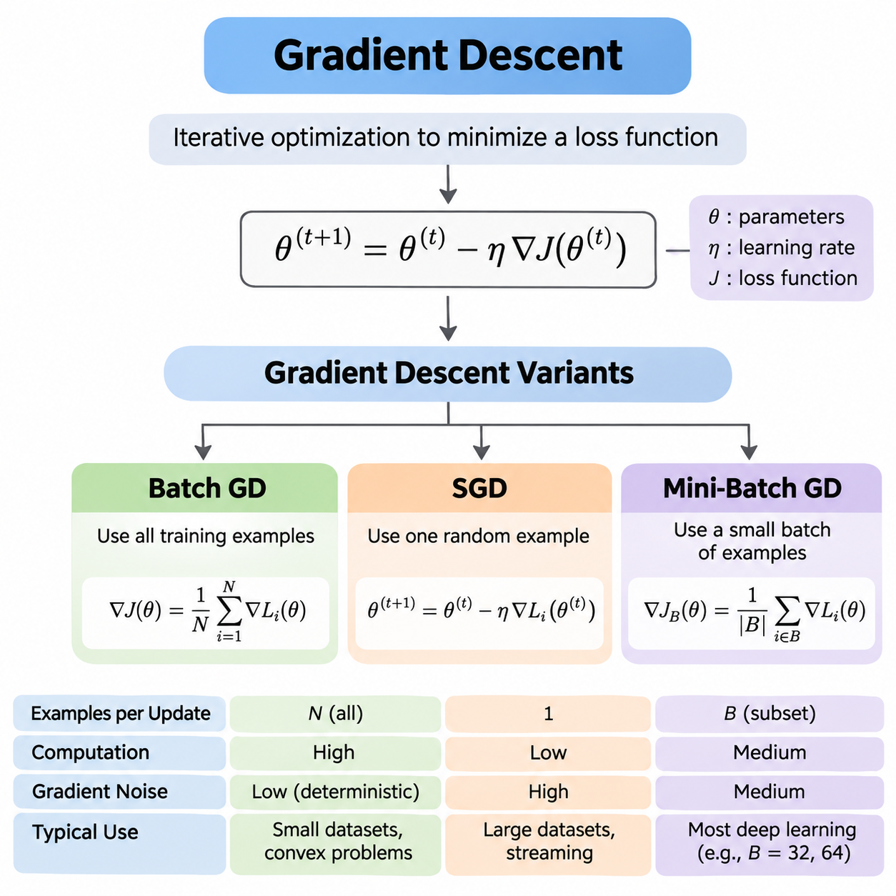
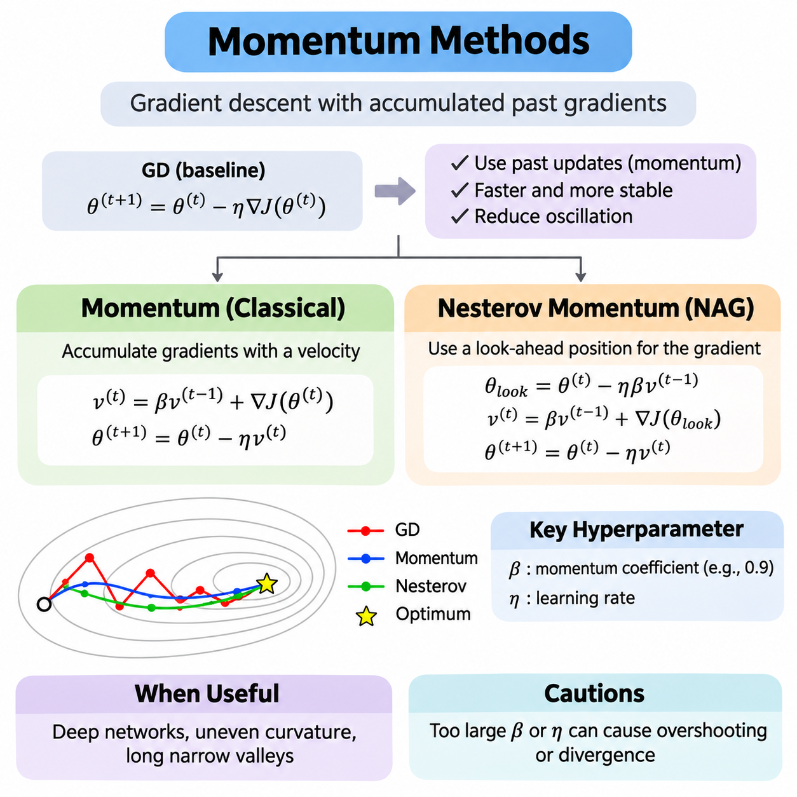
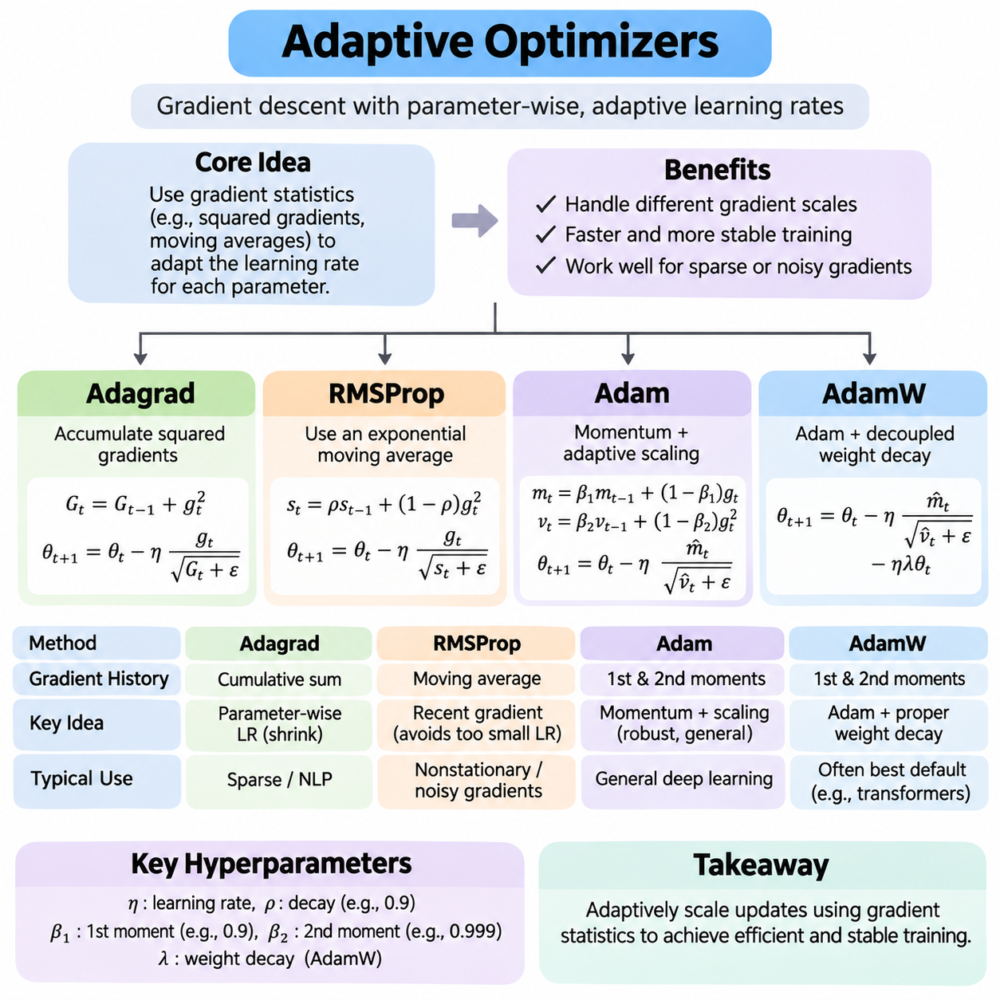
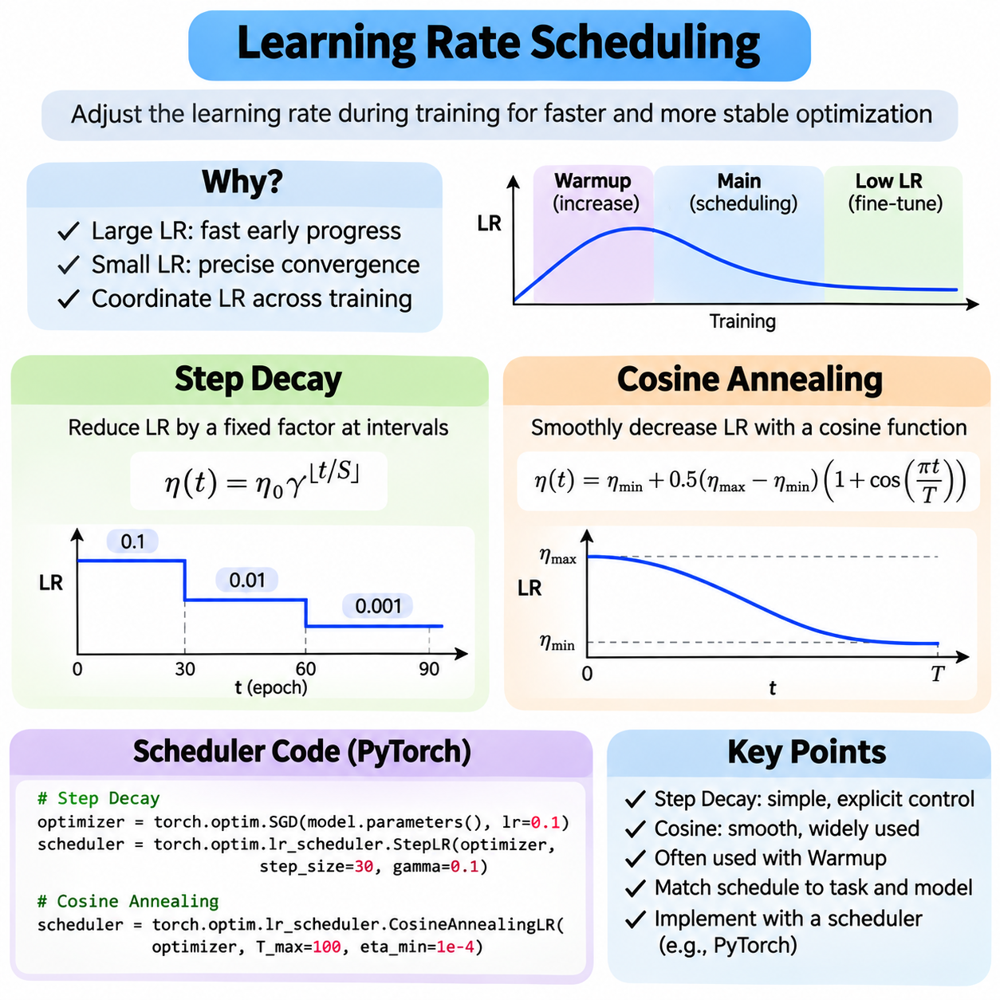
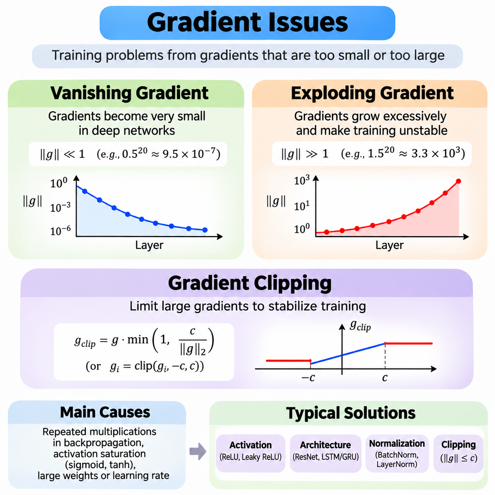
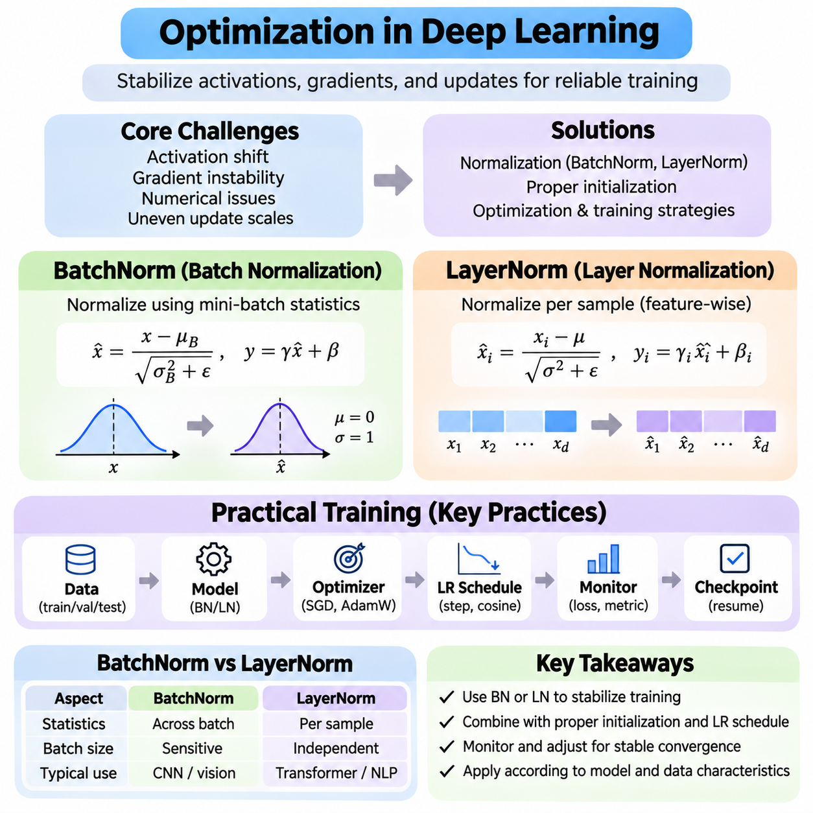

**Volume 06. Optimization and Generalization in ML**

# 02. Gradient Descent Family

## 02.00 Gradient Descent

{width="7.268055555555556in" height="7.268055555555556in"}

Gradient descent is a fundamental optimization algorithm used to minimize objective functions in machine learning. It iteratively adjusts model parameters in the direction opposite to the gradient of the loss function. Because the gradient indicates the direction of steepest local increase, moving against it generally reduces the loss when the learning rate is sufficiently small. This principle provides the mathematical foundation for training many statistical models and neural networks.

The optimization process begins with an initial parameter vector, typically represented by θ. At each iteration, the algorithm computes the gradient of the objective function and updates the parameters according to θ(t+1) = θ(t) − η∇J(θ(t)), where η denotes the learning rate and J represents the objective function. The learning rate determines the magnitude of each update and strongly influences convergence speed, numerical stability, and final optimization performance.

Gradient descent methods differ primarily in how many training examples are used to estimate the gradient during each parameter update. Batch Gradient Descent uses the entire training dataset, Stochastic Gradient Descent uses one training example, and Mini-Batch Gradient Descent uses a subset of examples. Although these methods share the same fundamental update principle, their computational requirements, gradient variability, memory consumption, and convergence behavior differ substantially.

Batch Gradient Descent computes the gradient of the objective function using every training example before updating the model parameters. For a dataset containing N examples, the empirical objective is commonly defined as J(θ) = (1/N)ΣᵢL(fθ(xᵢ), yᵢ), where L represents the individual loss. The complete gradient is calculated from all N examples, producing an update direction that accurately reflects the gradient of the current empirical training objective.

The primary advantage of Batch Gradient Descent is its deterministic behavior when the dataset and model computations remain fixed. Each iteration uses the complete dataset, eliminating randomness associated with selecting individual training examples. This property makes optimization trajectories relatively smooth and facilitates convergence analysis. For convex objectives with suitable smoothness assumptions and learning rates, Batch Gradient Descent offers well-established theoretical convergence guarantees.

However, Batch Gradient Descent becomes computationally expensive when training datasets contain millions or billions of examples. Every parameter update requires processing the entire dataset, which increases computation time and memory traffic. Although gradients can be accumulated without storing every example simultaneously, full-dataset processing remains necessary. Consequently, Batch Gradient Descent is often impractical for large-scale neural network training.

Batch Gradient Descent is particularly suitable for relatively small datasets, convex optimization problems, and experiments requiring reproducible gradient calculations. Linear regression provides a representative example because its mean squared error objective can be differentiated analytically. The algorithm repeatedly calculates predictions, evaluates residuals, accumulates gradients across all observations, and updates the parameters until a convergence criterion is satisfied.

A practical Batch Gradient Descent implementation typically initializes model parameters, evaluates the complete training loss, computes gradients through analytical differentiation or automatic differentiation, and applies a parameter update. The process continues until a maximum iteration count is reached or improvement becomes sufficiently small. Monitoring the objective value and gradient norm helps identify convergence, while excessive learning rates may cause oscillation or divergence.

Stochastic Gradient Descent, commonly abbreviated as SGD, replaces the full-dataset gradient with an estimate calculated from a single randomly selected training example. Its update can be expressed as θ(t+1) = θ(t) − η∇Lᵢ(θ(t)), where Lᵢ represents the loss associated with the selected example. When examples are sampled uniformly, the stochastic gradient is an unbiased estimator of the full empirical gradient under the standard sampling assumptions.

Because SGD updates parameters after processing individual examples, it can make progress without evaluating the entire dataset at every step. This characteristic is valuable for large datasets and streaming learning environments. SGD also requires relatively little memory for each gradient calculation. Nevertheless, its sequential updates may not exploit modern GPU parallelism efficiently, especially when each training example requires only a small amount of computation.

The stochastic nature of SGD introduces fluctuations into the optimization trajectory. Individual training examples may produce gradients that differ significantly from the full-dataset gradient, causing successive parameter updates to move in different directions. Such variability can help optimization explore complex nonconvex loss surfaces, although it does not guarantee escape from local minima or convergence to a globally optimal solution.

The learning rate is especially important in SGD because gradient noise persists even when the parameters approach a stationary point. With a constant learning rate, SGD may continue fluctuating around an optimum rather than converging exactly. Decreasing the learning rate over time can reduce these fluctuations and improve convergence under appropriate assumptions. However, reducing it too quickly may slow learning or prevent sufficient exploration of the parameter space.

In practical implementations, SGD often processes randomly shuffled training examples during each epoch. An epoch represents one complete pass through the training dataset, while an iteration represents a single parameter update. For N training examples, conventional single-example SGD performs approximately N updates per epoch. Shuffling helps reduce systematic ordering effects, particularly when examples are grouped by class, acquisition time, or other correlated characteristics.

SGD is useful when training data arrives continuously or when rapid initial parameter updates are desirable. Online recommendation systems, incremental classifiers, and streaming prediction models illustrate possible applications. However, SGD performance depends on data ordering, feature scaling, learning rate selection, and gradient variance. Reliable implementation therefore requires careful monitoring of optimization behavior and appropriate handling of noisy or highly heterogeneous observations.

Mini-Batch Gradient Descent combines characteristics of Batch Gradient Descent and SGD by calculating gradients from a subset of training examples. If a mini-batch contains B examples, the update uses the average gradient across those examples. The resulting estimate is generally less noisy than a single-example gradient while requiring substantially less computation per update than a complete full-dataset gradient.

Mini-batch size controls the tradeoff between gradient estimation quality and computational efficiency. Smaller mini-batches generate more frequent parameter updates and often introduce greater stochastic variability. Larger mini-batches generally produce more stable gradient estimates and can improve hardware utilization. However, increasing batch size also raises activation-memory requirements and may eventually provide diminishing improvements in computational throughput.

Mini-Batch Gradient Descent is particularly effective on GPUs because matrix operations can process multiple examples simultaneously. Modern deep learning frameworks organize input tensors into batches and execute vectorized forward and backward computations. This approach reduces per-example processing overhead and improves accelerator utilization. Consequently, mini-batch training has become the standard optimization approach for many contemporary deep learning applications.

For a dataset containing N examples and mini-batch size B, the approximate number of updates per epoch is ceil(N/B). For example, a dataset with 60,000 examples and a batch size of 128 requires 469 updates when the final incomplete batch is retained. Each update processes one mini-batch, computes the average loss and corresponding gradients, and modifies the model parameters before the next mini-batch is evaluated.

Mini-batch selection affects both optimization behavior and statistical properties. Random shuffling generally helps produce representative batches, while stratified sampling may be useful when class distributions are highly imbalanced. In sequential datasets, unrestricted shuffling may violate temporal dependencies or evaluation assumptions. Therefore, batch construction should reflect the characteristics of the learning problem rather than relying exclusively on random selection.

The relationship between batch size and learning rate requires careful consideration. Larger batches reduce gradient variance under common sampling assumptions, potentially permitting larger learning rates. However, increasing the learning rate proportionally with batch size is a heuristic rather than a universal rule. Model architecture, normalization methods, dataset characteristics, and optimizer configuration determine whether a particular scaling strategy remains stable.

Mini-batch training also introduces engineering considerations involving data loading, memory allocation, and computational scheduling. Efficient implementations overlap data preparation with GPU computation whenever possible. Pinned memory, asynchronous transfers, prefetching, and appropriate worker configurations can reduce accelerator idle time. These improvements do not change the mathematical optimization objective but can substantially increase practical training throughput.

The three gradient descent variants can be understood through their different gradient estimators. Batch Gradient Descent computes the exact gradient of the empirical objective, SGD estimates it using one example, and Mini-Batch Gradient Descent estimates it using several examples. Under uniform sampling, the stochastic estimates represent the full gradient in expectation, although their variance and computational costs depend on the sampling strategy and batch size.

Convergence behavior also depends on the geometry of the objective function. For smooth convex objectives, appropriately configured gradient descent methods possess established convergence properties. Strong convexity provides additional guarantees under suitable assumptions. Deep neural networks, however, typically produce nonconvex objectives containing saddle points and complex parameter interactions. Their optimization behavior cannot be characterized solely through classical convex convergence results.

An important distinction exists between optimization convergence and generalization performance. A method that minimizes training loss more accurately does not necessarily produce better predictions on unseen data. Stochastic gradient noise, batch size, learning rate schedules, and model architecture may influence which solutions are reached. These interactions motivate the study of implicit regularization and explain why optimization performance should be evaluated alongside validation metrics.

In practical machine learning systems, the selection among Batch Gradient Descent, SGD, and Mini-Batch Gradient Descent depends on dataset size, available hardware, latency requirements, and model complexity. Batch methods provide stable full-gradient updates, SGD supports highly incremental learning, and mini-batch methods balance statistical efficiency with computational parallelism. Understanding these differences establishes the foundation for more advanced momentum-based and adaptive optimization algorithms.

## 02.01 Momentum Methods

{width="7.268055555555556in" height="7.268055555555556in"}

Momentum methods extend conventional gradient descent by incorporating information from previous parameter updates into the current optimization step. Instead of relying exclusively on the gradient evaluated at the current position, these methods accumulate directional information across iterations. This mechanism can accelerate convergence, reduce oscillations, and improve optimization stability, particularly when the objective function exhibits highly uneven curvature.

Standard gradient descent updates model parameters according to the current gradient, which represents the direction of steepest local increase in the objective function. Although this approach is mathematically straightforward, it may progress slowly through narrow valleys or oscillate across steep directions. Momentum addresses these limitations by maintaining a moving accumulation of past gradients, allowing parameter updates to reflect both current information and historical optimization behavior.

Classical Momentum introduces a velocity variable that stores an exponentially weighted accumulation of gradients. One common formulation is v(t) = βv(t−1) + ∇J(θ(t)), followed by θ(t+1) = θ(t) − ηv(t). Here, β represents the momentum coefficient, η denotes the learning rate, and J is the objective function. This formulation accumulates gradients directly, while equivalent implementations may incorporate the learning rate into the velocity variable.

The momentum coefficient determines how strongly previous gradients influence the current update. A coefficient close to zero makes the algorithm behave similarly to ordinary gradient descent, while a larger coefficient preserves directional information over more iterations. Values such as 0.9 are commonly used as starting points, although the appropriate coefficient depends on the optimization problem, learning rate, gradient characteristics, and training configuration.

Momentum can be interpreted as an exponentially weighted memory of previous gradient directions. When gradients consistently point in similar directions, their accumulated contributions increase the magnitude of movement along those directions. When gradients alternate in sign, their contributions partially cancel, reducing oscillatory behavior. This combination allows momentum to accelerate progress through elongated loss landscapes while damping unnecessary movement across steep dimensions.

Consider a loss surface containing a long, narrow valley. Ordinary gradient descent may repeatedly cross the valley because gradients contain strong components perpendicular to the desired direction of progress. Momentum suppresses these alternating components while accumulating gradients along the valley. Consequently, the optimizer can follow a smoother trajectory and reach lower-loss regions using fewer iterations under favorable conditions.

Momentum is particularly useful for neural network training because deep learning objectives frequently exhibit different curvature scales across parameter dimensions. Some directions produce large gradients, while others generate relatively small gradients. Without accumulated directional information, optimization may require conservative learning rates to avoid instability. Momentum can improve progress along persistent descent directions without requiring every update to depend entirely on the current gradient.

However, momentum does not guarantee faster convergence in every situation. Excessively large momentum coefficients or learning rates may cause overshooting, persistent oscillations, or divergence. The accumulated velocity can continue moving parameters even after the local gradient changes direction. Therefore, momentum must be configured carefully, and its effectiveness should be evaluated through training loss, validation performance, and optimization stability.

Nesterov Accelerated Gradient, commonly called Nesterov momentum, modifies classical momentum by evaluating the gradient at an anticipated future position rather than only at the current parameters. The method uses the existing velocity to estimate where the parameters are heading before calculating the corrective gradient. This look-ahead mechanism provides information about the loss landscape near the expected destination of the next update.

A common Nesterov formulation defines the look-ahead position as θlook = θ(t) − ηβv(t−1). The gradient is then evaluated at this anticipated position, giving v(t) = βv(t−1) + ∇J(θlook), followed by θ(t+1) = θ(t) − ηv(t). This representation uses the same gradient-accumulation convention as classical momentum and makes the difference between current-position and look-ahead gradient evaluation explicit.

The essential distinction between classical Momentum and Nesterov momentum lies in when corrective gradient information is obtained. Classical Momentum first evaluates the gradient at the current parameters and combines it with accumulated velocity. Nesterov momentum anticipates the movement caused by existing velocity and evaluates the gradient at that projected location. This adjustment can provide an earlier corrective response when the optimization trajectory approaches a region with changing curvature.

The look-ahead mechanism is especially intuitive when an optimizer moves rapidly toward the bottom of a valley. Classical Momentum may continue accelerating because its velocity reflects earlier gradients. Nesterov momentum examines the gradient closer to the projected destination, potentially detecting the need to slow down or change direction sooner. This anticipatory correction can reduce overshooting and improve convergence behavior under suitable conditions.

Nesterov acceleration also has important theoretical foundations in convex optimization. For smooth convex objectives, appropriately configured accelerated gradient methods can achieve an objective-value convergence rate of O(1/t²), compared with the O(1/t) rate associated with standard gradient descent under comparable general assumptions. These guarantees apply to specific accelerated algorithms and parameter schedules, rather than automatically to every practical implementation using a fixed Nesterov momentum coefficient.

In deep neural network optimization, Nesterov momentum is frequently implemented as an extension of stochastic gradient descent with momentum. Modern machine learning frameworks often provide a Nesterov option within their SGD optimizers. However, implementation details may differ from the explicit look-ahead formulation, particularly in how velocity, learning rate, and gradient correction are combined. Understanding these conventions is important when comparing equations with software implementations.

The intuitive behavior of momentum methods can be explained through the analogy of a moving object traveling across a landscape. The model parameters represent the object\'s position, the gradient determines the local downhill direction, and accumulated velocity represents the influence of previous movement. Unlike ordinary gradient descent, which responds only to the current slope, momentum retains information about earlier directions and therefore produces smoother, more persistent movement.

This physical analogy also explains the relationship between acceleration and oscillation. When successive gradients point in consistent directions, momentum increases the effective movement along the descent path. When gradients repeatedly reverse direction, accumulated contributions partially cancel and reduce unnecessary oscillations. Nevertheless, excessive velocity can carry the optimizer beyond a favorable region, demonstrating why momentum and learning rate must be balanced.

Classical Momentum resembles a moving object responding to its current slope while retaining inertia from earlier movement. Nesterov momentum adds an anticipatory component by estimating the slope at a projected future position. The distinction is analogous to reacting to the terrain directly beneath an object versus examining the terrain slightly ahead. Both methods exploit historical movement, but Nesterov incorporates additional information about the anticipated optimization trajectory.

From a geometric perspective, momentum methods are particularly effective when the loss surface is poorly conditioned. Poor conditioning occurs when curvature differs substantially between parameter directions, creating elongated contours and inefficient gradient descent trajectories. Momentum can reduce repeated movement across high-curvature directions while maintaining progress along lower-curvature directions. This behavior helps explain its effectiveness in many high-dimensional optimization problems.

The benefits of momentum also depend on gradient noise. In stochastic optimization, individual mini-batches may produce gradients that fluctuate around the underlying full-dataset gradient. Momentum averages directional information across iterations, potentially reducing the influence of short-term fluctuations. However, correlated gradient errors or rapidly changing loss landscapes can still affect the accumulated velocity, and momentum does not eliminate stochastic uncertainty.

Momentum coefficients and learning rates interact strongly during training. A large momentum coefficient increases the persistence of historical gradients, while a large learning rate increases the distance traveled during each parameter update. Combining both aggressively may destabilize optimization. Practical training therefore requires coordinated hyperparameter selection, often supported by learning rate schedules, validation monitoring, and controlled experiments.

Momentum methods provide a conceptual bridge between basic gradient descent and more advanced optimization algorithms. They demonstrate how historical gradient information can improve parameter updates without requiring second-order derivatives or explicit Hessian calculations. This principle also appears in adaptive optimizers such as Adam, which combines momentum-like first-moment estimation with adaptive scaling based on second-moment information.

In practical machine learning applications, classical Momentum offers a relatively simple and computationally inexpensive improvement over ordinary gradient descent. Nesterov momentum introduces anticipatory gradient evaluation that can further improve optimization behavior in appropriate settings. Neither method guarantees superior generalization or universal convergence acceleration, but both remain important techniques for training neural networks efficiently and understanding the evolution of modern optimization algorithms.

## 02.02 Adaptive Optimizers

{width="7.268055555555556in" height="7.268055555555556in"}

Adaptive optimizers extend gradient descent by automatically adjusting the effective learning rate for individual model parameters. Unlike conventional gradient descent, which applies a common learning rate to all parameter dimensions, adaptive methods use historical gradient information to control update magnitudes. This approach can improve optimization efficiency when gradients vary substantially across parameters or when training involves sparse, noisy, or poorly scaled features.

The central principle of adaptive optimization is to estimate gradient statistics and use them to normalize parameter updates. Parameters receiving consistently large gradients may require smaller effective steps, while parameters associated with smaller gradients may benefit from relatively larger steps. This adjustment reduces sensitivity to differences in gradient magnitude, although adaptive optimizers still require appropriate global learning rates and careful hyperparameter configuration.

Adagrad, short for Adaptive Gradient Algorithm, was developed to assign parameter-specific learning rates based on accumulated squared gradients. At each iteration, the algorithm adds the square of the current gradient to a running accumulator. Parameters with frequently occurring large gradients accumulate larger values, causing their effective learning rates to decrease. Conversely, parameters associated with infrequent gradients retain relatively larger learning rates.

The Adagrad update can be expressed as G(t) = G(t−1) + g(t)², followed by θ(t+1) = θ(t) − ηg(t)/(√G(t) + ε). Here, g(t) denotes the current gradient, G(t) represents the element-wise accumulated squared gradients, η is the global learning rate, and ε is a small numerical stability constant. All multiplication, division, and square-root operations are applied independently to individual parameter dimensions.

Adagrad is particularly effective for sparse learning problems in which some features occur much less frequently than others. Natural language processing, recommendation systems, and high-dimensional linear models provide representative applications. Rarely activated parameters receive fewer gradient contributions and therefore experience less aggressive learning-rate reduction. This behavior can improve learning efficiency when feature frequencies differ substantially across the training dataset.

However, Adagrad has an important limitation because its accumulated squared-gradient statistics increase monotonically. As training progresses, the denominator in the update equation generally grows, causing effective learning rates to decrease continuously. Eventually, parameter updates may become extremely small even when further optimization is necessary. This limitation makes conventional Adagrad less suitable for some long-running deep neural network training tasks.

RMSProp, meaning Root Mean Square Propagation, addresses Adagrad\'s continuously decreasing learning-rate problem by replacing cumulative squared gradients with an exponentially weighted moving average. Instead of retaining the complete history with equal accumulated influence, RMSProp gradually discounts older gradient information. This mechanism allows effective learning rates to adapt to recent optimization conditions rather than shrinking indefinitely because of distant historical gradients.

A common RMSProp formulation is s(t) = ρs(t−1) + (1−ρ)g(t)², followed by θ(t+1) = θ(t) − ηg(t)/(√s(t) + ε). The coefficient ρ controls the decay of historical squared-gradient information, while s(t) estimates the recent second raw moment of the gradient. Values such as 0.9 are frequently used for ρ, although optimal settings depend on the training problem.

RMSProp is useful when gradient magnitudes change during optimization or when the loss surface contains directions with substantially different curvature. By scaling updates according to recent squared-gradient statistics, the algorithm can reduce excessively large steps in sensitive parameter dimensions. This behavior often improves training stability in nonlinear neural networks and problems involving noisy or nonstationary gradient distributions.

Unlike Adagrad, RMSProp does not necessarily force effective learning rates toward zero as the number of iterations increases. Its moving average can decrease when recent gradients become smaller, allowing the update scaling to respond dynamically. Nevertheless, RMSProp does not guarantee convergence for arbitrary objectives or hyperparameter choices. Learning-rate selection, numerical stability, and the interaction between gradient statistics and model architecture remain important.

Adam, short for Adaptive Moment Estimation, combines momentum-based gradient accumulation with adaptive scaling based on squared gradients. It maintains two exponentially weighted moving averages: the first estimates the gradient\'s mean direction, while the second estimates its uncentered second moment. By combining these statistics, Adam incorporates directional persistence and parameter-specific update normalization within a single optimization algorithm.

The first-moment estimate is calculated as m(t) = β₁m(t−1) + (1−β₁)g(t), while the second-moment estimate is v(t) = β₂v(t−1) + (1−β₂)g(t)². The coefficients β₁ and β₂ determine the decay rates of the respective moving averages. Common default values are β₁ = 0.9 and β₂ = 0.999, although these settings may require adjustment for particular training workloads.

Because Adam initializes its moving averages at zero, the estimates are initially biased toward zero. Bias correction compensates for this initialization through m̂(t) = m(t)/(1−β₁ᵗ) and v̂(t) = v(t)/(1−β₂ᵗ). The parameter update then becomes θ(t+1) = θ(t) − ηm̂(t)/(√v̂(t) + ε). This correction is especially important during the early stages of optimization when relatively few gradient observations have been accumulated.

Adam is widely used in deep learning because it often provides rapid initial optimization and requires less manual adjustment than conventional SGD for many tasks. Its adaptive scaling is useful for heterogeneous parameter gradients, while momentum-like averaging helps stabilize update directions. Adam has been applied extensively to convolutional networks, transformers, generative models, and numerous other neural network architectures.

Despite its practical effectiveness, Adam is not universally superior to SGD with momentum. Some applications exhibit differences in generalization performance, optimization stability, or final validation accuracy. Furthermore, certain Adam configurations can fail to converge even in particular convex settings. These limitations have motivated theoretical refinements, alternative adaptive methods, and careful investigation of optimizer behavior under different training conditions.

AdamW extends Adam by separating weight decay from the adaptive gradient-based parameter update. In conventional Adam implementations using an L2 penalty added to the objective, the regularization gradient becomes part of the moment estimates and is scaled by the adaptive denominator. Consequently, L2 regularization and multiplicative weight decay are not generally equivalent when adaptive parameter-specific scaling is applied.

AdamW introduces decoupled weight decay, which applies parameter shrinkage separately from the adaptive gradient update. A simplified expression is θ(t+1) = θ(t) − ηm̂(t)/(√v̂(t) + ε) − ηλθ(t), where λ represents the weight-decay coefficient. The adaptive gradient contribution and the decay contribution are therefore controlled through distinct mechanisms, improving the interpretability and tuning of regularization strength.

The separation between optimization and weight decay is particularly valuable in large neural network training. AdamW allows the weight-decay coefficient to be tuned without embedding its contribution into the adaptive moment statistics. This distinction can improve regularization behavior and validation performance, although the actual benefit depends on architecture, dataset, training duration, and hyperparameter selection.

AdamW has become a common optimizer for transformer-based models and large-scale representation learning. Its combination of adaptive moment estimation and decoupled weight decay provides a practical balance between optimization efficiency and explicit parameter regularization. In many implementations, biases and normalization parameters are excluded from weight decay, reflecting the observation that applying identical shrinkage to every parameter group is not always desirable.

The differences among Adagrad, RMSProp, Adam, and AdamW reflect the evolution of gradient-statistics-based optimization. Adagrad accumulates squared gradients indefinitely, RMSProp replaces cumulative statistics with exponential averaging, Adam adds first-moment estimation and bias correction, and AdamW separates weight decay from adaptive gradient updates. Each development addresses particular limitations while introducing additional design choices and hyperparameters.

Adaptive optimizers generally require additional memory because they maintain auxiliary statistics for model parameters. Adagrad stores a squared-gradient accumulator, RMSProp maintains a moving average, and Adam-based methods typically store both first- and second-moment estimates. For very large models, these optimizer states can consume substantial memory, motivating techniques such as reduced-precision optimizer states, memory-efficient implementations, and distributed state partitioning.

Selecting an adaptive optimizer requires consideration of gradient sparsity, training stability, computational resources, and generalization requirements. Adagrad remains useful for sparse features, RMSProp offers responsive squared-gradient normalization, Adam provides broadly applicable adaptive moment estimation, and AdamW adds decoupled regularization. No single optimizer guarantees the best performance across all problems, making controlled empirical comparison essential.

In modern machine learning systems, adaptive optimization should be considered part of a broader training strategy rather than an isolated algorithmic choice. Learning-rate schedules, batch size, gradient clipping, parameter initialization, normalization, and regularization interact with optimizer behavior. Understanding these relationships enables more reliable training configurations and establishes the foundation for efficient optimization of increasingly large and complex artificial intelligence models.

## 02.03 Learning Rate Scheduling

{width="7.268055555555556in" height="7.268055555555556in"}

Learning rate scheduling is a fundamental training strategy that adjusts the learning rate during optimization rather than keeping it constant throughout the entire process. The learning rate determines how far model parameters move in response to computed gradients. Large learning rates can accelerate early progress, while smaller learning rates often support more precise convergence. Scheduling coordinates these behaviors across different stages of training.

A fixed learning rate may be appropriate for simple optimization problems, but complex neural networks frequently require different update magnitudes as training progresses. Early iterations benefit from relatively large parameter adjustments that rapidly reduce the objective function. Later iterations often require smaller updates to avoid oscillations near favorable solutions. Learning rate scheduling provides a systematic mechanism for managing this transition.

A learning rate scheduler modifies the optimizer\'s learning rate according to a predefined mathematical function, training progress, or observed performance. Some schedulers operate after each epoch, while others update the learning rate after every optimization step. The scheduling interval must match the intended training design because an epoch-based schedule and a step-based schedule can produce substantially different learning dynamics.

Step decay is one of the simplest and most widely understood learning rate scheduling strategies. It reduces the learning rate by a fixed multiplicative factor at predetermined training intervals. Instead of decreasing continuously, the learning rate remains constant for a specified number of epochs or iterations before dropping abruptly. This creates a sequence of progressively smaller learning rates throughout training.

A common step decay formulation is η(t) = η₀γ\^floor(t/S), where η₀ represents the initial learning rate, γ is the decay factor, S is the step interval, and t denotes the current epoch or iteration. When γ lies between zero and one, each scheduled reduction decreases the learning rate. The floor operation ensures that the learning rate changes only after completing the specified interval.

For example, consider an initial learning rate of 0.1, a decay factor of 0.1, and a step interval of 30 epochs. The learning rate remains 0.1 during the first 30 epochs, decreases to 0.01 for the next 30 epochs, and becomes 0.001 after 60 epochs. This predictable behavior makes step decay easy to implement, reproduce, and analyze across controlled machine learning experiments.

Step decay is effective when training exhibits distinct phases requiring progressively smaller parameter updates. Early training can use a relatively aggressive learning rate to move quickly through the loss landscape. Later reductions encourage more conservative optimization and may improve convergence stability. However, abrupt changes can temporarily alter training dynamics, and poorly chosen decay milestones may reduce the learning rate prematurely.

The main limitation of step decay is its dependence on manually selected decay intervals and multiplicative factors. Different datasets, model architectures, and optimization algorithms may require different schedules. If the learning rate decreases too early, optimization may stagnate before reaching a satisfactory solution. If it decreases too late, training may continue oscillating or waste computation near an already favorable region.

Cosine annealing provides a smoother alternative by gradually decreasing the learning rate according to a cosine-shaped function. Instead of applying abrupt reductions, it continuously adjusts the learning rate over a predefined training horizon. This smooth transition allows relatively large updates during early optimization and progressively smaller updates near the end of the schedule, supporting a controlled reduction in parameter movement.

A standard cosine annealing formulation is η(t) = ηmin + 0.5(ηmax − ηmin)(1 + cos(πt/T)), where ηmax is the initial maximum learning rate, ηmin is the minimum learning rate, T represents the scheduled duration, and t ranges from zero to T. The cosine function begins at its maximum value and gradually approaches its minimum, producing a smooth learning rate trajectory.

The cosine schedule decreases slowly near the beginning, changes more rapidly around the middle, and flattens again as it approaches the minimum learning rate. This behavior differs from linear decay, which reduces the learning rate at a constant rate. The smooth reduction can support stable late-stage optimization, although its effectiveness depends on the training horizon, optimizer, and underlying learning problem.

Cosine annealing is frequently used in deep learning workloads involving convolutional neural networks, transformers, and large-scale representation learning. Its mathematical simplicity makes it suitable for long training schedules with predetermined computational budgets. However, the schedule does not automatically guarantee better convergence or generalization than step decay, and its benefits should be established through validation experiments.

Cosine annealing can also be combined with warm restarts, which periodically increase the learning rate before beginning another cosine decay cycle. These restarts may encourage renewed exploration of the optimization landscape. However, cosine annealing without restarts follows a different trajectory, and the distinction must be preserved when configuring schedulers or interpreting experimental results.

Learning rate scheduling is often combined with a warmup phase during which the learning rate gradually increases from a small initial value. Warmup can reduce instability during the earliest optimization steps, particularly in large neural networks or training configurations using substantial batch sizes. After warmup, step decay or cosine annealing can progressively reduce the learning rate according to the planned training horizon.

Implementing learning rate scheduling requires coordination between the optimizer, scheduler, and training loop. The optimizer performs parameter updates using the current learning rate, while the scheduler determines when and how that learning rate changes. A reliable implementation explicitly defines whether scheduling occurs per epoch or per optimization step and ensures that the configured schedule matches the intended number of updates.

In PyTorch, step decay can be implemented using the StepLR scheduler, which accepts an optimizer, a step_size parameter, and a gamma decay factor. The optimizer updates model parameters during training, and the scheduler\'s step method advances the learning rate schedule. When the scheduler is intended to operate per epoch, its step method is typically called after completing the epoch\'s optimizer updates.

PyTorch also provides CosineAnnealingLR, which adjusts the learning rate according to a cosine schedule over a specified T_max interval. The eta_min parameter defines the lower learning rate boundary. The scheduler advances whenever its step method is called, so T_max must be interpreted in the same units as those calls. This distinction is essential for obtaining the intended cosine trajectory.

A typical scheduler implementation initializes the model, loss function, optimizer, and scheduling configuration before entering the training loop. Each iteration performs forward propagation, calculates the loss, computes gradients through backpropagation, and updates parameters. The scheduler is then advanced at the designated interval. Recording the learning rate alongside training and validation metrics supports reproducibility and performance analysis.

When training is interrupted and resumed, the optimizer state and scheduler state should generally be restored together with the model parameters. Otherwise, the resumed training process may use an incorrect learning rate or repeat an earlier scheduling phase. Reliable checkpointing therefore preserves the current epoch or iteration, optimizer statistics, scheduler progress, and relevant training configuration.

The interaction between learning rate scheduling and adaptive optimizers requires particular attention. Algorithms such as Adam and AdamW already adjust parameter-specific effective update magnitudes using gradient statistics. Nevertheless, their global learning rates still influence optimization behavior. Applying step decay or cosine annealing to these optimizers can provide additional control over training progression and final convergence.

Choosing between step decay and cosine annealing depends on training duration, optimization behavior, and experimental objectives. Step decay offers simplicity, interpretability, and explicit control over reduction milestones. Cosine annealing provides a smooth trajectory that naturally transitions from larger to smaller updates. Neither method is universally optimal, making empirical comparison under consistent training conditions essential.

Learning rate scheduling should be evaluated through more than training loss alone. Validation performance, convergence speed, gradient stability, and computational efficiency provide complementary information about scheduler effectiveness. A schedule that reduces training loss quickly may not produce the best generalization. Controlled experiments should therefore compare scheduling strategies using consistent datasets, architectures, random seeds, and evaluation procedures.

In modern artificial intelligence training systems, learning rate scheduling is an integral component of optimization engineering. Its effectiveness depends on interactions with batch size, gradient accumulation, momentum, adaptive optimizers, and training duration. Understanding step decay, cosine annealing, and scheduler implementation enables practitioners to design stable and reproducible training pipelines while making efficient use of available computational resources.

## 02.04 Gradient Issues

{width="7.268055555555556in" height="7.268055555555556in"}

Gradient-related problems represent fundamental challenges in training deep neural networks because parameter updates depend directly on gradients computed through backpropagation. When gradients become excessively small or large, optimization may slow dramatically or become unstable. Vanishing gradients, exploding gradients, and gradient clipping are closely related concepts that explain how gradient magnitude affects learning and how training systems can control numerical instability.

Backpropagation calculates gradients by repeatedly applying the chain rule through successive network layers. The resulting gradient depends on products of local derivatives and weight matrices. In deep architectures, these repeated multiplications can cause gradient magnitudes to shrink or grow substantially. Consequently, early network layers may receive ineffective learning signals, while other layers may experience excessively large parameter updates.

The vanishing gradient problem occurs when gradients become extremely small as they propagate backward through a neural network. Parameters in earlier layers may receive updates too small to produce meaningful learning progress. This problem is particularly pronounced in deep networks using saturating activation functions and recurrent architectures processing long sequences. As a result, the model may struggle to learn complex hierarchical representations or long-range dependencies.

Mathematically, consider a sequence of transformations whose derivatives have magnitudes consistently below one. Applying the chain rule multiplies these derivatives across layers, potentially producing an exponentially decreasing gradient. For example, repeatedly multiplying a derivative magnitude of 0.5 across twenty layers produces approximately 9.54 × 10⁻⁷. Such attenuation can make gradient-based updates nearly ineffective in earlier network components.

Activation functions significantly influence vanishing gradients. The sigmoid function approaches saturation when its input becomes strongly positive or negative, producing derivatives close to zero. Hyperbolic tangent functions exhibit similar behavior near their saturation regions. When many layers operate in these regions, gradients may diminish rapidly. This explains why activation selection is an important architectural decision in deep learning.

Rectified Linear Unit, commonly called ReLU, helps reduce vanishing gradients because its derivative equals one for positive inputs. However, ReLU does not eliminate every gradient-related problem. For negative inputs, its derivative is zero, potentially producing inactive neurons that stop receiving useful gradient signals. Variants such as Leaky ReLU and GELU provide alternative activation behaviors, although their effectiveness depends on the network and training conditions.

Residual connections provide another important mechanism for mitigating vanishing gradients. By adding an identity pathway around a transformation, residual architectures allow gradients to propagate through shorter computational paths. This design supports the optimization of very deep networks and is widely used in modern convolutional architectures and transformers. Nevertheless, residual connections do not guarantee perfectly stable gradients under every configuration.

The exploding gradient problem represents the opposite phenomenon, occurring when gradient magnitudes grow excessively during backpropagation. Large gradients can produce enormous parameter updates that destabilize optimization. Training loss may fluctuate unpredictably, increase sharply, or become numerically undefined. In severe cases, floating-point computations may produce infinity or NaN values, preventing the training process from continuing reliably.

Exploding gradients can arise when repeated Jacobian products amplify signals across network layers or time steps. If relevant derivative magnitudes repeatedly exceed one, their products may grow rapidly. For example, multiplying a factor of 1.5 across twenty transformations produces approximately 3325. This simplified calculation illustrates how moderate local amplification can become substantial when repeated throughout a deep computational graph.

Recurrent neural networks are especially vulnerable to vanishing and exploding gradients because backpropagation through time repeatedly applies related transformations across sequence positions. Long sequences increase the number of derivative multiplications and therefore amplify sensitivity to recurrent dynamics. Gated architectures such as LSTM and GRU were developed partly to improve information and gradient propagation across extended temporal dependencies.

Exploding gradients can also occur in feedforward networks, transformers, and other deep architectures when initialization, learning rates, or intermediate activation scales are poorly controlled. Large parameter values may amplify intermediate signals and gradients, creating unstable feedback during optimization. Mixed-precision training can introduce additional numerical concerns because limited floating-point ranges may cause overflow or underflow.

Detecting gradient problems requires monitoring more than the training loss. Gradient norms, parameter update magnitudes, activation distributions, and numerical exceptions provide useful diagnostic information. Vanishing gradients may appear as consistently tiny gradients in earlier layers, while exploding gradients may produce sudden norm spikes or unstable loss values. However, small gradients near a genuine optimum are not necessarily evidence of a vanishing gradient problem.

Gradient clipping is a practical technique for limiting excessively large gradients before an optimizer updates model parameters. Rather than changing the objective function, clipping modifies the computed gradient when its magnitude exceeds a specified threshold. This prevents individual optimization steps from becoming excessively large and is particularly useful for recurrent networks, unstable training configurations, and models experiencing occasional gradient spikes.

Gradient clipping by value constrains each gradient component independently to a predefined interval. For a threshold c, the operation can be expressed as gᵢ ← max(−c, min(gᵢ, c)). Components exceeding the positive threshold are reduced to c, while components below the negative threshold are increased to −c. This approach is straightforward but can alter the overall gradient direction because individual components are modified separately.

Gradient clipping by norm instead constrains the magnitude of the complete gradient vector while preserving its direction. Given gradient vector g and maximum norm c, the clipped gradient is gclip = g × min(1, c/(\|\|g\|\|₂ + ε)). When the norm is below the threshold, the gradient remains effectively unchanged. When the norm exceeds the threshold, all components are scaled proportionally, preventing excessively large updates.

Norm-based clipping is widely used because it controls gradient magnitude without substantially changing directional information. For example, if a gradient vector has an L2 norm of 20 and the clipping threshold is 5, the vector is multiplied by 0.25. Its resulting norm becomes 5 while its direction remains unchanged. This property makes norm clipping especially useful when optimization depends on preserving the relative contributions of gradient components.

Choosing a clipping threshold requires empirical evaluation because excessively small thresholds may suppress useful learning signals. Conversely, thresholds that are too large may fail to prevent instability. Values such as 1.0 or 5.0 are common experimental starting points, but appropriate settings depend on architecture, loss scaling, optimizer behavior, and gradient distributions. Monitoring clipping frequency helps determine whether the threshold is reasonable.

In PyTorch, gradient clipping can be implemented using torch.nn.utils.clip_grad_norm\\_ or torch.nn.utils.clip_grad_value\\_. These operations are typically applied after loss.backward() computes gradients and before optimizer.step() updates parameters. For automatic mixed-precision training with gradient scaling, gradients should generally be unscaled before clipping so that the threshold applies to their intended numerical magnitudes.

Gradient clipping should not be confused with gradient normalization or learning rate scheduling. Clipping intervenes only when gradients exceed specified limits, whereas normalization may continuously modify gradient scaling. Learning rate scheduling adjusts the global update scale across training iterations. These mechanisms can complement one another, but they address different aspects of optimization behavior and should be configured according to the underlying instability.

Preventing gradient problems requires coordinated architectural and optimization decisions. Appropriate weight initialization, residual connections, normalization layers, activation functions, and learning rates can reduce the likelihood of unstable gradient propagation. Gradient clipping provides an additional safeguard against excessive magnitudes, but it does not directly solve vanishing gradients or compensate for fundamentally unsuitable model configurations.

In modern deep learning systems, gradient stability is essential for reliable convergence, numerical correctness, and efficient computational resource utilization. Understanding vanishing gradients, exploding gradients, and clipping enables practitioners to distinguish optimization failures from ordinary training fluctuations. By combining gradient diagnostics with suitable architectural techniques and controlled update magnitudes, complex neural networks can be trained more consistently and robustly.

## 02.05 Optimization in Deep Learning

{width="7.268055555555556in" height="7.268055555555556in"}

Optimization in deep learning involves more than selecting a gradient descent algorithm. Successful training requires controlling activation distributions, gradient propagation, numerical stability, and parameter update magnitudes across many network layers. Batch normalization, layer normalization, and practical training strategies address these challenges through complementary mechanisms that improve optimization behavior and support reliable convergence.

Deep neural networks repeatedly transform intermediate representations through weighted operations and nonlinear activation functions. As parameters change during training, the statistical properties of intermediate activations may also change. Large variations in activation magnitude can complicate optimization and gradient propagation. Normalization techniques help control these variations, creating more predictable numerical conditions for subsequent layers.

Batch normalization, commonly called BatchNorm, normalizes intermediate activations using statistics calculated from a mini-batch of training examples. For each normalized feature or channel, it estimates a mean and variance over the relevant batch dimensions. The resulting standardized activations are subsequently transformed through learnable scaling and shifting parameters, allowing the network to recover useful representation magnitudes.

The basic BatchNorm transformation is expressed as μB = mean(x), σB² = var(x), and x̂ = (x − μB)/√(σB² + ε). The final output is y = γx̂ + β, where γ and β are learnable parameters and ε is a small numerical stability constant. The mean and variance are computed over the dimensions specified by the normalization layer, which differ between fully connected and convolutional architectures.

BatchNorm can improve optimization by moderating activation scales and influencing the conditioning of the training problem. It often permits larger learning rates and can accelerate convergence in convolutional neural networks. Although BatchNorm was originally motivated by reducing internal covariate shift, its practical benefits are also associated with smoother optimization behavior and improved gradient propagation.

During training, BatchNorm generally uses statistics from the current mini-batch. During inference, conventional implementations instead use running estimates of the activation mean and variance collected during training. This distinction is essential because inference should normally produce consistent outputs without depending on unrelated examples in the same batch. Correctly switching between training and evaluation modes is therefore important.

BatchNorm performance can depend on batch size because small batches provide noisy estimates of activation statistics. When batch sizes are extremely small, normalization may become unstable or less effective. Distributed training introduces additional considerations because statistics may be computed independently on each device unless synchronized BatchNorm is used. These limitations motivate alternative normalization approaches.

Layer normalization, commonly called LayerNorm, normalizes activations across selected feature dimensions within each individual training example. Unlike BatchNorm, it does not require statistics aggregated across different examples in a mini-batch. This makes its behavior largely independent of batch size and particularly useful for sequence models, language processing systems, and transformer architectures.

For a feature vector x containing d elements, LayerNorm calculates μ = (1/d)Σxᵢ and σ² = (1/d)Σ(xᵢ − μ)². Each feature is normalized as x̂ᵢ = (xᵢ − μ)/√(σ² + ε), followed by yᵢ = γᵢx̂ᵢ + βᵢ. The learnable parameters allow the network to adjust normalized representations while maintaining controlled feature statistics within each sample.

LayerNorm uses the current input\'s feature statistics during both training and inference, rather than relying on running estimates accumulated from previous batches. Consequently, its normalization behavior remains consistent across these operating modes. This property is valuable for autoregressive generation and variable-length sequence processing, where batch composition may change frequently.

LayerNorm has become a central component of transformer architectures because it helps regulate hidden-state magnitudes across attention and feedforward transformations. In pre-normalization transformers, normalization is applied before major sublayers, whereas post-normalization designs apply it after residual combinations. These arrangements influence gradient propagation, training stability, and the behavior of very deep transformer networks.

BatchNorm and LayerNorm differ primarily in the dimensions used to calculate normalization statistics. BatchNorm aggregates information across examples for each feature or channel, while LayerNorm aggregates across selected features within an example. Neither method is universally superior. Their effectiveness depends on architecture, batch size, data characteristics, and whether training involves spatial representations or sequential information.

Normalization should not be interpreted as a complete solution to optimization difficulties. Although it can stabilize activation magnitudes and improve gradient behavior, poor initialization, inappropriate learning rates, numerical overflow, and unsuitable objectives can still prevent convergence. Normalization also interacts with residual connections, activation functions, weight decay, and optimizer settings, making coordinated configuration necessary.

Practical deep learning training begins with a well-defined objective, an appropriate dataset, and a model architecture suited to the task. Training, validation, and test datasets should be separated to prevent information leakage and support unbiased evaluation. Input preprocessing and feature scaling should remain consistent across these partitions, with preprocessing statistics estimated only from permitted training data.

Weight initialization is an important early decision because it influences activation and gradient magnitudes before learning begins. Xavier initialization is commonly associated with networks using symmetric activations, while He initialization is designed for rectifier-based networks. These methods aim to maintain reasonable signal variance across layers, although their suitability depends on architectural assumptions and activation behavior.

Optimizer selection must reflect the training objective, computational budget, and expected gradient characteristics. SGD with momentum remains useful in many supervised learning applications, while Adam and AdamW provide adaptive parameter updates that often simplify initial optimization. Learning rate schedules, warmup, and weight decay should be configured together rather than treated as unrelated hyperparameters.

A typical training iteration performs forward propagation to generate predictions, evaluates a loss function, and computes gradients through backpropagation. The optimizer then updates model parameters using the computed gradients. Before each backward pass, existing gradients must be cleared or intentionally accumulated. This distinction is important because unintended gradient accumulation changes effective update magnitudes and can destabilize training.

Mini-batch size influences gradient noise, memory consumption, and computational efficiency. Larger batches may improve hardware utilization but can require learning rate adjustments and additional memory. Smaller batches introduce noisier gradient estimates that may affect convergence and generalization. Gradient accumulation can simulate a larger effective batch by combining gradients across multiple forward and backward passes before an optimizer update.

Gradient clipping provides an additional safeguard when unusually large gradients threaten numerical stability. Mixed-precision training can reduce memory requirements and improve throughput on supported accelerators, but it requires attention to numerical range and loss scaling. In automatic mixed-precision workflows, gradients should be unscaled before norm clipping, and optimizer updates must respect the scaling mechanism.

Reliable training also requires systematic monitoring of training loss, validation metrics, learning rates, gradient norms, and resource utilization. Sudden loss increases may indicate unstable updates, while persistent gaps between training and validation performance can suggest overfitting. Monitoring should distinguish genuine optimization failures from ordinary stochastic fluctuations and provide evidence for targeted configuration changes.

Checkpointing preserves model parameters, optimizer statistics, scheduler progress, and relevant training state so interrupted experiments can resume consistently. Reproducibility also benefits from recording random seeds, dataset versions, software configurations, and hyperparameters. Although deterministic execution may involve performance tradeoffs, consistent experiment tracking improves the reliability of comparisons between optimization strategies.

In modern deep learning systems, effective optimization emerges from the interaction of normalization, initialization, gradient management, scheduling, and experimental discipline. BatchNorm supports stable feature scaling across mini-batches, while LayerNorm provides sample-wise normalization suited to sequence architectures. Combining these techniques with carefully engineered training procedures enables efficient, stable, and reproducible development of increasingly complex neural networks.
