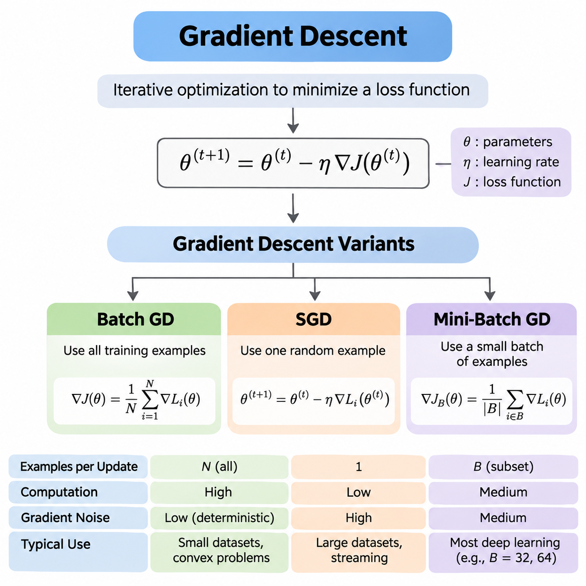
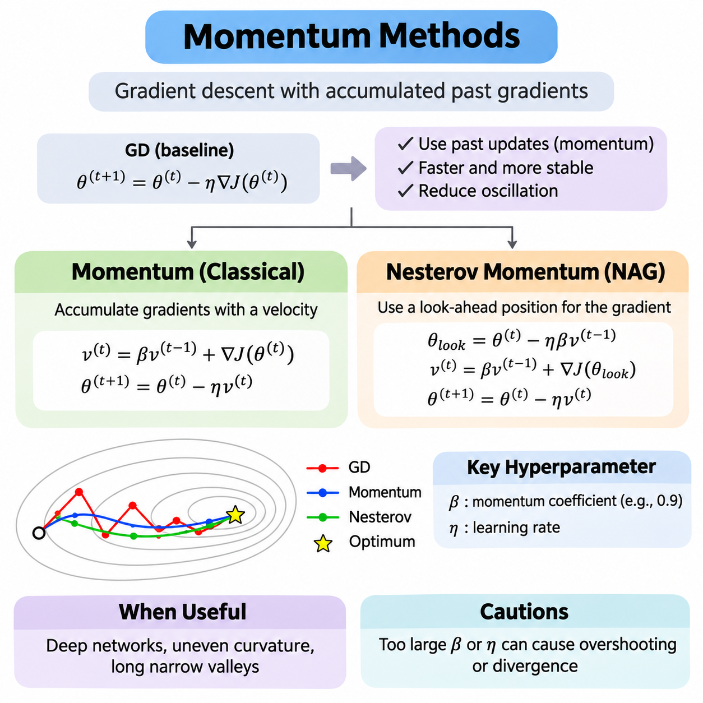
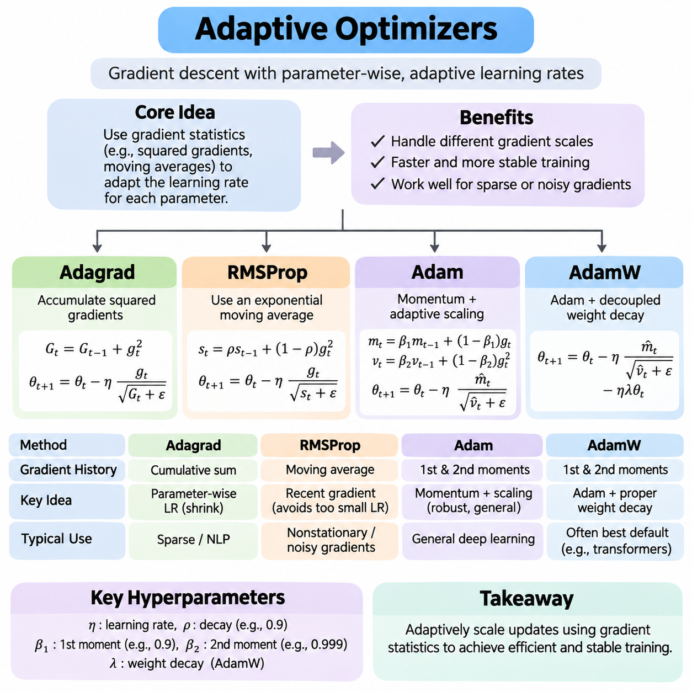
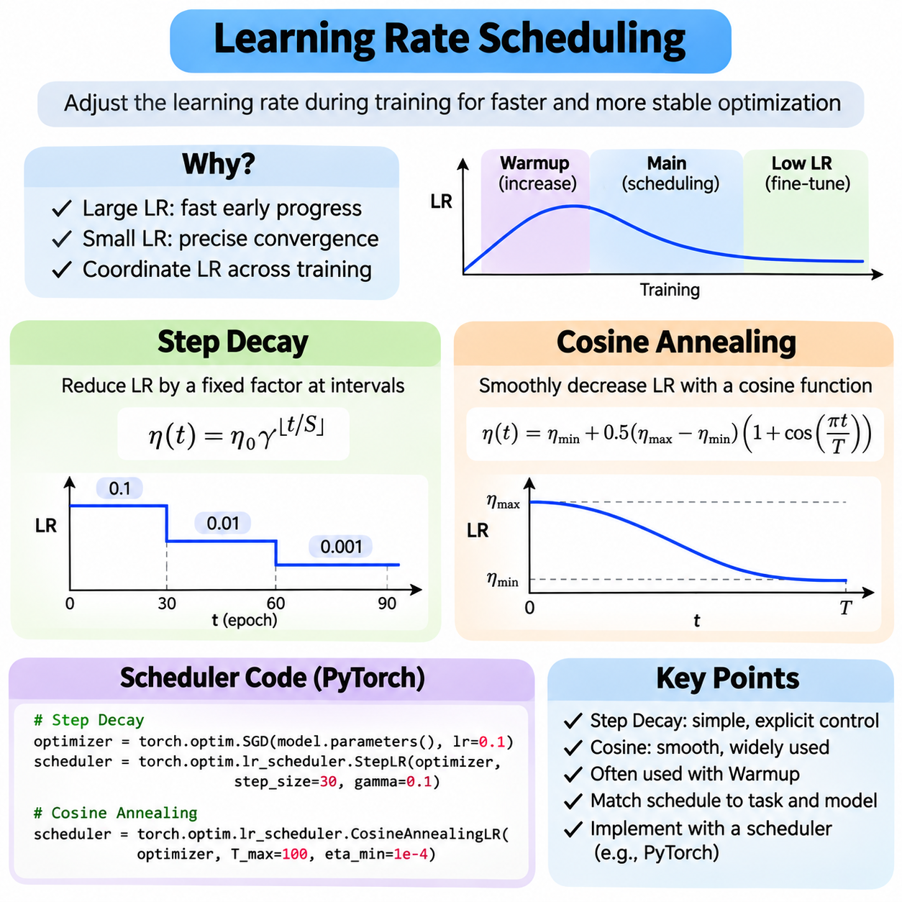
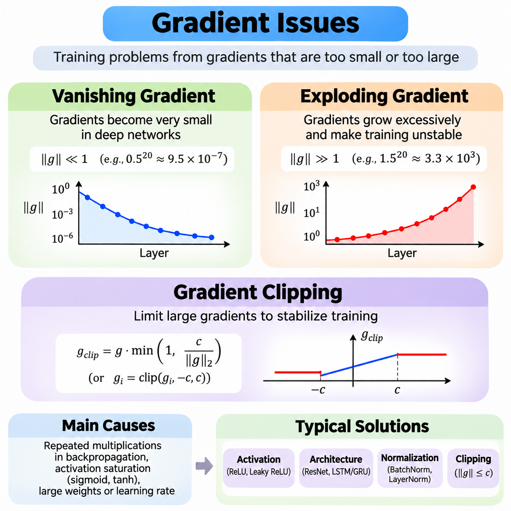
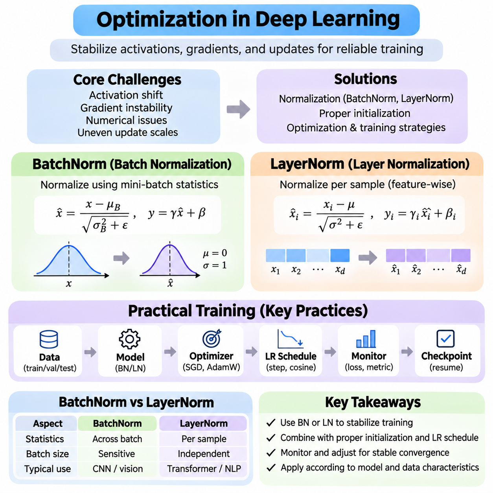

# 02. Gradient Descent Family

## 02.00 Gradient Descent

{width="7.268055555555556in" height="7.268055555555556in"}

경사 하강법(Gradient Descent)은 기계 학습(Machine Learning)에서 목적 함수(Objective Function)를 최소화하는 데 사용되는 기본적인 최적화 알고리즘(Optimization Algorithm)이다. 이 알고리즘은 손실 함수(Loss Function)의 기울기(Gradient)와 반대 방향으로 모델 매개변수(Model Parameters)를 반복적으로 조정한다. 기울기는 함수값이 국소적으로 가장 빠르게 증가하는 방향을 나타내므로, 학습률(Learning Rate)이 충분히 작을 때 반대 방향으로 이동하면 일반적으로 손실이 감소한다. 이러한 원리는 다양한 통계 모델(Statistical Models)과 신경망(Neural Networks)을 학습시키는 수학적 기반을 제공한다.

최적화 과정(Optimization Process)은 일반적으로 θ로 표현되는 초기 매개변수 벡터(Parameter Vector)에서 시작한다. 각 반복(Iteration)에서 알고리즘은 목적 함수의 기울기를 계산하고 θ(t+1) = θ(t) − η∇J(θ(t))에 따라 매개변수를 갱신한다. 여기서 η는 학습률(Learning Rate)을 나타내고, J는 목적 함수(Objective Function)를 의미한다. 학습률은 각 갱신 단계(Update Step)의 크기를 결정하며, 수렴 속도(Convergence Speed), 수치적 안정성(Numerical Stability), 최종 최적화 성능(Optimization Performance)에 큰 영향을 미친다.

경사 하강법(Gradient Descent)의 여러 방법은 주로 각 매개변수 갱신(Parameter Update)에서 기울기를 추정하기 위해 사용하는 학습 데이터(Training Data)의 수에 따라 구분된다. 배치 경사 하강법(Batch Gradient Descent)은 전체 학습 데이터셋(Training Dataset)을 사용하고, 확률적 경사 하강법(Stochastic Gradient Descent, SGD)은 하나의 학습 샘플(Training Example)을 사용하며, 미니배치 경사 하강법(Mini-Batch Gradient Descent)은 일부 샘플의 집합을 사용한다. 이 방법들은 동일한 기본 갱신 원리를 공유하지만 계산 요구량, 기울기 변동성, 메모리 사용량, 수렴 특성에서 상당한 차이를 보인다.

배치 경사 하강법(Batch Gradient Descent)은 모델 매개변수를 갱신하기 전에 모든 학습 샘플을 사용하여 목적 함수(Objective Function)의 기울기를 계산한다. N개의 샘플을 포함하는 데이터셋에서 경험적 목적 함수(Empirical Objective Function)는 일반적으로 J(θ) = (1/N)ΣᵢL(fθ(xᵢ), yᵢ)로 정의되며, L은 개별 손실(Individual Loss)을 나타낸다. 전체 기울기는 N개의 모든 샘플을 기반으로 계산되므로 현재 경험적 학습 목적 함수(Empirical Training Objective)의 기울기를 정확하게 반영하는 갱신 방향을 제공한다.

배치 경사 하강법(Batch Gradient Descent)의 주요 장점은 데이터셋과 모델 계산이 고정되어 있을 때 나타나는 결정론적 동작(Deterministic Behavior)이다. 각 반복에서 전체 데이터셋을 사용하므로 개별 학습 샘플의 선택에 따른 무작위성(Randomness)이 제거된다. 이러한 특성은 상대적으로 매끄러운 최적화 경로(Optimization Trajectory)를 형성하고 수렴 분석(Convergence Analysis)을 용이하게 한다. 볼록 목적 함수(Convex Objective Function)에 대해서는 적절한 평활성 조건(Smoothness Assumptions)과 학습률이 충족될 경우 잘 정립된 이론적 수렴 보장(Convergence Guarantees)을 제공한다.

그러나 학습 데이터셋에 수백만 또는 수십억 개의 샘플이 포함되면 배치 경사 하강법(Batch Gradient Descent)의 계산 비용(Computational Cost)이 크게 증가한다. 모든 매개변수 갱신에서 전체 데이터셋을 처리해야 하므로 계산 시간과 메모리 전송량(Memory Traffic)이 증가한다. 모든 샘플을 동시에 메모리에 저장하지 않고 기울기를 누적할 수 있지만 전체 데이터 처리 자체는 필요하다. 따라서 대규모 신경망 학습(Large-Scale Neural Network Training)에서는 배치 경사 하강법을 적용하기 어려운 경우가 많다.

배치 경사 하강법(Batch Gradient Descent)은 비교적 작은 데이터셋, 볼록 최적화 문제(Convex Optimization Problems), 재현 가능한 기울기 계산(Reproducible Gradient Calculation)이 필요한 실험에 적합하다. 선형 회귀(Linear Regression)는 평균 제곱 오차(Mean Squared Error)의 목적 함수를 해석적으로 미분할 수 있으므로 대표적인 사례이다. 알고리즘은 예측값을 계산하고 잔차(Residuals)를 평가하며, 모든 관측값에 대한 기울기를 누적한 다음 수렴 조건(Convergence Criterion)이 충족될 때까지 매개변수를 반복적으로 갱신한다.

실제 배치 경사 하강법(Batch Gradient Descent)의 구현에서는 일반적으로 모델 매개변수를 초기화하고 전체 학습 손실(Training Loss)을 평가한 다음, 해석적 미분(Analytical Differentiation) 또는 자동 미분(Automatic Differentiation)을 통해 기울기를 계산하고 매개변수를 갱신한다. 이 과정은 최대 반복 횟수(Maximum Iteration Count)에 도달하거나 개선 정도가 충분히 작아질 때까지 계속된다. 목적 함수값과 기울기 노름(Gradient Norm)을 관찰하면 수렴 상태를 판단할 수 있으며, 지나치게 큰 학습률은 진동(Oscillation)이나 발산(Divergence)을 유발할 수 있다.

확률적 경사 하강법(Stochastic Gradient Descent, SGD)은 전체 데이터셋의 기울기를 무작위로 선택한 하나의 학습 샘플에서 계산한 추정값으로 대체한다. 갱신 식은 θ(t+1) = θ(t) − η∇Lᵢ(θ(t))로 표현할 수 있으며, Lᵢ는 선택된 샘플의 손실을 의미한다. 학습 샘플이 균등하게 추출되는 경우 확률적 기울기(Stochastic Gradient)는 표준적인 샘플링 가정(Sampling Assumptions) 아래에서 전체 경험적 기울기(Full Empirical Gradient)의 불편 추정량(Unbiased Estimator)이 된다.

확률적 경사 하강법(SGD)은 개별 샘플을 처리한 직후 매개변수를 갱신하므로 모든 단계에서 전체 데이터셋을 평가하지 않고도 학습을 진행할 수 있다. 이러한 특성은 대규모 데이터셋과 스트리밍 학습 환경(Streaming Learning Environments)에서 유용하다. 또한 각 기울기 계산에 필요한 메모리가 상대적으로 적다. 그러나 순차적인 매개변수 갱신은 최신 그래픽 처리 장치(Graphics Processing Unit, GPU)의 병렬 처리(Parallel Processing) 성능을 충분히 활용하지 못할 수 있으며, 특히 개별 샘플의 계산량이 작은 경우 이러한 한계가 두드러진다.

확률적 경사 하강법(SGD)의 확률적 특성(Stochastic Nature)은 최적화 경로(Optimization Trajectory)에 변동을 발생시킨다. 개별 학습 샘플에서 계산한 기울기는 전체 데이터셋의 기울기와 크게 다를 수 있으므로 연속적인 매개변수 갱신이 서로 다른 방향으로 진행될 수 있다. 이러한 변동성은 복잡한 비볼록 손실 표면(Nonconvex Loss Surface)을 탐색하는 데 도움이 될 수 있지만, 국소 최솟값(Local Minima)에서 반드시 벗어나거나 전역 최적해(Global Optimum)에 도달한다는 것을 보장하지는 않는다.

확률적 경사 하강법(SGD)에서는 매개변수가 정상점(Stationary Point)에 가까워져도 기울기 잡음(Gradient Noise)이 남아 있을 수 있으므로 학습률(Learning Rate)이 특히 중요하다. 일정한 학습률을 유지하면 최적점에 정확하게 수렴하기보다 주변에서 지속적으로 변동할 수 있다. 시간이 지남에 따라 학습률을 감소시키면 적절한 가정 아래에서 이러한 변동을 줄이고 수렴을 개선할 수 있다. 그러나 학습률을 지나치게 빠르게 감소시키면 학습 속도가 느려지거나 매개변수 공간(Parameter Space)을 충분히 탐색하지 못할 수 있다.

실제 구현에서 확률적 경사 하강법(SGD)은 일반적으로 각 에포크(Epoch)마다 학습 샘플의 순서를 무작위로 섞어 처리한다. 에포크는 전체 학습 데이터셋을 한 번 통과하는 과정을 의미하며, 반복(Iteration)은 한 번의 매개변수 갱신을 의미한다. N개의 학습 샘플에 대해 일반적인 단일 샘플 SGD는 에포크당 약 N번의 갱신을 수행한다. 셔플링(Shuffling)은 샘플이 클래스(Class), 수집 시간 또는 기타 상관관계가 있는 특성에 따라 정렬되어 있을 때 발생할 수 있는 체계적인 순서 효과를 줄이는 데 도움이 된다.

확률적 경사 하강법(SGD)은 학습 데이터가 지속적으로 유입되거나 초기 매개변수 갱신을 빠르게 수행해야 하는 환경에서 유용하다. 온라인 추천 시스템(Online Recommendation Systems), 점진적 분류기(Incremental Classifiers), 스트리밍 예측 모델(Streaming Prediction Models)이 대표적인 적용 사례이다. 그러나 SGD의 성능은 데이터 순서, 특성 스케일링(Feature Scaling), 학습률 설정, 기울기 분산(Gradient Variance)에 영향을 받는다. 따라서 안정적인 구현을 위해서는 최적화 동작을 면밀하게 관찰하고 잡음이 많거나 이질성이 높은 관측값을 적절하게 처리해야 한다.

미니배치 경사 하강법(Mini-Batch Gradient Descent)은 학습 샘플의 일부 집합을 사용하여 기울기를 계산함으로써 배치 경사 하강법과 확률적 경사 하강법의 특성을 결합한다. 미니배치(Mini-Batch)에 B개의 샘플이 포함되면 갱신 과정에서 해당 샘플들의 평균 기울기(Average Gradient)를 사용한다. 이러한 추정값은 일반적으로 단일 샘플의 기울기보다 잡음이 적으며, 전체 데이터셋의 기울기를 계산하는 것보다 한 번의 갱신에 필요한 계산량이 훨씬 작다.

미니배치 크기(Mini-Batch Size)는 기울기 추정 품질(Gradient Estimation Quality)과 계산 효율성(Computational Efficiency) 사이의 절충 관계(Tradeoff)를 결정한다. 작은 미니배치는 매개변수를 더 자주 갱신하고 일반적으로 더 큰 확률적 변동성을 발생시킨다. 큰 미니배치는 상대적으로 안정적인 기울기 추정값을 제공하며 하드웨어 활용률(Hardware Utilization)을 높일 수 있다. 그러나 배치 크기가 증가하면 활성화 메모리(Activation Memory) 요구량도 증가하고, 일정 수준 이후에는 계산 처리량(Computational Throughput)의 개선 효과가 점차 감소할 수 있다.

미니배치 경사 하강법(Mini-Batch Gradient Descent)은 여러 학습 샘플을 동시에 처리하는 행렬 연산(Matrix Operations)을 활용할 수 있으므로 GPU에서 특히 효과적이다. 최신 딥러닝 프레임워크(Deep Learning Frameworks)는 입력 텐서(Input Tensors)를 배치 단위로 구성하고 벡터화된 순전파(Forward Propagation)와 역전파(Backward Propagation)를 실행한다. 이러한 접근법은 샘플당 처리 오버헤드(Processing Overhead)를 줄이고 가속기 활용률(Accelerator Utilization)을 향상시킨다. 따라서 미니배치 학습은 현대 딥러닝 응용 분야에서 표준적인 최적화 방식으로 자리 잡았다.

N개의 샘플을 포함하는 데이터셋에서 미니배치 크기가 B이면 에포크당 갱신 횟수는 대략 ceil(N/B)로 계산된다. 예를 들어 60,000개의 샘플과 배치 크기 128을 사용하는 경우 마지막 불완전 배치(Incomplete Batch)를 유지하면 469번의 갱신이 필요하다. 각 갱신 단계에서는 하나의 미니배치를 처리하고 평균 손실(Average Loss)과 해당 기울기를 계산한 다음, 다음 미니배치를 평가하기 전에 모델 매개변수를 수정한다.

미니배치 선택(Mini-Batch Selection)은 최적화 동작과 통계적 특성(Statistical Properties)에 모두 영향을 미친다. 무작위 셔플링(Random Shuffling)은 일반적으로 대표성 있는 배치를 구성하는 데 도움이 되며, 클래스 분포가 심하게 불균형한 경우에는 층화 샘플링(Stratified Sampling)이 유용할 수 있다. 순차 데이터(Sequential Data)에서는 제한 없는 셔플링이 시간적 의존성(Temporal Dependencies)이나 평가 가정(Evaluation Assumptions)을 위반할 수 있다. 따라서 배치 구성은 무작위 선택에만 의존하기보다 학습 문제의 특성을 반영해야 한다.

배치 크기(Batch Size)와 학습률(Learning Rate)의 관계는 신중하게 고려해야 한다. 큰 배치는 일반적인 샘플링 가정 아래에서 기울기 분산(Gradient Variance)을 줄이므로 더 큰 학습률을 허용할 가능성이 있다. 그러나 배치 크기에 비례하여 학습률을 증가시키는 선형 스케일링(Linear Scaling)은 보편적인 규칙이 아니라 경험적 방법(Heuristic)이다. 특정 스케일링 전략의 안정성은 모델 아키텍처(Model Architecture), 정규화 방법(Normalization Methods), 데이터셋 특성, 최적화 알고리즘 설정(Optimizer Configuration)에 따라 달라진다.

미니배치 학습(Mini-Batch Training)에는 데이터 로딩(Data Loading), 메모리 할당(Memory Allocation), 계산 스케줄링(Computational Scheduling)과 관련된 공학적 고려 사항도 포함된다. 효율적인 구현에서는 가능한 경우 데이터 준비와 GPU 계산을 중첩하여 수행한다. 고정 페이지 메모리(Pinned Memory), 비동기 전송(Asynchronous Transfers), 사전 가져오기(Prefetching), 적절한 작업자 구성(Worker Configuration)은 가속기의 유휴 시간(Idle Time)을 줄일 수 있다. 이러한 개선은 수학적 최적화 목적 자체를 변경하지 않지만 실제 학습 처리량(Training Throughput)을 크게 향상시킬 수 있다.

세 가지 경사 하강법(Gradient Descent) 변형은 서로 다른 기울기 추정기(Gradient Estimators)를 통해 이해할 수 있다. 배치 경사 하강법은 경험적 목적 함수의 정확한 기울기를 계산하고, 확률적 경사 하강법은 하나의 샘플을 사용하여 기울기를 추정하며, 미니배치 경사 하강법은 여러 샘플을 사용하여 기울기를 추정한다. 균등 샘플링(Uniform Sampling) 조건에서 확률적 추정값은 기댓값(Expectation) 측면에서 전체 기울기를 나타내지만, 분산과 계산 비용은 샘플링 전략(Sampling Strategy) 및 배치 크기에 따라 달라진다.

수렴 동작(Convergence Behavior)은 목적 함수(Objective Function)의 기하학적 구조(Geometry)에도 영향을 받는다. 매끄러운 볼록 목적 함수(Smooth Convex Objective)에 대해서는 적절하게 설정된 경사 하강법이 확립된 수렴 특성을 갖는다. 강한 볼록성(Strong Convexity)은 적절한 가정 아래에서 추가적인 수렴 보장을 제공한다. 그러나 심층 신경망(Deep Neural Networks)은 일반적으로 안장점(Saddle Points)과 복잡한 매개변수 상호작용(Parameter Interactions)을 포함하는 비볼록 목적 함수를 형성한다. 따라서 이러한 모델의 최적화 동작은 고전적인 볼록 수렴 이론(Convex Convergence Theory)만으로 완전히 설명할 수 없다.

최적화 수렴(Optimization Convergence)과 일반화 성능(Generalization Performance)은 구별해야 하는 중요한 개념이다. 학습 손실(Training Loss)을 더 정확하게 최소화하는 방법이 반드시 새로운 데이터(Unseen Data)에 대해 더 좋은 예측 결과를 제공하는 것은 아니다. 확률적 기울기 잡음(Stochastic Gradient Noise), 배치 크기, 학습률 스케줄(Learning Rate Schedule), 모델 아키텍처는 도달하는 해(Solution)에 영향을 줄 수 있다. 이러한 상호작용은 암묵적 정규화(Implicit Regularization)를 연구하는 동기가 되며, 최적화 성능을 검증 지표(Validation Metrics)와 함께 평가해야 하는 이유를 설명한다.

실제 기계 학습 시스템(Machine Learning Systems)에서 배치 경사 하강법(Batch Gradient Descent), 확률적 경사 하강법(Stochastic Gradient Descent), 미니배치 경사 하강법(Mini-Batch Gradient Descent)의 선택은 데이터셋 크기, 사용 가능한 하드웨어, 지연 시간 요구사항(Latency Requirements), 모델 복잡도(Model Complexity)에 따라 결정된다. 배치 방식은 안정적인 전체 기울기 갱신을 제공하고, SGD는 높은 수준의 점진적 학습(Incremental Learning)을 지원하며, 미니배치 방식은 통계적 효율성(Statistical Efficiency)과 계산 병렬성(Computational Parallelism)의 균형을 제공한다. 이러한 차이를 이해하는 것은 더욱 발전된 모멘텀 기반 최적화 알고리즘(Momentum-Based Optimization Algorithms)과 적응형 최적화 알고리즘(Adaptive Optimization Algorithms)을 학습하기 위한 기초가 된다.

## 02.01 Momentum Methods

{width="7.268055555555556in" height="7.268055555555556in"}

모멘텀 기법(Momentum Methods)은 이전 매개변수 갱신(Parameter Updates)의 정보를 현재 최적화 단계(Optimization Step)에 반영하여 기존 경사 하강법(Gradient Descent)을 확장한 방법이다. 현재 위치에서 계산한 기울기(Gradient)에만 의존하는 대신, 여러 반복(Iterations)에 걸쳐 방향 정보를 누적한다. 이러한 메커니즘은 특히 목적 함수(Objective Function)의 곡률(Curvature)이 방향에 따라 크게 달라지는 경우 수렴 속도(Convergence Speed)를 높이고, 진동(Oscillations)을 줄이며, 최적화 안정성(Optimization Stability)을 향상시킬 수 있다.

표준 경사 하강법(Standard Gradient Descent)은 목적 함수가 국소적으로 가장 빠르게 증가하는 방향을 나타내는 현재 기울기에 따라 모델 매개변수(Model Parameters)를 갱신한다. 이 접근법은 수학적으로 간단하지만 좁은 골짜기 형태의 손실 표면(Loss Surface)에서는 진행 속도가 느려지거나 가파른 방향을 가로질러 진동할 수 있다. 모멘텀(Momentum)은 과거 기울기의 이동 누적값(Moving Accumulation)을 유지하여 이러한 한계를 완화하며, 현재 정보와 과거 최적화 동작(Historical Optimization Behavior)을 함께 반영하도록 한다.

고전적 모멘텀(Classical Momentum)은 기울기의 지수 가중 누적값(Exponentially Weighted Accumulation)을 저장하는 속도 변수(Velocity Variable)를 도입한다. 일반적인 수식은 v(t) = βv(t−1) + ∇J(θ(t))이며, 이후 θ(t+1) = θ(t) − ηv(t)에 따라 매개변수를 갱신한다. 여기서 β는 모멘텀 계수(Momentum Coefficient), η는 학습률(Learning Rate), J는 목적 함수(Objective Function)를 나타낸다. 이 표현은 기울기를 직접 누적하며, 다른 구현에서는 학습률을 속도 변수에 포함하기도 한다.

모멘텀 계수(Momentum Coefficient)는 이전 기울기가 현재 갱신에 얼마나 강하게 영향을 미치는지를 결정한다. 계수가 0에 가까우면 일반적인 경사 하강법(Gradient Descent)과 유사하게 동작하고, 계수가 커질수록 더 많은 반복에 걸쳐 방향 정보가 유지된다. 0.9와 같은 값이 일반적인 초기 설정으로 사용되지만, 적절한 계수는 최적화 문제(Optimization Problem), 학습률, 기울기 특성(Gradient Characteristics), 학습 설정(Training Configuration)에 따라 달라진다.

모멘텀(Momentum)은 이전 기울기 방향에 대한 지수 가중 기억(Exponentially Weighted Memory)으로 해석할 수 있다. 기울기가 지속적으로 유사한 방향을 가리키면 누적된 기여가 해당 방향의 이동 크기를 증가시킨다. 반대로 기울기의 부호가 번갈아 바뀌면 기여가 부분적으로 상쇄되어 진동이 감소한다. 이러한 특성은 길게 늘어난 손실 지형(Loss Landscape)을 따라 진행 속도를 높이는 동시에 가파른 차원에서 불필요한 움직임을 억제한다.

길고 좁은 골짜기를 포함하는 손실 표면(Loss Surface)을 생각해 볼 수 있다. 일반적인 경사 하강법은 원하는 진행 방향에 수직인 기울기 성분이 강하게 나타나기 때문에 골짜기를 반복적으로 가로지를 수 있다. 모멘텀(Momentum)은 이러한 교대 성분(Alternating Components)을 억제하면서 골짜기 방향의 기울기를 누적한다. 그 결과 최적화 알고리즘(Optimizer)은 더 부드러운 경로를 따라 이동하며, 유리한 조건에서는 더 적은 반복으로 손실이 낮은 영역에 도달할 수 있다.

모멘텀(Momentum)은 딥러닝(Deep Learning)의 목적 함수가 매개변수 차원마다 서로 다른 곡률 척도(Curvature Scales)를 갖는 경우가 많기 때문에 신경망 학습(Neural Network Training)에서 특히 유용하다. 일부 방향에서는 큰 기울기가 발생하고 다른 방향에서는 상대적으로 작은 기울기가 나타난다. 방향 정보가 누적되지 않으면 불안정성을 방지하기 위해 보수적인 학습률을 사용해야 할 수 있다. 모멘텀은 모든 갱신을 현재 기울기에만 의존하지 않도록 하여 지속적인 하강 방향(Persistent Descent Directions)으로의 진행을 개선한다.

그러나 모멘텀(Momentum)이 모든 상황에서 더 빠른 수렴을 보장하는 것은 아니다. 지나치게 큰 모멘텀 계수(Momentum Coefficient)나 학습률(Learning Rate)은 목표 지점을 지나치는 현상(Overshooting), 지속적인 진동(Persistent Oscillations), 발산(Divergence)을 유발할 수 있다. 누적된 속도(Velocity)는 국소 기울기의 방향이 바뀐 이후에도 매개변수를 계속 이동시킬 수 있다. 따라서 모멘텀은 신중하게 설정해야 하며, 학습 손실(Training Loss), 검증 성능(Validation Performance), 최적화 안정성(Optimization Stability)을 통해 효과를 평가해야 한다.

네스테로프 가속 기울기(Nesterov Accelerated Gradient)는 일반적으로 네스테로프 모멘텀(Nesterov Momentum)이라고 하며, 현재 매개변수에서만 기울기를 계산하는 대신 예상되는 미래 위치(Anticipated Future Position)에서 기울기를 평가하도록 고전적 모멘텀을 수정한 방법이다. 이 방법은 기존 속도(Velocity)를 사용하여 기울기를 계산하기 전에 매개변수가 이동할 위치를 예측한다. 이러한 선행 탐색 메커니즘(Look-Ahead Mechanism)은 다음 갱신의 예상 도착 지점 주변에 있는 손실 지형(Loss Landscape)에 대한 정보를 제공한다.

일반적인 네스테로프 공식(Nesterov Formulation)은 선행 탐색 위치(Look-Ahead Position)를 θlook = θ(t) − ηβv(t−1)로 정의한다. 이후 예상 위치에서 기울기를 평가하여 v(t) = βv(t−1) + ∇J(θlook)을 계산하고, θ(t+1) = θ(t) − ηv(t)에 따라 매개변수를 갱신한다. 이 표현은 고전적 모멘텀과 동일한 기울기 누적 방식(Gradient Accumulation Convention)을 사용하며, 현재 위치와 선행 탐색 위치에서 기울기를 평가하는 차이를 명확하게 보여준다.

고전적 모멘텀(Classical Momentum)과 네스테로프 모멘텀(Nesterov Momentum)의 핵심적인 차이는 보정 기울기 정보(Corrective Gradient Information)를 얻는 시점에 있다. 고전적 모멘텀은 현재 매개변수에서 기울기를 계산한 후 누적 속도와 결합한다. 반면 네스테로프 모멘텀은 기존 속도에 따른 이동을 미리 예측하고 해당 위치에서 기울기를 평가한다. 이러한 조정은 최적화 경로가 곡률이 변화하는 영역에 접근할 때 더 이른 보정 반응을 제공할 수 있다.

선행 탐색 메커니즘(Look-Ahead Mechanism)은 최적화 알고리즘이 골짜기의 바닥을 향해 빠르게 이동하는 상황에서 직관적으로 이해할 수 있다. 고전적 모멘텀은 이전 기울기의 영향을 받은 속도 때문에 계속 가속할 수 있다. 네스테로프 모멘텀은 예상 도착 지점에 가까운 위치에서 기울기를 확인하므로 속도를 줄이거나 방향을 변경해야 할 필요성을 더 일찍 감지할 수 있다. 이러한 예측적 보정(Anticipatory Correction)은 적절한 조건에서 지나침 현상(Overshooting)을 줄이고 수렴 동작(Convergence Behavior)을 개선할 수 있다.

네스테로프 가속(Nesterov Acceleration)은 볼록 최적화(Convex Optimization)에서도 중요한 이론적 기반을 갖는다. 매끄러운 볼록 목적 함수(Smooth Convex Objective)에 대해 적절하게 설정된 가속 기울기 방법(Accelerated Gradient Methods)은 O(1/t²)의 목적 함수값 수렴 속도(Objective-Value Convergence Rate)를 달성할 수 있다. 이는 유사한 일반적 가정에서 표준 경사 하강법의 O(1/t) 수렴 속도와 비교된다. 다만 이러한 보장은 특정 가속 알고리즘과 매개변수 스케줄(Parameter Schedules)에 적용되며, 고정된 네스테로프 모멘텀 계수를 사용하는 모든 실제 구현에 자동으로 적용되는 것은 아니다.

심층 신경망 최적화(Deep Neural Network Optimization)에서 네스테로프 모멘텀(Nesterov Momentum)은 확률적 경사 하강법(Stochastic Gradient Descent, SGD)에 모멘텀을 결합한 형태의 확장 기능으로 자주 구현된다. 최신 기계 학습 프레임워크(Machine Learning Frameworks)는 일반적으로 SGD 최적화 알고리즘에서 네스테로프 옵션(Nesterov Option)을 제공한다. 그러나 속도, 학습률, 기울기 보정(Gradient Correction)을 결합하는 방식에 따라 구현 세부 사항이 명시적인 선행 탐색 공식과 다를 수 있다. 따라서 수학적 수식과 소프트웨어 구현을 비교할 때 이러한 차이를 이해하는 것이 중요하다.

모멘텀 기법(Momentum Methods)의 직관적인 동작은 지형 위를 이동하는 물체의 비유(Physical Analogy)를 통해 설명할 수 있다. 모델 매개변수(Model Parameters)는 물체의 위치를 나타내고, 기울기(Gradient)는 국소적인 내리막 방향을 결정하며, 누적 속도(Accumulated Velocity)는 이전 움직임의 영향을 나타낸다. 현재 경사에만 반응하는 일반적인 경사 하강법과 달리 모멘텀은 이전 방향에 대한 정보를 유지하므로 더 부드럽고 지속적인 움직임을 만들어 낸다.

이러한 물리적 비유(Physical Analogy)는 가속(Acceleration)과 진동(Oscillation)의 관계도 설명한다. 연속적인 기울기가 일관된 방향을 가리키면 모멘텀은 하강 경로(Descent Path)를 따라 유효 이동량(Effective Movement)을 증가시킨다. 반대로 기울기가 반복적으로 반대 방향으로 바뀌면 누적된 기여가 부분적으로 상쇄되어 불필요한 진동이 감소한다. 그러나 지나치게 큰 속도는 최적화 알고리즘을 유리한 영역 밖으로 이동시킬 수 있으므로 모멘텀과 학습률 사이의 균형이 중요하다.

고전적 모멘텀(Classical Momentum)은 이전 움직임에서 발생한 관성(Inertia)을 유지하면서 현재 경사에 반응하는 물체와 유사하다. 네스테로프 모멘텀(Nesterov Momentum)은 예상되는 미래 위치의 경사를 추정하는 예측적 요소(Anticipatory Component)를 추가한다. 이러한 차이는 물체 바로 아래의 지형에 반응하는 것과 조금 앞쪽의 지형을 미리 살펴보는 것에 비유할 수 있다. 두 방법 모두 과거 움직임을 활용하지만, 네스테로프는 예상 최적화 경로(Anticipated Optimization Trajectory)에 대한 추가 정보를 반영한다.

기하학적 관점(Geometric Perspective)에서 모멘텀 기법(Momentum Methods)은 손실 표면의 조건 상태(Conditioning)가 좋지 않을 때 특히 효과적이다. 나쁜 조건 상태(Poor Conditioning)는 매개변수 방향마다 곡률이 크게 달라 길게 늘어난 등고선(Elongated Contours)과 비효율적인 경사 하강 경로를 형성하는 경우에 발생한다. 모멘텀은 곡률이 큰 방향(High-Curvature Directions)으로 반복해서 이동하는 현상을 줄이면서 곡률이 작은 방향(Low-Curvature Directions)으로의 진행을 유지할 수 있다. 이러한 특성은 많은 고차원 최적화 문제(High-Dimensional Optimization Problems)에서 모멘텀이 효과적인 이유를 설명한다.

모멘텀(Momentum)의 효과는 기울기 잡음(Gradient Noise)에도 영향을 받는다. 확률적 최적화(Stochastic Optimization)에서는 개별 미니배치(Mini-Batches)가 전체 데이터셋의 기울기 주변에서 변동하는 기울기를 생성할 수 있다. 모멘텀은 여러 반복에 걸쳐 방향 정보를 평균화하여 단기적인 변동(Short-Term Fluctuations)의 영향을 줄일 수 있다. 그러나 상관관계가 있는 기울기 오차(Correlated Gradient Errors)나 빠르게 변화하는 손실 지형은 여전히 누적 속도에 영향을 줄 수 있으며, 모멘텀이 확률적 불확실성(Stochastic Uncertainty)을 완전히 제거하는 것은 아니다.

모멘텀 계수(Momentum Coefficients)와 학습률(Learning Rates)은 학습 과정에서 강하게 상호작용한다. 큰 모멘텀 계수는 과거 기울기의 지속성(Persistence)을 증가시키고, 큰 학습률은 각 매개변수 갱신에서 이동하는 거리를 증가시킨다. 두 값을 동시에 지나치게 크게 설정하면 최적화가 불안정해질 수 있다. 따라서 실제 학습에서는 학습률 스케줄(Learning Rate Schedules), 검증 모니터링(Validation Monitoring), 통제된 실험(Controlled Experiments)을 활용하여 하이퍼파라미터(Hyperparameters)를 함께 조정해야 한다.

모멘텀 기법(Momentum Methods)은 기본 경사 하강법(Basic Gradient Descent)과 더욱 발전된 최적화 알고리즘(Advanced Optimization Algorithms)을 연결하는 개념적 가교(Conceptual Bridge)를 제공한다. 이 방법은 이차 도함수(Second-Order Derivatives)나 명시적인 헤시안 계산(Explicit Hessian Calculations) 없이도 과거 기울기 정보를 활용하여 매개변수 갱신을 개선할 수 있음을 보여준다. 이러한 원리는 모멘텀과 유사한 일차 모멘트 추정(First-Moment Estimation)과 이차 모멘트 정보(Second-Moment Information)에 기반한 적응형 스케일링(Adaptive Scaling)을 결합하는 Adam과 같은 적응형 최적화 알고리즘(Adaptive Optimizers)에도 적용된다.

실제 기계 학습 응용 분야(Machine Learning Applications)에서 고전적 모멘텀(Classical Momentum)은 일반적인 경사 하강법에 비해 비교적 간단하면서 계산 비용이 낮은 개선 방법을 제공한다. 네스테로프 모멘텀(Nesterov Momentum)은 예측적 기울기 평가(Anticipatory Gradient Evaluation)를 도입하여 적절한 환경에서 최적화 동작을 추가로 개선할 수 있다. 두 방법 모두 우수한 일반화 성능(Generalization Performance)이나 보편적인 수렴 가속(Universal Convergence Acceleration)을 보장하지는 않지만, 신경망을 효율적으로 학습하고 현대 최적화 알고리즘의 발전 과정을 이해하는 데 중요한 기법으로 활용된다.

## 02.02 Adaptive Optimizers

{width="7.268055555555556in" height="7.268055555555556in"}

적응형 최적화 알고리즘(Adaptive Optimizers)은 개별 모델 매개변수(Model Parameters)의 유효 학습률(Effective Learning Rate)을 자동으로 조정하여 경사 하강법(Gradient Descent)을 확장한 방법이다. 모든 매개변수 차원(Parameter Dimensions)에 공통 학습률을 적용하는 기존 경사 하강법과 달리, 적응형 방법은 과거 기울기 정보(Historical Gradient Information)를 활용하여 갱신 크기(Update Magnitudes)를 제어한다. 이러한 접근법은 매개변수마다 기울기가 크게 다르거나 희소하고 잡음이 많으며 스케일이 적절하게 조정되지 않은 특성(Features)을 포함하는 학습에서 최적화 효율성(Optimization Efficiency)을 향상시킬 수 있다.

적응형 최적화(Adaptive Optimization)의 핵심 원리는 기울기 통계량(Gradient Statistics)을 추정하고 이를 사용하여 매개변수 갱신(Parameter Updates)을 정규화하는 것이다. 지속적으로 큰 기울기를 받는 매개변수에는 더 작은 유효 갱신 단계(Effective Steps)가 필요할 수 있으며, 상대적으로 작은 기울기를 갖는 매개변수에는 더 큰 갱신 단계가 유리할 수 있다. 이러한 조정은 기울기 크기 차이에 대한 민감도를 줄이지만, 적응형 최적화 알고리즘 역시 적절한 전역 학습률(Global Learning Rate)과 신중한 하이퍼파라미터 설정(Hyperparameter Configuration)이 필요하다.

아다그라드(Adagrad)는 적응형 기울기 알고리즘(Adaptive Gradient Algorithm)의 약자로, 누적된 기울기 제곱(Accumulated Squared Gradients)을 기반으로 매개변수별 학습률(Parameter-Specific Learning Rates)을 할당하도록 개발되었다. 각 반복(Iteration)에서 현재 기울기의 제곱을 누적 변수(Running Accumulator)에 더한다. 큰 기울기가 자주 발생하는 매개변수는 더 큰 누적값을 갖게 되어 유효 학습률이 감소한다. 반대로 기울기가 드물게 발생하는 매개변수는 상대적으로 더 큰 학습률을 유지한다.

아다그라드(Adagrad)의 갱신 식은 G(t) = G(t−1) + g(t)²로 표현되며, 이후 θ(t+1) = θ(t) − ηg(t)/(√G(t) + ε)에 따라 매개변수를 갱신한다. 여기서 g(t)는 현재 기울기(Current Gradient), G(t)는 원소별 누적 기울기 제곱(Element-Wise Accumulated Squared Gradients), η는 전역 학습률(Global Learning Rate), ε는 수치적 안정성을 위한 작은 상수(Numerical Stability Constant)를 의미한다. 모든 곱셈, 나눗셈, 제곱근 연산은 개별 매개변수 차원에 독립적으로 적용된다.

아다그라드(Adagrad)는 일부 특성이 다른 특성보다 훨씬 드물게 나타나는 희소 학습 문제(Sparse Learning Problems)에서 특히 효과적이다. 자연어 처리(Natural Language Processing), 추천 시스템(Recommendation Systems), 고차원 선형 모델(High-Dimensional Linear Models)이 대표적인 적용 분야이다. 활성화 빈도가 낮은 매개변수는 기울기 누적 횟수가 적으므로 학습률 감소가 상대적으로 완만하다. 이러한 특성은 학습 데이터셋(Training Dataset)에서 특성 출현 빈도(Feature Frequencies)가 크게 다른 경우 학습 효율성을 높일 수 있다.

그러나 아다그라드(Adagrad)는 누적 기울기 제곱 통계량(Accumulated Squared-Gradient Statistics)이 단조 증가(Monotonic Increase)한다는 중요한 한계를 갖는다. 학습이 진행될수록 갱신 식의 분모가 일반적으로 커지므로 유효 학습률(Effective Learning Rate)이 지속적으로 감소한다. 결국 추가적인 최적화가 필요한 상황에서도 매개변수 갱신 크기가 매우 작아질 수 있다. 이러한 한계 때문에 기존 아다그라드는 장시간 수행되는 일부 심층 신경망 학습(Deep Neural Network Training)에 적합하지 않을 수 있다.

알엠에스프롭(RMSProp)은 제곱 평균 제곱근 전파(Root Mean Square Propagation)를 의미하며, 누적 기울기 제곱 대신 지수 가중 이동 평균(Exponentially Weighted Moving Average)을 사용하여 아다그라드의 지속적인 학습률 감소 문제를 해결한다. 전체 기울기 이력을 동일한 누적 영향으로 유지하는 대신 오래된 기울기 정보의 가중치를 점진적으로 감소시킨다. 이러한 메커니즘은 먼 과거의 기울기 때문에 학습률이 계속 감소하는 현상을 방지하고, 최근 최적화 조건(Recent Optimization Conditions)에 따라 유효 학습률을 조정하도록 한다.

일반적인 알엠에스프롭(RMSProp)의 수식은 s(t) = ρs(t−1) + (1−ρ)g(t)²이며, 이후 θ(t+1) = θ(t) − ηg(t)/(√s(t) + ε)에 따라 매개변수를 갱신한다. 계수 ρ는 과거 기울기 제곱 정보의 감쇠(Decay)를 제어하고, s(t)는 최근 기울기의 이차 원시 모멘트(Second Raw Moment)를 추정한다. ρ에는 0.9와 같은 값이 자주 사용되지만, 최적의 설정은 학습 문제(Training Problem)에 따라 달라진다.

알엠에스프롭(RMSProp)은 최적화 과정에서 기울기 크기가 변화하거나 손실 표면(Loss Surface)의 방향별 곡률(Curvature)이 크게 다른 경우 유용하다. 최근 기울기 제곱 통계량에 따라 갱신 크기를 조정하므로 민감한 매개변수 차원에서 지나치게 큰 갱신을 줄일 수 있다. 이러한 동작은 비선형 신경망(Nonlinear Neural Networks)과 잡음이 많거나 비정상적인 기울기 분포(Nonstationary Gradient Distributions)를 포함하는 문제에서 학습 안정성(Training Stability)을 향상시키는 경우가 많다.

아다그라드(Adagrad)와 달리 알엠에스프롭(RMSProp)은 반복 횟수가 증가하더라도 유효 학습률(Effective Learning Rate)이 반드시 0으로 수렴하도록 만들지는 않는다. 최근 기울기가 작아지면 이동 평균(Moving Average)도 감소할 수 있으므로 갱신 크기 조정(Update Scaling)이 동적으로 반응한다. 그러나 알엠에스프롭이 임의의 목적 함수(Objective Functions)나 하이퍼파라미터 선택에 대해 수렴을 보장하는 것은 아니다. 학습률 설정, 수치적 안정성(Numerical Stability), 기울기 통계량과 모델 아키텍처(Model Architecture)의 상호작용은 여전히 중요하다.

아담(Adam)은 적응형 모멘트 추정(Adaptive Moment Estimation)의 약자로, 모멘텀 기반 기울기 누적(Momentum-Based Gradient Accumulation)과 기울기 제곱에 기반한 적응형 스케일링(Adaptive Scaling)을 결합한다. 아담은 두 가지 지수 가중 이동 평균(Exponentially Weighted Moving Averages)을 유지한다. 첫 번째는 기울기의 평균 방향(Mean Direction)을 추정하고, 두 번째는 중심화되지 않은 이차 모멘트(Uncentered Second Moment)를 추정한다. 이러한 통계량을 결합하여 방향의 지속성과 매개변수별 갱신 정규화(Parameter-Specific Update Normalization)를 하나의 최적화 알고리즘에 통합한다.

일차 모멘트 추정값(First-Moment Estimate)은 m(t) = β₁m(t−1) + (1−β₁)g(t)로 계산되며, 이차 모멘트 추정값(Second-Moment Estimate)은 v(t) = β₂v(t−1) + (1−β₂)g(t)²로 계산된다. 계수 β₁과 β₂는 각각의 이동 평균(Moving Averages)에 대한 감쇠율(Decay Rates)을 결정한다. 일반적인 기본값은 β₁ = 0.9와 β₂ = 0.999이지만, 특정 학습 작업(Training Workloads)에서는 이러한 설정을 조정해야 할 수 있다.

아담(Adam)은 이동 평균(Moving Averages)을 0으로 초기화하므로 초기 추정값이 0에 가까운 방향으로 편향(Bias)된다. 편향 보정(Bias Correction)은 m̂(t) = m(t)/(1−β₁ᵗ)와 v̂(t) = v(t)/(1−β₂ᵗ)를 통해 이러한 초기화 편향을 보정한다. 이후 매개변수 갱신(Parameter Update)은 θ(t+1) = θ(t) − ηm̂(t)/(√v̂(t) + ε)로 계산된다. 이러한 보정은 기울기 관측값(Gradient Observations)이 상대적으로 적게 누적된 최적화 초기 단계에서 특히 중요하다.

아담(Adam)은 많은 작업에서 초기 최적화(Initial Optimization)를 빠르게 진행하고 기존 확률적 경사 하강법(Stochastic Gradient Descent, SGD)보다 수동 조정(Manual Adjustment)이 적게 필요한 경우가 많아 딥러닝(Deep Learning)에서 널리 사용된다. 적응형 스케일링(Adaptive Scaling)은 매개변수별 기울기 차이가 큰 경우 유용하며, 모멘텀과 유사한 평균화(Momentum-Like Averaging)는 갱신 방향(Update Directions)을 안정화하는 데 도움이 된다. 아담은 합성곱 신경망(Convolutional Networks), 트랜스포머(Transformers), 생성 모델(Generative Models) 및 다양한 신경망 아키텍처에 폭넓게 적용되어 왔다.

실제적인 효과에도 불구하고 아담(Adam)이 모멘텀을 사용하는 확률적 경사 하강법(SGD with Momentum)보다 항상 우수한 것은 아니다. 일부 응용 분야에서는 일반화 성능(Generalization Performance), 최적화 안정성(Optimization Stability), 최종 검증 정확도(Final Validation Accuracy)에 차이가 나타난다. 또한 특정 아담 설정은 일부 볼록 최적화 환경(Convex Settings)에서도 수렴하지 않을 수 있다. 이러한 한계는 이론적 개선(Theoretical Refinements), 대안적인 적응형 방법(Alternative Adaptive Methods), 다양한 학습 조건에서의 최적화 동작에 대한 연구를 촉진하였다.

아담더블유(AdamW)는 적응형 기울기 기반 매개변수 갱신(Adaptive Gradient-Based Parameter Update)에서 가중치 감쇠(Weight Decay)를 분리하여 아담(Adam)을 확장한 알고리즘이다. 기존 아담 구현에서 목적 함수에 L2 페널티(L2 Penalty)를 추가하면 정규화 기울기(Regularization Gradient)가 모멘트 추정값(Moment Estimates)에 포함되고 적응형 분모(Adaptive Denominator)에 의해 스케일링된다. 따라서 적응형 매개변수별 스케일링이 적용되는 경우 L2 정규화(L2 Regularization)와 곱셈형 가중치 감쇠(Multiplicative Weight Decay)는 일반적으로 동일하지 않다.

아담더블유(AdamW)는 적응형 기울기 갱신과 별도로 매개변수를 축소하는 분리형 가중치 감쇠(Decoupled Weight Decay)를 도입한다. 단순화된 수식은 θ(t+1) = θ(t) − ηm̂(t)/(√v̂(t) + ε) − ηλθ(t)이며, 여기서 λ는 가중치 감쇠 계수(Weight-Decay Coefficient)를 의미한다. 따라서 적응형 기울기의 기여와 감쇠의 기여는 서로 다른 메커니즘으로 제어되며, 정규화 강도(Regularization Strength)를 더욱 명확하게 해석하고 조정할 수 있다.

최적화(Optimization)와 가중치 감쇠(Weight Decay)의 분리는 대규모 신경망 학습(Large Neural Network Training)에서 특히 유용하다. 아담더블유(AdamW)는 가중치 감쇠의 영향을 적응형 모멘트 통계량(Adaptive Moment Statistics)에 포함하지 않고 감쇠 계수를 조정할 수 있도록 한다. 이러한 차이는 정규화 동작(Regularization Behavior)과 검증 성능(Validation Performance)을 개선할 수 있지만, 실제 효과는 모델 아키텍처, 데이터셋, 학습 기간(Training Duration), 하이퍼파라미터 선택(Hyperparameter Selection)에 따라 달라진다.

아담더블유(AdamW)는 트랜스포머 기반 모델(Transformer-Based Models)과 대규모 표현 학습(Large-Scale Representation Learning)에서 일반적으로 사용되는 최적화 알고리즘이 되었다. 적응형 모멘트 추정(Adaptive Moment Estimation)과 분리형 가중치 감쇠(Decoupled Weight Decay)를 결합하여 최적화 효율성과 명시적 매개변수 정규화(Explicit Parameter Regularization) 사이의 실용적인 균형을 제공한다. 많은 구현에서는 편향 매개변수(Bias Parameters)와 정규화 매개변수(Normalization Parameters)를 가중치 감쇠 대상에서 제외하는데, 이는 모든 매개변수 그룹(Parameter Groups)에 동일한 축소를 적용하는 것이 항상 바람직하지는 않기 때문이다.

아다그라드(Adagrad), 알엠에스프롭(RMSProp), 아담(Adam), 아담더블유(AdamW)의 차이는 기울기 통계량 기반 최적화(Gradient-Statistics-Based Optimization)의 발전 과정을 보여준다. 아다그라드는 기울기 제곱을 지속적으로 누적하고, 알엠에스프롭은 누적 통계량을 지수 이동 평균(Exponential Averaging)으로 대체한다. 아담은 일차 모멘트 추정(First-Moment Estimation)과 편향 보정(Bias Correction)을 추가하며, 아담더블유는 적응형 기울기 갱신에서 가중치 감쇠를 분리한다. 각 발전 단계는 특정 한계를 해결하는 동시에 추가적인 설계 선택과 하이퍼파라미터를 도입한다.

적응형 최적화 알고리즘(Adaptive Optimizers)은 모델 매개변수에 대한 보조 통계량(Auxiliary Statistics)을 유지하므로 일반적으로 추가적인 메모리가 필요하다. 아다그라드는 기울기 제곱 누적 변수(Squared-Gradient Accumulator)를 저장하고, 알엠에스프롭은 이동 평균(Moving Average)을 유지하며, 아담 계열 알고리즘은 일반적으로 일차 및 이차 모멘트 추정값을 모두 저장한다. 매우 큰 모델에서는 이러한 최적화 상태(Optimizer States)가 상당한 메모리를 소비할 수 있으므로 저정밀도 최적화 상태(Reduced-Precision Optimizer States), 메모리 효율적인 구현(Memory-Efficient Implementations), 분산 상태 분할(Distributed State Partitioning)과 같은 기술이 필요해진다.

적응형 최적화 알고리즘(Adaptive Optimizer)을 선택할 때는 기울기 희소성(Gradient Sparsity), 학습 안정성(Training Stability), 계산 자원(Computational Resources), 일반화 요구사항(Generalization Requirements)을 고려해야 한다. 아다그라드는 희소 특성(Sparse Features)에 유용하고, 알엠에스프롭은 최근 기울기 제곱에 반응하는 정규화(Squared-Gradient Normalization)를 제공한다. 아담은 폭넓게 적용할 수 있는 적응형 모멘트 추정(Adaptive Moment Estimation)을 제공하며, 아담더블유는 분리형 정규화(Decoupled Regularization)를 추가한다. 모든 문제에서 최고의 성능을 보장하는 단일 최적화 알고리즘은 없으므로 통제된 실증적 비교(Controlled Empirical Comparison)가 필수적이다.

현대 기계 학습 시스템(Modern Machine Learning Systems)에서 적응형 최적화(Adaptive Optimization)는 독립적인 알고리즘 선택이 아니라 더 광범위한 학습 전략(Training Strategy)의 일부로 고려해야 한다. 학습률 스케줄(Learning-Rate Schedules), 배치 크기(Batch Size), 기울기 클리핑(Gradient Clipping), 매개변수 초기화(Parameter Initialization), 정규화(Normalization), 규제화(Regularization)는 최적화 알고리즘의 동작과 상호작용한다. 이러한 관계를 이해하면 더욱 안정적인 학습 설정(Training Configurations)을 구성할 수 있으며, 점점 더 크고 복잡해지는 인공지능 모델(Artificial Intelligence Models)을 효율적으로 최적화하기 위한 기반을 마련할 수 있다.

## 02.03 Learning Rate Scheduling

{width="7.268055555555556in" height="7.268055555555556in"}

학습률 스케줄링(Learning Rate Scheduling)은 전체 최적화 과정(Optimization Process)에서 학습률(Learning Rate)을 일정하게 유지하는 대신 학습 진행에 따라 조정하는 핵심적인 학습 전략(Training Strategy)이다. 학습률은 계산된 기울기(Gradient)에 반응하여 모델 매개변수(Model Parameters)가 얼마나 멀리 이동하는지를 결정한다. 큰 학습률은 초기 학습 속도를 높일 수 있으며, 작은 학습률은 더욱 정밀한 수렴(Convergence)을 지원하는 경우가 많다. 학습률 스케줄링은 학습의 여러 단계에서 이러한 동작을 체계적으로 조정한다.

고정 학습률(Fixed Learning Rate)은 단순한 최적화 문제(Optimization Problems)에 적합할 수 있지만, 복잡한 신경망(Neural Networks)은 학습이 진행됨에 따라 서로 다른 갱신 크기(Update Magnitudes)를 요구하는 경우가 많다. 초기 반복(Iterations)에서는 목적 함수(Objective Function)를 빠르게 감소시키는 비교적 큰 매개변수 조정(Parameter Adjustments)이 유리하다. 반면 후기 반복에서는 유리한 해(Solutions) 주변에서 발생하는 진동(Oscillations)을 방지하기 위해 더 작은 갱신이 필요하다. 학습률 스케줄링은 이러한 전환을 체계적으로 관리하는 메커니즘을 제공한다.

학습률 스케줄러(Learning Rate Scheduler)는 사전에 정의된 수학 함수(Mathematical Function), 학습 진행 상태(Training Progress), 관측된 성능(Observed Performance)에 따라 최적화 알고리즘(Optimizer)의 학습률을 변경한다. 일부 스케줄러는 각 에포크(Epoch)가 끝날 때 동작하고, 다른 스케줄러는 모든 최적화 단계(Optimization Step) 이후 학습률을 갱신한다. 에포크 기반 스케줄(Epoch-Based Schedule)과 단계 기반 스케줄(Step-Based Schedule)은 상당히 다른 학습 동역학(Training Dynamics)을 만들어 낼 수 있으므로 갱신 간격을 의도한 학습 설계와 일치시켜야 한다.

단계적 감쇠(Step Decay)는 가장 단순하면서도 널리 알려진 학습률 스케줄링 전략(Learning Rate Scheduling Strategy) 중 하나이다. 이 방법은 사전에 지정한 학습 간격(Training Intervals)마다 고정된 곱셈 계수(Multiplicative Factor)를 적용하여 학습률을 감소시킨다. 학습률을 연속적으로 감소시키는 대신 일정한 에포크 또는 반복 횟수 동안 유지한 후 급격하게 낮춘다. 이를 통해 학습 전반에 걸쳐 점차 작아지는 학습률의 연속적인 구간을 형성한다.

일반적인 단계적 감쇠(Step Decay)의 수식은 η(t) = η₀γ\^floor(t/S)로 표현된다. 여기서 η₀는 초기 학습률(Initial Learning Rate), γ는 감쇠 계수(Decay Factor), S는 단계 간격(Step Interval), t는 현재 에포크 또는 반복 횟수(Current Epoch or Iteration)를 나타낸다. γ가 0과 1 사이에 있으면 예정된 감쇠 시점마다 학습률이 감소한다. 바닥 함수(Floor Operation)는 지정된 간격이 완료된 이후에만 학습률이 변경되도록 한다.

예를 들어 초기 학습률(Initial Learning Rate)이 0.1이고 감쇠 계수(Decay Factor)가 0.1이며 단계 간격(Step Interval)이 30에포크라고 가정할 수 있다. 첫 30에포크 동안 학습률은 0.1로 유지되고, 다음 30에포크에서는 0.01로 감소하며, 60에포크 이후에는 0.001이 된다. 이러한 예측 가능한 동작(Predictable Behavior)은 단계적 감쇠를 구현하고 재현하며, 통제된 기계 학습 실험(Controlled Machine Learning Experiments)에서 분석하기 쉽게 만든다.

단계적 감쇠(Step Decay)는 학습 과정이 점진적으로 더 작은 매개변수 갱신(Parameter Updates)을 필요로 하는 구분된 단계들로 이루어질 때 효과적이다. 초기 학습에서는 비교적 공격적인 학습률(Aggressive Learning Rate)을 사용하여 손실 지형(Loss Landscape)을 빠르게 이동할 수 있다. 이후 학습률을 낮추면 더욱 보수적인 최적화(Conservative Optimization)를 유도하고 수렴 안정성(Convergence Stability)을 향상시킬 수 있다. 그러나 급격한 변경은 일시적으로 학습 동역학을 변화시킬 수 있으며, 감쇠 시점(Decay Milestones)을 잘못 선택하면 학습률이 지나치게 일찍 감소할 수 있다.

단계적 감쇠(Step Decay)의 주요 한계는 감쇠 간격(Decay Intervals)과 곱셈 계수(Multiplicative Factors)를 수동으로 선택해야 한다는 점이다. 데이터셋(Datasets), 모델 아키텍처(Model Architectures), 최적화 알고리즘(Optimization Algorithms)에 따라 서로 다른 스케줄이 필요할 수 있다. 학습률이 너무 일찍 감소하면 만족스러운 해에 도달하기 전에 최적화가 정체(Stagnation)될 수 있다. 반대로 너무 늦게 감소하면 이미 유리한 영역에 도달한 상태에서도 진동이 지속되거나 계산 자원(Computational Resources)이 낭비될 수 있다.

코사인 어닐링(Cosine Annealing)은 코사인 형태의 함수(Cosine-Shaped Function)에 따라 학습률을 점진적으로 감소시키는 더욱 부드러운 대안을 제공한다. 급격한 감소를 적용하는 대신 사전에 정의된 학습 구간(Training Horizon)에 걸쳐 학습률을 연속적으로 조정한다. 이러한 부드러운 전환(Smooth Transition)은 초기 최적화에서 비교적 큰 갱신을 허용하고, 스케줄 종료 시점에 가까워질수록 갱신 크기를 점차 줄여 매개변수 이동(Parameter Movement)을 제어한다.

표준 코사인 어닐링(Cosine Annealing)의 수식은 η(t) = ηmin + 0.5(ηmax − ηmin)(1 + cos(πt/T))로 표현된다. 여기서 ηmax는 초기 최대 학습률(Initial Maximum Learning Rate), ηmin은 최소 학습률(Minimum Learning Rate), T는 예정된 스케줄 기간(Scheduled Duration), t는 0부터 T까지의 진행 상태를 나타낸다. 코사인 함수(Cosine Function)는 최대값에서 시작하여 점진적으로 최소값에 접근하므로 부드러운 학습률 궤적(Smooth Learning Rate Trajectory)을 형성한다.

코사인 스케줄(Cosine Schedule)은 시작 부분에서 천천히 감소하고 중간 부분에서 상대적으로 빠르게 변화하며, 최소 학습률에 접근할수록 다시 완만해진다. 이러한 동작은 일정한 비율로 학습률을 감소시키는 선형 감쇠(Linear Decay)와 다르다. 부드러운 감소는 후기 최적화(Late-Stage Optimization)의 안정성을 지원할 수 있지만, 실제 효과는 학습 구간(Training Horizon), 최적화 알고리즘(Optimizer), 학습 문제(Learning Problem)의 특성에 따라 달라진다.

코사인 어닐링(Cosine Annealing)은 합성곱 신경망(Convolutional Neural Networks), 트랜스포머(Transformers), 대규모 표현 학습(Large-Scale Representation Learning)을 포함하는 딥러닝 작업(Deep Learning Workloads)에서 자주 사용된다. 수학적으로 단순하므로 계산 예산(Computational Budgets)이 사전에 정해진 장기 학습 스케줄(Long Training Schedules)에 적합하다. 그러나 단계적 감쇠보다 더 우수한 수렴이나 일반화(Generalization)를 자동으로 보장하는 것은 아니며, 검증 실험(Validation Experiments)을 통해 효과를 확인해야 한다.

코사인 어닐링(Cosine Annealing)은 학습률을 주기적으로 증가시킨 후 새로운 코사인 감쇠 주기(Cosine Decay Cycle)를 시작하는 웜 리스타트(Warm Restarts)와 결합할 수도 있다. 이러한 재시작(Restarts)은 최적화 지형(Optimization Landscape)을 다시 탐색하도록 유도할 수 있다. 그러나 재시작이 없는 코사인 어닐링(Cosine Annealing Without Restarts)은 서로 다른 학습률 궤적을 따르므로, 스케줄러를 설정하거나 실험 결과를 해석할 때 이러한 차이를 명확하게 구분해야 한다.

학습률 스케줄링(Learning Rate Scheduling)은 학습률을 작은 초기값에서 점진적으로 증가시키는 워밍업 단계(Warmup Phase)와 함께 사용되는 경우가 많다. 워밍업(Warmup)은 특히 대규모 신경망(Large Neural Networks)이나 큰 배치 크기(Large Batch Sizes)를 사용하는 학습 설정에서 초기 최적화 단계의 불안정성을 줄일 수 있다. 워밍업 이후에는 계획된 학습 구간에 따라 단계적 감쇠(Step Decay) 또는 코사인 어닐링(Cosine Annealing)을 적용하여 학습률을 점진적으로 감소시킬 수 있다.

학습률 스케줄링(Learning Rate Scheduling)을 구현하려면 최적화 알고리즘(Optimizer), 스케줄러(Scheduler), 학습 루프(Training Loop) 사이의 동작을 조정해야 한다. 최적화 알고리즘은 현재 학습률을 사용하여 매개변수를 갱신하고, 스케줄러는 학습률을 언제 어떤 방식으로 변경할지 결정한다. 신뢰할 수 있는 구현(Reliable Implementation)을 위해서는 스케줄링이 에포크 단위인지 최적화 단계 단위인지 명확하게 정의하고, 설정된 스케줄이 의도한 전체 갱신 횟수와 일치하도록 해야 한다.

파이토치(PyTorch)에서는 최적화 알고리즘(Optimizer), 단계 크기 매개변수(step_size), 감쇠 계수(gamma)를 입력받는 StepLR 스케줄러를 사용하여 단계적 감쇠(Step Decay)를 구현할 수 있다. 최적화 알고리즘은 학습 중 모델 매개변수(Model Parameters)를 갱신하고, 스케줄러의 step 메서드(Step Method)는 학습률 스케줄을 진행시킨다. 스케줄러가 에포크 단위로 동작하도록 설계된 경우 일반적으로 해당 에포크의 최적화 갱신이 완료된 후 step 메서드를 호출한다.

파이토치(PyTorch)는 지정된 T_max 구간에 걸쳐 코사인 스케줄(Cosine Schedule)에 따라 학습률을 조정하는 CosineAnnealingLR도 제공한다. eta_min 매개변수(Parameter)는 학습률의 하한값(Lower Learning Rate Boundary)을 정의한다. 스케줄러는 step 메서드(Step Method)가 호출될 때마다 진행되므로 T_max는 호출 간격과 동일한 단위로 해석해야 한다. 이러한 구분은 의도한 코사인 궤적(Cosine Trajectory)을 정확하게 구현하는 데 필수적이다.

일반적인 스케줄러 구현(Scheduler Implementation)은 학습 루프(Training Loop)에 진입하기 전에 모델(Model), 손실 함수(Loss Function), 최적화 알고리즘(Optimizer), 스케줄링 설정(Scheduling Configuration)을 초기화한다. 각 반복에서는 순전파(Forward Propagation), 손실 계산(Loss Calculation), 역전파(Backpropagation)를 통한 기울기 계산, 매개변수 갱신을 수행한다. 이후 지정된 간격에서 스케줄러를 진행시킨다. 학습률을 학습 및 검증 지표(Training and Validation Metrics)와 함께 기록하면 재현성(Reproducibility)과 성능 분석(Performance Analysis)에 도움이 된다.

학습이 중단된 후 재개되는 경우 일반적으로 모델 매개변수(Model Parameters)와 함께 최적화 알고리즘 상태(Optimizer State) 및 스케줄러 상태(Scheduler State)를 복원해야 한다. 그렇지 않으면 재개된 학습 과정에서 잘못된 학습률을 사용하거나 이전 스케줄링 단계를 반복할 수 있다. 따라서 신뢰할 수 있는 체크포인트 관리(Reliable Checkpointing)는 현재 에포크 또는 반복 횟수, 최적화 통계량(Optimizer Statistics), 스케줄러 진행 상태(Scheduler Progress), 관련 학습 설정(Training Configuration)을 보존해야 한다.

학습률 스케줄링(Learning Rate Scheduling)과 적응형 최적화 알고리즘(Adaptive Optimizers)의 상호작용에는 특별한 주의가 필요하다. 아담(Adam)과 아담더블유(AdamW) 같은 알고리즘은 기울기 통계량(Gradient Statistics)을 활용하여 매개변수별 유효 갱신 크기(Effective Update Magnitudes)를 이미 조정한다. 그럼에도 전역 학습률(Global Learning Rate)은 최적화 동작에 계속 영향을 미친다. 이러한 알고리즘에 단계적 감쇠 또는 코사인 어닐링을 적용하면 학습 진행과 최종 수렴(Final Convergence)을 추가로 제어할 수 있다.

단계적 감쇠(Step Decay)와 코사인 어닐링(Cosine Annealing) 중 어떤 방법을 선택할지는 학습 기간(Training Duration), 최적화 동작(Optimization Behavior), 실험 목표(Experimental Objectives)에 따라 달라진다. 단계적 감쇠는 단순성(Simplicity), 해석 가능성(Interpretability), 감쇠 시점에 대한 명시적인 제어(Explicit Control)를 제공한다. 코사인 어닐링은 큰 갱신에서 작은 갱신으로 자연스럽게 전환되는 부드러운 궤적(Smooth Trajectory)을 제공한다. 어느 방법도 모든 상황에서 최적이라고 할 수 없으므로 일관된 학습 조건(Consistent Training Conditions)에서 실증적으로 비교해야 한다.

학습률 스케줄링(Learning Rate Scheduling)은 학습 손실(Training Loss)만으로 평가해서는 안 된다. 검증 성능(Validation Performance), 수렴 속도(Convergence Speed), 기울기 안정성(Gradient Stability), 계산 효율성(Computational Efficiency)은 스케줄러 효과를 판단하는 상호 보완적인 정보를 제공한다. 학습 손실을 빠르게 감소시키는 스케줄이 반드시 최고의 일반화 성능(Generalization Performance)을 제공하는 것은 아니다. 따라서 통제된 실험(Controlled Experiments)에서는 일관된 데이터셋, 모델 아키텍처, 난수 시드(Random Seeds), 평가 절차(Evaluation Procedures)를 사용하여 스케줄링 전략을 비교해야 한다.

현대 인공지능 학습 시스템(Artificial Intelligence Training Systems)에서 학습률 스케줄링(Learning Rate Scheduling)은 최적화 엔지니어링(Optimization Engineering)의 필수 구성 요소이다. 그 효과는 배치 크기(Batch Size), 기울기 누적(Gradient Accumulation), 모멘텀(Momentum), 적응형 최적화 알고리즘(Adaptive Optimizers), 학습 기간(Training Duration)과의 상호작용에 따라 달라진다. 단계적 감쇠, 코사인 어닐링, 스케줄러 구현(Scheduler Implementation)을 이해하면 안정적이고 재현 가능한 학습 파이프라인(Training Pipelines)을 설계하고, 사용 가능한 계산 자원(Computational Resources)을 효율적으로 활용할 수 있다.

## 02.04 Gradient Issues

{width="7.268055555555556in" height="7.268055555555556in"}

기울기 관련 문제(Gradient-Related Problems)는 역전파(Backpropagation)를 통해 계산된 기울기(Gradient)에 매개변수 갱신(Parameter Updates)이 직접적으로 의존하기 때문에 심층 신경망(Deep Neural Networks) 학습에서 근본적인 과제로 작용한다. 기울기가 지나치게 작아지거나 커지면 최적화(Optimization) 속도가 급격히 느려지거나 불안정해질 수 있다. 기울기 소실(Vanishing Gradient), 기울기 폭발(Exploding Gradient), 기울기 클리핑(Gradient Clipping)은 기울기 크기가 학습에 미치는 영향과 수치적 불안정성(Numerical Instability)을 제어하는 방법을 설명하는 밀접하게 연관된 개념이다.

역전파(Backpropagation)는 연속된 신경망 계층(Network Layers)에 연쇄 법칙(Chain Rule)을 반복적으로 적용하여 기울기(Gradients)를 계산한다. 계산된 기울기는 국소 도함수(Local Derivatives)와 가중치 행렬(Weight Matrices)의 곱에 따라 결정된다. 깊은 신경망 구조(Deep Architectures)에서는 이러한 반복적인 곱셈으로 인해 기울기 크기가 크게 감소하거나 증가할 수 있다. 그 결과 초기 계층(Early Layers)은 효과적인 학습 신호(Learning Signals)를 전달받지 못할 수 있으며, 다른 계층에서는 지나치게 큰 매개변수 갱신이 발생할 수 있다.

기울기 소실 문제(Vanishing Gradient Problem)는 신경망을 역방향으로 전파하는 과정에서 기울기가 극도로 작아질 때 발생한다. 초기 계층의 매개변수(Parameters)는 의미 있는 학습 진행을 만들어 내기 어려울 정도로 작은 갱신값을 받을 수 있다. 이 문제는 포화 활성화 함수(Saturating Activation Functions)를 사용하는 심층 신경망과 긴 시퀀스(Long Sequences)를 처리하는 순환 신경망 구조(Recurrent Architectures)에서 특히 두드러진다. 결과적으로 모델은 복잡한 계층적 표현(Hierarchical Representations)이나 장거리 의존성(Long-Range Dependencies)을 학습하는 데 어려움을 겪을 수 있다.

수학적으로 크기가 지속적으로 1보다 작은 도함수(Derivatives)를 갖는 연속적인 변환(Transformations)을 생각할 수 있다. 연쇄 법칙(Chain Rule)을 적용하면 이러한 도함수가 여러 계층에 걸쳐 곱해지므로 기울기가 지수적으로 감소할 수 있다. 예를 들어 크기가 0.5인 도함수를 20개 계층에 걸쳐 반복적으로 곱하면 약 9.54 × 10⁻⁷이 된다. 이러한 감쇠(Attenuation)는 신경망의 초기 구성 요소에서 기울기 기반 갱신(Gradient-Based Updates)을 거의 효과가 없도록 만들 수 있다.

활성화 함수(Activation Functions)는 기울기 소실(Vanishing Gradients)에 상당한 영향을 미친다. 시그모이드 함수(Sigmoid Function)는 입력값이 매우 큰 양수 또는 음수가 되면 포화 상태(Saturation)에 가까워지면서 도함수가 0에 근접한다. 쌍곡 탄젠트 함수(Hyperbolic Tangent Function)도 포화 영역(Saturation Regions) 부근에서 유사한 동작을 보인다. 여러 계층이 이러한 영역에서 동작하면 기울기가 빠르게 감소할 수 있다. 이는 활성화 함수 선택(Activation Selection)이 딥러닝에서 중요한 아키텍처 설계 결정(Architectural Decision)인 이유를 설명한다.

일반적으로 렐루(ReLU)라고 부르는 정류 선형 유닛(Rectified Linear Unit)은 양수 입력에 대한 도함수가 1이므로 기울기 소실을 완화하는 데 도움이 된다. 그러나 ReLU가 모든 기울기 관련 문제를 제거하는 것은 아니다. 음수 입력에서는 도함수가 0이므로 유용한 기울기 신호를 더 이상 받지 못하는 비활성 뉴런(Inactive Neurons)이 발생할 수 있다. 리키 렐루(Leaky ReLU)와 젤루(GELU) 같은 변형 함수는 대안적인 활성화 동작(Activation Behaviors)을 제공하지만, 효과는 신경망 구조와 학습 조건에 따라 달라진다.

잔차 연결(Residual Connections)은 기울기 소실(Vanishing Gradients)을 완화하는 또 다른 중요한 메커니즘이다. 변환 과정 주변에 항등 경로(Identity Pathway)를 추가함으로써 잔차 구조(Residual Architectures)는 기울기가 더 짧은 계산 경로(Computational Paths)를 통해 전파될 수 있도록 한다. 이러한 설계는 매우 깊은 신경망의 최적화를 지원하며, 현대 합성곱 신경망 구조(Convolutional Architectures)와 트랜스포머(Transformers)에서 널리 사용된다. 그러나 잔차 연결이 모든 설정에서 완벽하게 안정적인 기울기를 보장하는 것은 아니다.

기울기 폭발 문제(Exploding Gradient Problem)는 기울기 소실과 반대되는 현상으로, 역전파(Backpropagation) 과정에서 기울기 크기가 지나치게 증가할 때 발생한다. 큰 기울기는 매우 큰 매개변수 갱신(Parameter Updates)을 유발하여 최적화를 불안정하게 만들 수 있다. 학습 손실(Training Loss)이 예측하기 어렵게 변동하거나 급격히 증가하거나 수치적으로 정의되지 않은 상태가 될 수 있다. 심각한 경우 부동소수점 연산(Floating-Point Computations)에서 무한대(Infinity) 또는 NaN 값이 발생하여 학습 과정을 안정적으로 지속하기 어려워진다.

기울기 폭발(Exploding Gradients)은 신경망 계층이나 시간 단계(Time Steps)에 걸쳐 반복되는 야코비안 행렬 곱(Jacobian Products)이 신호를 증폭할 때 발생할 수 있다. 관련 도함수의 크기가 반복적으로 1을 초과하면 곱셈 결과가 빠르게 증가할 수 있다. 예를 들어 1.5라는 계수를 20번 반복해서 곱하면 약 3325가 된다. 이러한 단순화된 계산은 중간 정도의 국소 증폭(Local Amplification)도 깊은 계산 그래프(Computational Graph) 전체에서 반복되면 상당히 커질 수 있음을 보여준다.

순환 신경망(Recurrent Neural Networks)은 시간 역전파(Backpropagation Through Time)가 시퀀스 위치(Sequence Positions)에 걸쳐 관련 변환을 반복적으로 적용하기 때문에 기울기 소실과 기울기 폭발에 특히 취약하다. 긴 시퀀스는 도함수 곱셈 횟수를 증가시켜 순환 동역학(Recurrent Dynamics)에 대한 민감도를 높인다. 장단기 기억 네트워크(Long Short-Term Memory, LSTM)와 게이트 순환 유닛(Gated Recurrent Unit, GRU) 같은 게이트 기반 구조(Gated Architectures)는 긴 시간적 의존성(Temporal Dependencies)에 걸친 정보 및 기울기 전파를 개선하기 위한 목적으로 부분적으로 개발되었다.

기울기 폭발(Exploding Gradients)은 초기화(Initialization), 학습률(Learning Rates), 중간 활성화 크기(Intermediate Activation Scales)가 적절하게 제어되지 않는 경우 순전파 신경망(Feedforward Networks), 트랜스포머(Transformers), 기타 심층 신경망 구조에서도 발생할 수 있다. 큰 매개변수 값(Parameter Values)은 중간 신호와 기울기를 증폭하여 최적화 과정에서 불안정한 피드백(Unstable Feedback)을 형성할 수 있다. 혼합 정밀도 학습(Mixed-Precision Training)은 제한된 부동소수점 표현 범위(Floating-Point Ranges)로 인해 오버플로(Overflow) 또는 언더플로(Underflow)가 발생할 수 있으므로 추가적인 수치적 문제를 일으킬 수 있다.

기울기 문제(Gradient Problems)를 탐지하려면 학습 손실(Training Loss) 이외의 지표도 모니터링해야 한다. 기울기 노름(Gradient Norms), 매개변수 갱신 크기(Parameter Update Magnitudes), 활성화 분포(Activation Distributions), 수치적 예외(Numerical Exceptions)는 유용한 진단 정보(Diagnostic Information)를 제공한다. 기울기 소실은 초기 계층에서 지속적으로 매우 작은 기울기로 나타날 수 있으며, 기울기 폭발은 갑작스러운 노름 급증(Norm Spikes)이나 불안정한 손실값으로 나타날 수 있다. 그러나 실제 최적점(Genuine Optimum) 부근에서 발생하는 작은 기울기가 반드시 기울기 소실 문제를 의미하는 것은 아니다.

기울기 클리핑(Gradient Clipping)은 최적화 알고리즘(Optimizer)이 모델 매개변수를 갱신하기 전에 지나치게 큰 기울기를 제한하는 실용적인 기법이다. 목적 함수(Objective Function)를 변경하는 대신 계산된 기울기의 크기가 지정된 임계값(Threshold)을 초과할 때 이를 수정한다. 이를 통해 개별 최적화 단계(Optimization Steps)의 갱신 크기가 과도해지는 것을 방지하며, 순환 신경망(Recurrent Networks), 불안정한 학습 설정(Unstable Training Configurations), 간헐적인 기울기 급증(Gradient Spikes)이 발생하는 모델에서 특히 유용하다.

값 기반 기울기 클리핑(Gradient Clipping by Value)은 각 기울기 성분(Gradient Component)을 사전에 정의된 구간으로 독립적으로 제한한다. 임계값 c에 대해 연산은 gᵢ ← max(−c, min(gᵢ, c))로 표현할 수 있다. 양의 임계값을 초과하는 성분은 c로 감소시키고, 음의 임계값보다 작은 성분은 −c로 증가시킨다. 이 접근법은 구현이 간단하지만 개별 성분을 별도로 수정하므로 전체 기울기 방향(Overall Gradient Direction)이 변경될 수 있다.

노름 기반 기울기 클리핑(Gradient Clipping by Norm)은 기울기 벡터(Gradient Vector)의 방향을 유지하면서 전체 크기를 제한한다. 기울기 벡터 g와 최대 노름(Maximum Norm) c가 주어지면 클리핑된 기울기(Clipped Gradient)는 gclip = g × min(1, c/(\|\|g\|\|₂ + ε))로 표현된다. 노름이 임계값보다 작으면 기울기는 사실상 변경되지 않는다. 반대로 노름이 임계값을 초과하면 모든 성분을 동일한 비율로 축소하여 지나치게 큰 갱신을 방지한다.

노름 기반 클리핑(Norm-Based Clipping)은 방향 정보(Directional Information)를 실질적으로 변경하지 않으면서 기울기 크기를 제어하므로 널리 사용된다. 예를 들어 기울기 벡터의 L2 노름(L2 Norm)이 20이고 클리핑 임계값(Clipping Threshold)이 5라면 벡터에 0.25를 곱한다. 그 결과 노름은 5가 되지만 방향은 그대로 유지된다. 이러한 특성은 기울기 성분의 상대적 기여(Relative Contributions)를 보존하는 것이 중요한 최적화 과정에서 노름 기반 클리핑을 특히 유용하게 만든다.

클리핑 임계값(Clipping Threshold)은 지나치게 작으면 유용한 학습 신호(Learning Signals)를 억제할 수 있으므로 실증적인 평가(Empirical Evaluation)를 통해 선택해야 한다. 반대로 임계값이 너무 크면 불안정성을 방지하지 못할 수 있다. 1.0이나 5.0과 같은 값은 일반적인 실험 초기값(Experimental Starting Points)이지만, 적절한 설정은 모델 아키텍처(Architecture), 손실 스케일링(Loss Scaling), 최적화 알고리즘의 동작(Optimizer Behavior), 기울기 분포(Gradient Distributions)에 따라 달라진다. 클리핑 발생 빈도(Clipping Frequency)를 모니터링하면 임계값이 적절한지 판단하는 데 도움이 된다.

파이토치(PyTorch)에서는 torch.nn.utils.clip_grad_norm\\_ 또는 torch.nn.utils.clip_grad_value_를 사용하여 기울기 클리핑(Gradient Clipping)을 구현할 수 있다. 이러한 연산은 일반적으로 loss.backward()가 기울기를 계산한 이후, optimizer.step()이 매개변수를 갱신하기 전에 적용한다. 기울기 스케일링(Gradient Scaling)을 사용하는 자동 혼합 정밀도 학습(Automatic Mixed-Precision Training)에서는 클리핑 임계값이 의도한 수치적 크기에 적용되도록 일반적으로 클리핑 전에 기울기의 스케일을 복원(Unscaling)해야 한다.

기울기 클리핑(Gradient Clipping)은 기울기 정규화(Gradient Normalization)나 학습률 스케줄링(Learning Rate Scheduling)과 혼동해서는 안 된다. 클리핑은 기울기가 지정된 한계를 초과할 때만 개입하지만, 정규화는 기울기 스케일(Gradient Scaling)을 지속적으로 변경할 수 있다. 학습률 스케줄링은 학습 반복에 걸쳐 전역 갱신 크기(Global Update Scale)를 조정한다. 이러한 메커니즘은 서로 보완할 수 있지만 최적화 동작(Optimization Behavior)의 서로 다른 측면을 다루므로 근본적인 불안정성에 맞추어 설정해야 한다.

기울기 문제(Gradient Problems)를 예방하려면 신경망 아키텍처(Architecture)와 최적화(Optimization)에 관한 결정을 종합적으로 조정해야 한다. 적절한 가중치 초기화(Weight Initialization), 잔차 연결(Residual Connections), 정규화 계층(Normalization Layers), 활성화 함수(Activation Functions), 학습률(Learning Rates)은 불안정한 기울기 전파(Gradient Propagation)의 발생 가능성을 줄일 수 있다. 기울기 클리핑은 지나치게 큰 기울기에 대한 추가적인 보호 장치(Safeguard)를 제공하지만, 기울기 소실을 직접 해결하거나 근본적으로 부적절한 모델 설정(Model Configurations)을 보완하지는 못한다.

현대 딥러닝 시스템(Modern Deep Learning Systems)에서 기울기 안정성(Gradient Stability)은 신뢰할 수 있는 수렴(Reliable Convergence), 수치적 정확성(Numerical Correctness), 효율적인 계산 자원 활용(Computational Resource Utilization)에 필수적이다. 기울기 소실(Vanishing Gradients), 기울기 폭발(Exploding Gradients), 클리핑(Clipping)을 이해하면 최적화 실패(Optimization Failures)와 일반적인 학습 변동(Training Fluctuations)을 구분할 수 있다. 기울기 진단(Gradient Diagnostics)을 적절한 아키텍처 기법(Architectural Techniques) 및 제어된 갱신 크기(Controlled Update Magnitudes)와 결합하면 복잡한 신경망을 더욱 일관되고 견고하게 학습시킬 수 있다.

## 02.05 Optimization in Deep Learning

{width="7.268055555555556in" height="7.268055555555556in"}

딥러닝 최적화(Optimization in Deep Learning)는 단순히 경사 하강법(Gradient Descent) 알고리즘을 선택하는 것 이상의 과정을 포함한다. 성공적인 학습을 위해서는 여러 신경망 계층(Network Layers)에 걸쳐 활성화 분포(Activation Distributions), 기울기 전파(Gradient Propagation), 수치적 안정성(Numerical Stability), 매개변수 갱신 크기(Parameter Update Magnitudes)를 제어해야 한다. 배치 정규화(Batch Normalization), 계층 정규화(Layer Normalization), 실용적인 학습 전략(Practical Training Strategies)은 최적화 동작을 개선하고 안정적인 수렴(Reliable Convergence)을 지원하는 상호 보완적인 메커니즘을 제공한다.

심층 신경망(Deep Neural Networks)은 가중치 연산(Weighted Operations)과 비선형 활성화 함수(Nonlinear Activation Functions)를 통해 중간 표현(Intermediate Representations)을 반복적으로 변환한다. 학습 중 매개변수(Parameters)가 변경되면 중간 활성화값(Intermediate Activations)의 통계적 특성(Statistical Properties)도 변화할 수 있다. 활성화 크기(Activation Magnitude)의 큰 변동은 최적화와 기울기 전파를 어렵게 만들 수 있다. 정규화 기법(Normalization Techniques)은 이러한 변동을 제어하여 후속 계층(Subsequent Layers)에 더욱 예측 가능한 수치적 조건(Numerical Conditions)을 제공한다.

일반적으로 배치놈(BatchNorm)이라고 부르는 배치 정규화(Batch Normalization)는 학습 예제의 미니배치(Mini-Batch)에서 계산한 통계량(Statistics)을 사용하여 중간 활성화값(Intermediate Activations)을 정규화한다. 각 정규화 대상 특성(Feature) 또는 채널(Channel)에 대해 관련 배치 차원(Batch Dimensions)의 평균(Mean)과 분산(Variance)을 추정한다. 이후 표준화된 활성화값(Standardized Activations)에 학습 가능한 스케일링 및 이동 매개변수(Learnable Scaling and Shifting Parameters)를 적용하여 신경망이 유용한 표현 크기(Representation Magnitudes)를 복원할 수 있도록 한다.

배치 정규화(BatchNorm)의 기본 변환은 μB = mean(x), σB² = var(x), x̂ = (x − μB)/√(σB² + ε)로 표현된다. 최종 출력은 y = γx̂ + β이며, 여기서 γ와 β는 학습 가능한 매개변수(Learnable Parameters)이고 ε는 작은 수치적 안정성 상수(Numerical Stability Constant)이다. 평균과 분산은 정규화 계층(Normalization Layer)이 지정한 차원에 걸쳐 계산되며, 이러한 차원은 완전 연결 신경망 구조(Fully Connected Architectures)와 합성곱 신경망 구조(Convolutional Architectures)에 따라 달라진다.

배치 정규화(BatchNorm)는 활성화 크기(Activation Scales)를 조절하고 학습 문제의 조건 상태(Conditioning)에 영향을 미침으로써 최적화를 개선할 수 있다. 이 방법은 더 큰 학습률(Learning Rates)을 허용하는 경우가 많으며, 합성곱 신경망(Convolutional Neural Networks)의 수렴 속도를 높일 수 있다. 배치 정규화는 원래 내부 공변량 변화(Internal Covariate Shift)를 감소시키기 위한 목적으로 제안되었지만, 실제적인 이점은 더욱 부드러운 최적화 동작(Smoother Optimization Behavior)과 개선된 기울기 전파(Gradient Propagation)와도 관련이 있다.

학습 과정(Training)에서 배치 정규화(BatchNorm)는 일반적으로 현재 미니배치(Current Mini-Batch)의 통계량을 사용한다. 반면 추론(Inference) 과정에서는 기존 구현 방식에 따라 학습 중 수집한 활성화 평균과 분산의 이동 추정값(Running Estimates)을 사용한다. 이러한 차이는 추론 결과가 동일한 배치에 포함된 관련 없는 다른 예제에 의존하지 않고 일관된 출력(Consistent Outputs)을 생성해야 하기 때문에 중요하다. 따라서 학습 모드(Training Mode)와 평가 모드(Evaluation Mode)를 정확하게 전환하는 것이 필요하다.

배치 정규화(BatchNorm)의 성능은 배치 크기(Batch Size)에 영향을 받을 수 있는데, 작은 배치에서는 활성화 통계량(Activation Statistics)의 추정값에 잡음(Noise)이 많이 포함되기 때문이다. 배치 크기가 극도로 작으면 정규화가 불안정해지거나 효과가 감소할 수 있다. 분산 학습(Distributed Training)에서는 동기화 배치 정규화(Synchronized BatchNorm)를 사용하지 않는 한 각 장치(Device)에서 통계량을 독립적으로 계산할 수 있으므로 추가적인 고려가 필요하다. 이러한 한계는 대안적인 정규화 방법(Alternative Normalization Approaches)의 필요성을 높인다.

일반적으로 레이어놈(LayerNorm)이라고 부르는 계층 정규화(Layer Normalization)는 각 개별 학습 예제(Individual Training Example) 내부에서 선택된 특성 차원(Feature Dimensions)에 걸쳐 활성화값을 정규화한다. 배치 정규화와 달리 미니배치에 포함된 서로 다른 예제의 통계량을 집계할 필요가 없다. 따라서 배치 크기에 거의 영향을 받지 않으며, 시퀀스 모델(Sequence Models), 언어 처리 시스템(Language Processing Systems), 트랜스포머 구조(Transformer Architectures)에서 특히 유용하다.

d개의 원소를 포함하는 특성 벡터(Feature Vector) x에 대해 계층 정규화(LayerNorm)는 μ = (1/d)Σxᵢ와 σ² = (1/d)Σ(xᵢ − μ)²를 계산한다. 각 특성은 x̂ᵢ = (xᵢ − μ)/√(σ² + ε)에 따라 정규화되며, 이후 yᵢ = γᵢx̂ᵢ + βᵢ로 변환된다. 학습 가능한 매개변수(Learnable Parameters)는 각 샘플(Sample) 내부의 특성 통계량(Feature Statistics)을 제어하면서 신경망이 정규화된 표현(Normalized Representations)을 조정할 수 있도록 한다.

계층 정규화(LayerNorm)는 이전 배치에서 누적한 이동 추정값(Running Estimates)에 의존하지 않고, 학습과 추론 모두에서 현재 입력(Current Input)의 특성 통계량(Feature Statistics)을 사용한다. 따라서 학습 모드와 추론 모드에서 정규화 동작(Normalization Behavior)이 일관되게 유지된다. 이러한 특성은 배치 구성(Batch Composition)이 자주 변경될 수 있는 자기회귀 생성(Autoregressive Generation)과 가변 길이 시퀀스 처리(Variable-Length Sequence Processing)에서 유용하다.

계층 정규화(LayerNorm)는 어텐션(Attention)과 순전파 변환(Feedforward Transformations)에 걸쳐 은닉 상태 크기(Hidden-State Magnitudes)를 조절하는 데 도움이 되므로 트랜스포머 구조(Transformer Architectures)의 핵심 구성 요소가 되었다. 사전 정규화 트랜스포머(Pre-Normalization Transformers)에서는 주요 하위 계층(Sublayers) 이전에 정규화를 적용하고, 사후 정규화 구조(Post-Normalization Designs)에서는 잔차 결합(Residual Combinations) 이후에 적용한다. 이러한 배치 방식은 기울기 전파, 학습 안정성, 매우 깊은 트랜스포머 신경망의 동작에 영향을 미친다.

배치 정규화(BatchNorm)와 계층 정규화(LayerNorm)는 주로 정규화 통계량(Normalization Statistics)을 계산하는 차원에서 차이가 있다. 배치 정규화는 각 특성 또는 채널에 대해 여러 예제의 정보를 집계하지만, 계층 정규화는 개별 예제 내부의 선택된 특성에 걸쳐 통계량을 집계한다. 어느 방법도 모든 상황에서 우수한 것은 아니다. 효과는 모델 아키텍처(Model Architecture), 배치 크기(Batch Size), 데이터 특성(Data Characteristics), 공간적 표현(Spatial Representations) 또는 순차적 정보(Sequential Information)의 처리 여부에 따라 달라진다.

정규화(Normalization)를 모든 최적화 문제(Optimization Difficulties)를 해결하는 완전한 방법으로 이해해서는 안 된다. 정규화는 활성화 크기를 안정화하고 기울기 동작(Gradient Behavior)을 개선할 수 있지만, 부적절한 초기화(Poor Initialization), 잘못 설정된 학습률(Inappropriate Learning Rates), 수치적 오버플로(Numerical Overflow), 적합하지 않은 목적 함수(Unsuitable Objectives)는 여전히 수렴을 방해할 수 있다. 또한 정규화는 잔차 연결(Residual Connections), 활성화 함수(Activation Functions), 가중치 감쇠(Weight Decay), 최적화 알고리즘 설정(Optimizer Settings)과 상호작용하므로 통합적인 설정이 필요하다.

실용적인 딥러닝 학습(Practical Deep Learning Training)은 명확하게 정의된 목적(Objective), 적절한 데이터셋(Dataset), 작업에 적합한 모델 아키텍처(Model Architecture)에서 시작한다. 정보 누출(Information Leakage)을 방지하고 편향되지 않은 평가(Unbiased Evaluation)를 지원하기 위해 학습 데이터셋(Training Dataset), 검증 데이터셋(Validation Dataset), 테스트 데이터셋(Test Dataset)을 분리해야 한다. 입력 전처리(Input Preprocessing)와 특성 스케일링(Feature Scaling)은 이러한 데이터 분할에서 일관되게 유지해야 하며, 전처리 통계량(Preprocessing Statistics)은 허용된 학습 데이터에서만 추정해야 한다.

가중치 초기화(Weight Initialization)는 학습이 시작되기 전 활성화 크기(Activation Magnitudes)와 기울기 크기(Gradient Magnitudes)에 영향을 미치므로 중요한 초기 설계 결정이다. 자비에 초기화(Xavier Initialization)는 일반적으로 대칭 활성화 함수(Symmetric Activations)를 사용하는 신경망과 관련이 있으며, 히 초기화(He Initialization)는 정류기 기반 신경망(Rectifier-Based Networks)을 위해 설계되었다. 이러한 방법은 계층 간 신호 분산(Signal Variance)을 적절하게 유지하는 것을 목표로 하지만, 적합성은 아키텍처 가정(Architectural Assumptions)과 활성화 함수의 동작(Activation Behavior)에 따라 달라진다.

최적화 알고리즘 선택(Optimizer Selection)은 학습 목표(Training Objective), 계산 예산(Computational Budget), 예상되는 기울기 특성(Gradient Characteristics)을 반영해야 한다. 모멘텀을 사용하는 확률적 경사 하강법(SGD with Momentum)은 많은 지도 학습(Supervised Learning) 응용 분야에서 여전히 유용하며, 아담(Adam)과 아담더블유(AdamW)는 초기 최적화를 단순화하는 경우가 많은 적응형 매개변수 갱신(Adaptive Parameter Updates)을 제공한다. 학습률 스케줄(Learning Rate Schedules), 워밍업(Warmup), 가중치 감쇠(Weight Decay)는 서로 독립적인 하이퍼파라미터(Hyperparameters)로 취급하기보다 함께 설정해야 한다.

일반적인 학습 반복(Training Iteration)은 예측값을 생성하기 위한 순전파(Forward Propagation)를 수행하고, 손실 함수(Loss Function)를 평가하며, 역전파(Backpropagation)를 통해 기울기를 계산한다. 이후 최적화 알고리즘(Optimizer)은 계산된 기울기를 사용하여 모델 매개변수(Model Parameters)를 갱신한다. 각 역전파 수행 전에 기존 기울기를 초기화하거나 의도적으로 누적해야 한다. 의도하지 않은 기울기 누적(Unintended Gradient Accumulation)은 유효 갱신 크기(Effective Update Magnitudes)를 변경하고 학습을 불안정하게 만들 수 있으므로 이러한 구분이 중요하다.

미니배치 크기(Mini-Batch Size)는 기울기 잡음(Gradient Noise), 메모리 사용량(Memory Consumption), 계산 효율성(Computational Efficiency)에 영향을 미친다. 큰 배치는 하드웨어 활용률(Hardware Utilization)을 높일 수 있지만 학습률 조정과 추가 메모리가 필요할 수 있다. 작은 배치는 잡음이 많은 기울기 추정값(Gradient Estimates)을 생성하여 수렴과 일반화(Generalization)에 영향을 미칠 수 있다. 기울기 누적(Gradient Accumulation)은 최적화 알고리즘의 갱신 전에 여러 번의 순전파와 역전파에서 계산한 기울기를 결합하여 더 큰 유효 배치(Effective Batch)를 모사할 수 있다.

기울기 클리핑(Gradient Clipping)은 비정상적으로 큰 기울기가 수치적 안정성(Numerical Stability)을 위협할 때 추가적인 보호 장치(Safeguard)를 제공한다. 혼합 정밀도 학습(Mixed-Precision Training)은 지원되는 가속기(Accelerators)에서 메모리 요구량을 줄이고 처리량(Throughput)을 높일 수 있지만, 수치 표현 범위(Numerical Range)와 손실 스케일링(Loss Scaling)에 주의해야 한다. 자동 혼합 정밀도 작업 흐름(Automatic Mixed-Precision Workflows)에서는 노름 기반 클리핑(Norm Clipping) 전에 기울기의 스케일을 복원해야 하며, 최적화 알고리즘의 갱신은 스케일링 메커니즘(Scaling Mechanism)을 올바르게 반영해야 한다.

신뢰할 수 있는 학습(Reliable Training)을 위해서는 학습 손실(Training Loss), 검증 지표(Validation Metrics), 학습률(Learning Rates), 기울기 노름(Gradient Norms), 자원 활용률(Resource Utilization)을 체계적으로 모니터링해야 한다. 손실이 갑자기 증가하면 불안정한 매개변수 갱신(Unstable Updates)을 의미할 수 있으며, 학습 성능과 검증 성능 사이의 차이가 지속되면 과적합(Overfitting)을 시사할 수 있다. 모니터링은 실제 최적화 실패(Genuine Optimization Failures)와 일반적인 확률적 변동(Stochastic Fluctuations)을 구분하고, 설정을 목표에 맞게 변경할 수 있는 근거를 제공해야 한다.

체크포인트 관리(Checkpointing)는 모델 매개변수(Model Parameters), 최적화 통계량(Optimizer Statistics), 스케줄러 진행 상태(Scheduler Progress), 관련 학습 상태(Training State)를 보존하여 중단된 실험을 일관되게 재개할 수 있도록 한다. 재현성(Reproducibility)을 높이기 위해서는 난수 시드(Random Seeds), 데이터셋 버전(Dataset Versions), 소프트웨어 설정(Software Configurations), 하이퍼파라미터(Hyperparameters)도 기록해야 한다. 결정론적 실행(Deterministic Execution)은 성능상의 절충(Performance Tradeoffs)을 수반할 수 있지만, 일관된 실험 추적(Experiment Tracking)은 최적화 전략 간 비교의 신뢰성을 향상시킨다.

현대 딥러닝 시스템(Modern Deep Learning Systems)에서 효과적인 최적화(Effective Optimization)는 정규화(Normalization), 초기화(Initialization), 기울기 관리(Gradient Management), 스케줄링(Scheduling), 실험 관리 원칙(Experimental Discipline)의 상호작용을 통해 달성된다. 배치 정규화(BatchNorm)는 미니배치 전반에 걸쳐 안정적인 특성 스케일링(Feature Scaling)을 지원하며, 계층 정규화(LayerNorm)는 시퀀스 구조(Sequence Architectures)에 적합한 샘플별 정규화(Sample-Wise Normalization)를 제공한다. 이러한 기술을 신중하게 설계된 학습 절차(Training Procedures)와 결합하면 점점 더 복잡해지는 신경망을 효율적이고 안정적이며 재현 가능하게 개발할 수 있다.
