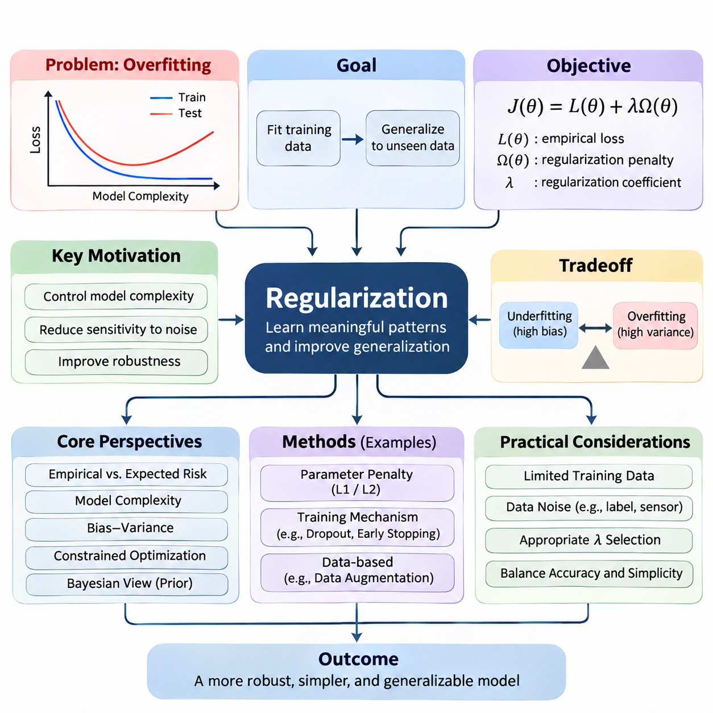
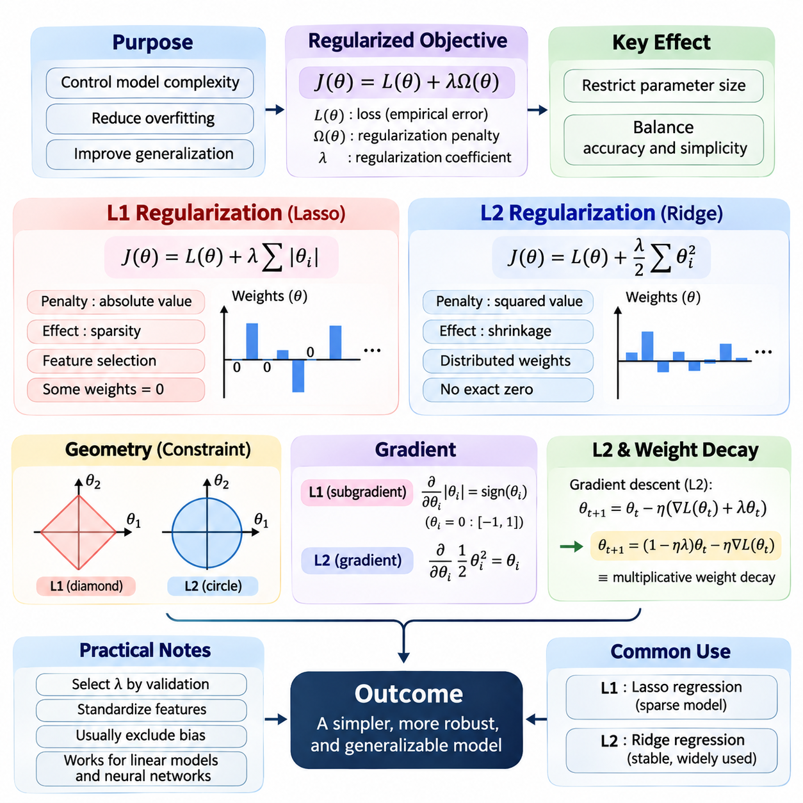
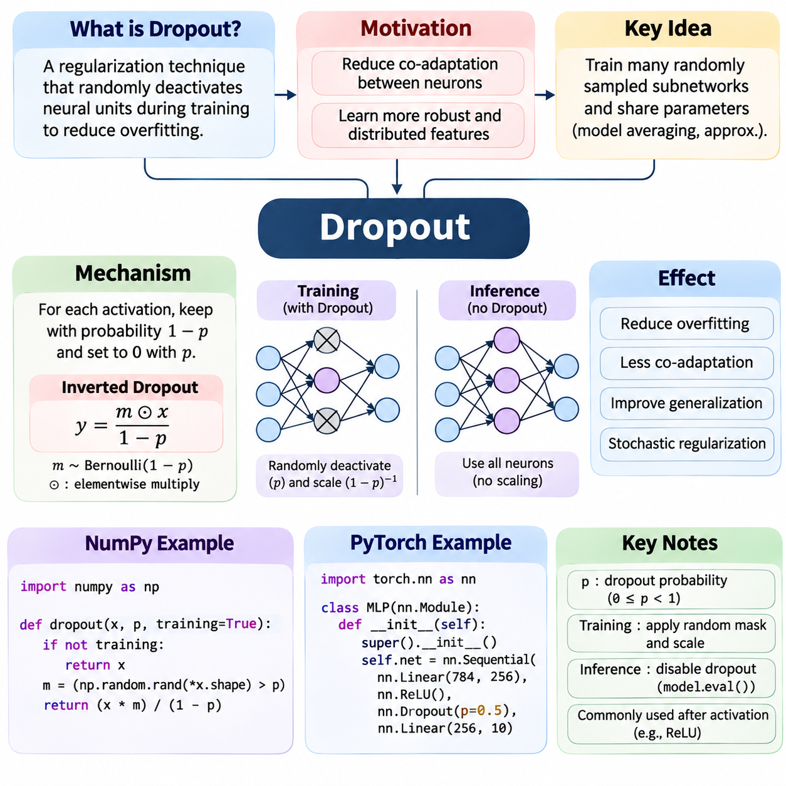
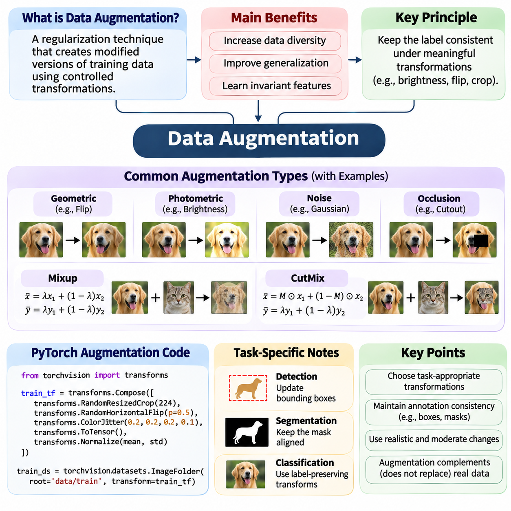
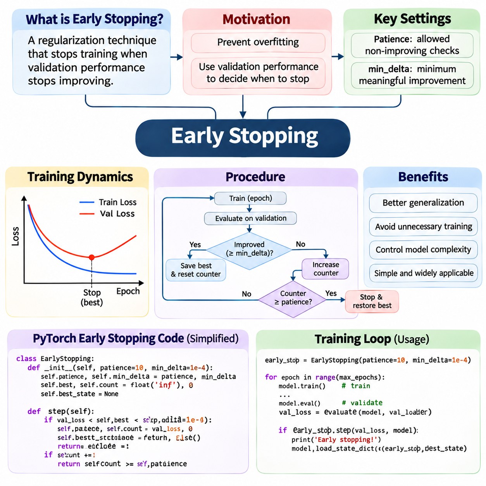
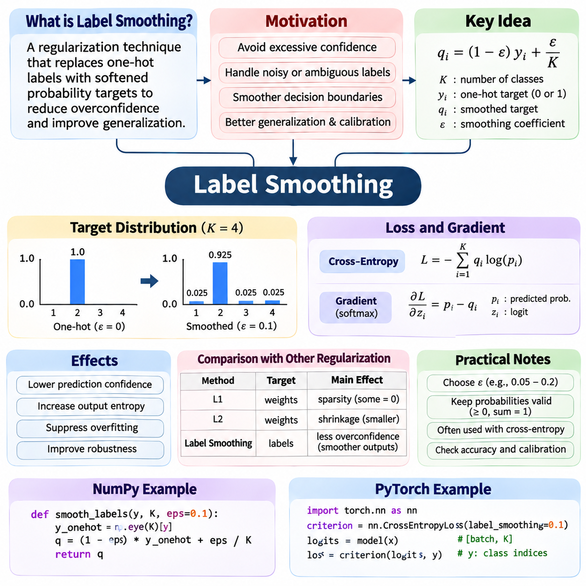
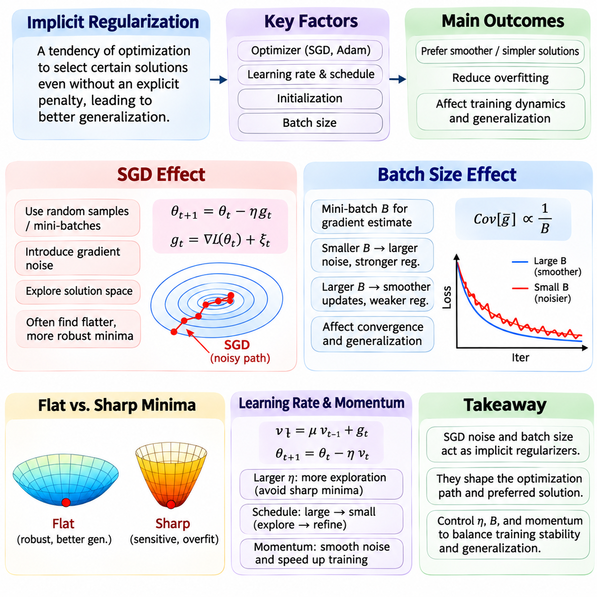
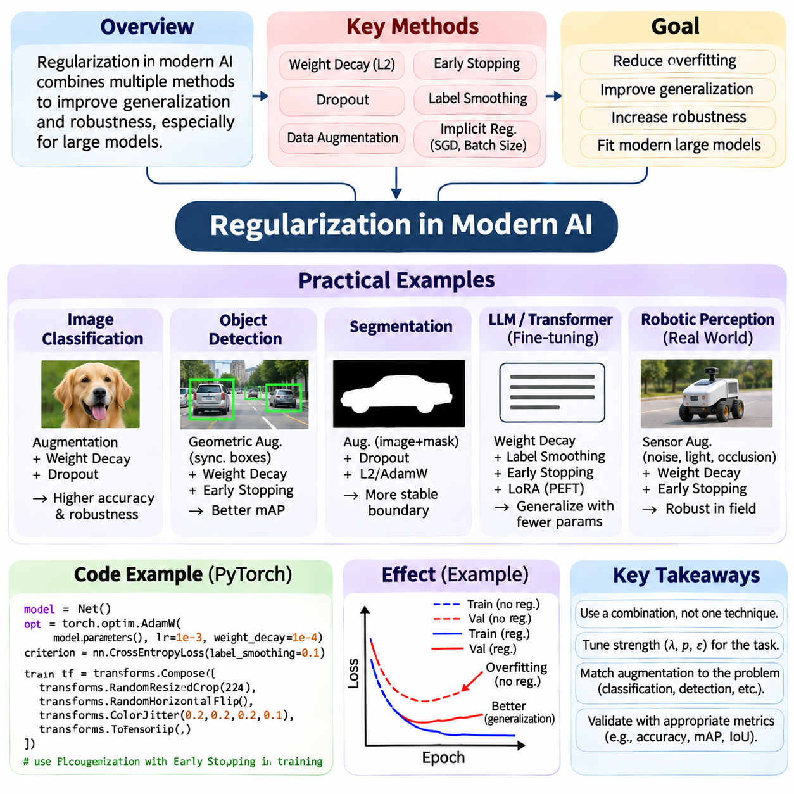

**Volume 06. Optimization and Generalization in ML**


# 03. Regularization

## 03.00 Why Regularization

{width="7.268055555555556in" height="7.268055555555556in"}

Regularization is a fundamental principle in machine learning that helps models learn meaningful patterns rather than memorize training examples. Although optimization algorithms minimize a loss function, achieving a low training loss does not necessarily guarantee reliable predictions on unseen data. Regularization addresses this limitation by guiding the learning process toward solutions that generalize more effectively.

The primary motivation for regularization arises from the difference between fitting observed data and learning the underlying data-generating relationships. A model with sufficient capacity can reproduce training observations almost perfectly, including random fluctuations and measurement errors. However, these details may not represent stable patterns, causing prediction accuracy to deteriorate when the model encounters new observations.

Overfitting occurs when a model becomes excessively sensitive to the characteristics of its training dataset. This problem is particularly common when the number of adjustable parameters is large relative to the available information. Deep neural networks can contain millions or billions of parameters, making them capable of representing highly complex functions that may capture both useful relationships and irrelevant variations.

Regularization introduces additional constraints, penalties, or training mechanisms that influence which solutions a learning algorithm selects. Rather than focusing exclusively on minimizing empirical training error, the objective becomes finding a model that balances predictive accuracy with desirable structural or behavioral properties. These properties may include smaller parameter magnitudes, smoother predictions, robustness, or reduced sensitivity to noise.

The distinction between empirical risk and expected risk provides a mathematical foundation for understanding regularization. Empirical risk measures average prediction error over the available training samples, whereas expected risk represents performance across the underlying data distribution. Since the true distribution is generally unknown, minimizing empirical risk alone may produce a solution that performs poorly outside the observed dataset.

A regularized optimization objective is commonly expressed as J(θ) = L(θ) + λΩ(θ), where L(θ) denotes the empirical loss, Ω(θ) represents a regularization penalty, and λ controls its relative influence. The parameter vector θ contains the trainable model parameters. Increasing λ strengthens the penalty, although the resulting behavior depends on the regularizer, model architecture, and optimization procedure.

The regularization coefficient establishes a tradeoff between fitting the training data and restricting the learned solution. When regularization is too weak, the model may retain unnecessary complexity and exhibit substantial overfitting. When regularization is excessively strong, important relationships may be suppressed, producing underfitting. Appropriate regularization therefore requires balancing competing objectives rather than simply maximizing the penalty.

Model complexity is closely related to regularization, but complexity cannot always be measured by counting parameters. Two neural networks with identical parameter counts may exhibit substantially different generalization behavior because of their architectures, parameter distributions, and training procedures. Regularization influences effective model capacity by restricting the functions or solutions that learning algorithms are likely to produce.

The bias-variance perspective offers another interpretation of why regularization is useful. Highly flexible models may exhibit low training bias but substantial sensitivity to variations in the training dataset. Introducing suitable regularization can reduce this sensitivity, potentially improving expected prediction performance. However, excessive restrictions can increase bias, preventing the model from representing relationships required for accurate predictions.

Noise is an unavoidable consideration in practical machine learning. Training datasets may contain measurement inaccuracies, inconsistent labels, sensor disturbances, or sampling artifacts. Without appropriate controls, models can learn these irregularities as though they were meaningful signals. Regularization can discourage such behavior, although it cannot automatically correct systematic labeling errors or compensate for fundamentally inadequate data quality.

Limited training data creates additional challenges because many different models may explain the same observations. This uncertainty becomes especially significant in high-dimensional feature spaces, where the number of possible relationships grows rapidly. Regularization introduces inductive preferences that favor certain solutions, reducing the ambiguity of model selection and potentially improving performance when observations are scarce.

Regularization can also be interpreted through constrained optimization. Instead of adding a penalty to the loss function, the learning problem may minimize empirical error while requiring model parameters to satisfy a specified constraint. Under suitable mathematical conditions, penalized and constrained formulations are closely related. This perspective illustrates how regularization restricts the feasible or preferred solution space.

From a Bayesian perspective, certain regularization penalties correspond to assumptions about prior parameter distributions. For example, quadratic penalties can be associated with Gaussian priors, while absolute-value penalties correspond to Laplace priors under common formulations. These connections show that regularization can encode prior preferences about plausible solutions rather than functioning merely as an arbitrary numerical adjustment.

Regularization is not limited to explicit mathematical penalties. Training procedures can influence generalization through stochastic optimization, parameter initialization, architectural restrictions, and the duration of training. These mechanisms may introduce implicit regularization, meaning that the learning algorithm favors particular solutions even when no additional penalty appears explicitly in the objective function.

Stochastic gradient descent illustrates the importance of optimization dynamics. Because gradients are estimated using randomly selected mini-batches, parameter updates contain stochastic variation. This variation can influence which regions of the loss landscape are explored and which solutions are eventually obtained. However, stochasticity does not universally improve generalization, and its effects depend on learning rates, batch sizes, and model properties.

Regularization becomes particularly important when training highly expressive neural networks on datasets with limited diversity. A model may achieve excellent training accuracy while failing to recognize objects under unfamiliar lighting, viewpoints, or environmental conditions. Techniques that encourage invariance or expose the model to meaningful input variations can improve its ability to recognize patterns beyond the original observations.

In computer vision, regularization helps models distinguish essential visual characteristics from incidental image properties. A classification network should ideally recognize an object despite reasonable changes in orientation, illumination, or background. Training strategies that reduce dependence on irrelevant visual details can improve robustness, provided that the transformations preserve the information needed for the intended prediction task.

Natural language processing presents similar challenges because models may exploit superficial correlations between words and labels. A sentiment classifier, for example, might associate particular expressions with positive outcomes without understanding their contextual meaning. Appropriate regularization can reduce reliance on unstable correlations, although robust language understanding also requires representative data and suitable model architectures.

In robotics and autonomous systems, regularization has implications beyond conventional benchmark accuracy. Perception and prediction models must operate under changing environmental conditions, sensor uncertainty, and variations in operating scenarios. Models that memorize laboratory conditions may behave unpredictably during deployment. Regularization contributes to reliability by discouraging unnecessary dependence on training-specific details.

The relationship between regularization and robustness requires careful interpretation. A regularized model may generalize better to new samples drawn from the same distribution, but this does not guarantee reliable performance under substantial distribution shifts. Changes in sensor characteristics, operating environments, or task requirements can introduce challenges that ordinary regularization cannot resolve without additional adaptation or validation.

Modern deep learning complicates traditional assumptions about model complexity and overfitting. Highly overparameterized networks can sometimes achieve nearly zero training error while maintaining strong test performance. This behavior indicates that generalization depends not only on parameter count but also on data structure, architecture, optimization dynamics, and the properties of the solutions selected during training.

Consequently, regularization should not be understood simply as a requirement to make every model smaller. Its broader purpose is to influence learning toward solutions with useful generalization characteristics. Some effective regularization strategies restrict parameter magnitudes, while others modify training examples, introduce stochastic behavior, limit training duration, or encourage smoother predictive distributions.

The effectiveness of regularization must be evaluated using data that were not used to fit model parameters. Validation datasets provide a practical basis for selecting regularization strengths and comparing alternative strategies. However, repeated tuning against the same validation set can introduce selection bias. A separate test dataset is therefore important for obtaining a less biased estimate of final model performance.

Training and validation learning curves can reveal whether regularization is appropriately configured. A large difference between training and validation performance may indicate overfitting, while poor performance on both datasets may suggest insufficient model capacity, optimization difficulties, or excessive regularization. These patterns are diagnostic indicators rather than definitive explanations, so additional experiments are often necessary.

Regularization also interacts with the amount and diversity of training data. When datasets are small, stronger inductive constraints may be beneficial because observations provide limited information about the underlying distribution. As datasets become larger and more representative, the need for particular restrictions may change. Nevertheless, larger datasets do not automatically eliminate overfitting or guarantee robustness.

The computational consequences of regularization vary across techniques. Some penalties introduce relatively little additional processing, while others modify the training pipeline or require additional data transformations. Regularization may also affect convergence speed and the number of training iterations needed to achieve satisfactory performance. Practical selection must therefore consider predictive quality, computational resources, and operational requirements.

An important distinction exists between regularization and optimization. Optimization determines how model parameters are updated to reduce an objective function, whereas regularization influences which solutions are preferred or how learning is constrained. The two processes interact closely because changing the regularization strategy can alter the loss landscape, gradient behavior, convergence trajectory, and final parameter configuration.

The central purpose of regularization is to improve the relationship between what a model learns during training and how it behaves when confronted with previously unseen observations. Successful regularization preserves meaningful predictive structure while limiting dependence on accidental characteristics of the training dataset. Understanding this principle provides the foundation for studying explicit penalties, stochastic methods, data augmentation, early stopping, and modern regularization strategies.

정규화(Regularization)는 모델(Model)이 학습 데이터(Training Data)를 단순히 암기하는 대신 의미 있는 패턴(Pattern)을 학습하도록 돕는 기계학습(Machine Learning)의 핵심 원리이다. 최적화 알고리즘(Optimization Algorithm)은 손실 함수(Loss Function)를 최소화하지만, 낮은 학습 손실(Training Loss)이 반드시 새로운 데이터에 대한 신뢰할 수 있는 예측을 보장하지는 않는다. 정규화는 학습 과정(Learning Process)을 더 나은 일반화(Generalization)가 가능한 해(Solution)로 유도하여 이러한 한계를 해결한다.

정규화가 필요한 근본적인 이유는 관측 데이터(Observed Data)에 적합하는 것과 실제 데이터 생성 관계(Data-Generating Relationship)를 학습하는 것 사이에 차이가 있기 때문이다. 충분한 표현 능력(Capacity)을 가진 모델은 무작위 변동(Random Fluctuation)과 측정 오차(Measurement Error)를 포함하여 학습 데이터를 거의 완벽하게 재현할 수 있다. 그러나 이러한 세부 사항이 안정적인 패턴을 의미하지는 않으므로 새로운 데이터에서 예측 정확도(Prediction Accuracy)가 저하될 수 있다.

과적합(Overfitting)은 모델이 학습 데이터셋(Training Dataset)의 특성에 지나치게 민감해질 때 발생한다. 이러한 문제는 조정 가능한 매개변수(Parameter)의 수가 사용 가능한 정보량에 비해 많을 때 특히 빈번하게 나타난다. 심층 신경망(Deep Neural Network)은 수백만 또는 수십억 개의 매개변수를 포함할 수 있으며, 유용한 관계뿐 아니라 불필요한 변동까지 학습할 수 있을 정도로 복잡한 함수(Function)를 표현할 수 있다.

정규화는 학습 알고리즘(Learning Algorithm)이 선택하는 해에 영향을 주는 추가적인 제약 조건(Constraint), 벌점(Penalty), 학습 메커니즘(Training Mechanism)을 도입한다. 경험적 학습 오차(Empirical Training Error)를 최소화하는 데만 집중하는 대신 예측 정확도와 바람직한 구조적·행동적 특성 사이의 균형을 추구한다. 이러한 특성에는 작은 매개변수 크기(Parameter Magnitude), 부드러운 예측(Smooth Prediction), 강건성(Robustness), 잡음(Noise)에 대한 민감도 감소 등이 포함된다.

경험 위험(Empirical Risk)과 기대 위험(Expected Risk)의 차이는 정규화를 이해하기 위한 수학적 기초를 제공한다. 경험 위험은 사용 가능한 학습 샘플(Training Sample)에 대한 평균 예측 오차를 측정하는 반면, 기대 위험은 실제 데이터 분포(Data Distribution) 전체에서의 성능을 나타낸다. 실제 분포는 일반적으로 알려져 있지 않으므로 경험 위험만 최소화하면 관측되지 않은 데이터에서 성능이 저하되는 해가 만들어질 수 있다.

정규화된 최적화 목적 함수(Regularized Optimization Objective)는 일반적으로 J(θ) = L(θ) + λΩ(θ)로 표현된다. 여기서 L(θ)는 경험적 손실(Empirical Loss), Ω(θ)는 정규화 벌점(Regularization Penalty), λ는 벌점의 상대적 영향을 조절하는 정규화 계수(Regularization Coefficient)를 의미한다. 매개변수 벡터(Parameter Vector) θ는 학습 가능한 모델 매개변수를 포함하며, λ가 증가하면 벌점의 영향이 강화되지만 실제 동작은 정규화 방법, 모델 구조, 최적화 과정에 따라 달라진다.

정규화 계수는 학습 데이터에 대한 적합도(Fitting Accuracy)와 학습된 해에 대한 제약 사이의 절충 관계(Tradeoff)를 형성한다. 정규화가 지나치게 약하면 모델이 불필요한 복잡성(Complexity)을 유지하면서 심각한 과적합을 나타낼 수 있다. 반대로 정규화가 지나치게 강하면 중요한 관계까지 억제되어 과소적합(Underfitting)이 발생할 수 있다. 따라서 적절한 정규화는 단순히 벌점을 최대화하는 것이 아니라 서로 경쟁하는 목적 사이의 균형을 찾는 과정이다.

모델 복잡도(Model Complexity)는 정규화와 밀접하게 관련되지만, 복잡도를 단순히 매개변수의 개수로 측정할 수 있는 것은 아니다. 동일한 매개변수 수를 가진 두 신경망도 구조(Architecture), 매개변수 분포(Parameter Distribution), 학습 절차(Training Procedure)에 따라 상당히 다른 일반화 성능을 보일 수 있다. 정규화는 학습 알고리즘이 생성할 가능성이 높은 함수나 해를 제한함으로써 유효 모델 용량(Effective Model Capacity)에 영향을 준다.

편향-분산 관점(Bias-Variance Perspective)은 정규화가 유용한 이유를 설명하는 또 다른 해석을 제공한다. 유연성이 높은 모델은 낮은 학습 편향(Training Bias)을 보일 수 있지만, 학습 데이터셋의 변화에 대한 민감도가 클 수 있다. 적절한 정규화를 도입하면 이러한 민감도를 줄여 기대 예측 성능(Expected Prediction Performance)을 개선할 가능성이 있다. 그러나 제약이 지나치면 편향(Bias)이 증가하여 정확한 예측에 필요한 관계를 표현하지 못할 수 있다.

잡음(Noise)은 실제 기계학습에서 피할 수 없는 고려 사항이다. 학습 데이터셋에는 측정 부정확성(Measurement Inaccuracy), 일관되지 않은 레이블(Inconsistent Label), 센서 교란(Sensor Disturbance), 표본 추출 인공물(Sampling Artifact) 등이 포함될 수 있다. 적절한 제어가 없다면 모델은 이러한 불규칙성을 의미 있는 신호(Signal)로 학습할 수 있다. 정규화는 이러한 현상을 억제하지만, 체계적인 레이블 오류(Systematic Labeling Error)나 근본적으로 부족한 데이터 품질(Data Quality)을 자동으로 해결하지는 못한다.

제한된 학습 데이터(Limited Training Data)는 여러 모델이 동일한 관측 결과를 설명할 수 있기 때문에 추가적인 문제를 발생시킨다. 이러한 불확실성(Uncertainty)은 가능한 관계의 수가 급격하게 증가하는 고차원 특징 공간(High-Dimensional Feature Space)에서 특히 중요해진다. 정규화는 특정 해를 선호하는 귀납적 선호(Inductive Preference)를 도입하여 모델 선택(Model Selection)의 모호성을 줄이고, 관측 데이터가 부족한 상황에서 성능을 개선할 가능성을 높인다.

정규화는 제약 최적화(Constrained Optimization)의 관점에서도 해석할 수 있다. 손실 함수에 벌점을 추가하는 대신 모델 매개변수가 지정된 제약 조건을 만족하도록 하면서 경험적 오차(Empirical Error)를 최소화할 수 있다. 적절한 수학적 조건에서는 벌점 기반 정식화(Penalized Formulation)와 제약 기반 정식화(Constrained Formulation)가 밀접하게 연결된다. 이러한 관점은 정규화가 허용되거나 선호되는 해 공간(Solution Space)을 제한하는 방식임을 보여준다.

베이지안 관점(Bayesian Perspective)에서 특정 정규화 벌점은 매개변수의 사전 분포(Prior Distribution)에 대한 가정과 대응된다. 예를 들어 이차 벌점(Quadratic Penalty)은 가우시안 사전 분포(Gaussian Prior)와 연결될 수 있으며, 절댓값 벌점(Absolute-Value Penalty)은 일반적인 정식화에서 라플라스 사전 분포(Laplace Prior)에 대응된다. 이러한 관계는 정규화가 단순한 수치적 조정이 아니라 타당한 해에 대한 사전 선호(Prior Preference)를 표현할 수 있음을 보여준다.

정규화가 명시적인 수학적 벌점에만 제한되는 것은 아니다. 학습 절차는 확률적 최적화(Stochastic Optimization), 매개변수 초기화(Parameter Initialization), 구조적 제약(Architectural Restriction), 학습 지속 시간(Training Duration) 등을 통해 일반화에 영향을 줄 수 있다. 이러한 메커니즘은 목적 함수에 추가적인 벌점이 명시되지 않더라도 학습 알고리즘이 특정 해를 선호하도록 만드는 암묵적 정규화(Implicit Regularization)를 도입할 수 있다.

확률적 경사 하강법(Stochastic Gradient Descent, SGD)은 최적화 동역학(Optimization Dynamics)의 중요성을 보여준다. 경사(Gradient)는 무작위로 선택된 미니배치(Mini-Batch)를 사용하여 추정되므로 매개변수 갱신(Parameter Update)에 확률적 변동(Stochastic Variation)이 포함된다. 이러한 변동은 손실 지형(Loss Landscape)에서 탐색되는 영역과 최종적으로 선택되는 해에 영향을 줄 수 있다. 그러나 확률성이 항상 일반화를 개선하는 것은 아니며, 그 효과는 학습률(Learning Rate), 배치 크기(Batch Size), 모델 특성에 따라 달라진다.

표현력이 높은 신경망(Expressive Neural Network)을 다양성이 제한된 데이터셋으로 학습할 때 정규화는 특히 중요하다. 모델은 높은 학습 정확도(Training Accuracy)를 달성하더라도 익숙하지 않은 조명, 시점(Viewpoint), 환경 조건에서 객체를 인식하지 못할 수 있다. 불변성(Invariance)을 장려하거나 의미 있는 입력 변형(Input Variation)에 모델을 노출하는 기법은 원래 관측 데이터의 범위를 넘어 패턴을 인식하는 능력을 개선할 수 있다.

컴퓨터 비전(Computer Vision)에서 정규화는 모델이 본질적인 시각적 특성(Essential Visual Characteristic)과 우연히 나타나는 이미지 속성(Incidental Image Property)을 구분하도록 돕는다. 분류 신경망(Classification Network)은 방향, 조명, 배경이 합리적인 범위에서 변화하더라도 객체를 인식하는 것이 바람직하다. 관련 없는 시각적 세부 사항에 대한 의존성을 줄이는 학습 전략은 변환(Transformation)이 예측 작업에 필요한 정보를 보존한다는 조건에서 강건성을 향상할 수 있다.

자연어 처리(Natural Language Processing, NLP)에서도 모델이 단어와 레이블 사이의 피상적인 상관관계(Superficial Correlation)를 활용할 수 있기 때문에 유사한 문제가 발생한다. 예를 들어 감성 분류기(Sentiment Classifier)는 문맥적 의미(Contextual Meaning)를 이해하지 못한 상태에서 특정 표현을 긍정적인 결과와 연결할 수 있다. 적절한 정규화는 불안정한 상관관계에 대한 의존성을 줄일 수 있지만, 강건한 언어 이해(Robust Language Understanding)를 위해서는 대표성 있는 데이터와 적절한 모델 구조도 필요하다.

로보틱스(Robotics)와 자율 시스템(Autonomous System)에서 정규화의 중요성은 일반적인 벤치마크 정확도(Benchmark Accuracy)를 넘어선다. 인식 및 예측 모델(Perception and Prediction Model)은 변화하는 환경 조건, 센서 불확실성(Sensor Uncertainty), 다양한 운영 시나리오(Operating Scenario)에서 동작해야 한다. 실험실 조건만 암기한 모델은 실제 배포(Deployment) 환경에서 예측하기 어려운 동작을 보일 수 있다. 정규화는 학습 환경에만 존재하는 세부 특성에 대한 불필요한 의존성을 억제하여 신뢰성(Reliability)에 기여한다.

정규화와 강건성(Robustness)의 관계는 신중하게 해석해야 한다. 정규화된 모델은 동일한 분포에서 추출한 새로운 샘플에 대해 더 나은 일반화 성능을 보일 수 있지만, 상당한 분포 이동(Distribution Shift)이 발생했을 때도 안정적으로 작동한다는 보장은 없다. 센서 특성, 운영 환경, 작업 요구사항의 변화는 일반적인 정규화만으로 해결하기 어려운 문제를 유발할 수 있으며, 추가적인 적응(Adaptation)이나 검증(Validation)이 필요할 수 있다.

현대 심층학습(Modern Deep Learning)은 모델 복잡도와 과적합에 대한 전통적인 가정을 더욱 복잡하게 만든다. 과매개변수화된 신경망(Overparameterized Neural Network)은 학습 오차가 거의 0에 도달하면서도 높은 테스트 성능(Test Performance)을 유지하는 경우가 있다. 이러한 현상은 일반화가 단순히 매개변수 수에만 의존하지 않고 데이터 구조(Data Structure), 모델 구조, 최적화 동역학, 학습 과정에서 선택된 해의 특성에 의해 결정된다는 사실을 보여준다.

따라서 정규화를 모든 모델의 크기를 줄이기 위한 요구사항으로만 이해해서는 안 된다. 정규화의 더 넓은 목적은 유용한 일반화 특성(Generalization Characteristic)을 가진 해를 향해 학습을 유도하는 것이다. 일부 정규화 전략(Regularization Strategy)은 매개변수 크기를 제한하지만, 다른 전략은 학습 샘플을 수정하거나 확률적 동작(Stochastic Behavior)을 도입하고, 학습 시간을 제한하거나 더 부드러운 예측 분포(Predictive Distribution)를 장려한다.

정규화의 효과는 모델 매개변수를 학습하는 데 사용되지 않은 데이터를 통해 평가해야 한다. 검증 데이터셋(Validation Dataset)은 정규화 강도(Regularization Strength)를 선택하고 대안적인 전략을 비교하기 위한 실용적인 기준을 제공한다. 그러나 동일한 검증 데이터셋에 대해 반복적으로 조정하면 선택 편향(Selection Bias)이 발생할 수 있다. 따라서 최종 모델 성능에 대한 편향이 적은 추정치를 얻기 위해 별도의 테스트 데이터셋(Test Dataset)이 중요하다.

학습 및 검증 학습 곡선(Training and Validation Learning Curve)은 정규화가 적절하게 설정되었는지 파악하는 데 도움이 된다. 학습 성능과 검증 성능 사이의 차이가 크면 과적합을 의미할 수 있으며, 두 데이터셋 모두에서 성능이 낮으면 모델 용량 부족(Insufficient Model Capacity), 최적화 문제(Optimization Difficulty), 과도한 정규화(Excessive Regularization)를 의심할 수 있다. 그러나 이러한 패턴은 확정적인 원인이 아니라 진단 지표(Diagnostic Indicator)이므로 추가적인 실험이 필요한 경우가 많다.

정규화는 학습 데이터의 양과 다양성(Data Diversity)에도 영향을 받는다. 데이터셋이 작을 때는 관측 결과가 실제 데이터 분포에 대한 제한적인 정보만 제공하므로 더 강한 귀납적 제약(Inductive Constraint)이 유용할 수 있다. 데이터셋이 커지고 대표성(Representativeness)이 높아지면 특정 제약의 필요성이 달라질 수 있다. 그러나 데이터셋이 커진다고 해서 과적합이 자동으로 사라지거나 강건성이 보장되는 것은 아니다.

정규화의 계산적 영향(Computational Consequence)은 기법에 따라 다르다. 일부 벌점은 추가적인 처리 비용(Processing Cost)이 상대적으로 작지만, 다른 기법은 학습 파이프라인(Training Pipeline)을 수정하거나 추가적인 데이터 변환(Data Transformation)을 요구한다. 정규화는 수렴 속도(Convergence Speed)와 만족스러운 성능에 도달하는 데 필요한 학습 반복 횟수(Training Iteration)에도 영향을 줄 수 있다. 따라서 실제 기법 선택에서는 예측 품질, 계산 자원(Computational Resource), 운영 요구사항(Operational Requirement)을 함께 고려해야 한다.

정규화와 최적화(Optimization) 사이에는 중요한 차이가 존재한다. 최적화는 목적 함수를 감소시키기 위해 모델 매개변수를 어떻게 갱신할지 결정하는 반면, 정규화는 어떤 해를 선호할지 또는 학습을 어떻게 제한할지에 영향을 준다. 두 과정은 밀접하게 상호작용하며, 정규화 전략의 변경은 손실 지형, 경사 동작(Gradient Behavior), 수렴 경로(Convergence Trajectory), 최종 매개변수 구성(Parameter Configuration)을 변화시킬 수 있다.

정규화의 핵심 목적은 모델이 학습 과정에서 습득한 내용과 이전에 관측하지 못한 데이터에 직면했을 때 나타나는 동작 사이의 관계를 개선하는 것이다. 성공적인 정규화는 의미 있는 예측 구조(Predictive Structure)를 보존하면서 학습 데이터셋의 우연한 특성에 대한 의존성을 제한한다. 이러한 원리를 이해하는 것은 명시적 벌점(Explicit Penalty), 확률적 방법(Stochastic Method), 데이터 증강(Data Augmentation), 조기 종료(Early Stopping), 현대적 정규화 전략(Modern Regularization Strategy)을 학습하기 위한 기초가 된다.

## 03.01 L1 L2 Regularization

{width="7.268055555555556in" height="7.268055555555556in"}

L1 and L2 regularization are fundamental techniques for controlling model complexity and improving generalization in machine learning. Both methods modify the training objective by introducing penalties on model parameters, discouraging solutions that rely on unnecessarily large coefficients. Although they share the goal of reducing overfitting, they impose different mathematical constraints and produce distinct effects on parameter distributions.

L1 regularization adds a penalty proportional to the sum of the absolute values of model parameters. Its objective can be expressed as J(θ) = L(θ) + λΣ\|θᵢ\|, where L(θ) represents the original loss function and λ controls regularization strength. Because the penalty increases linearly with parameter magnitude, L1 regularization encourages sparse solutions in which some coefficients become exactly zero.

Sparsity is the defining characteristic of L1 regularization. By eliminating selected coefficients, the method can perform implicit feature selection and produce models that depend on fewer input variables. This property is particularly valuable when datasets contain many irrelevant or redundant features. However, the selected features may vary when predictors are strongly correlated or the training dataset changes.

L2 regularization introduces a penalty proportional to the sum of squared parameter values. The regularized objective is commonly written as J(θ) = L(θ) + (λ/2)Σθᵢ². Unlike L1 regularization, L2 generally shrinks coefficients continuously toward zero without forcing them to become exactly zero. Consequently, it encourages distributed representations rather than explicitly sparse parameter configurations.

The mathematical difference between absolute-value and squared penalties explains their contrasting behavior. L1 applies a constant-magnitude penalty gradient to nonzero coefficients, whereas L2 produces gradients proportional to parameter values. Large coefficients therefore receive stronger absolute penalties under L2, while L1 can drive small coefficients to zero through its characteristic nonsmooth optimization geometry.

From a geometric perspective, L1 regularization constrains parameters within a diamond-shaped region in two dimensions, while L2 regularization corresponds to a circular region. The corners of the L1 constraint frequently intersect optimal loss contours at coordinate axes, producing zero coefficients. The smooth boundary of the L2 constraint instead favors solutions with multiple reduced coefficients.

L1 regularization is closely associated with Lasso regression, which minimizes prediction error while penalizing the absolute values of regression coefficients. L2 regularization forms the foundation of Ridge regression, where squared coefficients are penalized. Both approaches extend naturally to other differentiable learning objectives, including logistic regression and neural network training.

The regularization coefficient λ determines how strongly parameter magnitudes influence the optimization process. When λ approaches zero, the objective increasingly resembles the original empirical loss. As λ increases, parameter restrictions become stronger, potentially reducing variance but increasing bias. Selecting λ requires validation because excessive regularization can prevent the model from learning meaningful relationships.

Feature scaling is particularly important when implementing L1 or L2 regularization in linear models. If input variables have substantially different numerical ranges, their coefficients operate on incompatible scales. Applying the same penalty to all coefficients may then produce unintended preferences. Standardizing numerical features before fitting a regularized model helps ensure more consistent penalty behavior.

In practical implementations, regularization is usually applied to trainable weights while bias parameters are excluded. Bias terms often control baseline predictions rather than feature sensitivity, so penalizing them may introduce unnecessary restrictions. However, this convention is not universal, and implementation details should be verified because different frameworks expose different parameter grouping and regularization mechanisms.

A basic NumPy implementation begins by computing predictions, evaluating the original loss, and adding the selected penalty. For L1 regularization, the additional term is calculated using the absolute values of the weight vector. For L2 regularization, squared weights are summed and multiplied by the chosen coefficient. The resulting objective is then minimized using an appropriate optimization algorithm.

Gradient-based optimization requires particular attention when implementing L1 regularization. The absolute-value function is not differentiable at zero, so conventional gradients are replaced by subgradients or specialized optimization procedures. For nonzero coefficients, the L1 subgradient equals the sign of the coefficient. At zero, any value within the interval from −1 to 1 is a valid subgradient.

L2 regularization is comparatively straightforward because its squared penalty is differentiable everywhere. For the objective J(θ) = L(θ) + (λ/2)Σθᵢ², the gradient becomes ∇J(θ) = ∇L(θ) + λθ. This additional term pulls parameters toward zero during optimization. Its simplicity makes L2 regularization particularly convenient for gradient-based learning algorithms.

When standard gradient descent is applied to an L2-regularized objective, the parameter update becomes θₜ₊₁ = θₜ − η(∇L(θₜ) + λθₜ), where η denotes the learning rate. Rearranging gives θₜ₊₁ = (1 − ηλ)θₜ − η∇L(θₜ). This expression illustrates the connection between L2 regularization and multiplicative weight decay under ordinary gradient descent.

Weight decay and L2 regularization are equivalent under standard gradient descent when their coefficients are matched appropriately. However, the equivalence does not generally hold for adaptive optimizers such as Adam when the penalty gradient is incorporated into adaptive moment estimates. Decoupled weight decay, implemented by optimizers such as AdamW, applies parameter shrinkage separately from the loss gradient.

In PyTorch, explicit L1 regularization can be implemented by adding the sum of absolute weight values to the computed training loss. Automatic differentiation handles the corresponding gradient calculations using its defined behavior at nondifferentiable points. For L2-style regularization, an explicit squared-weight penalty can be added, while optimizer weight decay provides another commonly used implementation mechanism.

A typical PyTorch training loop first performs a forward pass, computes the task loss, and constructs the regularization penalty from selected model parameters. The combined loss is then passed through backward propagation before the optimizer updates the weights. This approach allows developers to control which layers are regularized and whether different parameter groups receive different penalty strengths.

Scikit-learn provides established implementations of regularized linear models through estimators such as Lasso, Ridge, and ElasticNet. These estimators manage the optimization procedures internally, allowing practitioners to focus on feature preparation, hyperparameter selection, and evaluation. Their regularization parameters and objective scaling conventions must be checked before comparing results with custom implementations.

Elastic Net combines L1 and L2 penalties within a single objective. Its regularization term can be expressed as λ₁Σ\|θᵢ\| + (λ₂/2)Σθᵢ², allowing both sparsity and continuous coefficient shrinkage. This combination is useful when predictors are correlated because it can retain groups of related features more effectively than pure L1 regularization in many practical settings.

The choice between L1 and L2 depends on the learning objective and characteristics of the data. L1 is attractive when feature selection, compact representations, or coefficient interpretability are important. L2 is often preferred when many features contribute useful information and stable coefficient shrinkage is desirable. Neither method universally outperforms the other across all datasets.

In high-dimensional classification problems, L1 regularization can reduce dependence on irrelevant input dimensions. For example, a text classification model may contain thousands of sparse vocabulary features, only some of which contribute meaningfully to predictions. L1 can suppress unnecessary coefficients, potentially improving interpretability and reducing the effective number of active features.

L2 regularization is widely used in neural networks because it discourages excessive parameter magnitudes without explicitly eliminating connections. Smaller weights may reduce sensitivity to certain input variations and influence the complexity of learned functions. Nevertheless, parameter magnitude alone does not fully determine neural network generalization, especially in architectures containing normalization layers or scale-invariant parameterizations.

Implementation quality depends on the relationship between regularization strength and loss reduction conventions. If the original loss is averaged across samples but the penalty is summed across parameters, changing the number of parameters can substantially affect their relative contributions. Likewise, using summed rather than averaged sample losses changes the effective meaning of λ unless the coefficient is adjusted accordingly.

Regularization experiments should use consistent data partitions and evaluation procedures. A practical comparison trains an unregularized baseline, an L1-regularized model, and an L2-regularized model under comparable conditions. Training loss, validation performance, coefficient magnitudes, and the number of zero-valued parameters provide complementary information about how each method influences learning.

Hyperparameter tuning commonly evaluates several regularization strengths across a logarithmic range. Small coefficients allow the model greater flexibility, while larger coefficients impose stronger restrictions. Cross-validation can provide more stable estimates when datasets are limited, although preprocessing must be fitted independently within each training fold to avoid information leakage.

An important implementation consideration is that stronger regularization does not necessarily produce better generalization. A model may initially benefit from reduced variance, but further increases in penalty strength can eliminate useful predictive information. Monitoring validation metrics alongside training behavior helps identify the point at which additional regularization becomes counterproductive.

L1 and L2 regularization provide a practical foundation for understanding explicit complexity control in machine learning. Their mathematical differences explain why one favors sparse solutions while the other promotes continuous parameter shrinkage. Correct implementation requires attention to objective scaling, feature normalization, parameter selection, optimizer behavior, and validation procedures, ensuring that regularization improves generalization rather than merely reducing coefficient magnitudes.

L1 및 L2 정규화(L1 and L2 Regularization)는 기계학습(Machine Learning)에서 모델 복잡도(Model Complexity)를 제어하고 일반화 성능(Generalization Performance)을 향상하기 위한 핵심 기법이다. 두 방법 모두 모델 매개변수(Model Parameter)에 벌점(Penalty)을 추가하여 학습 목적 함수(Training Objective)를 수정하며, 불필요하게 큰 계수(Coefficient)에 의존하는 해(Solution)를 억제한다. 두 방법은 과적합(Overfitting)을 줄인다는 공통된 목적을 가지지만, 서로 다른 수학적 제약(Mathematical Constraint)을 적용하므로 매개변수 분포(Parameter Distribution)에 미치는 영향도 다르다.

L1 정규화(L1 Regularization)는 모델 매개변수의 절댓값 합(Sum of Absolute Values)에 비례하는 벌점을 추가한다. 목적 함수(Objective Function)는 J(θ) = L(θ) + λΣ\|θᵢ\|로 표현할 수 있으며, 여기서 L(θ)는 기존 손실 함수(Loss Function)를 나타내고 λ는 정규화 강도(Regularization Strength)를 제어한다. 벌점은 매개변수 크기에 비례하여 선형적으로 증가하므로 L1 정규화는 일부 계수가 정확히 0이 되는 희소 해(Sparse Solution)를 유도한다.

희소성(Sparsity)은 L1 정규화의 가장 중요한 특성이다. 특정 계수를 제거함으로써 이 방법은 암묵적인 특징 선택(Implicit Feature Selection)을 수행하고 더 적은 입력 변수(Input Variable)에 의존하는 모델을 생성할 수 있다. 이러한 특성은 데이터셋(Dataset)에 관련성이 낮거나 중복된 특징(Feature)이 많이 포함되어 있을 때 특히 유용하다. 그러나 예측 변수(Predictor) 사이의 상관관계(Correlation)가 높거나 학습 데이터셋이 변경되면 선택되는 특징이 달라질 수 있다.

L2 정규화(L2 Regularization)는 매개변수 값의 제곱합(Sum of Squared Parameter Values)에 비례하는 벌점을 도입한다. 정규화된 목적 함수(Regularized Objective)는 일반적으로 J(θ) = L(θ) + (λ/2)Σθᵢ²로 표현된다. L1 정규화와 달리 L2 정규화는 일반적으로 계수를 정확히 0으로 만들지 않고 연속적으로 0에 가깝게 축소한다. 따라서 명시적인 희소 매개변수 구성(Sparse Parameter Configuration)보다는 분산 표현(Distributed Representation)을 장려한다.

절댓값 벌점(Absolute-Value Penalty)과 제곱 벌점(Squared Penalty)의 수학적 차이는 두 방법의 상반된 동작을 설명한다. L1 정규화는 0이 아닌 계수에 일정한 크기의 벌점 기울기(Penalty Gradient)를 적용하지만, L2 정규화는 매개변수 값에 비례하는 기울기를 생성한다. 따라서 L2에서는 큰 계수가 더 강한 절대적 벌점 영향을 받으며, L1에서는 미분 불가능한 최적화 기하학(Nonsmooth Optimization Geometry)의 특성으로 작은 계수가 0에 도달할 수 있다.

기하학적 관점(Geometric Perspective)에서 L1 정규화는 2차원 공간에서 매개변수를 마름모 형태의 영역(Diamond-Shaped Region)으로 제한하는 반면, L2 정규화는 원형 영역(Circular Region)에 대응한다. L1 제약 영역의 모서리는 최적 손실 등고선(Optimal Loss Contour)과 좌표축(Coordinate Axis)에서 교차하는 경우가 많아 계수가 0이 되는 해를 생성한다. 반면 L2 제약의 부드러운 경계(Smooth Boundary)는 여러 계수가 함께 축소되는 해를 선호한다.

L1 정규화는 회귀 계수(Regression Coefficient)의 절댓값에 벌점을 부여하면서 예측 오차(Prediction Error)를 최소화하는 라쏘 회귀(Lasso Regression)와 밀접하게 관련된다. L2 정규화는 계수의 제곱값에 벌점을 부여하는 릿지 회귀(Ridge Regression)의 기초를 형성한다. 두 접근법은 로지스틱 회귀(Logistic Regression)와 신경망 학습(Neural Network Training)을 포함하여 미분 가능한 다른 학습 목적 함수에도 자연스럽게 확장될 수 있다.

정규화 계수(Regularization Coefficient) λ는 매개변수 크기가 최적화 과정(Optimization Process)에 얼마나 강하게 영향을 미치는지 결정한다. λ가 0에 가까워지면 목적 함수는 원래의 경험적 손실(Empirical Loss)과 점점 유사해진다. 반대로 λ가 증가하면 매개변수 제약이 강화되어 분산(Variance)이 감소할 수 있지만 편향(Bias)은 증가할 수 있다. 과도한 정규화는 모델이 의미 있는 관계를 학습하지 못하게 만들 수 있으므로 λ는 검증(Validation)을 통해 선택해야 한다.

특징 스케일링(Feature Scaling)은 선형 모델(Linear Model)에서 L1 또는 L2 정규화를 구현할 때 특히 중요하다. 입력 변수의 수치 범위(Numerical Range)가 크게 다르면 해당 계수들이 서로 다른 척도(Scale)에서 작동하게 된다. 모든 계수에 동일한 벌점을 적용하면 의도하지 않은 선호가 발생할 수 있다. 정규화 모델을 학습하기 전에 수치형 특징(Numerical Feature)을 표준화(Standardization)하면 벌점이 보다 일관되게 작용하도록 만들 수 있다.

실제 구현(Implementation)에서는 일반적으로 학습 가능한 가중치(Trainable Weight)에 정규화를 적용하고 편향 매개변수(Bias Parameter)는 제외한다. 편향 항(Bias Term)은 특징에 대한 민감도(Feature Sensitivity)보다는 기준 예측값(Baseline Prediction)을 제어하는 경우가 많으므로, 여기에 벌점을 적용하면 불필요한 제약이 발생할 수 있다. 그러나 이러한 관례가 모든 경우에 적용되는 것은 아니며, 프레임워크(Framework)마다 매개변수 그룹화(Parameter Grouping)와 정규화 메커니즘이 다르므로 구현 세부 사항을 확인해야 한다.

기본적인 넘파이(NumPy) 구현은 예측값(Prediction)을 계산하고 기존 손실을 평가한 다음 선택한 벌점을 추가하는 방식으로 시작한다. L1 정규화에서는 가중치 벡터(Weight Vector)의 절댓값을 이용하여 추가 항을 계산한다. L2 정규화에서는 가중치의 제곱값을 합산한 후 선택한 계수를 곱한다. 이렇게 구성된 목적 함수는 적절한 최적화 알고리즘(Optimization Algorithm)을 사용하여 최소화한다.

경사 기반 최적화(Gradient-Based Optimization)에서는 L1 정규화를 구현할 때 특별한 주의가 필요하다. 절댓값 함수(Absolute-Value Function)는 0에서 미분할 수 없으므로 일반적인 기울기 대신 부분 기울기(Subgradient) 또는 특수한 최적화 절차(Specialized Optimization Procedure)를 사용한다. 0이 아닌 계수에서 L1 부분 기울기는 해당 계수의 부호(Sign)와 같다. 계수가 0인 경우에는 −1부터 1까지의 구간에 속하는 모든 값이 유효한 부분 기울기가 된다.

L2 정규화는 제곱 벌점이 모든 지점에서 미분 가능(Differentiable)하므로 상대적으로 구현이 간단하다. 목적 함수가 J(θ) = L(θ) + (λ/2)Σθᵢ²일 때 기울기는 ∇J(θ) = ∇L(θ) + λθ가 된다. 추가된 항은 최적화 과정에서 매개변수를 0에 가까운 방향으로 이동시킨다. 이러한 단순성 때문에 L2 정규화는 경사 기반 학습 알고리즘(Gradient-Based Learning Algorithm)에 특히 편리하게 적용할 수 있다.

표준 경사 하강법(Standard Gradient Descent)을 L2 정규화 목적 함수에 적용하면 매개변수 갱신(Parameter Update)은 θₜ₊₁ = θₜ − η(∇L(θₜ) + λθₜ)가 되며, 여기서 η는 학습률(Learning Rate)을 의미한다. 이를 정리하면 θₜ₊₁ = (1 − ηλ)θₜ − η∇L(θₜ)가 된다. 이 식은 일반적인 경사 하강법에서 L2 정규화와 곱셈 방식의 가중치 감쇠(Multiplicative Weight Decay)가 연결되는 원리를 보여준다.

가중치 감쇠(Weight Decay)와 L2 정규화는 표준 경사 하강법에서 계수를 적절히 일치시키면 동등한 효과를 나타낸다. 그러나 벌점 기울기가 적응형 모멘트 추정(Adaptive Moment Estimate)에 포함되는 경우에는 아담(Adam)과 같은 적응형 최적화 알고리즘(Adaptive Optimizer)에서 이러한 동등성이 일반적으로 성립하지 않는다. 아담W(AdamW)와 같은 최적화 알고리즘이 구현하는 분리형 가중치 감쇠(Decoupled Weight Decay)는 손실 기울기(Loss Gradient)와 별도로 매개변수 축소(Parameter Shrinkage)를 적용한다.

파이토치(PyTorch)에서는 계산된 학습 손실(Training Loss)에 가중치 절댓값의 합을 추가하여 명시적 L1 정규화(Explicit L1 Regularization)를 구현할 수 있다. 자동 미분(Automatic Differentiation)은 미분 불가능한 지점에서 정의된 동작을 사용하여 해당 기울기 계산을 처리한다. L2 방식의 정규화는 명시적인 가중치 제곱 벌점(Squared-Weight Penalty)을 추가하여 구현할 수 있으며, 최적화 알고리즘의 가중치 감쇠 기능도 일반적으로 사용되는 구현 방법이다.

일반적인 파이토치 학습 루프(PyTorch Training Loop)는 먼저 순전파(Forward Pass)를 수행하고 작업 손실(Task Loss)을 계산한 다음 선택한 모델 매개변수로부터 정규화 벌점(Regularization Penalty)을 구성한다. 이후 결합된 손실(Combined Loss)에 대해 역전파(Backward Propagation)를 수행하고 최적화 알고리즘이 가중치를 갱신한다. 이러한 접근법을 사용하면 개발자는 정규화를 적용할 계층(Layer)을 제어하고 서로 다른 매개변수 그룹(Parameter Group)에 다른 벌점 강도를 적용할 수 있다.

사이킷런(Scikit-learn)은 라쏘(Lasso), 릿지(Ridge), 엘라스틱넷(ElasticNet)과 같은 추정기(Estimator)를 통해 정규화된 선형 모델의 검증된 구현을 제공한다. 이러한 추정기는 최적화 절차를 내부적으로 처리하므로 사용자는 특징 준비(Feature Preparation), 하이퍼파라미터 선택(Hyperparameter Selection), 평가(Evaluation)에 집중할 수 있다. 다만 사용자 정의 구현(Custom Implementation)과 결과를 비교하기 전에 정규화 매개변수와 목적 함수 스케일링(Objective Scaling)의 규칙을 확인해야 한다.

엘라스틱넷(Elastic Net)은 L1과 L2 벌점을 하나의 목적 함수에 결합한다. 정규화 항은 λ₁Σ\|θᵢ\| + (λ₂/2)Σθᵢ²로 표현할 수 있으며, 이를 통해 희소성과 연속적인 계수 축소(Continuous Coefficient Shrinkage)를 동시에 적용한다. 이러한 조합은 예측 변수 사이에 상관관계가 존재할 때 유용하며, 많은 실제 상황에서 순수한 L1 정규화보다 관련된 특징 그룹(Feature Group)을 효과적으로 유지할 수 있다.

L1과 L2 중 어떤 방법을 선택할지는 학습 목적(Learning Objective)과 데이터 특성(Data Characteristic)에 따라 달라진다. 특징 선택, 간결한 표현(Compact Representation), 계수 해석 가능성(Coefficient Interpretability)이 중요하다면 L1이 유용하다. 반면 많은 특징이 유용한 정보를 제공하고 안정적인 계수 축소가 필요하다면 L2가 선호되는 경우가 많다. 어떤 방법도 모든 데이터셋에서 항상 우수한 성능을 보장하지는 않는다.

고차원 분류 문제(High-Dimensional Classification Problem)에서 L1 정규화는 관련성이 낮은 입력 차원(Input Dimension)에 대한 의존성을 줄일 수 있다. 예를 들어 텍스트 분류 모델(Text Classification Model)에는 수천 개의 희소 어휘 특징(Sparse Vocabulary Feature)이 포함될 수 있지만, 그중 일부만 예측에 의미 있게 기여한다. L1은 불필요한 계수를 억제하여 해석 가능성을 개선하고 실제로 활성화된 특징(Active Feature)의 수를 줄일 가능성이 있다.

L2 정규화는 연결을 명시적으로 제거하지 않으면서 과도한 매개변수 크기를 억제하므로 신경망에서 널리 사용된다. 작은 가중치는 특정 입력 변동(Input Variation)에 대한 민감도를 줄이고 학습된 함수의 복잡도에 영향을 줄 수 있다. 그러나 매개변수 크기만으로 신경망의 일반화를 완전히 설명할 수는 없으며, 특히 정규화 계층(Normalization Layer)이나 스케일 불변 매개변수화(Scale-Invariant Parameterization)를 포함한 구조에서는 이러한 한계가 더욱 중요하다.

구현 품질(Implementation Quality)은 정규화 강도와 손실 감소 규칙(Loss Reduction Convention) 사이의 관계에 영향을 받는다. 원래 손실을 샘플 전체에 대해 평균화하지만 벌점은 매개변수 전체에 대해 합산한다면, 매개변수 수의 변화가 두 항의 상대적 기여도(Relative Contribution)에 상당한 영향을 줄 수 있다. 마찬가지로 샘플 손실을 평균하지 않고 합산하면 계수를 적절히 조정하지 않는 한 λ의 실질적인 의미가 달라진다.

정규화 실험(Regularization Experiment)은 일관된 데이터 분할(Data Partition)과 평가 절차(Evaluation Procedure)를 사용해야 한다. 실용적인 비교 방법은 정규화를 적용하지 않은 기준 모델(Unregularized Baseline), L1 정규화 모델, L2 정규화 모델을 유사한 조건에서 학습하는 것이다. 학습 손실, 검증 성능(Validation Performance), 계수 크기(Coefficient Magnitude), 0인 매개변수의 개수는 각 방법이 학습에 미치는 영향을 상호 보완적으로 설명한다.

하이퍼파라미터 튜닝(Hyperparameter Tuning)은 일반적으로 로그 간격(Logarithmic Range)에 따라 여러 정규화 강도를 평가한다. 작은 계수는 모델에 더 큰 유연성(Flexibility)을 허용하지만, 큰 계수는 더 강한 제약을 부과한다. 데이터셋이 제한적일 때 교차 검증(Cross-Validation)은 더 안정적인 성능 추정치를 제공할 수 있다. 다만 정보 누출(Information Leakage)을 방지하려면 각 학습 폴드(Training Fold) 내부에서 전처리(Preprocessing)를 독립적으로 학습해야 한다.

중요한 구현 고려 사항은 정규화를 강화한다고 해서 반드시 일반화 성능이 향상되는 것은 아니라는 점이다. 초기에는 분산 감소(Reduced Variance)를 통해 성능이 개선될 수 있지만, 벌점 강도를 계속 높이면 유용한 예측 정보(Predictive Information)까지 제거될 수 있다. 학습 동작(Training Behavior)과 함께 검증 지표(Validation Metric)를 모니터링하면 추가적인 정규화가 오히려 성능을 저하시키기 시작하는 지점을 파악하는 데 도움이 된다.

L1 및 L2 정규화는 기계학습에서 명시적인 복잡도 제어(Explicit Complexity Control)를 이해하기 위한 실용적인 기초를 제공한다. 두 방법의 수학적 차이는 L1이 희소 해를 선호하고 L2가 연속적인 매개변수 축소를 장려하는 이유를 설명한다. 올바른 구현을 위해서는 목적 함수 스케일링, 특징 정규화(Feature Normalization), 매개변수 선택(Parameter Selection), 최적화 알고리즘의 동작(Optimizer Behavior), 검증 절차에 주의를 기울여야 하며, 이를 통해 정규화가 단순히 계수 크기를 줄이는 데 그치지 않고 일반화 성능을 실질적으로 개선하도록 해야 한다.

## 03.02 Dropout

{width="7.268055555555556in" height="7.268055555555556in"}

Dropout is a widely used regularization technique in deep learning that reduces overfitting by randomly deactivating selected neural network units during training. Instead of allowing every neuron to participate in every forward pass, dropout introduces stochastic variation into the network\'s internal representations. This mechanism discourages excessive dependence on individual neurons and encourages the development of more distributed and robust feature representations.

The fundamental motivation for dropout is to reduce co-adaptation among neurons. Co-adaptation occurs when groups of neurons become overly dependent on one another to produce accurate predictions. Such dependencies may fit training examples effectively but generalize poorly to unseen observations. By randomly removing neuron contributions during training, dropout encourages the remaining units to learn useful features under varying network configurations.

Dropout operates by sampling a binary mask for selected activations during each training forward pass. Each element is independently retained with probability 1 − p and set to zero with probability p, where p represents the dropout probability. The resulting activation pattern changes across training iterations, exposing the network to many randomly sampled subnetworks while preserving the same underlying trainable parameters.

The mathematical formulation of inverted dropout can be expressed as y = (m ⊙ x)/(1 − p), where x represents the original activation tensor, m is a Bernoulli mask with retention probability 1 − p, and ⊙ denotes elementwise multiplication. Dividing retained activations by 1 − p preserves their expected values during training, provided that p is less than one.

Inverted dropout is the standard implementation strategy in modern deep learning frameworks. During training, retained activations are scaled to compensate for randomly removed units. During inference, dropout is disabled and activations pass through without additional scaling. This approach simplifies deployment because the same deterministic network can perform predictions without sampling dropout masks or modifying activation magnitudes.

The dropout probability controls the strength of stochastic regularization. A small probability removes relatively few activations and introduces limited perturbation, while a larger probability produces stronger disruptions to information flow. Excessively aggressive dropout can prevent the network from learning important relationships, resulting in underfitting or unstable convergence. Appropriate probabilities depend on architecture, dataset size, and training conditions.

Dropout is often interpreted as an approximate form of model averaging. Each sampled mask creates a different effective subnetwork, and training shares parameters across these configurations. At inference, the complete network provides a computationally efficient approximation to combining information learned across many subnetworks. However, this interpretation is approximate rather than mathematically equivalent to averaging every possible model.

In fully connected neural networks, dropout is commonly applied after activation functions in selected hidden layers. The operation randomly suppresses components of intermediate feature vectors before they are passed to subsequent layers. This placement can reduce reliance on individual hidden representations, although the optimal location depends on architectural details and interactions with normalization or residual connections.

Dropout behaves differently from weight-based regularization methods such as L1 and L2. Weight penalties directly influence parameter magnitudes through additional objective terms, whereas dropout modifies the computational pathway during training. Its regularization effect emerges from stochastic activation suppression rather than explicit coefficient shrinkage. These approaches can be combined, although their interactions require empirical validation.

A basic dropout implementation can be constructed using NumPy by generating a random binary mask with the same shape as an activation array. Each mask element is sampled according to the retention probability, and the activation array is multiplied elementwise by the mask. Dividing the result by the retention probability implements inverted dropout and maintains the expected activation scale.

Implementing dropout manually requires distinguishing training mode from inference mode. During training, the forward pass samples a new mask and applies stochastic suppression. During inference, the original activations are returned unchanged. The implementation must also handle boundary conditions, ensuring that the dropout probability remains within the valid interval from zero inclusive to one exclusive.

In PyTorch, dropout is provided through torch.nn.Dropout, which automatically applies inverted dropout during training. A layer can be created using nn.Dropout(p=0.5), where the probability specifies the fraction of activation elements expected to be suppressed. When the model is placed in training mode through model.train(), the layer generates random masks during forward execution.

PyTorch automatically disables standard dropout when the model enters evaluation mode through model.eval(). This distinction is essential for obtaining stable validation and inference results. If evaluation is performed while dropout remains active, predictions may vary between repeated forward passes. Correct mode management is therefore a fundamental requirement of reliable dropout implementation.

A typical PyTorch multilayer perceptron combines linear transformations, nonlinear activation functions, and dropout layers. For example, a hidden representation may pass through nn.Linear, nn.ReLU, and nn.Dropout before reaching the next transformation. During training, the dropout layer randomly suppresses activation elements, while automatic differentiation propagates gradients through the retained computational paths.

During backward propagation, activations removed by dropout do not contribute gradients through their masked paths in that iteration. Retained activations propagate gradients according to the scaling factor used during the forward pass. Because different masks are sampled across iterations, individual neurons receive learning signals under varying combinations of active network components.

TensorFlow and Keras provide equivalent functionality through the tf.keras.layers.Dropout layer. The dropout rate determines the probability of setting input elements to zero during training. Keras automatically manages the distinction between training and inference when the model is used through standard training and prediction interfaces, reducing the need for manual mask handling.

Dropout placement requires particular attention in convolutional neural networks. Standard elementwise dropout independently suppresses activation elements, but nearby spatial activations may contain strongly correlated information. Spatial dropout variants address this issue by suppressing entire feature channels or structured groups of activations, potentially producing more meaningful regularization in convolutional feature maps.

In PyTorch, nn.Dropout2d and nn.Dropout3d support channel-oriented dropout behavior for suitable convolutional tensors. These layers differ from ordinary dropout because their masks operate over structured feature dimensions rather than independently removing every spatial activation. Selecting the appropriate variant requires understanding tensor layouts, spatial dependencies, and the intended regularization behavior.

Dropout is also used in recurrent and sequence-processing architectures, although its implementation requires additional care. Independently sampling masks at every time step can introduce undesirable temporal noise in certain recurrent computations. Variational dropout and related methods may reuse masks across sequence positions or time steps, depending on the architecture and implementation.

Transformer architectures employ dropout in selected components, including attention probabilities, residual pathways, and feedforward representations. However, dropout rates and placement vary substantially across model families and training regimes. Large-scale pretrained transformers sometimes use little or no dropout during pretraining, demonstrating that dropout is not universally necessary for successful generalization.

Dropout interacts with normalization layers and other training mechanisms. Batch normalization estimates activation statistics from training batches, while dropout changes activation distributions stochastically. Certain layer arrangements can therefore create differences between training and inference behavior. Careful architectural design and validation are necessary when combining dropout with batch normalization or other normalization methods.

The relationship between dropout and dataset size is important for practical model development. Small datasets may benefit from additional stochastic regularization because networks can otherwise memorize limited observations. However, excessive dropout can be harmful when training examples are already scarce or when the model struggles to learn useful features. Validation performance should determine whether stronger dropout is beneficial.

Dropout can increase the difficulty of optimization because each training iteration uses a different effective network configuration. Training loss may decrease more slowly than in an otherwise identical model without dropout. Nevertheless, improved validation performance can justify this additional optimization difficulty. Comparing models requires evaluating both convergence behavior and generalization rather than relying exclusively on training loss.

A practical experiment compares identical neural network architectures trained with several dropout probabilities. The training procedure should preserve comparable data partitions, optimizer settings, and evaluation metrics. Monitoring training and validation losses helps reveal whether dropout reduces overfitting, introduces underfitting, or provides little benefit under the selected experimental conditions.

Dropout can also support uncertainty estimation through Monte Carlo dropout. In this approach, dropout remains active during repeated inference passes, generating multiple stochastic predictions for the same input. The variation among predictions provides an approximate measure of predictive uncertainty, although its reliability depends on model calibration, dropout configuration, and the assumptions underlying the approximation.

Monte Carlo dropout requires deliberate control of inference behavior because ordinary evaluation mode disables dropout. Implementations may selectively activate dropout layers while keeping other components, particularly batch normalization, in evaluation mode. Repeated predictions can then be summarized using statistics such as predictive means and variances, providing additional information beyond a single deterministic output.

Dropout implementation should be evaluated in the context of deployment requirements. Standard inference generally disables dropout and therefore introduces no additional stochastic computation. Monte Carlo dropout, by contrast, requires multiple forward passes and increases computational latency. Real-time systems must balance uncertainty estimation benefits against throughput, memory consumption, and response-time constraints.

Dropout remains an important example of regularization through stochastic computation rather than explicit parameter penalties. Its effectiveness depends on selecting suitable probabilities, applying masks to appropriate network components, and correctly separating training from inference behavior. Understanding both its mathematical formulation and framework implementation provides a foundation for designing neural networks that learn useful representations while limiting overfitting.

드롭아웃(Dropout)은 학습 과정에서 선택된 신경망 뉴런(Neuron)을 무작위로 비활성화하여 과적합(Overfitting)을 줄이는 데 사용되는 대표적인 심층학습(Deep Learning) 정규화 기법(Regularization Technique)이다. 모든 뉴런이 매번 순전파(Forward Pass)에 참여하도록 하는 대신, 드롭아웃은 신경망의 내부 표현(Internal Representation)에 확률적 변동(Stochastic Variation)을 도입한다. 이러한 메커니즘은 개별 뉴런에 대한 과도한 의존성을 억제하고 더욱 분산되고 강건한 특징 표현(Feature Representation)을 학습하도록 유도한다.

드롭아웃의 근본적인 목적은 뉴런 사이의 공동 적응(Co-adaptation)을 줄이는 것이다. 공동 적응은 여러 뉴런이 정확한 예측을 생성하기 위해 서로 지나치게 의존할 때 발생한다. 이러한 의존 관계는 학습 데이터(Training Data)에 효과적으로 적합할 수 있지만, 관측되지 않은 데이터(Unseen Data)에 대한 일반화(Generalization)는 저하될 수 있다. 드롭아웃은 학습 중 뉴런의 기여를 무작위로 제거함으로써 남아 있는 뉴런들이 다양한 신경망 구성(Network Configuration)에서도 유용한 특징을 학습하도록 유도한다.

드롭아웃은 각 학습 순전파 과정에서 선택된 활성화 값(Activation)에 대한 이진 마스크(Binary Mask)를 샘플링(Sampling)하는 방식으로 작동한다. 각 요소는 유지 확률(Retention Probability) 1 − p에 따라 독립적으로 유지되거나 드롭아웃 확률(Dropout Probability) p에 따라 0으로 설정된다. 결과적으로 활성화 패턴(Activation Pattern)은 학습 반복(Training Iteration)마다 달라지며, 동일한 학습 가능 매개변수(Trainable Parameter)를 유지하면서 여러 무작위 부분 신경망(Subnetwork)을 경험하게 된다.

역 드롭아웃(Inverted Dropout)의 수학적 표현(Mathematical Formulation)은 y = (m ⊙ x)/(1 − p)로 나타낼 수 있다. 여기서 x는 원래의 활성화 텐서(Activation Tensor), m은 유지 확률이 1 − p인 베르누이 마스크(Bernoulli Mask), ⊙는 요소별 곱셈(Elementwise Multiplication)을 의미한다. 유지된 활성화 값을 1 − p로 나누면 p가 1보다 작은 조건에서 학습 중 활성화 값의 기댓값(Expected Value)을 보존할 수 있다.

역 드롭아웃은 현대 심층학습 프레임워크(Deep Learning Framework)에서 표준적으로 사용되는 구현 전략(Implementation Strategy)이다. 학습 중에는 무작위로 제거된 뉴런을 보상하기 위해 유지된 활성화 값의 크기를 조정한다. 추론(Inference) 단계에서는 드롭아웃을 비활성화하고 추가적인 스케일링(Scaling) 없이 활성화 값을 전달한다. 이러한 방식은 드롭아웃 마스크를 샘플링하거나 활성화 크기를 수정하지 않고 동일한 결정론적 신경망(Deterministic Network)으로 예측할 수 있으므로 배포(Deployment)를 단순화한다.

드롭아웃 확률은 확률적 정규화(Stochastic Regularization)의 강도를 제어한다. 작은 확률은 상대적으로 적은 활성화 값을 제거하여 제한적인 교란(Perturbation)을 도입하지만, 큰 확률은 정보 흐름(Information Flow)에 더 강한 변화를 발생시킨다. 지나치게 높은 드롭아웃 확률은 신경망이 중요한 관계를 학습하지 못하게 하여 과소적합(Underfitting)이나 불안정한 수렴(Unstable Convergence)을 유발할 수 있다. 적절한 확률은 모델 구조(Architecture), 데이터셋 크기(Dataset Size), 학습 조건(Training Condition)에 따라 달라진다.

드롭아웃은 종종 모델 평균화(Model Averaging)의 근사적인 형태로 해석된다. 샘플링된 각 마스크는 서로 다른 유효 부분 신경망(Effective Subnetwork)을 생성하며, 학습 과정에서는 이러한 구성 사이에 매개변수를 공유한다. 추론 단계에서는 전체 신경망이 여러 부분 신경망에서 학습된 정보를 결합하는 계산 효율적인 근사(Computationally Efficient Approximation)를 제공한다. 그러나 이러한 해석은 근사적인 것이며 가능한 모든 모델의 예측을 평균하는 것과 수학적으로 완전히 동등하지는 않다.

완전 연결 신경망(Fully Connected Neural Network)에서는 일반적으로 선택된 은닉 계층(Hidden Layer)의 활성화 함수(Activation Function) 뒤에 드롭아웃을 적용한다. 이 연산은 중간 특징 벡터(Intermediate Feature Vector)의 일부 요소를 무작위로 억제한 후 다음 계층으로 전달한다. 이러한 배치는 개별 은닉 표현(Hidden Representation)에 대한 의존성을 줄일 수 있지만, 최적의 적용 위치는 모델 구조의 세부 사항과 정규화 계층(Normalization Layer) 또는 잔차 연결(Residual Connection)과의 상호작용에 따라 달라진다.

드롭아웃은 L1 및 L2와 같은 가중치 기반 정규화(Weight-Based Regularization) 방법과 다르게 작동한다. 가중치 벌점(Weight Penalty)은 목적 함수(Objective Function)에 추가적인 항을 도입하여 매개변수 크기에 직접 영향을 주지만, 드롭아웃은 학습 중 계산 경로(Computational Pathway)를 변경한다. 드롭아웃의 정규화 효과는 명시적인 계수 축소(Coefficient Shrinkage)가 아니라 확률적인 활성화 억제(Stochastic Activation Suppression)에서 발생한다. 이러한 방법들은 결합할 수 있지만 상호작용 효과는 실험적으로 검증해야 한다.

기본적인 드롭아웃 구현은 넘파이(NumPy)를 사용하여 활성화 배열(Activation Array)과 동일한 형태의 무작위 이진 마스크를 생성하는 방식으로 구성할 수 있다. 각 마스크 요소는 유지 확률에 따라 샘플링되며, 활성화 배열에 마스크를 요소별로 곱한다. 이후 결과를 유지 확률로 나누면 역 드롭아웃이 구현되고 활성화 값의 기대 척도(Expected Activation Scale)를 유지할 수 있다.

드롭아웃을 수동으로 구현할 때는 학습 모드(Training Mode)와 추론 모드(Inference Mode)를 구분해야 한다. 학습 중에는 순전파 과정에서 새로운 마스크를 샘플링하고 확률적인 억제를 적용한다. 반면 추론 중에는 원래 활성화 값을 변경하지 않고 반환한다. 구현 과정에서는 경계 조건(Boundary Condition)도 처리해야 하며, 드롭아웃 확률이 0을 포함하고 1은 제외하는 유효 구간(Valid Interval)에 있도록 보장해야 한다.

파이토치(PyTorch)는 학습 중 역 드롭아웃을 자동으로 적용하는 torch.nn.Dropout을 제공한다. 예를 들어 nn.Dropout(p=0.5)를 사용하여 드롭아웃 계층(Dropout Layer)을 생성할 수 있으며, 이 확률은 제거될 것으로 예상되는 활성화 요소의 비율을 지정한다. model.train()을 통해 모델을 학습 모드로 설정하면 드롭아웃 계층은 순전파 실행 중 무작위 마스크(Random Mask)를 생성한다.

파이토치는 model.eval()을 통해 모델이 평가 모드(Evaluation Mode)에 진입하면 표준 드롭아웃(Standard Dropout)을 자동으로 비활성화한다. 이러한 구분은 안정적인 검증(Validation) 및 추론 결과를 얻는 데 필수적이다. 드롭아웃이 활성화된 상태에서 평가를 수행하면 동일한 입력에 대해 반복적인 순전파를 실행할 때 예측 결과가 달라질 수 있다. 따라서 올바른 모드 관리(Mode Management)는 신뢰할 수 있는 드롭아웃 구현의 기본 요구사항이다.

일반적인 파이토치 다층 퍼셉트론(Multilayer Perceptron, MLP)은 선형 변환(Linear Transformation), 비선형 활성화 함수(Nonlinear Activation Function), 드롭아웃 계층을 결합한다. 예를 들어 은닉 표현은 nn.Linear, nn.ReLU, nn.Dropout을 차례로 통과한 후 다음 변환 단계로 전달될 수 있다. 학습 중 드롭아웃 계층은 활성화 요소를 무작위로 억제하며, 자동 미분(Automatic Differentiation)은 유지된 계산 경로를 통해 기울기(Gradient)를 전파한다.

역전파(Backward Propagation) 과정에서 드롭아웃으로 제거된 활성화 값은 해당 반복에서 마스킹된 경로를 통한 기울기 계산에 기여하지 않는다. 유지된 활성화 값은 순전파에서 사용한 스케일링 계수(Scaling Factor)에 따라 기울기를 전파한다. 반복마다 서로 다른 마스크가 샘플링되므로 개별 뉴런은 활성화된 신경망 구성 요소(Active Network Component)의 조합이 달라지는 조건에서 학습 신호(Learning Signal)를 받는다.

텐서플로(TensorFlow)와 케라스(Keras)는 tf.keras.layers.Dropout 계층을 통해 동일한 기능을 제공한다. 드롭아웃 비율(Dropout Rate)은 학습 중 입력 요소를 0으로 설정할 확률을 결정한다. 케라스는 표준 학습 및 예측 인터페이스(Training and Prediction Interface)를 사용할 때 학습과 추론 사이의 차이를 자동으로 관리하므로 수동 마스크 처리(Manual Mask Handling)의 필요성을 줄여준다.

합성곱 신경망(Convolutional Neural Network, CNN)에서는 드롭아웃 적용 위치(Dropout Placement)에 특별한 주의가 필요하다. 표준 요소별 드롭아웃(Elementwise Dropout)은 활성화 요소를 독립적으로 억제하지만, 인접한 공간 활성화(Spatial Activation)에는 강한 상관관계가 존재할 수 있다. 공간 드롭아웃(Spatial Dropout)의 변형 기법은 전체 특징 채널(Feature Channel) 또는 구조화된 활성화 그룹(Structured Activation Group)을 억제하여 합성곱 특징 맵(Convolutional Feature Map)에서 더욱 의미 있는 정규화 효과를 제공할 수 있다.

파이토치의 nn.Dropout2d와 nn.Dropout3d는 적절한 합성곱 텐서(Convolutional Tensor)에 대해 채널 중심 드롭아웃(Channel-Oriented Dropout)을 지원한다. 이러한 계층은 모든 공간 활성화 값을 독립적으로 제거하는 대신 구조화된 특징 차원(Structured Feature Dimension)에 마스크를 적용한다는 점에서 일반 드롭아웃과 다르다. 적절한 변형 기법을 선택하려면 텐서 배치 구조(Tensor Layout), 공간적 의존성(Spatial Dependency), 의도한 정규화 동작(Regularization Behavior)을 이해해야 한다.

드롭아웃은 순환 및 시퀀스 처리 구조(Recurrent and Sequence-Processing Architecture)에서도 사용되지만, 구현에는 추가적인 주의가 필요하다. 모든 시간 단계(Time Step)에서 독립적으로 마스크를 샘플링하면 특정 순환 계산(Recurrent Computation)에 바람직하지 않은 시간적 잡음(Temporal Noise)이 발생할 수 있다. 변분 드롭아웃(Variational Dropout)과 관련 방법은 모델 구조와 구현 방식에 따라 시퀀스 위치(Sequence Position) 또는 시간 단계 사이에서 동일한 마스크를 재사용할 수 있다.

트랜스포머(Transformer) 구조는 어텐션 확률(Attention Probability), 잔차 경로(Residual Pathway), 피드포워드 표현(Feedforward Representation) 등 선택된 구성 요소에 드롭아웃을 적용한다. 그러나 드롭아웃 비율과 적용 위치는 모델 계열(Model Family) 및 학습 체계(Training Regime)에 따라 상당히 달라진다. 일부 대규모 사전 학습 트랜스포머(Large-Scale Pretrained Transformer)는 사전 학습(Pretraining) 과정에서 드롭아웃을 거의 사용하지 않거나 전혀 사용하지 않으며, 이는 성공적인 일반화를 위해 드롭아웃이 항상 필요한 것은 아님을 보여준다.

드롭아웃은 정규화 계층 및 다른 학습 메커니즘(Training Mechanism)과 상호작용한다. 배치 정규화(Batch Normalization)는 학습 배치(Training Batch)에서 활성화 통계(Activation Statistics)를 추정하지만, 드롭아웃은 활성화 분포(Activation Distribution)를 확률적으로 변화시킨다. 따라서 특정 계층 배치(Layer Arrangement)는 학습과 추론 사이의 동작 차이를 발생시킬 수 있다. 드롭아웃을 배치 정규화 또는 다른 정규화 방법과 결합할 때는 신중한 구조 설계(Architectural Design)와 검증이 필요하다.

드롭아웃과 데이터셋 크기의 관계는 실제 모델 개발(Model Development)에서 중요하다. 작은 데이터셋은 신경망이 제한된 관측 결과를 암기할 가능성이 높기 때문에 추가적인 확률적 정규화의 이점을 얻을 수 있다. 그러나 학습 샘플(Training Sample)이 이미 부족하거나 모델이 유용한 특징을 학습하는 데 어려움을 겪는 경우 과도한 드롭아웃은 오히려 해로울 수 있다. 따라서 더 강한 드롭아웃이 유익한지는 검증 성능(Validation Performance)을 기준으로 판단해야 한다.

드롭아웃은 각 학습 반복에서 서로 다른 유효 신경망 구성(Effective Network Configuration)을 사용하므로 최적화(Optimization)를 더 어렵게 만들 수 있다. 드롭아웃을 사용하지 않는 동일한 모델보다 학습 손실(Training Loss)이 느리게 감소할 수 있다. 그러나 검증 성능이 개선된다면 이러한 추가적인 최적화 어려움이 정당화될 수 있다. 모델 비교에서는 학습 손실만 고려하지 않고 수렴 동작(Convergence Behavior)과 일반화 성능을 함께 평가해야 한다.

실용적인 실험(Practical Experiment)에서는 동일한 신경망 구조(Neural Network Architecture)에 여러 드롭아웃 확률을 적용하여 학습 결과를 비교한다. 학습 절차에서는 데이터 분할(Data Partition), 최적화 알고리즘 설정(Optimizer Setting), 평가 지표(Evaluation Metric)를 가능한 한 동일하게 유지해야 한다. 학습 손실과 검증 손실(Validation Loss)을 모니터링하면 드롭아웃이 과적합을 줄이는지, 과소적합을 유발하는지, 또는 선택한 실험 조건에서 효과가 거의 없는지 확인할 수 있다.

드롭아웃은 몬테카를로 드롭아웃(Monte Carlo Dropout, MC Dropout)을 통해 불확실성 추정(Uncertainty Estimation)에도 활용될 수 있다. 이 접근법에서는 반복적인 추론 과정에서도 드롭아웃을 활성화하여 동일한 입력에 대해 여러 확률적 예측(Stochastic Prediction)을 생성한다. 예측 결과 사이의 변동은 예측 불확실성(Predictive Uncertainty)에 대한 근사적인 측정값을 제공하지만, 그 신뢰성은 모델 보정(Model Calibration), 드롭아웃 구성(Dropout Configuration), 근사에 사용된 가정(Approximation Assumption)에 따라 달라진다.

몬테카를로 드롭아웃은 일반적인 평가 모드에서 드롭아웃이 비활성화되므로 추론 동작(Inference Behavior)을 의도적으로 제어해야 한다. 구현에서는 다른 구성 요소, 특히 배치 정규화 계층을 평가 모드로 유지하면서 드롭아웃 계층만 선택적으로 활성화할 수 있다. 이후 반복적인 예측 결과를 예측 평균(Predictive Mean)과 분산(Variance) 등의 통계량으로 요약하여 단일 결정론적 출력(Deterministic Output)보다 많은 정보를 제공할 수 있다.

드롭아웃 구현은 배포 요구사항(Deployment Requirement)을 고려하여 평가해야 한다. 표준 추론에서는 일반적으로 드롭아웃을 비활성화하므로 추가적인 확률적 계산(Stochastic Computation)이 발생하지 않는다. 반면 몬테카를로 드롭아웃은 여러 차례의 순전파를 필요로 하므로 계산 지연(Computational Latency)이 증가한다. 실시간 시스템(Real-Time System)은 불확실성 추정의 이점과 처리량(Throughput), 메모리 사용량(Memory Consumption), 응답 시간 제약(Response-Time Constraint) 사이의 균형을 고려해야 한다.

드롭아웃은 명시적인 매개변수 벌점(Explicit Parameter Penalty)이 아니라 확률적 계산(Stochastic Computation)을 통해 정규화를 수행하는 중요한 사례이다. 그 효과는 적절한 확률 선택, 올바른 신경망 구성 요소에 대한 마스크 적용, 학습과 추론 동작의 정확한 분리에 따라 달라진다. 드롭아웃의 수학적 정식화(Mathematical Formulation)와 프레임워크 구현(Framework Implementation)을 함께 이해하면 과적합을 억제하면서 유용한 표현을 학습하는 신경망을 설계하기 위한 기초를 마련할 수 있다.

## 03.03 Data Augmentation

{width="7.268055555555556in" height="7.268055555555556in"}

Data augmentation is a fundamental regularization technique that improves machine learning generalization by expanding the diversity of training examples. Rather than collecting entirely new observations, augmentation generates modified versions of existing samples through controlled transformations. These variations encourage models to learn stable patterns instead of memorizing specific characteristics of individual training instances.

The central principle of data augmentation is that meaningful information should remain consistent under selected transformations. For image classification, an object may retain its identity despite moderate changes in brightness, orientation, or position. By exposing the model to these variations, augmentation encourages invariance to irrelevant changes while preserving sensitivity to features that determine the correct prediction.

Data augmentation increases the effective diversity of a dataset without necessarily increasing the number of independently collected observations. A single image can generate many transformed examples, but these examples remain statistically related to their source. Consequently, augmentation cannot completely replace additional real-world data, especially when the original dataset lacks important classes, environmental conditions, or representative operating scenarios.

Augmentation strategies must respect the semantics of the learning task. Horizontal flipping may be appropriate for recognizing many everyday objects but unsuitable when left-right orientation determines the label. Similarly, arbitrary rotations can damage the meaning of handwritten digits or directional traffic signs. A valid augmentation should preserve the target label or transform its annotation consistently with the modified input.

Geometric augmentation modifies spatial properties such as position, scale, rotation, and perspective. Common operations include random cropping, horizontal flipping, translation, resizing, and affine transformations. These techniques help vision models tolerate variations in camera placement and object appearance. However, excessive transformations can remove important features or produce unrealistic samples that reduce training effectiveness.

Photometric augmentation changes image appearance without directly modifying object geometry. Brightness, contrast, saturation, hue, and color balance can be adjusted to simulate different illumination and camera conditions. Such transformations are valuable for outdoor perception and industrial inspection, where lighting varies considerably. Their intensity should remain consistent with physically plausible operating environments.

Noise injection introduces controlled perturbations into training samples to improve tolerance to measurement uncertainty. Gaussian noise, sensor noise, and compression artifacts can approximate imperfections encountered during deployment. However, randomly generated noise does not always represent actual sensor behavior. Effective augmentation benefits from understanding the statistical characteristics of the intended acquisition hardware.

Occlusion-based augmentation randomly hides portions of an input image, encouraging the model to recognize objects from incomplete visual evidence. Techniques such as Cutout and Random Erasing remove or replace selected image regions during training. These methods can reduce dependence on isolated visual cues, but excessive occlusion may eliminate the information required to distinguish classes correctly.

Mixup creates synthetic training examples by combining pairs of inputs and their corresponding targets. A common formulation is x̃ = λx₁ + (1 − λ)x₂ and ỹ = λy₁ + (1 − λ)y₂, where λ is sampled from a mixing distribution. This technique encourages smoother transitions between training examples and can reduce overconfident predictions, although its suitability depends on the task and target representation.

CutMix combines image regions from different training examples while adjusting target contributions according to the replaced area. Unlike Mixup, which blends pixel values, CutMix preserves local visual structures within pasted regions. It can improve robustness and encourage attention to multiple object regions. Nevertheless, the target mixing rule may become inaccurate when object occupancy differs substantially from the pasted region area.

Data augmentation for object detection requires synchronized transformations of images and bounding box annotations. When an image is resized, cropped, flipped, or rotated, its bounding boxes must be updated using the same geometric transformation. Invalid or truncated boxes should be handled carefully. Failure to maintain annotation consistency introduces label noise and can severely degrade localization accuracy.

Semantic segmentation introduces similar requirements because pixel-level masks must remain aligned with transformed images. Geometric operations should modify the input image and segmentation mask consistently, while photometric transformations should generally affect only the image. Interpolation methods also matter because categorical segmentation masks must preserve discrete class identifiers rather than introduce intermediate label values.

In practical Python implementations, augmentation pipelines can be constructed using torchvision.transforms or other image-processing libraries. A typical training pipeline may combine random resized cropping, horizontal flipping, color adjustments, tensor conversion, and normalization. These operations are executed in sequence, producing transformed inputs before they are supplied to the neural network.

PyTorch commonly applies augmentation inside a Dataset object or through transform arguments provided to dataset classes. When a sample is retrieved, random transformations generate a new training variation without requiring every augmented image to be stored on disk. This online augmentation approach reduces storage requirements and allows the model to encounter different transformations across training epochs.

A practical torchvision pipeline can use transforms.Compose to combine operations such as RandomResizedCrop, RandomHorizontalFlip, ColorJitter, ToTensor, and Normalize. The ordering of transformations matters because some operations expect PIL images while others operate on tensors. Developers should verify compatibility with the installed torchvision version and the input representation used by the dataset.

Training and validation pipelines should be separated to preserve reliable performance measurement. Random augmentation is generally applied only to training samples, while validation and test data use deterministic preprocessing. For image classification, validation preprocessing often includes resizing, center cropping, tensor conversion, and normalization. This separation ensures that evaluation results are not influenced by uncontrolled random transformations.

Augmentation intensity is an important hyperparameter that determines how far transformed examples deviate from their original samples. Weak augmentation may provide insufficient diversity, while overly aggressive augmentation can distort class identity or introduce unrealistic training conditions. Appropriate intensity should be selected through validation experiments rather than assuming that stronger transformations always produce better generalization.

Automated augmentation methods attempt to discover useful transformation policies instead of relying entirely on manually selected operations. AutoAugment searches for combinations of transformations, while RandAugment simplifies policy selection through a small number of control parameters. These approaches can improve performance, but their computational requirements and effectiveness depend on the dataset, model architecture, and training configuration.

Data augmentation extends beyond computer vision into natural language processing, speech recognition, and time-series learning. Text augmentation may involve controlled word replacement or paraphrasing, while audio augmentation can modify background noise, timing, or frequency characteristics. Time-series augmentation may introduce scaling, jitter, or temporal shifts, provided that the transformations preserve task-relevant relationships.

For robotics and autonomous systems, augmentation should reflect realistic operational variation. Camera images may be modified to simulate illumination changes, weather effects, sensor noise, or partial occlusion. However, transformations must respect physical constraints and preserve geometric consistency across synchronized sensors. Unrealistic augmentation can create a mismatch between training conditions and actual deployment environments.

Synthetic data generation and data augmentation are related but distinct concepts. Traditional augmentation modifies existing observations, whereas synthetic generation may create entirely new scenes, objects, or environmental configurations. Simulation platforms can produce labeled data under controlled conditions, while augmentation increases variation within available samples. Combining both approaches can improve coverage when simulation fidelity and data quality are sufficient.

Augmentation interacts with other regularization techniques, including dropout, weight decay, and early stopping. Since each method influences learning differently, combining them can improve generalization but may also create excessive regularization. For example, aggressive image transformations combined with strong dropout may make optimization unnecessarily difficult. Controlled experiments are needed to determine effective combinations.

A practical evaluation compares a baseline model trained with minimal preprocessing against models using progressively richer augmentation pipelines. Training and validation accuracy, loss curves, and performance under controlled perturbations provide useful evidence. The comparison should preserve data splits, optimizer settings, and training budgets so that observed differences can be attributed more reliably to augmentation choices.

Augmentation experiments should also examine class balance and rare-event coverage. Repeatedly transforming common examples does not necessarily improve recognition of underrepresented classes. Class-aware sampling or targeted augmentation may help, but excessive reuse of rare examples can introduce artificial patterns. Maintaining representative class distributions and realistic sample diversity remains essential for trustworthy model evaluation.

Data augmentation is especially valuable when real-world data collection is expensive, slow, or constrained by operational safety. Industrial robotics, medical imaging, and autonomous navigation frequently encounter such limitations. Carefully designed transformations can improve data efficiency and robustness, but their benefits depend on whether augmented samples approximate meaningful variations that the deployed model will actually encounter.

The effectiveness of augmentation ultimately depends on preserving label validity, selecting realistic transformations, and maintaining consistent implementation across data and annotations. Well-designed augmentation expands the range of conditions represented during training and encourages models to learn transferable features. Understanding augmentation pipelines, transformation probabilities, annotation handling, and evaluation procedures provides a practical foundation for robust machine learning development.

데이터 증강(Data Augmentation)은 학습 샘플(Training Sample)의 다양성을 확장하여 기계학습(Machine Learning) 모델의 일반화(Generalization) 성능을 향상하는 핵심 정규화 기법(Regularization Technique)이다. 완전히 새로운 관측 데이터(Observation)를 수집하는 대신, 기존 샘플에 제어된 변환(Controlled Transformation)을 적용하여 수정된 데이터를 생성한다. 이러한 변형은 모델이 개별 학습 사례(Training Instance)의 특정 특성을 암기하기보다 안정적인 패턴(Stable Pattern)을 학습하도록 유도한다.

데이터 증강의 핵심 원리는 선택된 변환 이후에도 의미 있는 정보(Meaningful Information)가 일관되게 유지되어야 한다는 것이다. 이미지 분류(Image Classification)에서는 밝기(Brightness), 방향(Orientation), 위치(Position)가 적절한 범위에서 변하더라도 객체의 정체성(Object Identity)이 유지될 수 있다. 모델을 이러한 변형에 노출하면 불필요한 변화에 대한 불변성(Invariance)을 학습하면서 올바른 예측을 결정하는 특징(Feature)에 대한 민감도(Sensitivity)는 유지하도록 유도할 수 있다.

데이터 증강은 독립적으로 수집된 관측 데이터의 수를 반드시 늘리지 않으면서 데이터셋(Dataset)의 유효 다양성(Effective Diversity)을 증가시킨다. 하나의 이미지에서 여러 변환 샘플(Transformed Sample)을 생성할 수 있지만, 이러한 샘플은 원본 데이터와 통계적으로 관련되어 있다. 따라서 원본 데이터셋에 중요한 클래스(Class), 환경 조건(Environmental Condition), 대표적인 운영 시나리오(Operating Scenario)가 부족하다면 데이터 증강만으로 추가적인 실제 데이터(Real-World Data)를 완전히 대체할 수 없다.

데이터 증강 전략(Augmentation Strategy)은 학습 작업(Learning Task)의 의미적 특성(Semantics)을 존중해야 한다. 수평 뒤집기(Horizontal Flipping)는 일반적인 객체 인식(Object Recognition)에는 적절할 수 있지만, 좌우 방향이 레이블(Label)을 결정하는 경우에는 부적절할 수 있다. 마찬가지로 임의 회전(Random Rotation)은 손글씨 숫자(Handwritten Digit)나 방향성 교통 표지판(Directional Traffic Sign)의 의미를 훼손할 수 있다. 유효한 데이터 증강은 목표 레이블(Target Label)을 보존하거나 수정된 입력에 맞추어 주석(Annotation)을 일관되게 변환해야 한다.

기하학적 데이터 증강(Geometric Augmentation)은 위치, 크기, 회전, 원근(Perspective)과 같은 공간적 속성(Spatial Property)을 수정한다. 대표적인 연산에는 무작위 자르기(Random Cropping), 수평 뒤집기, 이동(Translation), 크기 조정(Resizing), 아핀 변환(Affine Transformation)이 포함된다. 이러한 기법은 비전 모델(Vision Model)이 카메라 위치(Camera Placement)와 객체 외형(Object Appearance)의 변화에 대응하도록 돕는다. 그러나 과도한 변환은 중요한 특징을 제거하거나 비현실적인 샘플을 생성하여 학습 효과를 저하시킬 수 있다.

광도 기반 데이터 증강(Photometric Augmentation)은 객체의 기하학적 구조(Geometry)를 직접 수정하지 않고 이미지의 외형을 변경한다. 밝기, 대비(Contrast), 채도(Saturation), 색조(Hue), 색상 균형(Color Balance)을 조절하여 다양한 조명 및 카메라 조건(Camera Condition)을 모사할 수 있다. 이러한 변환은 조명 변화가 큰 실외 인식(Outdoor Perception)과 산업 검사(Industrial Inspection)에서 유용하다. 변환 강도는 물리적으로 타당한 운영 환경(Operating Environment)에 부합해야 한다.

잡음 주입(Noise Injection)은 학습 샘플에 제어된 교란(Perturbation)을 추가하여 측정 불확실성(Measurement Uncertainty)에 대한 내성을 향상한다. 가우시안 잡음(Gaussian Noise), 센서 잡음(Sensor Noise), 압축 인공물(Compression Artifact)은 실제 배포(Deployment) 과정에서 발생하는 불완전성을 근사할 수 있다. 그러나 무작위로 생성한 잡음이 실제 센서 동작(Sensor Behavior)을 항상 대표하는 것은 아니다. 효과적인 증강을 위해서는 사용하려는 데이터 획득 하드웨어(Acquisition Hardware)의 통계적 특성(Statistical Characteristic)을 이해하는 것이 중요하다.

가림 기반 데이터 증강(Occlusion-Based Augmentation)은 입력 이미지의 일부 영역을 무작위로 가려 모델이 불완전한 시각적 정보(Visual Evidence)에서도 객체를 인식하도록 유도한다. 컷아웃(Cutout)과 랜덤 이레이징(Random Erasing)은 학습 중 선택된 이미지 영역을 제거하거나 다른 값으로 대체한다. 이러한 방법은 특정 시각적 단서(Visual Cue)에 대한 의존성을 줄일 수 있지만, 지나친 가림은 클래스를 올바르게 구분하는 데 필요한 정보를 제거할 수 있다.

믹스업(Mixup)은 두 입력 데이터와 해당 목표값(Target)을 결합하여 합성 학습 샘플(Synthetic Training Sample)을 생성한다. 일반적인 수식은 x̃ = λx₁ + (1 − λ)x₂ 및 ỹ = λy₁ + (1 − λ)y₂로 표현되며, 여기서 λ는 혼합 분포(Mixing Distribution)에서 샘플링된다. 이 기법은 학습 샘플 사이에서 더 부드러운 전이(Smooth Transition)를 학습하도록 유도하고 과도하게 확신하는 예측(Overconfident Prediction)을 줄일 수 있지만, 적합성은 작업과 목표 표현(Target Representation)에 따라 달라진다.

컷믹스(CutMix)는 서로 다른 학습 이미지의 영역을 결합하면서 교체된 면적에 따라 목표값의 기여도(Target Contribution)를 조정한다. 픽셀값(Pixel Value)을 혼합하는 믹스업과 달리 컷믹스는 붙여 넣은 영역(Pasted Region)의 국소적인 시각 구조(Local Visual Structure)를 유지한다. 이 방법은 강건성(Robustness)을 개선하고 여러 객체 영역(Object Region)에 주의를 기울이도록 유도할 수 있다. 그러나 실제 객체 점유 영역(Object Occupancy)이 붙여 넣은 영역의 면적과 크게 다르면 목표값 혼합 규칙(Target Mixing Rule)이 부정확해질 수 있다.

객체 감지(Object Detection)를 위한 데이터 증강에서는 이미지와 경계 상자 주석(Bounding Box Annotation)을 동기화하여 변환해야 한다. 이미지의 크기 조정, 자르기, 뒤집기, 회전을 수행하면 동일한 기하학적 변환(Geometric Transformation)을 사용하여 경계 상자(Bounding Box)도 갱신해야 한다. 유효하지 않거나 잘린 경계 상자(Truncated Bounding Box)는 신중하게 처리해야 한다. 주석의 일관성(Annotation Consistency)을 유지하지 못하면 레이블 잡음(Label Noise)이 발생하고 위치 추정 정확도(Localization Accuracy)가 크게 저하될 수 있다.

의미론적 분할(Semantic Segmentation)에서도 픽셀 수준 마스크(Pixel-Level Mask)가 변환된 이미지와 정렬(Alignment)을 유지해야 하므로 유사한 요구사항이 적용된다. 기하학적 연산은 입력 이미지와 분할 마스크(Segmentation Mask)를 일관되게 수정해야 하지만, 광도 변환은 일반적으로 이미지에만 적용해야 한다. 보간 방법(Interpolation Method)도 중요한데, 범주형 분할 마스크(Categorical Segmentation Mask)는 중간 레이블값(Intermediate Label Value)을 생성하지 않고 이산적인 클래스 식별자(Discrete Class Identifier)를 유지해야 하기 때문이다.

실제 파이썬(Python) 구현에서는 torchvision.transforms 또는 다른 이미지 처리 라이브러리(Image-Processing Library)를 사용하여 데이터 증강 파이프라인(Augmentation Pipeline)을 구성할 수 있다. 일반적인 학습 파이프라인(Training Pipeline)은 무작위 크기 조정 자르기(Random Resized Cropping), 수평 뒤집기, 색상 조정(Color Adjustment), 텐서 변환(Tensor Conversion), 정규화(Normalization)를 결합한다. 이러한 연산은 순차적으로 실행되며 신경망(Neural Network)에 입력되기 전에 변환된 데이터를 생성한다.

파이토치(PyTorch)는 일반적으로 데이터셋 객체(Dataset Object) 내부 또는 데이터셋 클래스(Dataset Class)에 전달되는 변환 인자(Transform Argument)를 통해 데이터 증강을 적용한다. 샘플을 불러올 때 무작위 변환(Random Transformation)을 실행하면 모든 증강 이미지를 디스크(Disk)에 저장하지 않고도 새로운 학습 변형을 생성할 수 있다. 이러한 온라인 데이터 증강(Online Augmentation)은 저장 공간(Storage Requirement)을 줄이고 학습 에포크(Training Epoch)마다 모델이 서로 다른 변환을 경험하도록 한다.

실용적인 torchvision 파이프라인에서는 transforms.Compose를 사용하여 RandomResizedCrop, RandomHorizontalFlip, ColorJitter, ToTensor, Normalize와 같은 연산을 결합할 수 있다. 변환 순서(Transformation Order)는 일부 연산이 PIL 이미지(PIL Image)를 요구하는 반면 다른 연산은 텐서(Tensor)를 대상으로 작동하므로 중요하다. 개발자는 설치된 torchvision 버전(Version)과 데이터셋에서 사용하는 입력 표현(Input Representation)의 호환성(Compatibility)을 확인해야 한다.

학습 및 검증 파이프라인(Training and Validation Pipeline)은 신뢰할 수 있는 성능 측정(Performance Measurement)을 위해 분리해야 한다. 무작위 데이터 증강은 일반적으로 학습 샘플에만 적용하며, 검증 및 테스트 데이터(Validation and Test Data)에는 결정론적 전처리(Deterministic Preprocessing)를 사용한다. 이미지 분류에서는 크기 조정, 중앙 자르기(Center Cropping), 텐서 변환, 정규화를 검증 전처리에 사용하는 경우가 많다. 이러한 분리는 제어되지 않은 무작위 변환이 평가 결과에 영향을 주지 않도록 보장한다.

데이터 증강 강도(Augmentation Intensity)는 변환된 샘플이 원본에서 얼마나 멀어지는지 결정하는 중요한 하이퍼파라미터(Hyperparameter)이다. 약한 증강(Weak Augmentation)은 충분한 다양성을 제공하지 못할 수 있지만, 지나치게 강한 증강(Aggressive Augmentation)은 클래스 정체성(Class Identity)을 왜곡하거나 비현실적인 학습 조건을 도입할 수 있다. 따라서 강한 변환이 항상 더 나은 일반화를 제공한다고 가정하기보다 검증 실험(Validation Experiment)을 통해 적절한 강도를 선택해야 한다.

자동 데이터 증강(Automated Augmentation)은 사람이 직접 선택한 연산에만 의존하지 않고 유용한 변환 정책(Transformation Policy)을 탐색하는 방법이다. 오토어그먼트(AutoAugment)는 변환 조합(Transformation Combination)을 탐색하며, 랜드어그먼트(RandAugment)는 소수의 제어 매개변수(Control Parameter)를 통해 정책 선택(Policy Selection)을 단순화한다. 이러한 접근법은 성능을 향상할 수 있지만 계산 요구량(Computational Requirement)과 효과는 데이터셋, 모델 구조(Model Architecture), 학습 구성(Training Configuration)에 따라 달라진다.

데이터 증강은 컴퓨터 비전(Computer Vision)을 넘어 자연어 처리(Natural Language Processing), 음성 인식(Speech Recognition), 시계열 학습(Time-Series Learning)에도 적용된다. 텍스트 증강(Text Augmentation)은 제어된 단어 교체(Word Replacement)나 바꿔 쓰기(Paraphrasing)를 사용할 수 있으며, 오디오 증강(Audio Augmentation)은 배경 잡음(Background Noise), 시간적 특성(Timing), 주파수 특성(Frequency Characteristic)을 변경할 수 있다. 시계열 증강은 작업과 관련된 관계(Task-Relevant Relationship)를 유지하는 조건에서 크기 조정(Scaling), 미세 변동(Jitter), 시간 이동(Temporal Shift)을 도입할 수 있다.

로보틱스(Robotics)와 자율 시스템(Autonomous System)에서는 데이터 증강이 실제 운영 환경의 변화(Operational Variation)를 반영해야 한다. 카메라 이미지(Camera Image)는 조명 변화(Illumination Change), 기상 효과(Weather Effect), 센서 잡음, 부분 가림(Partial Occlusion)을 모사하도록 수정할 수 있다. 그러나 변환은 물리적 제약(Physical Constraint)을 준수하고 동기화된 센서(Synchronized Sensor) 사이의 기하학적 일관성(Geometric Consistency)을 유지해야 한다. 비현실적인 증강은 학습 조건과 실제 배포 환경 사이에 불일치(Mismatch)를 발생시킬 수 있다.

합성 데이터 생성(Synthetic Data Generation)과 데이터 증강은 관련되어 있지만 서로 다른 개념이다. 전통적인 데이터 증강은 기존 관측 데이터를 수정하는 반면, 합성 데이터 생성은 완전히 새로운 장면(Scene), 객체(Object), 환경 구성(Environmental Configuration)을 만들 수 있다. 시뮬레이션 플랫폼(Simulation Platform)은 제어된 조건에서 레이블이 포함된 데이터(Labeled Data)를 생성할 수 있으며, 데이터 증강은 기존 샘플의 변형 범위를 확대한다. 시뮬레이션 충실도(Simulation Fidelity)와 데이터 품질(Data Quality)이 충분하다면 두 접근법을 결합하여 데이터 범위(Coverage)를 개선할 수 있다.

데이터 증강은 드롭아웃(Dropout), 가중치 감쇠(Weight Decay), 조기 종료(Early Stopping) 등 다른 정규화 기법과 상호작용한다. 각 방법은 서로 다른 방식으로 학습에 영향을 미치므로 결합하면 일반화 성능을 향상할 수 있지만 과도한 정규화(Excessive Regularization)가 발생할 수도 있다. 예를 들어 공격적인 이미지 변환(Aggressive Image Transformation)과 강한 드롭아웃을 함께 적용하면 최적화(Optimization)가 불필요하게 어려워질 수 있다. 효과적인 조합을 결정하려면 통제된 실험(Controlled Experiment)이 필요하다.

실용적인 평가(Practical Evaluation)에서는 최소한의 전처리(Minimal Preprocessing)로 학습한 기준 모델(Baseline Model)과 점진적으로 풍부한 데이터 증강 파이프라인을 적용한 모델을 비교한다. 학습 및 검증 정확도(Training and Validation Accuracy), 손실 곡선(Loss Curve), 제어된 교란에 대한 성능은 유용한 근거를 제공한다. 비교 과정에서는 데이터 분할(Data Split), 최적화 알고리즘 설정(Optimizer Setting), 학습 예산(Training Budget)을 동일하게 유지하여 관측된 차이가 데이터 증강 선택에 기인한다고 더 신뢰성 있게 판단할 수 있도록 해야 한다.

데이터 증강 실험에서는 클래스 균형(Class Balance)과 희귀 사건 범위(Rare-Event Coverage)도 검토해야 한다. 일반적인 샘플(Common Example)을 반복적으로 변환한다고 해서 과소 대표된 클래스(Underrepresented Class)의 인식 성능이 반드시 개선되는 것은 아니다. 클래스 인식 샘플링(Class-Aware Sampling)이나 표적 데이터 증강(Targeted Augmentation)이 도움이 될 수 있지만, 희귀 샘플을 과도하게 재사용하면 인위적인 패턴(Artificial Pattern)이 발생할 수 있다. 신뢰할 수 있는 모델 평가를 위해서는 대표적인 클래스 분포(Class Distribution)와 현실적인 샘플 다양성(Sample Diversity)을 유지하는 것이 필수적이다.

데이터 증강은 실제 데이터 수집(Real-World Data Collection)에 높은 비용, 긴 시간, 운영 안전 제약(Operational Safety Constraint)이 수반되는 경우 특히 유용하다. 산업용 로보틱스(Industrial Robotics), 의료 영상(Medical Imaging), 자율 주행 및 항법(Autonomous Navigation)은 이러한 제약에 자주 직면한다. 신중하게 설계된 변환은 데이터 효율성(Data Efficiency)과 강건성을 개선할 수 있지만, 그 효과는 증강된 샘플이 실제 배포 모델이 경험할 의미 있는 변화를 얼마나 적절하게 근사하는지에 달려 있다.

데이터 증강의 효과는 궁극적으로 레이블 유효성(Label Validity)을 보존하고 현실적인 변환을 선택하며 데이터와 주석 전반에 걸쳐 일관된 구현을 유지하는 데 달려 있다. 잘 설계된 데이터 증강은 학습 중 표현되는 조건의 범위를 확대하고 모델이 전이 가능한 특징(Transferable Feature)을 학습하도록 유도한다. 데이터 증강 파이프라인, 변환 확률(Transformation Probability), 주석 처리(Annotation Handling), 평가 절차(Evaluation Procedure)를 이해하는 것은 강건한 기계학습 개발(Robust Machine Learning Development)을 위한 실용적인 기초가 된다.

## 03.04 Early Stopping

{width="7.268055555555556in" height="7.268055555555556in"}

Early stopping is a practical regularization technique that improves generalization by terminating model training when validation performance stops improving. Instead of allowing optimization to continue until training loss reaches its minimum, early stopping monitors performance on unseen validation samples. This approach reduces the risk of fitting noise and unnecessary details in the training dataset.

The motivation for early stopping arises from the difference between optimization progress and generalization performance. During training, empirical loss often decreases continuously, while validation loss may eventually increase. This divergence indicates that additional parameter updates are improving the fit to training examples without necessarily improving predictions on new observations.

Early stopping treats training duration as a form of model complexity control. A neural network trained for fewer iterations may learn dominant patterns before adapting to less reliable variations in the data. Continuing optimization can increase sensitivity to training-specific characteristics. Stopping at an appropriate point therefore introduces an implicit constraint on the learned solution.

A typical early stopping procedure evaluates the model on a separate validation dataset after each epoch or a specified number of training steps. The monitored metric may be validation loss, classification accuracy, F1 score, or another task-specific measure. When the metric fails to improve for a predefined period, training terminates and the best-performing model parameters are restored.

The patience parameter determines how many consecutive validation checks without sufficient improvement are tolerated. For example, patience = 10 allows training to continue through ten unsuccessful validation evaluations before stopping. This mechanism prevents termination after a single unfavorable fluctuation and gives the optimizer opportunities to escape temporary performance plateaus.

Minimum improvement, commonly represented by min_delta, specifies the smallest metric change considered meaningful. If validation loss decreases by less than this threshold, the update may not reset the patience counter. Selecting an appropriate threshold helps distinguish genuine progress from numerical fluctuations, particularly when validation metrics change slowly near convergence.

Early stopping requires defining whether the monitored metric should be minimized or maximized. Validation loss and error rates are usually minimized, whereas accuracy, F1 score, and many detection metrics are maximized. An implementation must apply the correct comparison rule because reversing the direction can cause premature stopping or prevent stopping entirely.

Validation frequency influences both stopping accuracy and computational overhead. Evaluating after every epoch provides regular feedback but may be expensive for large datasets. Step-based validation offers finer control when epochs are long, although frequent evaluations can increase training time. The stopping configuration should reflect the computational budget and expected rate of model improvement.

A basic Python implementation maintains the best validation score, a counter for unsuccessful evaluations, and the patience threshold. After each validation phase, the current score is compared with the best recorded result. Meaningful improvement resets the counter, while insufficient improvement increments it. Training stops once the counter reaches the configured patience.

Saving the best model checkpoint is essential because the final training iteration is not necessarily the iteration with the strongest validation performance. A checkpoint may contain model weights, optimizer state, epoch number, and selected training metadata. Restoring the best weights ensures that subsequent evaluation or deployment uses the model associated with the selected validation result.

In PyTorch, early stopping is commonly implemented as a custom utility within the training loop. After completing an epoch, the model enters evaluation mode through model.eval(), and validation predictions are computed without gradient tracking. The resulting validation metric is passed to an early stopping controller that determines whether to save a checkpoint, continue training, or terminate.

Correct mode management is important when evaluating models containing dropout or batch normalization. Calling model.eval() disables standard dropout and changes batch normalization behavior to use stored statistics. Validation calculations should generally use torch.no_grad() or torch.inference_mode() to avoid unnecessary gradient tracking and reduce memory consumption.

When training resumes after validation, model.train() must be called to restore training behavior. Otherwise, dropout and normalization layers may operate incorrectly during subsequent optimization steps. A reliable implementation separates training and evaluation phases explicitly, ensuring that validation results are consistent and training dynamics remain appropriate.

A reusable EarlyStopping class can store patience, min_delta, the best metric, and the number of consecutive non-improving checks. Its update method receives the latest validation result and returns a stopping decision. Optional checkpoint functionality can save model parameters whenever improvement occurs, making the component independent of a particular network architecture.

Checkpoint restoration requires care because references to mutable parameter objects may change as optimization continues. In-memory checkpointing should use independent copies of model state, while disk-based checkpointing can serialize the state dictionary. When only inference is required, restoring model weights may be sufficient; exact training continuation also requires optimizer and scheduler states.

Early stopping is closely related to the bias-variance tradeoff. Terminating training too early may produce underfitting because the model has not learned sufficient structure. Training too long can increase sensitivity to noise and dataset-specific patterns. The stopping point seeks a practical balance, although the relationship between training duration and generalization is not always monotonic.

The technique is particularly useful for overparameterized neural networks that can continue reducing training loss after validation performance has stabilized. However, validation curves may contain temporary degradation followed by renewed improvement. This behavior means that early stopping should not assume every short-term increase in validation loss represents irreversible overfitting.

Learning rate schedules can interact strongly with early stopping. A model may show little validation improvement before a scheduled learning rate reduction enables further progress. If patience is too short, training may terminate before this improvement occurs. Coordinating stopping criteria with learning rate schedulers helps prevent premature termination during planned optimization transitions.

Early stopping can also be combined with ReduceLROnPlateau, which lowers the learning rate when a monitored metric stops improving. In such configurations, the learning rate scheduler generally receives an opportunity to adjust optimization before early stopping terminates training. The patience settings should be coordinated so that the model has enough time to benefit from learning rate reductions.

Validation data must remain separate from training data to provide a meaningful stopping signal. If the same samples are used for both optimization and stopping decisions, the monitored metric may fail to reveal overfitting. Preprocessing procedures should also avoid information leakage, particularly when normalization statistics or feature transformations are estimated from data.

Repeatedly selecting checkpoints using the same validation dataset introduces a form of model selection bias. Although early stopping improves generalization in many cases, validation performance may become optimistic when extensive tuning is performed. A separate test dataset should therefore be reserved for final evaluation, especially when comparing multiple architectures or stopping configurations.

For small validation datasets, metric estimates can fluctuate substantially because a few samples may strongly influence the result. Increasing patience or evaluating a more stable metric may reduce premature stopping. Nevertheless, excessive patience can weaken the regularization effect. The choice should reflect dataset size, measurement noise, and the consequences of stopping too early.

Early stopping can reduce computational cost by avoiding unnecessary training epochs. This benefit becomes significant when models require expensive GPU resources or lengthy distributed training. However, frequent validation and checkpoint serialization introduce additional overhead. Efficient implementations balance the savings from earlier termination against the cost of monitoring model performance.

In distributed training, validation metrics may need to be aggregated across multiple workers before a stopping decision is made. The decision should be synchronized so that all workers terminate consistently. Checkpoint writing is typically restricted to a designated process to avoid duplicate files or race conditions. These considerations are important for reliable multi-GPU training pipelines.

A practical experiment compares fixed-duration training against early stopping under otherwise identical conditions. Training and validation loss curves reveal how the stopping criterion responds to generalization behavior. The selected checkpoint can then be evaluated on an independent test set. Recording the best epoch, stopping epoch, and patience counter improves experiment reproducibility.

Early stopping is applicable beyond classification to regression, object detection, segmentation, and sequence modeling. Each application requires selecting a validation metric that reflects the intended deployment objective. For object detection, validation loss may not always align perfectly with mean average precision, while regression systems may prioritize mean absolute error or another application-specific measure.

Early stopping is most effective when combined with reliable validation procedures, suitable patience settings, meaningful improvement thresholds, and checkpoint restoration. It does not guarantee optimal generalization, but it provides an efficient mechanism for controlling training duration and limiting unnecessary adaptation to training data. Understanding its implementation enables more reliable and computationally efficient machine learning development.

조기 종료(Early Stopping)는 검증 성능(Validation Performance)의 개선이 중단되었을 때 모델 학습(Model Training)을 종료하여 일반화(Generalization)를 향상하는 실용적인 정규화 기법(Regularization Technique)이다. 학습 손실(Training Loss)이 최솟값에 도달할 때까지 최적화(Optimization)를 계속하는 대신, 조기 종료는 학습에 사용되지 않은 검증 샘플(Validation Sample)에 대한 성능을 모니터링한다. 이러한 접근법은 학습 데이터셋(Training Dataset)의 잡음(Noise)과 불필요한 세부 특성에 과도하게 적합할 위험을 줄인다.

조기 종료의 필요성은 최적화 진행(Optimization Progress)과 일반화 성능 사이의 차이에서 비롯된다. 학습 과정에서 경험적 손실(Empirical Loss)은 지속적으로 감소하는 경우가 많지만, 검증 손실(Validation Loss)은 일정 시점 이후 증가할 수 있다. 이러한 차이는 추가적인 매개변수 갱신(Parameter Update)이 학습 샘플에 대한 적합도(Fitting Accuracy)는 개선하지만, 새로운 관측 데이터(New Observation)에 대한 예측 성능을 반드시 향상하지는 않는다는 것을 의미한다.

조기 종료는 학습 지속 시간(Training Duration)을 모델 복잡도 제어(Model Complexity Control)의 한 형태로 취급한다. 적은 반복 횟수(Iteration)로 학습한 신경망(Neural Network)은 데이터의 신뢰성이 낮은 변동에 적응하기 전에 주요 패턴(Dominant Pattern)을 학습할 수 있다. 최적화를 계속하면 학습 데이터에만 존재하는 특성(Training-Specific Characteristic)에 대한 민감도가 증가할 수 있다. 따라서 적절한 시점에서 학습을 중단하면 학습된 해(Learned Solution)에 암묵적인 제약(Implicit Constraint)을 부여할 수 있다.

일반적인 조기 종료 절차(Early Stopping Procedure)는 각 에포크(Epoch)가 끝나거나 지정된 학습 단계(Training Step)에 도달할 때마다 별도의 검증 데이터셋(Validation Dataset)으로 모델을 평가한다. 모니터링 지표(Monitored Metric)는 검증 손실, 분류 정확도(Classification Accuracy), F1 점수(F1 Score), 기타 작업별 평가 지표(Task-Specific Metric)가 될 수 있다. 사전에 정의한 기간 동안 지표가 개선되지 않으면 학습을 종료하고 가장 우수한 성능을 보인 모델 매개변수(Model Parameter)를 복원한다.

인내 횟수(Patience Parameter)는 충분한 성능 개선 없이 연속적으로 허용되는 검증 횟수를 결정한다. 예를 들어 patience = 10으로 설정하면 검증 평가(Validation Evaluation)에서 열 번 연속으로 개선이 나타나지 않을 때까지 학습을 계속한다. 이러한 메커니즘은 한 번의 불리한 변동(Unfavorable Fluctuation)으로 학습이 종료되는 것을 방지하며, 최적화 알고리즘(Optimizer)이 일시적인 성능 정체 구간(Performance Plateau)을 벗어날 기회를 제공한다.

최소 개선량(Minimum Improvement)은 일반적으로 min_delta로 표현되며, 의미 있는 변화로 인정할 최소한의 지표 차이를 지정한다. 검증 손실의 감소량이 이 임계값(Threshold)보다 작으면 인내 횟수 카운터(Patience Counter)가 초기화되지 않을 수 있다. 적절한 임계값을 선택하면 특히 수렴(Convergence)에 가까워져 검증 지표가 천천히 변화할 때 실제 개선(Genuine Improvement)과 수치적 변동(Numerical Fluctuation)을 구분하는 데 도움이 된다.

조기 종료를 구현하려면 모니터링 지표를 최소화(Minimization)할지 최대화(Maximization)할지 정의해야 한다. 검증 손실과 오류율(Error Rate)은 일반적으로 최소화하지만, 정확도(Accuracy), F1 점수, 여러 객체 감지 지표(Object Detection Metric)는 최대화한다. 구현 과정에서는 올바른 비교 규칙(Comparison Rule)을 적용해야 하며, 방향을 반대로 설정하면 학습이 너무 일찍 종료되거나 종료되지 않는 문제가 발생할 수 있다.

검증 빈도(Validation Frequency)는 종료 판단의 정확도(Stopping Accuracy)와 계산 오버헤드(Computational Overhead)에 영향을 준다. 매 에포크 이후 평가하면 정기적인 피드백(Feedback)을 얻을 수 있지만 대규모 데이터셋에서는 비용이 높을 수 있다. 단계 기반 검증(Step-Based Validation)은 에포크가 긴 경우 더 세밀한 제어를 제공하지만, 빈번한 평가는 전체 학습 시간을 증가시킬 수 있다. 종료 설정(Stopping Configuration)은 계산 예산(Computational Budget)과 예상되는 모델 개선 속도를 반영해야 한다.

기본적인 파이썬(Python) 구현은 최상의 검증 점수(Best Validation Score), 개선되지 않은 평가 횟수를 저장하는 카운터(Counter), 인내 횟수 임계값(Patience Threshold)을 유지한다. 각 검증 단계 이후 현재 점수를 기록된 최상의 결과와 비교한다. 의미 있는 개선이 발생하면 카운터를 초기화하고, 개선이 충분하지 않으면 카운터를 증가시킨다. 카운터가 설정된 인내 횟수에 도달하면 학습을 종료한다.

최상의 모델 체크포인트(Best Model Checkpoint)를 저장하는 것은 필수적이다. 마지막 학습 반복(Training Iteration)이 반드시 가장 우수한 검증 성능을 나타내는 시점은 아니기 때문이다. 체크포인트에는 모델 가중치(Model Weight), 최적화 알고리즘 상태(Optimizer State), 에포크 번호(Epoch Number), 선택된 학습 메타데이터(Training Metadata)가 포함될 수 있다. 최상의 가중치를 복원하면 이후 평가나 배포(Deployment)에서 선택된 검증 결과에 해당하는 모델을 사용할 수 있다.

파이토치(PyTorch)에서는 일반적으로 학습 루프(Training Loop) 내부에 사용자 정의 유틸리티(Custom Utility)를 구현하여 조기 종료를 처리한다. 에포크가 완료되면 model.eval()을 통해 모델을 평가 모드(Evaluation Mode)로 전환하고, 기울기 추적(Gradient Tracking) 없이 검증 예측(Validation Prediction)을 계산한다. 이후 검증 지표를 조기 종료 제어기(Early Stopping Controller)에 전달하여 체크포인트 저장, 학습 지속, 학습 종료 여부를 결정한다.

드롭아웃(Dropout)이나 배치 정규화(Batch Normalization)를 포함하는 모델을 평가할 때는 올바른 모드 관리(Mode Management)가 중요하다. model.eval()을 호출하면 표준 드롭아웃(Standard Dropout)이 비활성화되고 배치 정규화는 저장된 통계량(Stored Statistics)을 사용하도록 동작이 변경된다. 검증 계산에서는 일반적으로 torch.no_grad() 또는 torch.inference_mode()를 사용하여 불필요한 기울기 추적을 방지하고 메모리 사용량(Memory Consumption)을 줄여야 한다.

검증 이후 학습을 재개할 때는 model.train()을 호출하여 학습 동작(Training Behavior)을 복원해야 한다. 그렇지 않으면 드롭아웃과 정규화 계층(Normalization Layer)이 이후 최적화 단계에서 잘못 작동할 수 있다. 신뢰할 수 있는 구현은 학습 단계(Training Phase)와 평가 단계(Evaluation Phase)를 명확하게 분리하여 검증 결과의 일관성을 유지하고 적절한 학습 동역학(Training Dynamics)을 보장한다.

재사용 가능한 조기 종료 클래스(EarlyStopping Class)는 인내 횟수, 최소 개선량, 최상의 지표(Best Metric), 연속적인 성능 미개선 횟수를 저장할 수 있다. 갱신 메서드(Update Method)는 최신 검증 결과를 입력받아 종료 여부를 반환한다. 선택적인 체크포인트 기능(Checkpoint Functionality)은 성능이 개선될 때마다 모델 매개변수를 저장할 수 있으며, 이를 통해 특정 신경망 구조(Network Architecture)에 종속되지 않는 구성 요소를 만들 수 있다.

체크포인트 복원(Checkpoint Restoration)에서는 변경 가능한 매개변수 객체(Mutable Parameter Object)에 대한 참조(Reference)가 최적화가 진행되면서 달라질 수 있으므로 주의해야 한다. 메모리 내 체크포인트(In-Memory Checkpoint)는 모델 상태(Model State)의 독립적인 복사본을 사용해야 하며, 디스크 기반 체크포인트(Disk-Based Checkpoint)는 상태 사전(State Dictionary)을 직렬화(Serialization)할 수 있다. 추론만 필요하다면 모델 가중치 복원으로 충분할 수 있지만, 정확한 학습 재개(Training Continuation)를 위해서는 최적화 알고리즘과 스케줄러 상태(Scheduler State)도 필요하다.

조기 종료는 편향-분산 절충 관계(Bias-Variance Tradeoff)와 밀접하게 관련된다. 학습을 지나치게 일찍 종료하면 모델이 충분한 구조를 학습하지 못해 과소적합(Underfitting)이 발생할 수 있다. 반대로 학습을 너무 오래 지속하면 잡음과 데이터셋 고유 패턴(Dataset-Specific Pattern)에 대한 민감도가 증가할 수 있다. 종료 시점(Stopping Point)은 실용적인 균형을 추구하지만, 학습 지속 시간과 일반화 사이의 관계가 항상 단조적(Monotonic)인 것은 아니다.

이 기법은 검증 성능이 안정화된 이후에도 학습 손실을 계속 감소시킬 수 있는 과매개변수화 신경망(Overparameterized Neural Network)에 특히 유용하다. 그러나 검증 곡선(Validation Curve)은 일시적인 성능 저하 이후 다시 개선되는 형태를 나타낼 수 있다. 따라서 조기 종료에서는 검증 손실이 단기간 증가했다고 해서 반드시 회복할 수 없는 과적합(Irreversible Overfitting)이 발생했다고 가정해서는 안 된다.

학습률 스케줄(Learning Rate Schedule)은 조기 종료와 강하게 상호작용할 수 있다. 예정된 학습률 감소(Learning Rate Reduction)가 추가적인 개선을 가능하게 하기 전까지 모델의 검증 성능이 거의 변하지 않을 수 있다. 인내 횟수가 너무 짧으면 이러한 개선이 발생하기 전에 학습이 종료될 수 있다. 종료 기준(Stopping Criterion)을 학습률 스케줄러(Learning Rate Scheduler)와 조정하면 계획된 최적화 전환(Optimization Transition) 과정에서 조기 종료가 너무 빨리 발생하는 것을 방지할 수 있다.

조기 종료는 모니터링 지표의 개선이 중단되면 학습률을 낮추는 ReduceLROnPlateau와 결합할 수도 있다. 이러한 구성에서는 일반적으로 조기 종료가 학습을 중단하기 전에 학습률 스케줄러가 최적화 과정을 조정할 기회를 제공한다. 모델이 학습률 감소의 효과를 충분히 활용할 수 있도록 두 기능의 인내 횟수 설정(Patience Setting)을 조정해야 한다.

검증 데이터(Validation Data)는 의미 있는 종료 신호(Stopping Signal)를 제공하기 위해 학습 데이터(Training Data)와 분리되어야 한다. 동일한 샘플을 최적화와 종료 판단에 모두 사용하면 모니터링 지표가 과적합을 제대로 드러내지 못할 수 있다. 전처리 절차(Preprocessing Procedure)에서도 정보 누출(Information Leakage)을 방지해야 하며, 특히 정규화 통계량(Normalization Statistics)이나 특징 변환(Feature Transformation)을 데이터로부터 추정할 때 주의가 필요하다.

동일한 검증 데이터셋을 반복적으로 사용하여 체크포인트를 선택하면 일종의 모델 선택 편향(Model Selection Bias)이 발생한다. 조기 종료는 많은 경우 일반화를 개선하지만, 광범위한 튜닝(Extensive Tuning)이 수행되면 검증 성능이 실제보다 낙관적으로 평가될 수 있다. 따라서 여러 모델 구조나 종료 설정을 비교할 때는 최종 평가(Final Evaluation)를 위한 별도의 테스트 데이터셋(Test Dataset)을 확보해야 한다.

검증 데이터셋이 작으면 일부 샘플이 결과에 큰 영향을 미치므로 지표 추정치(Metric Estimate)가 상당히 변동할 수 있다. 인내 횟수를 늘리거나 더 안정적인 평가 지표(Stable Evaluation Metric)를 사용하면 너무 이른 종료를 줄일 수 있다. 그러나 지나치게 긴 인내 횟수는 정규화 효과를 약화시킬 수 있다. 적절한 설정은 데이터셋 크기, 측정 잡음(Measurement Noise), 조기 종료로 인한 영향을 고려해야 한다.

조기 종료는 불필요한 학습 에포크를 줄여 계산 비용(Computational Cost)을 절감할 수 있다. 이러한 이점은 고가의 그래픽 처리 장치(GPU) 자원이나 장시간 분산 학습(Distributed Training)이 필요한 모델에서 더욱 중요하다. 그러나 빈번한 검증과 체크포인트 직렬화(Checkpoint Serialization)는 추가적인 오버헤드를 발생시킨다. 효율적인 구현에서는 학습을 일찍 종료하여 절약하는 비용과 모델 성능 모니터링 비용 사이의 균형을 고려해야 한다.

분산 학습에서는 종료 여부를 결정하기 전에 여러 작업자(Worker)의 검증 지표를 집계(Aggregation)해야 할 수 있다. 모든 작업자가 일관되게 종료되도록 결정 결과를 동기화(Synchronization)해야 한다. 중복 파일(Duplicate File)이나 경쟁 상태(Race Condition)를 방지하기 위해 체크포인트 기록(Checkpoint Writing)은 일반적으로 지정된 프로세스(Process)에서만 수행한다. 이러한 고려 사항은 신뢰할 수 있는 다중 GPU 학습 파이프라인(Multi-GPU Training Pipeline)을 구축하는 데 중요하다.

실용적인 실험(Practical Experiment)에서는 다른 조건을 동일하게 유지하면서 고정 기간 학습(Fixed-Duration Training)과 조기 종료를 비교한다. 학습 및 검증 손실 곡선(Training and Validation Loss Curve)은 종료 기준이 일반화 동작(Generalization Behavior)에 어떻게 반응하는지 보여준다. 이후 선택된 체크포인트를 독립적인 테스트 데이터셋(Independent Test Set)에서 평가할 수 있다. 최상의 에포크(Best Epoch), 종료 에포크(Stopping Epoch), 인내 횟수 카운터를 기록하면 실험 재현성(Experiment Reproducibility)을 향상할 수 있다.

조기 종료는 분류(Classification)뿐 아니라 회귀(Regression), 객체 감지(Object Detection), 분할(Segmentation), 시퀀스 모델링(Sequence Modeling)에도 적용할 수 있다. 각 응용 분야에서는 실제 배포 목적(Deployment Objective)을 반영하는 검증 지표를 선택해야 한다. 객체 감지에서는 검증 손실이 평균 정밀도(Mean Average Precision, mAP)와 항상 완벽하게 일치하지 않을 수 있으며, 회귀 시스템에서는 평균 절대 오차(Mean Absolute Error, MAE) 또는 다른 응용 분야별 지표(Application-Specific Metric)를 우선할 수 있다.

조기 종료는 신뢰할 수 있는 검증 절차(Reliable Validation Procedure), 적절한 인내 횟수 설정, 의미 있는 최소 개선 임계값(Minimum Improvement Threshold), 체크포인트 복원을 결합할 때 가장 효과적이다. 최적의 일반화(Optimal Generalization)를 보장하지는 않지만, 학습 지속 시간을 제어하고 학습 데이터에 대한 불필요한 적응(Unnecessary Adaptation)을 제한하는 효율적인 메커니즘을 제공한다. 구현 원리를 이해하면 더욱 신뢰할 수 있고 계산 효율적인 기계학습 개발(Machine Learning Development)이 가능해진다.

## 03.05 Label Smoothing

{width="7.268055555555556in" height="7.268055555555556in"}

Label smoothing is a regularization technique used in classification models to reduce excessive confidence in predicted class probabilities. Conventional supervised learning often represents targets as one-hot vectors, assigning probability one to the correct class and zero to every other class. Label smoothing replaces these extreme targets with softened probability distributions, encouraging more balanced predictions and potentially improving generalization.

The motivation for label smoothing arises from the limitations of treating every training label as an absolutely certain observation. Real datasets may contain annotation errors, ambiguous examples, or overlapping class boundaries. Training models to produce nearly perfect confidence for every labeled example can encourage overly sharp decision boundaries and poorly calibrated predictions, particularly when the training data is limited or noisy.

For a classification problem containing K classes, label smoothing modifies the original one-hot target distribution using a smoothing coefficient ε. A common formulation is qᵢ = (1 − ε)yᵢ + ε/K, where yᵢ is the original target and qᵢ is the smoothed target probability. The correct class receives 1 − ε + ε/K, while each incorrect class receives ε/K, ensuring that all target probabilities sum to one.

The smoothing coefficient determines how strongly the target distribution moves toward a uniform distribution. When ε = 0, the original one-hot labels remain unchanged. As ε increases, the correct-class target probability decreases while the probabilities assigned to other classes increase. Excessive smoothing can remove useful class information, so the coefficient must be selected according to the dataset and learning objective.

Label smoothing is commonly applied to the cross-entropy loss used in neural network classification. Standard cross-entropy is expressed as L = −Σᵢ yᵢ log(pᵢ), where pᵢ represents the predicted probability of class i. With label smoothing, the target distribution becomes q, producing L = −Σᵢ qᵢ log(pᵢ). This modification changes the gradients that guide optimization without requiring changes to the model architecture.

The gradient behavior explains why label smoothing can reduce overconfidence. For softmax classification with cross-entropy loss, the gradient with respect to each logit is proportional to pᵢ − qᵢ. Unlike one-hot targets, smoothed labels do not encourage the correct-class probability to approach one as aggressively. Consequently, the optimizer receives less incentive to increase already dominant logits indefinitely.

Label smoothing differs from L1 and L2 regularization because it modifies the training targets rather than directly penalizing model parameters. L1 encourages sparse coefficients, while L2 discourages large parameter magnitudes. Label smoothing instead influences the probability distribution learned by the classifier. Its regularization effect emerges from the relationship between softened targets, predictive confidence, and optimization dynamics.

A probabilistic interpretation views label smoothing as combining the observed label distribution with a prior distribution over classes. Uniform label smoothing assumes that a small portion of target probability should be distributed equally among all available classes. This assumption can be useful when labels contain uncertainty, although a uniform distribution may not accurately represent the true ambiguity between semantically related classes.

Label smoothing can also be understood through its relationship with prediction entropy. Highly confident classifiers often produce low-entropy probability distributions concentrated on a single class. Smoothed targets discourage extreme concentration and may increase predictive entropy during training. However, higher entropy does not automatically imply better uncertainty estimation, and the effect on calibration must be evaluated empirically.

In practical implementations, label smoothing can be applied by constructing softened target vectors before computing the loss. A NumPy implementation first creates a one-hot representation of each class label, multiplies it by 1 − ε, and adds ε/K to every class component. The resulting probability vectors are then used with cross-entropy to compute the training objective.

The implementation must ensure that target probabilities remain nonnegative and sum to one. For uniform smoothing, ε is generally selected within the interval from zero to one. Numerical stability is also important because directly computing logarithms of probabilities close to zero can produce unstable values. Modern frameworks typically use log-softmax operations or stable cross-entropy implementations.

PyTorch provides built-in label smoothing through torch.nn.CrossEntropyLoss with the label_smoothing argument. For example, nn.CrossEntropyLoss(label_smoothing=0.1) applies uniform smoothing to the target distribution during loss computation. This approach avoids manually creating dense target vectors and integrates directly with ordinary classification training loops.

A typical PyTorch implementation computes logits through a neural network, passes the logits and integer class labels to the configured loss function, and performs backward propagation. The smoothing operation is handled internally by the criterion. During inference, the model produces logits or probabilities normally, because label smoothing modifies the training objective rather than introducing a separate inference operation.

TensorFlow and Keras also support label smoothing through suitable cross-entropy loss configurations. For categorical classification, tf.keras.losses.CategoricalCrossentropy can apply smoothing to one-hot or probability targets. Developers should distinguish categorical targets from sparse integer labels because available smoothing options and expected target formats differ between loss implementations.

Label smoothing is particularly useful in image classification, where large neural networks may become highly confident about training examples. By reducing the pressure to assign nearly all probability mass to a single class, smoothing can improve generalization under suitable conditions. However, its effectiveness depends on dataset quality, model capacity, augmentation policies, and the presence of other regularization mechanisms.

In object detection, label smoothing may be applied to classification components that predict object categories. Detection architectures often combine classification, localization, and objectness objectives, so smoothing must be integrated with the appropriate loss terms. Applying smoothing indiscriminately to regression targets or localization coordinates would be conceptually incorrect because these outputs do not represent categorical probability distributions.

Semantic segmentation can also benefit from label smoothing because each pixel may be assigned a categorical class distribution. However, segmentation datasets frequently include ignored pixels, uncertain boundaries, and severe class imbalance. Implementations must preserve ignore masks and avoid unintentionally assigning probability mass to invalid classes. Excessive smoothing may reduce the ability to distinguish fine object boundaries.

The relationship between label smoothing and knowledge distillation is important in modern neural network training. Knowledge distillation uses soft predictions from a teacher model to guide a student model, while conventional label smoothing usually distributes probability mass according to a predefined rule. Both techniques soften supervision, but teacher-generated targets can encode class relationships that uniform smoothing does not capture.

Label smoothing may influence representation learning and the structure of learned features. By reducing the incentive to maximize separation between every labeled example and all alternative classes, it can alter how feature embeddings are organized. These effects may improve classification performance but can also reduce information useful for certain downstream tasks, including some forms of knowledge distillation.

Calibration is another important consideration. A calibrated classifier should assign probabilities that correspond reasonably well to observed correctness frequencies. Label smoothing can reduce extreme confidence and sometimes improve calibration metrics, but it does not guarantee calibration. Reliability diagrams, expected calibration error, negative log-likelihood, and related measures can help assess its practical effects.

The smoothing coefficient is an important hyperparameter and should be tuned using validation data. Small values such as 0.05 or 0.1 are commonly examined as starting points, but they are not universally optimal. Stronger smoothing may help certain noisy classification problems while harming tasks requiring sharply distinguished categories. Controlled experiments are necessary to identify suitable settings.

Label smoothing interacts with data augmentation, dropout, weight decay, and other regularization methods. Combining these techniques can improve robustness, but excessive regularization may prevent a model from fitting important patterns. When strong augmentation already introduces substantial training difficulty, additional smoothing may produce limited benefits or increase underfitting.

Class imbalance complicates the interpretation of uniform label smoothing. Distributing equal probability mass across all classes does not reflect unequal class frequencies or asymmetric classification costs. In some applications, class-dependent smoothing or alternative target distributions may be more appropriate. Such modifications should be justified by the learning objective rather than applied automatically.

Noisy-label learning requires additional care because label smoothing does not correct incorrect annotations. A mislabeled example still assigns its largest target probability to the recorded class, even after smoothing. Although reduced confidence pressure can lessen some harmful effects, systematic annotation errors may require label cleaning, robust loss functions, or dedicated noise-handling strategies.

A practical evaluation compares an ordinary cross-entropy baseline with models trained using several smoothing coefficients. Training loss, validation accuracy, negative log-likelihood, and calibration metrics provide complementary evidence. Since smoothed and unsmoothed training losses optimize different targets, direct comparisons of their numerical training-loss values should be interpreted carefully.

Implementation testing should verify the mathematical target distribution before conducting large experiments. For example, with K = 5 and ε = 0.1, the correct-class target becomes 0.92, while each other class receives 0.02. Confirming these values helps detect mistakes involving class counts, smoothing conventions, and incorrect normalization.

Label smoothing introduces a modest computational overhead because it modifies target probabilities or the loss calculation rather than network structure. Framework implementations can often avoid explicitly materializing full target distributions. Consequently, label smoothing is attractive for large-scale classification, although memory usage and efficiency depend on the specific implementation and number of classes.

Label smoothing provides a simple mechanism for reducing overconfident supervision and encouraging less extreme class probability distributions. Its effectiveness depends on appropriate coefficient selection, correct loss implementation, valid class definitions, and reliable evaluation. Understanding its mathematical formulation and practical behavior helps developers improve classification generalization while recognizing the limitations of softened training targets.

레이블 스무딩(Label Smoothing)은 예측된 클래스 확률(Class Probability)에 대한 과도한 확신(Overconfidence)을 줄이기 위해 분류 모델(Classification Model)에 사용하는 정규화 기법(Regularization Technique)이다. 기존 지도학습(Supervised Learning)은 일반적으로 정답 클래스(Correct Class)에 확률 1을, 나머지 모든 클래스에 확률 0을 할당하는 원-핫 벡터(One-Hot Vector)로 목표값(Target)을 표현한다. 레이블 스무딩은 이러한 극단적인 목표값을 완화된 확률 분포(Softened Probability Distribution)로 대체하여 보다 균형 잡힌 예측을 유도하고 일반화(Generalization)를 개선할 수 있다.

레이블 스무딩의 필요성은 모든 학습 레이블(Training Label)을 절대적으로 확실한 관측 결과로 취급하는 방식의 한계에서 비롯된다. 실제 데이터셋(Dataset)에는 주석 오류(Annotation Error), 모호한 샘플(Ambiguous Example), 중첩된 클래스 경계(Overlapping Class Boundary)가 포함될 수 있다. 모든 레이블 샘플에 대해 거의 완벽한 확신도를 출력하도록 학습하면 지나치게 날카로운 결정 경계(Decision Boundary)와 부정확하게 보정된 예측(Poorly Calibrated Prediction)이 발생할 수 있으며, 특히 학습 데이터가 제한적이거나 잡음이 많은 경우 이러한 문제가 두드러진다.

K개의 클래스로 구성된 분류 문제(Classification Problem)에서 레이블 스무딩은 평활화 계수(Smoothing Coefficient) ε을 사용하여 원래의 원-핫 목표 분포(One-Hot Target Distribution)를 수정한다. 일반적인 수식은 qᵢ = (1 − ε)yᵢ + ε/K이며, 여기서 yᵢ는 원래 목표값이고 qᵢ는 평활화된 목표 확률(Smoothed Target Probability)이다. 정답 클래스에는 1 − ε + ε/K가 할당되고, 각 오답 클래스(Incorrect Class)에는 ε/K가 할당되어 모든 목표 확률의 합이 1이 되도록 한다.

평활화 계수는 목표 분포(Target Distribution)가 균등 분포(Uniform Distribution)에 얼마나 가까워지는지를 결정한다. ε = 0이면 기존 원-핫 레이블(One-Hot Label)이 변경되지 않는다. ε이 증가하면 정답 클래스의 목표 확률은 감소하고 다른 클래스에 할당되는 확률은 증가한다. 지나치게 강한 평활화(Excessive Smoothing)는 유용한 클래스 정보(Class Information)를 제거할 수 있으므로 데이터셋과 학습 목적(Learning Objective)에 따라 계수를 선택해야 한다.

레이블 스무딩은 신경망 분류(Neural Network Classification)에 사용되는 교차 엔트로피 손실(Cross-Entropy Loss)에 일반적으로 적용된다. 표준 교차 엔트로피는 L = −Σᵢ yᵢ log(pᵢ)로 표현되며, 여기서 pᵢ는 클래스 i의 예측 확률(Predicted Probability)이다. 레이블 스무딩을 적용하면 목표 분포가 q로 변경되어 L = −Σᵢ qᵢ log(pᵢ)가 된다. 이러한 수정은 모델 구조(Model Architecture)를 변경하지 않고도 최적화(Optimization)를 유도하는 기울기(Gradient)를 변화시킨다.

기울기 동작(Gradient Behavior)은 레이블 스무딩이 과도한 확신을 줄이는 이유를 설명한다. 소프트맥스 분류(Softmax Classification)와 교차 엔트로피 손실에서 각 로짓(Logit)에 대한 기울기는 pᵢ − qᵢ에 비례한다. 원-핫 목표값과 달리 평활화된 레이블(Smoothed Label)은 정답 클래스 확률이 1에 접근하도록 강하게 유도하지 않는다. 따라서 최적화 알고리즘(Optimizer)은 이미 지배적인 로짓(Dominant Logit)을 무한정 증가시킬 유인이 줄어든다.

레이블 스무딩은 모델 매개변수(Model Parameter)에 직접 벌점(Penalty)을 부과하지 않고 학습 목표값(Training Target)을 수정한다는 점에서 L1 및 L2 정규화(Regularization)와 다르다. L1은 희소 계수(Sparse Coefficient)를 유도하고, L2는 큰 매개변수 크기(Parameter Magnitude)를 억제한다. 반면 레이블 스무딩은 분류기가 학습하는 확률 분포(Probability Distribution)에 영향을 준다. 정규화 효과는 완화된 목표값, 예측 확신도(Predictive Confidence), 최적화 동역학(Optimization Dynamics) 사이의 관계에서 발생한다.

확률론적 해석(Probabilistic Interpretation)에서는 레이블 스무딩을 관측된 레이블 분포(Observed Label Distribution)와 클래스에 대한 사전 분포(Prior Distribution)를 결합하는 방식으로 이해한다. 균등 레이블 스무딩(Uniform Label Smoothing)은 목표 확률의 일부를 모든 클래스에 동일하게 분배해야 한다고 가정한다. 이러한 가정은 레이블에 불확실성(Uncertainty)이 존재할 때 유용할 수 있지만, 균등 분포가 의미적으로 관련된 클래스(Semantically Related Class) 사이의 실제 모호성을 정확하게 표현하지는 못할 수 있다.

레이블 스무딩은 예측 엔트로피(Prediction Entropy)와의 관계를 통해서도 이해할 수 있다. 확신도가 높은 분류기(Highly Confident Classifier)는 하나의 클래스에 확률이 집중된 낮은 엔트로피(Low-Entropy)의 확률 분포를 출력하는 경우가 많다. 평활화된 목표값은 이러한 극단적인 집중을 억제하며 학습 중 예측 엔트로피(Predictive Entropy)를 증가시킬 수 있다. 그러나 높은 엔트로피가 자동으로 더 나은 불확실성 추정(Uncertainty Estimation)을 의미하지는 않으며, 확률 보정(Calibration)에 미치는 영향은 실험적으로 평가해야 한다.

실제 구현(Practical Implementation)에서는 손실(Loss)을 계산하기 전에 완화된 목표 벡터(Softened Target Vector)를 생성하여 레이블 스무딩을 적용할 수 있다. 넘파이(NumPy) 구현에서는 먼저 각 클래스 레이블(Class Label)을 원-핫 표현(One-Hot Representation)으로 변환하고, 여기에 1 − ε을 곱한 다음 모든 클래스 성분(Class Component)에 ε/K를 더한다. 이렇게 생성된 확률 벡터(Probability Vector)는 교차 엔트로피를 사용하여 학습 목적 함수(Training Objective)를 계산하는 데 활용된다.

구현 과정에서는 목표 확률(Target Probability)이 음수가 아니며 합계가 1인지 확인해야 한다. 균등 평활화(Uniform Smoothing)에서는 일반적으로 ε을 0에서 1 사이의 구간에서 선택한다. 0에 가까운 확률의 로그(Logarithm)를 직접 계산하면 불안정한 값이 발생할 수 있으므로 수치적 안정성(Numerical Stability)도 중요하다. 최신 프레임워크(Framework)는 일반적으로 로그 소프트맥스(Log-Softmax) 연산이나 안정적인 교차 엔트로피 구현을 사용한다.

파이토치(PyTorch)는 torch.nn.CrossEntropyLoss의 label_smoothing 인자를 통해 내장된 레이블 스무딩(Built-In Label Smoothing)을 제공한다. 예를 들어 nn.CrossEntropyLoss(label_smoothing=0.1)은 손실 계산 과정에서 목표 분포에 균등 평활화를 적용한다. 이러한 접근법은 밀집 목표 벡터(Dense Target Vector)를 수동으로 생성할 필요가 없으며 일반적인 분류 학습 루프(Classification Training Loop)에 직접 통합할 수 있다.

일반적인 파이토치 구현에서는 신경망(Neural Network)을 통해 로짓을 계산하고, 로짓과 정수형 클래스 레이블(Integer Class Label)을 설정된 손실 함수(Loss Function)에 전달한 다음 역전파(Backward Propagation)를 수행한다. 평활화 연산(Smoothing Operation)은 손실 함수 내부에서 처리된다. 추론(Inference) 과정에서는 모델이 평소와 동일하게 로짓이나 확률을 출력하는데, 레이블 스무딩은 별도의 추론 연산을 추가하는 것이 아니라 학습 목적 함수를 수정하기 때문이다.

텐서플로(TensorFlow)와 케라스(Keras)도 적절한 교차 엔트로피 손실 설정(Cross-Entropy Loss Configuration)을 통해 레이블 스무딩을 지원한다. 범주형 분류(Categorical Classification)에서는 tf.keras.losses.CategoricalCrossentropy를 사용하여 원-핫 목표값이나 확률 목표값(Probability Target)에 평활화를 적용할 수 있다. 손실 함수 구현에 따라 사용 가능한 평활화 옵션(Smoothing Option)과 예상 목표 형식(Target Format)이 다르므로 범주형 목표값과 희소 정수 레이블(Sparse Integer Label)을 구분해야 한다.

레이블 스무딩은 대규모 신경망(Large Neural Network)이 학습 샘플에 대해 지나치게 높은 확신도를 나타낼 수 있는 이미지 분류(Image Classification)에서 특히 유용하다. 하나의 클래스에 거의 모든 확률 질량(Probability Mass)을 할당하도록 요구하는 압력을 줄이면 적절한 조건에서 일반화를 개선할 수 있다. 그러나 효과는 데이터셋 품질(Dataset Quality), 모델 용량(Model Capacity), 데이터 증강 정책(Data Augmentation Policy), 다른 정규화 메커니즘(Regularization Mechanism)의 존재 여부에 따라 달라진다.

객체 감지(Object Detection)에서는 객체 범주(Object Category)를 예측하는 분류 구성 요소(Classification Component)에 레이블 스무딩을 적용할 수 있다. 객체 감지 모델 구조(Detection Architecture)는 일반적으로 분류, 위치 추정(Localization), 객체 존재성(Objectness)에 대한 목적 함수(Objective)를 결합하므로 적절한 손실 항(Loss Term)에 평활화를 통합해야 한다. 회귀 목표값(Regression Target)이나 위치 좌표(Localization Coordinate)에 무분별하게 평활화를 적용하는 것은 이러한 출력이 범주형 확률 분포(Categorical Probability Distribution)를 나타내지 않으므로 개념적으로 잘못된 접근이다.

의미론적 분할(Semantic Segmentation)에서도 각 픽셀(Pixel)에 범주형 클래스 분포(Categorical Class Distribution)가 할당될 수 있으므로 레이블 스무딩의 이점을 얻을 수 있다. 그러나 분할 데이터셋(Segmentation Dataset)에는 무시 대상 픽셀(Ignored Pixel), 불확실한 경계(Uncertain Boundary), 심각한 클래스 불균형(Class Imbalance)이 자주 포함된다. 구현에서는 무시 마스크(Ignore Mask)를 보존하고 유효하지 않은 클래스(Invalid Class)에 의도치 않게 확률 질량을 할당하지 않도록 해야 한다. 지나친 평활화는 세밀한 객체 경계(Fine Object Boundary)를 구분하는 능력을 저하시킬 수 있다.

레이블 스무딩과 지식 증류(Knowledge Distillation)의 관계는 현대 신경망 학습에서 중요하다. 지식 증류는 교사 모델(Teacher Model)의 부드러운 예측(Soft Prediction)을 사용하여 학생 모델(Student Model)을 지도하지만, 일반적인 레이블 스무딩은 사전에 정의된 규칙에 따라 확률 질량을 분배한다. 두 기법 모두 감독 신호(Supervision)를 완화하지만, 교사 모델이 생성한 목표값은 균등 평활화가 표현하지 못하는 클래스 간 관계(Class Relationship)를 포함할 수 있다.

레이블 스무딩은 표현 학습(Representation Learning)과 학습된 특징(Learned Feature)의 구조에도 영향을 줄 수 있다. 모든 레이블 샘플과 대체 클래스(Alternative Class) 사이의 분리를 극대화하려는 유인을 줄임으로써 특징 임베딩(Feature Embedding)이 구성되는 방식을 변화시킬 수 있다. 이러한 효과는 분류 성능(Classification Performance)을 향상할 수 있지만, 일부 지식 증류 작업을 포함한 특정 후속 작업(Downstream Task)에 유용한 정보를 감소시킬 수도 있다.

확률 보정(Calibration)도 중요한 고려 사항이다. 보정된 분류기(Calibrated Classifier)는 예측 확률이 실제 관측된 정답 빈도(Observed Correctness Frequency)와 합리적으로 일치하도록 출력해야 한다. 레이블 스무딩은 극단적인 확신도를 줄이고 경우에 따라 보정 지표(Calibration Metric)를 개선할 수 있지만, 확률 보정을 보장하지는 않는다. 신뢰도 다이어그램(Reliability Diagram), 기대 보정 오차(Expected Calibration Error), 음의 로그 우도(Negative Log-Likelihood) 및 관련 지표를 사용하여 실제 효과를 평가할 수 있다.

평활화 계수는 중요한 하이퍼파라미터(Hyperparameter)이므로 검증 데이터(Validation Data)를 사용하여 조정해야 한다. 0.05나 0.1과 같은 작은 값은 초기 실험값(Starting Point)으로 자주 검토되지만 모든 문제에서 최적인 것은 아니다. 더 강한 평활화는 잡음이 많은 일부 분류 문제(Noisy Classification Problem)에 도움이 될 수 있지만, 클래스를 명확하게 구분해야 하는 작업에서는 성능을 저하시킬 수 있다. 적절한 설정을 찾기 위해서는 통제된 실험(Controlled Experiment)이 필요하다.

레이블 스무딩은 데이터 증강(Data Augmentation), 드롭아웃(Dropout), 가중치 감쇠(Weight Decay), 기타 정규화 방법(Regularization Method)과 상호작용한다. 이러한 기법을 결합하면 강건성(Robustness)을 향상할 수 있지만 과도한 정규화(Excessive Regularization)는 모델이 중요한 패턴을 학습하지 못하도록 할 수 있다. 강한 데이터 증강(Strong Augmentation)이 이미 학습 난이도(Training Difficulty)를 상당히 높이고 있다면 추가적인 평활화는 이점이 제한적이거나 과소적합(Underfitting)을 증가시킬 수 있다.

클래스 불균형은 균등 레이블 스무딩의 해석을 복잡하게 만든다. 모든 클래스에 동일한 확률 질량을 분배하는 방식은 불균등한 클래스 빈도(Class Frequency)나 비대칭 분류 비용(Asymmetric Classification Cost)을 반영하지 않는다. 일부 응용 분야에서는 클래스별 평활화(Class-Dependent Smoothing)나 대체 목표 분포(Alternative Target Distribution)가 더 적절할 수 있다. 이러한 수정은 자동으로 적용하기보다 학습 목적에 근거하여 정당화해야 한다.

잡음 레이블 학습(Noisy-Label Learning)에서는 레이블 스무딩이 잘못된 주석(Incorrect Annotation)을 수정하지 않는다는 점에 주의해야 한다. 잘못 레이블링된 샘플(Mislabeled Example)은 평활화 이후에도 기록된 클래스(Recorded Class)에 가장 높은 목표 확률을 할당한다. 확신도를 높이려는 압력이 감소하면서 일부 부정적인 영향이 완화될 수 있지만, 체계적인 주석 오류(Systematic Annotation Error)는 레이블 정제(Label Cleaning), 강건한 손실 함수(Robust Loss Function), 전용 잡음 처리 전략(Noise-Handling Strategy)을 요구할 수 있다.

실용적인 평가(Practical Evaluation)에서는 일반적인 교차 엔트로피 기준 모델(Cross-Entropy Baseline)과 여러 평활화 계수를 적용하여 학습한 모델을 비교한다. 학습 손실(Training Loss), 검증 정확도(Validation Accuracy), 음의 로그 우도, 확률 보정 지표는 상호 보완적인 근거를 제공한다. 평활화 적용 여부에 따라 서로 다른 목표값을 최적화하므로, 두 방식의 학습 손실 수치(Numerical Training-Loss Value)를 직접 비교할 때는 신중하게 해석해야 한다.

구현 테스트(Implementation Testing)에서는 대규모 실험을 수행하기 전에 수학적인 목표 분포(Mathematical Target Distribution)를 검증해야 한다. 예를 들어 K = 5이고 ε = 0.1이면 정답 클래스의 목표 확률은 0.92가 되고, 나머지 각 클래스에는 0.02가 할당된다. 이러한 값을 확인하면 클래스 수(Class Count), 평활화 규칙(Smoothing Convention), 잘못된 정규화(Incorrect Normalization)와 관련된 오류를 발견하는 데 도움이 된다.

레이블 스무딩은 네트워크 구조를 변경하지 않고 목표 확률이나 손실 계산만 수정하므로 계산 오버헤드(Computational Overhead)가 비교적 작다. 프레임워크 구현(Framework Implementation)에서는 전체 목표 분포(Full Target Distribution)를 명시적으로 메모리에 생성하지 않고 계산할 수도 있다. 따라서 레이블 스무딩은 대규모 분류(Large-Scale Classification)에 매력적인 기법이지만, 메모리 사용량(Memory Usage)과 효율성(Efficiency)은 구체적인 구현 방식과 클래스 수에 따라 달라진다.

레이블 스무딩은 과도한 확신을 유도하는 감독 신호(Overconfident Supervision)를 완화하고 극단적이지 않은 클래스 확률 분포(Class Probability Distribution)를 학습하도록 유도하는 간단한 메커니즘을 제공한다. 그 효과는 적절한 계수 선택(Coefficient Selection), 올바른 손실 함수 구현(Loss Implementation), 유효한 클래스 정의(Class Definition), 신뢰할 수 있는 평가(Reliable Evaluation)에 달려 있다. 수학적 공식(Mathematical Formulation)과 실제 동작(Practical Behavior)을 이해하면 완화된 학습 목표값(Softened Training Target)의 한계를 인식하면서 분류 모델의 일반화 성능을 개선할 수 있다.

## 03.06 Implicit Regularization

{width="7.268055555555556in" height="7.268055555555556in"}

Implicit regularization refers to the tendency of machine learning algorithms to favor certain solutions even when no explicit penalty is added to the objective function. Unlike L1 regularization, L2 regularization, or dropout, implicit regularization emerges from the optimization procedure itself. The optimizer, learning rate, initialization, and training dynamics can influence which solution is selected among many models that fit the training data.

The importance of implicit regularization becomes especially apparent in overparameterized neural networks, where the number of trainable parameters may greatly exceed the number of training examples. Such models can often achieve nearly zero training error while still generalizing effectively. This behavior suggests that model capacity alone does not determine generalization and that optimization dynamics contribute to the structure of learned solutions.

Stochastic gradient descent, commonly abbreviated as SGD, is a major source of implicit regularization in deep learning. Instead of computing gradients using the entire training dataset, SGD estimates gradients from randomly selected examples or mini-batches. These estimates introduce stochastic variation into parameter updates, producing optimization trajectories that differ from deterministic full-batch gradient descent.

For model parameters θ, a typical SGD update is expressed as θₜ₊₁ = θₜ − ηgₜ, where η represents the learning rate and gₜ is the stochastic gradient estimate. The gradient can be decomposed as gₜ = ∇L(θₜ) + ξₜ, where ξₜ represents sampling noise. Under uniform unbiased sampling, the expected stochastic gradient equals the full empirical gradient, although individual updates fluctuate around it.

Gradient noise affects how the optimizer explores the loss landscape. In regions containing multiple possible solutions, stochastic updates may discourage prolonged residence in certain narrow or unstable configurations. This behavior can influence the preference for solutions with broader regions of relatively low loss. However, the relationship between gradient noise, flat minima, and generalization depends on model parameterization and problem structure.

The concept of flat minima is frequently used to explain implicit regularization. A flat minimum corresponds informally to a region where moderate parameter perturbations produce relatively small changes in training loss. Such solutions may tolerate certain disturbances better than sharply localized minima. Nevertheless, numerical flatness is not invariant under every parameter transformation and does not universally guarantee superior generalization.

SGD also exhibits implicit bias in simpler mathematical models. For example, gradient descent on certain underdetermined linear least-squares problems converges toward a minimum-Euclidean-norm solution when initialized at zero. In separable linear classification with logistic loss, gradient descent can approach a maximum-margin direction under suitable conditions. These examples demonstrate that optimization can select structured solutions without explicit regularization terms.

The learning rate influences both convergence behavior and implicit regularization. Larger learning rates can increase the scale of stochastic parameter movement and may prevent convergence to some sharp configurations. Smaller learning rates generally support more precise optimization near a solution. However, excessively large learning rates can cause instability or divergence, while very small values may require substantial computation.

Learning rate scheduling changes the optimization trajectory throughout training. A common strategy begins with a relatively large learning rate and gradually reduces it as training progresses. Early stochastic exploration can be followed by more stable refinement. The resulting model depends on the complete schedule rather than only the final learning rate, making scheduling an important component of implicit regularization.

Momentum modifies SGD by accumulating information from previous gradients. A common formulation is vₜ = μvₜ₋₁ + gₜ and θₜ₊₁ = θₜ − ηvₜ, where μ controls momentum. This mechanism smooths some gradient fluctuations and accelerates movement along persistent directions. Momentum also changes the optimizer\'s implicit preferences, although its generalization effects depend on the dataset and training configuration.

Adaptive optimizers such as Adam and AdamW introduce different update dynamics by scaling parameter changes using estimates of gradient statistics. These methods can converge rapidly and handle heterogeneous gradient magnitudes effectively. However, their implicit biases may differ from those of SGD. Neither optimizer family universally produces better generalization, so comparisons should control learning rates, regularization, and computational budgets.

Mini-batch size is another major factor influencing implicit regularization. A mini-batch contains a subset of training examples used to estimate the gradient during an optimization step. Small batches produce more variable gradient estimates, while larger batches generally reduce sampling noise. Consequently, batch size affects optimization dynamics, hardware utilization, memory consumption, and potentially generalization performance.

For independent sampling, the covariance of the averaged mini-batch gradient typically decreases approximately in proportion to 1/B, where B is the batch size. When sampling without replacement from a finite dataset, an additional finite-population correction applies. This relationship explains why larger batches usually provide more stable gradient estimates, although correlations and sampling strategies can alter the effective noise.

Small-batch training introduces stronger stochastic fluctuations that may help optimization explore different regions of the loss landscape. In some settings, these fluctuations favor solutions with useful generalization properties. However, excessive gradient noise can slow convergence, destabilize training, or obscure informative gradient directions. Small batches therefore do not automatically produce better models.

Large-batch training provides more accurate estimates of the empirical gradient and can exploit parallel GPU computation efficiently. This property is valuable for large-scale neural network training and distributed systems. Nevertheless, large batches may follow different optimization trajectories and sometimes exhibit generalization gaps relative to smaller batches when learning schedules and training budgets are not appropriately adjusted.

The generalization gap associated with batch size is not a universal law. Large-batch models can achieve competitive performance when learning rate schedules, warmup procedures, training duration, and other hyperparameters are carefully tuned. Comparisons must distinguish the effects of batch size from differences in optimizer steps, processed samples, total computation, and regularization settings.

Batch size and learning rate interact closely because both influence the scale and structure of stochastic updates. Increasing batch size reduces gradient noise, while changing the learning rate modifies the magnitude of parameter movement. The approximate noise scale is sometimes related to η/B under simplified assumptions. However, this relationship is not an exact universal rule for nonlinear neural network training.

Linear learning rate scaling is frequently considered when increasing batch size in distributed training. Under appropriate conditions, multiplying the batch size by a factor may motivate a similar increase in learning rate. Warmup schedules can help stabilize the early optimization phase. Nevertheless, scaling rules require empirical validation because model architecture, normalization, optimizer behavior, and training regime affect stability.

Batch normalization introduces an additional interaction between batch size and training dynamics. Its estimates of activation statistics depend on the examples available in each batch. Small batches can produce noisy statistics, while large batches generally provide more stable estimates. Thus, observed batch-size effects may arise from both stochastic gradient behavior and normalization-layer behavior.

Gradient accumulation allows a model to simulate a larger effective batch size by combining gradients from several smaller micro-batches before updating parameters. If losses are scaled correctly, this approach can approximate the gradient of a larger batch without requiring all samples to reside in GPU memory simultaneously. However, batch-dependent layers and stochastic operations can prevent exact equivalence.

In PyTorch, the SGD effect can be investigated by training identical models with torch.optim.SGD while varying learning rates and momentum. Each experiment should preserve initialization procedures, dataset splits, and evaluation metrics. Training loss, validation accuracy, gradient norms, and convergence speed provide evidence about how optimizer settings influence both optimization and generalization.

Batch-size experiments can be implemented by changing the batch_size argument of torch.utils.data.DataLoader. For example, configurations using 32, 128, and 512 samples per batch can be compared under controlled conditions. Since different batch sizes produce different numbers of optimizer updates per epoch, experiments should explicitly report both epochs and optimization steps.

A rigorous comparison should distinguish equal-epoch, equal-update, and equal-compute experiments. Equal-epoch training processes approximately the same number of examples but performs fewer updates with larger batches. Equal-update training performs similar numbers of parameter updates but processes different amounts of data. Equal-compute comparisons attempt to control computational resources, providing another perspective on training efficiency.

Gradient noise can be examined experimentally by measuring gradients from several independently sampled mini-batches at the same model parameters. Their variability provides an estimate of stochastic gradient dispersion. Researchers may also examine gradient covariance, Hessian-related curvature measures, and parameter sensitivity. Such measurements help characterize optimization behavior but should not be interpreted as direct guarantees of generalization.

Implicit regularization interacts with explicit methods such as weight decay, dropout, data augmentation, and early stopping. For example, smaller batches may introduce stochastic gradient noise while weight decay directly constrains parameter magnitudes. These mechanisms can complement one another, but their combined effects are not necessarily additive. Careful experimentation is needed to separate optimizer-induced effects from explicit regularization.

In modern large-scale training, batch size is also constrained by GPU memory, communication bandwidth, and parallel processing efficiency. Distributed data parallelism can increase the global batch size across multiple devices, while gradient accumulation can further modify effective batch size. These engineering choices influence the number of optimizer updates and may change the implicit regularization properties of the training process.

Implicit regularization demonstrates that generalization depends not only on model architecture and explicit penalties but also on how parameters are optimized. SGD noise, learning rate schedules, momentum, adaptive updates, and batch size collectively shape the learned solution. Understanding these interactions enables more informed choices about training stability, computational efficiency, and generalization in modern machine learning systems.

암묵적 정규화(Implicit Regularization)는 목적 함수(Objective Function)에 명시적인 벌점(Explicit Penalty)을 추가하지 않더라도 기계학습 알고리즘(Machine Learning Algorithm)이 특정 해(Solution)를 선호하는 경향을 의미한다. L1 정규화(L1 Regularization), L2 정규화(L2 Regularization), 드롭아웃(Dropout)과 달리 암묵적 정규화는 최적화 절차(Optimization Procedure) 자체에서 발생한다. 최적화 알고리즘(Optimizer), 학습률(Learning Rate), 초기화(Initialization), 학습 동역학(Training Dynamics)은 학습 데이터에 적합한 여러 모델 중 어떤 해가 선택되는지에 영향을 줄 수 있다.

암묵적 정규화의 중요성은 학습 가능한 매개변수(Trainable Parameter)의 수가 학습 샘플(Training Example)의 수를 크게 초과할 수 있는 과매개변수화 신경망(Overparameterized Neural Network)에서 특히 뚜렷하게 나타난다. 이러한 모델은 학습 오차(Training Error)를 거의 0으로 줄이면서도 효과적인 일반화(Generalization)를 달성할 수 있다. 이러한 현상은 모델 용량(Model Capacity)만으로 일반화 성능이 결정되지 않으며, 최적화 동역학이 학습된 해의 구조에 기여한다는 것을 보여준다.

일반적으로 SGD로 약칭하는 확률적 경사하강법(Stochastic Gradient Descent)은 딥러닝(Deep Learning)에서 암묵적 정규화를 발생시키는 주요 요인이다. SGD는 전체 학습 데이터셋(Training Dataset)을 사용하여 기울기(Gradient)를 계산하는 대신 무작위로 선택한 샘플이나 미니배치(Mini-Batch)에서 기울기를 추정한다. 이러한 추정은 매개변수 갱신(Parameter Update)에 확률적 변동(Stochastic Variation)을 도입하여 결정론적 전체 배치 경사하강법(Deterministic Full-Batch Gradient Descent)과 다른 최적화 경로(Optimization Trajectory)를 형성한다.

모델 매개변수 θ에 대한 일반적인 SGD 갱신은 θₜ₊₁ = θₜ − ηgₜ로 표현되며, 여기서 η는 학습률이고 gₜ는 확률적 기울기 추정치(Stochastic Gradient Estimate)이다. 기울기는 gₜ = ∇L(θₜ) + ξₜ로 분해할 수 있으며, ξₜ는 샘플링 잡음(Sampling Noise)을 나타낸다. 균등하고 편향되지 않은 샘플링(Uniform Unbiased Sampling)에서는 확률적 기울기의 기댓값(Expected Value)이 전체 경험적 기울기(Full Empirical Gradient)와 같지만, 개별 갱신은 그 주변에서 변동한다.

기울기 잡음(Gradient Noise)은 최적화 알고리즘이 손실 지형(Loss Landscape)을 탐색하는 방식에 영향을 준다. 여러 가능한 해가 존재하는 영역에서 확률적 갱신은 특정한 좁거나 불안정한 구성(Narrow or Unstable Configuration)에 장기간 머무르는 것을 억제할 수 있다. 이러한 동작은 상대적으로 낮은 손실이 넓은 영역에 걸쳐 유지되는 해를 선호하는 경향에 영향을 줄 수 있다. 그러나 기울기 잡음, 평평한 최솟값(Flat Minimum), 일반화 사이의 관계는 모델 매개변수화(Model Parameterization)와 문제 구조(Problem Structure)에 따라 달라진다.

평평한 최솟값(Flat Minima)이라는 개념은 암묵적 정규화를 설명하는 데 자주 사용된다. 평평한 최솟값은 적당한 매개변수 교란(Parameter Perturbation)이 학습 손실(Training Loss)에 비교적 작은 변화를 일으키는 영역을 비공식적으로 의미한다. 이러한 해는 급격하게 국소화된 최솟값(Sharply Localized Minimum)보다 특정 교란을 더 잘 견딜 수 있다. 그러나 수치적 평탄성(Numerical Flatness)은 모든 매개변수 변환(Parameter Transformation)에 대해 불변하지 않으며, 우수한 일반화를 보편적으로 보장하지도 않는다.

SGD는 보다 단순한 수학적 모델(Mathematical Model)에서도 암묵적 편향(Implicit Bias)을 나타낸다. 예를 들어 특정 미결정 선형 최소제곱 문제(Underdetermined Linear Least-Squares Problem)에서 경사하강법(Gradient Descent)은 0으로 초기화할 경우 최소 유클리드 노름 해(Minimum-Euclidean-Norm Solution)로 수렴한다. 로지스틱 손실(Logistic Loss)을 사용하는 선형 분리 가능 분류(Separable Linear Classification)에서는 적절한 조건에서 경사하강법이 최대 마진 방향(Maximum-Margin Direction)에 접근할 수 있다. 이러한 사례는 명시적인 정규화 항(Explicit Regularization Term) 없이도 최적화가 구조적인 해를 선택할 수 있음을 보여준다.

학습률은 수렴 동작(Convergence Behavior)과 암묵적 정규화 모두에 영향을 준다. 큰 학습률은 확률적 매개변수 이동(Stochastic Parameter Movement)의 규모를 증가시키고 일부 날카로운 구성(Sharp Configuration)으로의 수렴을 방해할 수 있다. 작은 학습률은 일반적으로 해 근처에서 더 정밀한 최적화를 지원한다. 그러나 지나치게 큰 학습률은 불안정성(Instability)이나 발산(Divergence)을 일으킬 수 있으며, 매우 작은 학습률은 상당한 계산량(Computation)을 요구할 수 있다.

학습률 스케줄링(Learning Rate Scheduling)은 학습 전반에 걸쳐 최적화 경로를 변화시킨다. 일반적인 전략은 비교적 큰 학습률로 시작한 다음 학습이 진행됨에 따라 점진적으로 감소시키는 것이다. 초기의 확률적 탐색(Stochastic Exploration) 이후 더욱 안정적인 세부 조정(Stable Refinement)이 이루어질 수 있다. 최종 모델은 마지막 학습률뿐 아니라 전체 스케줄(Complete Schedule)에 영향을 받으므로 학습률 스케줄링은 암묵적 정규화의 중요한 구성 요소가 된다.

모멘텀(Momentum)은 이전 기울기(Previous Gradient)의 정보를 누적하여 SGD를 수정한다. 일반적인 수식은 vₜ = μvₜ₋₁ + gₜ 및 θₜ₊₁ = θₜ − ηvₜ이며, 여기서 μ는 모멘텀을 제어한다. 이 메커니즘은 일부 기울기 변동을 완화하고 지속적인 방향(Persistent Direction)으로의 이동을 가속한다. 모멘텀은 최적화 알고리즘의 암묵적 선호(Implicit Preference)도 변화시키지만, 일반화에 미치는 영향은 데이터셋과 학습 구성(Training Configuration)에 따라 달라진다.

Adam과 AdamW 같은 적응형 최적화 알고리즘(Adaptive Optimizer)은 기울기 통계량(Gradient Statistics)의 추정치를 사용하여 매개변수 변화량을 조정함으로써 서로 다른 갱신 동역학(Update Dynamics)을 도입한다. 이러한 방법은 빠르게 수렴하고 서로 다른 기울기 크기(Heterogeneous Gradient Magnitude)를 효과적으로 처리할 수 있다. 그러나 암묵적 편향은 SGD와 다를 수 있다. 어느 최적화 알고리즘 계열도 항상 더 나은 일반화를 제공하는 것은 아니므로 학습률, 정규화, 계산 예산(Computational Budget)을 통제하여 비교해야 한다.

미니배치 크기(Mini-Batch Size)는 암묵적 정규화에 영향을 주는 또 다른 주요 요인이다. 미니배치는 최적화 단계(Optimization Step)에서 기울기를 추정하는 데 사용되는 학습 샘플의 부분집합(Subset)이다. 작은 배치는 변동성이 큰 기울기 추정치를 생성하는 반면, 큰 배치는 일반적으로 샘플링 잡음을 줄인다. 따라서 배치 크기(Batch Size)는 최적화 동역학, 하드웨어 활용률(Hardware Utilization), 메모리 사용량(Memory Consumption), 잠재적인 일반화 성능에 영향을 준다.

독립적인 샘플링(Independent Sampling)에서는 평균 미니배치 기울기(Averaged Mini-Batch Gradient)의 공분산(Covariance)이 일반적으로 배치 크기 B에 대해 약 1/B에 비례하여 감소한다. 유한한 데이터셋에서 비복원 추출(Sampling Without Replacement)을 수행하면 추가적인 유한 모집단 보정(Finite-Population Correction)이 적용된다. 이러한 관계는 큰 배치가 일반적으로 더 안정적인 기울기 추정치를 제공하는 이유를 설명하지만, 상관관계(Correlation)와 샘플링 전략(Sampling Strategy)은 실제 잡음 수준을 변화시킬 수 있다.

작은 배치 학습(Small-Batch Training)은 더 강한 확률적 변동(Stochastic Fluctuation)을 도입하여 최적화 과정이 손실 지형의 여러 영역을 탐색하도록 도울 수 있다. 일부 조건에서는 이러한 변동이 유용한 일반화 특성(Generalization Property)을 가진 해를 선호하게 한다. 그러나 과도한 기울기 잡음은 수렴을 지연시키거나 학습을 불안정하게 만들고 유용한 기울기 방향(Informative Gradient Direction)을 가릴 수 있다. 따라서 작은 배치가 자동으로 더 우수한 모델을 생성하는 것은 아니다.

큰 배치 학습(Large-Batch Training)은 경험적 기울기(Empirical Gradient)를 더 정확하게 추정하며 병렬 GPU 연산(Parallel GPU Computation)을 효율적으로 활용할 수 있다. 이러한 특성은 대규모 신경망 학습(Large-Scale Neural Network Training)과 분산 시스템(Distributed System)에서 유용하다. 그러나 큰 배치는 서로 다른 최적화 경로를 따를 수 있으며, 학습률 스케줄과 학습 예산(Training Budget)을 적절히 조정하지 않으면 작은 배치에 비해 일반화 격차(Generalization Gap)가 나타날 수 있다.

배치 크기와 관련된 일반화 격차는 보편적인 법칙(Universal Law)이 아니다. 학습률 스케줄, 워밍업 절차(Warmup Procedure), 학습 지속 시간(Training Duration), 기타 하이퍼파라미터(Hyperparameter)를 신중하게 조정하면 큰 배치 모델도 경쟁력 있는 성능을 달성할 수 있다. 비교 과정에서는 배치 크기의 효과와 최적화 단계 수(Optimizer Step), 처리된 샘플 수(Processed Sample), 전체 계산량(Total Computation), 정규화 설정의 차이를 구분해야 한다.

배치 크기와 학습률은 확률적 갱신의 규모와 구조에 모두 영향을 주므로 밀접하게 상호작용한다. 배치 크기를 늘리면 기울기 잡음이 감소하는 반면, 학습률을 변경하면 매개변수 이동의 크기가 달라진다. 단순화된 가정(Simplified Assumption)에서는 근사적인 잡음 규모(Approximate Noise Scale)가 η/B와 관련되는 경우가 있다. 그러나 이러한 관계는 비선형 신경망 학습(Nonlinear Neural Network Training)에 적용되는 정확하고 보편적인 규칙은 아니다.

선형 학습률 스케일링(Linear Learning Rate Scaling)은 분산 학습(Distributed Training)에서 배치 크기를 증가시킬 때 자주 고려된다. 적절한 조건에서는 배치 크기를 특정 배수로 증가시키면 학습률도 비슷한 비율로 증가시키는 방법을 검토할 수 있다. 워밍업 스케줄(Warmup Schedule)은 초기 최적화 단계를 안정화하는 데 도움이 될 수 있다. 그러나 모델 구조(Model Architecture), 정규화 방식(Normalization), 최적화 알고리즘의 동작, 학습 체제(Training Regime)가 안정성에 영향을 주므로 스케일링 규칙은 실험적으로 검증해야 한다.

배치 정규화(Batch Normalization)는 배치 크기와 학습 동역학 사이에 추가적인 상호작용을 도입한다. 활성화 통계량(Activation Statistics)의 추정치는 각 배치에 포함된 샘플에 의존한다. 작은 배치는 잡음이 많은 통계량(Noisy Statistics)을 생성할 수 있지만, 큰 배치는 일반적으로 더 안정적인 추정치를 제공한다. 따라서 관측된 배치 크기 효과는 확률적 기울기 동작과 정규화 계층(Normalization Layer)의 동작 모두에서 발생할 수 있다.

기울기 누적(Gradient Accumulation)은 매개변수를 갱신하기 전에 여러 작은 마이크로배치(Micro-Batch)의 기울기를 결합하여 더 큰 유효 배치 크기(Effective Batch Size)를 모사한다. 손실값(Loss Value)의 크기를 올바르게 조정하면 모든 샘플을 동시에 GPU 메모리에 저장하지 않고도 큰 배치의 기울기를 근사할 수 있다. 그러나 배치에 의존하는 계층(Batch-Dependent Layer)과 확률적 연산(Stochastic Operation) 때문에 완전히 동일한 결과를 얻지 못할 수 있다.

파이토치(PyTorch)에서는 torch.optim.SGD를 사용하여 동일한 모델(Identical Model)을 학습하면서 학습률과 모멘텀을 변경함으로써 SGD 효과를 조사할 수 있다. 각 실험에서는 초기화 절차(Initialization Procedure), 데이터셋 분할(Dataset Split), 평가 지표(Evaluation Metric)를 동일하게 유지해야 한다. 학습 손실, 검증 정확도(Validation Accuracy), 기울기 노름(Gradient Norm), 수렴 속도(Convergence Speed)는 최적화 알고리즘 설정이 최적화와 일반화에 미치는 영향을 보여주는 근거가 된다.

배치 크기 실험(Batch-Size Experiment)은 torch.utils.data.DataLoader의 batch_size 인자를 변경하여 구현할 수 있다. 예를 들어 배치당 32개, 128개, 512개의 샘플을 사용하는 구성을 통제된 조건에서 비교할 수 있다. 배치 크기가 달라지면 에포크당 최적화 갱신 횟수(Optimizer Update Count)도 달라지므로 실험에서는 에포크 수(Epoch Count)와 최적화 단계 수(Optimization Step Count)를 모두 명시적으로 보고해야 한다.

엄격한 비교(Rigorous Comparison)에서는 동일 에포크 실험(Equal-Epoch Experiment), 동일 갱신 횟수 실험(Equal-Update Experiment), 동일 계산량 실험(Equal-Compute Experiment)을 구분해야 한다. 동일 에포크 학습은 거의 같은 수의 샘플을 처리하지만 큰 배치에서는 갱신 횟수가 적다. 동일 갱신 횟수 학습은 비슷한 수의 매개변수 갱신을 수행하지만 처리하는 데이터량은 다르다. 동일 계산량 비교는 계산 자원(Computational Resource)을 통제하여 학습 효율성(Training Efficiency)을 다른 관점에서 평가한다.

기울기 잡음은 동일한 모델 매개변수에서 독립적으로 샘플링한 여러 미니배치의 기울기를 측정하여 실험적으로 조사할 수 있다. 기울기의 변동성(Gradient Variability)은 확률적 기울기 분산(Stochastic Gradient Dispersion)을 추정하는 근거를 제공한다. 연구자는 기울기 공분산(Gradient Covariance), 헤시안 관련 곡률 지표(Hessian-Related Curvature Measure), 매개변수 민감도(Parameter Sensitivity)도 조사할 수 있다. 이러한 측정은 최적화 동작을 특성화하는 데 도움이 되지만 일반화를 직접 보장하는 지표로 해석해서는 안 된다.

암묵적 정규화는 가중치 감쇠(Weight Decay), 드롭아웃(Dropout), 데이터 증강(Data Augmentation), 조기 종료(Early Stopping) 같은 명시적 정규화 방법(Explicit Regularization Method)과 상호작용한다. 예를 들어 작은 배치는 확률적 기울기 잡음을 도입하는 반면, 가중치 감쇠는 매개변수 크기(Parameter Magnitude)를 직접 제한한다. 이러한 메커니즘은 서로 보완할 수 있지만 결합 효과가 반드시 가산적(Additive)인 것은 아니다. 최적화 알고리즘에서 발생하는 효과와 명시적 정규화 효과를 구분하려면 신중한 실험이 필요하다.

현대의 대규모 학습(Large-Scale Training)에서는 배치 크기가 GPU 메모리(GPU Memory), 통신 대역폭(Communication Bandwidth), 병렬 처리 효율성(Parallel Processing Efficiency)의 제약도 받는다. 분산 데이터 병렬 처리(Distributed Data Parallelism)는 여러 장치(Device)에 걸쳐 전역 배치 크기(Global Batch Size)를 증가시킬 수 있으며, 기울기 누적은 유효 배치 크기를 추가로 변경할 수 있다. 이러한 엔지니어링 선택(Engineering Choice)은 최적화 갱신 횟수에 영향을 주며 학습 과정의 암묵적 정규화 특성도 변화시킬 수 있다.

암묵적 정규화는 일반화가 모델 구조와 명시적인 벌점에만 의존하는 것이 아니라 매개변수가 최적화되는 방식에도 의존한다는 것을 보여준다. SGD 잡음(SGD Noise), 학습률 스케줄(Learning Rate Schedule), 모멘텀, 적응형 갱신(Adaptive Update), 배치 크기는 함께 작용하여 학습된 해를 형성한다. 이러한 상호작용을 이해하면 현대 기계학습 시스템(Modern Machine Learning System)에서 학습 안정성(Training Stability), 계산 효율성, 일반화에 관한 더욱 합리적인 선택을 할 수 있다.

## 03.07 Regularization in Modern AI

{width="7.268055555555556in" height="7.268055555555556in"}

Regularization in modern artificial intelligence extends beyond traditional penalties on model parameters. Contemporary systems combine weight decay, dropout, data augmentation, early stopping, and optimization-induced effects to improve generalization. These methods are particularly important for large neural networks, where substantial model capacity can produce excellent training performance without guaranteeing reliable behavior on unseen data.

Modern regularization strategies must account for the relationship between model architecture, dataset characteristics, and training objectives. A technique that improves image classification may not provide the same benefit in language modeling or robotic perception. Effective regularization therefore requires understanding which variations should be ignored, which features must remain distinguishable, and how training procedures influence learned representations.

Weight decay remains one of the most widely used regularization methods in contemporary deep learning. By discouraging excessive parameter magnitudes, it can influence optimization and reduce sensitivity to training-specific patterns. AdamW implements decoupled weight decay, separating parameter shrinkage from the adaptive gradient update. This distinction is important because conventional L2 penalties do not behave identically under adaptive optimization.

In practical PyTorch implementations, AdamW can be configured through torch.optim.AdamW with a selected learning rate and weight_decay value. Different parameter groups may use different decay settings, particularly when biases and normalization parameters are excluded from weight decay. These choices should be documented because the same nominal decay coefficient can produce different effects across optimizers and training configurations.

Dropout continues to provide useful regularization in selected neural network architectures. During training, randomly deactivated units reduce dependence on particular activation pathways and discourage excessive feature co-adaptation. However, dropout is not universally beneficial in every modern architecture. Its effectiveness depends on network structure, normalization methods, training data volume, and interactions with other regularization techniques.

Transformer architectures illustrate how regularization has evolved with model scale and training methodology. Attention dropout, residual dropout, weight decay, and stochastic depth can influence training behavior. Some large-scale transformer configurations use little or no dropout when sufficient data and other regularization mechanisms are available. Consequently, regularization settings should be selected empirically rather than copied across architectures.

Large language models introduce additional considerations because their pretraining datasets are enormous and their objectives involve predicting token distributions. Weight decay, data quality filtering, learning rate scheduling, and training duration can influence generalization. Dropout may be reduced or omitted in some large-scale pretraining configurations, while fine-tuning on smaller datasets may require stronger controls against overfitting.

Fine-tuning pretrained models creates a different regularization problem from training models from scratch. A pretrained network already contains representations learned from extensive data, and aggressive parameter updates may damage useful knowledge. Small learning rates, selective layer freezing, weight decay, and early stopping can help preserve pretrained capabilities while adapting the model to a new domain or task.

Parameter-efficient fine-tuning methods, including Low-Rank Adaptation, reduce the number of trainable parameters by introducing compact adaptation components. This restriction can limit the space of possible updates and sometimes reduce overfitting, although it is not a universal regularization guarantee. LoRA configurations may also include dropout, rank selection, and scaling parameters that influence adaptation capacity.

Data augmentation is particularly important in modern computer vision because deployment environments contain substantial visual variability. Random cropping, color transformations, geometric perturbations, Mixup, and CutMix can expand training diversity. However, augmentation policies must preserve label validity and task-specific constraints. Transformations appropriate for image classification may be unsuitable for detection, segmentation, or geometric estimation.

Self-supervised learning uses augmentation differently because transformed views can define relationships between training examples. Contrastive learning often encourages representations of related views to remain similar while distinguishing unrelated samples. The choice of transformations determines which properties become invariant. Excessively aggressive augmentation can remove information that downstream applications need to preserve.

Modern object detection systems combine classification and localization objectives, requiring careful coordination of regularization techniques. Image transformations must update bounding boxes consistently, while strong augmentation may alter object visibility and scale. Weight decay, early stopping, and suitable augmentation policies can improve robustness. Their effectiveness should be measured using detection metrics rather than classification accuracy alone.

Semantic segmentation introduces additional requirements because models must preserve detailed spatial information. Random cropping, photometric transformations, and scale augmentation can improve generalization, but geometric transformations must maintain alignment between images and segmentation masks. Excessive smoothing or spatial distortion may reduce boundary accuracy, especially when small objects or rare classes are important.

Robotic perception systems require regularization strategies that reflect real sensor characteristics and operating conditions. Camera noise, illumination variation, partial occlusion, and environmental changes can be represented through carefully designed augmentation. However, arbitrary transformations may violate physical constraints or sensor calibration. Training robustness should therefore be evaluated against realistic deployment scenarios.

For multimodal models, regularization must preserve relationships between different input modalities. Image, language, audio, and sensor representations may be trained jointly, making inconsistent augmentation potentially harmful. For example, modifying an image without updating its associated spatial annotation can create contradictory supervision. Effective multimodal regularization considers both individual modalities and cross-modal consistency.

Diffusion models and other generative architectures present additional regularization challenges because they learn complex data distributions rather than only discriminative boundaries. Training objectives, noise schedules, dataset diversity, and weight decay can influence generated outputs. Excessive regularization may reduce fidelity or representation capacity, while insufficient controls can contribute to memorization and unstable training.

Early stopping remains useful in modern AI, particularly during fine-tuning and experiments involving limited datasets. Validation loss or task-specific metrics can identify checkpoints that perform better than the final training iteration. However, large-scale pretraining often follows planned token or computation budgets. In such settings, checkpoint selection and training schedules may be more practical than conventional patience-based termination.

Label smoothing is another regularization method used in classification components of modern AI systems. By replacing exact one-hot targets with softened probability distributions, it reduces pressure toward extreme confidence. Nevertheless, smoothing may not benefit every architecture or objective. Its influence on accuracy, calibration, and representation learning should be evaluated independently rather than assumed to be universally positive.

Implicit regularization continues to play an important role through optimizer selection, batch size, learning rate schedules, and initialization. SGD and adaptive optimizers can favor different optimization trajectories even when trained with similar objectives. Large-batch training may require learning rate adjustments and warmup schedules. These interactions demonstrate that regularization is partly determined by the complete training procedure.

A practical image classification experiment can compare a baseline convolutional neural network against configurations using weight decay, dropout, and data augmentation. The same training and validation splits should be preserved across experiments. Recording accuracy, validation loss, training duration, and generalization gaps helps identify which techniques contribute measurable improvements under controlled conditions.

For transformer fine-tuning, practical experiments may compare full parameter updates against selective freezing and parameter-efficient adaptation. Each configuration should use comparable validation procedures and report trainable parameter counts. Additional measurements of memory consumption, convergence speed, and downstream performance reveal whether improved efficiency is accompanied by acceptable generalization.

Regularization experiments should avoid changing many variables simultaneously because interactions can obscure the contribution of individual methods. An ablation study systematically removes or modifies selected components while keeping other settings controlled. For example, comparing augmentation alone, weight decay alone, and their combination can reveal whether their effects are complementary or redundant.

Hyperparameter selection is essential because regularization strength depends on the dataset and training regime. Weight decay coefficients, dropout probabilities, augmentation intensities, and early stopping patience all influence model behavior. Excessive regularization can produce underfitting, while insufficient regularization may permit memorization. Validation experiments should examine both predictive performance and training stability.

Evaluation should extend beyond a single accuracy metric when models operate in complex environments. Calibration, robustness to distribution shifts, rare-class performance, and computational efficiency may be equally important. For safety-sensitive applications, validation should include realistic disturbances and failure conditions. Regularization is valuable only when its benefits translate into the performance requirements of the intended system.

Reproducibility is particularly important when comparing modern regularization methods. Experiments should record random seeds, dataset versions, optimizer settings, learning rate schedules, batch sizes, and augmentation policies. Multiple training runs can help distinguish consistent improvements from random variation. Checkpoint selection procedures should also be documented to prevent misleading comparisons.

Modern regularization is best understood as a coordinated training design rather than a collection of independent techniques. Explicit penalties, stochastic optimization, data transformations, architectural constraints, and validation procedures collectively influence the learned solution. Effective implementation requires balancing model capacity, computational cost, and generalization while preserving the information needed for reliable real-world predictions.

현대 인공지능(Modern Artificial Intelligence)에서 정규화(Regularization)는 모델 매개변수(Model Parameter)에 적용하는 전통적인 벌점(Penalty)을 넘어 다양한 방법으로 확장되고 있다. 현대 인공지능 시스템은 가중치 감쇠(Weight Decay), 드롭아웃(Dropout), 데이터 증강(Data Augmentation), 조기 종료(Early Stopping), 최적화 과정에서 발생하는 효과(Optimization-Induced Effect)를 결합하여 일반화(Generalization)를 향상한다. 이러한 방법은 높은 학습 성능(Training Performance)이 새로운 데이터에 대한 신뢰할 수 있는 동작을 보장하지 않는 대규모 신경망(Large Neural Network)에서 특히 중요하다.

현대적인 정규화 전략(Regularization Strategy)은 모델 구조(Model Architecture), 데이터셋 특성(Dataset Characteristic), 학습 목적(Training Objective) 사이의 관계를 고려해야 한다. 이미지 분류(Image Classification) 성능을 향상하는 기법이 언어 모델링(Language Modeling)이나 로봇 인식(Robotic Perception)에서 동일한 효과를 제공하지는 않을 수 있다. 따라서 효과적인 정규화를 위해서는 어떤 변화를 무시해야 하는지, 어떤 특징(Feature)을 구별 가능한 상태로 유지해야 하는지, 학습 절차(Training Procedure)가 학습된 표현(Learned Representation)에 어떤 영향을 주는지 이해해야 한다.

가중치 감쇠는 현대 딥러닝(Deep Learning)에서 가장 널리 사용되는 정규화 방법 중 하나이다. 과도한 매개변수 크기(Parameter Magnitude)를 억제함으로써 최적화(Optimization)에 영향을 주고 학습 데이터에만 존재하는 패턴(Training-Specific Pattern)에 대한 민감도를 줄일 수 있다. AdamW는 적응형 기울기 갱신(Adaptive Gradient Update)과 매개변수 축소(Parameter Shrinkage)를 분리하는 분리형 가중치 감쇠(Decoupled Weight Decay)를 구현한다. 기존 L2 벌점(L2 Penalty)은 적응형 최적화(Adaptive Optimization)에서 동일하게 동작하지 않으므로 이러한 차이는 중요하다.

실제 파이토치(PyTorch) 구현에서는 torch.optim.AdamW를 사용하여 선택한 학습률(Learning Rate)과 weight_decay 값을 설정할 수 있다. 서로 다른 매개변수 그룹(Parameter Group)에 다른 감쇠 설정(Decay Setting)을 적용할 수 있으며, 특히 편향(Bias)과 정규화 매개변수(Normalization Parameter)를 가중치 감쇠에서 제외하는 경우가 있다. 동일한 명목상 감쇠 계수(Nominal Decay Coefficient)라도 최적화 알고리즘(Optimizer)과 학습 구성(Training Configuration)에 따라 다른 효과를 나타낼 수 있으므로 이러한 선택을 문서화해야 한다.

드롭아웃은 특정 신경망 구조(Neural Network Architecture)에서 여전히 유용한 정규화 방법이다. 학습 중 일부 뉴런(Unit)을 무작위로 비활성화하여 특정 활성화 경로(Activation Pathway)에 대한 의존성을 줄이고 과도한 특징 공동 적응(Feature Co-Adaptation)을 억제한다. 그러나 모든 현대 신경망 구조에서 드롭아웃이 항상 유익한 것은 아니다. 효과는 네트워크 구조(Network Structure), 정규화 방법(Normalization Method), 학습 데이터량(Training Data Volume), 다른 정규화 기법과의 상호작용에 따라 달라진다.

트랜스포머(Transformer) 구조는 모델 규모(Model Scale)와 학습 방법론(Training Methodology)의 발전에 따라 정규화가 어떻게 변화했는지를 보여준다. 어텐션 드롭아웃(Attention Dropout), 잔차 드롭아웃(Residual Dropout), 가중치 감쇠, 확률적 깊이(Stochastic Depth)는 학습 동작(Training Behavior)에 영향을 줄 수 있다. 일부 대규모 트랜스포머 구성에서는 충분한 데이터와 다른 정규화 메커니즘(Regularization Mechanism)이 확보되면 드롭아웃을 거의 사용하지 않거나 생략한다. 따라서 정규화 설정은 다른 구조의 값을 그대로 복사하기보다 실험적으로 선택해야 한다.

대규모 언어 모델(Large Language Model, LLM)은 사전 학습 데이터셋(Pretraining Dataset)의 규모가 매우 크고 학습 목적이 토큰 분포(Token Distribution)를 예측하는 데 있으므로 추가적인 고려 사항이 필요하다. 가중치 감쇠, 데이터 품질 필터링(Data Quality Filtering), 학습률 스케줄링(Learning Rate Scheduling), 학습 지속 시간(Training Duration)은 일반화에 영향을 줄 수 있다. 일부 대규모 사전 학습 구성에서는 드롭아웃을 줄이거나 생략하지만, 작은 데이터셋으로 미세 조정(Fine-Tuning)할 때는 과적합(Overfitting)을 방지하기 위한 더 강한 제어가 필요할 수 있다.

사전 학습 모델(Pretrained Model)의 미세 조정은 처음부터 모델을 학습하는 경우와 다른 정규화 문제를 만든다. 사전 학습된 신경망은 이미 방대한 데이터에서 학습한 표현을 포함하고 있으므로 공격적인 매개변수 갱신(Aggressive Parameter Update)은 유용한 지식을 손상시킬 수 있다. 작은 학습률, 선택적 계층 동결(Selective Layer Freezing), 가중치 감쇠, 조기 종료는 사전 학습 능력(Pretrained Capability)을 보존하면서 새로운 도메인(Domain)이나 작업(Task)에 적응하도록 도울 수 있다.

저랭크 적응(Low-Rank Adaptation, LoRA)을 포함한 매개변수 효율적 미세 조정(Parameter-Efficient Fine-Tuning) 방법은 작은 적응 구성 요소(Compact Adaptation Component)를 도입하여 학습 가능한 매개변수(Trainable Parameter)의 수를 줄인다. 이러한 제한은 가능한 갱신 공간(Update Space)을 축소하여 경우에 따라 과적합을 줄일 수 있지만 보편적인 정규화 보장은 아니다. LoRA 구성에는 드롭아웃, 랭크 선택(Rank Selection), 스케일링 매개변수(Scaling Parameter)가 포함될 수 있으며, 이들은 적응 용량(Adaptation Capacity)에 영향을 준다.

데이터 증강은 실제 배포 환경(Deployment Environment)에 상당한 시각적 변동(Visual Variability)이 존재하므로 현대 컴퓨터 비전(Computer Vision)에서 특히 중요하다. 무작위 자르기(Random Cropping), 색상 변환(Color Transformation), 기하학적 교란(Geometric Perturbation), 믹스업(Mixup), 컷믹스(CutMix)는 학습 데이터의 다양성을 확장할 수 있다. 그러나 증강 정책(Augmentation Policy)은 레이블 유효성(Label Validity)과 작업별 제약(Task-Specific Constraint)을 유지해야 한다. 이미지 분류에 적합한 변환이 객체 감지(Object Detection), 분할(Segmentation), 기하학적 추정(Geometric Estimation)에는 부적절할 수 있다.

자기지도학습(Self-Supervised Learning)은 변환된 데이터 뷰(Transformed View)를 사용하여 학습 샘플 사이의 관계를 정의할 수 있으므로 데이터 증강을 다른 방식으로 활용한다. 대조 학습(Contrastive Learning)은 관련된 뷰의 표현이 서로 유사하게 유지되도록 하면서 관련 없는 샘플을 구별하도록 유도하는 경우가 많다. 변환의 선택은 어떤 속성이 불변성(Invariance)을 갖게 되는지 결정한다. 지나치게 강한 데이터 증강은 후속 응용(Downstream Application)에서 보존해야 할 정보를 제거할 수 있다.

현대 객체 감지 시스템(Modern Object Detection System)은 분류(Classification)와 위치 추정(Localization) 목적 함수를 결합하므로 정규화 기법을 신중하게 조정해야 한다. 이미지 변환(Image Transformation)은 경계 상자(Bounding Box)를 일관되게 갱신해야 하며, 강한 데이터 증강은 객체 가시성(Object Visibility)과 크기(Scale)를 변화시킬 수 있다. 가중치 감쇠, 조기 종료, 적절한 증강 정책은 강건성(Robustness)을 개선할 수 있다. 효과는 분류 정확도(Classification Accuracy)만이 아니라 객체 감지 지표(Detection Metric)를 사용하여 측정해야 한다.

의미론적 분할(Semantic Segmentation)은 모델이 상세한 공간 정보(Spatial Information)를 보존해야 하므로 추가적인 요구사항이 있다. 무작위 자르기, 광도 변환(Photometric Transformation), 크기 증강(Scale Augmentation)은 일반화를 개선할 수 있지만, 기하학적 변환(Geometric Transformation)은 이미지와 분할 마스크(Segmentation Mask) 사이의 정렬(Alignment)을 유지해야 한다. 지나친 평활화(Smoothing)나 공간 왜곡(Spatial Distortion)은 특히 작은 객체(Small Object)나 희귀 클래스(Rare Class)가 중요한 경우 경계 정확도(Boundary Accuracy)를 저하시킬 수 있다.

로봇 인식 시스템(Robotic Perception System)에는 실제 센서 특성(Real Sensor Characteristic)과 운영 조건(Operating Condition)을 반영하는 정규화 전략이 필요하다. 카메라 잡음(Camera Noise), 조명 변화(Illumination Variation), 부분 가림(Partial Occlusion), 환경 변화(Environmental Change)는 신중하게 설계된 데이터 증강으로 표현할 수 있다. 그러나 임의의 변환은 물리적 제약(Physical Constraint)이나 센서 보정(Sensor Calibration)을 위반할 수 있다. 따라서 학습 강건성(Training Robustness)은 현실적인 배포 시나리오(Deployment Scenario)를 기준으로 평가해야 한다.

다중모달 모델(Multimodal Model)에서는 정규화가 서로 다른 입력 모달리티(Input Modality) 사이의 관계를 보존해야 한다. 이미지, 언어, 오디오, 센서 표현(Sensor Representation)을 공동으로 학습할 수 있으므로 일관되지 않은 데이터 증강(Inconsistent Augmentation)은 해로울 수 있다. 예를 들어 이미지와 관련된 공간 주석(Spatial Annotation)을 갱신하지 않고 이미지만 수정하면 모순된 감독 신호(Contradictory Supervision)가 발생할 수 있다. 효과적인 다중모달 정규화(Multimodal Regularization)는 개별 모달리티와 모달리티 간 일관성(Cross-Modal Consistency)을 모두 고려한다.

확산 모델(Diffusion Model)과 기타 생성형 구조(Generative Architecture)는 단순히 판별 경계(Discriminative Boundary)를 학습하는 것이 아니라 복잡한 데이터 분포(Data Distribution)를 학습하므로 추가적인 정규화 문제가 존재한다. 학습 목적, 잡음 스케줄(Noise Schedule), 데이터셋 다양성(Dataset Diversity), 가중치 감쇠는 생성 결과(Generated Output)에 영향을 줄 수 있다. 지나친 정규화는 충실도(Fidelity)나 표현 용량(Representation Capacity)을 감소시킬 수 있으며, 제어가 부족하면 암기(Memorization)와 불안정한 학습(Unstable Training)이 발생할 수 있다.

조기 종료는 현대 인공지능에서도 유용하며, 특히 미세 조정과 제한된 데이터셋을 사용하는 실험에서 중요하다. 검증 손실(Validation Loss)이나 작업별 지표(Task-Specific Metric)를 사용하면 마지막 학습 반복(Training Iteration)보다 더 우수한 성능을 나타내는 체크포인트(Checkpoint)를 찾을 수 있다. 그러나 대규모 사전 학습은 계획된 토큰 예산(Token Budget)이나 계산 예산(Compute Budget)에 따라 진행되는 경우가 많다. 이러한 환경에서는 전통적인 인내 횟수 기반 종료(Patience-Based Termination)보다 체크포인트 선택(Checkpoint Selection)과 학습 스케줄(Training Schedule)이 더 실용적일 수 있다.

레이블 스무딩(Label Smoothing)은 현대 인공지능 시스템의 분류 구성 요소(Classification Component)에 사용되는 또 다른 정규화 방법이다. 정확한 원-핫 목표값(One-Hot Target)을 완화된 확률 분포(Softened Probability Distribution)로 대체하여 극단적인 확신도(Extreme Confidence)를 향한 압력을 줄인다. 그러나 모든 모델 구조나 목적 함수(Objective Function)에 평활화가 유익한 것은 아니다. 정확도(Accuracy), 확률 보정(Calibration), 표현 학습(Representation Learning)에 미치는 영향은 보편적으로 긍정적이라고 가정하기보다 독립적으로 평가해야 한다.

암묵적 정규화(Implicit Regularization)는 최적화 알고리즘 선택(Optimizer Selection), 배치 크기(Batch Size), 학습률 스케줄, 초기화(Initialization)를 통해 계속 중요한 역할을 수행한다. 확률적 경사하강법(Stochastic Gradient Descent, SGD)과 적응형 최적화 알고리즘(Adaptive Optimizer)은 유사한 목적 함수로 학습하더라도 서로 다른 최적화 경로(Optimization Trajectory)를 선호할 수 있다. 큰 배치 학습(Large-Batch Training)에는 학습률 조정(Learning Rate Adjustment)과 워밍업 스케줄(Warmup Schedule)이 필요할 수 있다. 이러한 상호작용은 정규화가 전체 학습 절차에 의해 부분적으로 결정된다는 사실을 보여준다.

실용적인 이미지 분류 실험(Practical Image Classification Experiment)에서는 기준 합성곱 신경망(Baseline Convolutional Neural Network, CNN)과 가중치 감쇠, 드롭아웃, 데이터 증강을 적용한 구성을 비교할 수 있다. 실험 전반에 걸쳐 동일한 학습 및 검증 데이터 분할(Training and Validation Split)을 유지해야 한다. 정확도, 검증 손실, 학습 시간(Training Duration), 일반화 격차(Generalization Gap)를 기록하면 통제된 조건에서 어떤 기법이 측정 가능한 성능 개선에 기여하는지 확인할 수 있다.

트랜스포머 미세 조정(Transformer Fine-Tuning)에서는 전체 매개변수 갱신(Full Parameter Update)과 선택적 계층 동결 및 매개변수 효율적 적응(Parameter-Efficient Adaptation)을 비교하는 실험을 수행할 수 있다. 각 구성에는 비교 가능한 검증 절차(Validation Procedure)를 적용하고 학습 가능한 매개변수 수(Trainable Parameter Count)를 보고해야 한다. 메모리 사용량(Memory Consumption), 수렴 속도(Convergence Speed), 후속 작업 성능(Downstream Performance)을 추가로 측정하면 효율성 향상이 허용 가능한 일반화 성능을 동반하는지 판단할 수 있다.

정규화 실험(Regularization Experiment)에서는 여러 변수를 동시에 변경하지 않아야 한다. 변수 사이의 상호작용이 개별 방법의 기여도를 불분명하게 만들 수 있기 때문이다. 제거 실험(Ablation Study)은 다른 설정을 통제하면서 선택한 구성 요소를 체계적으로 제거하거나 수정한다. 예를 들어 데이터 증강만 적용한 경우, 가중치 감쇠만 적용한 경우, 두 기법을 결합한 경우를 비교하면 효과가 상호 보완적(Complementary)인지 중복적(Redundant)인지 확인할 수 있다.

정규화 강도(Regularization Strength)는 데이터셋과 학습 체제(Training Regime)에 따라 달라지므로 하이퍼파라미터 선택(Hyperparameter Selection)이 필수적이다. 가중치 감쇠 계수(Weight Decay Coefficient), 드롭아웃 확률(Dropout Probability), 데이터 증강 강도(Augmentation Intensity), 조기 종료 인내 횟수(Early Stopping Patience)는 모두 모델 동작에 영향을 준다. 과도한 정규화는 과소적합(Underfitting)을 일으킬 수 있으며, 부족한 정규화는 암기를 허용할 수 있다. 검증 실험(Validation Experiment)에서는 예측 성능(Predictive Performance)과 학습 안정성(Training Stability)을 함께 조사해야 한다.

모델이 복잡한 환경에서 작동한다면 평가는 단일 정확도 지표(Single Accuracy Metric)를 넘어 확장되어야 한다. 확률 보정, 분포 변화에 대한 강건성(Robustness to Distribution Shift), 희귀 클래스 성능(Rare-Class Performance), 계산 효율성(Computational Efficiency)도 동일하게 중요할 수 있다. 안전 민감 응용(Safety-Sensitive Application)에서는 현실적인 교란(Realistic Disturbance)과 고장 조건(Failure Condition)을 검증에 포함해야 한다. 정규화는 그 이점이 목표 시스템(Intended System)의 성능 요구사항(Performance Requirement)에 실제로 반영될 때 가치가 있다.

현대 정규화 방법을 비교할 때 재현성(Reproducibility)은 특히 중요하다. 실험에서는 난수 시드(Random Seed), 데이터셋 버전(Dataset Version), 최적화 알고리즘 설정(Optimizer Setting), 학습률 스케줄, 배치 크기, 데이터 증강 정책을 기록해야 한다. 여러 차례의 학습 실행(Training Run)은 일관된 성능 개선과 무작위 변동(Random Variation)을 구분하는 데 도움이 된다. 오해를 유발하는 비교를 방지하기 위해 체크포인트 선택 절차(Checkpoint Selection Procedure)도 문서화해야 한다.

현대 정규화는 독립적인 기법의 집합이라기보다 조정된 학습 설계(Coordinated Training Design)로 이해하는 것이 가장 적절하다. 명시적 벌점(Explicit Penalty), 확률적 최적화(Stochastic Optimization), 데이터 변환(Data Transformation), 구조적 제약(Architectural Constraint), 검증 절차는 함께 작용하여 학습된 해(Learned Solution)에 영향을 준다. 효과적인 구현을 위해서는 신뢰할 수 있는 실제 환경 예측(Real-World Prediction)에 필요한 정보를 보존하면서 모델 용량(Model Capacity), 계산 비용(Computational Cost), 일반화 사이의 균형을 유지해야 한다.
