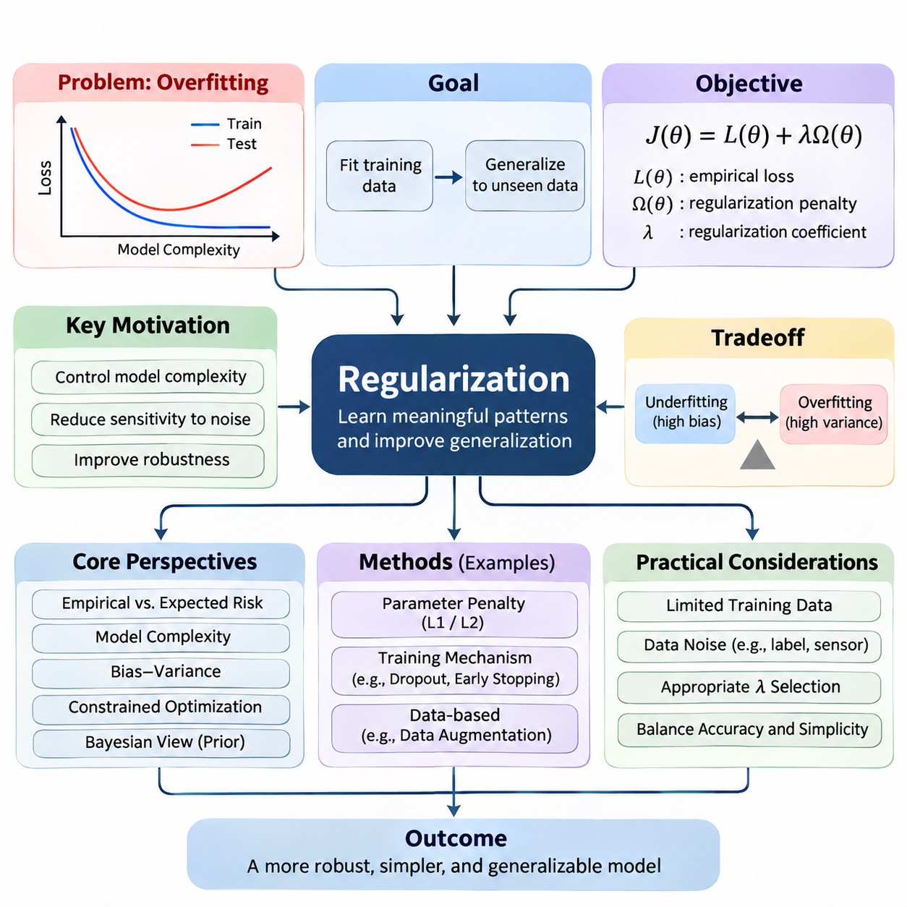
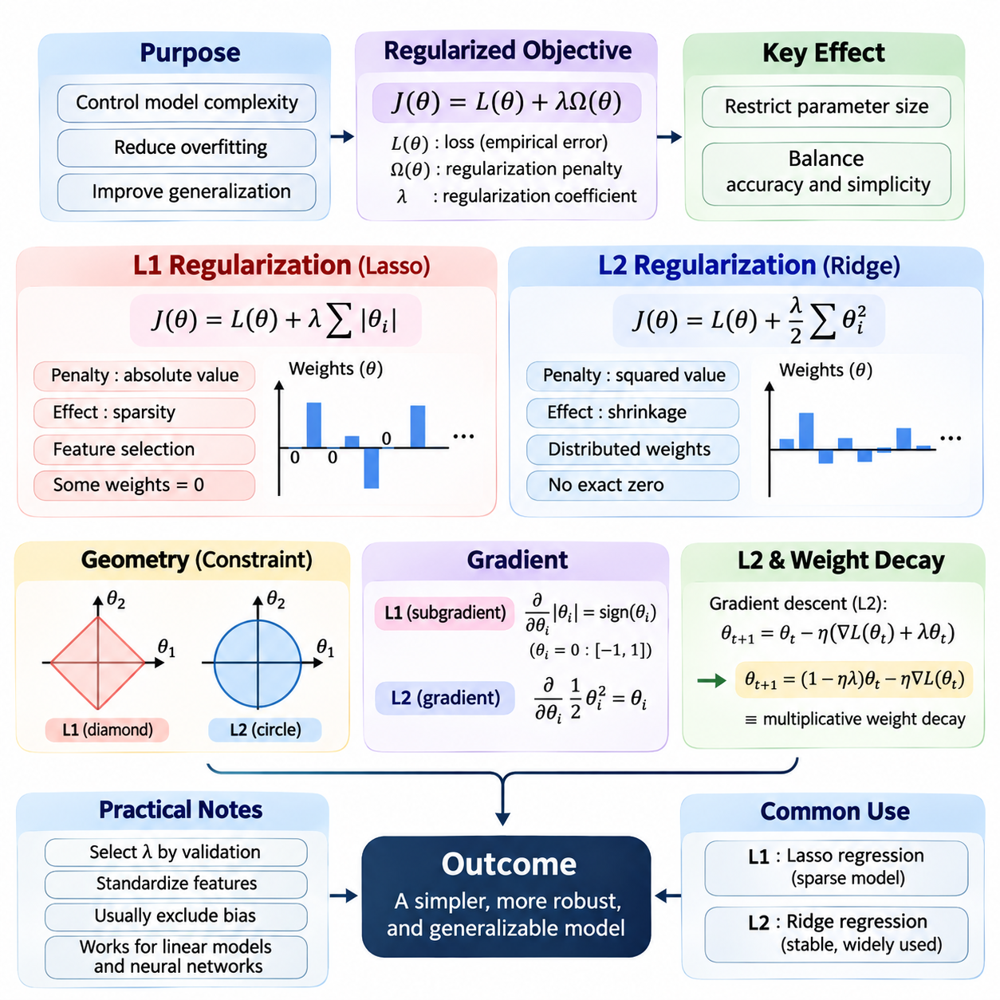
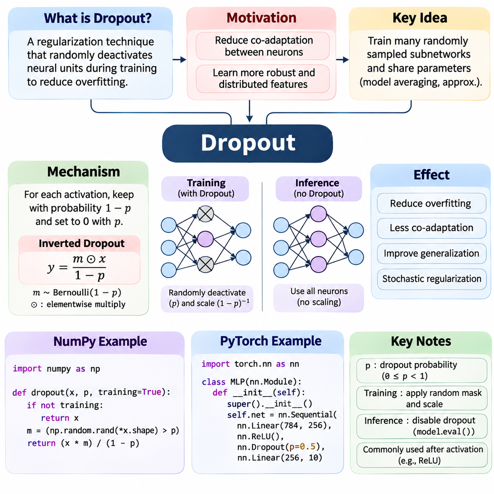
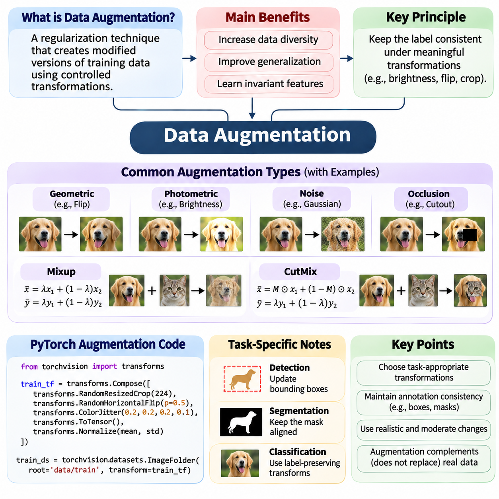
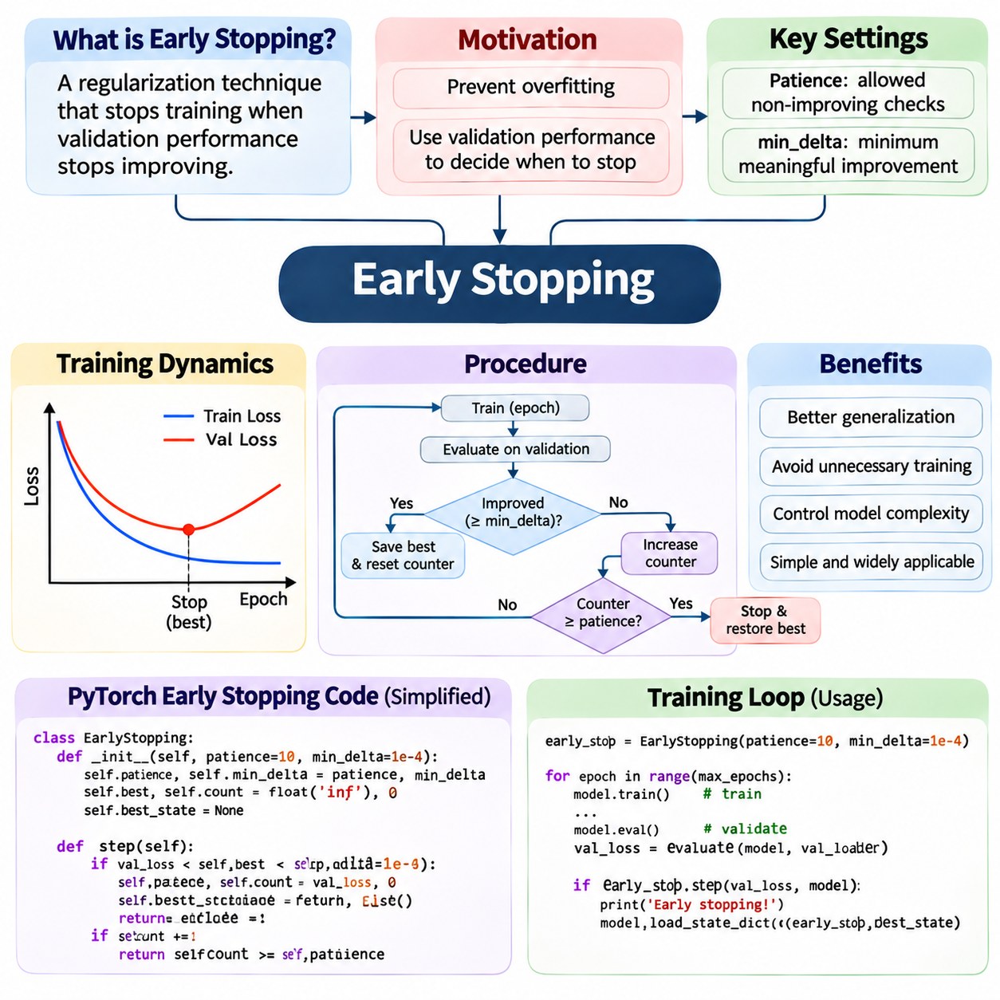
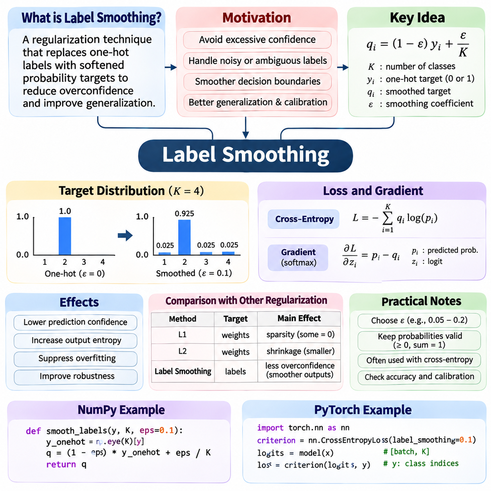
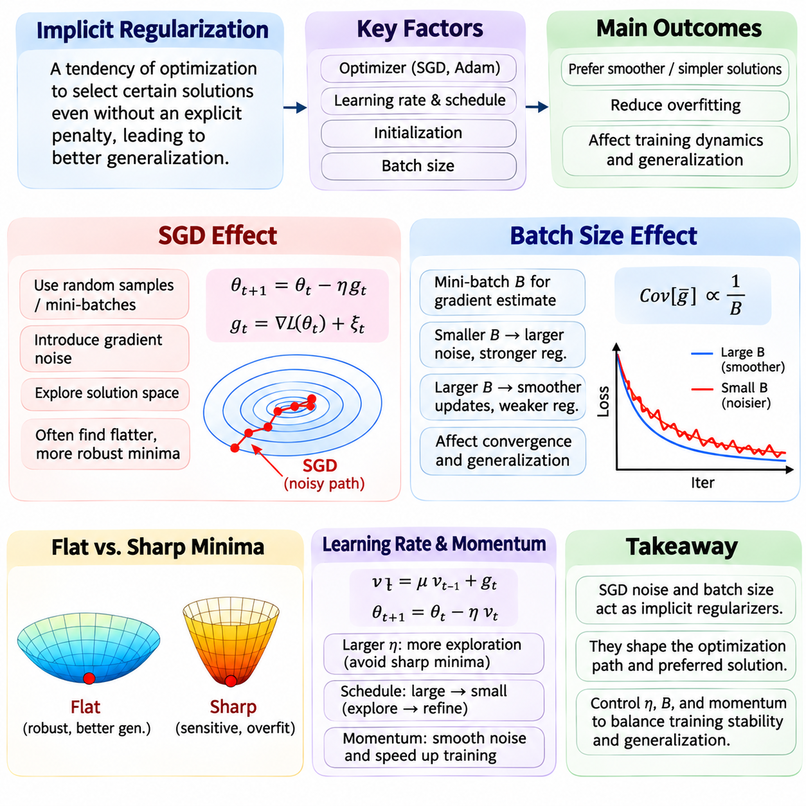
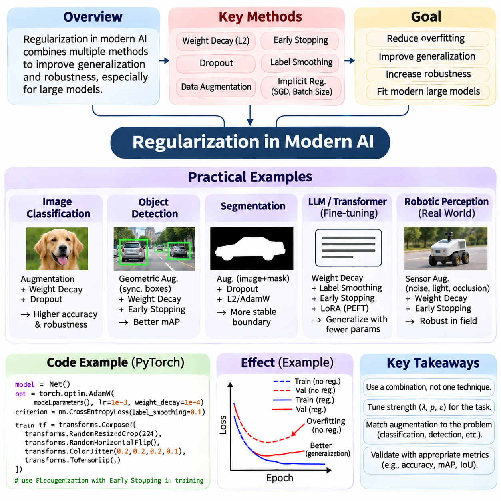

**Volume 06. Optimization and Generalization in ML**

# 03. Regularization

## 03.00 Why Regularization

{width="7.268055555555556in" height="7.268055555555556in"}

Regularization is a fundamental principle in machine learning that helps models learn meaningful patterns rather than memorize training examples. Although optimization algorithms minimize a loss function, achieving a low training loss does not necessarily guarantee reliable predictions on unseen data. Regularization addresses this limitation by guiding the learning process toward solutions that generalize more effectively.

The primary motivation for regularization arises from the difference between fitting observed data and learning the underlying data-generating relationships. A model with sufficient capacity can reproduce training observations almost perfectly, including random fluctuations and measurement errors. However, these details may not represent stable patterns, causing prediction accuracy to deteriorate when the model encounters new observations.

Overfitting occurs when a model becomes excessively sensitive to the characteristics of its training dataset. This problem is particularly common when the number of adjustable parameters is large relative to the available information. Deep neural networks can contain millions or billions of parameters, making them capable of representing highly complex functions that may capture both useful relationships and irrelevant variations.

Regularization introduces additional constraints, penalties, or training mechanisms that influence which solutions a learning algorithm selects. Rather than focusing exclusively on minimizing empirical training error, the objective becomes finding a model that balances predictive accuracy with desirable structural or behavioral properties. These properties may include smaller parameter magnitudes, smoother predictions, robustness, or reduced sensitivity to noise.

The distinction between empirical risk and expected risk provides a mathematical foundation for understanding regularization. Empirical risk measures average prediction error over the available training samples, whereas expected risk represents performance across the underlying data distribution. Since the true distribution is generally unknown, minimizing empirical risk alone may produce a solution that performs poorly outside the observed dataset.

A regularized optimization objective is commonly expressed as J(θ) = L(θ) + λΩ(θ), where L(θ) denotes the empirical loss, Ω(θ) represents a regularization penalty, and λ controls its relative influence. The parameter vector θ contains the trainable model parameters. Increasing λ strengthens the penalty, although the resulting behavior depends on the regularizer, model architecture, and optimization procedure.

The regularization coefficient establishes a tradeoff between fitting the training data and restricting the learned solution. When regularization is too weak, the model may retain unnecessary complexity and exhibit substantial overfitting. When regularization is excessively strong, important relationships may be suppressed, producing underfitting. Appropriate regularization therefore requires balancing competing objectives rather than simply maximizing the penalty.

Model complexity is closely related to regularization, but complexity cannot always be measured by counting parameters. Two neural networks with identical parameter counts may exhibit substantially different generalization behavior because of their architectures, parameter distributions, and training procedures. Regularization influences effective model capacity by restricting the functions or solutions that learning algorithms are likely to produce.

The bias-variance perspective offers another interpretation of why regularization is useful. Highly flexible models may exhibit low training bias but substantial sensitivity to variations in the training dataset. Introducing suitable regularization can reduce this sensitivity, potentially improving expected prediction performance. However, excessive restrictions can increase bias, preventing the model from representing relationships required for accurate predictions.

Noise is an unavoidable consideration in practical machine learning. Training datasets may contain measurement inaccuracies, inconsistent labels, sensor disturbances, or sampling artifacts. Without appropriate controls, models can learn these irregularities as though they were meaningful signals. Regularization can discourage such behavior, although it cannot automatically correct systematic labeling errors or compensate for fundamentally inadequate data quality.

Limited training data creates additional challenges because many different models may explain the same observations. This uncertainty becomes especially significant in high-dimensional feature spaces, where the number of possible relationships grows rapidly. Regularization introduces inductive preferences that favor certain solutions, reducing the ambiguity of model selection and potentially improving performance when observations are scarce.

Regularization can also be interpreted through constrained optimization. Instead of adding a penalty to the loss function, the learning problem may minimize empirical error while requiring model parameters to satisfy a specified constraint. Under suitable mathematical conditions, penalized and constrained formulations are closely related. This perspective illustrates how regularization restricts the feasible or preferred solution space.

From a Bayesian perspective, certain regularization penalties correspond to assumptions about prior parameter distributions. For example, quadratic penalties can be associated with Gaussian priors, while absolute-value penalties correspond to Laplace priors under common formulations. These connections show that regularization can encode prior preferences about plausible solutions rather than functioning merely as an arbitrary numerical adjustment.

Regularization is not limited to explicit mathematical penalties. Training procedures can influence generalization through stochastic optimization, parameter initialization, architectural restrictions, and the duration of training. These mechanisms may introduce implicit regularization, meaning that the learning algorithm favors particular solutions even when no additional penalty appears explicitly in the objective function.

Stochastic gradient descent illustrates the importance of optimization dynamics. Because gradients are estimated using randomly selected mini-batches, parameter updates contain stochastic variation. This variation can influence which regions of the loss landscape are explored and which solutions are eventually obtained. However, stochasticity does not universally improve generalization, and its effects depend on learning rates, batch sizes, and model properties.

Regularization becomes particularly important when training highly expressive neural networks on datasets with limited diversity. A model may achieve excellent training accuracy while failing to recognize objects under unfamiliar lighting, viewpoints, or environmental conditions. Techniques that encourage invariance or expose the model to meaningful input variations can improve its ability to recognize patterns beyond the original observations.

In computer vision, regularization helps models distinguish essential visual characteristics from incidental image properties. A classification network should ideally recognize an object despite reasonable changes in orientation, illumination, or background. Training strategies that reduce dependence on irrelevant visual details can improve robustness, provided that the transformations preserve the information needed for the intended prediction task.

Natural language processing presents similar challenges because models may exploit superficial correlations between words and labels. A sentiment classifier, for example, might associate particular expressions with positive outcomes without understanding their contextual meaning. Appropriate regularization can reduce reliance on unstable correlations, although robust language understanding also requires representative data and suitable model architectures.

In robotics and autonomous systems, regularization has implications beyond conventional benchmark accuracy. Perception and prediction models must operate under changing environmental conditions, sensor uncertainty, and variations in operating scenarios. Models that memorize laboratory conditions may behave unpredictably during deployment. Regularization contributes to reliability by discouraging unnecessary dependence on training-specific details.

The relationship between regularization and robustness requires careful interpretation. A regularized model may generalize better to new samples drawn from the same distribution, but this does not guarantee reliable performance under substantial distribution shifts. Changes in sensor characteristics, operating environments, or task requirements can introduce challenges that ordinary regularization cannot resolve without additional adaptation or validation.

Modern deep learning complicates traditional assumptions about model complexity and overfitting. Highly overparameterized networks can sometimes achieve nearly zero training error while maintaining strong test performance. This behavior indicates that generalization depends not only on parameter count but also on data structure, architecture, optimization dynamics, and the properties of the solutions selected during training.

Consequently, regularization should not be understood simply as a requirement to make every model smaller. Its broader purpose is to influence learning toward solutions with useful generalization characteristics. Some effective regularization strategies restrict parameter magnitudes, while others modify training examples, introduce stochastic behavior, limit training duration, or encourage smoother predictive distributions.

The effectiveness of regularization must be evaluated using data that were not used to fit model parameters. Validation datasets provide a practical basis for selecting regularization strengths and comparing alternative strategies. However, repeated tuning against the same validation set can introduce selection bias. A separate test dataset is therefore important for obtaining a less biased estimate of final model performance.

Training and validation learning curves can reveal whether regularization is appropriately configured. A large difference between training and validation performance may indicate overfitting, while poor performance on both datasets may suggest insufficient model capacity, optimization difficulties, or excessive regularization. These patterns are diagnostic indicators rather than definitive explanations, so additional experiments are often necessary.

Regularization also interacts with the amount and diversity of training data. When datasets are small, stronger inductive constraints may be beneficial because observations provide limited information about the underlying distribution. As datasets become larger and more representative, the need for particular restrictions may change. Nevertheless, larger datasets do not automatically eliminate overfitting or guarantee robustness.

The computational consequences of regularization vary across techniques. Some penalties introduce relatively little additional processing, while others modify the training pipeline or require additional data transformations. Regularization may also affect convergence speed and the number of training iterations needed to achieve satisfactory performance. Practical selection must therefore consider predictive quality, computational resources, and operational requirements.

An important distinction exists between regularization and optimization. Optimization determines how model parameters are updated to reduce an objective function, whereas regularization influences which solutions are preferred or how learning is constrained. The two processes interact closely because changing the regularization strategy can alter the loss landscape, gradient behavior, convergence trajectory, and final parameter configuration.

The central purpose of regularization is to improve the relationship between what a model learns during training and how it behaves when confronted with previously unseen observations. Successful regularization preserves meaningful predictive structure while limiting dependence on accidental characteristics of the training dataset. Understanding this principle provides the foundation for studying explicit penalties, stochastic methods, data augmentation, early stopping, and modern regularization strategies.

## 03.01 L1 L2 Regularization

{width="7.268055555555556in" height="7.268055555555556in"}

L1 and L2 regularization are fundamental techniques for controlling model complexity and improving generalization in machine learning. Both methods modify the training objective by introducing penalties on model parameters, discouraging solutions that rely on unnecessarily large coefficients. Although they share the goal of reducing overfitting, they impose different mathematical constraints and produce distinct effects on parameter distributions.

L1 regularization adds a penalty proportional to the sum of the absolute values of model parameters. Its objective can be expressed as J(θ) = L(θ) + λΣ\|θᵢ\|, where L(θ) represents the original loss function and λ controls regularization strength. Because the penalty increases linearly with parameter magnitude, L1 regularization encourages sparse solutions in which some coefficients become exactly zero.

Sparsity is the defining characteristic of L1 regularization. By eliminating selected coefficients, the method can perform implicit feature selection and produce models that depend on fewer input variables. This property is particularly valuable when datasets contain many irrelevant or redundant features. However, the selected features may vary when predictors are strongly correlated or the training dataset changes.

L2 regularization introduces a penalty proportional to the sum of squared parameter values. The regularized objective is commonly written as J(θ) = L(θ) + (λ/2)Σθᵢ². Unlike L1 regularization, L2 generally shrinks coefficients continuously toward zero without forcing them to become exactly zero. Consequently, it encourages distributed representations rather than explicitly sparse parameter configurations.

The mathematical difference between absolute-value and squared penalties explains their contrasting behavior. L1 applies a constant-magnitude penalty gradient to nonzero coefficients, whereas L2 produces gradients proportional to parameter values. Large coefficients therefore receive stronger absolute penalties under L2, while L1 can drive small coefficients to zero through its characteristic nonsmooth optimization geometry.

From a geometric perspective, L1 regularization constrains parameters within a diamond-shaped region in two dimensions, while L2 regularization corresponds to a circular region. The corners of the L1 constraint frequently intersect optimal loss contours at coordinate axes, producing zero coefficients. The smooth boundary of the L2 constraint instead favors solutions with multiple reduced coefficients.

L1 regularization is closely associated with Lasso regression, which minimizes prediction error while penalizing the absolute values of regression coefficients. L2 regularization forms the foundation of Ridge regression, where squared coefficients are penalized. Both approaches extend naturally to other differentiable learning objectives, including logistic regression and neural network training.

The regularization coefficient λ determines how strongly parameter magnitudes influence the optimization process. When λ approaches zero, the objective increasingly resembles the original empirical loss. As λ increases, parameter restrictions become stronger, potentially reducing variance but increasing bias. Selecting λ requires validation because excessive regularization can prevent the model from learning meaningful relationships.

Feature scaling is particularly important when implementing L1 or L2 regularization in linear models. If input variables have substantially different numerical ranges, their coefficients operate on incompatible scales. Applying the same penalty to all coefficients may then produce unintended preferences. Standardizing numerical features before fitting a regularized model helps ensure more consistent penalty behavior.

In practical implementations, regularization is usually applied to trainable weights while bias parameters are excluded. Bias terms often control baseline predictions rather than feature sensitivity, so penalizing them may introduce unnecessary restrictions. However, this convention is not universal, and implementation details should be verified because different frameworks expose different parameter grouping and regularization mechanisms.

A basic NumPy implementation begins by computing predictions, evaluating the original loss, and adding the selected penalty. For L1 regularization, the additional term is calculated using the absolute values of the weight vector. For L2 regularization, squared weights are summed and multiplied by the chosen coefficient. The resulting objective is then minimized using an appropriate optimization algorithm.

Gradient-based optimization requires particular attention when implementing L1 regularization. The absolute-value function is not differentiable at zero, so conventional gradients are replaced by subgradients or specialized optimization procedures. For nonzero coefficients, the L1 subgradient equals the sign of the coefficient. At zero, any value within the interval from −1 to 1 is a valid subgradient.

L2 regularization is comparatively straightforward because its squared penalty is differentiable everywhere. For the objective J(θ) = L(θ) + (λ/2)Σθᵢ², the gradient becomes ∇J(θ) = ∇L(θ) + λθ. This additional term pulls parameters toward zero during optimization. Its simplicity makes L2 regularization particularly convenient for gradient-based learning algorithms.

When standard gradient descent is applied to an L2-regularized objective, the parameter update becomes θₜ₊₁ = θₜ − η(∇L(θₜ) + λθₜ), where η denotes the learning rate. Rearranging gives θₜ₊₁ = (1 − ηλ)θₜ − η∇L(θₜ). This expression illustrates the connection between L2 regularization and multiplicative weight decay under ordinary gradient descent.

Weight decay and L2 regularization are equivalent under standard gradient descent when their coefficients are matched appropriately. However, the equivalence does not generally hold for adaptive optimizers such as Adam when the penalty gradient is incorporated into adaptive moment estimates. Decoupled weight decay, implemented by optimizers such as AdamW, applies parameter shrinkage separately from the loss gradient.

In PyTorch, explicit L1 regularization can be implemented by adding the sum of absolute weight values to the computed training loss. Automatic differentiation handles the corresponding gradient calculations using its defined behavior at nondifferentiable points. For L2-style regularization, an explicit squared-weight penalty can be added, while optimizer weight decay provides another commonly used implementation mechanism.

A typical PyTorch training loop first performs a forward pass, computes the task loss, and constructs the regularization penalty from selected model parameters. The combined loss is then passed through backward propagation before the optimizer updates the weights. This approach allows developers to control which layers are regularized and whether different parameter groups receive different penalty strengths.

Scikit-learn provides established implementations of regularized linear models through estimators such as Lasso, Ridge, and ElasticNet. These estimators manage the optimization procedures internally, allowing practitioners to focus on feature preparation, hyperparameter selection, and evaluation. Their regularization parameters and objective scaling conventions must be checked before comparing results with custom implementations.

Elastic Net combines L1 and L2 penalties within a single objective. Its regularization term can be expressed as λ₁Σ\|θᵢ\| + (λ₂/2)Σθᵢ², allowing both sparsity and continuous coefficient shrinkage. This combination is useful when predictors are correlated because it can retain groups of related features more effectively than pure L1 regularization in many practical settings.

The choice between L1 and L2 depends on the learning objective and characteristics of the data. L1 is attractive when feature selection, compact representations, or coefficient interpretability are important. L2 is often preferred when many features contribute useful information and stable coefficient shrinkage is desirable. Neither method universally outperforms the other across all datasets.

In high-dimensional classification problems, L1 regularization can reduce dependence on irrelevant input dimensions. For example, a text classification model may contain thousands of sparse vocabulary features, only some of which contribute meaningfully to predictions. L1 can suppress unnecessary coefficients, potentially improving interpretability and reducing the effective number of active features.

L2 regularization is widely used in neural networks because it discourages excessive parameter magnitudes without explicitly eliminating connections. Smaller weights may reduce sensitivity to certain input variations and influence the complexity of learned functions. Nevertheless, parameter magnitude alone does not fully determine neural network generalization, especially in architectures containing normalization layers or scale-invariant parameterizations.

Implementation quality depends on the relationship between regularization strength and loss reduction conventions. If the original loss is averaged across samples but the penalty is summed across parameters, changing the number of parameters can substantially affect their relative contributions. Likewise, using summed rather than averaged sample losses changes the effective meaning of λ unless the coefficient is adjusted accordingly.

Regularization experiments should use consistent data partitions and evaluation procedures. A practical comparison trains an unregularized baseline, an L1-regularized model, and an L2-regularized model under comparable conditions. Training loss, validation performance, coefficient magnitudes, and the number of zero-valued parameters provide complementary information about how each method influences learning.

Hyperparameter tuning commonly evaluates several regularization strengths across a logarithmic range. Small coefficients allow the model greater flexibility, while larger coefficients impose stronger restrictions. Cross-validation can provide more stable estimates when datasets are limited, although preprocessing must be fitted independently within each training fold to avoid information leakage.

An important implementation consideration is that stronger regularization does not necessarily produce better generalization. A model may initially benefit from reduced variance, but further increases in penalty strength can eliminate useful predictive information. Monitoring validation metrics alongside training behavior helps identify the point at which additional regularization becomes counterproductive.

L1 and L2 regularization provide a practical foundation for understanding explicit complexity control in machine learning. Their mathematical differences explain why one favors sparse solutions while the other promotes continuous parameter shrinkage. Correct implementation requires attention to objective scaling, feature normalization, parameter selection, optimizer behavior, and validation procedures, ensuring that regularization improves generalization rather than merely reducing coefficient magnitudes.

## 03.02 Dropout

{width="7.268055555555556in" height="7.268055555555556in"}

Dropout is a widely used regularization technique in deep learning that reduces overfitting by randomly deactivating selected neural network units during training. Instead of allowing every neuron to participate in every forward pass, dropout introduces stochastic variation into the network\'s internal representations. This mechanism discourages excessive dependence on individual neurons and encourages the development of more distributed and robust feature representations.

The fundamental motivation for dropout is to reduce co-adaptation among neurons. Co-adaptation occurs when groups of neurons become overly dependent on one another to produce accurate predictions. Such dependencies may fit training examples effectively but generalize poorly to unseen observations. By randomly removing neuron contributions during training, dropout encourages the remaining units to learn useful features under varying network configurations.

Dropout operates by sampling a binary mask for selected activations during each training forward pass. Each element is independently retained with probability 1 − p and set to zero with probability p, where p represents the dropout probability. The resulting activation pattern changes across training iterations, exposing the network to many randomly sampled subnetworks while preserving the same underlying trainable parameters.

The mathematical formulation of inverted dropout can be expressed as y = (m ⊙ x)/(1 − p), where x represents the original activation tensor, m is a Bernoulli mask with retention probability 1 − p, and ⊙ denotes elementwise multiplication. Dividing retained activations by 1 − p preserves their expected values during training, provided that p is less than one.

Inverted dropout is the standard implementation strategy in modern deep learning frameworks. During training, retained activations are scaled to compensate for randomly removed units. During inference, dropout is disabled and activations pass through without additional scaling. This approach simplifies deployment because the same deterministic network can perform predictions without sampling dropout masks or modifying activation magnitudes.

The dropout probability controls the strength of stochastic regularization. A small probability removes relatively few activations and introduces limited perturbation, while a larger probability produces stronger disruptions to information flow. Excessively aggressive dropout can prevent the network from learning important relationships, resulting in underfitting or unstable convergence. Appropriate probabilities depend on architecture, dataset size, and training conditions.

Dropout is often interpreted as an approximate form of model averaging. Each sampled mask creates a different effective subnetwork, and training shares parameters across these configurations. At inference, the complete network provides a computationally efficient approximation to combining information learned across many subnetworks. However, this interpretation is approximate rather than mathematically equivalent to averaging every possible model.

In fully connected neural networks, dropout is commonly applied after activation functions in selected hidden layers. The operation randomly suppresses components of intermediate feature vectors before they are passed to subsequent layers. This placement can reduce reliance on individual hidden representations, although the optimal location depends on architectural details and interactions with normalization or residual connections.

Dropout behaves differently from weight-based regularization methods such as L1 and L2. Weight penalties directly influence parameter magnitudes through additional objective terms, whereas dropout modifies the computational pathway during training. Its regularization effect emerges from stochastic activation suppression rather than explicit coefficient shrinkage. These approaches can be combined, although their interactions require empirical validation.

A basic dropout implementation can be constructed using NumPy by generating a random binary mask with the same shape as an activation array. Each mask element is sampled according to the retention probability, and the activation array is multiplied elementwise by the mask. Dividing the result by the retention probability implements inverted dropout and maintains the expected activation scale.

Implementing dropout manually requires distinguishing training mode from inference mode. During training, the forward pass samples a new mask and applies stochastic suppression. During inference, the original activations are returned unchanged. The implementation must also handle boundary conditions, ensuring that the dropout probability remains within the valid interval from zero inclusive to one exclusive.

In PyTorch, dropout is provided through torch.nn.Dropout, which automatically applies inverted dropout during training. A layer can be created using nn.Dropout(p=0.5), where the probability specifies the fraction of activation elements expected to be suppressed. When the model is placed in training mode through model.train(), the layer generates random masks during forward execution.

PyTorch automatically disables standard dropout when the model enters evaluation mode through model.eval(). This distinction is essential for obtaining stable validation and inference results. If evaluation is performed while dropout remains active, predictions may vary between repeated forward passes. Correct mode management is therefore a fundamental requirement of reliable dropout implementation.

A typical PyTorch multilayer perceptron combines linear transformations, nonlinear activation functions, and dropout layers. For example, a hidden representation may pass through nn.Linear, nn.ReLU, and nn.Dropout before reaching the next transformation. During training, the dropout layer randomly suppresses activation elements, while automatic differentiation propagates gradients through the retained computational paths.

During backward propagation, activations removed by dropout do not contribute gradients through their masked paths in that iteration. Retained activations propagate gradients according to the scaling factor used during the forward pass. Because different masks are sampled across iterations, individual neurons receive learning signals under varying combinations of active network components.

TensorFlow and Keras provide equivalent functionality through the tf.keras.layers.Dropout layer. The dropout rate determines the probability of setting input elements to zero during training. Keras automatically manages the distinction between training and inference when the model is used through standard training and prediction interfaces, reducing the need for manual mask handling.

Dropout placement requires particular attention in convolutional neural networks. Standard elementwise dropout independently suppresses activation elements, but nearby spatial activations may contain strongly correlated information. Spatial dropout variants address this issue by suppressing entire feature channels or structured groups of activations, potentially producing more meaningful regularization in convolutional feature maps.

In PyTorch, nn.Dropout2d and nn.Dropout3d support channel-oriented dropout behavior for suitable convolutional tensors. These layers differ from ordinary dropout because their masks operate over structured feature dimensions rather than independently removing every spatial activation. Selecting the appropriate variant requires understanding tensor layouts, spatial dependencies, and the intended regularization behavior.

Dropout is also used in recurrent and sequence-processing architectures, although its implementation requires additional care. Independently sampling masks at every time step can introduce undesirable temporal noise in certain recurrent computations. Variational dropout and related methods may reuse masks across sequence positions or time steps, depending on the architecture and implementation.

Transformer architectures employ dropout in selected components, including attention probabilities, residual pathways, and feedforward representations. However, dropout rates and placement vary substantially across model families and training regimes. Large-scale pretrained transformers sometimes use little or no dropout during pretraining, demonstrating that dropout is not universally necessary for successful generalization.

Dropout interacts with normalization layers and other training mechanisms. Batch normalization estimates activation statistics from training batches, while dropout changes activation distributions stochastically. Certain layer arrangements can therefore create differences between training and inference behavior. Careful architectural design and validation are necessary when combining dropout with batch normalization or other normalization methods.

The relationship between dropout and dataset size is important for practical model development. Small datasets may benefit from additional stochastic regularization because networks can otherwise memorize limited observations. However, excessive dropout can be harmful when training examples are already scarce or when the model struggles to learn useful features. Validation performance should determine whether stronger dropout is beneficial.

Dropout can increase the difficulty of optimization because each training iteration uses a different effective network configuration. Training loss may decrease more slowly than in an otherwise identical model without dropout. Nevertheless, improved validation performance can justify this additional optimization difficulty. Comparing models requires evaluating both convergence behavior and generalization rather than relying exclusively on training loss.

A practical experiment compares identical neural network architectures trained with several dropout probabilities. The training procedure should preserve comparable data partitions, optimizer settings, and evaluation metrics. Monitoring training and validation losses helps reveal whether dropout reduces overfitting, introduces underfitting, or provides little benefit under the selected experimental conditions.

Dropout can also support uncertainty estimation through Monte Carlo dropout. In this approach, dropout remains active during repeated inference passes, generating multiple stochastic predictions for the same input. The variation among predictions provides an approximate measure of predictive uncertainty, although its reliability depends on model calibration, dropout configuration, and the assumptions underlying the approximation.

Monte Carlo dropout requires deliberate control of inference behavior because ordinary evaluation mode disables dropout. Implementations may selectively activate dropout layers while keeping other components, particularly batch normalization, in evaluation mode. Repeated predictions can then be summarized using statistics such as predictive means and variances, providing additional information beyond a single deterministic output.

Dropout implementation should be evaluated in the context of deployment requirements. Standard inference generally disables dropout and therefore introduces no additional stochastic computation. Monte Carlo dropout, by contrast, requires multiple forward passes and increases computational latency. Real-time systems must balance uncertainty estimation benefits against throughput, memory consumption, and response-time constraints.

Dropout remains an important example of regularization through stochastic computation rather than explicit parameter penalties. Its effectiveness depends on selecting suitable probabilities, applying masks to appropriate network components, and correctly separating training from inference behavior. Understanding both its mathematical formulation and framework implementation provides a foundation for designing neural networks that learn useful representations while limiting overfitting.

## 03.03 Data Augmentation

{width="7.268055555555556in" height="7.268055555555556in"}

Data augmentation is a fundamental regularization technique that improves machine learning generalization by expanding the diversity of training examples. Rather than collecting entirely new observations, augmentation generates modified versions of existing samples through controlled transformations. These variations encourage models to learn stable patterns instead of memorizing specific characteristics of individual training instances.

The central principle of data augmentation is that meaningful information should remain consistent under selected transformations. For image classification, an object may retain its identity despite moderate changes in brightness, orientation, or position. By exposing the model to these variations, augmentation encourages invariance to irrelevant changes while preserving sensitivity to features that determine the correct prediction.

Data augmentation increases the effective diversity of a dataset without necessarily increasing the number of independently collected observations. A single image can generate many transformed examples, but these examples remain statistically related to their source. Consequently, augmentation cannot completely replace additional real-world data, especially when the original dataset lacks important classes, environmental conditions, or representative operating scenarios.

Augmentation strategies must respect the semantics of the learning task. Horizontal flipping may be appropriate for recognizing many everyday objects but unsuitable when left-right orientation determines the label. Similarly, arbitrary rotations can damage the meaning of handwritten digits or directional traffic signs. A valid augmentation should preserve the target label or transform its annotation consistently with the modified input.

Geometric augmentation modifies spatial properties such as position, scale, rotation, and perspective. Common operations include random cropping, horizontal flipping, translation, resizing, and affine transformations. These techniques help vision models tolerate variations in camera placement and object appearance. However, excessive transformations can remove important features or produce unrealistic samples that reduce training effectiveness.

Photometric augmentation changes image appearance without directly modifying object geometry. Brightness, contrast, saturation, hue, and color balance can be adjusted to simulate different illumination and camera conditions. Such transformations are valuable for outdoor perception and industrial inspection, where lighting varies considerably. Their intensity should remain consistent with physically plausible operating environments.

Noise injection introduces controlled perturbations into training samples to improve tolerance to measurement uncertainty. Gaussian noise, sensor noise, and compression artifacts can approximate imperfections encountered during deployment. However, randomly generated noise does not always represent actual sensor behavior. Effective augmentation benefits from understanding the statistical characteristics of the intended acquisition hardware.

Occlusion-based augmentation randomly hides portions of an input image, encouraging the model to recognize objects from incomplete visual evidence. Techniques such as Cutout and Random Erasing remove or replace selected image regions during training. These methods can reduce dependence on isolated visual cues, but excessive occlusion may eliminate the information required to distinguish classes correctly.

Mixup creates synthetic training examples by combining pairs of inputs and their corresponding targets. A common formulation is x̃ = λx₁ + (1 − λ)x₂ and ỹ = λy₁ + (1 − λ)y₂, where λ is sampled from a mixing distribution. This technique encourages smoother transitions between training examples and can reduce overconfident predictions, although its suitability depends on the task and target representation.

CutMix combines image regions from different training examples while adjusting target contributions according to the replaced area. Unlike Mixup, which blends pixel values, CutMix preserves local visual structures within pasted regions. It can improve robustness and encourage attention to multiple object regions. Nevertheless, the target mixing rule may become inaccurate when object occupancy differs substantially from the pasted region area.

Data augmentation for object detection requires synchronized transformations of images and bounding box annotations. When an image is resized, cropped, flipped, or rotated, its bounding boxes must be updated using the same geometric transformation. Invalid or truncated boxes should be handled carefully. Failure to maintain annotation consistency introduces label noise and can severely degrade localization accuracy.

Semantic segmentation introduces similar requirements because pixel-level masks must remain aligned with transformed images. Geometric operations should modify the input image and segmentation mask consistently, while photometric transformations should generally affect only the image. Interpolation methods also matter because categorical segmentation masks must preserve discrete class identifiers rather than introduce intermediate label values.

In practical Python implementations, augmentation pipelines can be constructed using torchvision.transforms or other image-processing libraries. A typical training pipeline may combine random resized cropping, horizontal flipping, color adjustments, tensor conversion, and normalization. These operations are executed in sequence, producing transformed inputs before they are supplied to the neural network.

PyTorch commonly applies augmentation inside a Dataset object or through transform arguments provided to dataset classes. When a sample is retrieved, random transformations generate a new training variation without requiring every augmented image to be stored on disk. This online augmentation approach reduces storage requirements and allows the model to encounter different transformations across training epochs.

A practical torchvision pipeline can use transforms.Compose to combine operations such as RandomResizedCrop, RandomHorizontalFlip, ColorJitter, ToTensor, and Normalize. The ordering of transformations matters because some operations expect PIL images while others operate on tensors. Developers should verify compatibility with the installed torchvision version and the input representation used by the dataset.

Training and validation pipelines should be separated to preserve reliable performance measurement. Random augmentation is generally applied only to training samples, while validation and test data use deterministic preprocessing. For image classification, validation preprocessing often includes resizing, center cropping, tensor conversion, and normalization. This separation ensures that evaluation results are not influenced by uncontrolled random transformations.

Augmentation intensity is an important hyperparameter that determines how far transformed examples deviate from their original samples. Weak augmentation may provide insufficient diversity, while overly aggressive augmentation can distort class identity or introduce unrealistic training conditions. Appropriate intensity should be selected through validation experiments rather than assuming that stronger transformations always produce better generalization.

Automated augmentation methods attempt to discover useful transformation policies instead of relying entirely on manually selected operations. AutoAugment searches for combinations of transformations, while RandAugment simplifies policy selection through a small number of control parameters. These approaches can improve performance, but their computational requirements and effectiveness depend on the dataset, model architecture, and training configuration.

Data augmentation extends beyond computer vision into natural language processing, speech recognition, and time-series learning. Text augmentation may involve controlled word replacement or paraphrasing, while audio augmentation can modify background noise, timing, or frequency characteristics. Time-series augmentation may introduce scaling, jitter, or temporal shifts, provided that the transformations preserve task-relevant relationships.

For robotics and autonomous systems, augmentation should reflect realistic operational variation. Camera images may be modified to simulate illumination changes, weather effects, sensor noise, or partial occlusion. However, transformations must respect physical constraints and preserve geometric consistency across synchronized sensors. Unrealistic augmentation can create a mismatch between training conditions and actual deployment environments.

Synthetic data generation and data augmentation are related but distinct concepts. Traditional augmentation modifies existing observations, whereas synthetic generation may create entirely new scenes, objects, or environmental configurations. Simulation platforms can produce labeled data under controlled conditions, while augmentation increases variation within available samples. Combining both approaches can improve coverage when simulation fidelity and data quality are sufficient.

Augmentation interacts with other regularization techniques, including dropout, weight decay, and early stopping. Since each method influences learning differently, combining them can improve generalization but may also create excessive regularization. For example, aggressive image transformations combined with strong dropout may make optimization unnecessarily difficult. Controlled experiments are needed to determine effective combinations.

A practical evaluation compares a baseline model trained with minimal preprocessing against models using progressively richer augmentation pipelines. Training and validation accuracy, loss curves, and performance under controlled perturbations provide useful evidence. The comparison should preserve data splits, optimizer settings, and training budgets so that observed differences can be attributed more reliably to augmentation choices.

Augmentation experiments should also examine class balance and rare-event coverage. Repeatedly transforming common examples does not necessarily improve recognition of underrepresented classes. Class-aware sampling or targeted augmentation may help, but excessive reuse of rare examples can introduce artificial patterns. Maintaining representative class distributions and realistic sample diversity remains essential for trustworthy model evaluation.

Data augmentation is especially valuable when real-world data collection is expensive, slow, or constrained by operational safety. Industrial robotics, medical imaging, and autonomous navigation frequently encounter such limitations. Carefully designed transformations can improve data efficiency and robustness, but their benefits depend on whether augmented samples approximate meaningful variations that the deployed model will actually encounter.

The effectiveness of augmentation ultimately depends on preserving label validity, selecting realistic transformations, and maintaining consistent implementation across data and annotations. Well-designed augmentation expands the range of conditions represented during training and encourages models to learn transferable features. Understanding augmentation pipelines, transformation probabilities, annotation handling, and evaluation procedures provides a practical foundation for robust machine learning development.

## 03.04 Early Stopping

{width="7.268055555555556in" height="7.268055555555556in"}

Early stopping is a practical regularization technique that improves generalization by terminating model training when validation performance stops improving. Instead of allowing optimization to continue until training loss reaches its minimum, early stopping monitors performance on unseen validation samples. This approach reduces the risk of fitting noise and unnecessary details in the training dataset.

The motivation for early stopping arises from the difference between optimization progress and generalization performance. During training, empirical loss often decreases continuously, while validation loss may eventually increase. This divergence indicates that additional parameter updates are improving the fit to training examples without necessarily improving predictions on new observations.

Early stopping treats training duration as a form of model complexity control. A neural network trained for fewer iterations may learn dominant patterns before adapting to less reliable variations in the data. Continuing optimization can increase sensitivity to training-specific characteristics. Stopping at an appropriate point therefore introduces an implicit constraint on the learned solution.

A typical early stopping procedure evaluates the model on a separate validation dataset after each epoch or a specified number of training steps. The monitored metric may be validation loss, classification accuracy, F1 score, or another task-specific measure. When the metric fails to improve for a predefined period, training terminates and the best-performing model parameters are restored.

The patience parameter determines how many consecutive validation checks without sufficient improvement are tolerated. For example, patience = 10 allows training to continue through ten unsuccessful validation evaluations before stopping. This mechanism prevents termination after a single unfavorable fluctuation and gives the optimizer opportunities to escape temporary performance plateaus.

Minimum improvement, commonly represented by min_delta, specifies the smallest metric change considered meaningful. If validation loss decreases by less than this threshold, the update may not reset the patience counter. Selecting an appropriate threshold helps distinguish genuine progress from numerical fluctuations, particularly when validation metrics change slowly near convergence.

Early stopping requires defining whether the monitored metric should be minimized or maximized. Validation loss and error rates are usually minimized, whereas accuracy, F1 score, and many detection metrics are maximized. An implementation must apply the correct comparison rule because reversing the direction can cause premature stopping or prevent stopping entirely.

Validation frequency influences both stopping accuracy and computational overhead. Evaluating after every epoch provides regular feedback but may be expensive for large datasets. Step-based validation offers finer control when epochs are long, although frequent evaluations can increase training time. The stopping configuration should reflect the computational budget and expected rate of model improvement.

A basic Python implementation maintains the best validation score, a counter for unsuccessful evaluations, and the patience threshold. After each validation phase, the current score is compared with the best recorded result. Meaningful improvement resets the counter, while insufficient improvement increments it. Training stops once the counter reaches the configured patience.

Saving the best model checkpoint is essential because the final training iteration is not necessarily the iteration with the strongest validation performance. A checkpoint may contain model weights, optimizer state, epoch number, and selected training metadata. Restoring the best weights ensures that subsequent evaluation or deployment uses the model associated with the selected validation result.

In PyTorch, early stopping is commonly implemented as a custom utility within the training loop. After completing an epoch, the model enters evaluation mode through model.eval(), and validation predictions are computed without gradient tracking. The resulting validation metric is passed to an early stopping controller that determines whether to save a checkpoint, continue training, or terminate.

Correct mode management is important when evaluating models containing dropout or batch normalization. Calling model.eval() disables standard dropout and changes batch normalization behavior to use stored statistics. Validation calculations should generally use torch.no_grad() or torch.inference_mode() to avoid unnecessary gradient tracking and reduce memory consumption.

When training resumes after validation, model.train() must be called to restore training behavior. Otherwise, dropout and normalization layers may operate incorrectly during subsequent optimization steps. A reliable implementation separates training and evaluation phases explicitly, ensuring that validation results are consistent and training dynamics remain appropriate.

A reusable EarlyStopping class can store patience, min_delta, the best metric, and the number of consecutive non-improving checks. Its update method receives the latest validation result and returns a stopping decision. Optional checkpoint functionality can save model parameters whenever improvement occurs, making the component independent of a particular network architecture.

Checkpoint restoration requires care because references to mutable parameter objects may change as optimization continues. In-memory checkpointing should use independent copies of model state, while disk-based checkpointing can serialize the state dictionary. When only inference is required, restoring model weights may be sufficient; exact training continuation also requires optimizer and scheduler states.

Early stopping is closely related to the bias-variance tradeoff. Terminating training too early may produce underfitting because the model has not learned sufficient structure. Training too long can increase sensitivity to noise and dataset-specific patterns. The stopping point seeks a practical balance, although the relationship between training duration and generalization is not always monotonic.

The technique is particularly useful for overparameterized neural networks that can continue reducing training loss after validation performance has stabilized. However, validation curves may contain temporary degradation followed by renewed improvement. This behavior means that early stopping should not assume every short-term increase in validation loss represents irreversible overfitting.

Learning rate schedules can interact strongly with early stopping. A model may show little validation improvement before a scheduled learning rate reduction enables further progress. If patience is too short, training may terminate before this improvement occurs. Coordinating stopping criteria with learning rate schedulers helps prevent premature termination during planned optimization transitions.

Early stopping can also be combined with ReduceLROnPlateau, which lowers the learning rate when a monitored metric stops improving. In such configurations, the learning rate scheduler generally receives an opportunity to adjust optimization before early stopping terminates training. The patience settings should be coordinated so that the model has enough time to benefit from learning rate reductions.

Validation data must remain separate from training data to provide a meaningful stopping signal. If the same samples are used for both optimization and stopping decisions, the monitored metric may fail to reveal overfitting. Preprocessing procedures should also avoid information leakage, particularly when normalization statistics or feature transformations are estimated from data.

Repeatedly selecting checkpoints using the same validation dataset introduces a form of model selection bias. Although early stopping improves generalization in many cases, validation performance may become optimistic when extensive tuning is performed. A separate test dataset should therefore be reserved for final evaluation, especially when comparing multiple architectures or stopping configurations.

For small validation datasets, metric estimates can fluctuate substantially because a few samples may strongly influence the result. Increasing patience or evaluating a more stable metric may reduce premature stopping. Nevertheless, excessive patience can weaken the regularization effect. The choice should reflect dataset size, measurement noise, and the consequences of stopping too early.

Early stopping can reduce computational cost by avoiding unnecessary training epochs. This benefit becomes significant when models require expensive GPU resources or lengthy distributed training. However, frequent validation and checkpoint serialization introduce additional overhead. Efficient implementations balance the savings from earlier termination against the cost of monitoring model performance.

In distributed training, validation metrics may need to be aggregated across multiple workers before a stopping decision is made. The decision should be synchronized so that all workers terminate consistently. Checkpoint writing is typically restricted to a designated process to avoid duplicate files or race conditions. These considerations are important for reliable multi-GPU training pipelines.

A practical experiment compares fixed-duration training against early stopping under otherwise identical conditions. Training and validation loss curves reveal how the stopping criterion responds to generalization behavior. The selected checkpoint can then be evaluated on an independent test set. Recording the best epoch, stopping epoch, and patience counter improves experiment reproducibility.

Early stopping is applicable beyond classification to regression, object detection, segmentation, and sequence modeling. Each application requires selecting a validation metric that reflects the intended deployment objective. For object detection, validation loss may not always align perfectly with mean average precision, while regression systems may prioritize mean absolute error or another application-specific measure.

Early stopping is most effective when combined with reliable validation procedures, suitable patience settings, meaningful improvement thresholds, and checkpoint restoration. It does not guarantee optimal generalization, but it provides an efficient mechanism for controlling training duration and limiting unnecessary adaptation to training data. Understanding its implementation enables more reliable and computationally efficient machine learning development.

## 03.05 Label Smoothing

{width="7.268055555555556in" height="7.268055555555556in"}

Label smoothing is a regularization technique used in classification models to reduce excessive confidence in predicted class probabilities. Conventional supervised learning often represents targets as one-hot vectors, assigning probability one to the correct class and zero to every other class. Label smoothing replaces these extreme targets with softened probability distributions, encouraging more balanced predictions and potentially improving generalization.

The motivation for label smoothing arises from the limitations of treating every training label as an absolutely certain observation. Real datasets may contain annotation errors, ambiguous examples, or overlapping class boundaries. Training models to produce nearly perfect confidence for every labeled example can encourage overly sharp decision boundaries and poorly calibrated predictions, particularly when the training data is limited or noisy.

For a classification problem containing K classes, label smoothing modifies the original one-hot target distribution using a smoothing coefficient ε. A common formulation is qᵢ = (1 − ε)yᵢ + ε/K, where yᵢ is the original target and qᵢ is the smoothed target probability. The correct class receives 1 − ε + ε/K, while each incorrect class receives ε/K, ensuring that all target probabilities sum to one.

The smoothing coefficient determines how strongly the target distribution moves toward a uniform distribution. When ε = 0, the original one-hot labels remain unchanged. As ε increases, the correct-class target probability decreases while the probabilities assigned to other classes increase. Excessive smoothing can remove useful class information, so the coefficient must be selected according to the dataset and learning objective.

Label smoothing is commonly applied to the cross-entropy loss used in neural network classification. Standard cross-entropy is expressed as L = −Σᵢ yᵢ log(pᵢ), where pᵢ represents the predicted probability of class i. With label smoothing, the target distribution becomes q, producing L = −Σᵢ qᵢ log(pᵢ). This modification changes the gradients that guide optimization without requiring changes to the model architecture.

The gradient behavior explains why label smoothing can reduce overconfidence. For softmax classification with cross-entropy loss, the gradient with respect to each logit is proportional to pᵢ − qᵢ. Unlike one-hot targets, smoothed labels do not encourage the correct-class probability to approach one as aggressively. Consequently, the optimizer receives less incentive to increase already dominant logits indefinitely.

Label smoothing differs from L1 and L2 regularization because it modifies the training targets rather than directly penalizing model parameters. L1 encourages sparse coefficients, while L2 discourages large parameter magnitudes. Label smoothing instead influences the probability distribution learned by the classifier. Its regularization effect emerges from the relationship between softened targets, predictive confidence, and optimization dynamics.

A probabilistic interpretation views label smoothing as combining the observed label distribution with a prior distribution over classes. Uniform label smoothing assumes that a small portion of target probability should be distributed equally among all available classes. This assumption can be useful when labels contain uncertainty, although a uniform distribution may not accurately represent the true ambiguity between semantically related classes.

Label smoothing can also be understood through its relationship with prediction entropy. Highly confident classifiers often produce low-entropy probability distributions concentrated on a single class. Smoothed targets discourage extreme concentration and may increase predictive entropy during training. However, higher entropy does not automatically imply better uncertainty estimation, and the effect on calibration must be evaluated empirically.

In practical implementations, label smoothing can be applied by constructing softened target vectors before computing the loss. A NumPy implementation first creates a one-hot representation of each class label, multiplies it by 1 − ε, and adds ε/K to every class component. The resulting probability vectors are then used with cross-entropy to compute the training objective.

The implementation must ensure that target probabilities remain nonnegative and sum to one. For uniform smoothing, ε is generally selected within the interval from zero to one. Numerical stability is also important because directly computing logarithms of probabilities close to zero can produce unstable values. Modern frameworks typically use log-softmax operations or stable cross-entropy implementations.

PyTorch provides built-in label smoothing through torch.nn.CrossEntropyLoss with the label_smoothing argument. For example, nn.CrossEntropyLoss(label_smoothing=0.1) applies uniform smoothing to the target distribution during loss computation. This approach avoids manually creating dense target vectors and integrates directly with ordinary classification training loops.

A typical PyTorch implementation computes logits through a neural network, passes the logits and integer class labels to the configured loss function, and performs backward propagation. The smoothing operation is handled internally by the criterion. During inference, the model produces logits or probabilities normally, because label smoothing modifies the training objective rather than introducing a separate inference operation.

TensorFlow and Keras also support label smoothing through suitable cross-entropy loss configurations. For categorical classification, tf.keras.losses.CategoricalCrossentropy can apply smoothing to one-hot or probability targets. Developers should distinguish categorical targets from sparse integer labels because available smoothing options and expected target formats differ between loss implementations.

Label smoothing is particularly useful in image classification, where large neural networks may become highly confident about training examples. By reducing the pressure to assign nearly all probability mass to a single class, smoothing can improve generalization under suitable conditions. However, its effectiveness depends on dataset quality, model capacity, augmentation policies, and the presence of other regularization mechanisms.

In object detection, label smoothing may be applied to classification components that predict object categories. Detection architectures often combine classification, localization, and objectness objectives, so smoothing must be integrated with the appropriate loss terms. Applying smoothing indiscriminately to regression targets or localization coordinates would be conceptually incorrect because these outputs do not represent categorical probability distributions.

Semantic segmentation can also benefit from label smoothing because each pixel may be assigned a categorical class distribution. However, segmentation datasets frequently include ignored pixels, uncertain boundaries, and severe class imbalance. Implementations must preserve ignore masks and avoid unintentionally assigning probability mass to invalid classes. Excessive smoothing may reduce the ability to distinguish fine object boundaries.

The relationship between label smoothing and knowledge distillation is important in modern neural network training. Knowledge distillation uses soft predictions from a teacher model to guide a student model, while conventional label smoothing usually distributes probability mass according to a predefined rule. Both techniques soften supervision, but teacher-generated targets can encode class relationships that uniform smoothing does not capture.

Label smoothing may influence representation learning and the structure of learned features. By reducing the incentive to maximize separation between every labeled example and all alternative classes, it can alter how feature embeddings are organized. These effects may improve classification performance but can also reduce information useful for certain downstream tasks, including some forms of knowledge distillation.

Calibration is another important consideration. A calibrated classifier should assign probabilities that correspond reasonably well to observed correctness frequencies. Label smoothing can reduce extreme confidence and sometimes improve calibration metrics, but it does not guarantee calibration. Reliability diagrams, expected calibration error, negative log-likelihood, and related measures can help assess its practical effects.

The smoothing coefficient is an important hyperparameter and should be tuned using validation data. Small values such as 0.05 or 0.1 are commonly examined as starting points, but they are not universally optimal. Stronger smoothing may help certain noisy classification problems while harming tasks requiring sharply distinguished categories. Controlled experiments are necessary to identify suitable settings.

Label smoothing interacts with data augmentation, dropout, weight decay, and other regularization methods. Combining these techniques can improve robustness, but excessive regularization may prevent a model from fitting important patterns. When strong augmentation already introduces substantial training difficulty, additional smoothing may produce limited benefits or increase underfitting.

Class imbalance complicates the interpretation of uniform label smoothing. Distributing equal probability mass across all classes does not reflect unequal class frequencies or asymmetric classification costs. In some applications, class-dependent smoothing or alternative target distributions may be more appropriate. Such modifications should be justified by the learning objective rather than applied automatically.

Noisy-label learning requires additional care because label smoothing does not correct incorrect annotations. A mislabeled example still assigns its largest target probability to the recorded class, even after smoothing. Although reduced confidence pressure can lessen some harmful effects, systematic annotation errors may require label cleaning, robust loss functions, or dedicated noise-handling strategies.

A practical evaluation compares an ordinary cross-entropy baseline with models trained using several smoothing coefficients. Training loss, validation accuracy, negative log-likelihood, and calibration metrics provide complementary evidence. Since smoothed and unsmoothed training losses optimize different targets, direct comparisons of their numerical training-loss values should be interpreted carefully.

Implementation testing should verify the mathematical target distribution before conducting large experiments. For example, with K = 5 and ε = 0.1, the correct-class target becomes 0.92, while each other class receives 0.02. Confirming these values helps detect mistakes involving class counts, smoothing conventions, and incorrect normalization.

Label smoothing introduces a modest computational overhead because it modifies target probabilities or the loss calculation rather than network structure. Framework implementations can often avoid explicitly materializing full target distributions. Consequently, label smoothing is attractive for large-scale classification, although memory usage and efficiency depend on the specific implementation and number of classes.

Label smoothing provides a simple mechanism for reducing overconfident supervision and encouraging less extreme class probability distributions. Its effectiveness depends on appropriate coefficient selection, correct loss implementation, valid class definitions, and reliable evaluation. Understanding its mathematical formulation and practical behavior helps developers improve classification generalization while recognizing the limitations of softened training targets.

## 03.06 Implicit Regularization

{width="7.268055555555556in" height="7.268055555555556in"}

Implicit regularization refers to the tendency of machine learning algorithms to favor certain solutions even when no explicit penalty is added to the objective function. Unlike L1 regularization, L2 regularization, or dropout, implicit regularization emerges from the optimization procedure itself. The optimizer, learning rate, initialization, and training dynamics can influence which solution is selected among many models that fit the training data.

The importance of implicit regularization becomes especially apparent in overparameterized neural networks, where the number of trainable parameters may greatly exceed the number of training examples. Such models can often achieve nearly zero training error while still generalizing effectively. This behavior suggests that model capacity alone does not determine generalization and that optimization dynamics contribute to the structure of learned solutions.

Stochastic gradient descent, commonly abbreviated as SGD, is a major source of implicit regularization in deep learning. Instead of computing gradients using the entire training dataset, SGD estimates gradients from randomly selected examples or mini-batches. These estimates introduce stochastic variation into parameter updates, producing optimization trajectories that differ from deterministic full-batch gradient descent.

For model parameters θ, a typical SGD update is expressed as θₜ₊₁ = θₜ − ηgₜ, where η represents the learning rate and gₜ is the stochastic gradient estimate. The gradient can be decomposed as gₜ = ∇L(θₜ) + ξₜ, where ξₜ represents sampling noise. Under uniform unbiased sampling, the expected stochastic gradient equals the full empirical gradient, although individual updates fluctuate around it.

Gradient noise affects how the optimizer explores the loss landscape. In regions containing multiple possible solutions, stochastic updates may discourage prolonged residence in certain narrow or unstable configurations. This behavior can influence the preference for solutions with broader regions of relatively low loss. However, the relationship between gradient noise, flat minima, and generalization depends on model parameterization and problem structure.

The concept of flat minima is frequently used to explain implicit regularization. A flat minimum corresponds informally to a region where moderate parameter perturbations produce relatively small changes in training loss. Such solutions may tolerate certain disturbances better than sharply localized minima. Nevertheless, numerical flatness is not invariant under every parameter transformation and does not universally guarantee superior generalization.

SGD also exhibits implicit bias in simpler mathematical models. For example, gradient descent on certain underdetermined linear least-squares problems converges toward a minimum-Euclidean-norm solution when initialized at zero. In separable linear classification with logistic loss, gradient descent can approach a maximum-margin direction under suitable conditions. These examples demonstrate that optimization can select structured solutions without explicit regularization terms.

The learning rate influences both convergence behavior and implicit regularization. Larger learning rates can increase the scale of stochastic parameter movement and may prevent convergence to some sharp configurations. Smaller learning rates generally support more precise optimization near a solution. However, excessively large learning rates can cause instability or divergence, while very small values may require substantial computation.

Learning rate scheduling changes the optimization trajectory throughout training. A common strategy begins with a relatively large learning rate and gradually reduces it as training progresses. Early stochastic exploration can be followed by more stable refinement. The resulting model depends on the complete schedule rather than only the final learning rate, making scheduling an important component of implicit regularization.

Momentum modifies SGD by accumulating information from previous gradients. A common formulation is vₜ = μvₜ₋₁ + gₜ and θₜ₊₁ = θₜ − ηvₜ, where μ controls momentum. This mechanism smooths some gradient fluctuations and accelerates movement along persistent directions. Momentum also changes the optimizer\'s implicit preferences, although its generalization effects depend on the dataset and training configuration.

Adaptive optimizers such as Adam and AdamW introduce different update dynamics by scaling parameter changes using estimates of gradient statistics. These methods can converge rapidly and handle heterogeneous gradient magnitudes effectively. However, their implicit biases may differ from those of SGD. Neither optimizer family universally produces better generalization, so comparisons should control learning rates, regularization, and computational budgets.

Mini-batch size is another major factor influencing implicit regularization. A mini-batch contains a subset of training examples used to estimate the gradient during an optimization step. Small batches produce more variable gradient estimates, while larger batches generally reduce sampling noise. Consequently, batch size affects optimization dynamics, hardware utilization, memory consumption, and potentially generalization performance.

For independent sampling, the covariance of the averaged mini-batch gradient typically decreases approximately in proportion to 1/B, where B is the batch size. When sampling without replacement from a finite dataset, an additional finite-population correction applies. This relationship explains why larger batches usually provide more stable gradient estimates, although correlations and sampling strategies can alter the effective noise.

Small-batch training introduces stronger stochastic fluctuations that may help optimization explore different regions of the loss landscape. In some settings, these fluctuations favor solutions with useful generalization properties. However, excessive gradient noise can slow convergence, destabilize training, or obscure informative gradient directions. Small batches therefore do not automatically produce better models.

Large-batch training provides more accurate estimates of the empirical gradient and can exploit parallel GPU computation efficiently. This property is valuable for large-scale neural network training and distributed systems. Nevertheless, large batches may follow different optimization trajectories and sometimes exhibit generalization gaps relative to smaller batches when learning schedules and training budgets are not appropriately adjusted.

The generalization gap associated with batch size is not a universal law. Large-batch models can achieve competitive performance when learning rate schedules, warmup procedures, training duration, and other hyperparameters are carefully tuned. Comparisons must distinguish the effects of batch size from differences in optimizer steps, processed samples, total computation, and regularization settings.

Batch size and learning rate interact closely because both influence the scale and structure of stochastic updates. Increasing batch size reduces gradient noise, while changing the learning rate modifies the magnitude of parameter movement. The approximate noise scale is sometimes related to η/B under simplified assumptions. However, this relationship is not an exact universal rule for nonlinear neural network training.

Linear learning rate scaling is frequently considered when increasing batch size in distributed training. Under appropriate conditions, multiplying the batch size by a factor may motivate a similar increase in learning rate. Warmup schedules can help stabilize the early optimization phase. Nevertheless, scaling rules require empirical validation because model architecture, normalization, optimizer behavior, and training regime affect stability.

Batch normalization introduces an additional interaction between batch size and training dynamics. Its estimates of activation statistics depend on the examples available in each batch. Small batches can produce noisy statistics, while large batches generally provide more stable estimates. Thus, observed batch-size effects may arise from both stochastic gradient behavior and normalization-layer behavior.

Gradient accumulation allows a model to simulate a larger effective batch size by combining gradients from several smaller micro-batches before updating parameters. If losses are scaled correctly, this approach can approximate the gradient of a larger batch without requiring all samples to reside in GPU memory simultaneously. However, batch-dependent layers and stochastic operations can prevent exact equivalence.

In PyTorch, the SGD effect can be investigated by training identical models with torch.optim.SGD while varying learning rates and momentum. Each experiment should preserve initialization procedures, dataset splits, and evaluation metrics. Training loss, validation accuracy, gradient norms, and convergence speed provide evidence about how optimizer settings influence both optimization and generalization.

Batch-size experiments can be implemented by changing the batch_size argument of torch.utils.data.DataLoader. For example, configurations using 32, 128, and 512 samples per batch can be compared under controlled conditions. Since different batch sizes produce different numbers of optimizer updates per epoch, experiments should explicitly report both epochs and optimization steps.

A rigorous comparison should distinguish equal-epoch, equal-update, and equal-compute experiments. Equal-epoch training processes approximately the same number of examples but performs fewer updates with larger batches. Equal-update training performs similar numbers of parameter updates but processes different amounts of data. Equal-compute comparisons attempt to control computational resources, providing another perspective on training efficiency.

Gradient noise can be examined experimentally by measuring gradients from several independently sampled mini-batches at the same model parameters. Their variability provides an estimate of stochastic gradient dispersion. Researchers may also examine gradient covariance, Hessian-related curvature measures, and parameter sensitivity. Such measurements help characterize optimization behavior but should not be interpreted as direct guarantees of generalization.

Implicit regularization interacts with explicit methods such as weight decay, dropout, data augmentation, and early stopping. For example, smaller batches may introduce stochastic gradient noise while weight decay directly constrains parameter magnitudes. These mechanisms can complement one another, but their combined effects are not necessarily additive. Careful experimentation is needed to separate optimizer-induced effects from explicit regularization.

In modern large-scale training, batch size is also constrained by GPU memory, communication bandwidth, and parallel processing efficiency. Distributed data parallelism can increase the global batch size across multiple devices, while gradient accumulation can further modify effective batch size. These engineering choices influence the number of optimizer updates and may change the implicit regularization properties of the training process.

Implicit regularization demonstrates that generalization depends not only on model architecture and explicit penalties but also on how parameters are optimized. SGD noise, learning rate schedules, momentum, adaptive updates, and batch size collectively shape the learned solution. Understanding these interactions enables more informed choices about training stability, computational efficiency, and generalization in modern machine learning systems.

## 03.07 Regularization in Modern AI

{width="7.268055555555556in" height="7.268055555555556in"}

Regularization in modern artificial intelligence extends beyond traditional penalties on model parameters. Contemporary systems combine weight decay, dropout, data augmentation, early stopping, and optimization-induced effects to improve generalization. These methods are particularly important for large neural networks, where substantial model capacity can produce excellent training performance without guaranteeing reliable behavior on unseen data.

Modern regularization strategies must account for the relationship between model architecture, dataset characteristics, and training objectives. A technique that improves image classification may not provide the same benefit in language modeling or robotic perception. Effective regularization therefore requires understanding which variations should be ignored, which features must remain distinguishable, and how training procedures influence learned representations.

Weight decay remains one of the most widely used regularization methods in contemporary deep learning. By discouraging excessive parameter magnitudes, it can influence optimization and reduce sensitivity to training-specific patterns. AdamW implements decoupled weight decay, separating parameter shrinkage from the adaptive gradient update. This distinction is important because conventional L2 penalties do not behave identically under adaptive optimization.

In practical PyTorch implementations, AdamW can be configured through torch.optim.AdamW with a selected learning rate and weight_decay value. Different parameter groups may use different decay settings, particularly when biases and normalization parameters are excluded from weight decay. These choices should be documented because the same nominal decay coefficient can produce different effects across optimizers and training configurations.

Dropout continues to provide useful regularization in selected neural network architectures. During training, randomly deactivated units reduce dependence on particular activation pathways and discourage excessive feature co-adaptation. However, dropout is not universally beneficial in every modern architecture. Its effectiveness depends on network structure, normalization methods, training data volume, and interactions with other regularization techniques.

Transformer architectures illustrate how regularization has evolved with model scale and training methodology. Attention dropout, residual dropout, weight decay, and stochastic depth can influence training behavior. Some large-scale transformer configurations use little or no dropout when sufficient data and other regularization mechanisms are available. Consequently, regularization settings should be selected empirically rather than copied across architectures.

Large language models introduce additional considerations because their pretraining datasets are enormous and their objectives involve predicting token distributions. Weight decay, data quality filtering, learning rate scheduling, and training duration can influence generalization. Dropout may be reduced or omitted in some large-scale pretraining configurations, while fine-tuning on smaller datasets may require stronger controls against overfitting.

Fine-tuning pretrained models creates a different regularization problem from training models from scratch. A pretrained network already contains representations learned from extensive data, and aggressive parameter updates may damage useful knowledge. Small learning rates, selective layer freezing, weight decay, and early stopping can help preserve pretrained capabilities while adapting the model to a new domain or task.

Parameter-efficient fine-tuning methods, including Low-Rank Adaptation, reduce the number of trainable parameters by introducing compact adaptation components. This restriction can limit the space of possible updates and sometimes reduce overfitting, although it is not a universal regularization guarantee. LoRA configurations may also include dropout, rank selection, and scaling parameters that influence adaptation capacity.

Data augmentation is particularly important in modern computer vision because deployment environments contain substantial visual variability. Random cropping, color transformations, geometric perturbations, Mixup, and CutMix can expand training diversity. However, augmentation policies must preserve label validity and task-specific constraints. Transformations appropriate for image classification may be unsuitable for detection, segmentation, or geometric estimation.

Self-supervised learning uses augmentation differently because transformed views can define relationships between training examples. Contrastive learning often encourages representations of related views to remain similar while distinguishing unrelated samples. The choice of transformations determines which properties become invariant. Excessively aggressive augmentation can remove information that downstream applications need to preserve.

Modern object detection systems combine classification and localization objectives, requiring careful coordination of regularization techniques. Image transformations must update bounding boxes consistently, while strong augmentation may alter object visibility and scale. Weight decay, early stopping, and suitable augmentation policies can improve robustness. Their effectiveness should be measured using detection metrics rather than classification accuracy alone.

Semantic segmentation introduces additional requirements because models must preserve detailed spatial information. Random cropping, photometric transformations, and scale augmentation can improve generalization, but geometric transformations must maintain alignment between images and segmentation masks. Excessive smoothing or spatial distortion may reduce boundary accuracy, especially when small objects or rare classes are important.

Robotic perception systems require regularization strategies that reflect real sensor characteristics and operating conditions. Camera noise, illumination variation, partial occlusion, and environmental changes can be represented through carefully designed augmentation. However, arbitrary transformations may violate physical constraints or sensor calibration. Training robustness should therefore be evaluated against realistic deployment scenarios.

For multimodal models, regularization must preserve relationships between different input modalities. Image, language, audio, and sensor representations may be trained jointly, making inconsistent augmentation potentially harmful. For example, modifying an image without updating its associated spatial annotation can create contradictory supervision. Effective multimodal regularization considers both individual modalities and cross-modal consistency.

Diffusion models and other generative architectures present additional regularization challenges because they learn complex data distributions rather than only discriminative boundaries. Training objectives, noise schedules, dataset diversity, and weight decay can influence generated outputs. Excessive regularization may reduce fidelity or representation capacity, while insufficient controls can contribute to memorization and unstable training.

Early stopping remains useful in modern AI, particularly during fine-tuning and experiments involving limited datasets. Validation loss or task-specific metrics can identify checkpoints that perform better than the final training iteration. However, large-scale pretraining often follows planned token or computation budgets. In such settings, checkpoint selection and training schedules may be more practical than conventional patience-based termination.

Label smoothing is another regularization method used in classification components of modern AI systems. By replacing exact one-hot targets with softened probability distributions, it reduces pressure toward extreme confidence. Nevertheless, smoothing may not benefit every architecture or objective. Its influence on accuracy, calibration, and representation learning should be evaluated independently rather than assumed to be universally positive.

Implicit regularization continues to play an important role through optimizer selection, batch size, learning rate schedules, and initialization. SGD and adaptive optimizers can favor different optimization trajectories even when trained with similar objectives. Large-batch training may require learning rate adjustments and warmup schedules. These interactions demonstrate that regularization is partly determined by the complete training procedure.

A practical image classification experiment can compare a baseline convolutional neural network against configurations using weight decay, dropout, and data augmentation. The same training and validation splits should be preserved across experiments. Recording accuracy, validation loss, training duration, and generalization gaps helps identify which techniques contribute measurable improvements under controlled conditions.

For transformer fine-tuning, practical experiments may compare full parameter updates against selective freezing and parameter-efficient adaptation. Each configuration should use comparable validation procedures and report trainable parameter counts. Additional measurements of memory consumption, convergence speed, and downstream performance reveal whether improved efficiency is accompanied by acceptable generalization.

Regularization experiments should avoid changing many variables simultaneously because interactions can obscure the contribution of individual methods. An ablation study systematically removes or modifies selected components while keeping other settings controlled. For example, comparing augmentation alone, weight decay alone, and their combination can reveal whether their effects are complementary or redundant.

Hyperparameter selection is essential because regularization strength depends on the dataset and training regime. Weight decay coefficients, dropout probabilities, augmentation intensities, and early stopping patience all influence model behavior. Excessive regularization can produce underfitting, while insufficient regularization may permit memorization. Validation experiments should examine both predictive performance and training stability.

Evaluation should extend beyond a single accuracy metric when models operate in complex environments. Calibration, robustness to distribution shifts, rare-class performance, and computational efficiency may be equally important. For safety-sensitive applications, validation should include realistic disturbances and failure conditions. Regularization is valuable only when its benefits translate into the performance requirements of the intended system.

Reproducibility is particularly important when comparing modern regularization methods. Experiments should record random seeds, dataset versions, optimizer settings, learning rate schedules, batch sizes, and augmentation policies. Multiple training runs can help distinguish consistent improvements from random variation. Checkpoint selection procedures should also be documented to prevent misleading comparisons.

Modern regularization is best understood as a coordinated training design rather than a collection of independent techniques. Explicit penalties, stochastic optimization, data transformations, architectural constraints, and validation procedures collectively influence the learned solution. Effective implementation requires balancing model capacity, computational cost, and generalization while preserving the information needed for reliable real-world predictions.
