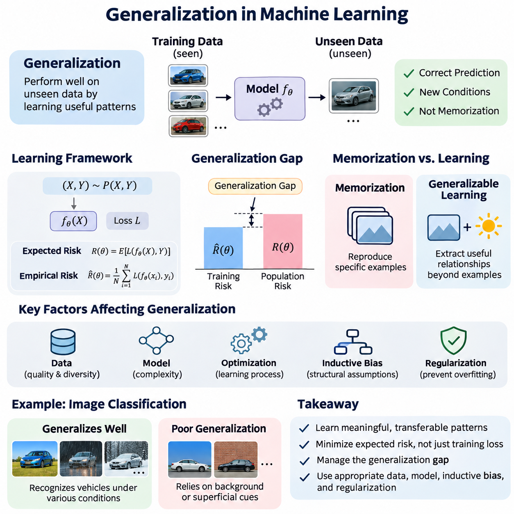
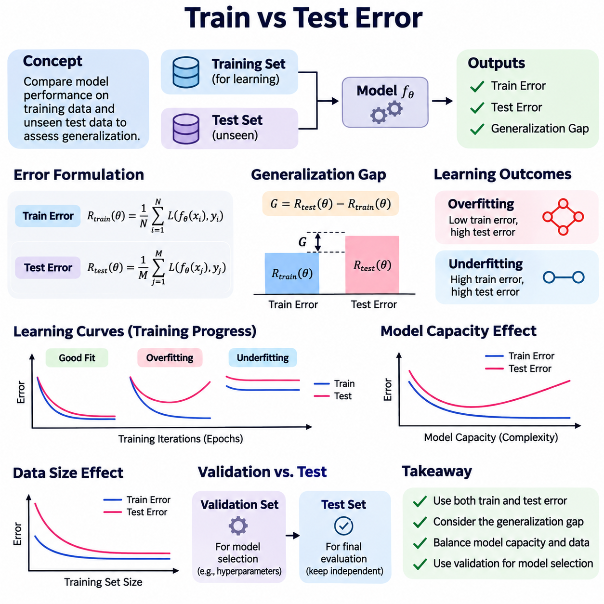
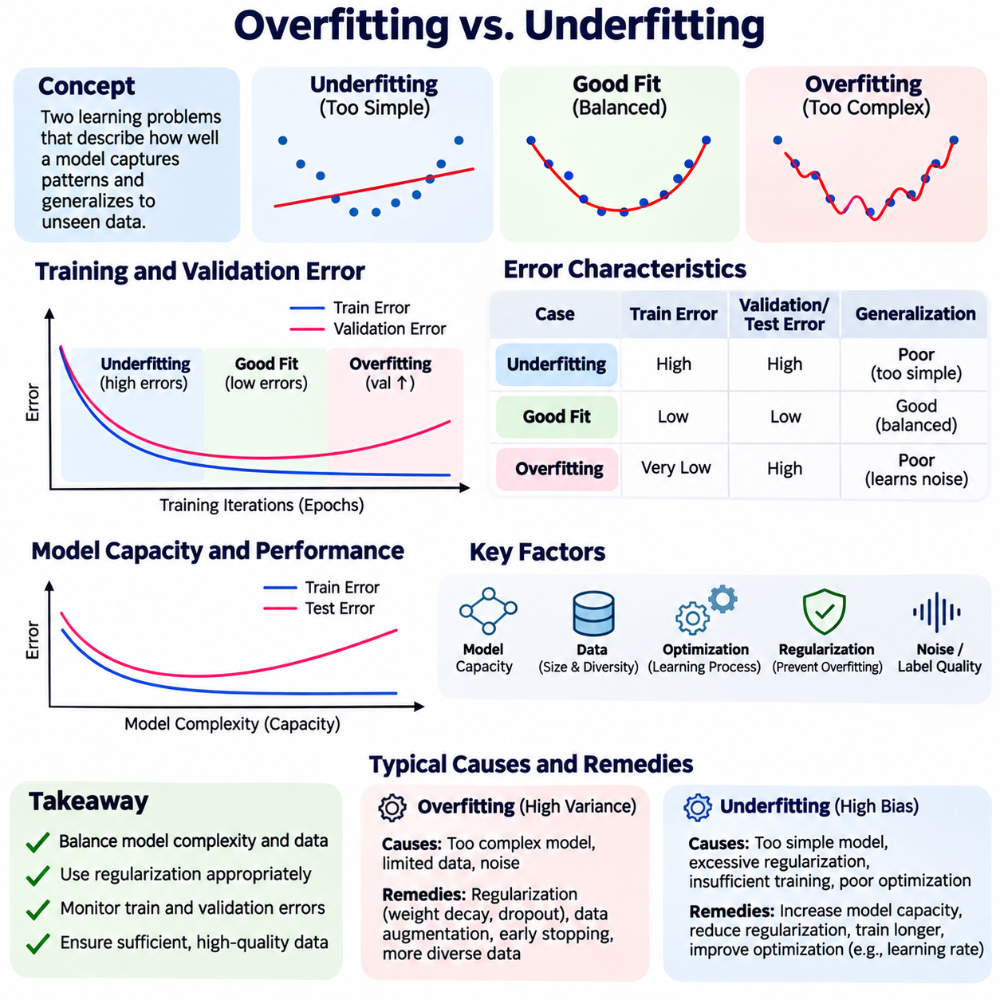
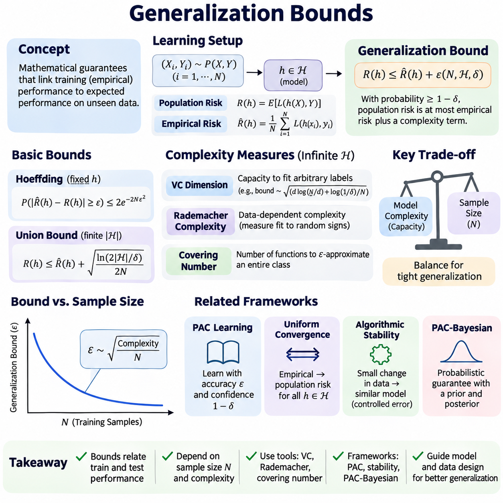
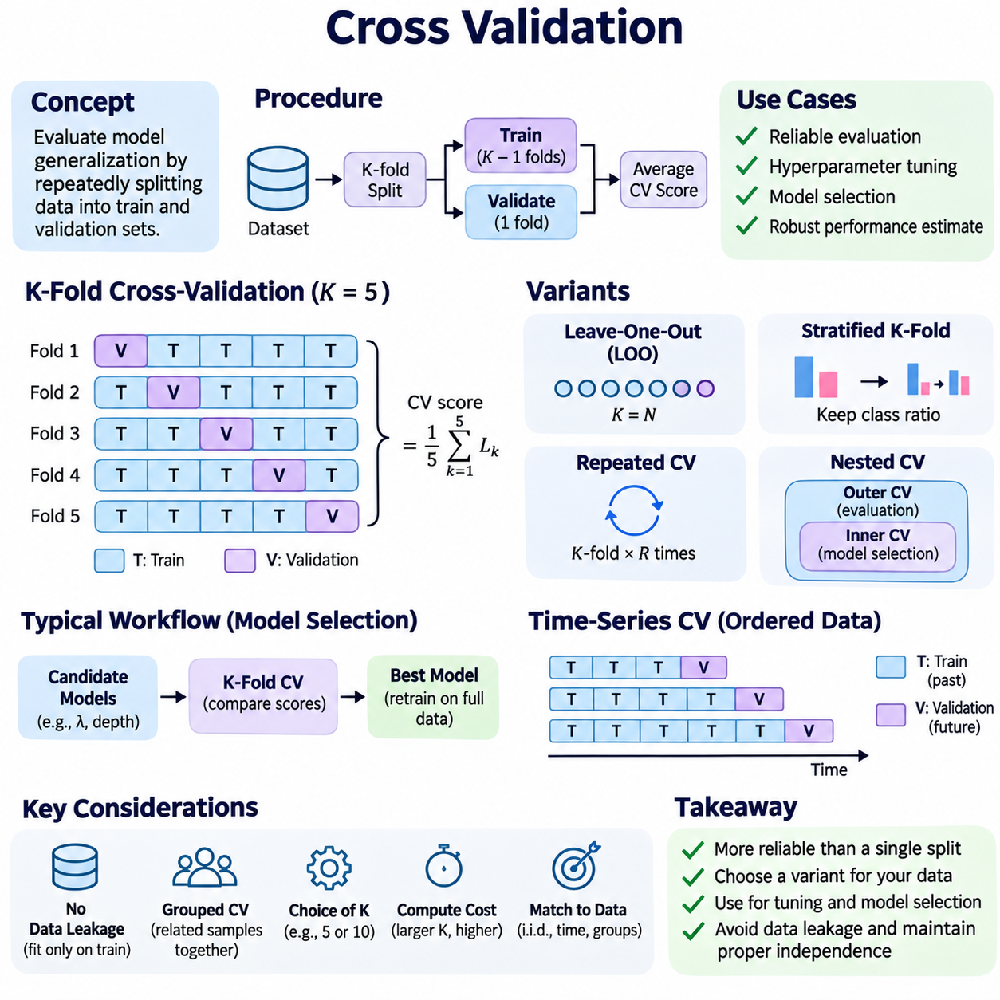
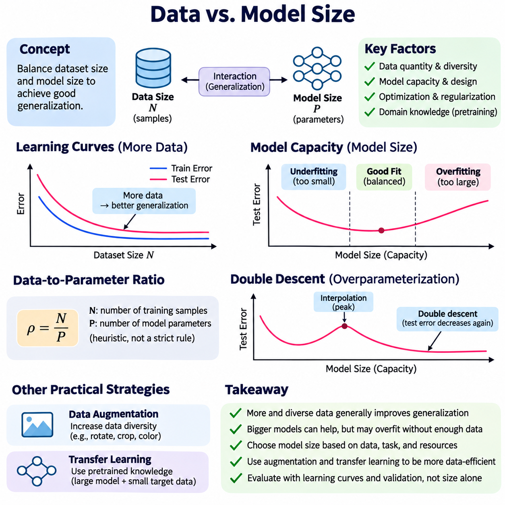
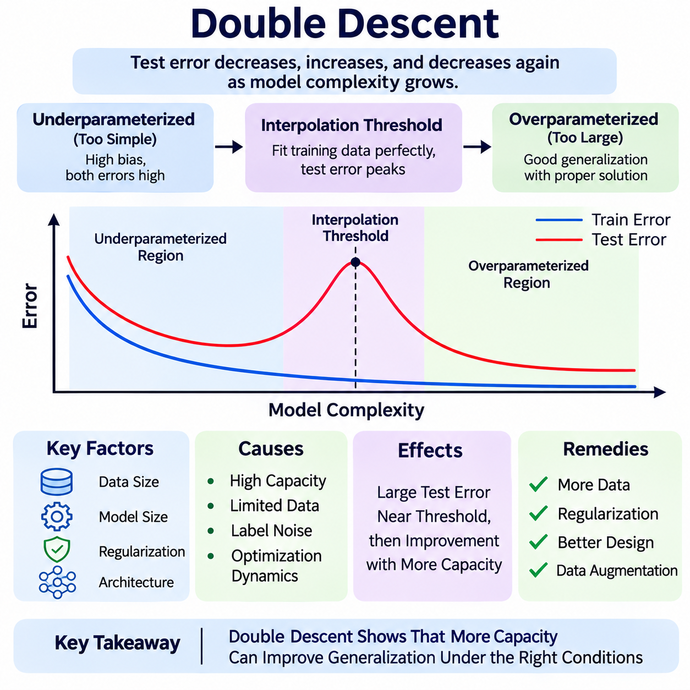
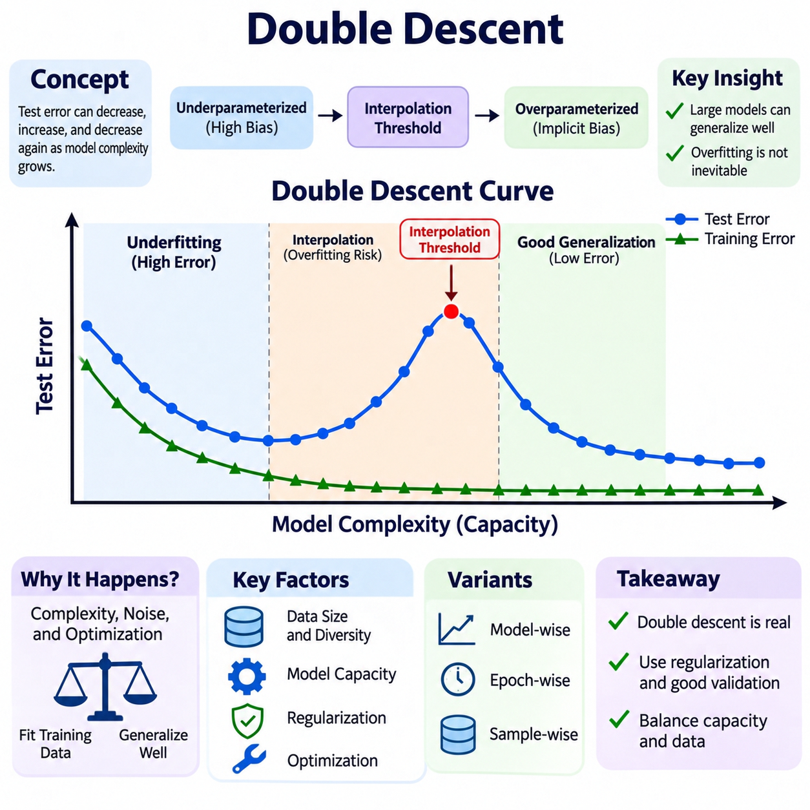
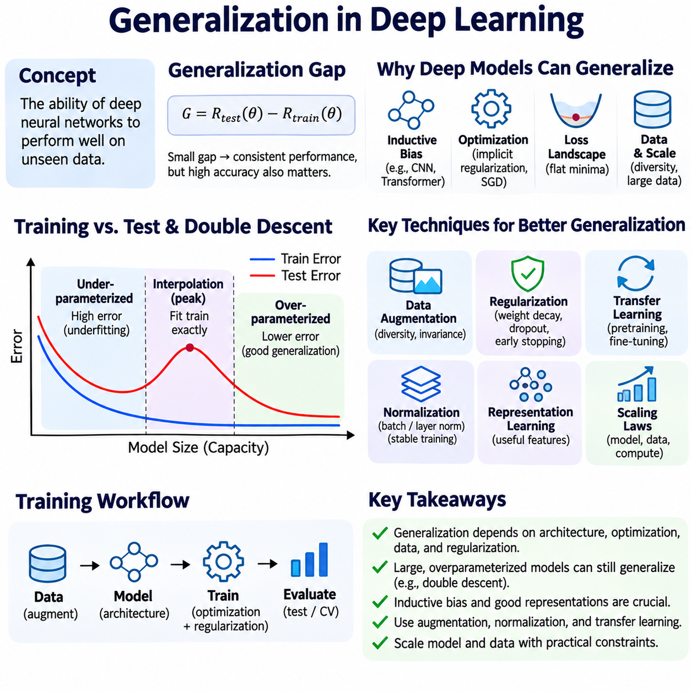
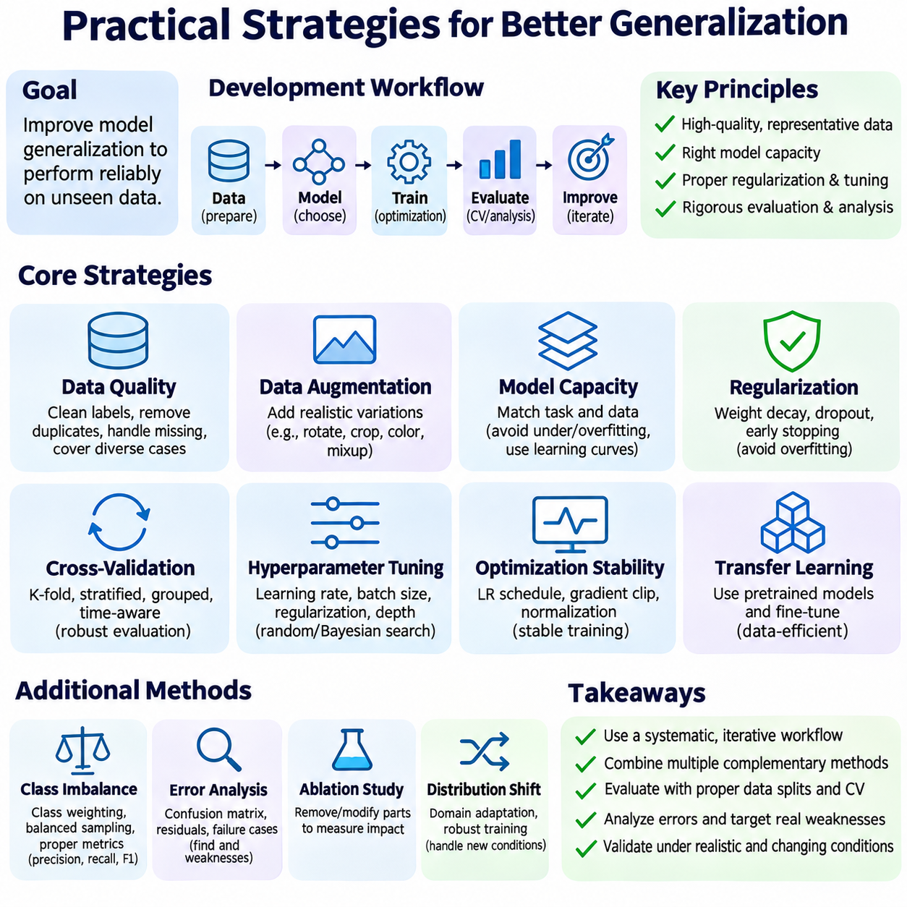

**Volume 06. Optimization and Generalization in ML**

# 04. Generalization

## 04.00 What is Generalization

{width="7.268055555555556in" height="7.268055555555556in"}

Generalization is the ability of a machine learning model to perform effectively on previously unseen data after learning from a limited set of training examples. Rather than simply memorizing observed inputs and outputs, a model should discover meaningful patterns that remain useful beyond the training dataset. This capability represents one of the fundamental objectives of machine learning because practical applications require predictions under conditions that were not explicitly encountered during training.

The central challenge of generalization arises from the difference between learning a finite collection of examples and understanding the underlying relationships that generated those examples. A training dataset provides only a partial representation of the target problem. Consequently, a model must infer statistical regularities from incomplete observations while avoiding dependence on accidental correlations, measurement noise, or characteristics that are unique to the available samples.

In supervised learning, generalization is commonly understood through the relationship between a training distribution and an unknown data-generating distribution. Training examples are typically assumed to be sampled from a probability distribution that also governs future observations. Under this assumption, successful learning requires a model to approximate relationships that remain valid for new samples drawn from the same distribution, rather than reproducing the training observations individually.

A mathematical description begins with a dataset containing input-output pairs sampled from an underlying distribution P(X,Y). A model fθ maps an input X to a prediction, while a loss function L measures disagreement between the prediction and the target Y. The expected risk is R(θ) = E[L(fθ(X),Y)], where the expectation is taken over the population distribution. Generalization concerns how effectively the learned parameters minimize this expected risk.

Because the true population distribution is generally unknown, the expected risk cannot usually be calculated directly. Instead, learning algorithms minimize empirical risk, which is the average loss over available training examples. If the dataset contains N observations, empirical risk is expressed as R̂(θ) = (1/N)ΣL(fθ(xᵢ),yᵢ). The distinction between empirical risk and expected risk is essential because optimizing observed performance does not automatically guarantee reliable predictions on unseen data.

The difference between population risk and empirical training risk is often called the generalization gap. A small gap suggests that performance on the training data is reasonably representative of performance on the target distribution. However, a small gap alone does not guarantee a useful model, since both training and population errors may remain high. Generalization must therefore be evaluated together with the absolute predictive quality achieved by the learning system.

An intuitive example can be found in image classification. A model trained to recognize vehicles may encounter images containing different lighting conditions, camera viewpoints, backgrounds, and vehicle configurations. A model that learns meaningful visual characteristics can identify unfamiliar vehicles despite these variations. Conversely, a model that relies primarily on background colors or recurring photographic conditions may perform poorly when those superficial characteristics change.

Generalization is closely related to the distinction between memorization and learning. Memorization allows a model to reproduce specific examples, whereas generalizable learning extracts relationships that extend beyond those examples. Nevertheless, these behaviors are not mutually exclusive. Modern neural networks can memorize portions of their training data while simultaneously learning useful representations, making the relationship between memorization and generalization more complex than a simple opposition.

The quality and diversity of training data strongly influence generalization. A dataset containing representative variations helps the model distinguish stable relationships from incidental characteristics. In contrast, insufficient sampling, systematic bias, incorrect labels, and limited coverage can produce misleading patterns. Increasing dataset size often improves generalization, but additional examples provide limited benefit when they repeatedly represent the same narrow conditions or reproduce existing biases.

Model complexity also affects the ability to generalize. A model with insufficient expressive capacity may fail to capture important relationships, while a highly flexible model may fit training-specific variations that do not transfer to new observations. However, model capacity alone does not determine generalization performance. Optimization algorithms, parameter initialization, architectural assumptions, training procedures, and dataset structure collectively influence which solutions are discovered.

Inductive bias describes the assumptions that guide a learning algorithm toward particular solutions. Convolutional neural networks, for example, exploit spatial structure through local connectivity and shared filters, while other architectures encode different structural preferences. Such assumptions can improve generalization when they correspond to meaningful properties of the problem. An unsuitable inductive bias, however, may restrict learning or encourage incorrect relationships.

Regularization provides another mechanism for improving generalization by influencing the solutions selected during training. Techniques such as weight decay, dropout, data augmentation, and early stopping can discourage excessive dependence on training-specific details. Their effectiveness depends on the model, data, and optimization process. Regularization should therefore be understood as a collection of strategies that influence learning behavior rather than a universal guarantee of better performance.

Optimization and generalization are related but distinct objectives. Optimization focuses on finding model parameters that reduce a specified training objective, whereas generalization concerns the predictive quality of those parameters on unseen observations. Two optimization algorithms may reach similarly low training losses while producing different generalization performance. This distinction explains why the lowest training loss does not necessarily correspond to the most useful model.

Stochastic gradient descent illustrates the interaction between optimization and generalization. Its parameter updates depend on randomly selected training examples, introducing variability into the optimization trajectory. This stochastic behavior can influence which regions of the loss landscape are explored and which solutions are selected. Such effects are sometimes described as implicit regularization, although their precise influence depends on learning rate, batch size, model architecture, and other training conditions.

Evaluating generalization requires separating model development from final performance assessment. Training data supports parameter optimization, validation data supports model selection and hyperparameter tuning, and test data provides an independent estimate of predictive performance. Repeatedly adjusting a model based on test results can compromise this independence. Reliable evaluation therefore requires careful data partitioning, leakage prevention, and procedures that reflect the intended deployment environment.

Cross-validation extends this principle by evaluating a learning procedure across multiple training and validation partitions. It is especially useful when the available dataset is relatively small or when performance depends strongly on sample selection. However, conventional random cross-validation may be inappropriate for temporal, grouped, or spatially correlated observations. Evaluation partitions must respect the dependency structure of the data to avoid overly optimistic generalization estimates.

Statistical learning theory provides a formal perspective on generalization by examining how empirical performance relates to population performance. Concepts such as hypothesis complexity, concentration inequalities, and generalization bounds help explain conditions under which training observations provide reliable information about unseen examples. These theoretical results depend on assumptions about sampling, model classes, and learning procedures, and their practical usefulness varies across applications.

Modern deep learning introduces additional questions because highly overparameterized networks can generalize effectively despite having enough parameters to fit their training datasets extremely closely. This behavior challenges explanations based solely on traditional measures of model complexity. Contemporary research therefore examines the combined effects of data structure, optimization dynamics, learned representations, architectural properties, and implicit regularization to understand generalization in large neural networks.

Generalization must also be distinguished from robustness under distribution shift. Conventional generalization commonly assumes that training and evaluation examples follow the same underlying distribution. Real-world systems may instead encounter changes in sensors, environments, operating conditions, user behavior, or population characteristics. Performance under such changes depends on additional capabilities, including robustness, domain adaptation, invariant representation learning, and appropriate uncertainty estimation.

For autonomous robots, generalization determines whether perception and decision-making models remain effective beyond their original training environments. A robot trained in one warehouse may encounter different floor materials, lighting conditions, obstacles, or equipment layouts elsewhere. Successful deployment requires models that capture transferable environmental properties while recognizing unfamiliar conditions. Simulation diversity, realistic validation scenarios, and field testing are therefore important complements to conventional training evaluation.

In industrial machine learning, generalization directly influences operational reliability and maintenance requirements. A defect detection model trained on images from one production line may experience reduced accuracy when camera calibration, material appearance, or illumination changes. Similarly, predictive maintenance models may encounter equipment operating regimes that were absent during training. Evaluating performance across machines, production periods, and environmental conditions helps reveal limitations before large-scale deployment.

A practical generalization strategy begins with defining the target population and identifying the variations that a deployed model is expected to encounter. Dataset construction, model selection, optimization, regularization, and evaluation should then be aligned with these requirements. Performance analysis should examine not only average accuracy but also error patterns, subgroup behavior, uncertainty, and sensitivity to relevant changes. This approach connects statistical learning objectives with engineering reliability.

Ultimately, generalization transforms machine learning from the reproduction of observed examples into a mechanism for making useful predictions about new situations. Its success depends on the interaction among representative data, suitable model assumptions, effective optimization, and trustworthy evaluation. Understanding this interaction provides the foundation for analyzing training and test errors, overfitting, theoretical generalization bounds, and the distinctive behavior of modern deep learning systems.

## 04.01 Train vs Test Error

{width="7.268055555555556in" height="7.268055555555556in"}

Training error and test error are fundamental measurements used to evaluate how effectively a machine learning model learns from observed examples and generalizes to unseen data. Training error measures predictive performance on the dataset used to optimize model parameters, whereas test error measures performance on an independent dataset excluded from model development. Their relationship provides essential information about learning quality, model reliability, and the potential for successful deployment.

Training error is calculated by applying a trained model to the examples used during optimization and measuring the differences between predictions and target values. For a dataset containing N training samples, empirical training risk can be expressed as R_train(θ) = (1/N)ΣL(fθ(xᵢ),yᵢ), where fθ represents the model and L denotes the loss function. This quantity describes how closely the model fits its observed training examples under the selected evaluation criterion.

Test error evaluates the same trained model using observations that were not included in parameter optimization or model selection. If the independent test dataset contains M examples, the corresponding empirical test risk is R_test(θ) = (1/M)ΣL(fθ(xⱼ),yⱼ). The test dataset provides an estimate of predictive performance on new observations, assuming that its sampling process adequately represents the intended target population and remains independent of model development decisions.

The distinction between training and test error reflects the difference between fitting known examples and predicting unknown outcomes. Learning algorithms directly optimize training objectives, so training performance generally benefits from repeated exposure to the same observations. Test performance depends on whether the learned relationships extend beyond those observations. Consequently, a model can achieve extremely low training error while producing substantially higher error on unfamiliar data.

The difference between test error and training error is commonly called the empirical generalization gap. It can be written as G = R_test(θ) − R_train(θ), provided that both quantities use comparable loss definitions and evaluation procedures. A positive gap indicates that the measured error is higher on test data than on training data. However, the magnitude of this gap depends on dataset characteristics, sample sizes, training procedures, and statistical variation.

A small generalization gap is often desirable, but it does not independently establish good predictive performance. A model that produces high training and test errors may exhibit a small gap while failing to capture important relationships. Conversely, a model with very low training error and moderately higher test error may still provide excellent practical predictions. Model assessment must therefore consider absolute test performance together with the difference between training and test errors.

Overfitting occurs when a model learns training-specific patterns that do not generalize adequately to unseen observations. During optimization, training error may continue decreasing as the model becomes increasingly adapted to the available examples. Meanwhile, validation error may stop improving or begin increasing. This divergence suggests that additional fitting is no longer improving generalization and may instead be capturing noise or incidental characteristics.

Underfitting represents a different learning problem in which the model cannot adequately capture important patterns even within the training dataset. Both training and test errors may remain relatively high because the model lacks sufficient capacity, suitable features, effective optimization, or adequate training time. Underfitting demonstrates why minimizing the generalization gap alone is insufficient. A useful model must learn meaningful relationships before its ability to generalize can be evaluated.

Model capacity influences the relationship between training and test error because more expressive models can represent increasingly complex functions. Increasing capacity often reduces the minimum achievable training error, but its effect on test error is not necessarily monotonic. Traditional learning scenarios may exhibit deteriorating test performance beyond a certain complexity, while modern overparameterized models can display more complicated behavior, including double descent under particular conditions.

Learning curves provide a practical method for understanding training and generalization behavior. These curves display training and validation errors as functions of training iterations, epochs, or dataset size. When both errors decrease, learning is generally progressing. When training error decreases while validation error increases, overfitting may be developing. When both remain high, insufficient capacity, unsuitable optimization settings, or inadequate representations may be responsible.

Training-set size also affects the interpretation of learning curves. With very limited data, flexible models may fit individual examples closely while producing unstable predictions on unseen observations. Increasing the number of representative training samples often reduces this instability and improves test performance. However, additional data may provide diminishing benefits when important sources of variation remain unrepresented or when model assumptions prevent the learning of relevant relationships.

Validation error must be distinguished from final test error because the two measurements serve different purposes. Validation data supports decisions about hyperparameters, architectures, regularization strength, and training duration. Test data should remain independent until the final evaluation of the selected model. Repeatedly selecting models based on test results introduces selection bias and can produce an overly optimistic estimate of generalization performance.

Data leakage is a major source of misleadingly low test error. Leakage occurs when information unavailable during genuine prediction enters model development or evaluation. Examples include duplicate observations across dataset partitions, preprocessing performed using the complete dataset, and features derived from future outcomes. Such leakage can make test performance appear excellent even when the model would perform poorly in realistic deployment conditions.

The statistical uncertainty of test error must also be considered. A test dataset contains only a finite sample of possible observations, so its measured error is an estimate rather than an exact representation of population risk. Small datasets may produce highly variable estimates, especially when errors are rare or unevenly distributed. Confidence intervals, repeated evaluation across appropriate partitions, and carefully designed sampling procedures can help characterize this uncertainty.

The choice of error metric affects how training and test performance should be interpreted. Classification tasks may use cross-entropy loss, error rate, or other classification metrics, while regression tasks frequently use mean squared error or mean absolute error. A model can improve one metric without improving another. Therefore, comparisons should use consistent definitions, and evaluation criteria should reflect the operational consequences of different prediction errors.

Class imbalance further complicates the interpretation of test error. In a dataset dominated by one class, a classifier may achieve low overall error while performing poorly on rare but important categories. For example, an industrial defect detector may classify most normal products correctly while missing uncommon defects. Class-specific recall, precision, and confusion-matrix analysis provide additional information that aggregate error measurements cannot fully capture.

Distribution shift creates another limitation because test error is meaningful only relative to the population represented by the test dataset. If deployment conditions differ from evaluation conditions, actual operational error may be substantially higher. Changes in camera configuration, environmental illumination, equipment characteristics, or user behavior can alter the input distribution. Reliable evaluation should therefore include representative operating conditions and relevant stress scenarios.

In deep learning, optimization procedures can influence training and test errors differently. Learning rate schedules, batch sizes, weight decay, and stochastic gradient updates affect both convergence and the characteristics of the learned solution. Two models with nearly identical training errors may exhibit different test performance because their optimization trajectories lead to different parameter configurations. This illustrates the distinction between successful optimization and effective generalization.

Early stopping uses validation performance to determine when training should terminate. When validation error stops improving despite continued reductions in training error, the training process can be stopped to preserve a model with better estimated generalization. This approach is particularly useful when extensive training increases sensitivity to noise. However, stopping decisions must rely on validation data rather than repeatedly examining the final test dataset.

For autonomous robotics, training and test error analysis must reflect environmental and operational diversity. A perception model trained using images from one facility may perform accurately on similar test images while failing in a different facility. Evaluation should therefore consider separate environments, sensor configurations, lighting conditions, and operating scenarios. Such testing reveals whether low error reflects transferable learning or dependence on narrowly represented conditions.

In industrial machine learning, test error directly influences decisions about deployment readiness and operational risk. Predictive maintenance systems must be evaluated across equipment units and operating periods, while quality inspection models should be tested using production batches independent of training data. Separating observations according to meaningful operational boundaries helps prevent optimistic estimates caused by correlations between closely related samples.

A reliable evaluation workflow begins with defining the target population, selecting appropriate error metrics, and establishing independent training, validation, and test partitions. Model parameters are optimized using training data, development decisions are guided by validation performance, and final predictive quality is assessed using untouched test data. Error analysis should then examine uncertainty, subgroup performance, potential leakage, and sensitivity to operational changes.

Ultimately, training error describes how effectively a model fits observed examples, while test error estimates its ability to predict independent observations from the intended population. Their difference reveals important aspects of generalization but cannot fully characterize model quality on its own. Understanding both measurements provides the foundation for diagnosing overfitting and underfitting, selecting appropriate model complexity, and developing machine learning systems that remain reliable beyond their training datasets.

## 04.02 Overfitting vs Underfitting

{width="7.268055555555556in" height="7.268055555555556in"}

Overfitting and underfitting are two fundamental learning problems that describe how effectively a machine learning model captures patterns in training data and applies them to unseen observations. Overfitting occurs when a model learns excessive details or noise specific to its training examples, while underfitting occurs when it fails to learn important relationships. Understanding these conditions is essential for developing models that achieve both accurate predictions and reliable generalization.

Overfitting typically appears when a model achieves very low training error but substantially higher validation or test error. The model may reproduce complex relationships within the training dataset without learning patterns that remain valid for new observations. This behavior is particularly common when model flexibility is high relative to the amount and diversity of available data, although optimization procedures and data characteristics also influence the outcome.

Underfitting occurs when a model cannot adequately represent or learn the underlying relationships present in the dataset. Both training and validation errors may remain high because the model is too simple, the input features are insufficient, or the optimization process has not converged. Unlike overfitting, underfitting reflects a failure to capture meaningful structure even in the observed examples, limiting predictive performance across both familiar and unfamiliar data.

A useful conceptual distinction involves model complexity and the balance between fitting ability and generalization. Models with insufficient capacity may produce overly simplified predictions, while excessively flexible models may become sensitive to irrelevant fluctuations. However, increasing model complexity does not always cause overfitting. Modern neural networks can generalize effectively despite having many parameters, demonstrating that architecture, optimization, regularization, and data structure jointly determine learning behavior.

The relationship between training and validation errors provides a practical method for identifying these conditions. Underfitting is often associated with relatively high errors on both datasets, while overfitting frequently produces a large difference between low training error and higher validation error. A well-generalized model typically achieves sufficiently low validation error with acceptable training performance, although the precise relationship depends on dataset difficulty and the selected evaluation metric.

Learning curves reveal how overfitting and underfitting develop during optimization. At the beginning of training, both training and validation errors may be high because the model has not yet learned useful patterns. As training progresses, both errors often decrease. If validation error eventually increases while training error continues falling, the model may be overfitting. If both errors remain high, inadequate capacity, ineffective optimization, or insufficient training may be responsible.

Model capacity is an important factor because it determines the range of functions that a learning system can represent. A linear model may underfit a strongly nonlinear relationship, while a high-degree polynomial may fit individual observations too closely. Nevertheless, the appropriate capacity depends on sample size, noise, task complexity, and regularization. Selecting capacity requires balancing expressive power with the ability to produce stable predictions on unseen observations.

Training dataset size and diversity strongly influence overfitting. When a dataset contains few examples, a flexible model may learn accidental correlations that do not reflect the underlying population. Increasing representative training data can reduce this dependence and improve generalization. However, simply duplicating observations or collecting additional examples from a narrow distribution may provide limited improvement because important variations remain absent.

Noise and label quality also affect learning behavior. A model with high capacity may fit incorrectly labeled examples or random measurement fluctuations, reducing its ability to generalize. Conversely, excessive noise can prevent a model from identifying meaningful relationships and contribute to high training error. Data cleaning, label verification, and robust loss functions can improve learning quality, although their effectiveness depends on the source and structure of the noise.

Regularization provides mechanisms for controlling overfitting by discouraging excessive dependence on training-specific patterns. Weight decay penalizes large parameter values, dropout introduces stochastic changes during training, and data augmentation exposes models to additional variations. Early stopping limits training when validation performance stops improving. These techniques influence model behavior differently and should be selected according to the architecture, dataset, and operational requirements.

Excessive regularization can itself cause underfitting. Strong weight penalties may prevent a model from learning important relationships, aggressive dropout can reduce effective representational capacity, and unrealistic augmentation may distort useful information. Similarly, stopping training too early may leave the model insufficiently optimized. Effective regularization therefore requires balancing constraints against the need to learn meaningful patterns from the available data.

Optimization difficulties can resemble underfitting even when the model has sufficient theoretical capacity. Poor learning rates, unsuitable initialization, vanishing gradients, or inadequate training duration may prevent the model from reaching a useful solution. In such cases, increasing architectural complexity may not solve the problem. Examining training dynamics, gradient behavior, and optimization stability helps distinguish representational limitations from failures of the learning procedure.

The bias-variance framework provides another perspective on these phenomena. High bias is often associated with overly restrictive models that systematically miss important relationships, while high variance describes sensitivity to changes in the training sample. Underfitting frequently corresponds to high bias, and overfitting is often associated with high variance. However, these associations are not universal, especially in modern deep learning systems with complex optimization dynamics.

Cross-validation supports the diagnosis of overfitting and underfitting by evaluating models across multiple data partitions. Consistently high validation errors may indicate insufficient learning, while large variations across partitions can reveal sensitivity to sample selection. Hyperparameters such as model depth, regularization strength, and training duration can be compared using validation performance. Final test data should remain independent to preserve an unbiased assessment of the selected model.

Data leakage can conceal overfitting by making validation or test performance appear artificially strong. If duplicate observations, future information, or preprocessing statistics from evaluation data enter the training process, the model may exploit information unavailable during deployment. Consequently, low validation error does not always indicate successful generalization. Reliable diagnosis requires careful partitioning and evaluation procedures that reflect realistic prediction conditions.

Class imbalance can further complicate interpretation. A classifier trained on a dataset dominated by one category may achieve low overall training and validation errors while failing to recognize minority classes. Such behavior may resemble successful generalization when only aggregate accuracy is examined. Class-specific precision, recall, confusion matrices, and appropriate loss functions help reveal whether the model has learned useful distinctions across the entire target population.

Distribution shift introduces challenges that cannot always be explained through conventional overfitting and underfitting. A model may perform well on independent test samples drawn from the training distribution but fail when environmental conditions change. Differences in sensors, illumination, operating regimes, or population characteristics can invalidate learned correlations. Evaluating robustness across representative environments is therefore necessary for understanding practical generalization beyond standard error comparisons.

In deep learning, overparameterized networks can sometimes achieve nearly zero training error while maintaining strong test performance. This behavior challenges the assumption that high model capacity inevitably produces overfitting. Phenomena such as double descent illustrate that test error may vary nonmonotonically with model size or training duration. These observations emphasize the importance of considering data structure, optimization dynamics, and implicit regularization alongside conventional complexity measures.

For autonomous robotics, overfitting may occur when perception models learn environment-specific textures, lighting patterns, or sensor characteristics rather than transferable features. Underfitting may occur when the model cannot distinguish obstacles, terrain types, or operational states with sufficient precision. Evaluation across different facilities, weather conditions, and sensor configurations helps identify these limitations and supports the development of more reliable autonomous systems.

In industrial machine learning, an overfitted defect detection model may perform accurately on familiar production batches but fail when materials, cameras, or manufacturing conditions change. An underfitted model may overlook subtle defects even within the training environment. Practical diagnosis requires examining errors across production periods, equipment units, and defect categories rather than relying exclusively on aggregate training accuracy.

A systematic improvement strategy begins by examining training and validation errors together. High errors on both datasets suggest investigating model capacity, feature quality, optimization, and training duration. Low training error combined with poor validation performance suggests examining regularization, dataset diversity, leakage, and model complexity. Controlled experiments should modify one major factor at a time so that improvements can be attributed to identifiable causes.

Ultimately, overfitting and underfitting represent different failures to achieve effective generalization. Overfitting reflects excessive adaptation to observed examples, whereas underfitting reflects insufficient learning of meaningful relationships. Neither problem can be diagnosed reliably through model size or training error alone. Their analysis requires representative evaluation data, appropriate metrics, careful optimization, and an understanding of the intended deployment environment.

## 04.03 Generalization Bounds

{width="7.268055555555556in" height="7.268055555555556in"}

Generalization bounds provide mathematical guarantees about how closely a machine learning model's performance on observed training data approximates its expected performance on unseen observations. They form a central part of statistical learning theory by connecting empirical risk, population risk, sample size, and model complexity. Rather than predicting exact future errors, these bounds establish probabilistic limits on the difference between training performance and generalization performance under specified assumptions.

The theoretical foundation begins with a dataset of N independent samples drawn from an unknown probability distribution P(X,Y). A hypothesis h maps inputs to predictions, while a loss function L measures prediction errors. The population risk is R(h) = E[L(h(X),Y)], and empirical risk is R̂(h) = (1/N)ΣL(h(xᵢ),yᵢ). Generalization analysis investigates how reliably the empirical quantity estimates population risk for a selected hypothesis or an entire hypothesis class.

A generalization bound typically states that, with probability at least 1 − δ over the sampled training dataset, population risk does not exceed empirical risk plus a complexity-dependent term. This relationship can be expressed as R(h) ≤ R̂(h) + ε(N,H,δ), where H denotes the hypothesis class and ε represents an uncertainty or complexity penalty. Smaller values of δ demand stronger confidence and generally produce less restrictive guarantees.

Concentration inequalities provide basic tools for deriving generalization guarantees. Hoeffding's inequality applies to independent bounded random variables and limits the probability that their empirical average differs substantially from its expectation. For a fixed hypothesis with losses in [0,1], it yields P(\|R̂(h) − R(h)\| ≥ ε) ≤ 2exp(−2Nε²). This result shows that estimation uncertainty decreases as the number of independent observations increases.

For a finite hypothesis class H, a union bound extends concentration results to multiple candidate models. With probability at least 1 − δ, every h in H satisfies R(h) ≤ R̂(h) + sqrt(ln(2\|H\|/δ)/(2N)). The guarantee becomes weaker as the hypothesis class grows because more candidate functions must be considered. However, increasing the training sample size reduces the complexity penalty and improves the reliability of empirical risk estimates.

Infinite hypothesis classes require more sophisticated complexity measures because simply counting candidate functions is impossible. Vapnik--Chervonenkis dimension, commonly called VC dimension, measures the ability of a binary hypothesis class to represent arbitrary labelings of finite point sets. A class with higher VC dimension can express more complex decision boundaries, but typically requires more training observations to obtain comparable distribution-free generalization guarantees.

VC-based bounds relate generalization uncertainty to the number of training examples and the expressive capacity of the hypothesis class. Their typical complexity terms scale approximately with sqrt((d log(N/d) + log(1/δ))/N), where d denotes VC dimension under suitable conditions. These results establish a relationship between sample complexity and model expressiveness, although the resulting bounds may be conservative for modern neural networks.

Rademacher complexity offers a data-dependent perspective by measuring how well a function class can correlate with randomly assigned signs on observed inputs. A class capable of fitting arbitrary random patterns generally has higher empirical Rademacher complexity. For bounded losses, generalization bounds can be expressed using empirical risk, a Rademacher complexity term, and a confidence penalty. This approach often captures properties of the observed sample more directly than parameter counting.

Covering numbers provide another way to characterize hypothesis complexity. They measure how many representative functions are required to approximate an entire function class within a specified tolerance under a chosen metric. Smaller covering numbers indicate that the class can be represented using fewer approximating elements. By combining covering arguments with concentration inequalities, researchers obtain uniform generalization guarantees for continuous or infinite model families.

Probably Approximately Correct learning, or PAC learning, formalizes the conditions under which an algorithm can learn a sufficiently accurate hypothesis with high probability. The framework uses an accuracy parameter ε and a failure probability δ to describe learning requirements. Sample complexity specifies how many independent observations are needed to achieve the desired guarantee. PAC theory therefore connects generalization bounds with the feasibility of learning from finite datasets.

Uniform convergence is a central principle underlying many classical bounds. It requires empirical risks to approach population risks simultaneously across a hypothesis class as the sample size increases. This property helps justify empirical risk minimization because a model selected using training data should also have controlled population risk. However, uniform convergence over very large hypothesis classes may yield loose guarantees that do not explain the observed behavior of practical learning algorithms.

Algorithmic stability provides an alternative perspective by examining how sensitive a learning algorithm is to changes in its training dataset. A stable algorithm produces similar predictions or losses when one training example is replaced or removed. Stability-based bounds connect this sensitivity to expected generalization error. Such analysis is particularly relevant to regularized optimization and certain stochastic learning procedures, although its guarantees depend on assumptions about losses and algorithms.

PAC-Bayesian theory develops generalization bounds for distributions over hypotheses rather than only individual deterministic models. A prior distribution is specified independently of the training sample, and a posterior distribution describes the learned hypothesis distribution. The resulting bounds involve empirical risk and a complexity penalty based on Kullback--Leibler divergence between posterior and prior. This framework provides a flexible connection between probabilistic learning and model complexity.

Information-theoretic approaches analyze how much information about the training dataset is retained by the learned model. Mutual information between training data and algorithm output can control expected generalization error under suitable assumptions. Intuitively, algorithms that reveal less information about individual training samples may generalize more reliably. However, information-based guarantees can become loose when model parameters encode substantial dataset information.

Generalization bounds are closely related to regularization because both address the balance between empirical fit and model complexity. Structural risk minimization selects models by considering training error together with a complexity penalty. Norm constraints, margin maximization, and restricted hypothesis classes can reduce certain theoretical complexity measures. Nevertheless, practical regularization methods do not automatically produce tight bounds, and their effectiveness must be evaluated empirically.

Margin-based bounds are especially important in classification. Instead of considering only whether a prediction is correct, they examine the separation between the predicted decision and competing alternatives. Larger classification margins can support stronger generalization guarantees under suitable norm and complexity constraints. This perspective helps explain why two classifiers with similar training accuracy may exhibit different robustness and test performance.

Deep neural networks create significant challenges for classical generalization theory because they often contain more parameters than training examples. Parameter-counting bounds may become vacuous even when models achieve excellent test accuracy. Contemporary research therefore investigates norm-based complexity, compression, sharpness, optimization trajectories, and data-dependent properties. These approaches provide partial explanations, but no single bound fully characterizes generalization across modern deep learning systems.

The assumptions behind a bound determine its applicability. Many classical results require independent and identically distributed observations, bounded or appropriately controlled losses, and a fixed sampling distribution. Temporal dependence, correlated observations, label noise, and distribution shift can invalidate direct applications of these guarantees. Therefore, theoretical confidence statements should not be interpreted as universal assurances of deployment performance.

In autonomous robotics, generalization bounds can help characterize uncertainty in learned perception and decision models under specified sampling assumptions. However, operational environments may involve correlated sensor measurements, changing weather, unfamiliar obstacles, and rare safety-critical events. A bound derived from ordinary training samples may not capture these conditions. Robust validation, scenario testing, and operational monitoring remain essential complements to theoretical analysis.

Industrial machine learning presents similar limitations. A defect detection model may have favorable theoretical guarantees under a stationary data distribution while encountering changing materials, camera calibration, or manufacturing processes. Moreover, rare defects may be insufficiently represented for meaningful confidence estimates. Generalization analysis should therefore consider sampling design, subgroup performance, operational changes, and the practical consequences of prediction errors.

A useful interpretation of generalization bounds distinguishes mathematical guarantees from empirical performance estimates. Bounds describe what can be guaranteed under explicit assumptions, while validation and test measurements describe observed performance on particular datasets. A loose bound does not necessarily indicate poor generalization, and a small measured test error does not establish a universal guarantee. Combining both perspectives produces a more reliable understanding of learning behavior.

Ultimately, generalization bounds establish a theoretical relationship between training performance, sample size, hypothesis complexity, and statistical confidence. Concentration inequalities, VC dimension, Rademacher complexity, PAC learning, stability, and PAC-Bayesian methods provide complementary approaches to this problem. Their practical value lies in clarifying learning assumptions, identifying sources of uncertainty, and guiding the development of models whose performance extends beyond observed training examples.

## 04.04 Cross Validation [w/Code]

{width="7.268055555555556in" height="7.268055555555556in"}

Cross-validation is a statistical evaluation technique used to estimate how reliably a machine learning model will perform on unseen data. Instead of relying on a single division between training and validation datasets, it repeatedly evaluates the learning procedure using different partitions of the available observations. This approach provides information about predictive performance, sensitivity to data selection, and the stability of model development decisions.

The central principle of cross-validation is to separate observations used for parameter estimation from those used for performance evaluation. A model is trained on one subset and evaluated on another subset that was excluded from that training run. Repeating this process across different partitions reduces dependence on a particular split. However, reliable estimates require partitions that reflect the sampling structure and intended deployment conditions.

K-fold cross-validation is one of the most widely used methods. A dataset is divided into K approximately equal, nonoverlapping folds. During each iteration, K − 1 folds are used for training, while the remaining fold serves as validation data. Every fold is used for validation exactly once, producing K evaluation results. The procedure allows each observation to contribute to validation without being used for training in the same iteration.

The overall cross-validation estimate is commonly calculated by averaging validation losses across folds. For K equally sized folds, CV = (1/K)ΣLₖ, where Lₖ denotes the average validation loss in fold k. When fold sizes differ, a sample-weighted average is more appropriate. The resulting estimate summarizes the performance of models trained on subsets of the available data rather than directly measuring the performance of the final model trained on all observations.

The choice of K affects computational cost and evaluation behavior. Five-fold and ten-fold cross-validation are common practical choices because they balance training expense and the amount of data available within each iteration. Larger K values provide more training observations per fold but require additional model fitting. The best choice depends on dataset size, computational resources, statistical dependence, and the objectives of model comparison.

Leave-one-out cross-validation represents an extreme case in which each validation fold contains a single observation. For N samples, the algorithm trains N models, each using N − 1 observations. This approach maximizes the training sample size within each iteration but can be computationally expensive. Its estimates may also exhibit substantial variability, so using more folds does not automatically guarantee a better evaluation procedure.

Stratified cross-validation is particularly useful for classification datasets containing imbalanced classes. Stratification attempts to preserve approximately similar class proportions across folds, reducing the likelihood that rare classes disappear from individual validation partitions. This generally improves the interpretability of fold-level metrics. Nevertheless, stratification cannot compensate for an extremely small number of minority-class observations.

Repeated cross-validation performs the partitioning process multiple times using different random assignments. The resulting evaluations provide additional information about sensitivity to the selected folds. Repeated stratified K-fold validation is frequently used when class balance matters. However, repeated results are statistically dependent because training subsets overlap, and their variability should not automatically be interpreted as independent uncertainty estimates.

Cross-validation is widely used for hyperparameter tuning and model selection. Candidate architectures, regularization strengths, learning rates, or feature configurations can be compared using their average validation performance. The selected configuration is typically retrained using the available development data. However, selecting the best candidate from many experiments introduces selection effects, meaning its cross-validation score may be optimistic.

Nested cross-validation addresses this problem by separating model selection from performance estimation. An inner cross-validation procedure selects hyperparameters using the training portion of an outer fold. The outer validation fold then evaluates the complete selection procedure. Repeating this process across outer folds provides an estimate of the performance of the model development workflow, although the computational cost can be substantial.

Data leakage is a critical concern because preprocessing operations can transfer information between training and validation partitions. Standardization, imputation, feature selection, and dimensionality reduction should generally be fitted using only the training portion of each fold. The fitted transformations are then applied to its validation portion. Implementing these operations within a consistent machine learning pipeline helps preserve evaluation independence.

Grouped cross-validation is necessary when multiple observations originate from the same individual, machine, experiment, or physical environment. Randomly distributing related observations across folds may allow the model to exploit shared characteristics rather than learn transferable patterns. Group-based partitioning keeps all observations belonging to a defined group within the same fold, providing a more realistic estimate of performance on previously unseen groups.

Time-series cross-validation requires special treatment because observations have temporal ordering and may contain information unavailable at earlier prediction times. Random K-fold partitioning can create unrealistic evaluation conditions by allowing future observations to influence training. Forward-chaining validation instead trains on earlier periods and evaluates later periods. Rolling-window methods can additionally reflect changing operating conditions and limited historical data.

Spatially correlated datasets present similar challenges. Nearby measurements may share environmental characteristics, making randomly separated validation observations easier to predict than geographically independent samples. Spatial cross-validation partitions observations according to regions or spatial blocks. This approach is important for remote sensing, environmental modeling, and robotics applications where performance across unfamiliar locations is a primary objective.

Evaluation metrics must remain consistent across folds. Classification models may be compared using accuracy, precision, recall, F1 score, or probabilistic losses, while regression models may use mean absolute error or mean squared error. When class distributions or fold sizes vary, aggregation methods require particular attention. Reporting both average performance and fold-level variation provides more information than presenting a single summary value.

Cross-validation does not eliminate the need for an independent test dataset. Validation results guide model development, while an untouched test set supports final assessment after model selection is complete. Repeatedly modifying a model based on cross-validation outcomes can gradually overfit the development process to the available data. An independent test evaluation helps detect this effect, provided the test set remains unused during development.

For deep learning, cross-validation can become computationally expensive because each fold requires a separate training run. Training large neural networks across multiple folds may demand substantial GPU resources and processing time. Practical alternatives include carefully designed holdout validation, fewer folds, or reduced-cost preliminary experiments. The evaluation strategy should balance statistical reliability with the computational constraints of the project.

In autonomous robotics, cross-validation should reflect differences among operating environments, sensor configurations, and deployment scenarios. Images collected from consecutive video frames are highly correlated, so random frame-level splitting may produce misleadingly strong results. Separating data by recording session, route, facility, or robot platform can provide more meaningful evidence of generalization to new operating conditions.

Industrial machine learning also benefits from structured cross-validation. A defect detection model may be evaluated across production batches, equipment units, or manufacturing periods to reveal sensitivity to operational variation. Predictive maintenance systems may require machine-level grouping or chronological validation. Such strategies help distinguish genuine predictive capability from correlations shared between training and validation observations.

Cross-validation results should be interpreted as estimates conditioned on the available dataset and evaluation design. High average performance does not guarantee reliability under distribution shift, rare failures, or substantially different deployment conditions. Likewise, small variation across folds does not establish that the sampled population adequately represents the real world. Appropriate sampling and external validation remain essential.

Ultimately, cross-validation provides a systematic framework for estimating generalization, comparing learning procedures, and identifying sensitivity to data partitioning. K-fold, stratified, repeated, nested, grouped, temporal, and spatial approaches address different evaluation requirements. Its effectiveness depends less on the number of folds than on maintaining independence, preventing leakage, and matching the evaluation design to the intended application.

## 04.05 Data vs Model Size

{width="7.268055555555556in" height="7.268055555555556in"}

The relationship between dataset size and model size is a central factor in machine learning generalization. Dataset size determines how much information is available for learning, while model size influences the complexity of functions that can be represented. Their interaction affects training accuracy, test performance, computational requirements, and robustness. Effective model development requires balancing available evidence with the capacity needed to capture meaningful patterns.

Dataset size is commonly measured by the number of training examples, although sample count alone does not describe information content. A dataset containing many nearly identical observations may provide less useful variation than a smaller, more diverse collection. Label quality, feature coverage, class balance, and sampling independence influence its effective size. Consequently, increasing the number of samples does not necessarily produce proportional improvements in generalization.

Model size is often described by the number of trainable parameters, but parameter count is only an approximate indicator of expressive capacity. Architecture, parameter sharing, sparsity, activation functions, and structural constraints also determine which relationships a model can represent. Two networks with similar parameter counts may exhibit substantially different learning behavior. Therefore, model size should be interpreted alongside architectural design and optimization characteristics.

Classical learning theory suggests that more expressive hypothesis classes generally require more observations to obtain comparable distribution-free generalization guarantees. Complexity measures such as VC dimension and Rademacher complexity formalize this relationship. However, theoretical capacity does not always predict practical test performance. Modern neural networks frequently contain more parameters than training samples while still achieving strong generalization under suitable conditions.

When datasets are small, highly flexible models may fit training observations closely while learning accidental correlations or measurement noise. This behavior can produce low training error and high validation error. Reducing model complexity, applying regularization, or collecting additional representative samples may improve performance. Nevertheless, small datasets do not automatically require small models, particularly when pretrained representations provide useful prior knowledge.

Increasing dataset size often improves generalization by exposing models to additional examples of relevant variation. Learning curves commonly show declining validation error as more representative observations become available. The improvement may eventually diminish because of irreducible noise, limited model capacity, or missing information in the input features. Examining learning curves helps determine whether further data collection is likely to provide meaningful benefits.

Increasing model size can improve performance when existing models lack sufficient capacity to capture important relationships. Larger networks may represent complex interactions, nonlinear dependencies, and hierarchical features more effectively. However, additional parameters increase memory consumption, training cost, and sometimes inference latency. Whether greater capacity improves test performance depends on the data distribution, optimization process, regularization, and available training resources.

The data-to-parameter ratio provides a simple descriptive comparison between dataset size and model size. It may be written as ρ = N/P, where N represents the number of training examples and P denotes the number of trainable parameters. However, this ratio is not a universal predictor of generalization. Data redundancy, architectural inductive bias, parameter sharing, and pretrained knowledge can make models with identical ratios behave very differently.

Overparameterization occurs when a model has more adjustable parameters than may appear necessary to fit its training examples. Such models can sometimes interpolate the training dataset while maintaining low test error. This behavior challenges the traditional assumption that increasing parameter count inevitably causes overfitting. Implicit regularization, data structure, optimization dynamics, and learned representations help explain why large models may generalize successfully.

The double descent phenomenon illustrates the complex relationship between model capacity and test error. In some settings, test error initially decreases, then increases near an interpolation threshold, and decreases again as capacity grows further. The precise behavior depends on model architecture, data properties, regularization, and training procedures. Double descent therefore demonstrates why simple rules based exclusively on parameter count can be misleading.

Data augmentation increases the diversity of training observations through transformations that preserve task-relevant information. Image rotation, cropping, color variation, and simulated environmental changes can expose models to conditions not explicitly represented in the original dataset. Although augmentation does not create independent real-world observations, it can improve effective training coverage. Poorly chosen transformations may instead introduce unrealistic patterns or incorrect labels.

Transfer learning changes the relationship between dataset size and model size by using representations learned from another dataset. A large pretrained model may perform effectively on a relatively small target dataset because substantial information is already encoded in its parameters. Fine-tuning adapts these representations to the new task. The benefits depend on similarity between source and target domains, adaptation strategy, and the quality of available target examples.

Self-supervised learning also changes conventional data requirements by extracting learning signals from unlabeled observations. Large collections of images, text, or sensor measurements can support representation learning before task-specific supervised training. This approach may reduce dependence on expensive annotations while allowing large models to exploit broader data distributions. However, downstream performance still depends on representation quality and target-domain compatibility.

Scaling laws describe empirical relationships among model size, dataset size, computational resources, and predictive loss. In some large-scale learning systems, performance follows approximately power-law trends over particular scaling ranges. These relationships help estimate the benefits of additional parameters or training data. Nevertheless, scaling exponents are task-dependent, and extrapolating beyond measured conditions may produce unreliable predictions.

Compute-optimal training considers how a fixed computational budget should be allocated between model capacity and the amount of training data processed. A larger model trained on insufficient data may be less efficient than a smaller model trained on more examples or tokens. The appropriate balance depends on training objectives, architecture, data quality, and hardware efficiency. Deployment constraints may favor a different balance when inference cost becomes important.

Data quality can be more valuable than raw dataset expansion. Incorrect labels, duplicated samples, unrepresentative observations, and systematic biases may limit performance even when datasets are large. Carefully selected examples covering rare conditions and difficult decision boundaries can provide substantial information. Active learning and targeted data acquisition help prioritize observations that are likely to improve the model rather than simply increasing sample count.

The relationship between data and model size also depends on task difficulty. Simple classification problems may be solved effectively using compact models and modest datasets, while complex perception or language tasks may require richer representations and broader training coverage. Intrinsic dimensionality, noise levels, class overlap, and environmental variability influence sample requirements. Model selection should therefore reflect the structure of the target problem rather than arbitrary size thresholds.

In autonomous robotics, dataset diversity is especially important because operational environments contain changing illumination, obstacles, terrain, and sensor conditions. A large perception model trained on narrowly collected data may fail when deployed in unfamiliar locations. Conversely, representative multi-environment data can improve the generalization of smaller models. Simulation, domain randomization, and real-world validation can help expand coverage of relevant operating conditions.

Industrial machine learning introduces additional constraints involving equipment variation, rare defects, and limited annotation budgets. Large models may offer strong representation capacity, but collecting representative examples across production batches and machines is often more important than parameter growth alone. Data collection should emphasize meaningful operating variations, while evaluation should separate correlated samples to avoid overly optimistic estimates of generalization.

Practical model development should compare learning curves across both dataset size and model capacity. If training and validation errors remain high, greater capacity or improved optimization may be necessary. If training error is low but validation error remains high, additional representative data or stronger regularization may help. Controlled experiments should evaluate accuracy together with training time, memory requirements, inference speed, and operational reliability.

Ultimately, dataset size and model size are complementary resources rather than interchangeable measures of learning capability. Larger models provide greater representational flexibility, while broader and higher-quality datasets supply the evidence needed to learn transferable relationships. Their optimal balance depends on task complexity, optimization, prior knowledge, computational budget, and deployment requirements. Understanding this interaction is essential for designing efficient and generalizable machine learning systems.

## 04.06 Double Descent

{width="7.268055555555556in" height="7.268055555555556in"}

{width="7.268055555555556in" height="7.268055555555556in"}

Double descent is a phenomenon in machine learning where test error can decrease, increase, and then decrease again as model complexity grows. This behavior challenges the classical expectation that increasingly complex models eventually generalize worse because of overfitting. Double descent reveals that highly overparameterized models can sometimes achieve excellent generalization despite fitting their training data almost perfectly.

Classical statistical learning theory often describes a U-shaped relationship between model complexity and test error. Simple models may underfit because they cannot represent important relationships, while increasingly flexible models initially improve prediction accuracy. Beyond a certain point, additional complexity may increase sensitivity to noise. This traditional bias-variance perspective does not fully describe some modern learning systems.

The double descent curve extends the classical picture by introducing a second region of improving test performance. As capacity increases, test error may initially decline, rise sharply near an interpolation threshold, and then decrease again in the overparameterized regime. Training error generally declines as fitting capacity increases. The resulting relationship demonstrates that model complexity and generalization are not necessarily connected monotonically.

The interpolation threshold is the point at which a model becomes capable of fitting all training examples with approximately zero training error. Near this threshold, the learning problem may become poorly conditioned, causing small variations in observations or labels to produce large changes in predictions. Under suitable conditions, test error can increase substantially around this transition, creating the characteristic peak of the double descent curve.

The underparameterized regime contains models whose effective capacity is insufficient to interpolate the training dataset. Increasing complexity in this region can reduce both training and test errors by improving representation of the underlying relationship. However, models approaching the interpolation threshold may become increasingly sensitive to training noise. The exact behavior depends on the learning algorithm, data distribution, and regularization.

Beyond the interpolation threshold, models enter an overparameterized regime where multiple parameter configurations can fit the training observations. Optimization algorithms may select solutions with favorable structural properties, such as small parameter norms or particular feature representations. These implicit preferences can improve generalization even though training error remains nearly zero. Overparameterization alone, however, does not guarantee this improvement.

Linear regression provides a useful mathematical setting for understanding double descent. When the number of features approaches the number of training observations, the design matrix may become nearly singular, making predictions sensitive to noise. In certain random-design models, expected test error becomes large near this transition. With additional features and minimum-norm interpolation, test error can decrease again under suitable assumptions.

The minimum-norm solution is particularly important in overparameterized linear models because infinitely many parameter vectors may fit the training observations. Selecting the solution with the smallest Euclidean norm introduces an implicit preference among these possibilities. Its generalization depends on feature covariance, signal alignment, noise levels, and sample size. Thus, minimum-norm interpolation can generalize well in some settings but poorly in others.

Label noise strongly influences the appearance of double descent. When training labels contain random errors, models near interpolation may require unstable solutions to fit every observation. This can amplify noise and increase test error. In more heavily overparameterized regimes, some learning procedures distribute the fitted variation across many degrees of freedom, potentially reducing prediction instability. The outcome remains dependent on model structure and optimization.

Double descent is not restricted to changes in parameter count. Model-wise double descent describes test error as model capacity increases, while epoch-wise double descent examines changes during prolonged training. Sample-wise double descent concerns performance changes as the number of training examples varies. These forms are related through interpolation and effective complexity, but their curves and underlying mechanisms need not be identical.

Epoch-wise double descent can occur when a model initially improves on both training and test data, then experiences worsening test performance, followed by renewed improvement during continued optimization. This behavior differs from conventional early overfitting, where validation error rises persistently. Consequently, a temporary increase in validation error does not always imply that additional training will be harmful, although continued improvement is never guaranteed.

Sample-wise double descent illustrates that adding training examples does not always produce a smooth reduction in test error. In certain models, changing sample size moves the system toward or away from an interpolation boundary. Performance may temporarily deteriorate before improving with additional data. This phenomenon depends on the relationship among sample count, effective model dimension, noise, and the learning procedure.

Regularization can substantially change the double descent curve. Explicit techniques such as ridge penalties or weight decay constrain solutions and may reduce the interpolation peak. Early stopping and data augmentation can also alter effective complexity. Strong regularization may suppress double descent while introducing additional bias. Therefore, the presence or absence of a visible peak depends partly on how the learning problem is regularized.

Optimization dynamics also influence which interpolating solution is selected. Gradient descent and stochastic gradient descent can exhibit implicit biases determined by initialization, architecture, learning rate, and parameterization. Two models with similar training losses may converge to solutions with different test performance. Understanding double descent therefore requires examining not only the number of parameters but also the mechanisms used to obtain the learned solution.

Deep neural networks introduce additional complexity because parameter count is an imperfect measure of effective model capacity. Network depth, width, activation functions, normalization, and parameter sharing affect expressiveness and optimization. Modern architectures may exhibit double descent under particular experimental conditions, but the phenomenon is not universal. Some configurations produce smooth scaling trends without a pronounced interpolation peak.

The relationship between double descent and the bias-variance tradeoff requires careful interpretation. Classical bias-variance decomposition remains mathematically valid for squared-error prediction under appropriate assumptions. What changes is the behavior of bias and variance as model complexity increases. In overparameterized regimes, variance need not increase indefinitely. Double descent therefore challenges simple monotonic assumptions rather than invalidating the underlying decomposition.

Benign overfitting is a related concept describing situations where models interpolate noisy training observations yet achieve low population prediction error. This behavior can arise when the structure of high-dimensional features allows noise fitting to have limited influence on unseen predictions. However, benign overfitting and double descent are not equivalent. One describes successful generalization despite interpolation, while the other describes a particular nonmonotonic performance pattern.

Experimental investigation of double descent requires systematic variation of model capacity while controlling dataset composition, training procedures, and evaluation conditions. Researchers should measure training error, validation error, and test error across the relevant capacity range. Repeated experiments with different random seeds help distinguish genuine trends from statistical fluctuations. Careful attention to optimization convergence is necessary when identifying interpolation thresholds.

In autonomous robotics, double descent provides a useful perspective on selecting perception models for high-dimensional sensor data. Increasing network capacity may improve representation learning, but performance near certain complexity transitions can become unstable. Evaluation should include independent environments, lighting conditions, sensor variations, and rare operational events. A favorable scaling curve on a benchmark does not establish reliability under distribution shift.

Industrial machine learning faces similar considerations when developing defect detection, predictive maintenance, and quality inspection models. Larger networks may capture subtle patterns, but limited datasets and noisy labels can create unstable generalization behavior. Comparing several model capacities and regularization settings can reveal whether performance improvements are consistent. Operational constraints such as inference latency, memory usage, and reliability must also guide selection.

Double descent should not be interpreted as a recommendation to increase model size without limit. Additional capacity can increase computational cost, memory requirements, and deployment complexity, while test performance may remain unchanged or deteriorate. The interpolation peak may be absent, shifted, or modified by data quality and training choices. Practical model selection must therefore rely on controlled evaluation rather than assuming that larger models will eventually generalize better.

Ultimately, double descent demonstrates that generalization depends on more than a simple balance between parameter count and training sample size. Interpolation thresholds, noise, feature geometry, regularization, and optimization dynamics interact to determine test performance. The phenomenon extends classical understanding of model complexity and provides a foundation for studying overparameterized learning, benign overfitting, and modern neural network generalization.

## 04.07 Generalization in Deep Learning

{width="7.268055555555556in" height="7.268055555555556in"}

Generalization in deep learning refers to the ability of neural networks to perform effectively on previously unseen data after learning from finite training examples. Unlike simple statistical models, deep networks often contain millions or billions of parameters and can represent highly complex functions. Despite this capacity, many achieve strong test performance, making generalization a central topic in understanding modern artificial intelligence.

Classical learning theory associates increasing model complexity with greater risks of overfitting, particularly when training data is limited. However, deep neural networks frequently achieve low training error and low test error even when their parameter counts exceed the number of training samples. This observation suggests that parameter count alone cannot explain generalization. Architecture, optimization, data structure, and implicit regularization must also be considered.

The generalization gap measures the difference between performance on training data and unseen evaluation data. For a loss function L, it can be expressed as G = R_test(θ) − R_train(θ), where θ represents learned parameters. A small gap often indicates consistent performance across datasets, but it does not necessarily imply high accuracy. Both training and test errors may remain large when a model underfits the underlying task.

Inductive bias plays an essential role in deep learning generalization by restricting or prioritizing the functions that a network can learn. Convolutional neural networks exploit spatial locality and parameter sharing, while transformers use attention mechanisms to model relationships among input elements. These architectural properties influence sample efficiency and learned representations. Appropriate inductive biases can improve generalization without reducing parameter count.

Optimization algorithms contribute to generalization through the solutions they preferentially discover. Stochastic gradient descent introduces randomness through minibatch sampling and may favor certain parameter configurations over others. This implicit regularization can influence test performance even when explicit penalties are absent. However, the relationship between optimization noise, learning rate, batch size, and generalization depends on the architecture and training conditions.

The geometry of the loss landscape provides another perspective on generalization. Flat regions are often associated with solutions whose loss changes relatively little under parameter perturbations, while sharp regions may exhibit greater sensitivity. Some studies connect flatter solutions with improved generalization, although naive sharpness measures depend on parameterization. Consequently, loss landscape geometry is informative but cannot independently guarantee predictive reliability.

Explicit regularization techniques help control how neural networks fit training data. Weight decay penalizes large parameter values, dropout randomly suppresses activations during training, and early stopping limits optimization based on validation performance. These methods can reduce sensitivity to noise and improve robustness. Their effectiveness depends on network architecture, data distribution, and the strength of regularization applied.

Data augmentation improves generalization by exposing models to transformations that preserve task-relevant information. Image cropping, rotation, color adjustment, and geometric transformations can encourage invariance to irrelevant variations. Mixup and related techniques construct additional training examples through combinations of observations and labels. However, transformations must respect task semantics because unrealistic augmentation can damage performance.

Representation learning is fundamental to the generalization capabilities of deep networks. Intermediate layers transform raw observations into increasingly useful feature representations, allowing models to capture patterns shared across examples. Good representations emphasize task-relevant structure while reducing sensitivity to irrelevant details. Their transferability depends on training objectives, dataset diversity, and the relationship between training and deployment environments.

Overparameterization introduces behavior that differs from traditional capacity-based expectations. Large neural networks may interpolate training data while retaining strong test performance, and some systems exhibit double descent as capacity increases. These outcomes depend on implicit bias, feature structure, noise, and optimization dynamics. Overparameterization therefore provides opportunities for effective learning but does not eliminate the possibility of severe overfitting.

Normalization techniques can influence both optimization and generalization. Batch normalization stabilizes intermediate activation statistics during training and can permit effective optimization with larger learning rates. Layer normalization is widely used in transformer architectures and operates differently from batch normalization. Although normalization may improve training behavior, its effects on generalization are context-dependent and should be evaluated experimentally.

Transfer learning and pretraining substantially change the amount of task-specific data required for successful generalization. Models pretrained on large datasets acquire reusable representations that can be adapted through fine-tuning. Self-supervised learning extends this approach by extracting supervision from unlabeled observations. Nevertheless, pretrained models may inherit biases or fail when target-domain characteristics differ substantially from those encountered during pretraining.

Scaling laws describe empirical relationships between model size, training data, computation, and predictive performance. Increasing these resources can improve generalization when training remains appropriately balanced. However, larger models do not automatically achieve better results, particularly when data quality is poor or computational budgets are insufficient. Compute-optimal scaling and efficient data utilization are therefore important considerations in large-scale deep learning.

Generalization under distribution shift is especially challenging because training and deployment data may follow different statistical distributions. Changes in lighting, sensor calibration, language usage, or operating environments can degrade predictions. Domain adaptation and domain generalization attempt to improve performance across such differences. Reliable evaluation requires testing on representative external conditions rather than relying exclusively on randomly separated samples.

Robustness and generalization are related but distinct properties. A model may perform well on ordinary unseen samples while remaining vulnerable to small perturbations, corrupted inputs, or adversarial examples. Robust training methods can improve resistance to selected disturbances, although improvements may involve tradeoffs with standard accuracy. Evaluating both ordinary prediction performance and behavior under realistic disturbances provides a more complete assessment.

Calibration is another important dimension of predictive reliability. A well-calibrated classifier assigns confidence values that correspond approximately to observed correctness frequencies. Deep neural networks can produce highly confident incorrect predictions even when overall accuracy is strong. Temperature scaling and other calibration methods can improve confidence estimates on suitable validation distributions, but calibration may deteriorate when deployment conditions change.

Generalization evaluation should account for statistical dependence and repeated experimentation. Random train-test splitting can produce optimistic results when related observations appear in both partitions. Group-based, temporal, and spatial validation strategies provide stronger evidence when data contains shared identities or environmental correlations. Independent test sets and carefully controlled hyperparameter selection help reduce evaluation bias and data leakage.

In autonomous robotics, generalization determines whether perception and decision models remain effective across unfamiliar environments, sensor conditions, and operational scenarios. Training data should represent variations in illumination, weather, obstacles, terrain, and robot motion. Simulation and domain randomization can expand exposure to diverse conditions, but real-world validation remains necessary. Safety-critical failures require attention beyond average benchmark accuracy.

Industrial deep learning faces similar challenges involving production variability, rare defects, changing equipment conditions, and limited labeled data. Models trained on a single production line may perform poorly when transferred to different machines or manufacturing batches. Structured validation, targeted data collection, and periodic performance monitoring can reveal these limitations. Model selection must also consider inference latency, memory requirements, and operational reliability.

Practical generalization improvement requires coordinated decisions about data, architecture, optimization, and evaluation. Learning curves can identify whether additional data or greater model capacity is likely to help, while ablation studies isolate the effects of individual techniques. Regularization, augmentation, transfer learning, and careful validation should be selected according to observed failure patterns. No single method guarantees generalization across every application.

Ultimately, deep learning generalization emerges from interactions among model capacity, inductive bias, optimization dynamics, learned representations, and data distributions. Modern networks demonstrate that large parameter counts are compatible with strong predictive performance, but this success depends on training conditions and evaluation design. Understanding these interactions is essential for developing efficient, robust, and reliable deep learning systems.

## 04.08 Practical Strategies [w/Code]

{width="7.268055555555556in" height="7.268055555555556in"}

Practical strategies for improving generalization focus on ensuring that machine learning models perform reliably beyond their training datasets. Successful generalization requires coordinated decisions about data quality, model capacity, optimization, regularization, and evaluation. Rather than relying on a single technique, practitioners should establish a systematic workflow that identifies performance limitations and applies appropriate corrective measures.

The first step is to construct representative training, validation, and test datasets. Each partition should reflect the intended prediction task while maintaining independence between evaluation and training observations. Random splitting is suitable for many independent samples, but grouped, temporal, or spatial partitioning may be necessary for correlated data. A separate test set should remain untouched until final model assessment.

Data quality often influences generalization more strongly than simply increasing dataset size. Incorrect labels, duplicated observations, missing values, and inconsistent measurement procedures can introduce misleading patterns. Data auditing should identify these problems before training begins. Representative coverage of rare conditions, difficult examples, and operational variations helps models learn relationships that remain useful outside the original dataset.

Data augmentation expands the effective diversity of training observations through carefully selected transformations. For computer vision, cropping, rotation, brightness adjustment, and geometric perturbations can improve robustness to irrelevant changes. Mixup and related methods can encourage smoother predictions between examples. However, transformations must preserve the correct labels and realistic task conditions to avoid introducing harmful training signals.

Model capacity should be selected according to task complexity, available data, and computational constraints. Small models may underfit complex relationships, while unnecessarily large models can increase training cost and sensitivity to noise. Comparing several architectures and parameter configurations provides stronger evidence than choosing models based only on size. Learning curves help determine whether additional capacity or more representative data is likely to improve performance.

Regularization reduces excessive dependence on individual training observations. Weight decay discourages large parameter values, dropout introduces stochastic variation during training, and early stopping limits optimization when validation performance stops improving. These methods can complement one another, but excessive regularization may cause underfitting. Their strengths should be selected through controlled validation rather than arbitrary settings.

Cross-validation provides a systematic method for evaluating model configurations across different data partitions. K-fold validation is useful for approximately independent observations, while stratified folds help preserve class proportions. Grouped and time-aware validation are necessary when observations share identities or chronological relationships. Nested cross-validation can reduce optimistic performance estimates when extensive hyperparameter selection is performed.

Hyperparameter tuning should follow a reproducible experimental procedure. Learning rates, batch sizes, regularization coefficients, network depth, and optimizer settings can strongly influence generalization. Random search, Bayesian optimization, and structured experiments help explore candidate configurations efficiently. All candidates should be compared using consistent validation rules, with the final test dataset excluded from tuning decisions.

Optimization stability is important because unstable training can produce unreliable representations and inconsistent predictions. Appropriate learning-rate schedules, gradient clipping, normalization, and numerical precision settings can improve convergence. Monitoring training and validation losses helps distinguish optimization failure from genuine overfitting. Repeated experiments with different random seeds provide additional evidence about training stability.

Transfer learning is particularly effective when labeled target data is limited. A pretrained network can provide useful representations that would otherwise require substantial training resources to develop. Fine-tuning selected layers or the complete network allows adaptation to the target task. However, source-domain differences and inherited biases may reduce effectiveness, so transfer learning should be evaluated against suitable baseline models.

Class imbalance requires careful treatment because models may achieve high overall accuracy while performing poorly on rare categories. Class weighting, balanced sampling, and targeted data acquisition can improve minority-class recognition. Evaluation should include precision, recall, F1 score, and class-specific error analysis when appropriate. Threshold selection must reflect the practical consequences of false positives and false negatives.

Error analysis transforms evaluation results into actionable development decisions. Confusion matrices, residual distributions, and failure-case inspection reveal which examples or operating conditions cause difficulties. Comparing errors across environments, classes, and data sources can expose systematic weaknesses. Targeted improvements based on observed failure patterns are often more effective than indiscriminately increasing model complexity.

Ablation studies help determine which components actually contribute to generalization. Removing or modifying individual techniques, such as augmentation, regularization, or architectural modules, allows their effects to be measured. Experiments should control other variables whenever possible. Because training results can vary with random initialization and sampling, important comparisons should include repeated runs and uncertainty estimates.

Distribution shift must be considered when deployment conditions differ from training conditions. Changes in lighting, sensors, equipment, user behavior, or environmental characteristics can reduce predictive accuracy. Domain adaptation and robust training may improve performance under selected shifts. Nevertheless, evaluation on representative external datasets remains essential because strong performance on randomly held-out samples does not guarantee deployment reliability.

For autonomous robotics, practical generalization strategies should include diverse sensor recordings, realistic simulation, and validation across independent environments. Domain randomization can expose perception models to changing textures, illumination, and physical conditions. Evaluation should consider rare obstacles, sensor degradation, and unusual operating scenarios. Safety-critical decisions require additional safeguards beyond statistical prediction accuracy.

Industrial applications require particular attention to production batches, equipment differences, and changing operating conditions. Defect detection and predictive maintenance models should be evaluated using independent machines or time periods when appropriate. Data collection should prioritize rare failures and meaningful operational variation. Monitoring prediction quality after deployment helps identify degradation caused by equipment changes or evolving production processes.

Deployment constraints should influence generalization strategy from the beginning of model development. A highly accurate model may be unsuitable when inference latency, memory consumption, or energy requirements exceed system limits. Model compression, pruning, quantization, and knowledge distillation can improve deployment efficiency. However, these techniques may alter accuracy and robustness, requiring validation on the actual target hardware.

Reproducibility is essential for trustworthy model comparison. Dataset versions, random seeds, preprocessing configurations, hyperparameters, software dependencies, and model checkpoints should be recorded. Experiment tracking makes it possible to identify which changes produced meaningful improvements. Consistent evaluation procedures also reduce the risk of selecting models based on accidental fluctuations rather than genuine performance differences.

Continuous monitoring extends generalization management beyond the initial training process. Changes in input distributions, prediction confidence, error rates, and operational conditions can indicate model degradation. When reliable ground-truth labels become available, periodic evaluation can guide retraining or recalibration. Monitoring systems should distinguish genuine distribution changes from temporary fluctuations and avoid automatically updating models without validation.

A practical development workflow should connect data inspection, baseline training, learning-curve analysis, controlled improvements, and independent evaluation. Each modification should address a specific observed limitation and be measured against consistent performance criteria. Statistical reliability, computational efficiency, and operational requirements must be considered together. This disciplined approach reduces unnecessary experimentation and supports evidence-based model selection.

Ultimately, improving generalization is an iterative engineering process rather than a single optimization problem. Representative data, suitable architectures, effective regularization, stable optimization, and rigorous evaluation work together to produce transferable predictive behavior. The most successful strategies combine statistical evidence with application-specific knowledge, enabling machine learning systems to remain reliable under realistic and changing conditions.
