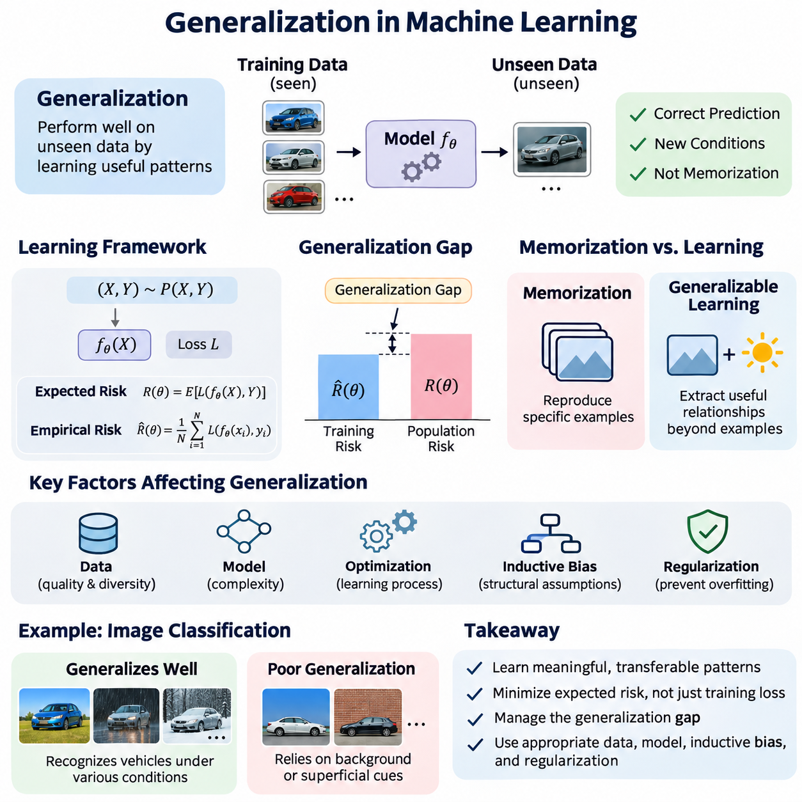
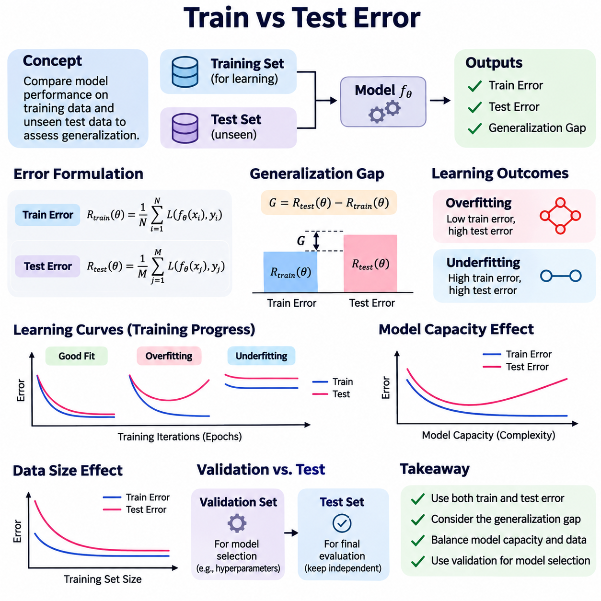
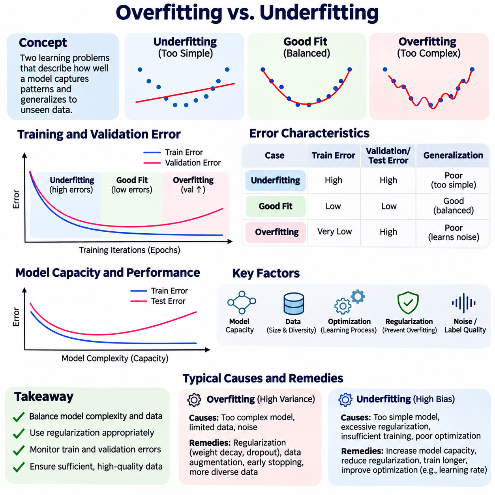
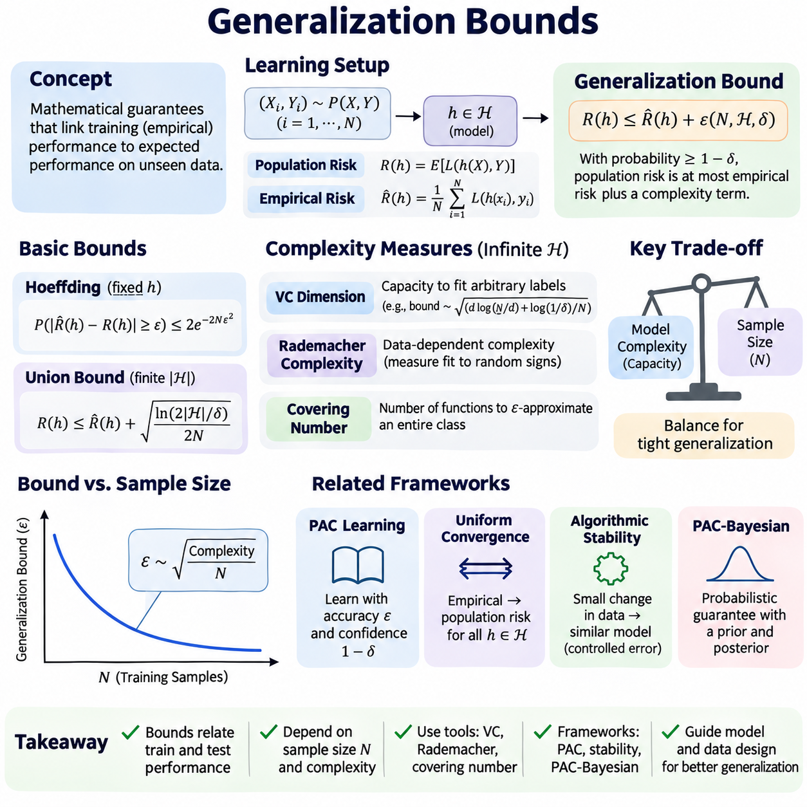
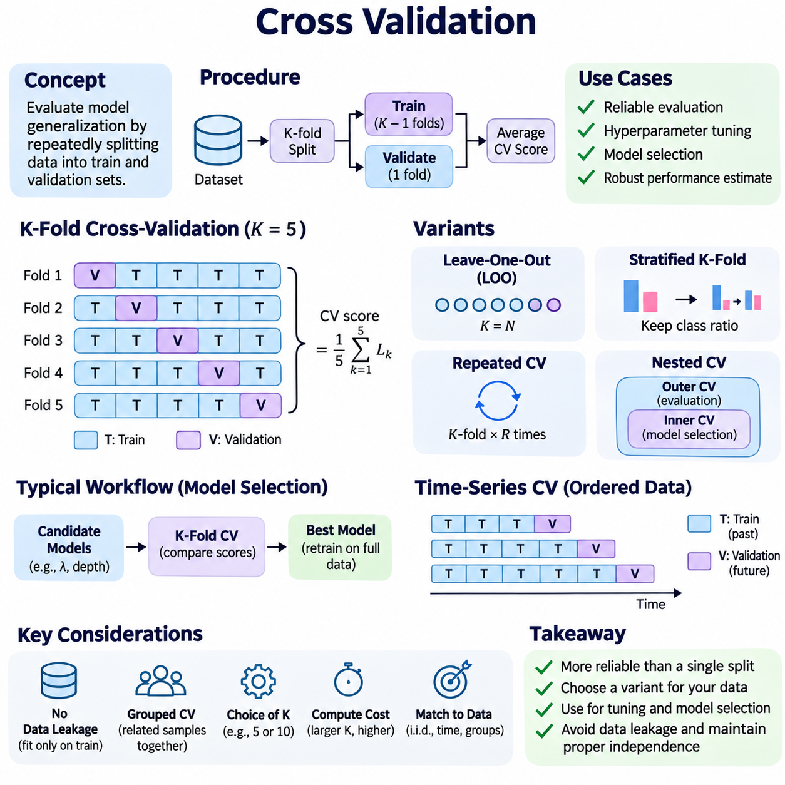
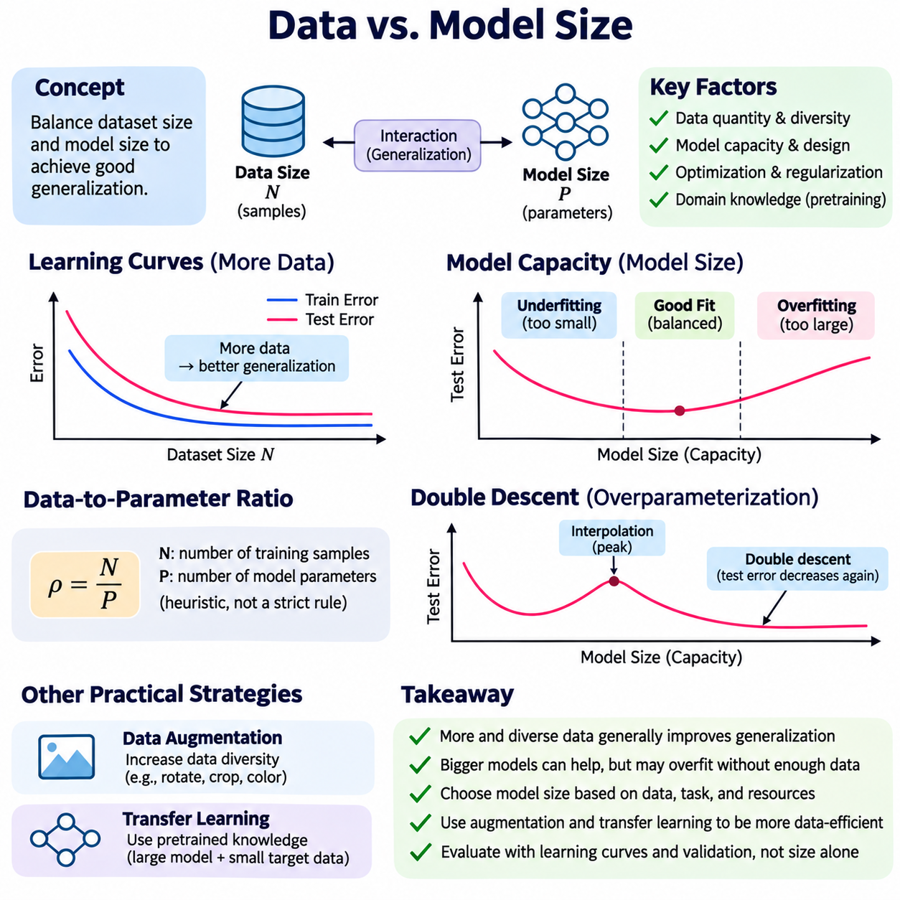
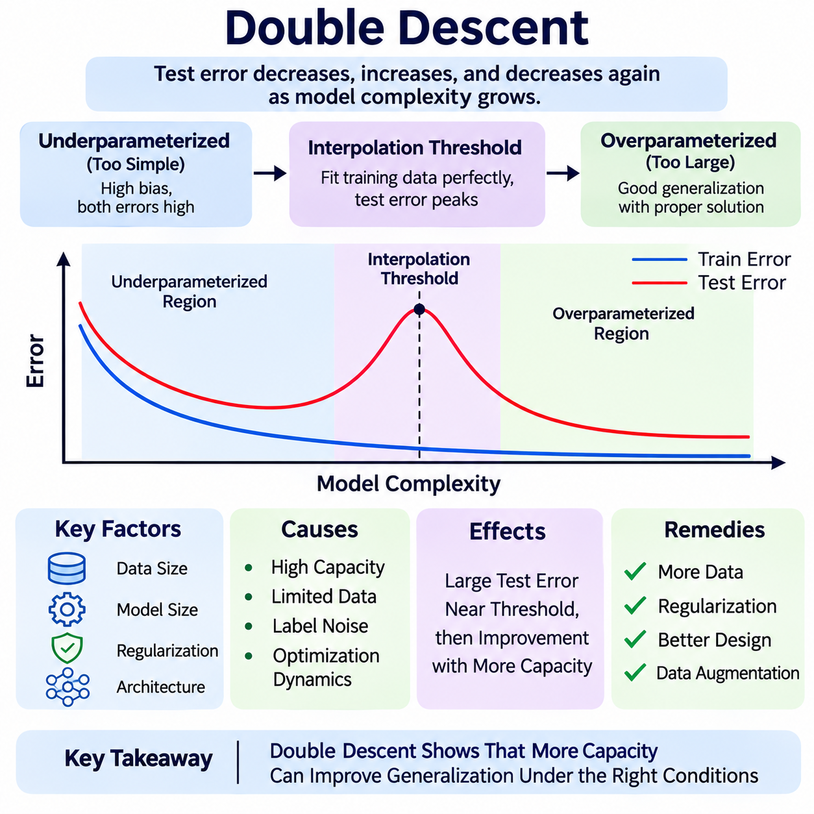
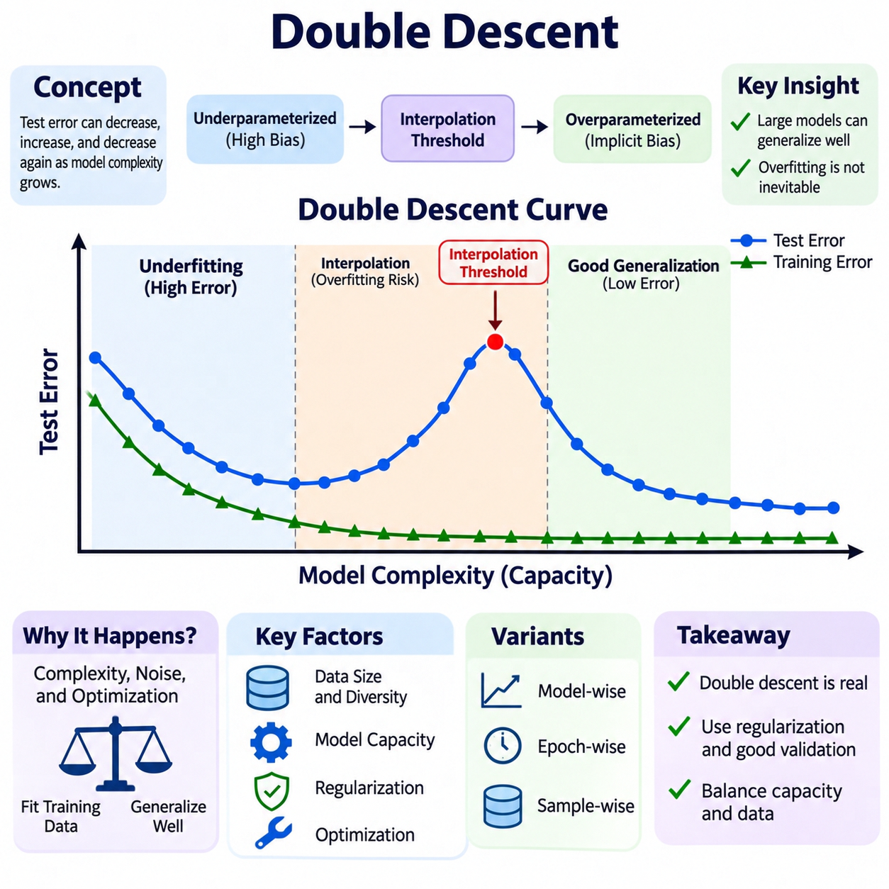
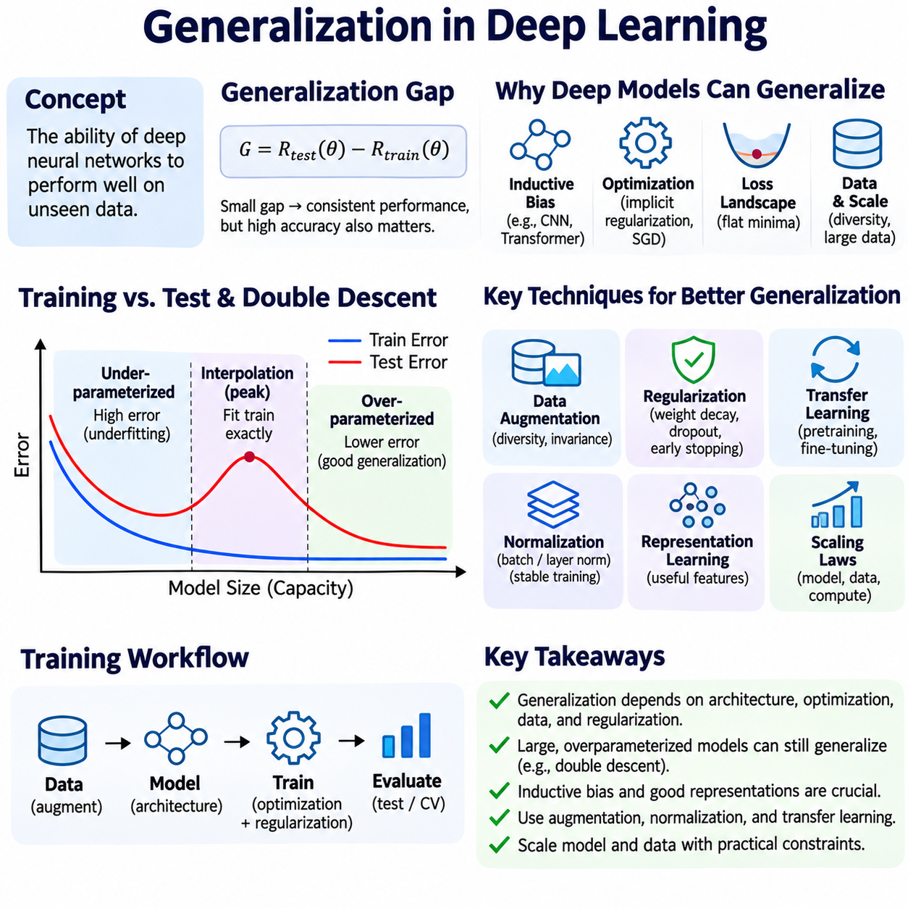
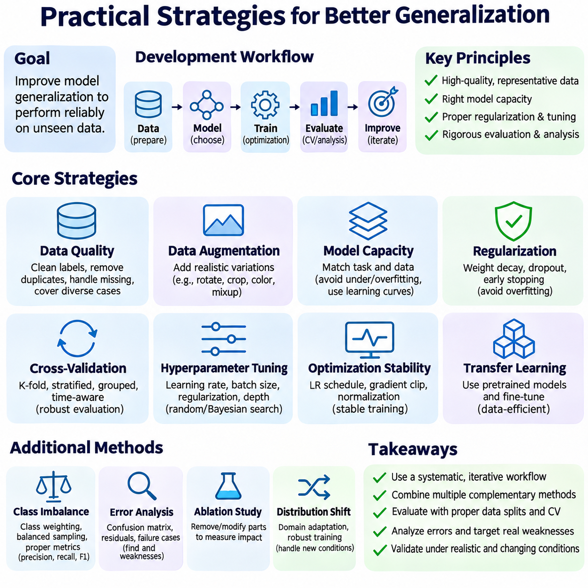

# 04. Generalization

## 04.00 What is Generalization

{width="7.268055555555556in" height="7.268055555555556in"}

일반화(Generalization)는 기계학습(Machine Learning) 모델이 제한된 학습 예제(Training Examples)로부터 학습한 후, 이전에 관찰하지 못한 새로운 데이터(Unseen Data)에 대해서도 효과적으로 작동하는 능력을 의미한다. 모델은 관찰된 입력과 출력을 단순히 암기하는 대신, 학습 데이터셋(Training Dataset)을 넘어 적용할 수 있는 의미 있는 패턴(Pattern)을 발견해야 한다. 실제 응용에서는 학습 과정에서 직접 경험하지 못한 조건에서도 예측을 수행해야 하므로, 일반화는 기계학습의 가장 근본적인 목표 중 하나이다.

일반화의 핵심 과제는 유한한 학습 예제 집합을 학습하는 것과 해당 예제를 생성한 근본적인 관계를 이해하는 것 사이의 차이에서 발생한다. 학습 데이터셋은 목표 문제(Target Problem)의 일부만을 표현한다. 따라서 모델은 불완전한 관측(Observation)으로부터 통계적 규칙성(Statistical Regularities)을 추론하면서, 우연한 상관관계(Accidental Correlations), 측정 잡음(Measurement Noise), 특정 학습 샘플에만 존재하는 특성에 지나치게 의존하지 않아야 한다.

지도학습(Supervised Learning)에서 일반화는 일반적으로 학습 분포(Training Distribution)와 알려지지 않은 데이터 생성 분포(Data-Generating Distribution)의 관계를 통해 이해할 수 있다. 학습 예제는 미래의 관측 데이터에도 적용되는 확률분포(Probability Distribution)에서 추출된다고 가정한다. 이러한 가정에서 성공적인 학습은 개별 학습 데이터를 재현하는 것이 아니라, 동일한 분포에서 추출된 새로운 샘플에도 유효한 관계를 근사하는 것을 의미한다.

일반화를 수학적으로 설명하기 위해 기본 분포(Underlying Distribution) P(X,Y)에서 추출된 입력과 출력의 쌍으로 구성된 데이터셋을 고려할 수 있다. 모델 fθ는 입력 X를 예측값으로 변환하고, 손실함수(Loss Function) L은 예측값과 실제 목표값 Y 사이의 차이를 측정한다. 기대 위험(Expected Risk)은 R(θ) = E[L(fθ(X),Y)]로 정의되며, 기댓값(Expectation)은 모집단 분포(Population Distribution)를 기준으로 계산된다. 일반화는 학습된 매개변수가 이러한 기대 위험을 얼마나 효과적으로 최소화하는지와 관련된다.

실제 모집단 분포는 일반적으로 알려져 있지 않으므로 기대 위험을 직접 계산하기 어렵다. 대신 학습 알고리즘(Learning Algorithm)은 관찰된 학습 예제의 평균 손실인 경험 위험(Empirical Risk)을 최소화한다. 데이터셋에 N개의 관측값이 존재한다면 경험 위험은 R̂(θ) = (1/N)ΣL(fθ(xᵢ),yᵢ)로 표현된다. 경험 위험과 기대 위험의 구분은 중요하다. 관찰된 데이터에서 성능을 최적화하더라도 새로운 데이터에 대한 신뢰할 수 있는 예측이 자동으로 보장되지는 않기 때문이다.

모집단 위험(Population Risk)과 경험적 학습 위험(Empirical Training Risk)의 차이는 일반화 격차(Generalization Gap)라고 한다. 일반화 격차가 작다는 것은 학습 데이터에서 측정된 성능이 목표 분포에서의 성능을 비교적 잘 대표한다는 의미이다. 그러나 학습 오차와 모집단 오차가 모두 높을 수도 있으므로, 작은 일반화 격차만으로 유용한 모델이라고 판단할 수는 없다. 따라서 일반화는 학습 시스템이 달성한 절대적인 예측 품질(Predictive Quality)과 함께 평가해야 한다.

일반화의 직관적인 사례는 이미지 분류(Image Classification)에서 확인할 수 있다. 차량을 인식하도록 학습된 모델은 서로 다른 조명 조건(Lighting Conditions), 카메라 시점(Camera Viewpoints), 배경(Backgrounds), 차량 구성(Vehicle Configurations)을 가진 이미지를 처리할 수 있어야 한다. 의미 있는 시각적 특성(Visual Features)을 학습한 모델은 이러한 변화에도 익숙하지 않은 차량을 식별할 수 있다. 반면 배경색이나 반복적인 촬영 조건에 의존하는 모델은 이러한 표면적인 특성이 달라지면 성능이 크게 저하될 수 있다.

일반화는 암기(Memorization)와 학습(Learning)의 차이와 밀접하게 관련된다. 암기는 특정 예제를 재현하는 능력인 반면, 일반화 가능한 학습은 관찰된 예제를 넘어 적용되는 관계를 추출하는 과정이다. 그러나 두 가지 행동이 반드시 상호 배타적인 것은 아니다. 현대 신경망(Neural Networks)은 학습 데이터의 일부를 암기하면서 동시에 유용한 표현(Representation)을 학습할 수 있다. 따라서 암기와 일반화의 관계는 단순한 대립 관계보다 훨씬 복잡하다.

학습 데이터의 품질(Data Quality)과 다양성(Data Diversity)은 일반화에 강한 영향을 미친다. 대표적인 변화를 포함하는 데이터셋은 모델이 안정적인 관계와 우연한 특성을 구별하도록 돕는다. 반면 불충분한 표본 추출(Sampling), 체계적 편향(Systematic Bias), 잘못된 레이블(Incorrect Labels), 제한된 데이터 범위는 잘못된 패턴을 학습하게 만들 수 있다. 데이터셋의 크기를 증가시키면 일반화가 개선되는 경우가 많지만, 동일한 조건이나 기존 편향을 반복하는 데이터만 추가한다면 효과는 제한적이다.

모델 복잡도(Model Complexity) 역시 일반화 능력에 영향을 미친다. 표현 능력(Expressive Capacity)이 부족한 모델은 중요한 관계를 포착하지 못할 수 있으며, 지나치게 유연한 모델은 새로운 데이터로 이전되지 않는 학습 데이터 특유의 변화를 학습할 수 있다. 그러나 모델 용량(Model Capacity)만으로 일반화 성능이 결정되지는 않는다. 최적화 알고리즘(Optimization Algorithms), 매개변수 초기화(Parameter Initialization), 아키텍처 가정(Architectural Assumptions), 학습 절차(Training Procedures), 데이터셋 구조가 함께 작용하여 최종 해를 결정한다.

귀납적 편향(Inductive Bias)은 학습 알고리즘이 특정한 해를 선택하도록 유도하는 가정을 의미한다. 예를 들어 합성곱 신경망(Convolutional Neural Networks)은 국소 연결(Local Connectivity)과 필터 공유(Shared Filters)를 통해 공간 구조(Spatial Structure)를 활용한다. 다른 아키텍처는 서로 다른 구조적 선호를 내재화한다. 이러한 가정이 문제의 의미 있는 특성과 일치하면 일반화 성능이 향상될 수 있지만, 부적절한 귀납적 편향은 학습을 제한하거나 잘못된 관계를 학습하도록 유도할 수 있다.

정규화(Regularization)는 학습 과정에서 선택되는 해에 영향을 주어 일반화를 개선하는 또 다른 메커니즘이다. 가중치 감쇠(Weight Decay), 드롭아웃(Dropout), 데이터 증강(Data Augmentation), 조기 종료(Early Stopping)와 같은 기법은 학습 데이터에만 존재하는 세부 특성에 대한 과도한 의존을 줄일 수 있다. 이러한 기법의 효과는 모델, 데이터, 최적화 과정에 따라 달라진다. 따라서 정규화는 일반화 개선을 무조건 보장하는 방법이 아니라 학습 동작에 영향을 주는 전략들의 집합으로 이해해야 한다.

최적화(Optimization)와 일반화는 서로 관련되어 있지만 구별되는 목표이다. 최적화는 지정된 학습 목적함수(Training Objective)를 감소시키는 모델 매개변수를 찾는 데 집중한다. 반면 일반화는 해당 매개변수가 새로운 관측 데이터에서 얼마나 우수한 예측 품질을 제공하는지에 초점을 맞춘다. 두 최적화 알고리즘이 비슷하게 낮은 학습 손실(Training Loss)에 도달하더라도 일반화 성능은 다를 수 있다. 이는 가장 낮은 학습 손실을 달성한 모델이 반드시 가장 유용한 모델은 아니라는 사실을 설명한다.

확률적 경사하강법(Stochastic Gradient Descent, SGD)은 최적화와 일반화의 상호작용을 보여주는 대표적인 사례이다. SGD의 매개변수 갱신(Parameter Updates)은 무작위로 선택된 학습 예제에 의존하므로 최적화 경로(Optimization Trajectory)에 변동성이 발생한다. 이러한 확률적 특성(Stochastic Behavior)은 손실 지형(Loss Landscape)에서 탐색되는 영역과 선택되는 해에 영향을 줄 수 있다. 이러한 효과는 암묵적 정규화(Implicit Regularization)라고 설명되기도 하지만, 실제 영향은 학습률(Learning Rate), 배치 크기(Batch Size), 모델 아키텍처 등에 따라 달라진다.

일반화를 평가하려면 모델 개발(Model Development)과 최종 성능 평가(Final Performance Assessment)를 분리해야 한다. 학습 데이터(Training Data)는 매개변수 최적화에 사용하고, 검증 데이터(Validation Data)는 모델 선택(Model Selection)과 하이퍼파라미터 조정(Hyperparameter Tuning)에 사용한다. 시험 데이터(Test Data)는 예측 성능을 독립적으로 추정하는 데 사용한다. 시험 결과를 반복적으로 참조하여 모델을 수정하면 이러한 독립성이 손상될 수 있다. 따라서 신뢰할 수 있는 평가에는 적절한 데이터 분할(Data Partitioning)과 데이터 누출(Data Leakage) 방지가 필요하다.

교차 검증(Cross-Validation)은 여러 학습 및 검증 분할에서 학습 절차를 평가함으로써 이러한 원칙을 확장한다. 특히 사용 가능한 데이터셋이 작거나 표본 선택에 따라 성능이 크게 달라지는 경우 유용하다. 그러나 일반적인 무작위 교차 검증(Random Cross-Validation)은 시간적, 집단적, 공간적 상관관계(Temporal, Grouped, or Spatial Correlations)가 존재하는 데이터에 적합하지 않을 수 있다. 지나치게 낙관적인 일반화 성능 추정을 방지하려면 평가 데이터 분할이 실제 데이터의 의존 구조(Dependency Structure)를 반영해야 한다.

통계적 학습 이론(Statistical Learning Theory)은 경험적 성능(Empirical Performance)과 모집단 성능(Population Performance)의 관계를 분석하여 일반화를 형식적으로 설명한다. 가설 복잡도(Hypothesis Complexity), 집중 부등식(Concentration Inequalities), 일반화 경계(Generalization Bounds)와 같은 개념은 학습 관측값이 새로운 예제에 대해 신뢰할 수 있는 정보를 제공하는 조건을 설명한다. 이러한 이론적 결과는 표본 추출, 모델 집합(Model Classes), 학습 절차에 관한 가정에 의존하며 실제 응용에서의 유용성도 달라질 수 있다.

현대 딥러닝(Deep Learning)은 매우 많은 매개변수를 가진 과매개변수화 신경망(Overparameterized Neural Networks)이 학습 데이터에 거의 완벽하게 적합할 수 있음에도 효과적으로 일반화한다는 추가적인 문제를 제시한다. 이러한 현상은 전통적인 모델 복잡도 측정만으로 일반화를 설명하기 어렵다는 사실을 보여준다. 따라서 현대 연구에서는 데이터 구조(Data Structure), 최적화 동역학(Optimization Dynamics), 학습된 표현(Learned Representations), 아키텍처 특성(Architectural Properties), 암묵적 정규화의 복합적인 영향을 분석한다.

일반화는 분포 이동(Distribution Shift) 상황에서의 강건성(Robustness)과도 구별해야 한다. 전통적인 일반화는 학습 데이터와 평가 데이터가 동일한 기본 분포를 따른다고 가정하는 경우가 많다. 그러나 실제 시스템에서는 센서(Sensors), 환경(Environments), 운영 조건(Operating Conditions), 사용자 행동(User Behavior), 모집단 특성(Population Characteristics)이 변화할 수 있다. 이러한 변화에서의 성능은 강건성, 도메인 적응(Domain Adaptation), 불변 표현 학습(Invariant Representation Learning), 적절한 불확실성 추정(Uncertainty Estimation)과 같은 추가적인 능력에 의존한다.

자율주행 로봇(Autonomous Robots)에서 일반화는 인식(Perception) 및 의사결정(Decision-Making) 모델이 기존 학습 환경을 벗어나서도 효과적으로 작동할 수 있는지를 결정한다. 특정 창고에서 학습된 로봇은 다른 창고에서 새로운 바닥 재질, 조명 조건, 장애물, 설비 배치를 경험할 수 있다. 성공적인 배포(Deployment)를 위해서는 이전 가능한 환경 특성(Transferable Environmental Properties)을 학습하면서 익숙하지 않은 조건을 인식할 수 있어야 한다. 따라서 시뮬레이션 다양성(Simulation Diversity), 현실적인 검증 시나리오(Validation Scenarios), 현장 시험(Field Testing)이 중요하다.

산업용 기계학습(Industrial Machine Learning)에서 일반화는 운영 신뢰성(Operational Reliability)과 유지보수 요구사항(Maintenance Requirements)에 직접적인 영향을 미친다. 특정 생산 라인의 이미지로 학습된 결함 검출 모델(Defect Detection Model)은 카메라 보정(Camera Calibration), 재료 외관(Material Appearance), 조명 조건이 변하면 정확도가 낮아질 수 있다. 마찬가지로 예지보전 모델(Predictive Maintenance Models)은 학습 과정에서 관찰하지 못한 장비 운영 조건을 경험할 수 있다. 여러 장비와 생산 기간, 환경 조건에 걸친 평가는 실제 배포 전에 이러한 한계를 발견하도록 돕는다.

실용적인 일반화 전략(Practical Generalization Strategy)은 목표 모집단(Target Population)을 정의하고 배포된 모델이 경험할 것으로 예상되는 변화를 식별하는 것에서 시작한다. 이후 데이터셋 구성(Dataset Construction), 모델 선택, 최적화, 정규화, 평가를 이러한 요구사항에 맞추어 설계해야 한다. 성능 분석(Performance Analysis)은 평균 정확도(Average Accuracy)뿐 아니라 오류 패턴(Error Patterns), 하위 집단별 성능(Subgroup Behavior), 불확실성(Uncertainty), 관련 환경 변화에 대한 민감도(Sensitivity)까지 검토해야 한다. 이러한 접근은 통계적 학습 목표와 공학적 신뢰성을 연결한다.

궁극적으로 일반화는 기계학습을 관찰된 예제의 단순한 재현에서 새로운 상황에 대한 유용한 예측을 수행하는 메커니즘으로 발전시킨다. 일반화의 성공은 대표성 있는 데이터(Representative Data), 적절한 모델 가정(Model Assumptions), 효과적인 최적화, 신뢰할 수 있는 평가 사이의 상호작용에 달려 있다. 이러한 관계를 이해하는 것은 학습 오차와 시험 오차(Training and Test Errors), 과적합(Overfitting), 이론적 일반화 경계(Theoretical Generalization Bounds), 현대 딥러닝 시스템의 고유한 동작을 분석하기 위한 기초가 된다.

## 04.01 Train vs Test Error

{width="7.268055555555556in" height="7.268055555555556in"}

학습 오차(Training Error)와 시험 오차(Test Error)는 기계학습(Machine Learning) 모델이 관찰된 예제로부터 얼마나 효과적으로 학습하고, 관찰하지 못한 새로운 데이터에 얼마나 잘 일반화(Generalization)하는지를 평가하는 기본적인 측정 지표이다. 학습 오차는 모델 매개변수(Model Parameters)를 최적화하는 데 사용된 데이터셋에서의 예측 성능을 측정하며, 시험 오차는 모델 개발 과정에서 제외된 독립적인 데이터셋에서의 성능을 측정한다. 두 오차의 관계는 학습 품질, 모델 신뢰성(Model Reliability), 실제 배포(Deployment) 가능성을 판단하는 데 중요한 정보를 제공한다.

학습 오차는 학습된 모델을 최적화 과정에서 사용한 예제에 적용하고, 예측값과 목표값(Target Values)의 차이를 측정하여 계산한다. N개의 학습 샘플로 구성된 데이터셋에서 경험적 학습 위험(Empirical Training Risk)은 R_train(θ) = (1/N)ΣL(fθ(xᵢ),yᵢ)로 표현할 수 있다. 여기서 fθ는 모델을 나타내고, L은 손실함수(Loss Function)를 의미한다. 이 값은 선택한 평가 기준(Evaluation Criterion)에 따라 모델이 관찰된 학습 예제에 얼마나 정확하게 적합(Fitting)되었는지를 설명한다.

시험 오차는 매개변수 최적화(Parameter Optimization)나 모델 선택(Model Selection)에 사용되지 않은 관측값을 이용하여 동일한 학습 모델을 평가한다. 독립적인 시험 데이터셋에 M개의 예제가 포함되어 있다면, 경험적 시험 위험(Empirical Test Risk)은 R_test(θ) = (1/M)ΣL(fθ(xⱼ),yⱼ)로 표현된다. 시험 데이터셋은 새로운 관측값에 대한 예측 성능을 추정하는 수단이며, 표본 추출 과정(Sampling Process)이 목표 모집단(Target Population)을 적절히 대표하고 모델 개발 결정으로부터 독립적이라는 가정이 필요하다.

학습 오차와 시험 오차의 구분은 알려진 예제에 적합하는 것과 알려지지 않은 결과를 예측하는 것 사이의 차이를 반영한다. 학습 알고리즘(Learning Algorithms)은 학습 목적함수(Training Objectives)를 직접 최적화하므로 동일한 관측값에 반복적으로 노출되면서 학습 성능이 일반적으로 개선된다. 반면 시험 성능은 학습된 관계가 기존 관측값을 넘어 적용될 수 있는지에 따라 결정된다. 따라서 학습 오차가 매우 낮더라도 익숙하지 않은 데이터에서는 상당히 높은 오차가 발생할 수 있다.

시험 오차와 학습 오차의 차이는 일반적으로 경험적 일반화 격차(Empirical Generalization Gap)라고 한다. 두 값이 비교 가능한 손실 정의(Loss Definitions)와 평가 절차(Evaluation Procedures)를 사용한다면 G = R_test(θ) − R_train(θ)로 표현할 수 있다. 양의 일반화 격차(Positive Generalization Gap)는 시험 데이터에서 측정된 오차가 학습 데이터보다 높다는 것을 의미한다. 그러나 격차의 크기는 데이터셋 특성, 샘플 수, 학습 절차, 통계적 변동성(Statistical Variation)에 따라 달라진다.

작은 일반화 격차는 일반적으로 바람직하지만, 그 자체로 우수한 예측 성능을 보장하지는 않는다. 학습 오차와 시험 오차가 모두 높은 모델은 일반화 격차가 작더라도 중요한 관계를 제대로 포착하지 못할 수 있다. 반대로 학습 오차가 매우 낮고 시험 오차가 다소 높은 모델도 실제 응용에서는 우수한 예측 성능을 제공할 수 있다. 따라서 모델 평가(Model Assessment)에서는 학습 오차와 시험 오차의 차이뿐 아니라 시험 성능의 절대적인 수준도 함께 고려해야 한다.

과적합(Overfitting)은 모델이 새로운 관측값에 충분히 일반화되지 않는 학습 데이터 특유의 패턴을 학습할 때 발생한다. 최적화 과정에서 모델이 학습 예제에 점점 더 적응하면서 학습 오차는 계속 감소할 수 있다. 반면 검증 오차(Validation Error)는 개선이 멈추거나 증가하기 시작할 수 있다. 이러한 차이는 추가적인 적합 과정이 일반화 성능을 개선하지 못하고, 오히려 잡음(Noise)이나 우연한 특성(Incidental Characteristics)을 학습하고 있음을 시사한다.

과소적합(Underfitting)은 모델이 학습 데이터에 존재하는 중요한 패턴조차 충분히 포착하지 못하는 다른 형태의 학습 문제이다. 모델 용량(Model Capacity), 적절한 특성(Features), 효과적인 최적화(Optimization), 학습 시간(Training Time)이 부족하면 학습 오차와 시험 오차가 모두 상대적으로 높게 유지될 수 있다. 과소적합은 일반화 격차를 최소화하는 것만으로 충분하지 않다는 사실을 보여준다. 유용한 모델은 일반화 능력을 평가하기 전에 의미 있는 관계를 먼저 학습해야 한다.

모델 용량은 표현력이 높은 모델일수록 복잡한 함수를 나타낼 수 있기 때문에 학습 오차와 시험 오차의 관계에 영향을 미친다. 모델 용량을 증가시키면 일반적으로 달성 가능한 최소 학습 오차가 감소하지만, 시험 오차에 미치는 영향이 반드시 단조적(Monotonic)인 것은 아니다. 전통적인 학습 환경에서는 복잡도가 일정 수준을 넘어서면 시험 성능이 악화될 수 있지만, 현대의 과매개변수화 모델(Overparameterized Models)은 특정 조건에서 이중 하강(Double Descent)을 포함하는 복잡한 동작을 나타낼 수 있다.

학습 곡선(Learning Curves)은 학습 과정과 일반화 동작을 이해하기 위한 실용적인 방법을 제공한다. 학습 곡선은 학습 반복 횟수(Training Iterations), 에포크(Epochs), 데이터셋 크기(Dataset Size)에 따른 학습 오차와 검증 오차를 나타낸다. 두 오차가 함께 감소하면 일반적으로 학습이 진행되고 있음을 의미한다. 학습 오차가 감소하는 동안 검증 오차가 증가하면 과적합이 발생하고 있을 수 있다. 두 오차가 모두 높게 유지된다면 모델 용량 부족, 부적절한 최적화 설정, 불충분한 표현(Representations) 등이 원인일 수 있다.

학습 데이터셋의 크기(Training-Set Size) 역시 학습 곡선을 해석하는 데 영향을 미친다. 데이터가 매우 제한적인 경우 유연한 모델은 개별 예제에 정밀하게 적합하면서도 새로운 관측값에 대해 불안정한 예측을 생성할 수 있다. 대표성 있는 학습 샘플(Representative Training Samples)의 수를 증가시키면 이러한 불안정성이 감소하고 시험 성능이 개선되는 경우가 많다. 그러나 중요한 변동 요인(Sources of Variation)이 여전히 데이터에 포함되지 않거나 모델 가정이 관련 관계의 학습을 제한한다면 추가 데이터의 효과는 점차 감소할 수 있다.

검증 오차와 최종 시험 오차는 서로 다른 목적을 수행하므로 명확히 구별해야 한다. 검증 데이터(Validation Data)는 하이퍼파라미터(Hyperparameters), 아키텍처(Architectures), 정규화 강도(Regularization Strength), 학습 기간(Training Duration)에 관한 결정을 지원한다. 시험 데이터(Test Data)는 선택된 모델의 최종 평가까지 독립적으로 유지되어야 한다. 시험 결과를 반복적으로 이용하여 모델을 선택하면 선택 편향(Selection Bias)이 발생하고 일반화 성능이 실제보다 낙관적으로 추정될 수 있다.

데이터 누출(Data Leakage)은 시험 오차가 실제보다 낮게 측정되는 주요 원인이다. 데이터 누출은 실제 예측 시점에 사용할 수 없는 정보가 모델 개발이나 평가 과정에 포함될 때 발생한다. 대표적인 사례로는 데이터셋 분할 간 중복 관측값(Duplicate Observations), 전체 데이터셋을 사용한 전처리(Preprocessing), 미래 결과(Future Outcomes)로부터 생성된 특성 등이 있다. 이러한 누출은 실제 배포 환경에서 성능이 낮은 모델도 시험 과정에서는 매우 우수한 성능을 보이는 것처럼 만들 수 있다.

시험 오차의 통계적 불확실성(Statistical Uncertainty)도 고려해야 한다. 시험 데이터셋은 가능한 모든 관측값 중 유한한 표본(Finite Sample)만 포함하므로, 측정된 오차는 모집단 위험(Population Risk)의 정확한 값이 아니라 추정값이다. 특히 오류가 드물거나 불균등하게 분포하는 경우 작은 데이터셋은 변동성이 큰 추정 결과를 생성할 수 있다. 신뢰구간(Confidence Intervals), 적절한 데이터 분할을 통한 반복 평가(Repeated Evaluation), 신중하게 설계된 표본 추출 절차는 이러한 불확실성을 파악하는 데 도움이 된다.

오차 지표(Error Metric)의 선택은 학습 성능과 시험 성능을 해석하는 방식에 영향을 미친다. 분류 작업(Classification Tasks)에서는 교차 엔트로피 손실(Cross-Entropy Loss), 오류율(Error Rate), 기타 분류 지표(Classification Metrics)를 사용할 수 있다. 회귀 작업(Regression Tasks)에서는 평균제곱오차(Mean Squared Error)나 평균절대오차(Mean Absolute Error)를 자주 사용한다. 한 지표에서 성능이 개선되더라도 다른 지표가 반드시 개선되는 것은 아니다. 따라서 비교에는 일관된 정의를 사용하고, 평가 기준은 예측 오류가 실제 운영에 미치는 영향을 반영해야 한다.

클래스 불균형(Class Imbalance)은 시험 오차의 해석을 더욱 복잡하게 만든다. 특정 클래스가 대부분을 차지하는 데이터셋에서는 분류기(Classifier)가 전체 오류율을 낮게 유지하면서도 드물지만 중요한 클래스에서 낮은 성능을 보일 수 있다. 예를 들어 산업용 결함 검출기(Industrial Defect Detector)는 대부분의 정상 제품을 정확하게 분류하면서 드문 결함을 놓칠 수 있다. 클래스별 재현율(Class-Specific Recall), 정밀도(Precision), 혼동행렬 분석(Confusion-Matrix Analysis)은 전체 오차 지표만으로 파악하기 어려운 추가 정보를 제공한다.

분포 이동(Distribution Shift)은 시험 오차가 시험 데이터셋이 대표하는 모집단에 대해서만 의미를 가진다는 점에서 또 다른 한계를 만든다. 실제 배포 조건이 평가 조건과 다르면 운영 환경에서의 오차가 상당히 높아질 수 있다. 카메라 구성(Camera Configuration), 환경 조명(Environmental Illumination), 장비 특성(Equipment Characteristics), 사용자 행동(User Behavior)의 변화는 입력 분포(Input Distribution)를 변화시킬 수 있다. 따라서 신뢰할 수 있는 평가에는 대표적인 운영 조건과 관련 스트레스 시험 시나리오(Stress Scenarios)를 포함해야 한다.

딥러닝(Deep Learning)에서는 최적화 절차가 학습 오차와 시험 오차에 서로 다른 영향을 미칠 수 있다. 학습률 스케줄(Learning Rate Schedules), 배치 크기(Batch Sizes), 가중치 감쇠(Weight Decay), 확률적 경사 갱신(Stochastic Gradient Updates)은 수렴(Convergence)과 학습된 해의 특성에 모두 영향을 준다. 학습 오차가 거의 동일한 두 모델도 서로 다른 최적화 경로(Optimization Trajectories)를 거쳐 다른 매개변수 구성(Parameter Configurations)에 도달할 수 있으므로 시험 성능이 달라질 수 있다. 이는 성공적인 최적화와 효과적인 일반화의 차이를 보여준다.

조기 종료(Early Stopping)는 검증 성능을 이용하여 학습을 종료할 시점을 결정하는 방법이다. 학습 오차가 계속 감소하더라도 검증 오차가 더 이상 개선되지 않으면, 일반화 성능이 더 우수할 것으로 추정되는 모델을 유지하기 위해 학습을 중단할 수 있다. 이러한 방법은 장시간 학습으로 잡음에 대한 민감도가 증가하는 경우 특히 유용하다. 그러나 종료 시점에 대한 결정은 최종 시험 데이터셋을 반복적으로 확인하는 대신 검증 데이터에 근거해야 한다.

자율주행 로봇(Autonomous Robotics)에서는 학습 오차와 시험 오차의 분석이 환경적 다양성(Environmental Diversity)과 운영 다양성(Operational Diversity)을 반영해야 한다. 특정 시설의 이미지로 학습된 인식 모델(Perception Model)은 유사한 시험 이미지에서는 높은 정확도를 보이지만 다른 시설에서는 실패할 수 있다. 따라서 평가에는 서로 다른 환경, 센서 구성(Sensor Configurations), 조명 조건, 운영 시나리오(Operating Scenarios)를 고려해야 한다. 이러한 시험은 낮은 오차가 이전 가능한 학습(Transferable Learning)의 결과인지, 제한된 조건에 대한 의존의 결과인지 구별하는 데 도움이 된다.

산업용 기계학습(Industrial Machine Learning)에서 시험 오차는 배포 준비 상태(Deployment Readiness)와 운영 위험(Operational Risk)에 관한 결정에 직접적인 영향을 미친다. 예지보전 시스템(Predictive Maintenance Systems)은 여러 장비와 운영 기간에 걸쳐 평가해야 하며, 품질 검사 모델(Quality Inspection Models)은 학습 데이터와 독립적인 생산 배치(Production Batches)를 이용하여 시험해야 한다. 의미 있는 운영 경계(Operational Boundaries)에 따라 관측값을 분리하면 서로 밀접하게 관련된 샘플 간 상관관계로 인해 지나치게 낙관적인 성능 추정이 발생하는 것을 방지할 수 있다.

신뢰할 수 있는 평가 절차(Reliable Evaluation Workflow)는 목표 모집단을 정의하고, 적절한 오차 지표를 선택하며, 독립적인 학습·검증·시험 데이터 분할(Training, Validation, and Test Partitions)을 설정하는 것에서 시작한다. 모델 매개변수는 학습 데이터를 사용하여 최적화하고, 개발 관련 결정은 검증 성능을 기준으로 수행하며, 최종 예측 품질은 사용하지 않은 시험 데이터로 평가한다. 이후 오차 분석(Error Analysis)에서는 불확실성, 하위 집단별 성능(Subgroup Performance), 잠재적인 데이터 누출, 운영 환경 변화에 대한 민감도(Sensitivity)를 검토해야 한다.

궁극적으로 학습 오차는 모델이 관찰된 예제에 얼마나 효과적으로 적합하는지를 설명하며, 시험 오차는 목표 모집단에서 추출된 독립적인 관측값을 예측하는 능력을 추정한다. 두 오차의 차이는 일반화의 중요한 특성을 보여주지만, 그 자체만으로 모델 품질(Model Quality)을 완전히 설명할 수는 없다. 두 측정값을 함께 이해하는 것은 과적합과 과소적합을 진단하고, 적절한 모델 복잡도(Model Complexity)를 선택하며, 학습 데이터셋을 넘어 안정적으로 작동하는 기계학습 시스템을 개발하기 위한 기초가 된다.

## 04.02 Overfitting vs Underfitting

{width="7.268055555555556in" height="7.268055555555556in"}

과적합(Overfitting)과 과소적합(Underfitting)은 기계학습(Machine Learning) 모델이 학습 데이터(Training Data)의 패턴을 얼마나 효과적으로 포착하고, 이를 관찰하지 못한 새로운 데이터(Unseen Data)에 적용하는지를 설명하는 두 가지 근본적인 학습 문제이다. 과적합은 모델이 학습 예제에 특화된 지나치게 세부적인 정보나 잡음(Noise)을 학습할 때 발생하며, 과소적합은 중요한 관계를 충분히 학습하지 못할 때 발생한다. 이러한 현상을 이해하는 것은 정확한 예측과 신뢰할 수 있는 일반화(Generalization)를 동시에 달성하는 모델을 개발하는 데 필수적이다.

과적합은 일반적으로 모델이 매우 낮은 학습 오차(Training Error)를 달성하지만 검증 오차(Validation Error)나 시험 오차(Test Error)는 상당히 높게 나타날 때 관찰된다. 모델은 학습 데이터셋(Training Dataset) 내부의 복잡한 관계를 재현할 수 있지만, 새로운 관측값에서도 유효한 패턴을 학습하지 못할 수 있다. 이러한 현상은 사용 가능한 데이터의 양과 다양성에 비해 모델의 유연성(Model Flexibility)이 높은 경우 특히 자주 발생하지만, 최적화 절차(Optimization Procedures)와 데이터 특성(Data Characteristics)도 결과에 영향을 미친다.

과소적합은 모델이 데이터셋에 존재하는 근본적인 관계를 충분히 표현하거나 학습하지 못할 때 발생한다. 모델이 지나치게 단순하거나 입력 특성(Input Features)이 부족하거나 최적화 과정(Optimization Process)이 수렴(Convergence)하지 못하면 학습 오차와 검증 오차가 모두 높게 유지될 수 있다. 과적합과 달리 과소적합은 관찰된 예제에서도 의미 있는 구조를 포착하지 못하는 현상을 의미하며, 익숙한 데이터와 새로운 데이터 모두에서 예측 성능(Predictive Performance)을 제한한다.

이 두 현상을 개념적으로 구분하는 유용한 기준은 모델 복잡도(Model Complexity)와 적합 능력(Fitting Ability), 일반화 사이의 균형이다. 모델 용량(Model Capacity)이 부족하면 지나치게 단순화된 예측을 생성할 수 있으며, 과도하게 유연한 모델은 중요하지 않은 변동에 민감해질 수 있다. 그러나 모델 복잡도가 증가한다고 반드시 과적합이 발생하는 것은 아니다. 현대 신경망(Neural Networks)은 많은 매개변수(Parameters)를 가지고도 효과적으로 일반화할 수 있으며, 이는 아키텍처(Architecture), 최적화(Optimization), 정규화(Regularization), 데이터 구조(Data Structure)가 학습 동작을 함께 결정한다는 사실을 보여준다.

학습 오차와 검증 오차의 관계는 이러한 상태를 식별하는 실용적인 방법을 제공한다. 과소적합은 일반적으로 두 데이터셋에서 상대적으로 높은 오차를 나타내며, 과적합은 낮은 학습 오차와 높은 검증 오차 사이에 큰 차이를 보이는 경우가 많다. 일반화가 잘 이루어진 모델(Well-Generalized Model)은 일반적으로 적절한 학습 성능을 유지하면서 충분히 낮은 검증 오차를 달성한다. 다만 정확한 관계는 데이터셋의 난이도(Dataset Difficulty)와 선택한 평가 지표(Evaluation Metric)에 따라 달라진다.

학습 곡선(Learning Curves)은 최적화 과정에서 과적합과 과소적합이 어떻게 발생하는지를 보여준다. 학습 초기에는 모델이 유용한 패턴을 충분히 학습하지 못했으므로 학습 오차와 검증 오차가 모두 높을 수 있다. 학습이 진행되면 두 오차는 일반적으로 감소한다. 그러나 학습 오차가 계속 감소하는 동안 검증 오차가 증가하기 시작하면 과적합이 발생하고 있을 수 있다. 두 오차가 모두 높게 유지된다면 모델 용량 부족, 비효율적인 최적화, 불충분한 학습 등이 원인일 수 있다.

모델 용량은 학습 시스템(Learning System)이 표현할 수 있는 함수의 범위를 결정하므로 중요한 요소이다. 선형 모델(Linear Model)은 강한 비선형 관계(Nonlinear Relationship)를 충분히 표현하지 못할 수 있으며, 고차 다항식(High-Degree Polynomial)은 개별 관측값에 지나치게 밀접하게 적합할 수 있다. 그러나 적절한 모델 용량은 표본 크기(Sample Size), 잡음, 작업 복잡도(Task Complexity), 정규화에 따라 달라진다. 따라서 모델 용량을 선택할 때는 표현 능력(Expressive Power)과 새로운 관측값에 대한 안정적인 예측 능력 사이의 균형을 고려해야 한다.

학습 데이터셋의 크기와 다양성은 과적합에 큰 영향을 미친다. 데이터셋에 포함된 예제가 적으면 유연한 모델은 실제 모집단(Underlying Population)의 특성을 반영하지 않는 우연한 상관관계(Accidental Correlations)를 학습할 수 있다. 대표성 있는 학습 데이터(Representative Training Data)를 증가시키면 이러한 의존성이 감소하고 일반화 성능이 개선될 수 있다. 그러나 단순히 관측값을 복제하거나 제한된 분포(Narrow Distribution)에서 추가 예제를 수집하는 것은 중요한 변동 요인(Important Variations)이 여전히 누락되어 있기 때문에 효과가 제한적일 수 있다.

잡음과 레이블 품질(Label Quality) 역시 학습 동작에 영향을 미친다. 높은 모델 용량을 가진 모델은 잘못된 레이블(Incorrect Labels)이나 무작위 측정 변동(Random Measurement Fluctuations)까지 학습하여 일반화 능력을 저하시킬 수 있다. 반대로 과도한 잡음은 모델이 의미 있는 관계를 식별하지 못하게 하여 높은 학습 오차를 유발할 수 있다. 데이터 정제(Data Cleaning), 레이블 검증(Label Verification), 강건한 손실함수(Robust Loss Functions)는 학습 품질을 개선할 수 있지만, 효과는 잡음의 원인과 구조에 따라 달라진다.

정규화는 학습 데이터에 특화된 패턴에 대한 과도한 의존을 억제하여 과적합을 제어하는 메커니즘을 제공한다. 가중치 감쇠(Weight Decay)는 큰 매개변수 값에 페널티(Penalty)를 부여하고, 드롭아웃(Dropout)은 학습 과정에 확률적 변화(Stochastic Changes)를 도입하며, 데이터 증강(Data Augmentation)은 모델을 추가적인 데이터 변형에 노출시킨다. 조기 종료(Early Stopping)는 검증 성능의 개선이 멈추면 학습을 제한한다. 이러한 기법은 서로 다른 방식으로 모델 동작에 영향을 주므로 아키텍처, 데이터셋, 운영 요구사항(Operational Requirements)에 맞게 선택해야 한다.

지나치게 강한 정규화는 오히려 과소적합을 유발할 수 있다. 강한 가중치 페널티(Weight Penalties)는 모델이 중요한 관계를 학습하지 못하게 할 수 있으며, 과도한 드롭아웃(Aggressive Dropout)은 실질적인 표현 용량(Effective Representational Capacity)을 감소시킬 수 있다. 비현실적인 데이터 증강(Unrealistic Augmentation)은 유용한 정보를 왜곡할 수 있다. 마찬가지로 학습을 너무 일찍 종료하면 모델이 충분히 최적화되지 못할 수 있다. 따라서 효과적인 정규화는 학습 제약과 의미 있는 패턴을 학습할 필요성 사이의 균형을 요구한다.

최적화 문제(Optimization Difficulties)는 모델이 이론적으로 충분한 용량을 가지고 있더라도 과소적합과 유사한 현상을 발생시킬 수 있다. 부적절한 학습률(Learning Rates), 잘못된 초기화(Initialization), 기울기 소실(Vanishing Gradients), 부족한 학습 시간은 모델이 유용한 해(Solution)에 도달하지 못하게 할 수 있다. 이러한 경우 아키텍처의 복잡도를 증가시키는 것만으로 문제를 해결하기 어렵다. 학습 동역학(Training Dynamics), 기울기 동작(Gradient Behavior), 최적화 안정성(Optimization Stability)을 분석하면 표현 능력의 한계와 학습 절차의 실패를 구별하는 데 도움이 된다.

편향-분산 프레임워크(Bias-Variance Framework)는 이러한 현상을 이해하는 또 다른 관점을 제공한다. 높은 편향(High Bias)은 중요한 관계를 체계적으로 놓치는 지나치게 제한적인 모델과 관련되는 경우가 많으며, 높은 분산(High Variance)은 학습 표본의 변화에 대한 민감도를 나타낸다. 과소적합은 흔히 높은 편향과 연결되고, 과적합은 높은 분산과 관련된다. 그러나 이러한 관계가 항상 성립하는 것은 아니며, 특히 복잡한 최적화 동역학을 가진 현대 딥러닝(Deep Learning) 시스템에서는 더욱 그렇다.

교차 검증(Cross-Validation)은 여러 데이터 분할(Data Partitions)에 걸쳐 모델을 평가함으로써 과적합과 과소적합을 진단하는 데 도움을 준다. 검증 오차가 지속적으로 높게 나타나면 학습이 충분하지 않음을 의미할 수 있으며, 데이터 분할에 따라 성능 차이가 크게 나타나면 표본 선택(Sample Selection)에 대한 민감성을 확인할 수 있다. 모델 깊이(Model Depth), 정규화 강도, 학습 기간과 같은 하이퍼파라미터(Hyperparameters)는 검증 성능을 기준으로 비교할 수 있다. 최종 시험 데이터(Final Test Data)는 선택된 모델의 편향되지 않은 평가(Unbiased Assessment)를 유지하기 위해 독립적으로 보존해야 한다.

데이터 누출(Data Leakage)은 검증 성능이나 시험 성능을 인위적으로 높여 과적합을 감출 수 있다. 중복 관측값(Duplicate Observations), 미래 정보(Future Information), 평가 데이터에서 계산된 전처리 통계(Preprocessing Statistics)가 학습 과정에 포함되면 모델은 실제 배포 환경에서 사용할 수 없는 정보를 활용할 수 있다. 따라서 낮은 검증 오차가 항상 성공적인 일반화를 의미하지는 않는다. 신뢰할 수 있는 진단을 위해서는 현실적인 예측 조건을 반영하는 신중한 데이터 분할과 평가 절차가 필요하다.

클래스 불균형(Class Imbalance)은 결과 해석을 더욱 복잡하게 만든다. 특정 범주(Category)가 대부분을 차지하는 데이터셋에서 학습된 분류기(Classifier)는 전체 학습 오차와 검증 오차가 낮더라도 소수 클래스(Minority Classes)를 제대로 인식하지 못할 수 있다. 전체 정확도(Aggregate Accuracy)만 확인하면 이러한 동작이 성공적인 일반화처럼 보일 수 있다. 클래스별 정밀도(Class-Specific Precision), 재현율(Recall), 혼동행렬(Confusion Matrices), 적절한 손실함수(Loss Functions)는 모델이 전체 목표 모집단에 걸쳐 유용한 구분 능력을 학습했는지 확인하는 데 도움을 준다.

분포 이동(Distribution Shift)은 전통적인 과적합과 과소적합만으로 설명하기 어려운 문제를 발생시킨다. 모델은 학습 분포(Training Distribution)에서 추출된 독립적인 시험 샘플에 대해 우수한 성능을 보이더라도 환경 조건이 변하면 실패할 수 있다. 센서(Sensors), 조명(Illumination), 운영 상태(Operating Regimes), 모집단 특성(Population Characteristics)의 차이는 학습된 상관관계를 무효화할 수 있다. 따라서 일반적인 오차 비교를 넘어 실제 일반화를 이해하려면 대표적인 환경에서 강건성(Robustness)을 평가해야 한다.

딥러닝에서는 과매개변수화 신경망(Overparameterized Networks)이 학습 오차를 거의 0에 가깝게 줄이면서도 높은 시험 성능을 유지하는 경우가 있다. 이러한 현상은 높은 모델 용량이 반드시 과적합을 유발한다는 가정에 의문을 제기한다. 이중 하강(Double Descent)과 같은 현상은 모델 크기(Model Size)나 학습 기간에 따라 시험 오차가 비단조적(Nonmonotonic)으로 변화할 수 있음을 보여준다. 이러한 관찰은 전통적인 복잡도 측정과 함께 데이터 구조, 최적화 동역학, 암묵적 정규화(Implicit Regularization)를 고려해야 한다는 점을 강조한다.

자율주행 로봇(Autonomous Robotics)에서는 인식 모델(Perception Models)이 이전 가능한 특성(Transferable Features) 대신 특정 환경의 질감(Textures), 조명 패턴(Lighting Patterns), 센서 특성(Sensor Characteristics)을 학습할 때 과적합이 발생할 수 있다. 반면 모델이 장애물(Obstacles), 지형 유형(Terrain Types), 운영 상태(Operational States)를 충분한 정밀도로 구별하지 못하면 과소적합이 발생할 수 있다. 서로 다른 시설, 기상 조건(Weather Conditions), 센서 구성(Sensor Configurations)에 걸친 평가는 이러한 한계를 식별하고 더욱 신뢰할 수 있는 자율 시스템(Autonomous Systems)을 개발하는 데 도움이 된다.

산업용 기계학습(Industrial Machine Learning)에서 과적합된 결함 검출 모델(Defect Detection Model)은 익숙한 생산 배치(Production Batches)에서는 정확하게 작동하지만 재료(Materials), 카메라(Cameras), 제조 조건(Manufacturing Conditions)이 변하면 실패할 수 있다. 반면 과소적합된 모델은 학습 환경 내부에서도 미세한 결함(Subtle Defects)을 놓칠 수 있다. 실용적인 진단을 위해서는 전체 학습 정확도(Aggregate Training Accuracy)에만 의존하지 않고 생산 기간, 장비 단위(Equipment Units), 결함 범주(Defect Categories)에 걸친 오류를 분석해야 한다.

체계적인 개선 전략(Systematic Improvement Strategy)은 학습 오차와 검증 오차를 함께 분석하는 것에서 시작한다. 두 데이터셋에서 모두 높은 오차가 나타나면 모델 용량, 특성 품질(Feature Quality), 최적화, 학습 기간을 검토해야 한다. 학습 오차는 낮지만 검증 성능이 좋지 않다면 정규화, 데이터셋 다양성(Dataset Diversity), 데이터 누출, 모델 복잡도를 조사해야 한다. 통제된 실험(Controlled Experiments)에서는 한 번에 하나의 주요 요인을 변경하여 성능 개선의 원인을 명확하게 식별할 수 있도록 해야 한다.

궁극적으로 과적합과 과소적합은 효과적인 일반화를 달성하지 못하는 서로 다른 실패 형태를 나타낸다. 과적합은 관찰된 예제에 대한 과도한 적응(Excessive Adaptation)을 의미하며, 과소적합은 의미 있는 관계를 충분히 학습하지 못하는 상태를 의미한다. 두 문제 모두 모델 크기나 학습 오차만으로 신뢰성 있게 진단할 수 없다. 정확한 분석을 위해서는 대표성 있는 평가 데이터(Representative Evaluation Data), 적절한 평가 지표(Appropriate Metrics), 신중한 최적화(Careful Optimization), 실제 배포 환경(Intended Deployment Environment)에 대한 이해가 필요하다.

## 04.03 Generalization Bounds

{width="7.268055555555556in" height="7.268055555555556in"}

일반화 경계(Generalization Bounds)는 기계학습(Machine Learning) 모델이 관찰된 학습 데이터(Training Data)에서 보이는 성능이 관찰하지 못한 새로운 데이터(Unseen Data)에 대한 기대 성능(Expected Performance)을 얼마나 정확하게 근사하는지에 관한 수학적 보장(Mathematical Guarantees)을 제공한다. 일반화 경계는 경험 위험(Empirical Risk), 모집단 위험(Population Risk), 표본 크기(Sample Size), 모델 복잡도(Model Complexity)를 연결하는 통계적 학습 이론(Statistical Learning Theory)의 핵심 개념이다. 미래의 오차를 정확하게 예측하기보다는 명시된 가정 아래에서 학습 성능과 일반화 성능 사이의 차이에 대한 확률적 한계(Probabilistic Limits)를 설정한다.

이론적 기초는 알려지지 않은 확률분포(Probability Distribution) P(X,Y)에서 추출한 N개의 독립적인 표본(Independent Samples)으로 구성된 데이터셋에서 시작한다. 가설(Hypothesis) h는 입력을 예측값으로 변환하고, 손실함수(Loss Function) L은 예측 오차를 측정한다. 모집단 위험은 R(h) = E[L(h(X),Y)]로 정의되며, 경험 위험은 R̂(h) = (1/N)ΣL(h(xᵢ),yᵢ)로 표현된다. 일반화 분석(Generalization Analysis)은 선택된 가설이나 전체 가설 클래스(Hypothesis Class)에 대해 경험 위험이 모집단 위험을 얼마나 신뢰성 있게 추정하는지를 조사한다.

일반화 경계는 일반적으로 학습 데이터셋의 표본 추출에 대해 최소 1 − δ의 확률로 모집단 위험이 경험 위험과 복잡도에 따른 항의 합을 초과하지 않는다고 설명한다. 이러한 관계는 R(h) ≤ R̂(h) + ε(N,H,δ)로 표현할 수 있으며, 여기서 H는 가설 클래스를 나타내고 ε는 불확실성 또는 복잡도 페널티(Complexity Penalty)를 의미한다. δ 값이 작을수록 더 높은 신뢰 수준(Confidence Level)을 요구하므로 일반적으로 경계가 느슨해져 보장되는 오차의 상한이 커진다.

집중 부등식(Concentration Inequalities)은 일반화 보장(Generalization Guarantees)을 유도하는 기본적인 수학적 도구를 제공한다. 호프딩 부등식(Hoeffding\'s Inequality)은 독립적이고 유계인 확률변수(Independent Bounded Random Variables)에 적용되며, 경험 평균(Empirical Average)이 기댓값(Expectation)에서 크게 벗어날 확률을 제한한다. 손실값이 [0,1] 범위에 있는 고정된 가설에 대해 P(\|R̂(h) − R(h)\| ≥ ε) ≤ 2exp(−2Nε²)를 얻을 수 있다. 이는 독립적인 관측값의 수가 증가할수록 추정 불확실성(Estimation Uncertainty)이 감소한다는 사실을 보여준다.

유한 가설 클래스(Finite Hypothesis Class) H에서는 합집합 경계(Union Bound)를 이용하여 집중 부등식의 결과를 여러 후보 모델로 확장할 수 있다. 최소 1 − δ의 확률로 H에 속한 모든 가설 h는 R(h) ≤ R̂(h) + sqrt(ln(2\|H\|/δ)/(2N))를 만족한다. 후보 함수의 수가 증가하면 고려해야 하는 가설이 많아지므로 보장이 약해진다. 그러나 학습 표본의 크기가 증가하면 복잡도 페널티가 감소하고 경험 위험 추정의 신뢰성이 개선된다.

무한 가설 클래스(Infinite Hypothesis Classes)는 후보 함수의 수를 단순히 계산할 수 없으므로 더욱 정교한 복잡도 측정 방법이 필요하다. 배프닉-체르보넨키스 차원(Vapnik--Chervonenkis Dimension), 즉 VC 차원(VC Dimension)은 이진 가설 클래스(Binary Hypothesis Class)가 유한한 점 집합에 대해 임의의 레이블 할당(Arbitrary Labelings)을 표현할 수 있는 능력을 측정한다. VC 차원이 높은 클래스는 더 복잡한 결정 경계(Decision Boundaries)를 표현할 수 있지만, 일반적으로 비슷한 수준의 분포 비의존적 일반화 보장(Distribution-Free Generalization Guarantees)을 얻기 위해 더 많은 학습 관측값이 필요하다.

VC 기반 경계(VC-Based Bounds)는 일반화 불확실성을 학습 예제의 수와 가설 클래스의 표현 능력(Expressive Capacity)에 연결한다. 일반적인 복잡도 항은 적절한 조건에서 sqrt((d log(N/d) + log(1/δ))/N)에 가까운 비율로 변화하며, 여기서 d는 VC 차원을 의미한다. 이러한 결과는 표본 복잡도(Sample Complexity)와 모델 표현력(Model Expressiveness) 사이의 관계를 설명한다. 다만 현대 신경망(Neural Networks)에 적용할 때 도출되는 경계는 실제보다 지나치게 보수적일 수 있다.

라데마허 복잡도(Rademacher Complexity)는 함수 클래스(Function Class)가 관찰된 입력에 무작위로 부여된 부호(Random Signs)와 얼마나 잘 상관관계를 형성할 수 있는지를 측정하는 데이터 의존적 관점(Data-Dependent Perspective)을 제공한다. 임의의 무작위 패턴에 잘 적합할 수 있는 클래스는 일반적으로 높은 경험적 라데마허 복잡도(Empirical Rademacher Complexity)를 가진다. 유계 손실(Bounded Losses)에 대해서는 경험 위험, 라데마허 복잡도 항, 신뢰도 페널티(Confidence Penalty)를 이용하여 일반화 경계를 표현할 수 있다. 이 접근법은 단순한 매개변수 개수보다 관찰된 표본의 특성을 직접 반영하는 경우가 많다.

덮개 수(Covering Numbers)는 가설 복잡도(Hypothesis Complexity)를 특성화하는 또 다른 방법이다. 덮개 수는 선택한 거리 척도(Metric)에서 지정된 허용 오차(Tolerance) 이내로 전체 함수 클래스를 근사하기 위해 필요한 대표 함수(Representative Functions)의 수를 측정한다. 덮개 수가 작다는 것은 상대적으로 적은 근사 요소(Approximating Elements)로 함수 클래스를 표현할 수 있음을 의미한다. 덮개 논증(Covering Arguments)과 집중 부등식을 결합하면 연속적이거나 무한한 모델 집합에 대한 균일 일반화 보장(Uniform Generalization Guarantees)을 얻을 수 있다.

확률적 근사 정확 학습(Probably Approximately Correct Learning, PAC Learning)은 학습 알고리즘이 높은 확률로 충분히 정확한 가설을 학습할 수 있는 조건을 형식화한다. 이 프레임워크(Framework)는 정확도 매개변수(Accuracy Parameter) ε와 실패 확률(Failure Probability) δ를 사용하여 학습 요구사항을 설명한다. 표본 복잡도는 원하는 보장을 달성하는 데 필요한 독립적인 관측값의 수를 나타낸다. 따라서 PAC 학습 이론은 일반화 경계와 유한한 데이터셋으로부터 학습할 수 있는 가능성을 연결한다.

균일 수렴(Uniform Convergence)은 많은 고전적 일반화 경계의 기초가 되는 핵심 원리이다. 균일 수렴은 표본 크기가 증가함에 따라 가설 클래스 전체에서 경험 위험이 모집단 위험에 동시에 가까워질 것을 요구한다. 이러한 특성은 학습 데이터를 이용하여 선택한 모델도 모집단 위험을 제어할 수 있어야 한다는 점에서 경험 위험 최소화(Empirical Risk Minimization)를 정당화하는 데 도움이 된다. 그러나 매우 큰 가설 클래스에 대한 균일 수렴은 실제 학습 알고리즘의 관찰된 동작을 설명하지 못하는 느슨한 보장을 생성할 수 있다.

알고리즘 안정성(Algorithmic Stability)은 학습 알고리즘이 학습 데이터셋의 변화에 얼마나 민감한지를 조사하는 대안적인 관점을 제공한다. 안정적인 알고리즘(Stable Algorithm)은 하나의 학습 예제가 교체되거나 제거되더라도 유사한 예측값이나 손실값을 생성한다. 안정성 기반 경계(Stability-Based Bounds)는 이러한 민감도를 기대 일반화 오차(Expected Generalization Error)와 연결한다. 이러한 분석은 정규화된 최적화(Regularized Optimization)와 일부 확률적 학습 절차(Stochastic Learning Procedures)에서 특히 중요하지만, 보장은 손실함수와 알고리즘에 관한 가정에 따라 달라진다.

PAC-베이즈 이론(PAC-Bayesian Theory)은 개별적인 결정론적 모델(Deterministic Models)뿐 아니라 가설에 대한 확률분포(Distributions over Hypotheses)를 대상으로 일반화 경계를 개발한다. 사전분포(Prior Distribution)는 학습 표본과 독립적으로 지정되며, 사후분포(Posterior Distribution)는 학습된 가설의 분포를 설명한다. 도출되는 경계에는 경험 위험과 사후분포 및 사전분포 사이의 쿨백-라이블러 발산(Kullback--Leibler Divergence)에 기반한 복잡도 페널티가 포함된다. 이 프레임워크는 확률적 학습(Probabilistic Learning)과 모델 복잡도 사이의 유연한 연결을 제공한다.

정보 이론적 접근법(Information-Theoretic Approaches)은 학습된 모델이 학습 데이터셋에 관한 정보를 얼마나 많이 보유하는지를 분석한다. 학습 데이터와 알고리즘 출력 사이의 상호정보량(Mutual Information)은 적절한 가정 아래에서 기대 일반화 오차를 제어하는 데 사용될 수 있다. 직관적으로 개별 학습 샘플에 관한 정보를 적게 드러내는 알고리즘은 더 안정적으로 일반화할 수 있다. 그러나 모델 매개변수가 데이터셋의 많은 정보를 인코딩(Encoding)하는 경우 정보 기반 보장(Information-Based Guarantees)은 느슨해질 수 있다.

일반화 경계는 경험적 적합(Empirical Fit)과 모델 복잡도 사이의 균형을 다룬다는 점에서 정규화(Regularization)와 밀접하게 관련된다. 구조적 위험 최소화(Structural Risk Minimization)는 학습 오차와 복잡도 페널티를 함께 고려하여 모델을 선택한다. 노름 제약(Norm Constraints), 마진 최대화(Margin Maximization), 제한된 가설 클래스(Restricted Hypothesis Classes)는 특정 이론적 복잡도 측정값을 감소시킬 수 있다. 그러나 실용적인 정규화 방법이 자동으로 엄격한 일반화 경계를 제공하는 것은 아니므로 실제 효과는 경험적으로 평가해야 한다.

마진 기반 경계(Margin-Based Bounds)는 분류(Classification) 문제에서 특히 중요하다. 이러한 경계는 예측이 올바른지만 고려하는 대신, 예측된 결정과 경쟁하는 다른 선택지 사이의 분리 정도(Separation)를 분석한다. 더 큰 분류 마진(Classification Margins)은 적절한 노름 제약과 복잡도 제약 아래에서 더 강한 일반화 보장을 뒷받침할 수 있다. 이러한 관점은 학습 정확도(Training Accuracy)가 비슷한 두 분류기(Classifiers)가 서로 다른 강건성(Robustness)과 시험 성능(Test Performance)을 나타내는 이유를 설명하는 데 도움이 된다.

심층 신경망(Deep Neural Networks)은 학습 예제보다 많은 매개변수를 포함하는 경우가 많기 때문에 고전적인 일반화 이론(Classical Generalization Theory)에 상당한 도전 과제를 제시한다. 매개변수 개수에 기반한 경계(Parameter-Counting Bounds)는 모델이 우수한 시험 정확도를 달성하더라도 실질적인 정보를 제공하지 못하는 공허한 경계(Vacuous Bounds)가 될 수 있다. 이에 따라 현대 연구에서는 노름 기반 복잡도(Norm-Based Complexity), 압축(Compression), 예리도(Sharpness), 최적화 경로(Optimization Trajectories), 데이터 의존적 특성(Data-Dependent Properties)을 조사한다. 이러한 접근법은 부분적인 설명을 제공하지만 현대 딥러닝 시스템 전반의 일반화를 완전히 설명하는 단일 경계는 아직 확립되지 않았다.

일반화 경계의 기반이 되는 가정(Assumptions)은 해당 경계를 적용할 수 있는 범위를 결정한다. 많은 고전적 결과는 독립 동일 분포(Independent and Identically Distributed, IID)를 따르는 관측값, 유계이거나 적절하게 제어된 손실, 고정된 표본 추출 분포(Fixed Sampling Distribution)를 요구한다. 시간적 의존성(Temporal Dependence), 상관관계가 있는 관측값(Correlated Observations), 레이블 잡음(Label Noise), 분포 이동(Distribution Shift)은 이러한 보장의 직접적인 적용을 무효화할 수 있다. 따라서 이론적 신뢰도 진술(Theoretical Confidence Statements)을 실제 배포 성능에 대한 보편적인 보장으로 해석해서는 안 된다.

자율주행 로봇(Autonomous Robotics)에서 일반화 경계는 특정 표본 추출 가정 아래 학습된 인식 모델(Perception Models)과 의사결정 모델(Decision Models)의 불확실성을 특성화하는 데 도움이 될 수 있다. 그러나 실제 운영 환경에는 상관관계가 있는 센서 측정값(Correlated Sensor Measurements), 변화하는 기상 조건(Weather Conditions), 익숙하지 않은 장애물(Unfamiliar Obstacles), 드물지만 안전에 중요한 사건(Safety-Critical Events)이 존재할 수 있다. 일반적인 학습 샘플에서 유도한 경계는 이러한 조건을 충분히 반영하지 못할 수 있다. 따라서 강건한 검증(Robust Validation), 시나리오 시험(Scenario Testing), 운영 모니터링(Operational Monitoring)은 이론적 분석을 보완하는 필수적인 요소이다.

산업용 기계학습(Industrial Machine Learning)에서도 유사한 한계가 나타난다. 결함 검출 모델(Defect Detection Model)은 정상적인 고정 데이터 분포(Stationary Data Distribution)에서 유리한 이론적 보장을 가지더라도 재료(Materials), 카메라 보정(Camera Calibration), 제조 공정(Manufacturing Processes)이 변화하면 성능이 저하될 수 있다. 또한 드문 결함(Rare Defects)은 의미 있는 신뢰도 추정(Confidence Estimates)을 수행하기에 충분히 표현되지 않을 수 있다. 따라서 일반화 분석에서는 표본 추출 설계(Sampling Design), 하위 집단별 성능(Subgroup Performance), 운영 조건 변화(Operational Changes), 예측 오류의 실제 결과를 함께 고려해야 한다.

일반화 경계를 유용하게 해석하려면 수학적 보장(Mathematical Guarantees)과 경험적 성능 추정(Empirical Performance Estimates)을 구별해야 한다. 일반화 경계는 명시적인 가정 아래에서 보장할 수 있는 범위를 설명하는 반면, 검증 및 시험 측정값(Validation and Test Measurements)은 특정 데이터셋에서 관찰된 성능을 설명한다. 느슨한 경계가 반드시 낮은 일반화 성능을 의미하지는 않으며, 측정된 시험 오차가 작다고 해서 보편적인 보장이 성립하는 것도 아니다. 두 관점을 결합하면 학습 동작(Learning Behavior)을 더욱 신뢰성 있게 이해할 수 있다.

궁극적으로 일반화 경계는 학습 성능, 표본 크기, 가설 복잡도(Hypothesis Complexity), 통계적 신뢰도(Statistical Confidence) 사이의 이론적 관계를 확립한다. 집중 부등식, VC 차원, 라데마허 복잡도, PAC 학습, 알고리즘 안정성, PAC-베이즈 방법(PAC-Bayesian Methods)은 이 문제에 대해 상호 보완적인 접근법을 제공한다. 이러한 이론의 실용적인 가치는 학습 가정(Learning Assumptions)을 명확히 하고, 불확실성의 원인(Sources of Uncertainty)을 식별하며, 관찰된 학습 예제를 넘어 성능을 유지할 수 있는 모델 개발을 안내하는 데 있다.

## 04.04 Cross Validation [w/Code]

{width="7.268055555555556in" height="7.268055555555556in"}

교차 검증(Cross-Validation)은 기계학습(Machine Learning) 모델이 관찰하지 못한 새로운 데이터(Unseen Data)에서 얼마나 신뢰성 있게 작동할 수 있는지를 추정하는 통계적 평가 기법(Statistical Evaluation Technique)이다. 학습 데이터셋(Training Dataset)과 검증 데이터셋(Validation Dataset)을 한 번만 분할하는 대신, 사용 가능한 관측값을 서로 다른 방식으로 분할하여 학습 절차(Learning Procedure)를 반복적으로 평가한다. 이러한 접근법은 예측 성능(Predictive Performance), 데이터 선택에 대한 민감도(Sensitivity to Data Selection), 모델 개발 결정의 안정성(Stability)에 관한 정보를 제공한다.

교차 검증의 핵심 원리는 매개변수 추정(Parameter Estimation)에 사용하는 관측값과 성능 평가(Performance Evaluation)에 사용하는 관측값을 분리하는 것이다. 모델은 하나의 부분집합(Subset)에서 학습하고, 해당 학습 과정에서 제외된 다른 부분집합에서 평가된다. 서로 다른 데이터 분할(Data Partitions)에 대해 이 과정을 반복하면 특정 분할에 대한 의존성을 줄일 수 있다. 그러나 신뢰할 수 있는 추정 결과를 얻으려면 데이터 분할이 표본 추출 구조(Sampling Structure)와 실제 배포 조건(Intended Deployment Conditions)을 반영해야 한다.

K-겹 교차 검증(K-Fold Cross-Validation)은 가장 널리 사용되는 방법 중 하나이다. 데이터셋을 크기가 거의 동일하고 서로 겹치지 않는 K개의 폴드(Folds)로 분할한다. 각 반복 과정에서 K − 1개의 폴드는 학습에 사용하고, 나머지 하나의 폴드는 검증 데이터로 사용한다. 모든 폴드는 정확히 한 번씩 검증에 사용되므로 총 K개의 평가 결과가 생성된다. 이러한 절차를 통해 각 관측값은 동일한 반복 과정에서 학습에 사용되지 않으면서 검증에 기여할 수 있다.

전체 교차 검증 추정값(Cross-Validation Estimate)은 일반적으로 각 폴드에서 측정된 검증 손실(Validation Losses)의 평균으로 계산한다. K개 폴드의 크기가 동일하다면 CV = (1/K)ΣLₖ로 표현할 수 있으며, 여기서 Lₖ는 k번째 폴드의 평균 검증 손실을 의미한다. 폴드 크기가 서로 다르면 샘플 수에 따른 가중 평균(Sample-Weighted Average)을 사용하는 것이 더 적절하다. 이렇게 얻은 추정값은 전체 관측값으로 학습한 최종 모델의 성능을 직접 측정하는 것이 아니라, 사용 가능한 데이터의 부분집합으로 학습한 모델들의 성능을 요약한다.

K 값의 선택은 계산 비용(Computational Cost)과 평가 동작(Evaluation Behavior)에 영향을 미친다. 5-겹 교차 검증(Five-Fold Cross-Validation)과 10-겹 교차 검증(Ten-Fold Cross-Validation)은 학습 비용과 각 반복 과정에서 사용할 수 있는 데이터의 양 사이에 균형을 제공하므로 실무에서 자주 사용된다. K 값이 커지면 각 폴드에서 학습에 사용할 수 있는 관측값이 증가하지만, 추가적인 모델 학습이 필요하다. 적절한 선택은 데이터셋 크기, 계산 자원(Computational Resources), 통계적 의존성(Statistical Dependence), 모델 비교 목적에 따라 달라진다.

하나 제외 교차 검증(Leave-One-Out Cross-Validation, LOOCV)은 각 검증 폴드에 하나의 관측값만 포함하는 극단적인 형태의 교차 검증이다. N개의 샘플이 존재하면 알고리즘은 각각 N − 1개의 관측값을 사용하는 N개의 모델을 학습한다. 이 접근법은 각 반복 과정에서 학습 표본의 크기를 최대화하지만 계산 비용이 매우 높을 수 있다. 또한 추정값에 상당한 변동성(Variability)이 나타날 수 있으므로 폴드 수를 증가시키는 것이 반드시 더 우수한 평가 절차를 보장하는 것은 아니다.

계층화 교차 검증(Stratified Cross-Validation)은 클래스 불균형(Class Imbalance)이 존재하는 분류 데이터셋(Classification Dataset)에서 특히 유용하다. 계층화(Stratification)는 각 폴드에서 클래스 비율(Class Proportions)을 가능한 한 비슷하게 유지하여 드문 클래스(Rare Classes)가 개별 검증 분할에서 사라질 가능성을 줄인다. 이는 일반적으로 폴드별 평가 지표(Fold-Level Metrics)의 해석 가능성을 높인다. 그러나 계층화만으로는 소수 클래스(Minority Class)의 관측값이 극도로 부족한 문제를 해결할 수 없다.

반복 교차 검증(Repeated Cross-Validation)은 서로 다른 무작위 할당(Random Assignments)을 사용하여 데이터 분할 과정을 여러 번 수행한다. 이렇게 생성된 평가 결과는 선택된 폴드에 대한 민감도를 추가적으로 파악하는 데 도움이 된다. 반복 계층화 K-겹 검증(Repeated Stratified K-Fold Validation)은 클래스 균형(Class Balance)이 중요한 경우 자주 사용된다. 그러나 학습 부분집합이 서로 겹치기 때문에 반복 평가 결과는 통계적으로 독립적이지 않으며, 결과의 변동성을 독립적인 불확실성 추정값(Independent Uncertainty Estimates)으로 자동 해석해서는 안 된다.

교차 검증은 하이퍼파라미터 조정(Hyperparameter Tuning)과 모델 선택(Model Selection)에 널리 사용된다. 후보 아키텍처(Candidate Architectures), 정규화 강도(Regularization Strengths), 학습률(Learning Rates), 특성 구성(Feature Configurations)은 평균 검증 성능을 기준으로 비교할 수 있다. 선택된 구성은 일반적으로 사용 가능한 개발 데이터(Development Data)를 이용하여 다시 학습한다. 그러나 많은 실험 중 가장 우수한 후보를 선택하는 과정에는 선택 효과(Selection Effects)가 발생하므로 해당 모델의 교차 검증 점수가 낙관적으로 추정될 수 있다.

중첩 교차 검증(Nested Cross-Validation)은 모델 선택과 성능 추정을 분리하여 이러한 문제를 해결한다. 내부 교차 검증(Inner Cross-Validation)은 외부 폴드(Outer Fold)의 학습 부분을 이용하여 하이퍼파라미터를 선택한다. 이후 외부 검증 폴드(Outer Validation Fold)는 전체 모델 선택 절차를 평가한다. 이 과정을 여러 외부 폴드에 걸쳐 반복하면 모델 개발 작업 흐름(Model Development Workflow)의 성능을 추정할 수 있다. 다만 여러 단계의 학습이 필요하므로 계산 비용이 상당히 증가할 수 있다.

데이터 누출(Data Leakage)은 전처리 작업(Preprocessing Operations)을 통해 학습 분할과 검증 분할 사이에 정보가 전달될 수 있기 때문에 매우 중요한 문제이다. 표준화(Standardization), 결측값 대체(Imputation), 특성 선택(Feature Selection), 차원 축소(Dimensionality Reduction)는 일반적으로 각 폴드의 학습 부분만을 사용하여 적합(Fitting)해야 한다. 이후 학습된 변환(Transformations)을 해당 검증 부분에 적용한다. 이러한 작업을 일관된 기계학습 파이프라인(Machine Learning Pipeline)으로 구현하면 평가의 독립성을 유지하는 데 도움이 된다.

그룹 교차 검증(Grouped Cross-Validation)은 여러 관측값이 동일한 개인, 장비, 실험 또는 물리적 환경에서 생성된 경우 필요하다. 서로 관련된 관측값을 무작위로 서로 다른 폴드에 배치하면 모델이 이전 가능한 패턴(Transferable Patterns)을 학습하는 대신 공유된 특성(Shared Characteristics)을 활용할 수 있다. 그룹 기반 분할(Group-Based Partitioning)은 동일한 그룹에 속한 모든 관측값을 하나의 폴드에 유지하여 이전에 관찰하지 못한 그룹에 대한 성능을 더욱 현실적으로 추정할 수 있도록 한다.

시계열 교차 검증(Time-Series Cross-Validation)은 관측값에 시간적 순서(Temporal Ordering)가 존재하고, 과거의 예측 시점에는 사용할 수 없었던 정보가 포함될 수 있으므로 특별한 처리가 필요하다. 무작위 K-겹 분할(Random K-Fold Partitioning)은 미래 관측값이 학습에 영향을 미치도록 하여 비현실적인 평가 조건을 만들 수 있다. 순방향 연쇄 검증(Forward-Chaining Validation)은 이전 기간의 데이터로 학습하고 이후 기간의 데이터로 평가한다. 이동 창 방법(Rolling-Window Methods)은 변화하는 운영 조건과 제한된 과거 데이터도 추가적으로 반영할 수 있다.

공간적 상관관계(Spatial Correlation)가 존재하는 데이터셋에서도 유사한 문제가 발생한다. 인접한 측정값은 환경적 특성(Environmental Characteristics)을 공유할 수 있으므로 무작위로 분리된 검증 관측값은 지리적으로 독립적인 샘플보다 예측하기 쉬울 수 있다. 공간 교차 검증(Spatial Cross-Validation)은 지역(Regions)이나 공간 블록(Spatial Blocks)을 기준으로 관측값을 분할한다. 이러한 접근법은 원격 탐사(Remote Sensing), 환경 모델링(Environmental Modeling), 로봇공학(Robotics)처럼 익숙하지 않은 위치에서의 성능이 중요한 응용 분야에서 유용하다.

평가 지표(Evaluation Metrics)는 모든 폴드에서 일관되게 유지되어야 한다. 분류 모델(Classification Models)은 정확도(Accuracy), 정밀도(Precision), 재현율(Recall), F1 점수(F1 Score), 확률적 손실(Probabilistic Losses)을 이용하여 비교할 수 있으며, 회귀 모델(Regression Models)은 평균절대오차(Mean Absolute Error)나 평균제곱오차(Mean Squared Error)를 사용할 수 있다. 클래스 분포(Class Distributions)나 폴드 크기가 서로 다르면 집계 방법(Aggregation Methods)에 특별한 주의가 필요하다. 평균 성능과 폴드별 변동(Fold-Level Variation)을 함께 보고하면 단일 요약값보다 더 많은 정보를 제공할 수 있다.

교차 검증은 독립적인 시험 데이터셋(Independent Test Dataset)의 필요성을 없애지 않는다. 검증 결과는 모델 개발을 안내하며, 사용하지 않은 시험 데이터셋(Untouched Test Set)은 모델 선택이 완료된 이후 최종 평가(Final Assessment)를 지원한다. 교차 검증 결과를 바탕으로 모델을 반복적으로 수정하면 개발 과정 자체가 사용 가능한 데이터에 점차 과적합될 수 있다. 시험 데이터셋을 개발 과정에서 사용하지 않았다면 독립적인 시험 평가(Test Evaluation)를 통해 이러한 영향을 확인하는 데 도움이 된다.

딥러닝(Deep Learning)에서는 각 폴드마다 별도의 학습 과정이 필요하기 때문에 교차 검증의 계산 비용이 매우 높아질 수 있다. 대규모 신경망(Large Neural Networks)을 여러 폴드에 걸쳐 학습하려면 상당한 그래픽 처리 장치(GPU) 자원과 처리 시간이 필요할 수 있다. 실용적인 대안으로는 신중하게 설계된 홀드아웃 검증(Holdout Validation), 적은 수의 폴드, 계산 비용을 줄인 예비 실험(Preliminary Experiments)이 있다. 평가 전략(Evaluation Strategy)은 통계적 신뢰성(Statistical Reliability)과 프로젝트의 계산 자원 제약(Computational Constraints) 사이에서 균형을 유지해야 한다.

자율주행 로봇(Autonomous Robotics)에서 교차 검증은 운영 환경(Operating Environments), 센서 구성(Sensor Configurations), 배포 시나리오(Deployment Scenarios) 사이의 차이를 반영해야 한다. 연속된 비디오 프레임(Consecutive Video Frames)에서 수집한 이미지는 높은 상관관계를 가지므로 무작위 프레임 단위 분할(Random Frame-Level Splitting)은 실제보다 지나치게 우수한 결과를 생성할 수 있다. 기록 세션(Recording Session), 이동 경로(Route), 시설(Facility), 로봇 플랫폼(Robot Platform)을 기준으로 데이터를 분리하면 새로운 운영 조건에 대한 일반화 성능을 더욱 의미 있게 평가할 수 있다.

산업용 기계학습(Industrial Machine Learning)에서도 구조화된 교차 검증(Structured Cross-Validation)은 중요한 이점을 제공한다. 결함 검출 모델(Defect Detection Model)은 생산 배치(Production Batches), 장비 단위(Equipment Units), 제조 기간(Manufacturing Periods)에 걸쳐 평가하여 운영 환경 변화에 대한 민감도를 확인할 수 있다. 예지보전 시스템(Predictive Maintenance Systems)은 장비 단위 그룹화(Machine-Level Grouping)나 시간 순서 기반 검증(Chronological Validation)이 필요할 수 있다. 이러한 전략은 실제 예측 능력(Genuine Predictive Capability)과 학습 및 검증 관측값 사이에 공유된 상관관계를 구별하는 데 도움이 된다.

교차 검증 결과는 사용 가능한 데이터셋과 평가 설계(Evaluation Design)에 조건부로 의존하는 추정값으로 해석해야 한다. 높은 평균 성능(Average Performance)이 분포 이동(Distribution Shift), 드문 실패(Rare Failures), 크게 달라진 배포 조건에서의 신뢰성을 보장하지는 않는다. 마찬가지로 폴드 간 변동이 작다고 해서 표본 모집단(Sampled Population)이 실제 환경을 충분히 대표한다는 의미도 아니다. 따라서 적절한 표본 추출(Appropriate Sampling)과 외부 검증(External Validation)은 여전히 필수적이다.

궁극적으로 교차 검증은 일반화 성능을 추정하고, 학습 절차를 비교하며, 데이터 분할에 대한 민감도를 식별하기 위한 체계적인 프레임워크(Systematic Framework)를 제공한다. K-겹, 계층화, 반복, 중첩, 그룹, 시간적, 공간적 교차 검증(K-Fold, Stratified, Repeated, Nested, Grouped, Temporal, and Spatial Cross-Validation)은 서로 다른 평가 요구사항을 해결한다. 교차 검증의 효과는 폴드 수 자체보다 독립성(Independence)을 유지하고, 데이터 누출을 방지하며, 평가 설계를 실제 적용 목적(Intended Application)에 맞추는 데 더 크게 좌우된다.

## 04.05 Data vs Model Size

{width="7.268055555555556in" height="7.268055555555556in"}

데이터셋 크기(Dataset Size)와 모델 크기(Model Size)의 관계는 기계학습(Machine Learning)의 일반화(Generalization)를 결정하는 핵심 요소이다. 데이터셋 크기는 학습에 사용할 수 있는 정보의 양을 결정하며, 모델 크기는 표현할 수 있는 함수의 복잡도(Function Complexity)에 영향을 미친다. 두 요소의 상호작용은 학습 정확도(Training Accuracy), 시험 성능(Test Performance), 계산 요구사항(Computational Requirements), 강건성(Robustness)에 영향을 준다. 효과적인 모델 개발을 위해서는 의미 있는 패턴을 포착하는 데 필요한 모델 용량(Model Capacity)과 사용 가능한 학습 정보 사이의 균형이 필요하다.

데이터셋 크기는 일반적으로 학습 예제(Training Examples)의 수로 측정하지만, 샘플 수(Sample Count)만으로 정보의 양을 완전히 설명할 수는 없다. 거의 동일한 관측값을 다수 포함하는 데이터셋은 규모가 작더라도 다양성이 높은 데이터셋보다 유용한 변동 정보를 적게 제공할 수 있다. 레이블 품질(Label Quality), 특성 범위(Feature Coverage), 클래스 균형(Class Balance), 표본 추출의 독립성(Sampling Independence)은 데이터셋의 유효 크기(Effective Size)에 영향을 미친다. 따라서 샘플 수를 증가시키는 것이 반드시 일반화 성능의 비례적인 개선으로 이어지는 것은 아니다.

모델 크기는 흔히 학습 가능한 매개변수(Trainable Parameters)의 수로 설명하지만, 매개변수 개수는 표현 용량(Expressive Capacity)을 나타내는 근사적인 지표에 불과하다. 아키텍처(Architecture), 매개변수 공유(Parameter Sharing), 희소성(Sparsity), 활성화 함수(Activation Functions), 구조적 제약(Structural Constraints) 역시 모델이 표현할 수 있는 관계를 결정한다. 매개변수 수가 비슷한 두 신경망(Neural Networks)도 상당히 다른 학습 동작(Learning Behavior)을 보일 수 있다. 따라서 모델 크기는 아키텍처 설계(Architectural Design)와 최적화 특성(Optimization Characteristics)을 함께 고려하여 해석해야 한다.

고전적 학습 이론(Classical Learning Theory)에 따르면 표현력이 높은 가설 클래스(Hypothesis Classes)는 일반적으로 비슷한 수준의 분포 비의존적 일반화 보장(Distribution-Free Generalization Guarantees)을 얻기 위해 더 많은 관측값을 필요로 한다. VC 차원(VC Dimension)과 라데마허 복잡도(Rademacher Complexity) 같은 복잡도 측정 지표(Complexity Measures)는 이러한 관계를 수학적으로 설명한다. 그러나 이론적 용량(Theoretical Capacity)이 실제 시험 성능을 항상 정확하게 예측하는 것은 아니다. 현대 신경망은 적절한 조건에서 학습 샘플보다 많은 매개변수를 가지고도 우수한 일반화 성능을 달성하는 경우가 많다.

데이터셋이 작은 경우 유연성이 높은 모델(Highly Flexible Models)은 학습 관측값에 정밀하게 적합하면서 우연한 상관관계(Accidental Correlations)나 측정 잡음(Measurement Noise)을 학습할 수 있다. 이러한 현상은 낮은 학습 오차(Training Error)와 높은 검증 오차(Validation Error)를 발생시킬 수 있다. 모델 복잡도(Model Complexity)를 줄이거나 정규화(Regularization)를 적용하거나 대표성 있는 샘플(Representative Samples)을 추가로 수집하면 성능이 개선될 수 있다. 그러나 사전학습된 표현(Pretrained Representations)이 유용한 사전 지식(Prior Knowledge)을 제공하는 경우처럼 작은 데이터셋이 반드시 작은 모델을 요구하는 것은 아니다.

데이터셋 크기를 증가시키면 관련된 변동을 나타내는 추가 예제를 모델에 제공함으로써 일반화 성능이 개선되는 경우가 많다. 학습 곡선(Learning Curves)은 대표성 있는 관측값이 증가함에 따라 검증 오차가 감소하는 경향을 보여준다. 그러나 감소시킬 수 없는 잡음(Irreducible Noise), 제한된 모델 용량, 입력 특성(Input Features)에 누락된 정보 때문에 성능 개선 효과는 점차 감소할 수 있다. 학습 곡선을 분석하면 추가적인 데이터 수집(Data Collection)이 의미 있는 성능 향상을 제공할 가능성이 있는지 판단하는 데 도움이 된다.

기존 모델이 중요한 관계를 포착하기에 충분한 용량을 갖추지 못한 경우 모델 크기를 증가시키면 성능이 개선될 수 있다. 더 큰 신경망은 복잡한 상호작용(Complex Interactions), 비선형 의존성(Nonlinear Dependencies), 계층적 특성(Hierarchical Features)을 더욱 효과적으로 표현할 수 있다. 그러나 매개변수가 증가하면 메모리 사용량(Memory Consumption), 학습 비용(Training Cost), 경우에 따라 추론 지연시간(Inference Latency)도 증가한다. 추가적인 모델 용량이 시험 성능을 개선하는지는 데이터 분포(Data Distribution), 최적화 과정(Optimization Process), 정규화, 사용 가능한 학습 자원(Training Resources)에 따라 달라진다.

데이터 대 매개변수 비율(Data-to-Parameter Ratio)은 데이터셋 크기와 모델 크기를 비교하는 간단한 설명 지표이다. 이 비율은 ρ = N/P로 표현할 수 있으며, 여기서 N은 학습 예제의 수를 나타내고 P는 학습 가능한 매개변수의 수를 의미한다. 그러나 이 비율은 일반화 성능을 예측하는 보편적인 지표(Universal Predictor)가 아니다. 데이터 중복성(Data Redundancy), 아키텍처의 귀납적 편향(Architectural Inductive Bias), 매개변수 공유, 사전학습 지식(Pretrained Knowledge)에 따라 동일한 비율을 가진 모델도 매우 다른 동작을 보일 수 있다.

과매개변수화(Overparameterization)는 학습 예제에 적합하는 데 필요하다고 예상되는 수준보다 더 많은 조정 가능한 매개변수(Adjustable Parameters)를 모델이 가지는 상태를 의미한다. 이러한 모델은 학습 데이터셋을 보간(Interpolation)하면서도 낮은 시험 오차를 유지하는 경우가 있다. 이는 매개변수 수가 증가하면 반드시 과적합(Overfitting)이 발생한다는 전통적인 가정에 도전한다. 암묵적 정규화(Implicit Regularization), 데이터 구조(Data Structure), 최적화 동역학(Optimization Dynamics), 학습된 표현(Learned Representations)은 대규모 모델이 성공적으로 일반화할 수 있는 이유를 설명하는 데 도움이 된다.

이중 하강(Double Descent) 현상은 모델 용량과 시험 오차 사이의 복잡한 관계를 보여준다. 일부 조건에서는 모델 용량이 증가함에 따라 시험 오차가 처음에는 감소하다가 보간 임계점(Interpolation Threshold) 부근에서 증가하고, 용량이 더욱 커지면 다시 감소한다. 이러한 동작의 구체적인 형태는 모델 아키텍처(Model Architecture), 데이터 특성(Data Properties), 정규화, 학습 절차(Training Procedures)에 따라 달라진다. 따라서 이중 하강은 매개변수 개수만을 기준으로 모델 성능을 판단하는 단순한 규칙이 잘못된 결론을 유도할 수 있음을 보여준다.

데이터 증강(Data Augmentation)은 작업과 관련된 정보(Task-Relevant Information)를 유지하는 변환(Transformations)을 통해 학습 관측값의 다양성을 증가시킨다. 이미지 회전(Image Rotation), 자르기(Cropping), 색상 변화(Color Variation), 시뮬레이션된 환경 변화(Simulated Environmental Changes)는 원본 데이터셋에 명시적으로 포함되지 않은 조건을 모델이 경험하도록 한다. 데이터 증강이 독립적인 실제 관측값(Independent Real-World Observations)을 생성하는 것은 아니지만, 유효 학습 범위(Effective Training Coverage)를 확장할 수 있다. 반대로 부적절한 변환은 비현실적인 패턴이나 잘못된 레이블을 도입할 수 있다.

전이학습(Transfer Learning)은 다른 데이터셋에서 학습한 표현을 활용함으로써 데이터셋 크기와 모델 크기의 관계를 변화시킨다. 대규모 사전학습 모델(Pretrained Model)은 매개변수에 상당한 정보가 이미 인코딩(Encoding)되어 있으므로 상대적으로 작은 목표 데이터셋(Target Dataset)에서도 효과적으로 작동할 수 있다. 미세조정(Fine-Tuning)은 이러한 표현을 새로운 작업에 적응시킨다. 전이학습의 효과는 원본 도메인(Source Domain)과 목표 도메인(Target Domain)의 유사성, 적응 전략(Adaptation Strategy), 사용 가능한 목표 예제의 품질에 따라 달라진다.

자기지도학습(Self-Supervised Learning) 역시 레이블이 없는 관측값(Unlabeled Observations)에서 학습 신호(Learning Signals)를 추출함으로써 기존의 데이터 요구사항을 변화시킨다. 대규모 이미지, 텍스트, 센서 측정값(Sensor Measurements)은 작업별 지도학습(Task-Specific Supervised Training) 이전에 표현 학습(Representation Learning)에 활용될 수 있다. 이러한 접근법은 비용이 높은 주석(Annotations)에 대한 의존도를 줄이면서 대규모 모델이 더 넓은 데이터 분포를 활용하도록 한다. 그러나 후속 작업(Downstream Tasks)의 성능은 여전히 표현 품질(Representation Quality)과 목표 도메인 적합성(Target-Domain Compatibility)에 따라 달라진다.

스케일링 법칙(Scaling Laws)은 모델 크기, 데이터셋 크기, 계산 자원(Computational Resources), 예측 손실(Predictive Loss) 사이의 경험적 관계(Empirical Relationships)를 설명한다. 일부 대규모 학습 시스템(Large-Scale Learning Systems)에서는 특정 확장 범위(Scaling Ranges)에서 성능이 근사적인 멱법칙(Power-Law Trends)을 따른다. 이러한 관계는 추가적인 매개변수나 학습 데이터가 제공할 수 있는 효과를 추정하는 데 도움이 된다. 그러나 스케일링 지수(Scaling Exponents)는 작업에 따라 달라지며, 측정된 조건을 벗어나 외삽(Extrapolation)하면 신뢰할 수 없는 예측이 발생할 수 있다.

계산 최적 학습(Compute-Optimal Training)은 고정된 계산 예산(Computational Budget)을 모델 용량과 처리할 학습 데이터의 양 사이에 어떻게 배분해야 하는지를 고려한다. 충분하지 않은 데이터로 학습한 대규모 모델은 더 많은 예제나 토큰(Tokens)으로 학습한 작은 모델보다 효율성이 낮을 수 있다. 적절한 균형은 학습 목적(Training Objectives), 아키텍처, 데이터 품질, 하드웨어 효율성(Hardware Efficiency)에 따라 달라진다. 또한 추론 비용(Inference Cost)이 중요해지는 실제 배포 환경에서는 학습 단계와 다른 균형이 유리할 수 있다.

데이터 품질(Data Quality)은 단순한 데이터셋 확장보다 더 큰 가치를 제공할 수 있다. 잘못된 레이블(Incorrect Labels), 중복 샘플(Duplicated Samples), 대표성이 부족한 관측값(Unrepresentative Observations), 체계적 편향(Systematic Biases)은 데이터셋이 크더라도 성능을 제한할 수 있다. 드문 조건(Rare Conditions)과 어려운 결정 경계(Difficult Decision Boundaries)를 포함하도록 신중하게 선택한 예제는 상당한 정보를 제공할 수 있다. 능동학습(Active Learning)과 목표 지향적 데이터 획득(Targeted Data Acquisition)은 단순히 샘플 수를 늘리는 대신 모델 개선에 기여할 가능성이 높은 관측값을 우선적으로 선택하도록 돕는다.

데이터와 모델 크기의 관계는 작업 난이도(Task Difficulty)에 따라서도 달라진다. 단순한 분류 문제(Classification Problems)는 소형 모델(Compact Models)과 적당한 규모의 데이터셋으로 효과적으로 해결할 수 있지만, 복잡한 인식 작업(Perception Tasks)이나 언어 작업(Language Tasks)은 더 풍부한 표현(Richer Representations)과 폭넓은 학습 데이터가 필요할 수 있다. 내재 차원(Intrinsic Dimensionality), 잡음 수준(Noise Levels), 클래스 중첩(Class Overlap), 환경적 변동성(Environmental Variability)은 필요한 표본 수에 영향을 미친다. 따라서 모델 선택은 임의적인 크기 기준보다 목표 문제의 구조를 반영해야 한다.

자율주행 로봇(Autonomous Robotics)에서는 운영 환경(Operational Environments)에 조명 변화(Changing Illumination), 장애물(Obstacles), 지형(Terrain), 센서 조건(Sensor Conditions)의 변화가 존재하므로 데이터셋 다양성(Dataset Diversity)이 특히 중요하다. 제한된 조건에서 수집한 데이터로 학습된 대규모 인식 모델(Perception Model)은 익숙하지 않은 위치에 배포되면 실패할 수 있다. 반대로 여러 환경을 대표하는 데이터(Multi-Environment Data)는 더 작은 모델의 일반화 성능도 개선할 수 있다. 시뮬레이션(Simulation), 도메인 무작위화(Domain Randomization), 실제 환경 검증(Real-World Validation)은 관련 운영 조건의 데이터 범위를 확장하는 데 도움이 된다.

산업용 기계학습(Industrial Machine Learning)에는 장비 간 변동(Equipment Variation), 드문 결함(Rare Defects), 제한된 주석 예산(Annotation Budgets)과 관련된 추가적인 제약이 존재한다. 대규모 모델은 높은 표현 용량을 제공할 수 있지만, 생산 배치(Production Batches)와 장비(Machines)에 걸쳐 대표성 있는 예제를 수집하는 것이 단순한 매개변수 증가보다 중요한 경우가 많다. 데이터 수집은 의미 있는 운영 조건 변화(Operating Variations)를 중심으로 수행해야 하며, 평가 과정에서는 상관관계가 있는 샘플(Correlated Samples)을 분리하여 일반화 성능이 지나치게 낙관적으로 추정되는 것을 방지해야 한다.

실용적인 모델 개발(Practical Model Development)에서는 데이터셋 크기와 모델 용량을 변화시키면서 학습 곡선을 비교해야 한다. 학습 오차와 검증 오차가 모두 높게 유지된다면 더 큰 모델 용량이나 개선된 최적화가 필요할 수 있다. 학습 오차는 낮지만 검증 오차가 높다면 대표성 있는 데이터의 추가 확보나 더 강한 정규화가 도움이 될 수 있다. 통제된 실험(Controlled Experiments)에서는 정확도(Accuracy)와 함께 학습 시간(Training Time), 메모리 요구사항(Memory Requirements), 추론 속도(Inference Speed), 운영 신뢰성(Operational Reliability)을 평가해야 한다.

궁극적으로 데이터셋 크기와 모델 크기는 서로 대체할 수 있는 학습 능력의 척도가 아니라 상호 보완적인 자원(Complementary Resources)이다. 더 큰 모델은 높은 표현 유연성(Representational Flexibility)을 제공하며, 더 폭넓고 품질이 높은 데이터셋은 이전 가능한 관계(Transferable Relationships)를 학습하는 데 필요한 근거를 제공한다. 두 요소의 최적 균형(Optimal Balance)은 작업 복잡도, 최적화, 사전 지식, 계산 예산, 배포 요구사항(Deployment Requirements)에 따라 달라진다. 이러한 상호작용을 이해하는 것은 효율적이고 일반화 능력이 높은 기계학습 시스템을 설계하는 데 필수적이다.

## 04.06 Double Descent

{width="7.268055555555556in" height="7.268055555555556in"}

{width="7.268055555555556in" height="7.268055555555556in"}

이중 하강(Double Descent)은 모델 복잡도(Model Complexity)가 증가함에 따라 시험 오차(Test Error)가 감소하다가 증가하고, 이후 다시 감소할 수 있는 기계학습(Machine Learning) 현상이다. 이러한 동작은 모델이 복잡해질수록 과적합(Overfitting)으로 인해 결국 일반화 성능(Generalization Performance)이 저하된다는 고전적인 예상에 도전한다. 이중 하강은 과매개변수화된 모델(Overparameterized Models)이 학습 데이터(Training Data)에 거의 완벽하게 적합하면서도 우수한 일반화 성능을 달성할 수 있음을 보여준다.

고전적 통계 학습 이론(Classical Statistical Learning Theory)은 모델 복잡도와 시험 오차 사이의 관계를 흔히 U자형 곡선(U-Shaped Curve)으로 설명한다. 단순한 모델은 중요한 관계를 표현하지 못해 과소적합(Underfitting)이 발생할 수 있지만, 모델의 유연성이 증가하면 초기에는 예측 정확도(Prediction Accuracy)가 개선된다. 그러나 특정 지점을 지나면 추가적인 복잡도가 잡음(Noise)에 대한 민감도를 증가시킬 수 있다. 이러한 전통적인 편향-분산 관점(Bias-Variance Perspective)은 일부 현대 학습 시스템(Modern Learning Systems)의 동작을 완전히 설명하지 못한다.

이중 하강 곡선(Double Descent Curve)은 시험 성능이 다시 개선되는 두 번째 영역을 도입하여 고전적인 설명을 확장한다. 모델 용량(Model Capacity)이 증가하면 시험 오차는 처음에 감소하고, 보간 임계점(Interpolation Threshold) 부근에서 급격하게 증가한 후, 과매개변수화 영역(Overparameterized Regime)에서 다시 감소할 수 있다. 학습 오차(Training Error)는 일반적으로 모델의 적합 용량(Fitting Capacity)이 증가함에 따라 감소한다. 이러한 관계는 모델 복잡도와 일반화 성능이 반드시 단조적인 관계(Monotonic Relationship)를 가지는 것은 아님을 보여준다.

보간 임계점(Interpolation Threshold)은 모델이 모든 학습 예제(Training Examples)를 거의 0에 가까운 학습 오차로 적합할 수 있게 되는 지점이다. 이 임계점 부근에서는 학습 문제가 수치적으로 불안정한 상태(Poorly Conditioned)가 되어 관측값이나 레이블(Labels)의 작은 변화가 예측값에 큰 변화를 발생시킬 수 있다. 적절한 조건에서 시험 오차는 이러한 전환 지점 부근에서 상당히 증가할 수 있으며, 이중 하강 곡선의 특징적인 정점(Peak)을 형성한다.

과소매개변수화 영역(Underparameterized Regime)은 유효 모델 용량(Effective Model Capacity)이 학습 데이터셋을 보간하기에 충분하지 않은 모델들로 구성된다. 이 영역에서 모델 복잡도를 증가시키면 기저 관계(Underlying Relationship)를 더 정확하게 표현할 수 있으므로 학습 오차와 시험 오차가 모두 감소할 수 있다. 그러나 보간 임계점에 접근하는 모델은 학습 잡음(Training Noise)에 점차 민감해질 수 있다. 구체적인 동작은 학습 알고리즘(Learning Algorithm), 데이터 분포(Data Distribution), 정규화(Regularization)에 따라 달라진다.

보간 임계점을 넘어서면 모델은 여러 매개변수 구성(Parameter Configurations)이 학습 관측값에 적합할 수 있는 과매개변수화 영역(Overparameterized Regime)에 진입한다. 최적화 알고리즘(Optimization Algorithms)은 작은 매개변수 노름(Parameter Norms)이나 특정 특성 표현(Feature Representations)과 같이 유리한 구조적 특성(Structural Properties)을 가진 해(Solutions)를 선택할 수 있다. 이러한 암묵적 선호(Implicit Preferences)는 학습 오차가 거의 0으로 유지되더라도 일반화 성능을 개선할 수 있다. 그러나 과매개변수화 자체가 이러한 개선을 보장하지는 않는다.

선형 회귀(Linear Regression)는 이중 하강을 이해하기 위한 유용한 수학적 환경을 제공한다. 특성의 수(Number of Features)가 학습 관측값의 수에 가까워지면 설계 행렬(Design Matrix)이 거의 특이 행렬(Nearly Singular Matrix)이 되어 예측값이 잡음에 민감해질 수 있다. 특정 무작위 설계 모델(Random-Design Models)에서는 이러한 전환 지점 부근에서 기대 시험 오차(Expected Test Error)가 크게 증가한다. 추가적인 특성과 최소 노름 보간(Minimum-Norm Interpolation)을 사용하면 적절한 가정 아래에서 시험 오차가 다시 감소할 수 있다.

최소 노름 해(Minimum-Norm Solution)는 무한히 많은 매개변수 벡터(Parameter Vectors)가 학습 관측값에 적합할 수 있는 과매개변수화 선형 모델(Overparameterized Linear Models)에서 특히 중요하다. 유클리드 노름(Euclidean Norm)이 가장 작은 해를 선택하면 가능한 해들 사이에 암묵적인 선호가 도입된다. 이러한 해의 일반화 성능은 특성 공분산(Feature Covariance), 신호 정렬(Signal Alignment), 잡음 수준(Noise Levels), 표본 크기(Sample Size)에 따라 달라진다. 따라서 최소 노름 보간은 일부 조건에서는 우수하게 일반화하지만 다른 조건에서는 낮은 성능을 보일 수 있다.

레이블 잡음(Label Noise)은 이중 하강의 형태에 큰 영향을 미친다. 학습 레이블에 무작위 오류(Random Errors)가 포함되어 있으면 보간 임계점 부근의 모델은 모든 관측값에 적합하기 위해 불안정한 해(Unstable Solutions)를 필요로 할 수 있다. 이는 잡음을 증폭시키고 시험 오차를 증가시킬 수 있다. 과매개변수화가 더욱 진행된 영역에서는 일부 학습 절차(Learning Procedures)가 적합 과정에서 발생하는 변동을 많은 자유도(Degrees of Freedom)에 분산시켜 예측 불안정성(Prediction Instability)을 줄일 가능성이 있다. 그러나 결과는 여전히 모델 구조와 최적화에 따라 달라진다.

이중 하강은 매개변수 개수(Parameter Count)의 변화에만 국한되지 않는다. 모델별 이중 하강(Model-Wise Double Descent)은 모델 용량이 증가할 때의 시험 오차를 설명하며, 에포크별 이중 하강(Epoch-Wise Double Descent)은 학습이 장기간 진행되는 동안의 변화를 분석한다. 표본별 이중 하강(Sample-Wise Double Descent)은 학습 예제의 수가 변화할 때 나타나는 성능 변화를 다룬다. 이러한 형태는 보간과 유효 복잡도(Effective Complexity)를 통해 관련되지만, 곡선의 형태와 기저 메커니즘(Underlying Mechanisms)이 반드시 동일한 것은 아니다.

에포크별 이중 하강(Epoch-Wise Double Descent)은 모델이 초기에는 학습 데이터와 시험 데이터 모두에서 성능이 개선되다가 시험 성능이 악화되고, 이후 최적화를 계속하면서 다시 개선되는 경우에 발생할 수 있다. 이러한 동작은 검증 오차(Validation Error)가 지속적으로 증가하는 일반적인 초기 과적합(Early Overfitting)과 다르다. 따라서 검증 오차가 일시적으로 증가한다고 해서 추가 학습이 항상 해롭다는 의미는 아니다. 다만 학습을 계속한다고 해서 성능이 반드시 다시 개선되는 것도 아니다.

표본별 이중 하강(Sample-Wise Double Descent)은 학습 예제를 추가하더라도 시험 오차가 항상 부드럽게 감소하는 것은 아님을 보여준다. 특정 모델에서는 표본 크기의 변화가 시스템을 보간 경계(Interpolation Boundary)에 접근시키거나 멀어지게 한다. 이에 따라 추가 데이터가 확보되면서 성능이 개선되기 전에 일시적으로 악화될 수 있다. 이러한 현상은 표본 수(Sample Count), 유효 모델 차원(Effective Model Dimension), 잡음, 학습 절차 사이의 관계에 따라 달라진다.

정규화(Regularization)는 이중 하강 곡선을 상당히 변화시킬 수 있다. 릿지 페널티(Ridge Penalties)나 가중치 감쇠(Weight Decay)와 같은 명시적 정규화 기법(Explicit Regularization Techniques)은 해를 제약하여 보간 정점(Interpolation Peak)을 낮출 수 있다. 조기 종료(Early Stopping)와 데이터 증강(Data Augmentation) 역시 유효 복잡도를 변화시킬 수 있다. 강한 정규화(Strong Regularization)는 이중 하강을 억제하는 동시에 추가적인 편향(Bias)을 도입할 수 있다. 따라서 뚜렷한 정점의 존재 여부는 학습 문제에 적용한 정규화 방식에도 부분적으로 의존한다.

최적화 동역학(Optimization Dynamics) 역시 어떤 보간 해(Interpolating Solution)가 선택되는지에 영향을 미친다. 경사하강법(Gradient Descent)과 확률적 경사하강법(Stochastic Gradient Descent)은 초기화(Initialization), 아키텍처(Architecture), 학습률(Learning Rate), 매개변수화(Parameterization)에 따라 결정되는 암묵적 편향(Implicit Biases)을 나타낼 수 있다. 학습 손실(Training Losses)이 비슷한 두 모델도 서로 다른 시험 성능에 도달할 수 있다. 따라서 이중 하강을 이해하려면 매개변수 수뿐 아니라 학습된 해를 얻는 메커니즘도 함께 조사해야 한다.

심층 신경망(Deep Neural Networks)은 매개변수 개수가 유효 모델 용량을 나타내는 불완전한 지표이기 때문에 추가적인 복잡성을 가진다. 신경망 깊이(Network Depth), 너비(Network Width), 활성화 함수(Activation Functions), 정규화(Normalization), 매개변수 공유(Parameter Sharing)는 표현력(Expressiveness)과 최적화에 영향을 미친다. 현대 신경망 아키텍처(Modern Architectures)는 특정 실험 조건에서 이중 하강을 나타낼 수 있지만, 이 현상이 보편적으로 발생하는 것은 아니다. 일부 구성에서는 뚜렷한 보간 정점 없이 부드러운 스케일링 경향(Smooth Scaling Trends)이 나타난다.

이중 하강과 편향-분산 절충(Bias-Variance Tradeoff)의 관계는 신중하게 해석해야 한다. 고전적인 편향-분산 분해(Bias-Variance Decomposition)는 적절한 가정 아래에서 제곱오차 예측(Squared-Error Prediction)에 대해 여전히 수학적으로 유효하다. 달라지는 것은 모델 복잡도가 증가함에 따라 편향과 분산이 변화하는 방식이다. 과매개변수화 영역에서는 분산(Variance)이 무한정 증가할 필요가 없다. 따라서 이중 하강은 기초적인 수학적 분해 자체를 부정하는 것이 아니라 단순한 단조 증가 또는 감소 가정(Monotonic Assumptions)에 도전한다.

양성 과적합(Benign Overfitting)은 모델이 잡음이 포함된 학습 관측값을 보간하면서도 낮은 모집단 예측 오차(Population Prediction Error)를 달성하는 상황을 설명하는 관련 개념이다. 이러한 동작은 고차원 특성(High-Dimensional Features)의 구조로 인해 잡음에 대한 적합이 관찰하지 못한 데이터의 예측에 제한적인 영향을 미치는 경우 발생할 수 있다. 그러나 양성 과적합과 이중 하강은 동일한 개념이 아니다. 전자는 보간에도 불구하고 성공적인 일반화가 이루어지는 현상을 설명하며, 후자는 특정한 비단조적 성능 패턴(Nonmonotonic Performance Pattern)을 설명한다.

이중 하강을 실험적으로 조사하려면 데이터셋 구성(Dataset Composition), 학습 절차(Training Procedures), 평가 조건(Evaluation Conditions)을 통제하면서 모델 용량을 체계적으로 변화시켜야 한다. 연구자는 관련 용량 범위(Capacity Range)에 걸쳐 학습 오차, 검증 오차, 시험 오차를 측정해야 한다. 서로 다른 난수 시드(Random Seeds)를 사용한 반복 실험은 실제 경향과 통계적 변동(Statistical Fluctuations)을 구별하는 데 도움이 된다. 보간 임계점을 식별할 때는 최적화 수렴(Optimization Convergence) 여부에도 주의를 기울여야 한다.

자율주행 로봇(Autonomous Robotics)에서 이중 하강은 고차원 센서 데이터(High-Dimensional Sensor Data)를 처리하는 인식 모델(Perception Models)을 선택하는 데 유용한 관점을 제공한다. 신경망 용량을 증가시키면 표현 학습(Representation Learning)이 개선될 수 있지만, 특정 복잡도 전환 지점(Complexity Transitions) 부근에서는 성능이 불안정해질 수 있다. 평가에는 독립적인 환경(Independent Environments), 조명 조건(Lighting Conditions), 센서 변동(Sensor Variations), 드문 운영 사건(Rare Operational Events)을 포함해야 한다. 벤치마크(Benchmark)에서 유리한 스케일링 곡선이 나타나더라도 분포 이동(Distribution Shift) 상황에서의 신뢰성이 보장되는 것은 아니다.

산업용 기계학습(Industrial Machine Learning)에서도 결함 검출(Defect Detection), 예지보전(Predictive Maintenance), 품질 검사(Quality Inspection) 모델을 개발할 때 유사한 고려사항이 존재한다. 대규모 신경망은 미세한 패턴(Subtle Patterns)을 포착할 수 있지만, 제한된 데이터셋과 잡음이 포함된 레이블(Noisy Labels)은 불안정한 일반화 동작을 유발할 수 있다. 여러 모델 용량과 정규화 설정을 비교하면 성능 개선이 일관되게 나타나는지 확인할 수 있다. 추론 지연시간(Inference Latency), 메모리 사용량(Memory Usage), 신뢰성(Reliability)과 같은 운영 제약(Operational Constraints)도 모델 선택에 반영해야 한다.

이중 하강을 모델 크기를 제한 없이 증가시키라는 권고로 해석해서는 안 된다. 추가적인 모델 용량은 계산 비용(Computational Cost), 메모리 요구사항(Memory Requirements), 배포 복잡도(Deployment Complexity)를 증가시킬 수 있으며, 시험 성능은 변화하지 않거나 오히려 악화될 수 있다. 보간 정점은 데이터 품질(Data Quality)과 학습 설정(Training Choices)에 따라 나타나지 않거나 위치가 이동하거나 형태가 달라질 수 있다. 따라서 실용적인 모델 선택(Practical Model Selection)은 대규모 모델이 결국 더 잘 일반화할 것이라는 가정보다 통제된 평가(Controlled Evaluation)에 근거해야 한다.

궁극적으로 이중 하강은 일반화 성능이 매개변수 개수와 학습 표본 크기 사이의 단순한 균형만으로 결정되지 않음을 보여준다. 보간 임계점, 잡음, 특성 기하학(Feature Geometry), 정규화, 최적화 동역학은 서로 상호작용하여 시험 성능을 결정한다. 이 현상은 모델 복잡도에 대한 고전적인 이해를 확장하며, 과매개변수화 학습(Overparameterized Learning), 양성 과적합, 현대 신경망 일반화(Modern Neural Network Generalization)를 연구하기 위한 이론적 기반을 제공한다.

## 04.07 Generalization in Deep Learning

{width="7.268055555555556in" height="7.268055555555556in"}

딥러닝의 일반화(Generalization in Deep Learning)는 신경망(Neural Networks)이 제한된 학습 예제(Training Examples)로부터 학습한 이후, 이전에 관찰하지 못한 새로운 데이터(Unseen Data)에서도 효과적으로 작동하는 능력을 의미한다. 단순한 통계 모델(Statistical Models)과 달리 심층 신경망(Deep Neural Networks)은 수백만 개에서 수십억 개의 매개변수(Parameters)를 포함하는 경우가 많으며, 매우 복잡한 함수(Complex Functions)를 표현할 수 있다. 이러한 높은 모델 용량(Model Capacity)에도 불구하고 많은 신경망이 우수한 시험 성능(Test Performance)을 달성하고 있으며, 일반화는 현대 인공지능(Modern Artificial Intelligence)을 이해하는 핵심 연구 주제가 되었다.

고전적 학습 이론(Classical Learning Theory)은 모델 복잡도(Model Complexity)가 증가할수록 과적합(Overfitting)의 위험이 커진다고 설명하며, 특히 학습 데이터(Training Data)가 제한적인 경우 이러한 문제가 두드러진다. 그러나 심층 신경망은 매개변수 개수(Parameter Count)가 학습 샘플(Training Samples)의 수보다 많더라도 낮은 학습 오차(Training Error)와 낮은 시험 오차(Test Error)를 동시에 달성하는 경우가 많다. 이러한 관찰은 매개변수 개수만으로 일반화 성능을 설명할 수 없음을 시사한다. 따라서 아키텍처(Architecture), 최적화(Optimization), 데이터 구조(Data Structure), 암묵적 정규화(Implicit Regularization)를 함께 고려해야 한다.

일반화 격차(Generalization Gap)는 학습 데이터와 관찰하지 못한 평가 데이터(Evaluation Data) 사이의 성능 차이를 측정한다. 손실 함수(Loss Function) L에 대해 일반화 격차는 G = R_test(θ) − R_train(θ)로 표현할 수 있으며, 여기서 θ는 학습된 매개변수(Learned Parameters)를 나타낸다. 작은 일반화 격차는 일반적으로 데이터셋 사이에서 일관된 성능을 나타내지만, 반드시 높은 정확도(Accuracy)를 의미하지는 않는다. 모델이 기저 작업(Underlying Task)에 과소적합(Underfitting)된 경우 학습 오차와 시험 오차가 모두 높게 유지될 수 있다.

귀납적 편향(Inductive Bias)은 신경망이 학습할 수 있는 함수를 제한하거나 특정 함수에 우선순위를 부여함으로써 딥러닝의 일반화에 중요한 역할을 한다. 합성곱 신경망(Convolutional Neural Networks)은 공간적 국소성(Spatial Locality)과 매개변수 공유(Parameter Sharing)를 활용하며, 트랜스포머(Transformers)는 어텐션 메커니즘(Attention Mechanisms)을 사용하여 입력 요소 사이의 관계를 모델링한다. 이러한 아키텍처 특성은 표본 효율성(Sample Efficiency)과 학습된 표현(Learned Representations)에 영향을 미친다. 적절한 귀납적 편향은 매개변수 개수를 줄이지 않고도 일반화 성능을 개선할 수 있다.

최적화 알고리즘(Optimization Algorithms)은 우선적으로 찾아내는 해(Solutions)를 통해 일반화 성능에 영향을 미친다. 확률적 경사하강법(Stochastic Gradient Descent)은 미니배치 샘플링(Minibatch Sampling)을 통해 무작위성을 도입하며, 특정 매개변수 구성(Parameter Configurations)을 다른 구성보다 선호할 수 있다. 이러한 암묵적 정규화(Implicit Regularization)는 명시적인 페널티(Explicit Penalties)가 없는 경우에도 시험 성능에 영향을 줄 수 있다. 그러나 최적화 잡음(Optimization Noise), 학습률(Learning Rate), 배치 크기(Batch Size), 일반화 사이의 관계는 아키텍처와 학습 조건(Training Conditions)에 따라 달라진다.

손실 지형(Loss Landscape)의 기하학적 구조(Geometry)는 일반화를 이해하는 또 다른 관점을 제공한다. 평탄한 영역(Flat Regions)은 매개변수 교란(Parameter Perturbations)에 대해 손실이 상대적으로 작게 변화하는 해와 관련되는 경우가 많으며, 날카로운 영역(Sharp Regions)은 더 높은 민감도를 나타낼 수 있다. 일부 연구에서는 평탄한 해(Flat Solutions)가 개선된 일반화 성능과 관련된다고 설명하지만, 단순한 날카로움 측정 지표(Sharpness Measures)는 매개변수화(Parameterization)에 따라 달라질 수 있다. 따라서 손실 지형의 기하학적 특성은 유용한 정보를 제공하지만, 그 자체로 예측 신뢰성(Predictive Reliability)을 보장하지는 않는다.

명시적 정규화 기법(Explicit Regularization Techniques)은 신경망이 학습 데이터에 적합하는 방식을 제어하는 데 도움이 된다. 가중치 감쇠(Weight Decay)는 큰 매개변수 값에 페널티를 부과하고, 드롭아웃(Dropout)은 학습 중 활성화 값(Activations)을 무작위로 억제하며, 조기 종료(Early Stopping)는 검증 성능(Validation Performance)을 기준으로 최적화 과정을 제한한다. 이러한 방법은 잡음(Noise)에 대한 민감도를 줄이고 강건성(Robustness)을 개선할 수 있다. 효과는 신경망 아키텍처, 데이터 분포(Data Distribution), 적용된 정규화 강도(Regularization Strength)에 따라 달라진다.

데이터 증강(Data Augmentation)은 작업과 관련된 정보(Task-Relevant Information)를 유지하는 변환(Transformations)에 모델을 노출하여 일반화 성능을 개선한다. 이미지 자르기(Image Cropping), 회전(Rotation), 색상 조정(Color Adjustment), 기하학적 변환(Geometric Transformations)은 중요하지 않은 변화에 대한 불변성(Invariance)을 학습하도록 유도할 수 있다. 믹스업(Mixup)과 관련 기법은 관측값과 레이블의 조합을 통해 추가적인 학습 예제(Training Examples)를 구성한다. 그러나 변환은 작업의 의미적 특성(Task Semantics)을 유지해야 하며, 비현실적인 데이터 증강은 오히려 성능을 저하시킬 수 있다.

표현 학습(Representation Learning)은 심층 신경망의 일반화 능력을 구성하는 핵심 요소이다. 중간 계층(Intermediate Layers)은 원시 관측값(Raw Observations)을 점차 유용한 특성 표현(Feature Representations)으로 변환하여 모델이 여러 예제에 공통으로 존재하는 패턴을 포착하도록 한다. 우수한 표현은 작업과 관련된 구조(Task-Relevant Structure)를 강조하면서 중요하지 않은 세부 요소에 대한 민감도를 줄인다. 이러한 표현의 전이 가능성(Transferability)은 학습 목적(Training Objectives), 데이터셋 다양성(Dataset Diversity), 학습 환경과 배포 환경 사이의 관계에 따라 달라진다.

과매개변수화(Overparameterization)는 전통적인 모델 용량 기반 예상(Capacity-Based Expectations)과 다른 동작을 나타낸다. 대규모 신경망은 학습 데이터를 보간(Interpolation)하면서도 우수한 시험 성능을 유지할 수 있으며, 일부 시스템에서는 모델 용량이 증가함에 따라 이중 하강(Double Descent)이 나타난다. 이러한 결과는 암묵적 편향(Implicit Bias), 특성 구조(Feature Structure), 잡음, 최적화 동역학(Optimization Dynamics)에 따라 달라진다. 따라서 과매개변수화는 효과적인 학습의 가능성을 제공하지만 심각한 과적합의 위험을 제거하지는 않는다.

정규화 기법(Normalization Techniques)은 최적화와 일반화 모두에 영향을 미칠 수 있다. 배치 정규화(Batch Normalization)는 학습 중 중간 활성화 통계(Intermediate Activation Statistics)를 안정화하고 더 큰 학습률을 사용한 효과적인 최적화를 가능하게 할 수 있다. 계층 정규화(Layer Normalization)는 트랜스포머 아키텍처(Transformer Architectures)에서 널리 사용되며 배치 정규화와 다른 방식으로 작동한다. 정규화는 학습 동작(Training Behavior)을 개선할 수 있지만 일반화에 미치는 영향은 상황에 따라 달라지므로 실험적으로 평가해야 한다.

전이학습(Transfer Learning)과 사전학습(Pretraining)은 성공적인 일반화를 위해 필요한 작업별 데이터(Task-Specific Data)의 양을 크게 변화시킨다. 대규모 데이터셋에서 사전학습된 모델(Pretrained Models)은 미세조정(Fine-Tuning)을 통해 적응시킬 수 있는 재사용 가능한 표현(Reusable Representations)을 획득한다. 자기지도학습(Self-Supervised Learning)은 레이블이 없는 관측값(Unlabeled Observations)에서 지도 신호(Supervision)를 추출하여 이러한 접근법을 확장한다. 그러나 사전학습 모델은 편향(Biases)을 물려받거나 목표 도메인(Target Domain)의 특성이 사전학습 과정에서 경험한 특성과 크게 다른 경우 실패할 수 있다.

스케일링 법칙(Scaling Laws)은 모델 크기(Model Size), 학습 데이터(Training Data), 계산량(Computation), 예측 성능(Predictive Performance) 사이의 경험적 관계(Empirical Relationships)를 설명한다. 학습 과정이 적절한 균형을 유지한다면 이러한 자원을 증가시키는 것이 일반화 성능을 개선할 수 있다. 그러나 데이터 품질(Data Quality)이 낮거나 계산 예산(Computational Budgets)이 충분하지 않은 경우 대규모 모델이 자동으로 더 나은 결과를 달성하는 것은 아니다. 따라서 계산 최적 스케일링(Compute-Optimal Scaling)과 효율적인 데이터 활용(Efficient Data Utilization)은 대규모 딥러닝에서 중요한 고려사항이다.

분포 이동(Distribution Shift) 상황에서의 일반화는 학습 데이터와 배포 데이터가 서로 다른 통계적 분포(Statistical Distributions)를 따를 수 있기 때문에 특히 어렵다. 조명(Lighting), 센서 보정(Sensor Calibration), 언어 사용(Language Usage), 운영 환경(Operating Environments)의 변화는 예측 성능을 저하시킬 수 있다. 도메인 적응(Domain Adaptation)과 도메인 일반화(Domain Generalization)는 이러한 차이가 존재하는 환경에서도 성능을 개선하는 것을 목표로 한다. 신뢰할 수 있는 평가를 위해서는 무작위로 분리한 샘플에만 의존하지 않고 실제 조건을 대표하는 외부 환경(Representative External Conditions)에서 시험해야 한다.

강건성(Robustness)과 일반화(Generalization)는 서로 관련되어 있지만 구별되는 특성이다. 모델은 일반적인 미관측 샘플(Unseen Samples)에서 우수한 성능을 보이면서도 작은 교란(Perturbations), 손상된 입력(Corrupted Inputs), 적대적 예제(Adversarial Examples)에 취약할 수 있다. 강건 학습 방법(Robust Training Methods)은 특정 교란에 대한 저항성을 개선할 수 있지만, 이러한 개선에는 표준 정확도(Standard Accuracy)와의 절충 관계(Tradeoffs)가 수반될 수 있다. 일반적인 예측 성능과 현실적인 교란 상황에서의 동작을 함께 평가하면 모델의 신뢰성을 더욱 종합적으로 판단할 수 있다.

보정(Calibration)은 예측 신뢰성(Predictive Reliability)을 구성하는 또 다른 중요한 요소이다. 적절하게 보정된 분류기(Well-Calibrated Classifier)는 예측 신뢰도(Confidence Values)가 실제 관찰된 정답 비율(Observed Correctness Frequencies)과 대체로 일치하도록 출력한다. 심층 신경망은 전체 정확도가 높더라도 잘못된 예측에 매우 높은 신뢰도를 부여할 수 있다. 온도 스케일링(Temperature Scaling)과 다른 보정 방법(Calibration Methods)은 적절한 검증 분포(Validation Distributions)에서 신뢰도 추정값(Confidence Estimates)을 개선할 수 있지만, 배포 조건이 변화하면 보정 성능이 저하될 수 있다.

일반화 평가(Generalization Evaluation)에서는 통계적 의존성(Statistical Dependence)과 반복 실험(Repeated Experimentation)을 고려해야 한다. 관련된 관측값이 학습 분할과 시험 분할 모두에 포함되면 무작위 학습-시험 분할(Random Train-Test Splitting)은 지나치게 낙관적인 결과를 생성할 수 있다. 데이터에 공유된 개체 정보(Shared Identities)나 환경적 상관관계(Environmental Correlations)가 존재하는 경우 그룹 기반 검증(Group-Based Validation), 시간적 검증(Temporal Validation), 공간적 검증(Spatial Validation)이 더 강한 평가 근거를 제공한다. 독립적인 시험 데이터셋(Independent Test Sets)과 신중하게 통제된 하이퍼파라미터 선택(Hyperparameter Selection)은 평가 편향(Evaluation Bias)과 데이터 누출(Data Leakage)을 줄이는 데 도움이 된다.

자율주행 로봇(Autonomous Robotics)에서 일반화는 인식 모델(Perception Models)과 의사결정 모델(Decision Models)이 익숙하지 않은 환경, 센서 조건, 운영 시나리오(Operational Scenarios)에서도 효과적으로 작동할 수 있는지를 결정한다. 학습 데이터는 조명, 날씨(Weather), 장애물(Obstacles), 지형(Terrain), 로봇 움직임(Robot Motion)의 변화를 포함해야 한다. 시뮬레이션(Simulation)과 도메인 무작위화(Domain Randomization)는 다양한 조건에 대한 경험 범위를 확장할 수 있지만, 실제 환경 검증(Real-World Validation)은 여전히 필요하다. 안전 필수 시스템(Safety-Critical Systems)의 실패는 평균 벤치마크 정확도(Average Benchmark Accuracy) 이상의 특별한 주의가 필요하다.

산업용 딥러닝(Industrial Deep Learning)에서도 생산 변동성(Production Variability), 드문 결함(Rare Defects), 변화하는 장비 조건(Changing Equipment Conditions), 제한된 레이블 데이터(Labeled Data)와 관련된 유사한 문제가 발생한다. 하나의 생산 라인(Production Line)에서 학습한 모델은 다른 장비나 제조 배치(Manufacturing Batches)에 적용할 때 성능이 크게 저하될 수 있다. 구조화된 검증(Structured Validation), 목표 지향적 데이터 수집(Targeted Data Collection), 주기적인 성능 모니터링(Periodic Performance Monitoring)은 이러한 한계를 파악하는 데 도움이 된다. 모델 선택에서는 추론 지연시간(Inference Latency), 메모리 요구사항(Memory Requirements), 운영 신뢰성(Operational Reliability)도 함께 고려해야 한다.

실용적인 일반화 개선(Practical Generalization Improvement)을 위해서는 데이터, 아키텍처, 최적화, 평가에 관한 의사결정을 통합적으로 수행해야 한다. 학습 곡선(Learning Curves)은 추가 데이터나 더 큰 모델 용량이 도움이 될 가능성을 식별할 수 있으며, 제거 실험(Ablation Studies)은 개별 기법의 영향을 분리하여 분석한다. 정규화, 데이터 증강, 전이학습, 신중한 검증은 관찰된 실패 패턴(Observed Failure Patterns)에 따라 선택해야 한다. 모든 응용 분야에서 일반화를 보장하는 단일 방법은 존재하지 않는다.

궁극적으로 딥러닝의 일반화는 모델 용량(Model Capacity), 귀납적 편향(Inductive Bias), 최적화 동역학(Optimization Dynamics), 학습된 표현(Learned Representations), 데이터 분포(Data Distributions) 사이의 상호작용에서 나타난다. 현대 신경망은 많은 매개변수를 보유하면서도 우수한 예측 성능(Predictive Performance)을 달성할 수 있음을 보여주지만, 이러한 성공은 학습 조건(Training Conditions)과 평가 설계(Evaluation Design)에 따라 달라진다. 이러한 상호작용을 이해하는 것은 효율적이고 강건하며 신뢰할 수 있는 딥러닝 시스템(Deep Learning Systems)을 개발하는 데 필수적이다.

## 04.08 Practical Strategies [w/Code]

{width="7.268055555555556in" height="7.268055555555556in"}

일반화 성능(Generalization Performance)을 개선하기 위한 실용적 전략(Practical Strategies)은 기계학습(Machine Learning) 모델이 학습 데이터셋(Training Datasets)을 벗어난 환경에서도 신뢰성 있게 작동하도록 하는 데 초점을 맞춘다. 성공적인 일반화를 위해서는 데이터 품질(Data Quality), 모델 용량(Model Capacity), 최적화(Optimization), 정규화(Regularization), 평가(Evaluation)에 관한 의사결정을 통합적으로 수행해야 한다. 단일 기법에 의존하기보다는 성능의 한계를 식별하고 적절한 개선 조치를 적용하는 체계적인 작업 흐름(Systematic Workflow)을 구축해야 한다.

첫 번째 단계는 대표성 있는 학습 데이터셋(Training Dataset), 검증 데이터셋(Validation Dataset), 시험 데이터셋(Test Dataset)을 구성하는 것이다. 각 데이터 분할(Data Partition)은 의도한 예측 작업(Prediction Task)을 반영하면서 평가 관측값(Evaluation Observations)과 학습 관측값(Training Observations) 사이의 독립성(Independence)을 유지해야 한다. 무작위 분할(Random Splitting)은 독립적인 샘플에 적합하지만, 상관관계가 있는 데이터(Correlated Data)에서는 그룹 기반 분할(Grouped Partitioning), 시간적 분할(Temporal Partitioning), 공간적 분할(Spatial Partitioning)이 필요할 수 있다. 별도의 시험 데이터셋은 최종 모델 평가(Final Model Assessment)까지 사용하지 않고 유지해야 한다.

데이터 품질(Data Quality)은 단순히 데이터셋 크기(Dataset Size)를 증가시키는 것보다 일반화 성능에 더 큰 영향을 미치는 경우가 많다. 잘못된 레이블(Incorrect Labels), 중복 관측값(Duplicated Observations), 결측값(Missing Values), 일관되지 않은 측정 절차(Inconsistent Measurement Procedures)는 잘못된 패턴(Misleading Patterns)을 학습하게 할 수 있다. 학습을 시작하기 전에 데이터 감사(Data Auditing)를 통해 이러한 문제를 식별해야 한다. 드문 조건(Rare Conditions), 어려운 예제(Difficult Examples), 운영 환경의 변동(Operational Variations)을 대표성 있게 포함하면 모델이 원래 데이터셋 외부에서도 유용한 관계를 학습하는 데 도움이 된다.

데이터 증강(Data Augmentation)은 신중하게 선택한 변환(Transformations)을 통해 학습 관측값(Training Observations)의 유효 다양성(Effective Diversity)을 확장한다. 컴퓨터 비전(Computer Vision)에서는 이미지 자르기(Cropping), 회전(Rotation), 밝기 조정(Brightness Adjustment), 기하학적 교란(Geometric Perturbations)이 중요하지 않은 변화에 대한 강건성(Robustness)을 개선할 수 있다. 믹스업(Mixup)과 관련 기법은 예제 사이에서 더 부드러운 예측(Smoother Predictions)을 유도할 수 있다. 그러나 변환은 올바른 레이블(Correct Labels)과 현실적인 작업 조건(Realistic Task Conditions)을 유지해야 하며, 그렇지 않으면 해로운 학습 신호(Harmful Training Signals)를 도입할 수 있다.

모델 용량(Model Capacity)은 작업 복잡도(Task Complexity), 사용 가능한 데이터(Available Data), 계산 자원 제약(Computational Constraints)에 따라 선택해야 한다. 작은 모델은 복잡한 관계를 충분히 학습하지 못해 과소적합(Underfitting)이 발생할 수 있으며, 불필요하게 큰 모델은 학습 비용(Training Cost)과 잡음에 대한 민감도(Sensitivity to Noise)를 증가시킬 수 있다. 여러 아키텍처(Architectures)와 매개변수 구성(Parameter Configurations)을 비교하는 것이 모델 크기만으로 선택하는 것보다 더 신뢰할 수 있는 근거를 제공한다. 학습 곡선(Learning Curves)은 추가적인 모델 용량이나 대표성 있는 데이터가 성능을 개선할 가능성이 있는지 판단하는 데 도움이 된다.

정규화(Regularization)는 개별 학습 관측값(Individual Training Observations)에 대한 과도한 의존성을 줄인다. 가중치 감쇠(Weight Decay)는 큰 매개변수 값(Parameter Values)을 억제하고, 드롭아웃(Dropout)은 학습 중 확률적 변동(Stochastic Variation)을 도입하며, 조기 종료(Early Stopping)는 검증 성능(Validation Performance)의 개선이 멈추면 최적화 과정을 제한한다. 이러한 방법들은 서로 보완적으로 작용할 수 있지만, 지나친 정규화는 과소적합을 유발할 수 있다. 따라서 정규화 강도(Regularization Strength)는 임의로 설정하기보다 통제된 검증(Controlled Validation)을 통해 선택해야 한다.

교차 검증(Cross-Validation)은 서로 다른 데이터 분할(Data Partitions)에 걸쳐 모델 구성을 체계적으로 평가하는 방법을 제공한다. K-겹 교차 검증(K-Fold Validation)은 관측값이 대체로 독립적인 경우 유용하며, 계층화 폴드(Stratified Folds)는 클래스 비율(Class Proportions)을 유지하는 데 도움이 된다. 관측값이 동일한 개체 정보(Shared Identities)나 시간적 관계(Chronological Relationships)를 공유하는 경우에는 그룹 기반 검증(Grouped Validation)과 시간 인식 검증(Time-Aware Validation)이 필요하다. 광범위한 하이퍼파라미터 선택(Hyperparameter Selection)이 수행되는 경우 중첩 교차 검증(Nested Cross-Validation)은 지나치게 낙관적인 성능 추정(Optimistic Performance Estimates)을 줄일 수 있다.

하이퍼파라미터 조정(Hyperparameter Tuning)은 재현 가능한 실험 절차(Reproducible Experimental Procedure)에 따라 수행해야 한다. 학습률(Learning Rates), 배치 크기(Batch Sizes), 정규화 계수(Regularization Coefficients), 신경망 깊이(Network Depth), 최적화 알고리즘 설정(Optimizer Settings)은 일반화 성능에 큰 영향을 미칠 수 있다. 무작위 탐색(Random Search), 베이지안 최적화(Bayesian Optimization), 구조화된 실험(Structured Experiments)은 후보 구성을 효율적으로 탐색하는 데 도움이 된다. 모든 후보는 일관된 검증 규칙(Consistent Validation Rules)에 따라 비교해야 하며, 최종 시험 데이터셋은 조정 과정에서 제외해야 한다.

최적화 안정성(Optimization Stability)은 불안정한 학습이 신뢰하기 어려운 표현(Unreliable Representations)과 일관되지 않은 예측(Inconsistent Predictions)을 생성할 수 있기 때문에 중요하다. 적절한 학습률 스케줄(Learning-Rate Schedules), 기울기 클리핑(Gradient Clipping), 정규화(Normalization), 수치 정밀도 설정(Numerical Precision Settings)은 수렴(Convergence)을 개선할 수 있다. 학습 손실(Training Loss)과 검증 손실(Validation Loss)을 모니터링하면 최적화 실패(Optimization Failure)와 실제 과적합(Genuine Overfitting)을 구별하는 데 도움이 된다. 서로 다른 난수 시드(Random Seeds)를 사용한 반복 실험은 학습 안정성에 관한 추가적인 근거를 제공한다.

전이학습(Transfer Learning)은 레이블이 있는 목표 데이터(Labeled Target Data)가 제한적인 경우 특히 효과적이다. 사전학습된 신경망(Pretrained Network)은 처음부터 학습하려면 상당한 학습 자원(Training Resources)이 필요한 유용한 표현(Useful Representations)을 제공할 수 있다. 선택한 계층(Selected Layers)이나 전체 신경망을 미세조정(Fine-Tuning)하면 목표 작업(Target Task)에 적응시킬 수 있다. 그러나 원본 도메인과 목표 도메인의 차이(Source-Domain Differences), 사전학습 과정에서 물려받은 편향(Inherited Biases)은 효과를 감소시킬 수 있으므로 적절한 기준 모델(Baseline Models)과 비교하여 평가해야 한다.

클래스 불균형(Class Imbalance)은 모델이 높은 전체 정확도(Overall Accuracy)를 달성하면서도 드문 범주(Rare Categories)에서는 낮은 성능을 보일 수 있으므로 신중하게 처리해야 한다. 클래스 가중치(Class Weighting), 균형 샘플링(Balanced Sampling), 목표 지향적 데이터 획득(Targeted Data Acquisition)은 소수 클래스 인식(Minority-Class Recognition)을 개선할 수 있다. 평가에는 필요에 따라 정밀도(Precision), 재현율(Recall), F1 점수(F1 Score), 클래스별 오류 분석(Class-Specific Error Analysis)을 포함해야 한다. 임계값 선택(Threshold Selection)은 거짓 양성(False Positives)과 거짓 음성(False Negatives)이 실제 운영에 미치는 영향을 반영해야 한다.

오류 분석(Error Analysis)은 평가 결과를 실행 가능한 개발 의사결정(Actionable Development Decisions)으로 전환한다. 혼동 행렬(Confusion Matrices), 잔차 분포(Residual Distributions), 실패 사례 검사(Failure-Case Inspection)는 어떤 예제나 운영 조건에서 문제가 발생하는지 보여준다. 환경, 클래스, 데이터 출처(Data Sources)에 따른 오류를 비교하면 체계적인 약점(Systematic Weaknesses)을 발견할 수 있다. 관찰된 실패 패턴(Observed Failure Patterns)을 기반으로 목표를 설정하여 개선하는 것이 모델 복잡도를 무분별하게 증가시키는 것보다 효과적인 경우가 많다.

제거 실험(Ablation Studies)은 어떤 구성 요소가 실제로 일반화 성능에 기여하는지 판단하는 데 도움이 된다. 데이터 증강, 정규화, 아키텍처 모듈(Architectural Modules)과 같은 개별 기법을 제거하거나 수정하면 각각의 영향을 측정할 수 있다. 실험에서는 가능한 한 다른 변수(Variables)를 통제해야 한다. 학습 결과는 무작위 초기화(Random Initialization)와 샘플링(Sampling)에 따라 달라질 수 있으므로 중요한 비교에는 반복 실행(Repeated Runs)과 불확실성 추정(Uncertainty Estimates)을 포함해야 한다.

분포 이동(Distribution Shift)은 배포 조건(Deployment Conditions)이 학습 조건(Training Conditions)과 다른 경우 반드시 고려해야 한다. 조명(Lighting), 센서(Sensors), 장비(Equipment), 사용자 행동(User Behavior), 환경적 특성(Environmental Characteristics)의 변화는 예측 정확도(Predictive Accuracy)를 저하시킬 수 있다. 도메인 적응(Domain Adaptation)과 강건 학습(Robust Training)은 특정 분포 변화에 대한 성능을 개선할 수 있다. 그러나 무작위로 분리한 샘플(Randomly Held-Out Samples)에서 우수한 성능을 보인다고 해서 배포 신뢰성(Deployment Reliability)이 보장되는 것은 아니므로 대표성 있는 외부 데이터셋(Representative External Datasets)에 대한 평가가 필수적이다.

자율주행 로봇(Autonomous Robotics)의 실용적인 일반화 전략에는 다양한 센서 기록(Diverse Sensor Recordings), 현실적인 시뮬레이션(Realistic Simulation), 독립적인 환경(Independent Environments)에 걸친 검증이 포함되어야 한다. 도메인 무작위화(Domain Randomization)는 인식 모델(Perception Models)을 변화하는 질감(Textures), 조명(Illumination), 물리적 조건(Physical Conditions)에 노출할 수 있다. 평가에서는 드문 장애물(Rare Obstacles), 센서 성능 저하(Sensor Degradation), 비정상적인 운영 시나리오(Unusual Operating Scenarios)를 고려해야 한다. 안전 필수 의사결정(Safety-Critical Decisions)에는 통계적 예측 정확도 이상의 추가적인 안전장치(Safeguards)가 필요하다.

산업 응용 분야(Industrial Applications)에서는 생산 배치(Production Batches), 장비 간 차이(Equipment Differences), 변화하는 운영 조건(Changing Operating Conditions)에 특별한 주의를 기울여야 한다. 결함 검출(Defect Detection)과 예지보전(Predictive Maintenance) 모델은 적절한 경우 독립적인 장비(Independent Machines)나 시간 구간(Time Periods)을 사용하여 평가해야 한다. 데이터 수집은 드문 고장(Rare Failures)과 의미 있는 운영 변동(Operational Variation)을 우선적으로 고려해야 한다. 배포 이후 예측 품질(Prediction Quality)을 모니터링하면 장비 변경이나 생산 공정 변화(Evolving Production Processes)로 인한 성능 저하를 식별하는 데 도움이 된다.

배포 제약(Deployment Constraints)은 모델 개발 초기부터 일반화 전략에 반영해야 한다. 정확도가 매우 높은 모델이라도 추론 지연시간(Inference Latency), 메모리 사용량(Memory Consumption), 에너지 요구사항(Energy Requirements)이 시스템 한계를 초과하면 적합하지 않을 수 있다. 모델 압축(Model Compression), 가지치기(Pruning), 양자화(Quantization), 지식 증류(Knowledge Distillation)는 배포 효율성(Deployment Efficiency)을 개선할 수 있다. 그러나 이러한 기법은 정확도와 강건성을 변화시킬 수 있으므로 실제 목표 하드웨어(Target Hardware)에서 검증해야 한다.

재현성(Reproducibility)은 신뢰할 수 있는 모델 비교(Model Comparison)를 위해 필수적이다. 데이터셋 버전(Dataset Versions), 난수 시드(Random Seeds), 전처리 구성(Preprocessing Configurations), 하이퍼파라미터(Hyperparameters), 소프트웨어 의존성(Software Dependencies), 모델 체크포인트(Model Checkpoints)를 기록해야 한다. 실험 추적(Experiment Tracking)을 통해 어떤 변경 사항이 의미 있는 성능 개선을 가져왔는지 확인할 수 있다. 일관된 평가 절차(Consistent Evaluation Procedures)는 실제 성능 차이가 아니라 우연한 변동(Accidental Fluctuations)에 근거하여 모델을 선택할 위험을 줄인다.

지속적인 모니터링(Continuous Monitoring)은 초기 학습 과정 이후까지 일반화 관리를 확장한다. 입력 분포(Input Distributions), 예측 신뢰도(Prediction Confidence), 오류율(Error Rates), 운영 조건(Operational Conditions)의 변화는 모델 성능 저하(Model Degradation)를 나타낼 수 있다. 신뢰할 수 있는 정답 레이블(Ground-Truth Labels)이 확보되면 주기적인 평가(Periodic Evaluation)를 통해 재학습(Retraining)이나 재보정(Recalibration)의 필요성을 판단할 수 있다. 모니터링 시스템(Monitoring Systems)은 실제 분포 변화와 일시적인 변동(Temporary Fluctuations)을 구별해야 하며, 검증 없이 모델을 자동으로 업데이트하는 것을 피해야 한다.

실용적인 개발 작업 흐름(Practical Development Workflow)은 데이터 검사(Data Inspection), 기준 모델 학습(Baseline Training), 학습 곡선 분석(Learning-Curve Analysis), 통제된 개선(Controlled Improvements), 독립적인 평가(Independent Evaluation)를 연결해야 한다. 각 수정 사항은 관찰된 특정 한계(Observed Limitation)를 해결하는 데 목적을 두고, 일관된 성능 기준(Consistent Performance Criteria)에 따라 측정해야 한다. 통계적 신뢰성(Statistical Reliability), 계산 효율성(Computational Efficiency), 운영 요구사항(Operational Requirements)을 함께 고려해야 한다. 이러한 체계적인 접근법은 불필요한 실험을 줄이고 근거 기반 모델 선택(Evidence-Based Model Selection)을 지원한다.

궁극적으로 일반화 성능의 개선은 단일 최적화 문제(Single Optimization Problem)가 아니라 반복적인 공학적 과정(Iterative Engineering Process)이다. 대표성 있는 데이터(Representative Data), 적절한 아키텍처(Suitable Architectures), 효과적인 정규화(Effective Regularization), 안정적인 최적화(Stable Optimization), 엄격한 평가(Rigorous Evaluation)가 함께 작용하여 새로운 환경으로 이전 가능한 예측 동작(Transferable Predictive Behavior)을 만들어낸다. 가장 성공적인 전략은 통계적 근거(Statistical Evidence)와 응용 분야별 지식(Application-Specific Knowledge)을 결합하여 기계학습 시스템이 현실적이고 변화하는 조건에서도 신뢰성 있게 작동하도록 한다.
