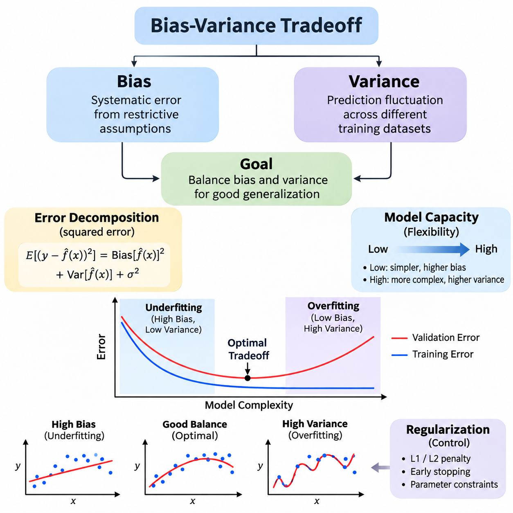
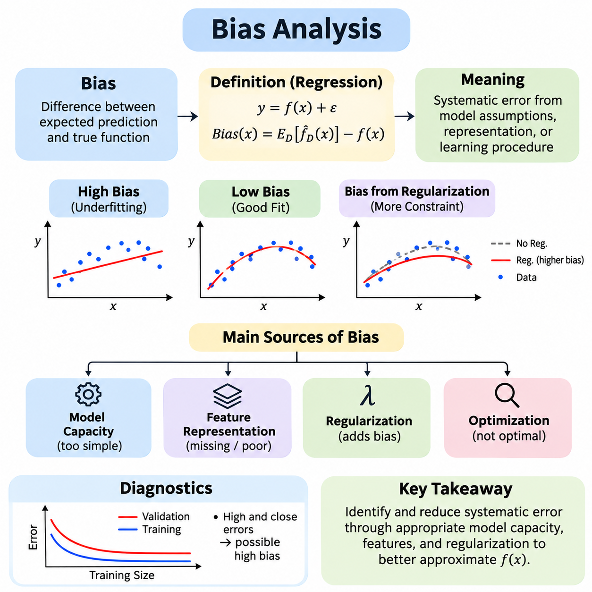
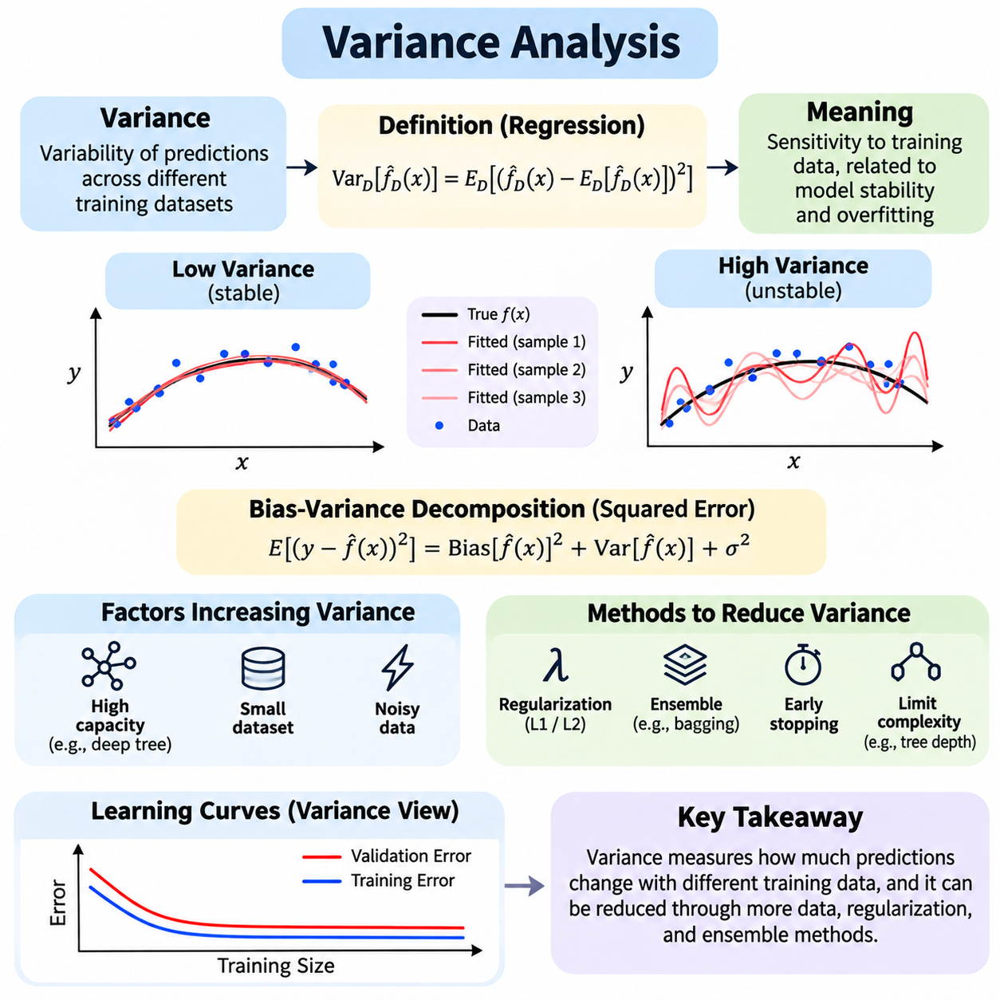
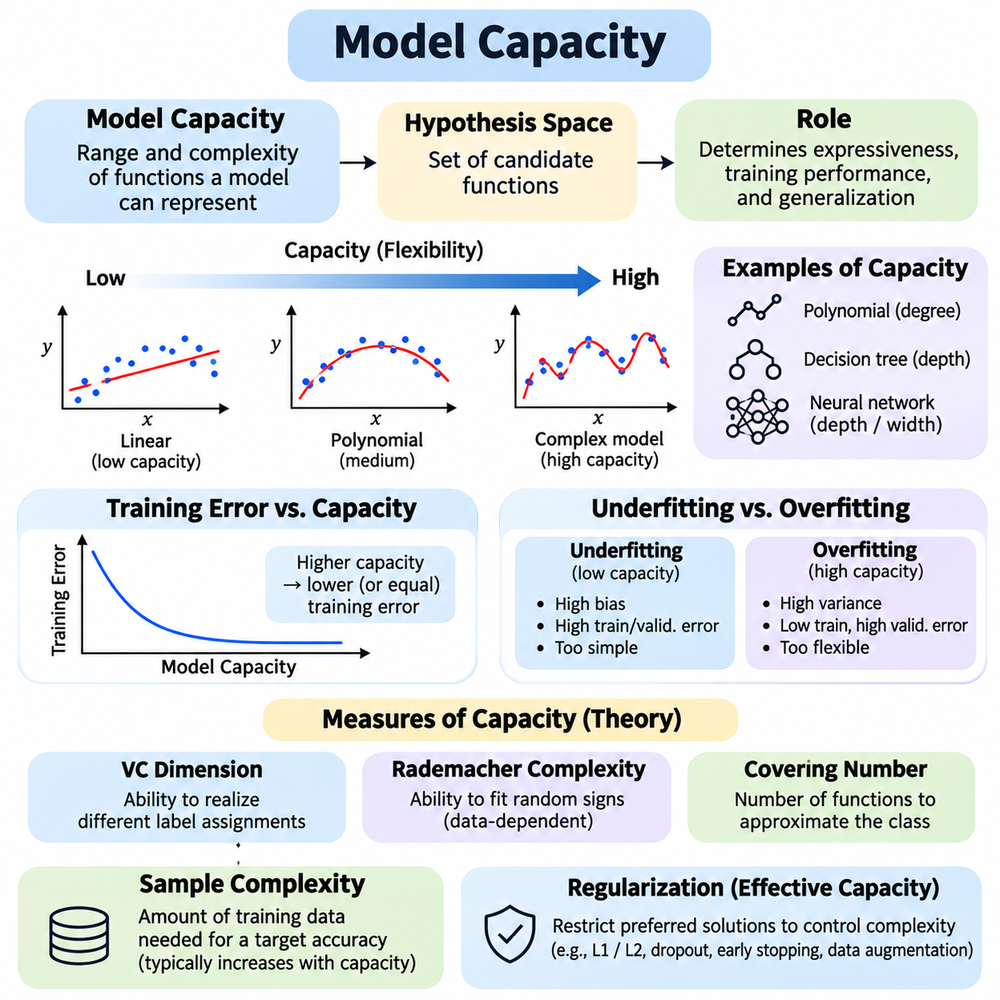
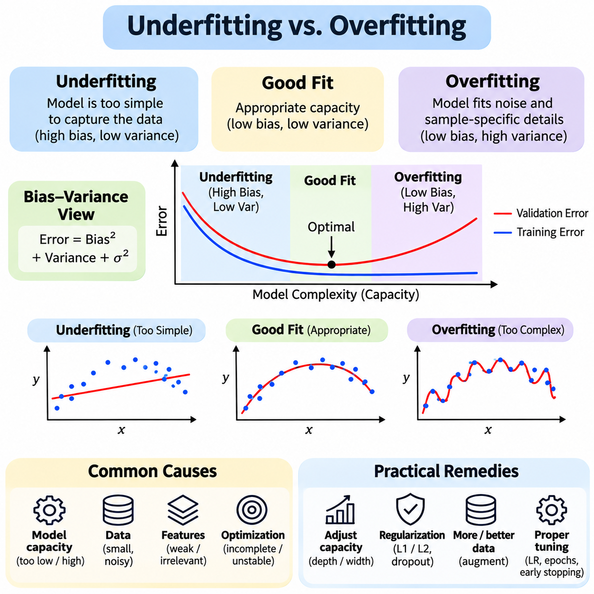
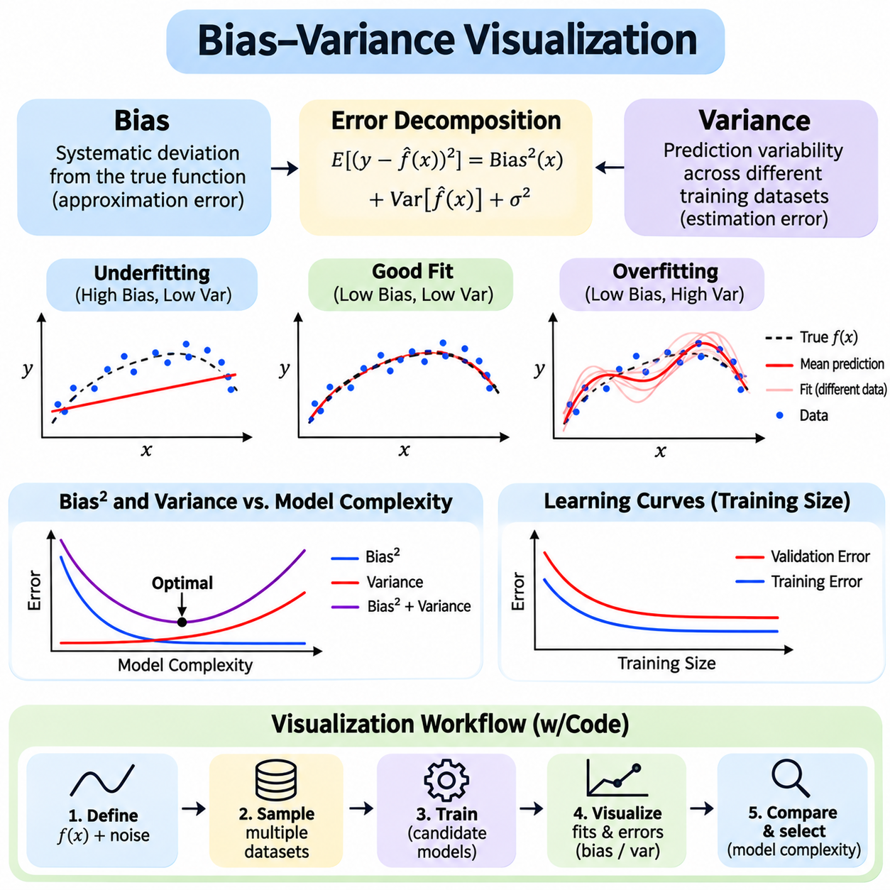
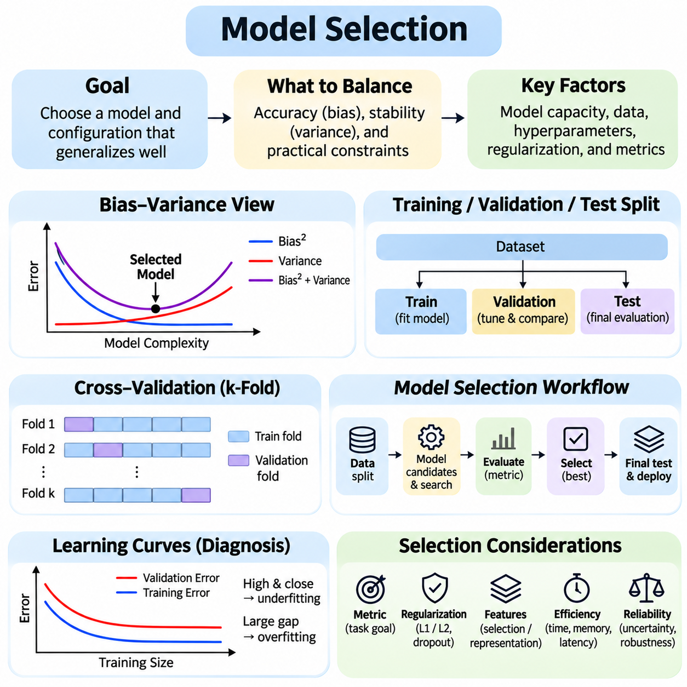
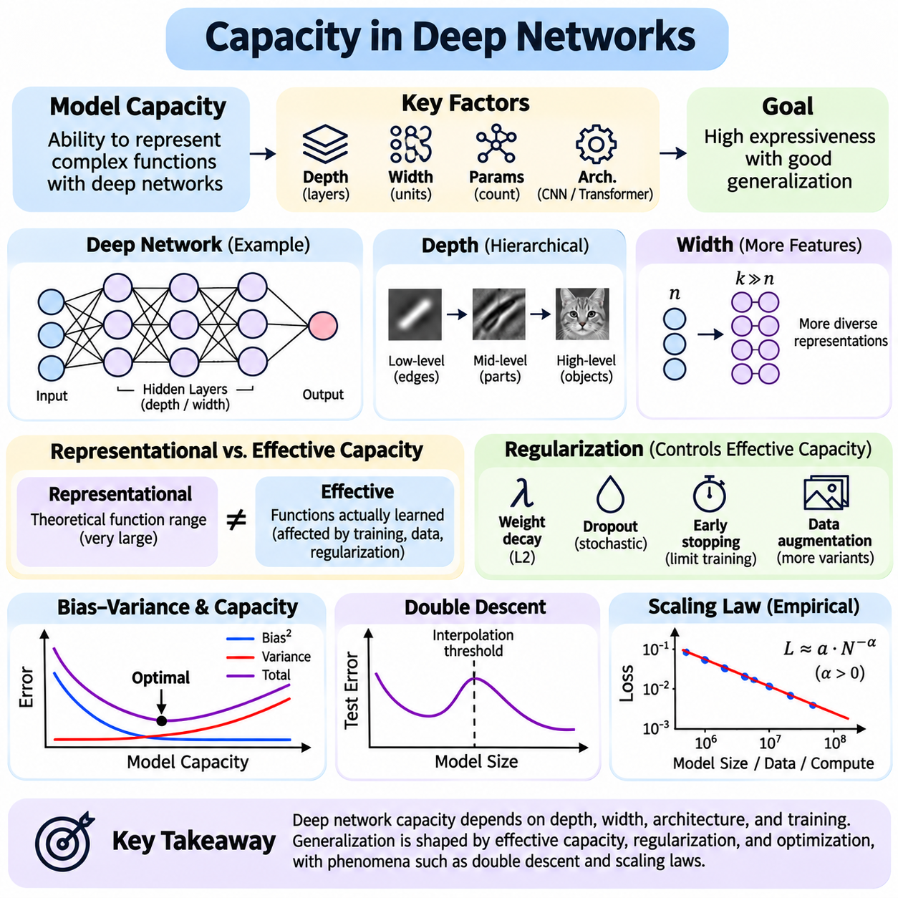
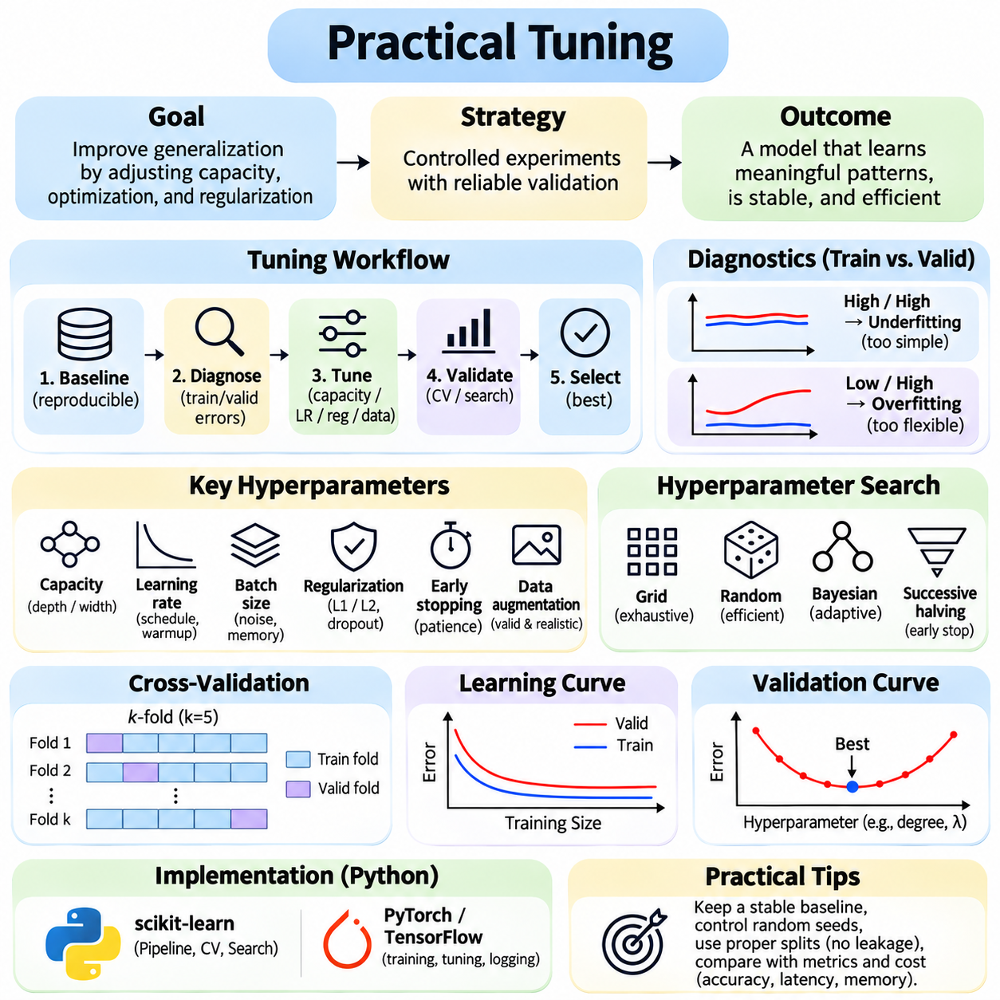

**Volume 06. Optimization and Generalization in ML**


# 05. Bias Variance and Model Capacity

## 05.00 Bias Variance Tradeoff

{width="7.268055555555556in" height="7.268055555555556in"}

The bias-variance tradeoff is a fundamental principle in machine learning that explains how model complexity influences predictive accuracy and generalization. A learning algorithm must identify meaningful patterns from training data while avoiding excessive sensitivity to individual observations. Bias represents systematic prediction errors caused by restrictive assumptions, whereas variance describes fluctuations in predictions across different training datasets.

The central challenge is balancing these two sources of error. Models with strong assumptions often produce stable predictions but may fail to represent complex relationships. Highly flexible models can capture intricate patterns, yet their predictions may change substantially when the training data changes. Effective learning requires sufficient flexibility to represent the underlying relationship without becoming overly dependent on sampling noise.

Consider a supervised regression problem in which observations follow the relationship y = f(x) + ε, where f(x) represents the true underlying function and ε denotes random noise. A learning algorithm estimates a predictive function from a finite training dataset. Because different datasets contain different observations and noise realizations, repeated training can produce different estimates even when the same algorithm and configuration are used.

Under squared-error loss, the expected prediction error at a particular input can be decomposed into squared bias, variance, and irreducible noise. This decomposition provides a mathematical explanation for the tradeoff between systematic approximation errors and sensitivity to training samples. It also clarifies why minimizing training error alone does not necessarily produce the most accurate predictions on previously unseen observations.

The expected squared prediction error can be expressed as E[(y − f̂(x))²] = Bias[f̂(x)]² + Var[f̂(x)] + σ². Here, f̂(x) represents the prediction produced by a model trained on a randomly sampled dataset, and σ² represents the conditional variance of observation noise. This classical decomposition assumes that the noise has zero conditional mean and that its variance is defined at the input being evaluated.

Bias measures the difference between the average prediction across possible training datasets and the true underlying function. A model exhibits high bias when its assumptions prevent it from representing important relationships in the data. For example, fitting a straight line to observations generated by a strongly nonlinear function can produce systematic errors even when the available training dataset is large and representative.

Variance measures how much the learned prediction changes when the training dataset changes. A high-variance model may fit one dataset extremely well while producing noticeably different predictions after training on another sample from the same population. This sensitivity is particularly problematic when datasets are small, noisy, or unrepresentative, because individual observations can exert excessive influence on the learned parameters.

A simple polynomial regression example illustrates the relationship between bias and variance. A first-degree polynomial may be unable to represent a curved relationship, resulting in high bias. Increasing the polynomial degree allows the model to approximate more complicated functions and may reduce bias. However, sufficiently high polynomial degrees can produce unstable predictions, especially near boundaries or in regions containing few observations.

As model flexibility increases, training error generally decreases when models are nested and optimized appropriately. Validation error, however, may initially decrease and subsequently increase because additional flexibility can amplify sensitivity to sampling noise. This familiar behavior motivates the classical bias-variance tradeoff, although modern learning systems do not always follow a simple U-shaped relationship between model complexity and generalization error.

Underfitting occurs when a model cannot adequately capture the structure of the underlying data-generating process. It is commonly associated with high bias and relatively low variance. Both training and validation errors may remain large because the model lacks sufficient representational flexibility. Increasing model capacity, improving feature representations, or reducing excessive regularization can help address this limitation.

Overfitting occurs when a model learns characteristics of the training dataset that do not transfer reliably to unseen observations. It is often associated with high variance, although overfitting cannot always be explained by variance alone. A model may achieve exceptionally low training error while exhibiting substantially worse validation performance because it has captured accidental correlations, measurement noise, or sample-specific irregularities.

Model capacity plays a central role in this relationship because it determines the range of functions that a learning algorithm can represent. Low-capacity models typically impose stronger restrictions on possible solutions, while high-capacity models permit more complex relationships. Nevertheless, representational capacity is not identical to effective learning complexity, which also depends on optimization procedures, regularization, training data, and architectural assumptions.

Regularization provides an important mechanism for controlling the bias-variance balance. Techniques such as L1 and L2 penalties, early stopping, and constraints on model parameters can reduce sensitivity to training observations. Stronger regularization often increases bias while decreasing variance, although the exact effect depends on the learning algorithm. Appropriate regularization can improve generalization by discouraging unnecessarily complicated solutions.

Increasing the amount of representative training data can reduce estimation variance without necessarily requiring a reduction in model capacity. Larger datasets provide more evidence about the underlying relationship and reduce the influence of individual observations. However, additional data cannot automatically eliminate bias caused by an unsuitable model family, missing explanatory variables, incorrect assumptions, or systematic errors in data collection.

Ensemble learning offers another approach to variance reduction. Bagging methods train multiple models using different samples and combine their predictions, reducing variance when prediction errors are not perfectly correlated. Random forests apply this principle to decision trees while introducing additional randomness. Boosting methods can also improve predictive accuracy, although their effects on bias and variance depend on the algorithm and training configuration.

The bias-variance relationship becomes more complicated in deep neural networks. Modern networks frequently contain enough parameters to interpolate training observations while still achieving strong generalization. Architectural inductive biases, stochastic optimization, parameter initialization, implicit regularization, and the geometry of learned solutions influence predictive behavior. Consequently, parameter count alone is insufficient to determine whether a network will generalize successfully.

Double descent further challenges the traditional interpretation of model complexity. In some learning systems, test error initially decreases, increases near an interpolation threshold, and decreases again as capacity grows beyond that threshold. This behavior demonstrates that increasing model capacity does not always lead to monotonically increasing variance or worsening generalization. The observed pattern depends on the data distribution, model family, and training procedure.

In practical model development, the bias-variance tradeoff should be investigated through controlled experiments rather than inferred solely from model size. Training and validation learning curves provide useful diagnostic evidence. Persistently high errors on both datasets may indicate insufficient capacity or inadequate optimization, whereas a substantial generalization gap may suggest excessive sensitivity to the training sample or other sources of distribution mismatch.

Cross-validation helps estimate predictive performance across different partitions of the available data. By repeatedly training and evaluating models on separate subsets, practitioners can assess the stability of performance estimates and compare alternative configurations. However, variation across validation scores is not identical to the formal prediction variance in the bias-variance decomposition, because evaluation samples and training subsets may both change.

Hyperparameter selection should therefore consider predictive accuracy, stability, computational cost, and the reliability of validation results. Model depth, regularization strength, feature selection, learning rate, and training duration can all influence effective model complexity. A carefully designed evaluation process helps distinguish improvements that reflect genuine generalization from apparent gains caused by random sampling or repeated experimentation.

The tradeoff also has important implications for real-world AI systems. In robotics, autonomous navigation, industrial inspection, and predictive maintenance, models must operate under sensor noise, environmental changes, and limited training coverage. Excessive bias may prevent recognition of important operational patterns, while excessive variance may produce unstable predictions. Robust deployment requires evaluating performance across realistic operating conditions.

Ultimately, the bias-variance tradeoff provides a conceptual framework for understanding why learning systems succeed or fail on unseen data. It connects model assumptions, training data, representational flexibility, and statistical uncertainty within a common perspective. Although modern deep learning introduces behaviors beyond the classical framework, understanding bias and variance remains essential for designing reliable models and making informed decisions about model complexity.

편향-분산 상충관계(Bias-Variance Tradeoff)는 모델 복잡도(Model Complexity)가 예측 정확도(Predictive Accuracy)와 일반화(Generalization)에 어떤 영향을 미치는지 설명하는 기계학습(Machine Learning)의 기본 원리이다. 학습 알고리즘(Learning Algorithm)은 개별 관측값에 지나치게 민감해지지 않으면서 훈련 데이터(Training Data)에서 의미 있는 패턴을 찾아야 한다. 편향(Bias)은 제한적인 가정으로 발생하는 체계적인 예측 오차를 의미하며, 분산(Variance)은 서로 다른 훈련 데이터셋에 따른 예측값의 변동을 나타낸다.

핵심 과제는 이러한 두 가지 오차 원인 사이에서 균형을 유지하는 것이다. 강한 가정을 적용하는 모델은 일반적으로 안정적인 예측을 생성하지만 복잡한 관계를 표현하지 못할 수 있다. 반면 유연성이 높은 모델은 정교한 패턴을 포착할 수 있지만 훈련 데이터가 변경되면 예측 결과도 크게 달라질 수 있다. 효과적인 학습을 위해서는 표본 잡음(Sampling Noise)에 지나치게 의존하지 않으면서 실제 데이터의 관계를 표현할 수 있는 충분한 유연성이 필요하다.

관측값이 y = f(x) + ε 관계를 따르는 지도 회귀 문제(Supervised Regression Problem)를 고려할 수 있다. 여기서 f(x)는 실제 기저 함수(True Underlying Function)를 나타내며, ε는 무작위 잡음(Random Noise)을 의미한다. 학습 알고리즘은 유한한 훈련 데이터셋으로부터 예측 함수(Predictive Function)를 추정한다. 서로 다른 데이터셋에는 각기 다른 관측값과 잡음이 포함되므로 동일한 알고리즘과 설정을 사용하더라도 반복 학습을 통해 서로 다른 추정 결과가 생성될 수 있다.

제곱오차 손실(Squared-Error Loss)을 사용하는 경우 특정 입력에서의 기대 예측 오차(Expected Prediction Error)는 편향 제곱(Squared Bias), 분산(Variance), 비가역적 잡음(Irreducible Noise)으로 분해할 수 있다. 이러한 오차 분해(Error Decomposition)는 체계적인 근사 오차(Approximation Error)와 훈련 표본에 대한 민감도 사이의 상충관계를 수학적으로 설명한다. 또한 훈련 오차(Training Error)를 최소화하는 것만으로는 이전에 관측하지 않은 데이터에 대해 가장 정확한 예측을 보장할 수 없는 이유를 보여준다.

기대 제곱 예측 오차(Expected Squared Prediction Error)는 E[(y − f̂(x))²] = Bias[f̂(x)]² + Var[f̂(x)] + σ²로 표현할 수 있다. 여기서 f̂(x)는 무작위로 추출한 데이터셋으로 학습한 모델의 예측값이며, σ²는 관측 잡음의 조건부 분산(Conditional Variance)을 나타낸다. 이러한 고전적 오차 분해(Classical Error Decomposition)는 잡음의 조건부 평균(Conditional Mean)이 0이고 평가 대상 입력에서 잡음 분산이 정의된다는 가정을 전제로 한다.

편향(Bias)은 가능한 여러 훈련 데이터셋에서 얻은 평균 예측값과 실제 기저 함수 사이의 차이를 측정한다. 모델의 가정이 데이터에 존재하는 중요한 관계를 표현하지 못하도록 제한하면 높은 편향(High Bias)이 발생한다. 예를 들어 강한 비선형 함수(Nonlinear Function)로 생성된 관측값에 직선을 적합시키면 훈련 데이터셋이 충분히 크고 대표성을 갖추고 있더라도 체계적인 오차가 발생할 수 있다.

분산(Variance)은 훈련 데이터셋이 변경될 때 학습된 예측값이 얼마나 달라지는지를 측정한다. 고분산 모델(High-Variance Model)은 하나의 데이터셋에 매우 정확하게 적합할 수 있지만 동일한 모집단(Population)에서 추출한 다른 표본으로 학습하면 예측 결과가 크게 달라질 수 있다. 이러한 민감도는 데이터셋이 작거나 잡음이 많거나 대표성이 부족할 때 특히 문제가 된다. 개별 관측값이 학습된 매개변수(Parameters)에 지나치게 큰 영향을 미칠 수 있기 때문이다.

간단한 다항 회귀(Polynomial Regression) 사례를 통해 편향과 분산의 관계를 설명할 수 있다. 일차 다항식(First-Degree Polynomial)은 곡선 형태의 관계를 표현하지 못해 높은 편향을 발생시킬 수 있다. 다항식의 차수를 높이면 더 복잡한 함수를 근사할 수 있으므로 편향이 감소할 수 있다. 그러나 지나치게 높은 차수는 특히 데이터가 적은 영역이나 경계 부근에서 불안정한 예측을 생성할 수 있다.

모델의 유연성이 증가하면 모델들이 중첩 관계(Nested Relationship)를 이루고 적절하게 최적화된 경우 훈련 오차는 일반적으로 감소한다. 그러나 검증 오차(Validation Error)는 처음에는 감소하다가 추가적인 유연성으로 인해 표본 잡음에 대한 민감도가 커지면서 다시 증가할 수 있다. 이러한 현상은 고전적인 편향-분산 상충관계를 설명하지만 현대 학습 시스템(Modern Learning Systems)이 항상 모델 복잡도와 일반화 오차 사이에서 단순한 U자형 관계를 보이는 것은 아니다.

과소적합(Underfitting)은 모델이 실제 데이터 생성 과정(Data-Generating Process)의 구조를 충분히 포착하지 못할 때 발생한다. 일반적으로 높은 편향과 상대적으로 낮은 분산에 관련된다. 모델에 충분한 표현 유연성(Representational Flexibility)이 없기 때문에 훈련 오차와 검증 오차가 모두 높게 유지될 수 있다. 모델 용량(Model Capacity)을 증가시키거나 특징 표현(Feature Representation)을 개선하거나 과도한 정규화(Regularization)를 완화하면 이러한 문제를 개선할 수 있다.

과적합(Overfitting)은 모델이 훈련 데이터셋의 특성을 학습하지만 그 특성이 새로운 관측값으로 안정적으로 전달되지 않을 때 발생한다. 일반적으로 높은 분산과 관련되지만 과적합을 항상 분산만으로 설명할 수 있는 것은 아니다. 모델은 훈련 오차를 매우 낮게 달성하면서도 우연한 상관관계(Accidental Correlation), 측정 잡음(Measurement Noise), 표본별 불규칙성(Sample-Specific Irregularities)을 학습하여 검증 성능이 크게 저하될 수 있다.

모델 용량(Model Capacity)은 학습 알고리즘이 표현할 수 있는 함수의 범위를 결정하므로 이러한 관계에서 핵심적인 역할을 한다. 저용량 모델(Low-Capacity Model)은 가능한 해에 더 강한 제약을 적용하는 반면, 고용량 모델(High-Capacity Model)은 더 복잡한 관계를 표현할 수 있다. 그러나 표현 용량(Representational Capacity)은 유효 학습 복잡도(Effective Learning Complexity)와 동일하지 않다. 유효 학습 복잡도는 최적화 절차, 정규화, 훈련 데이터, 모델 구조의 가정에도 영향을 받는다.

정규화(Regularization)는 편향과 분산의 균형을 제어하는 중요한 방법을 제공한다. L1 및 L2 페널티(Penalty), 조기 종료(Early Stopping), 모델 매개변수 제약(Parameter Constraints) 등의 기법은 훈련 관측값에 대한 민감도를 줄일 수 있다. 강한 정규화는 일반적으로 편향을 증가시키면서 분산을 감소시키지만 구체적인 효과는 학습 알고리즘에 따라 달라진다. 적절한 정규화는 불필요하게 복잡한 해를 억제하여 일반화 성능을 향상시킬 수 있다.

대표성을 갖춘 훈련 데이터의 양을 늘리면 반드시 모델 용량을 줄이지 않더라도 추정 분산(Estimation Variance)을 감소시킬 수 있다. 더 큰 데이터셋은 실제 기저 관계에 대한 더 많은 증거를 제공하며 개별 관측값의 영향을 줄여준다. 그러나 부적절한 모델 계열(Model Family), 누락된 설명 변수(Explanatory Variables), 잘못된 가정, 데이터 수집 과정의 체계적 오류로 발생한 편향은 단순히 데이터를 추가하는 것만으로 자동으로 제거되지 않는다.

앙상블 학습(Ensemble Learning)은 분산을 감소시키는 또 다른 접근법이다. 배깅(Bagging)은 서로 다른 표본으로 여러 모델을 학습한 후 예측 결과를 결합하며, 예측 오차 사이의 상관관계가 완전하지 않을 때 분산을 줄일 수 있다. 랜덤 포레스트(Random Forest)는 결정 트리(Decision Tree)에 추가적인 무작위성을 도입하여 이 원리를 활용한다. 부스팅(Boosting) 역시 예측 정확도를 개선할 수 있지만 편향과 분산에 미치는 영향은 알고리즘과 학습 설정에 따라 달라진다.

심층 신경망(Deep Neural Networks)에서는 편향과 분산의 관계가 더욱 복잡해진다. 현대 신경망은 훈련 관측값을 보간(Interpolation)할 만큼 충분한 매개변수를 가지면서도 우수한 일반화 성능을 달성하는 경우가 많다. 모델 구조의 귀납적 편향(Inductive Bias), 확률적 최적화(Stochastic Optimization), 매개변수 초기화(Parameter Initialization), 암묵적 정규화(Implicit Regularization), 학습된 해의 기하학적 특성(Geometry of Learned Solutions)이 예측 동작에 영향을 미친다. 따라서 매개변수 수만으로 신경망의 일반화 성능을 판단하기는 어렵다.

이중 하강(Double Descent)은 모델 복잡도에 대한 전통적인 해석에 추가적인 도전 과제를 제시한다. 일부 학습 시스템에서는 모델 용량이 증가함에 따라 테스트 오차(Test Error)가 처음에는 감소하고 보간 임계점(Interpolation Threshold) 부근에서 증가한 다음, 임계점을 넘어 용량이 더 커지면 다시 감소한다. 이러한 현상은 모델 용량 증가가 항상 분산 증가나 일반화 성능 악화로 이어지는 것은 아님을 보여준다. 관측되는 패턴은 데이터 분포, 모델 계열, 학습 절차에 따라 달라진다.

실제 모델 개발에서는 모델 크기만으로 편향-분산 상충관계를 추론하기보다 통제된 실험(Controlled Experiments)을 통해 분석해야 한다. 훈련 및 검증 학습 곡선(Learning Curves)은 유용한 진단 근거를 제공한다. 두 데이터셋에서 오차가 지속적으로 높다면 모델 용량 부족이나 불충분한 최적화를 의심할 수 있다. 반면 일반화 격차(Generalization Gap)가 크다면 훈련 표본에 대한 과도한 민감도 또는 데이터 분포 불일치(Distribution Mismatch) 등의 원인을 검토해야 한다.

교차 검증(Cross-Validation)은 사용 가능한 데이터를 서로 다른 부분으로 분할하여 예측 성능을 추정하는 데 도움이 된다. 여러 부분집합(Subset)에서 반복적으로 모델을 학습하고 평가하면 성능 추정의 안정성을 확인하고 다양한 모델 설정을 비교할 수 있다. 그러나 검증 점수의 변동이 편향-분산 분해에서 정의하는 예측 분산(Prediction Variance)과 동일한 것은 아니다. 평가 표본과 훈련 부분집합이 동시에 변경될 수 있기 때문이다.

따라서 초매개변수 선택(Hyperparameter Selection)에서는 예측 정확도, 안정성, 계산 비용(Computational Cost), 검증 결과의 신뢰성을 함께 고려해야 한다. 모델 깊이(Model Depth), 정규화 강도(Regularization Strength), 특징 선택(Feature Selection), 학습률(Learning Rate), 학습 시간(Training Duration)은 모두 유효 모델 복잡도(Effective Model Complexity)에 영향을 줄 수 있다. 신중하게 설계된 평가 과정은 실제 일반화 성능의 개선과 무작위 표본 추출 또는 반복 실험으로 발생한 겉보기 성능 향상을 구분하는 데 도움이 된다.

이러한 상충관계는 실제 인공지능 시스템(Real-World AI Systems)에서도 중요한 의미를 갖는다. 로봇공학(Robotics), 자율주행(Autonomous Navigation), 산업 검사(Industrial Inspection), 예지 정비(Predictive Maintenance) 분야의 모델은 센서 잡음(Sensor Noise), 환경 변화(Environmental Changes), 제한된 훈련 데이터 범위에서 작동해야 한다. 과도한 편향은 중요한 운영 패턴을 인식하지 못하게 만들 수 있으며, 과도한 분산은 불안정한 예측을 발생시킬 수 있다. 안정적인 배포(Deployment)를 위해서는 실제 운영 조건을 반영한 성능 평가가 필요하다.

궁극적으로 편향-분산 상충관계(Bias-Variance Tradeoff)는 학습 시스템이 새로운 데이터에서 성공하거나 실패하는 이유를 이해하기 위한 개념적 틀(Conceptual Framework)을 제공한다. 이는 모델의 가정, 훈련 데이터, 표현 유연성, 통계적 불확실성(Statistical Uncertainty)을 하나의 관점으로 연결한다. 현대 딥러닝(Deep Learning)은 고전적 이론만으로 설명하기 어려운 동작을 보여주지만, 편향과 분산에 대한 이해는 신뢰할 수 있는 모델을 설계하고 모델 복잡도에 관한 합리적인 결정을 내리는 데 여전히 필수적이다.

## 05.01 Bias Analysis

{width="7.268055555555556in" height="7.268055555555556in"}

Bias analysis is an essential component of machine learning evaluation because it examines systematic errors introduced by model assumptions, representation limitations, and learning procedures. Bias describes the difference between the expected prediction of a learning algorithm and the true underlying relationship. Understanding this difference helps practitioners determine whether a model possesses sufficient flexibility to capture meaningful patterns in the data.

In supervised learning, the objective is to approximate an unknown function that maps input variables to target outputs. A learning algorithm constructs an estimated function using a finite training dataset. Since different training samples may produce different fitted models, bias is defined relative to the average prediction across possible datasets. This perspective separates systematic prediction tendencies from fluctuations caused by random sampling.

For a regression problem, assume that the observed target follows y = f(x) + ε, where f(x) represents the true conditional mean and ε is random noise with zero conditional expectation. The bias of an estimator at input x is defined as Bias(x) = E_D[f̂\\_D(x)] − f(x). Here, E_D represents expectation over possible training datasets, while f̂\\_D(x) denotes the prediction obtained from a model trained on dataset D.

This definition emphasizes that bias is a property of the learning procedure under a specified data-generating distribution rather than merely an error observed in one fitted model. A single training experiment cannot directly reveal the expected prediction across all possible datasets. Consequently, practical bias analysis often relies on repeated sampling, simulation experiments, theoretical assumptions, or indirect evidence obtained from training and validation performance.

High bias occurs when a learning algorithm consistently produces predictions that deviate from the true relationship in a similar direction or pattern. This behavior frequently results from restrictive model assumptions, insufficient feature representations, or excessive regularization. A model with high bias may remain inaccurate even when trained on large datasets because additional observations cannot automatically overcome limitations imposed by its hypothesis space.

Consider a dataset generated by a nonlinear relationship between an input variable and a continuous target. If a linear regression model is used without appropriate nonlinear features, its predictions may systematically underestimate values in some regions and overestimate them in others. These errors arise because the selected model family cannot adequately represent the underlying function, illustrating approximation bias caused by limited model capacity.

Model capacity influences bias by determining the complexity of functions that can be represented. Simple models generally impose stronger structural assumptions and may exhibit greater approximation bias when the true relationship is complex. Increasing capacity can reduce this limitation by allowing richer functional relationships. However, greater capacity does not guarantee lower prediction bias because optimization, regularization, and data quality also affect the learned solution.

Feature engineering provides another important perspective on bias. Even a flexible learning algorithm may produce systematically inaccurate predictions when essential explanatory variables are missing or informative relationships are poorly represented. Transformations, interaction terms, nonlinear mappings, and learned embeddings can improve the representation of relevant patterns. Effective feature design therefore reduces certain sources of bias without necessarily requiring a larger model.

Regularization can introduce bias intentionally to improve predictive reliability. L2 regularization discourages large parameter values, while L1 regularization encourages sparse parameter representations. These constraints may shift estimated parameters away from their unregularized values, increasing systematic estimation error. Nevertheless, the resulting reduction in variance can outweigh the additional bias and improve expected prediction performance.

The relationship between bias and training error requires careful interpretation. A model that exhibits high training error may suffer from insufficient capacity, excessive regularization, inappropriate features, or incomplete optimization. However, training error alone does not measure statistical bias directly. High training error can also result from irreducible noise, incorrect labels, unsuitable loss functions, or optimization failures unrelated to approximation limitations.

Learning curves provide practical evidence for identifying potential high-bias behavior. When both training and validation errors remain relatively high and close together, the model may be unable to represent the underlying relationship adequately. Increasing the training dataset may provide limited improvement if the primary limitation is model expressiveness. More flexible architectures, improved features, or weaker regularization may therefore be appropriate experimental adjustments.

Bias analysis should also distinguish approximation error from estimation error. Approximation error arises when the best function available within a model family cannot represent the true relationship sufficiently well. Estimation error occurs because the learning algorithm must infer parameters from finite observations. Although these concepts are related to bias and variance, they are not identical, and estimation procedures may themselves introduce systematic bias.

Optimization bias represents another potential source of systematic deviation. A model may possess sufficient theoretical capacity but fail to reach an appropriate solution because of optimization constraints, limited training duration, or unfavorable initialization. In deep neural networks, the optimization algorithm and training configuration influence which solutions are obtained. Consequently, observed systematic errors cannot always be attributed solely to insufficient representational capacity.

Bias can vary significantly across different regions of the input space. A regression model may provide accurate predictions near densely sampled observations while exhibiting systematic errors in sparsely represented regions. Global evaluation metrics can conceal these local weaknesses because errors in different regions may offset one another. Conditional error analysis and evaluation across meaningful input subsets help reveal such behavior.

In classification tasks, bias analysis requires additional care because predictions may be discrete labels or estimated class probabilities. Systematic errors can arise from inappropriate decision boundaries, limited feature representations, or incorrect probability estimates. Classification performance should therefore be examined using suitable loss functions, calibration analysis, and class-specific evaluation rather than directly applying regression-based bias formulas to every classification metric.

The distinction between statistical bias and algorithmic fairness is particularly important. Statistical bias describes systematic deviation of an estimator from a defined target, whereas fairness-related bias concerns differences in outcomes or errors across populations. These concepts may interact but are not interchangeable. A statistically well-calibrated model can still exhibit undesirable group-level performance disparities, requiring separate evaluation criteria.

Simulation provides a useful method for studying bias when the true generating function is known. Researchers can generate multiple training datasets from the same distribution, train identical models independently, and average their predictions at selected inputs. Comparing these averages with the known function provides an empirical estimate of prediction bias. Repeated experiments also help distinguish systematic errors from random variations between fitted models.

For example, suppose observations are generated from a quadratic function with additive Gaussian noise. A linear model may consistently fail to reproduce the curvature, producing substantial bias across repeated training samples. A quadratic model can represent the generating relationship more accurately when fitted appropriately. A higher-degree polynomial may offer additional flexibility, but its increased complexity can introduce greater prediction variability.

Deep learning introduces additional considerations because highly overparameterized networks can exhibit low training error and strong generalization despite enormous representational capacity. Architectural inductive biases, data augmentation, optimization dynamics, and implicit regularization influence the functions these networks learn. Therefore, analyzing bias in deep networks requires attention to the complete training procedure rather than treating parameter count as a direct measure of bias.

Dataset characteristics also influence the interpretation of systematic prediction errors. Missing variables, measurement errors, label inconsistencies, and unrepresentative sampling can produce persistent prediction patterns that resemble model bias. Distribution shifts between training and deployment environments may introduce additional systematic deviations. Reliable analysis must therefore examine both model assumptions and the quality and representativeness of the available data.

Practical bias reduction begins with diagnosing the source of systematic error. If the model is too restrictive, increasing capacity or introducing nonlinear features may help. If excessive regularization is responsible, reducing its strength may improve fit. When optimization is incomplete, adjusting learning schedules or training duration may be more effective. Each intervention should be evaluated against independent validation data to detect unintended increases in variance.

Ultimately, bias analysis provides a structured approach to understanding systematic limitations in machine learning models. It connects mathematical expectations, model assumptions, feature representations, optimization behavior, and empirical evaluation. By identifying where and why predictions consistently deviate from the underlying relationship, practitioners can select targeted improvements while preserving the broader objective of reliable generalization to unseen data.

편향 분석(Bias Analysis)은 모델의 가정(Model Assumptions), 표현 능력의 한계(Representation Limitations), 학습 절차(Learning Procedures)에서 발생하는 체계적인 오차(Systematic Errors)를 조사하므로 기계학습 평가(Machine Learning Evaluation)의 핵심 요소이다. 편향(Bias)은 학습 알고리즘(Learning Algorithm)의 기대 예측값(Expected Prediction)과 실제 기저 관계(True Underlying Relationship) 사이의 차이를 나타낸다. 이러한 차이를 이해하면 모델이 데이터의 의미 있는 패턴을 포착할 만큼 충분한 유연성을 갖추고 있는지 판단할 수 있다.

지도학습(Supervised Learning)의 목적은 입력 변수(Input Variables)를 목표 출력(Target Outputs)에 대응시키는 알려지지 않은 함수(Unknown Function)를 근사하는 것이다. 학습 알고리즘은 유한한 훈련 데이터셋(Training Dataset)을 사용하여 추정 함수(Estimated Function)를 구성한다. 서로 다른 훈련 표본(Training Samples)이 서로 다른 적합 모델(Fitted Models)을 생성할 수 있으므로 편향은 가능한 여러 데이터셋에서 얻은 평균 예측값을 기준으로 정의된다. 이러한 관점은 체계적인 예측 경향을 무작위 표본 추출(Random Sampling)로 발생하는 변동과 구분한다.

회귀 문제(Regression Problem)에서 관측된 목표값이 y = f(x) + ε을 따른다고 가정한다. 여기서 f(x)는 실제 조건부 평균(True Conditional Mean)을 나타내며, ε는 조건부 기댓값(Conditional Expectation)이 0인 무작위 잡음(Random Noise)이다. 입력 x에서 추정량(Estimator)의 편향은 Bias(x) = E_D[f̂\\_D(x)] − f(x)로 정의된다. 여기서 E_D는 가능한 훈련 데이터셋에 대한 기댓값을 나타내며, f̂\\_D(x)는 데이터셋 D로 학습한 모델의 예측값을 의미한다.

이러한 정의는 편향이 단일 적합 모델에서 관측된 단순한 오차가 아니라 특정 데이터 생성 분포(Data-Generating Distribution)에서 학습 절차가 갖는 특성임을 강조한다. 단일 훈련 실험만으로는 가능한 모든 데이터셋에 대한 기대 예측값을 직접 확인할 수 없다. 따라서 실제 편향 분석에서는 반복 표본 추출(Repeated Sampling), 시뮬레이션 실험(Simulation Experiments), 이론적 가정(Theoretical Assumptions), 훈련 및 검증 성능(Training and Validation Performance)에서 얻은 간접적인 증거를 활용한다.

높은 편향(High Bias)은 학습 알고리즘이 실제 관계에서 유사한 방향이나 패턴으로 지속적으로 벗어나는 예측을 생성할 때 발생한다. 이러한 현상은 제한적인 모델 가정(Restrictive Model Assumptions), 불충분한 특징 표현(Feature Representations), 과도한 정규화(Excessive Regularization)에서 자주 나타난다. 높은 편향을 가진 모델은 대규모 데이터셋으로 학습하더라도 부정확한 상태로 남을 수 있다. 추가 관측값만으로는 가설 공간(Hypothesis Space)에 부과된 제약을 자동으로 극복할 수 없기 때문이다.

입력 변수와 연속형 목표값(Continuous Target) 사이에 비선형 관계(Nonlinear Relationship)가 존재하는 데이터셋을 고려할 수 있다. 적절한 비선형 특징(Nonlinear Features) 없이 선형 회귀 모델(Linear Regression Model)을 사용하면 일부 영역에서는 값을 체계적으로 과소추정(Underestimation)하고 다른 영역에서는 과대추정(Overestimation)할 수 있다. 이러한 오차는 선택한 모델 계열(Model Family)이 실제 기저 함수(Underlying Function)를 충분히 표현하지 못하기 때문에 발생하며, 제한된 모델 용량(Model Capacity)으로 인한 근사 편향(Approximation Bias)을 보여준다.

모델 용량(Model Capacity)은 표현할 수 있는 함수의 복잡도를 결정하므로 편향에 영향을 미친다. 단순한 모델(Simple Models)은 일반적으로 더 강한 구조적 가정(Structural Assumptions)을 적용하며 실제 관계가 복잡할 때 더 큰 근사 편향을 나타낼 수 있다. 모델 용량을 증가시키면 더 풍부한 함수 관계(Functional Relationships)를 표현할 수 있으므로 이러한 한계를 줄일 수 있다. 그러나 최적화(Optimization), 정규화(Regularization), 데이터 품질(Data Quality)도 학습 결과에 영향을 미치기 때문에 용량 증가가 반드시 예측 편향의 감소를 보장하지는 않는다.

특징 공학(Feature Engineering)은 편향을 이해하는 또 다른 중요한 관점을 제공한다. 유연한 학습 알고리즘을 사용하더라도 필수적인 설명 변수(Explanatory Variables)가 누락되거나 유용한 관계가 제대로 표현되지 않으면 체계적으로 부정확한 예측이 발생할 수 있다. 특징 변환(Feature Transformations), 상호작용 항(Interaction Terms), 비선형 매핑(Nonlinear Mappings), 학습된 임베딩(Learned Embeddings)은 관련 패턴의 표현을 개선할 수 있다. 따라서 효과적인 특징 설계는 반드시 더 큰 모델을 사용하지 않더라도 특정 편향 원인을 줄일 수 있다.

정규화(Regularization)는 예측 신뢰성(Predictive Reliability)을 개선하기 위해 의도적으로 편향을 도입할 수 있다. L2 정규화(L2 Regularization)는 큰 매개변수 값(Parameter Values)을 억제하며, L1 정규화(L1 Regularization)는 희소한 매개변수 표현(Sparse Parameter Representations)을 유도한다. 이러한 제약은 추정된 매개변수를 정규화하지 않은 값에서 벗어나게 하여 체계적인 추정 오차(Systematic Estimation Error)를 증가시킬 수 있다. 그러나 분산 감소(Variance Reduction)의 효과가 추가적인 편향보다 크다면 기대 예측 성능(Expected Prediction Performance)이 향상될 수 있다.

편향과 훈련 오차(Training Error)의 관계는 신중하게 해석해야 한다. 훈련 오차가 높은 모델은 불충분한 모델 용량(Insufficient Model Capacity), 과도한 정규화, 부적절한 특징(Inappropriate Features), 불완전한 최적화(Incomplete Optimization)의 영향을 받을 수 있다. 그러나 훈련 오차 자체가 통계적 편향(Statistical Bias)을 직접 측정하는 것은 아니다. 높은 훈련 오차는 비가역적 잡음(Irreducible Noise), 잘못된 레이블(Incorrect Labels), 부적절한 손실 함수(Unsuitable Loss Functions), 근사 능력의 한계와 무관한 최적화 실패(Optimization Failures)에서도 발생할 수 있다.

학습 곡선(Learning Curves)은 높은 편향이 존재할 가능성을 식별하는 실용적인 근거를 제공한다. 훈련 오차와 검증 오차(Validation Error)가 모두 상대적으로 높고 서로 비슷한 수준을 유지한다면 모델이 실제 기저 관계를 충분히 표현하지 못할 수 있다. 주요 문제가 모델의 표현 능력(Model Expressiveness)에 있다면 훈련 데이터셋을 증가시키더라도 개선 효과는 제한적일 수 있다. 따라서 더 유연한 모델 구조(Flexible Architectures), 개선된 특징 표현, 약한 정규화(Weaker Regularization)를 실험적으로 검토할 수 있다.

편향 분석에서는 근사 오차(Approximation Error)와 추정 오차(Estimation Error)를 구분해야 한다. 근사 오차는 모델 계열에서 선택할 수 있는 최적의 함수조차 실제 관계를 충분히 표현하지 못할 때 발생한다. 추정 오차는 학습 알고리즘이 유한한 관측값으로부터 매개변수를 추론해야 하기 때문에 발생한다. 이러한 개념은 편향 및 분산(Variance)과 관련되어 있지만 완전히 동일하지 않으며, 추정 절차(Estimation Procedures) 자체가 체계적인 편향을 도입할 수도 있다.

최적화 편향(Optimization Bias)은 체계적인 편차(Systematic Deviation)를 발생시키는 또 다른 원인이다. 모델이 이론적으로 충분한 용량을 갖추고 있더라도 최적화 제약(Optimization Constraints), 제한된 훈련 시간(Limited Training Duration), 불리한 초기화(Unfavorable Initialization)로 인해 적절한 해에 도달하지 못할 수 있다. 심층 신경망(Deep Neural Networks)에서는 최적화 알고리즘과 학습 설정(Training Configuration)이 어떤 해를 얻는지에 영향을 미친다. 따라서 관측된 체계적 오차를 항상 표현 용량 부족만으로 설명할 수는 없다.

편향은 입력 공간(Input Space)의 영역에 따라 크게 달라질 수 있다. 회귀 모델은 관측값이 밀집된 영역에서는 정확한 예측을 제공하면서 표본이 부족한 영역에서는 체계적인 오차를 나타낼 수 있다. 전역 평가 지표(Global Evaluation Metrics)는 서로 다른 영역의 오차가 상쇄될 수 있기 때문에 이러한 국소적인 약점(Local Weaknesses)을 감출 수 있다. 조건부 오차 분석(Conditional Error Analysis)과 의미 있는 입력 부분집합(Input Subsets)에 대한 평가는 이러한 현상을 식별하는 데 도움이 된다.

분류 작업(Classification Tasks)에서는 예측 결과가 이산 레이블(Discrete Labels) 또는 추정된 클래스 확률(Estimated Class Probabilities)일 수 있으므로 편향 분석에 추가적인 주의가 필요하다. 부적절한 결정 경계(Decision Boundaries), 제한된 특징 표현, 잘못된 확률 추정(Probability Estimates)으로 인해 체계적인 오차가 발생할 수 있다. 따라서 모든 분류 지표에 회귀 기반 편향 공식(Regression-Based Bias Formulas)을 직접 적용하기보다는 적절한 손실 함수(Loss Functions), 보정 분석(Calibration Analysis), 클래스별 평가(Class-Specific Evaluation)를 활용해야 한다.

통계적 편향(Statistical Bias)과 알고리즘 공정성(Algorithmic Fairness)의 차이를 이해하는 것도 중요하다. 통계적 편향은 정의된 목표값에서 추정량이 체계적으로 벗어나는 현상을 의미하는 반면, 공정성과 관련된 편향(Fairness-Related Bias)은 집단 간 결과나 오차의 차이를 다룬다. 두 개념은 상호작용할 수 있지만 동일하지 않다. 통계적으로 잘 보정된 모델(Well-Calibrated Model)이라도 집단별 성능 격차(Group-Level Performance Disparities)가 바람직하지 않게 나타날 수 있으므로 별도의 평가 기준(Evaluation Criteria)이 필요하다.

시뮬레이션(Simulation)은 실제 생성 함수(True Generating Function)가 알려진 경우 편향을 연구하는 유용한 방법이다. 연구자는 동일한 분포에서 여러 훈련 데이터셋을 생성하고 동일한 모델을 독립적으로 학습한 후 선택한 입력에서 예측값의 평균을 계산할 수 있다. 이 평균을 알려진 함수와 비교하면 예측 편향(Prediction Bias)을 경험적으로 추정할 수 있다. 반복 실험(Repeated Experiments)은 적합 모델 간 무작위 변동(Random Variations)과 체계적인 오차를 구분하는 데에도 도움이 된다.

예를 들어 관측값이 가산 가우시안 잡음(Additive Gaussian Noise)을 포함한 이차 함수(Quadratic Function)에서 생성된다고 가정할 수 있다. 선형 모델(Linear Model)은 반복적으로 훈련하더라도 곡률(Curvature)을 재현하지 못해 상당한 편향을 발생시킬 수 있다. 이차 모델(Quadratic Model)은 적절하게 적합되면 실제 생성 관계를 더 정확하게 표현할 수 있다. 고차 다항식(Higher-Degree Polynomial)은 추가적인 유연성을 제공하지만 복잡도 증가로 인해 예측 변동성(Prediction Variability)이 커질 수 있다.

딥러닝(Deep Learning)에서는 매우 많은 매개변수를 가진 과매개변수화 신경망(Overparameterized Networks)이 낮은 훈련 오차와 우수한 일반화 성능(Generalization Performance)을 동시에 달성할 수 있으므로 추가적인 고려가 필요하다. 모델 구조의 귀납적 편향(Architectural Inductive Biases), 데이터 증강(Data Augmentation), 최적화 동역학(Optimization Dynamics), 암묵적 정규화(Implicit Regularization)는 신경망이 학습하는 함수에 영향을 미친다. 따라서 심층 신경망의 편향 분석에서는 매개변수 수를 편향의 직접적인 척도로 간주하기보다 전체 학습 절차를 검토해야 한다.

데이터셋의 특성(Dataset Characteristics)도 체계적인 예측 오차를 해석하는 데 영향을 미친다. 누락된 변수(Missing Variables), 측정 오차(Measurement Errors), 레이블 불일치(Label Inconsistencies), 대표성이 부족한 표본 추출(Unrepresentative Sampling)은 모델 편향과 유사한 지속적인 예측 패턴을 생성할 수 있다. 훈련 환경과 배포 환경 사이의 분포 이동(Distribution Shift)은 추가적인 체계적 편차를 발생시킬 수 있다. 따라서 신뢰할 수 있는 분석을 위해서는 모델 가정뿐 아니라 사용 가능한 데이터의 품질과 대표성(Representativeness)도 검토해야 한다.

실용적인 편향 감소(Bias Reduction)는 체계적인 오차의 원인을 진단하는 것에서 시작한다. 모델이 지나치게 제한적이라면 용량을 증가시키거나 비선형 특징을 도입하는 것이 도움이 될 수 있다. 과도한 정규화가 원인이라면 정규화 강도를 낮추어 적합 성능을 개선할 수 있다. 최적화가 불완전한 경우에는 학습 일정(Learning Schedules)이나 훈련 시간(Training Duration)을 조정하는 것이 더 효과적일 수 있다. 각 개선 방법은 의도하지 않은 분산 증가를 확인할 수 있도록 독립적인 검증 데이터(Independent Validation Data)를 사용하여 평가해야 한다.

궁극적으로 편향 분석(Bias Analysis)은 기계학습 모델의 체계적인 한계(Systematic Limitations)를 이해하기 위한 구조화된 접근법(Structured Approach)을 제공한다. 이는 수학적 기댓값(Mathematical Expectations), 모델 가정(Model Assumptions), 특징 표현(Feature Representations), 최적화 동작(Optimization Behavior), 경험적 평가(Empirical Evaluation)를 연결한다. 예측값이 실제 기저 관계에서 지속적으로 벗어나는 위치와 원인을 식별하면 새로운 데이터에 대한 신뢰할 수 있는 일반화(Reliable Generalization)라는 전체 목표를 유지하면서 필요한 개선 방법을 선택할 수 있다.

## 05.02 Variance Analysis

{width="7.268055555555556in" height="7.268055555555556in"}

Variance analysis is a fundamental component of machine learning because it examines how sensitive a trained model is to changes in its training dataset. Variance describes the variability of predictions produced by a learning algorithm when trained on different samples drawn from the same underlying distribution. Understanding this behavior is essential for evaluating model stability, identifying overfitting, and improving generalization to unseen observations.

In supervised learning, a model is constructed from a finite collection of input-output observations. Different training datasets contain different samples, even when they originate from the same population. Consequently, repeated applications of an identical learning algorithm can produce different parameter estimates and predictions. Variance analysis quantifies these differences and reveals how strongly the learning procedure depends on the particular observations used during training.

For a regression problem, let f̂\\_D(x) represent the prediction at input x obtained by training a model on dataset D. Prediction variance is defined as Var_D[f̂\\_D(x)] = E_D[(f̂\\_D(x) − E_D[f̂\\_D(x)])²]. The expectation is taken over possible training datasets sampled from the same distribution. This expression measures the expected squared deviation of individual model predictions from their average prediction at a fixed input.

High variance indicates that relatively small changes in the training dataset can produce substantial changes in model predictions. Such sensitivity commonly occurs in highly flexible models trained on limited or noisy data. Although these models may achieve low training error, their predictions can become unstable when evaluated on new samples. This instability contributes to generalization error and frequently appears alongside overfitting.

Low variance indicates that predictions remain relatively consistent across different training datasets. Models with strong structural assumptions or substantial regularization often exhibit this behavior. However, prediction stability does not necessarily imply predictive accuracy. A model may consistently produce incorrect predictions if its assumptions are too restrictive, illustrating why variance must be considered together with bias when evaluating learning performance.

The classical bias-variance decomposition provides a mathematical framework for understanding prediction variance. Under squared-error loss and zero-mean observation noise, expected prediction error consists of squared bias, prediction variance, and irreducible noise. Variance represents the component associated with uncertainty in the fitted model caused by random training samples. Reducing this component can improve expected generalization performance when other error components remain controlled.

Model capacity strongly influences variance because flexible hypothesis spaces permit many possible fitted functions. High-degree polynomial regression, deep decision trees, and certain highly parameterized models can respond strongly to individual training observations. Increasing capacity may reduce approximation bias while increasing estimation sensitivity. Nevertheless, the relationship is not universally monotonic, particularly in modern overparameterized learning systems.

Consider polynomial regression applied to observations generated from a smooth nonlinear function. A low-degree polynomial may produce similar predictions across repeated training samples because its limited flexibility restricts possible fitted curves. A high-degree polynomial may fit each dataset closely but generate substantially different curves between observations. This behavior becomes especially pronounced when the training dataset contains few samples or substantial measurement noise.

Decision trees provide another intuitive example of prediction variance. Small changes in training observations can alter splitting decisions, potentially producing different tree structures and predictions. Deep trees are particularly sensitive because successive partitions may depend on relatively few samples. Restricting tree depth, requiring larger leaf populations, or combining multiple trees can reduce instability while preserving useful nonlinear modeling capabilities.

Training dataset size is a major determinant of estimation variance. When only a small number of observations are available, individual samples may exert considerable influence on learned parameters. Increasing the number of independent and representative observations generally improves estimation stability. However, the magnitude of improvement depends on model structure, data dimensionality, noise characteristics, and the statistical properties of the learning algorithm.

Data quality also affects variance because noisy measurements and inconsistent labels introduce uncertainty into parameter estimation. A flexible model may adapt to accidental fluctuations rather than stable relationships. Improving measurement reliability, removing erroneous records, and establishing consistent labeling procedures can reduce unnecessary sensitivity. Nevertheless, eliminating noise completely is rarely possible, and some uncertainty remains inherent in finite-sample learning.

Regularization is an important mechanism for controlling prediction variance. L2 regularization discourages excessively large parameter values, while L1 regularization can produce sparse representations. Early stopping limits the extent to which iterative training adapts to individual observations. These techniques often reduce sensitivity to sampling fluctuations, although stronger regularization may introduce additional bias and does not guarantee variance reduction in every setting.

Ensemble learning provides a direct strategy for reducing variance through prediction aggregation. Bagging trains multiple models on bootstrap samples and combines their outputs. Averaging can reduce prediction variance when individual model errors are not perfectly correlated. Random forests extend this approach by introducing randomness into feature selection, helping reduce correlations among trees and improving stability compared with individual high-variance decision trees.

The effectiveness of ensemble averaging depends on the correlation structure of prediction errors. If individual estimators have equal variance σ² and pairwise correlation ρ, the variance of their average is σ²[ρ + (1 − ρ)/M], where M denotes the number of estimators. This relationship shows that increasing ensemble size reduces the uncorrelated component of variance, while correlated errors impose a limit on the achievable improvement.

Bootstrap resampling provides a practical method for investigating model variability. Multiple datasets are generated by sampling observations with replacement from the original training dataset. The same learning procedure is applied to each resampled dataset, producing a collection of fitted models. Variation among their predictions can provide an empirical approximation of sampling sensitivity, although bootstrap estimates depend on assumptions about the original sample.

Cross-validation also provides information about model stability, but its interpretation requires care. Performance differences across folds may reflect changes in training samples, evaluation samples, or both. Consequently, the variance of cross-validation scores is not identical to prediction variance in the classical bias-variance decomposition. Repeated cross-validation can nevertheless help assess the robustness of performance estimates and identify unstable model configurations.

Variance analysis can be performed locally across the input space rather than relying exclusively on aggregate statistics. Predictions may remain stable in densely sampled regions while exhibiting substantial variability near boundaries or in sparsely represented areas. Evaluating prediction distributions at selected inputs helps identify these weaknesses. Such analysis is particularly valuable when reliability requirements differ across operating conditions.

In classification problems, prediction variance may be examined through changes in estimated class probabilities, decision boundaries, or predicted labels. Models trained on different samples may assign substantially different probabilities to the same observation. However, discrete classification outputs do not directly follow the same squared-error decomposition used in regression. Appropriate analysis should distinguish probability variability from classification error and calibration quality.

Deep neural networks introduce additional complexity into variance analysis. Their predictions depend on training data, parameter initialization, stochastic optimization, regularization, and architectural design. Variability across random seeds may reflect optimization randomness rather than training-sample variance alone. Separating these sources requires controlled experiments in which dataset sampling and training randomness are varied independently.

Modern overparameterized networks can sometimes achieve strong generalization despite possessing extremely large representational capacity. Phenomena such as double descent demonstrate that prediction variance and test error do not always increase monotonically with model size. Implicit regularization, learned representations, and optimization dynamics influence effective complexity. Therefore, parameter count alone is insufficient for assessing variance in contemporary deep learning systems.

In industrial AI and robotics, prediction variance has direct implications for operational reliability. Models used for visual inspection, sensor fusion, localization, and predictive maintenance must provide consistent behavior under realistic environmental variation. Excessive sensitivity to training samples can produce unstable decisions and unreliable confidence estimates. Variance analysis helps engineers identify vulnerable operating regions and evaluate the benefits of additional data or regularization.

Ultimately, variance analysis provides a systematic framework for understanding model instability and sampling uncertainty. It connects statistical estimation, model capacity, dataset characteristics, regularization, ensemble methods, and empirical evaluation. By measuring how predictions change across plausible training datasets, practitioners can develop models that maintain reliable performance beyond the observations used during training.

분산 분석(Variance Analysis)은 훈련된 모델(Trained Model)이 훈련 데이터셋(Training Dataset)의 변화에 얼마나 민감하게 반응하는지를 조사하므로 기계학습(Machine Learning)의 핵심 요소이다. 분산(Variance)은 동일한 기저 분포(Underlying Distribution)에서 추출한 서로 다른 표본으로 학습했을 때 학습 알고리즘(Learning Algorithm)이 생성하는 예측값의 변동성을 나타낸다. 이러한 특성을 이해하는 것은 모델 안정성(Model Stability)을 평가하고 과적합(Overfitting)을 식별하며 새로운 관측값에 대한 일반화(Generalization)를 개선하는 데 필수적이다.

지도학습(Supervised Learning)에서는 유한한 입력-출력 관측값(Input-Output Observations)으로부터 모델을 구성한다. 서로 다른 훈련 데이터셋은 동일한 모집단(Population)에서 생성되더라도 서로 다른 표본을 포함한다. 따라서 동일한 학습 알고리즘을 반복적으로 적용하면 서로 다른 매개변수 추정값(Parameter Estimates)과 예측값이 생성될 수 있다. 분산 분석은 이러한 차이를 정량화하고 학습 절차(Learning Procedure)가 훈련에 사용된 특정 관측값에 얼마나 크게 의존하는지를 보여준다.

회귀 문제(Regression Problem)에서 f̂\\_D(x)는 데이터셋 D로 모델을 학습했을 때 입력 x에서 얻는 예측값을 나타낸다고 가정한다. 예측 분산(Prediction Variance)은 Var_D[f̂\\_D(x)] = E_D[(f̂\\_D(x) − E_D[f̂\\_D(x)])²]로 정의된다. 여기서 기댓값(Expectation)은 동일한 분포에서 추출할 수 있는 가능한 훈련 데이터셋 전체에 대해 계산된다. 이 식은 고정된 입력에서 개별 모델의 예측값이 평균 예측값으로부터 벗어나는 정도를 제곱하여 기댓값으로 나타낸 것이다.

높은 분산(High Variance)은 훈련 데이터셋의 비교적 작은 변화가 모델 예측에 상당한 변화를 일으킬 수 있음을 의미한다. 이러한 민감도는 제한적이거나 잡음이 많은 데이터로 학습한 유연성이 높은 모델(Highly Flexible Models)에서 흔히 발생한다. 이러한 모델은 낮은 훈련 오차(Training Error)를 달성할 수 있지만 새로운 표본에서 평가하면 예측이 불안정해질 수 있다. 이러한 불안정성은 일반화 오차(Generalization Error)에 영향을 미치며 과적합과 함께 나타나는 경우가 많다.

낮은 분산(Low Variance)은 서로 다른 훈련 데이터셋에서도 예측값이 상대적으로 일관되게 유지됨을 의미한다. 강한 구조적 가정(Structural Assumptions)을 적용하거나 상당한 정규화(Regularization)를 사용하는 모델에서 이러한 특성이 자주 나타난다. 그러나 예측 안정성(Prediction Stability)이 반드시 예측 정확도(Predictive Accuracy)를 의미하지는 않는다. 모델의 가정이 지나치게 제한적이면 일관되게 잘못된 예측을 생성할 수 있으므로 학습 성능을 평가할 때 분산과 편향(Bias)을 함께 고려해야 한다.

고전적인 편향-분산 분해(Bias-Variance Decomposition)는 예측 분산을 이해하기 위한 수학적 체계(Mathematical Framework)를 제공한다. 제곱오차 손실(Squared-Error Loss)과 평균이 0인 관측 잡음(Zero-Mean Observation Noise)을 가정하면 기대 예측 오차(Expected Prediction Error)는 편향 제곱(Squared Bias), 예측 분산(Prediction Variance), 비가역적 잡음(Irreducible Noise)으로 구성된다. 분산은 무작위 훈련 표본으로 인해 적합된 모델에 발생하는 불확실성(Uncertainty)을 나타내며, 다른 오차 요소를 적절히 제어하면서 이를 줄이면 기대 일반화 성능(Expected Generalization Performance)을 개선할 수 있다.

모델 용량(Model Capacity)은 유연한 가설 공간(Hypothesis Space)이 다양한 적합 함수(Fitted Functions)를 허용하므로 분산에 큰 영향을 미친다. 고차 다항 회귀(High-Degree Polynomial Regression), 깊은 결정 트리(Deep Decision Trees), 일부 고매개변수 모델(Highly Parameterized Models)은 개별 훈련 관측값에 민감하게 반응할 수 있다. 모델 용량을 증가시키면 근사 편향(Approximation Bias)은 감소하는 반면 추정 민감도(Estimation Sensitivity)는 증가할 수 있다. 그러나 이러한 관계가 항상 단조적(Monotonic)인 것은 아니며, 특히 현대의 과매개변수화 학습 시스템(Overparameterized Learning Systems)에서는 더욱 복잡하게 나타난다.

매끄러운 비선형 함수(Smooth Nonlinear Function)에서 생성된 관측값에 다항 회귀(Polynomial Regression)를 적용하는 경우를 고려할 수 있다. 저차 다항식(Low-Degree Polynomial)은 제한된 유연성으로 인해 가능한 적합 곡선의 범위가 좁아 반복 학습에서도 유사한 예측을 생성할 수 있다. 반면 고차 다항식(Higher-Degree Polynomial)은 각 데이터셋에 매우 정확하게 적합하면서도 관측값 사이에서 크게 다른 곡선을 생성할 수 있다. 이러한 현상은 훈련 데이터셋의 표본 수가 적거나 측정 잡음(Measurement Noise)이 상당할 때 특히 두드러진다.

결정 트리(Decision Trees)는 예측 분산을 직관적으로 이해할 수 있는 또 다른 사례이다. 훈련 관측값의 작은 변화가 분할 결정(Splitting Decisions)을 변경하여 서로 다른 트리 구조(Tree Structures)와 예측값을 생성할 수 있다. 깊은 트리는 연속적인 분할이 상대적으로 적은 표본에 의존할 수 있으므로 특히 민감하다. 트리 깊이(Tree Depth)를 제한하거나 리프 노드(Leaf Node)에 필요한 최소 표본 수를 증가시키거나 여러 트리를 결합하면 유용한 비선형 모델링(Nonlinear Modeling) 능력을 유지하면서 불안정성을 줄일 수 있다.

훈련 데이터셋의 크기(Training Dataset Size)는 추정 분산(Estimation Variance)을 결정하는 주요 요소이다. 관측값이 적으면 개별 표본이 학습된 매개변수에 상당한 영향을 미칠 수 있다. 독립적이고 대표성을 갖춘 관측값(Independent and Representative Observations)의 수를 증가시키면 일반적으로 추정 안정성(Estimation Stability)이 개선된다. 그러나 개선 정도는 모델 구조(Model Structure), 데이터 차원(Data Dimensionality), 잡음 특성(Noise Characteristics), 학습 알고리즘의 통계적 특성(Statistical Properties)에 따라 달라진다.

데이터 품질(Data Quality)도 분산에 영향을 미친다. 잡음이 포함된 측정값(Noisy Measurements)과 일관되지 않은 레이블(Inconsistent Labels)은 매개변수 추정(Parameter Estimation)에 불확실성을 도입하기 때문이다. 유연한 모델은 안정적인 관계보다 우연한 변동(Accidental Fluctuations)에 적응할 수 있다. 측정 신뢰성(Measurement Reliability)을 개선하고 잘못된 기록(Erroneous Records)을 제거하며 일관된 레이블링 절차(Labeling Procedures)를 확립하면 불필요한 민감도를 줄일 수 있다. 그러나 잡음을 완전히 제거하기는 어려우며 유한 표본 학습(Finite-Sample Learning)에는 본질적인 불확실성이 남는다.

정규화(Regularization)는 예측 분산을 제어하는 중요한 방법이다. L2 정규화(L2 Regularization)는 지나치게 큰 매개변수 값을 억제하며, L1 정규화(L1 Regularization)는 희소 표현(Sparse Representations)을 생성할 수 있다. 조기 종료(Early Stopping)는 반복 학습(Iterative Training)이 개별 관측값에 적응하는 정도를 제한한다. 이러한 기법은 표본 변동(Sampling Fluctuations)에 대한 민감도를 감소시키는 경우가 많지만, 강한 정규화는 추가적인 편향을 도입할 수 있으며 모든 상황에서 분산 감소를 보장하지는 않는다.

앙상블 학습(Ensemble Learning)은 예측 결과를 집계(Prediction Aggregation)하여 분산을 감소시키는 직접적인 전략을 제공한다. 배깅(Bagging)은 부트스트랩 표본(Bootstrap Samples)으로 여러 모델을 학습한 후 출력값을 결합한다. 개별 모델의 예측 오차가 완전히 상관되어 있지 않다면 평균화(Averaging)를 통해 예측 분산을 줄일 수 있다. 랜덤 포레스트(Random Forest)는 특징 선택(Feature Selection)에 무작위성을 도입하여 이 접근법을 확장하며, 트리 사이의 상관관계를 줄이고 개별 고분산 결정 트리보다 안정성을 개선하는 데 도움이 된다.

앙상블 평균화(Ensemble Averaging)의 효과는 예측 오차의 상관관계 구조(Correlation Structure)에 따라 달라진다. 개별 추정량(Estimators)이 동일한 분산 σ²와 쌍별 상관계수(Pairwise Correlation) ρ를 갖는다면 평균의 분산은 σ²[ρ + (1 − ρ)/M]으로 표현되며, 여기서 M은 추정량의 수를 나타낸다. 이 관계는 앙상블 크기가 증가할수록 상관되지 않은 분산 성분(Uncorrelated Variance Component)이 감소하지만, 상관된 오차(Correlated Errors)는 달성 가능한 개선 수준에 한계를 부과한다는 사실을 보여준다.

부트스트랩 재표본 추출(Bootstrap Resampling)은 모델 변동성(Model Variability)을 조사하는 실용적인 방법이다. 원본 훈련 데이터셋에서 복원 추출(Sampling with Replacement)을 수행하여 여러 데이터셋을 생성한다. 동일한 학습 절차를 각 재표본 데이터셋(Resampled Dataset)에 적용하면 여러 적합 모델이 생성된다. 이들의 예측값 사이의 변동은 표본 민감도(Sampling Sensitivity)에 대한 경험적 근사값(Empirical Approximation)을 제공할 수 있지만, 부트스트랩 추정값은 원본 표본에 대한 가정에 영향을 받는다.

교차 검증(Cross-Validation)도 모델 안정성에 관한 정보를 제공하지만 해석에는 주의가 필요하다. 폴드(Folds) 사이의 성능 차이는 훈련 표본, 평가 표본(Evaluation Samples), 또는 두 요소의 변화에서 발생할 수 있다. 따라서 교차 검증 점수의 분산(Variance of Cross-Validation Scores)은 고전적인 편향-분산 분해에서 정의하는 예측 분산과 동일하지 않다. 그럼에도 반복 교차 검증(Repeated Cross-Validation)은 성능 추정값의 강건성(Robustness)을 평가하고 불안정한 모델 설정(Model Configurations)을 식별하는 데 도움이 된다.

분산 분석은 집계 통계량(Aggregate Statistics)에만 의존하지 않고 입력 공간(Input Space)의 국소 영역(Local Regions)에서도 수행할 수 있다. 예측값은 표본이 밀집된 영역(Densely Sampled Regions)에서는 안정적이지만 경계 부근이나 표본이 부족한 영역(Sparsely Represented Areas)에서는 상당한 변동성을 나타낼 수 있다. 선택한 입력에서 예측 분포(Prediction Distributions)를 평가하면 이러한 약점을 식별할 수 있다. 이러한 분석은 운영 조건(Operating Conditions)에 따라 신뢰성 요구사항(Reliability Requirements)이 달라지는 경우 특히 유용하다.

분류 문제(Classification Problems)에서는 추정된 클래스 확률(Estimated Class Probabilities), 결정 경계(Decision Boundaries), 예측 레이블(Predicted Labels)의 변화를 통해 예측 분산을 조사할 수 있다. 서로 다른 표본으로 학습한 모델은 동일한 관측값에 상당히 다른 확률을 부여할 수 있다. 그러나 이산 분류 출력(Discrete Classification Outputs)은 회귀 문제에서 사용하는 제곱오차 분해(Squared-Error Decomposition)를 그대로 따르지 않는다. 따라서 적절한 분석에서는 확률 변동성(Probability Variability)을 분류 오차(Classification Error) 및 보정 품질(Calibration Quality)과 구분해야 한다.

심층 신경망(Deep Neural Networks)은 분산 분석에 추가적인 복잡성을 도입한다. 예측 결과는 훈련 데이터, 매개변수 초기화(Parameter Initialization), 확률적 최적화(Stochastic Optimization), 정규화, 모델 구조 설계(Architectural Design)에 영향을 받는다. 서로 다른 난수 시드(Random Seeds)에 따른 변동성은 훈련 표본 분산뿐 아니라 최적화 과정의 무작위성(Optimization Randomness)을 반영할 수 있다. 이러한 원인을 구분하려면 데이터셋 표본 추출(Dataset Sampling)과 학습 과정의 무작위성을 독립적으로 변경하는 통제된 실험(Controlled Experiments)이 필요하다.

현대의 과매개변수화 신경망(Overparameterized Networks)은 매우 큰 표현 용량(Representational Capacity)을 갖추고도 우수한 일반화 성능을 달성할 수 있다. 이중 하강(Double Descent)과 같은 현상은 예측 분산과 테스트 오차(Test Error)가 모델 크기에 따라 항상 단조적으로 증가하지는 않는다는 사실을 보여준다. 암묵적 정규화(Implicit Regularization), 학습된 표현(Learned Representations), 최적화 동역학(Optimization Dynamics)은 유효 복잡도(Effective Complexity)에 영향을 미친다. 따라서 현대 딥러닝(Deep Learning)에서는 매개변수 수만으로 분산을 평가하기에 충분하지 않다.

산업용 인공지능(Industrial AI)과 로봇공학(Robotics)에서 예측 분산은 운영 신뢰성(Operational Reliability)에 직접적인 영향을 미친다. 시각 검사(Visual Inspection), 센서 융합(Sensor Fusion), 위치 추정(Localization), 예지 정비(Predictive Maintenance)에 사용되는 모델은 실제 환경 변화(Environmental Variation)에서도 일관된 동작을 제공해야 한다. 훈련 표본에 대한 과도한 민감도는 불안정한 의사결정(Unstable Decisions)과 신뢰하기 어려운 신뢰도 추정값(Unreliable Confidence Estimates)을 발생시킬 수 있다. 분산 분석은 취약한 운영 영역을 식별하고 추가 데이터나 정규화의 효과를 평가하는 데 도움이 된다.

궁극적으로 분산 분석(Variance Analysis)은 모델 불안정성(Model Instability)과 표본 불확실성(Sampling Uncertainty)을 이해하기 위한 체계적인 분석 체계(Systematic Framework)를 제공한다. 이는 통계적 추정(Statistical Estimation), 모델 용량(Model Capacity), 데이터셋 특성(Dataset Characteristics), 정규화(Regularization), 앙상블 기법(Ensemble Methods), 경험적 평가(Empirical Evaluation)를 연결한다. 가능한 여러 훈련 데이터셋에서 예측값이 어떻게 변화하는지 측정함으로써 개발자는 훈련에 사용된 관측값을 넘어서는 환경에서도 신뢰할 수 있는 성능을 유지하는 모델을 개발할 수 있다.

## 05.03 Model Capacity

{width="7.268055555555556in" height="7.268055555555556in"}

Model capacity describes the range and complexity of functions that a machine learning model can represent. It determines whether a learning algorithm can capture simple linear relationships, complex nonlinear interactions, or highly structured patterns. Capacity is closely related to the hypothesis space, which contains the candidate functions available to the model. Understanding capacity is essential for balancing expressive power, training performance, and generalization.

A low-capacity model represents a relatively restricted collection of functions, while a high-capacity model can express a broader variety of relationships. Linear regression without nonlinear features has limited capacity compared with polynomial regression or deep neural networks. However, capacity is not determined solely by the number of parameters. Architectural constraints, feature representations, regularization, and learning procedures also influence the functions that can be learned.

The relationship between model capacity and training error is fundamental to statistical learning. When hypothesis spaces are nested and optimization is sufficiently effective, increasing capacity cannot increase the minimum achievable training loss. A more expressive model can reproduce solutions available to a simpler model while potentially representing additional patterns. Nevertheless, lower training error does not necessarily imply improved performance on unseen data.

Insufficient model capacity commonly leads to underfitting, where the model cannot adequately represent the underlying relationship. Such models may exhibit high approximation bias and relatively similar training and validation errors. Increasing capacity can improve performance by introducing nonlinear transformations, additional features, or richer architectures. However, optimization failures and poor data quality can produce similar symptoms, requiring careful diagnosis.

Excessive effective capacity may contribute to overfitting when a model adapts to noise or accidental correlations in the training dataset. Highly flexible functions can reproduce individual observations without learning stable relationships. This behavior may produce low training error but poor validation performance. The risk depends on dataset size, noise, regularization, and optimization, rather than on representational capacity alone.

Polynomial regression illustrates capacity through the degree of the fitted polynomial. A first-degree polynomial represents linear relationships, whereas higher-degree polynomials can approximate increasingly complex curves. As the degree increases, the model gains flexibility but may become sensitive to individual observations. Selecting an appropriate degree requires balancing approximation accuracy against prediction stability on independent data.

Decision trees demonstrate another form of capacity control. A shallow tree represents a limited number of decision regions, while a deep tree can create many partitions and model intricate interactions. Maximum depth, minimum leaf size, and pruning influence effective complexity. Restricting these parameters can improve stability, although overly restrictive trees may fail to capture important nonlinear patterns.

Neural network capacity depends on several architectural characteristics, including depth, width, activation functions, connectivity, and parameter sharing. Deeper networks can construct hierarchical representations, while wider networks provide additional computational units. Convolutional networks exploit spatial structure through shared filters, and transformers use attention mechanisms to represent contextual interactions. These architectural choices shape expressiveness beyond raw parameter count.

Theoretical learning frameworks provide formal measures of model capacity. Vapnik--Chervonenkis dimension, commonly called VC dimension, characterizes the ability of a hypothesis class to realize different binary label assignments. A class with high VC dimension can shatter larger sets of points. This concept connects expressiveness with sample complexity, although classical bounds may be conservative for modern deep learning models.

Rademacher complexity provides another statistical measure by examining how well a function class can correlate with random signs assigned to observed samples. Greater complexity generally indicates a stronger ability to fit arbitrary fluctuations. Unlike measures based solely on the hypothesis class, empirical Rademacher complexity depends on the observed inputs. It therefore provides a data-dependent perspective on generalization and effective model flexibility.

Covering numbers and related complexity measures describe how many representative functions are needed to approximate a hypothesis class within a specified tolerance. These quantities help characterize the richness of function spaces and support theoretical generalization bounds. Their practical computation can be difficult for large neural networks, but they clarify why capacity involves more than simply counting trainable parameters.

Sample complexity describes the amount of training data required to achieve a desired level of predictive accuracy with specified confidence. In classical statistical learning theory, richer hypothesis classes often require more observations to control generalization error. However, sample requirements also depend on the data distribution, noise level, learning algorithm, and structural assumptions. Capacity should therefore be evaluated relative to the available evidence.

Regularization modifies effective capacity by restricting which solutions are preferred or accessible during training. L1 and L2 penalties constrain parameter estimates, while dropout, early stopping, and data augmentation influence learned representations and optimization behavior. These techniques do not necessarily reduce the theoretical function class, but they can reduce the effective flexibility of the training procedure and improve generalization.

The distinction between representational capacity and effective capacity is especially important in deep learning. A network may theoretically represent an enormous collection of functions, yet its training algorithm explores only a limited subset. Initialization, optimization dynamics, architectural inductive biases, and implicit regularization influence the final solution. Consequently, two models with identical parameter counts can exhibit substantially different generalization behavior.

Overparameterization occurs when a model contains more adjustable parameters than might appear necessary for the available observations. Modern neural networks frequently operate in this regime and can sometimes interpolate their training datasets. Surprisingly, interpolation does not always imply poor generalization. Learned representations, optimization preferences, and data structure can enable highly expressive networks to produce stable predictions on unseen samples.

Double descent challenges the traditional assumption that test error always follows a single U-shaped curve as capacity increases. In some systems, test error initially decreases, rises near an interpolation threshold, and decreases again as capacity grows further. This phenomenon demonstrates that capacity and generalization interact through optimization and statistical structure. Its occurrence and shape depend on the model, dataset, and training procedure.

Model capacity can also be examined through learning curves that compare training and validation performance across dataset sizes. Persistently high errors may suggest insufficient capacity, while a large generalization gap may indicate excessive sensitivity to training samples. However, these patterns are diagnostic clues rather than definitive measurements of capacity. Controlled experiments are needed to distinguish model limitations from optimization and distributional problems.

Capacity selection is closely related to hyperparameter optimization. Polynomial degree, tree depth, network width, network depth, embedding dimension, and regularization strength all influence effective complexity. Cross-validation and independent validation datasets help compare candidate configurations. Reliable selection procedures should account for computational cost, performance variability, and the risk of repeatedly adapting decisions to validation results.

In industrial AI and robotics, model capacity must be considered alongside deployment constraints. Autonomous systems may require real-time inference, predictable latency, limited memory consumption, and robust operation under changing conditions. A larger model may provide greater expressive power but also increase computational requirements and operational complexity. Effective engineering therefore balances accuracy, stability, resource consumption, and environmental robustness.

Capacity requirements also vary across application domains. Visual inspection models may need to recognize subtle defects, while localization systems must represent complex relationships between sensor observations and spatial states. Predictive maintenance models may require temporal dependencies and nonlinear interactions. Selecting an appropriate architecture involves understanding the structure of the task rather than assuming that the largest available model is always preferable.

Practical capacity analysis should compare models under consistent data splits, evaluation metrics, and training conditions. Increasing capacity should be accompanied by monitoring training loss, validation performance, calibration, and sensitivity to random initialization. Repeated experiments can reveal whether additional flexibility produces meaningful improvements or merely increases instability. Such evidence supports more reliable architecture and hyperparameter decisions.

Ultimately, model capacity provides a conceptual connection between function approximation, statistical learning theory, optimization, and generalization. Insufficient capacity restricts what a model can learn, while excessive effective flexibility can increase sensitivity to limited observations. Modern deep learning demonstrates that this relationship is more nuanced than a simple tradeoff. Successful model design requires matching expressive power to data, task structure, and deployment requirements.

모델 용량(Model Capacity)은 기계학습 모델(Machine Learning Model)이 표현할 수 있는 함수의 범위와 복잡도를 나타낸다. 이는 학습 알고리즘(Learning Algorithm)이 단순한 선형 관계(Linear Relationships), 복잡한 비선형 상호작용(Nonlinear Interactions), 고도로 구조화된 패턴(Highly Structured Patterns)을 포착할 수 있는지를 결정한다. 모델 용량은 모델이 선택할 수 있는 후보 함수(Candidate Functions)를 포함하는 가설 공간(Hypothesis Space)과 밀접하게 관련된다. 모델 용량을 이해하는 것은 표현 능력(Expressive Power), 훈련 성능(Training Performance), 일반화(Generalization) 사이의 균형을 유지하는 데 필수적이다.

저용량 모델(Low-Capacity Model)은 상대적으로 제한된 함수 집합을 표현하는 반면, 고용량 모델(High-Capacity Model)은 더 다양한 관계를 표현할 수 있다. 비선형 특징(Nonlinear Features)을 사용하지 않는 선형 회귀(Linear Regression)는 다항 회귀(Polynomial Regression)나 심층 신경망(Deep Neural Networks)에 비해 제한적인 용량을 갖는다. 그러나 모델 용량은 매개변수 수(Number of Parameters)만으로 결정되지 않는다. 모델 구조의 제약(Architectural Constraints), 특징 표현(Feature Representations), 정규화(Regularization), 학습 절차(Learning Procedures)도 학습 가능한 함수에 영향을 미친다.

모델 용량과 훈련 오차(Training Error)의 관계는 통계적 학습(Statistical Learning)의 기본 원리이다. 가설 공간이 중첩 관계(Nested Hypothesis Spaces)를 이루고 최적화(Optimization)가 충분히 효과적으로 수행된다면, 모델 용량을 증가시켜도 달성 가능한 최소 훈련 손실(Minimum Achievable Training Loss)은 증가하지 않는다. 표현력이 높은 모델은 단순한 모델이 제공하는 해를 재현하면서 추가적인 패턴도 표현할 수 있다. 그러나 훈련 오차가 감소한다고 해서 관측하지 않은 데이터(Unseen Data)에 대한 성능이 반드시 개선되는 것은 아니다.

불충분한 모델 용량(Insufficient Model Capacity)은 일반적으로 과소적합(Underfitting)을 유발하며, 이 경우 모델은 실제 기저 관계(Underlying Relationship)를 충분히 표현하지 못한다. 이러한 모델은 높은 근사 편향(Approximation Bias)을 나타내고 훈련 오차와 검증 오차(Validation Error)가 상대적으로 비슷할 수 있다. 비선형 변환(Nonlinear Transformations), 추가 특징(Additional Features), 더 풍부한 모델 구조(Richer Architectures)를 도입하면 성능을 개선할 수 있다. 그러나 최적화 실패(Optimization Failures)와 낮은 데이터 품질(Poor Data Quality)도 유사한 현상을 발생시키므로 신중한 진단이 필요하다.

과도한 유효 용량(Excessive Effective Capacity)은 모델이 훈련 데이터셋의 잡음(Noise)이나 우연한 상관관계(Accidental Correlations)에 적응할 때 과적합(Overfitting)을 유발할 수 있다. 유연성이 높은 함수는 안정적인 관계(Stable Relationships)를 학습하지 않고도 개별 관측값을 재현할 수 있다. 이러한 현상은 낮은 훈련 오차와 낮은 검증 성능(Validation Performance)을 동시에 발생시킬 수 있다. 과적합 위험은 표현 용량(Representational Capacity) 자체뿐 아니라 데이터셋 크기(Dataset Size), 잡음, 정규화, 최적화에도 영향을 받는다.

다항 회귀(Polynomial Regression)는 적합된 다항식의 차수(Polynomial Degree)를 통해 모델 용량을 설명할 수 있다. 일차 다항식(First-Degree Polynomial)은 선형 관계를 표현하며, 고차 다항식(Higher-Degree Polynomials)은 점점 더 복잡한 곡선을 근사할 수 있다. 차수가 증가하면 모델의 유연성(Flexibility)이 높아지지만 개별 관측값에 민감해질 수도 있다. 적절한 차수를 선택하려면 근사 정확도(Approximation Accuracy)와 독립적인 데이터(Independent Data)에 대한 예측 안정성(Prediction Stability) 사이의 균형을 고려해야 한다.

결정 트리(Decision Trees)는 모델 용량을 제어하는 또 다른 방법을 보여준다. 얕은 트리(Shallow Tree)는 제한된 수의 결정 영역(Decision Regions)을 표현하는 반면, 깊은 트리(Deep Tree)는 많은 분할(Partitions)을 생성하고 복잡한 상호작용을 모델링할 수 있다. 최대 깊이(Maximum Depth), 최소 리프 크기(Minimum Leaf Size), 가지치기(Pruning)는 유효 복잡도(Effective Complexity)에 영향을 미친다. 이러한 매개변수를 제한하면 안정성을 개선할 수 있지만 지나치게 제한된 트리는 중요한 비선형 패턴(Nonlinear Patterns)을 포착하지 못할 수 있다.

신경망 용량(Neural Network Capacity)은 깊이(Depth), 너비(Width), 활성화 함수(Activation Functions), 연결 구조(Connectivity), 매개변수 공유(Parameter Sharing) 등 여러 모델 구조의 특성에 따라 달라진다. 깊은 신경망은 계층적 표현(Hierarchical Representations)을 구성할 수 있으며, 넓은 신경망은 추가적인 계산 단위(Computational Units)를 제공한다. 합성곱 신경망(Convolutional Networks)은 공유 필터(Shared Filters)를 통해 공간 구조(Spatial Structure)를 활용하고, 트랜스포머(Transformers)는 어텐션 메커니즘(Attention Mechanisms)을 사용하여 문맥적 상호작용(Contextual Interactions)을 표현한다. 이러한 구조적 선택은 단순한 매개변수 수를 넘어 표현 능력에 영향을 미친다.

이론적 학습 체계(Theoretical Learning Frameworks)는 모델 용량을 측정하기 위한 형식적인 척도(Formal Measures)를 제공한다. 일반적으로 VC 차원(VC Dimension)이라고 부르는 바프니크-체르보넨키스 차원(Vapnik--Chervonenkis Dimension)은 가설 클래스(Hypothesis Class)가 서로 다른 이진 레이블 할당(Binary Label Assignments)을 구현할 수 있는 능력을 나타낸다. VC 차원이 높은 가설 클래스는 더 큰 점 집합을 완전히 분할(Shatter)할 수 있다. 이 개념은 표현 능력과 표본 복잡도(Sample Complexity)를 연결하지만 고전적인 일반화 경계(Classical Generalization Bounds)는 현대 딥러닝 모델에 대해 보수적일 수 있다.

라데마허 복잡도(Rademacher Complexity)는 관측된 표본에 무작위로 부여한 부호(Random Signs)와 함수 클래스(Function Class)가 얼마나 강하게 상관될 수 있는지를 조사하는 또 다른 통계적 척도(Statistical Measure)이다. 복잡도가 높을수록 일반적으로 임의의 변동(Arbitrary Fluctuations)에 적합할 수 있는 능력이 커진다. 가설 클래스에만 의존하는 척도와 달리 경험적 라데마허 복잡도(Empirical Rademacher Complexity)는 관측된 입력값에 영향을 받는다. 따라서 일반화와 유효 모델 유연성(Effective Model Flexibility)을 데이터 의존적 관점(Data-Dependent Perspective)에서 분석할 수 있다.

피복수(Covering Numbers)와 관련 복잡도 척도(Complexity Measures)는 지정된 허용 오차(Tolerance) 내에서 가설 클래스를 근사하기 위해 필요한 대표 함수(Representative Functions)의 수를 설명한다. 이러한 수량은 함수 공간(Function Spaces)의 풍부함을 특성화하고 이론적 일반화 경계(Theoretical Generalization Bounds)를 도출하는 데 활용된다. 대규모 신경망에서는 실제 계산이 어려울 수 있지만 모델 용량이 단순히 학습 가능한 매개변수(Trainable Parameters)의 수를 계산하는 것 이상의 개념임을 명확하게 보여준다.

표본 복잡도(Sample Complexity)는 지정된 신뢰 수준(Confidence Level)에서 원하는 예측 정확도(Predictive Accuracy)를 달성하기 위해 필요한 훈련 데이터의 양을 나타낸다. 고전적인 통계적 학습 이론(Statistical Learning Theory)에서는 더 풍부한 가설 클래스가 일반화 오차(Generalization Error)를 제어하기 위해 더 많은 관측값을 요구하는 경우가 많다. 그러나 표본 요구량은 데이터 분포(Data Distribution), 잡음 수준(Noise Level), 학습 알고리즘, 구조적 가정(Structural Assumptions)에 따라서도 달라진다. 따라서 모델 용량은 사용 가능한 데이터와 관련하여 평가해야 한다.

정규화(Regularization)는 학습 과정에서 선호되거나 접근 가능한 해(Solutions)를 제한하여 유효 용량(Effective Capacity)을 변화시킨다. L1 및 L2 페널티(Penalties)는 매개변수 추정값(Parameter Estimates)에 제약을 적용하며, 드롭아웃(Dropout), 조기 종료(Early Stopping), 데이터 증강(Data Augmentation)은 학습된 표현(Learned Representations)과 최적화 동작(Optimization Behavior)에 영향을 미친다. 이러한 기법이 이론적인 함수 클래스(Theoretical Function Class)를 반드시 축소하는 것은 아니지만 학습 절차의 실질적인 유연성을 줄이고 일반화 성능을 개선할 수 있다.

표현 용량(Representational Capacity)과 유효 용량(Effective Capacity)의 차이는 딥러닝(Deep Learning)에서 특히 중요하다. 신경망은 이론적으로 매우 방대한 함수 집합을 표현할 수 있지만 학습 알고리즘은 그중 제한된 부분집합(Subset)만 탐색할 수 있다. 초기화(Initialization), 최적화 동역학(Optimization Dynamics), 모델 구조의 귀납적 편향(Architectural Inductive Biases), 암묵적 정규화(Implicit Regularization)는 최종 해(Final Solution)에 영향을 미친다. 따라서 매개변수 수가 동일한 두 모델도 상당히 다른 일반화 동작(Generalization Behavior)을 나타낼 수 있다.

과매개변수화(Overparameterization)는 모델이 사용 가능한 관측값에 비해 필요 이상으로 많아 보이는 조정 가능한 매개변수(Adjustable Parameters)를 포함하는 경우를 의미한다. 현대 신경망은 이러한 영역에서 작동하는 경우가 많으며 훈련 데이터셋을 보간(Interpolation)할 수도 있다. 놀랍게도 보간이 반드시 낮은 일반화 성능을 의미하지는 않는다. 학습된 표현(Learned Representations), 최적화의 선호 특성(Optimization Preferences), 데이터 구조(Data Structure)는 표현력이 높은 신경망이 새로운 표본에서도 안정적인 예측을 생성하도록 만들 수 있다.

이중 하강(Double Descent)은 모델 용량이 증가할 때 테스트 오차(Test Error)가 항상 하나의 U자형 곡선(U-Shaped Curve)을 따른다는 전통적인 가정에 도전한다. 일부 시스템에서는 테스트 오차가 처음에는 감소하다가 보간 임계점(Interpolation Threshold) 부근에서 증가하고, 용량이 더 커지면 다시 감소한다. 이러한 현상은 모델 용량과 일반화가 최적화 및 통계적 구조(Statistical Structure)를 통해 상호작용한다는 사실을 보여준다. 이중 하강의 발생 여부와 형태는 모델, 데이터셋, 학습 절차에 따라 달라진다.

모델 용량은 데이터셋 크기에 따른 훈련 및 검증 성능을 비교하는 학습 곡선(Learning Curves)을 통해서도 분석할 수 있다. 지속적으로 높은 오차는 불충분한 용량을 시사할 수 있으며, 큰 일반화 격차(Generalization Gap)는 훈련 표본에 대한 과도한 민감도를 나타낼 수 있다. 그러나 이러한 패턴은 모델 용량을 확정적으로 측정하는 값이 아니라 진단 단서(Diagnostic Clues)에 해당한다. 모델 자체의 한계와 최적화 문제(Optimization Problems), 분포 문제(Distributional Problems)를 구분하려면 통제된 실험(Controlled Experiments)이 필요하다.

모델 용량 선택(Capacity Selection)은 초매개변수 최적화(Hyperparameter Optimization)와 밀접하게 관련된다. 다항식 차수(Polynomial Degree), 트리 깊이(Tree Depth), 신경망 너비(Network Width), 신경망 깊이(Network Depth), 임베딩 차원(Embedding Dimension), 정규화 강도(Regularization Strength)는 모두 유효 복잡도에 영향을 미친다. 교차 검증(Cross-Validation)과 독립적인 검증 데이터셋(Independent Validation Datasets)은 후보 설정(Candidate Configurations)을 비교하는 데 도움이 된다. 신뢰할 수 있는 선택 절차는 계산 비용(Computational Cost), 성능 변동성(Performance Variability), 검증 결과에 반복적으로 의존하여 의사결정을 조정하는 위험을 고려해야 한다.

산업용 인공지능(Industrial AI)과 로봇공학(Robotics)에서는 배포 제약(Deployment Constraints)과 함께 모델 용량을 고려해야 한다. 자율 시스템(Autonomous Systems)은 실시간 추론(Real-Time Inference), 예측 가능한 지연시간(Predictable Latency), 제한된 메모리 사용량(Limited Memory Consumption), 변화하는 환경에서의 강건한 동작(Robust Operation)을 요구할 수 있다. 더 큰 모델은 높은 표현 능력을 제공하지만 계산 요구사항(Computational Requirements)과 운영 복잡도(Operational Complexity)를 증가시킬 수도 있다. 따라서 효과적인 시스템 설계에서는 정확도, 안정성, 자원 소비(Resource Consumption), 환경 강건성(Environmental Robustness) 사이의 균형을 유지해야 한다.

모델 용량 요구사항(Capacity Requirements)은 응용 분야(Application Domains)에 따라서도 달라진다. 시각 검사 모델(Visual Inspection Models)은 미세한 결함(Subtle Defects)을 인식해야 할 수 있으며, 위치 추정 시스템(Localization Systems)은 센서 관측값(Sensor Observations)과 공간 상태(Spatial States) 사이의 복잡한 관계를 표현해야 한다. 예지 정비 모델(Predictive Maintenance Models)은 시간적 의존성(Temporal Dependencies)과 비선형 상호작용을 처리해야 할 수 있다. 적절한 모델 구조를 선택하려면 가장 큰 모델이 항상 우수하다고 가정하기보다 작업의 구조(Task Structure)를 이해해야 한다.

실용적인 모델 용량 분석(Practical Capacity Analysis)에서는 일관된 데이터 분할(Data Splits), 평가 지표(Evaluation Metrics), 학습 조건(Training Conditions)에서 모델을 비교해야 한다. 용량을 증가시킬 때는 훈련 손실(Training Loss), 검증 성능(Validation Performance), 확률 보정(Calibration), 무작위 초기화(Random Initialization)에 대한 민감도를 함께 관찰해야 한다. 반복 실험(Repeated Experiments)은 추가적인 유연성이 의미 있는 개선을 제공하는지, 아니면 단순히 불안정성만 증가시키는지를 보여준다. 이러한 실험적 근거는 모델 구조와 초매개변수(Hyperparameters)에 관한 더욱 신뢰할 수 있는 의사결정을 지원한다.

궁극적으로 모델 용량(Model Capacity)은 함수 근사(Function Approximation), 통계적 학습 이론(Statistical Learning Theory), 최적화(Optimization), 일반화(Generalization)를 연결하는 개념적 기반(Conceptual Foundation)을 제공한다. 불충분한 용량은 모델이 학습할 수 있는 범위를 제한하며, 과도한 유효 유연성(Effective Flexibility)은 제한된 관측값에 대한 민감도를 증가시킬 수 있다. 현대 딥러닝은 이러한 관계가 단순한 상충관계(Tradeoff)보다 훨씬 복잡하다는 사실을 보여준다. 성공적인 모델 설계(Model Design)를 위해서는 표현 능력을 데이터, 작업 구조, 배포 요구사항(Deployment Requirements)에 적절하게 맞추어야 한다.

## 05.04 Underfitting vs Overfitting

{width="7.268055555555556in" height="7.268055555555556in"}

Underfitting and overfitting describe two fundamental failure modes in machine learning that arise when a model does not achieve an appropriate balance between learning capacity and generalization. Underfitting occurs when a model cannot capture important patterns in the training data, whereas overfitting occurs when it learns sample-specific details that do not transfer reliably to unseen observations. Understanding both conditions is essential for developing accurate and robust predictive systems.

Underfitting typically results from insufficient model capacity, overly restrictive assumptions, inadequate feature representations, or incomplete optimization. A model affected by underfitting fails to reproduce meaningful relationships even within its training dataset. Consequently, both training and validation errors may remain relatively high. Increasing the number of training examples alone may not resolve the problem when the primary limitation is the model\'s expressive ability.

Overfitting occurs when a model adapts excessively to the particular observations used during training. It may learn random noise, accidental correlations, or irregularities that are not representative of the underlying population. Such models often achieve very low training error but exhibit substantially worse validation performance. The resulting generalization gap reflects a mismatch between successful memorization and reliable prediction.

The bias-variance framework provides a useful interpretation of these behaviors. Underfitting is frequently associated with high approximation bias because the model cannot represent the true relationship adequately. Overfitting is often associated with high prediction variance because learned functions change substantially across training samples. However, these associations are not universal, especially in modern overparameterized neural networks.

Consider polynomial regression applied to data generated from a nonlinear function. A linear model may underfit because it cannot reproduce the curvature of the underlying relationship. A moderately complex polynomial may approximate the function accurately, while an excessively high-degree polynomial may follow individual noisy observations. This example illustrates how changing model flexibility can shift the balance between systematic error and sensitivity to training data.

Training and validation learning curves are practical tools for diagnosing these conditions. When both errors remain high and relatively close, insufficient capacity or incomplete learning may be responsible. When training error decreases while validation error remains high or begins increasing, overfitting becomes a plausible explanation. These patterns should be interpreted alongside data quality, optimization behavior, and the evaluation procedure.

Model capacity influences the risk of underfitting and overfitting, but it is not the only determining factor. Network depth, parameter count, tree complexity, and feature interactions affect expressiveness. Dataset size, noise levels, regularization, and training duration influence how that capacity is used. A highly expressive model can generalize effectively when its learning procedure favors stable solutions supported by the available data.

Regularization provides an important mechanism for controlling overfitting. L1 and L2 penalties constrain parameter estimates, dropout introduces stochastic perturbations during training, and early stopping limits excessive adaptation to training observations. These techniques can improve validation performance by reducing effective flexibility. However, overly strong regularization may prevent the model from learning important relationships and produce underfitting.

Data augmentation can reduce overfitting by exposing a model to additional variations that preserve relevant target information. Image transformations, controlled noise injection, and domain-specific perturbations can encourage more robust representations. However, augmentation must respect the task\'s semantics. Transformations that alter labels or introduce unrealistic conditions may degrade performance rather than improve generalization.

Increasing the quantity of representative training data can reduce overfitting by limiting the influence of individual observations. Larger datasets provide stronger evidence about stable relationships and may support the use of more expressive models. Nevertheless, additional data cannot automatically correct inappropriate model assumptions, systematic labeling errors, or distribution mismatches. Data quality and representativeness remain essential.

Feature engineering can address both underfitting and overfitting. Introducing meaningful nonlinear transformations or interaction features may reduce approximation error in overly simple models. Conversely, removing irrelevant or redundant features may reduce unnecessary sensitivity to sampling fluctuations. Effective feature selection should preserve predictive information while avoiding representations that encourage learning accidental correlations.

Optimization behavior must also be considered when diagnosing poor model performance. A network may exhibit high training error because its learning rate is inappropriate, gradients are unstable, or training terminates prematurely. These problems can resemble underfitting without indicating insufficient theoretical capacity. Monitoring optimization progress helps distinguish limitations of the model architecture from failures of the training procedure.

Cross-validation supports more reliable model selection by evaluating candidate configurations across multiple data partitions. It helps estimate generalization performance and reduces dependence on a single validation split. However, repeated hyperparameter tuning against the same validation results can itself cause overfitting to the evaluation procedure. Independent test data should therefore remain isolated until final assessment.

Early stopping is particularly useful when training loss continues decreasing after validation performance stops improving. By selecting a checkpoint based on validation results, the learning process can avoid some forms of excessive adaptation. However, validation metrics may fluctuate, and selecting the best checkpoint repeatedly can introduce selection bias. Patience settings and consistent evaluation schedules improve reliability.

Learning curves across increasing dataset sizes offer additional diagnostic information. If training and validation errors converge at a high level, the model may require greater expressiveness or improved optimization. If a large gap persists but decreases as more data becomes available, additional representative observations may improve generalization. Such curves help distinguish data limitations from model limitations.

Deep learning complicates the classical interpretation of overfitting because large neural networks can memorize training data while still generalizing effectively. Implicit regularization, architectural inductive biases, and optimization dynamics influence which solutions are learned. Double descent further demonstrates that test error may decrease again beyond an interpolation threshold. Therefore, parameter count alone cannot reliably classify a model as underfitted or overfitted.

Distribution shift introduces another important consideration. A model may perform well on training and validation data yet fail when deployment conditions differ substantially. This failure is not necessarily conventional overfitting, although reliance on unstable correlations can contribute to it. Robust evaluation should include realistic operating conditions, temporal changes, and relevant variations in the input distribution.

In classification systems, underfitting may appear as consistently poor class separation, while overfitting may produce confident predictions that fail on independent samples. Accuracy alone may conceal these problems, particularly with imbalanced datasets. Calibration, precision, recall, class-specific metrics, and confusion matrices provide additional evidence about prediction reliability and generalization.

Industrial AI and robotics systems require particular attention to these failure modes. An underfitted visual inspection model may miss subtle defects, while an overfitted model may respond unpredictably to lighting changes or sensor noise. Localization and predictive maintenance systems face similar challenges under changing operational conditions. Reliable deployment requires evaluation across representative environments rather than training performance alone.

A practical diagnostic workflow begins by comparing training and validation errors under consistent evaluation conditions. High errors on both datasets suggest examining model expressiveness, features, and optimization. A substantial generalization gap suggests investigating regularization, data augmentation, dataset size, and sampling quality. Controlled experiments should modify one major factor at a time to identify the underlying cause.

Ultimately, underfitting and overfitting represent different ways in which learning systems fail to capture relationships that generalize beyond their training observations. Effective model development requires balancing capacity, data quality, optimization, and regularization. By interpreting learning curves, validating across independent samples, and testing realistic conditions, practitioners can develop models that achieve both accurate fitting and dependable generalization.

과소적합(Underfitting)과 과적합(Overfitting)은 모델이 학습 용량(Learning Capacity)과 일반화(Generalization) 사이에서 적절한 균형을 달성하지 못할 때 발생하는 기계학습(Machine Learning)의 두 가지 근본적인 실패 유형(Failure Modes)을 설명한다. 과소적합은 모델이 훈련 데이터(Training Data)의 중요한 패턴을 포착하지 못할 때 발생하며, 과적합은 새로운 관측값(Unseen Observations)에 안정적으로 적용되지 않는 표본별 세부 특성(Sample-Specific Details)을 학습할 때 발생한다. 두 현상을 이해하는 것은 정확하고 강건한 예측 시스템(Predictive Systems)을 개발하는 데 필수적이다.

과소적합은 일반적으로 불충분한 모델 용량(Insufficient Model Capacity), 지나치게 제한적인 가정(Restrictive Assumptions), 부적절한 특징 표현(Feature Representations), 불완전한 최적화(Incomplete Optimization)로 인해 발생한다. 과소적합이 발생한 모델은 훈련 데이터셋(Training Dataset) 내부에서도 의미 있는 관계를 충분히 재현하지 못한다. 따라서 훈련 오차(Training Error)와 검증 오차(Validation Error)가 모두 상대적으로 높은 수준을 유지할 수 있다. 주요 원인이 모델의 표현 능력(Expressive Ability)에 있다면 훈련 표본 수를 증가시키는 것만으로는 문제를 해결하기 어렵다.

과적합은 모델이 훈련에 사용된 특정 관측값에 지나치게 적응할 때 발생한다. 모델은 실제 모집단(Underlying Population)을 대표하지 않는 무작위 잡음(Random Noise), 우연한 상관관계(Accidental Correlations), 불규칙성(Irregularities)을 학습할 수 있다. 이러한 모델은 매우 낮은 훈련 오차를 달성하지만 검증 성능(Validation Performance)은 상당히 낮게 나타나는 경우가 많다. 이때 발생하는 일반화 격차(Generalization Gap)는 성공적인 암기(Memorization)와 신뢰할 수 있는 예측(Reliable Prediction) 사이의 불일치를 반영한다.

편향-분산 체계(Bias-Variance Framework)는 이러한 현상을 해석하는 데 유용한 관점을 제공한다. 과소적합은 모델이 실제 관계(True Relationship)를 충분히 표현하지 못하기 때문에 높은 근사 편향(Approximation Bias)과 자주 관련된다. 과적합은 훈련 표본이 달라질 때 학습된 함수가 크게 변할 수 있으므로 높은 예측 분산(Prediction Variance)과 관련되는 경우가 많다. 그러나 이러한 관계가 항상 성립하는 것은 아니며, 특히 현대의 과매개변수화 신경망(Overparameterized Neural Networks)에서는 더욱 복잡하게 나타난다.

비선형 함수(Nonlinear Function)에서 생성된 데이터에 다항 회귀(Polynomial Regression)를 적용하는 경우를 고려할 수 있다. 선형 모델(Linear Model)은 실제 관계의 곡률(Curvature)을 재현하지 못하므로 과소적합될 수 있다. 적절한 복잡도의 다항식(Polynomial)은 실제 함수를 정확하게 근사할 수 있지만, 지나치게 높은 차수의 다항식은 잡음이 포함된 개별 관측값을 따라갈 수 있다. 이러한 사례는 모델 유연성(Model Flexibility)의 변화가 체계적인 오차(Systematic Error)와 훈련 데이터에 대한 민감도(Sensitivity) 사이의 균형을 어떻게 변화시키는지 보여준다.

훈련 및 검증 학습 곡선(Training and Validation Learning Curves)은 이러한 상태를 진단하는 실용적인 도구이다. 두 오차가 모두 높고 상대적으로 비슷한 수준을 유지한다면 모델 용량 부족(Insufficient Capacity)이나 불완전한 학습(Incomplete Learning)이 원인일 수 있다. 반면 훈련 오차가 감소하는 동안 검증 오차가 높은 수준을 유지하거나 증가하기 시작한다면 과적합을 의심할 수 있다. 이러한 패턴은 데이터 품질(Data Quality), 최적화 동작(Optimization Behavior), 평가 절차(Evaluation Procedure)와 함께 해석해야 한다.

모델 용량(Model Capacity)은 과소적합과 과적합의 위험에 영향을 미치지만 유일한 결정 요인은 아니다. 신경망 깊이(Network Depth), 매개변수 수(Parameter Count), 트리 복잡도(Tree Complexity), 특징 간 상호작용(Feature Interactions)은 모델의 표현 능력(Expressiveness)에 영향을 준다. 데이터셋 크기(Dataset Size), 잡음 수준(Noise Levels), 정규화(Regularization), 훈련 시간(Training Duration)은 이러한 용량이 실제로 활용되는 방식에 영향을 미친다. 표현력이 높은 모델이라도 학습 절차가 데이터에 의해 뒷받침되는 안정적인 해(Stable Solutions)를 선호한다면 효과적으로 일반화할 수 있다.

정규화(Regularization)는 과적합을 제어하는 중요한 방법을 제공한다. L1 및 L2 페널티(Penalties)는 매개변수 추정값(Parameter Estimates)에 제약을 적용하고, 드롭아웃(Dropout)은 학습 중 확률적 교란(Stochastic Perturbations)을 도입하며, 조기 종료(Early Stopping)는 훈련 관측값에 대한 과도한 적응을 제한한다. 이러한 기법은 유효 유연성(Effective Flexibility)을 감소시켜 검증 성능을 개선할 수 있다. 그러나 정규화가 지나치게 강하면 모델이 중요한 관계를 학습하지 못해 과소적합이 발생할 수 있다.

데이터 증강(Data Augmentation)은 관련 목표 정보(Target Information)를 유지하는 추가적인 변형을 모델에 제공하여 과적합을 줄일 수 있다. 이미지 변환(Image Transformations), 통제된 잡음 주입(Controlled Noise Injection), 도메인별 교란(Domain-Specific Perturbations)은 더욱 강건한 표현(Robust Representations)의 학습을 유도할 수 있다. 그러나 데이터 증강은 작업의 의미적 특성(Task Semantics)을 유지해야 한다. 레이블(Labels)을 변경하거나 비현실적인 조건(Unrealistic Conditions)을 도입하는 변환은 일반화를 개선하기보다 성능을 저하시킬 수 있다.

대표성을 갖춘 훈련 데이터(Representative Training Data)의 양을 증가시키면 개별 관측값의 영향을 제한하여 과적합을 줄일 수 있다. 대규모 데이터셋(Larger Datasets)은 안정적인 관계에 관한 더 강한 근거를 제공하며 표현력이 높은 모델의 사용을 뒷받침할 수 있다. 그러나 추가 데이터만으로는 부적절한 모델 가정(Inappropriate Model Assumptions), 체계적인 레이블 오류(Systematic Labeling Errors), 분포 불일치(Distribution Mismatches)를 자동으로 수정할 수 없다. 따라서 데이터 품질과 대표성(Representativeness)은 여전히 중요하다.

특징 공학(Feature Engineering)은 과소적합과 과적합을 모두 해결하는 데 도움이 될 수 있다. 의미 있는 비선형 변환(Nonlinear Transformations)이나 상호작용 특징(Interaction Features)을 도입하면 지나치게 단순한 모델의 근사 오차(Approximation Error)를 줄일 수 있다. 반대로 관련성이 없거나 중복된 특징(Irrelevant or Redundant Features)을 제거하면 표본 변동(Sampling Fluctuations)에 대한 불필요한 민감도를 감소시킬 수 있다. 효과적인 특징 선택(Feature Selection)은 예측 정보(Predictive Information)를 유지하면서 우연한 상관관계의 학습을 유도하는 표현을 피해야 한다.

모델 성능이 낮은 원인을 진단할 때는 최적화 동작(Optimization Behavior)도 고려해야 한다. 신경망은 부적절한 학습률(Learning Rate), 불안정한 기울기(Unstable Gradients), 조기 학습 종료(Premature Training Termination)로 인해 높은 훈련 오차를 나타낼 수 있다. 이러한 문제는 이론적인 모델 용량(Theoretical Model Capacity)이 부족하지 않더라도 과소적합과 유사한 현상을 발생시킬 수 있다. 최적화 진행 상황(Optimization Progress)을 관찰하면 모델 구조의 한계(Architectural Limitations)와 학습 절차의 실패(Training Procedure Failures)를 구분하는 데 도움이 된다.

교차 검증(Cross-Validation)은 여러 데이터 분할(Data Partitions)에서 후보 모델 설정(Candidate Configurations)을 평가하여 더욱 신뢰할 수 있는 모델 선택(Model Selection)을 지원한다. 이는 일반화 성능(Generalization Performance)을 추정하고 단일 검증 분할(Validation Split)에 대한 의존도를 줄이는 데 도움이 된다. 그러나 동일한 검증 결과를 반복적으로 사용하여 초매개변수(Hyperparameters)를 조정하면 평가 절차 자체에 과적합될 수 있다. 따라서 독립적인 테스트 데이터(Independent Test Data)는 최종 평가(Final Assessment)까지 분리하여 유지해야 한다.

조기 종료(Early Stopping)는 검증 성능의 개선이 멈춘 이후에도 훈련 손실(Training Loss)이 계속 감소하는 경우 특히 유용하다. 검증 결과를 기준으로 체크포인트(Checkpoint)를 선택하면 학습 과정에서 발생하는 일부 과도한 적응을 방지할 수 있다. 그러나 검증 지표(Validation Metrics)는 변동할 수 있으며 최상의 체크포인트를 반복적으로 선택하면 선택 편향(Selection Bias)이 발생할 수 있다. 인내 설정(Patience Settings)과 일관된 평가 일정(Consistent Evaluation Schedules)은 신뢰성을 개선하는 데 도움이 된다.

데이터셋 크기를 점진적으로 증가시키면서 측정한 학습 곡선(Learning Curves)은 추가적인 진단 정보를 제공한다. 훈련 오차와 검증 오차가 높은 수준에서 수렴한다면 모델의 표현 능력을 높이거나 최적화를 개선해야 할 수 있다. 반면 큰 일반화 격차(Generalization Gap)가 유지되지만 데이터가 증가할수록 감소한다면 대표성을 갖춘 관측값을 추가하여 일반화를 개선할 수 있다. 이러한 곡선은 데이터의 한계(Data Limitations)와 모델의 한계(Model Limitations)를 구분하는 데 도움이 된다.

딥러닝(Deep Learning)은 대규모 신경망(Large Neural Networks)이 훈련 데이터를 암기하면서도 효과적으로 일반화할 수 있으므로 과적합에 대한 고전적인 해석을 복잡하게 만든다. 암묵적 정규화(Implicit Regularization), 모델 구조의 귀납적 편향(Architectural Inductive Biases), 최적화 동역학(Optimization Dynamics)은 학습되는 해에 영향을 미친다. 이중 하강(Double Descent)은 보간 임계점(Interpolation Threshold)을 넘어선 이후 테스트 오차(Test Error)가 다시 감소할 수 있음을 보여준다. 따라서 매개변수 수만으로 모델의 과소적합 또는 과적합 여부를 신뢰성 있게 판단할 수 없다.

분포 이동(Distribution Shift)은 고려해야 할 또 다른 중요한 요소이다. 모델이 훈련 데이터와 검증 데이터에서 우수한 성능을 나타내더라도 배포 조건(Deployment Conditions)이 크게 달라지면 실패할 수 있다. 이러한 실패가 반드시 전통적인 과적합(Conventional Overfitting)을 의미하는 것은 아니지만 불안정한 상관관계(Unstable Correlations)에 대한 의존이 원인이 될 수 있다. 강건한 평가(Robust Evaluation)에는 실제 운영 조건(Realistic Operating Conditions), 시간에 따른 변화(Temporal Changes), 입력 분포(Input Distribution)의 관련 변동이 포함되어야 한다.

분류 시스템(Classification Systems)에서 과소적합은 지속적으로 낮은 클래스 분리 성능(Class Separation Performance)으로 나타날 수 있으며, 과적합은 독립적인 표본(Independent Samples)에서 실패하는 과도하게 확신하는 예측(Overconfident Predictions)으로 나타날 수 있다. 특히 불균형 데이터셋(Imbalanced Datasets)에서는 정확도(Accuracy)만으로 이러한 문제를 파악하기 어렵다. 확률 보정(Calibration), 정밀도(Precision), 재현율(Recall), 클래스별 지표(Class-Specific Metrics), 혼동 행렬(Confusion Matrices)은 예측 신뢰성(Prediction Reliability)과 일반화에 관한 추가적인 근거를 제공한다.

산업용 인공지능(Industrial AI)과 로봇공학(Robotics) 시스템에서는 이러한 실패 유형(Failure Modes)에 특별한 주의가 필요하다. 과소적합된 시각 검사 모델(Visual Inspection Model)은 미세한 결함(Subtle Defects)을 놓칠 수 있으며, 과적합된 모델은 조명 변화(Lighting Changes)나 센서 잡음(Sensor Noise)에 예측 불가능하게 반응할 수 있다. 위치 추정(Localization)과 예지 정비(Predictive Maintenance) 시스템도 변화하는 운영 조건(Operational Conditions)에서 유사한 문제에 직면한다. 신뢰할 수 있는 배포(Reliable Deployment)를 위해서는 훈련 성능뿐 아니라 대표적인 운영 환경(Representative Environments) 전반에 걸친 평가가 필요하다.

실용적인 진단 절차(Practical Diagnostic Workflow)는 일관된 평가 조건(Consistent Evaluation Conditions)에서 훈련 오차와 검증 오차를 비교하는 것으로 시작한다. 두 데이터셋에서 모두 높은 오차가 나타나면 모델 표현 능력(Model Expressiveness), 특징(Features), 최적화를 검토해야 한다. 상당한 일반화 격차가 나타나면 정규화, 데이터 증강, 데이터셋 크기, 표본 추출 품질(Sampling Quality)을 조사해야 한다. 통제된 실험(Controlled Experiments)에서는 주요 요인을 한 번에 하나씩 변경하여 근본 원인(Underlying Cause)을 식별하는 것이 바람직하다.

궁극적으로 과소적합(Underfitting)과 과적합(Overfitting)은 학습 시스템(Learning Systems)이 훈련 관측값을 넘어 일반화할 수 있는 관계를 포착하지 못하는 서로 다른 방식을 나타낸다. 효과적인 모델 개발(Model Development)을 위해서는 모델 용량(Model Capacity), 데이터 품질(Data Quality), 최적화(Optimization), 정규화(Regularization) 사이의 균형이 필요하다. 학습 곡선을 해석하고 독립적인 표본으로 검증하며 실제 운영 조건을 시험함으로써 개발자는 정확한 적합(Accurate Fitting)과 신뢰할 수 있는 일반화(Dependable Generalization)를 동시에 달성하는 모델을 개발할 수 있다.

## 05.05 Bias Variance Visualization [w/Code]

{width="7.268055555555556in" height="7.268055555555556in"}

Bias-variance visualization provides an intuitive way to understand how model complexity, training data, and statistical uncertainty influence prediction performance. By examining prediction curves, error distributions, and learning behavior, practitioners can identify systematic deviations and unstable estimates. Visualization connects the mathematical bias-variance decomposition with observable model behavior, making abstract concepts easier to interpret.

The classical bias-variance decomposition separates expected squared prediction error into squared bias, variance, and irreducible noise. Bias measures the difference between the average learned prediction and the true function, while variance measures fluctuations around that average. Visual analysis can illustrate these components by comparing predictions from models trained on multiple independently sampled datasets at identical input locations.

A useful experiment begins with a known data-generating function, such as a smooth nonlinear curve. Multiple training datasets are sampled from this function with additive random noise. The same learning algorithm is trained independently on each dataset, producing several fitted prediction curves. Because the true function is known, the experiment allows systematic prediction errors and sampling variability to be examined separately.

Low-capacity models often produce prediction curves that remain similar across repeated training samples but deviate consistently from the true relationship. This pattern indicates relatively low variance and potentially high bias. In a polynomial regression experiment, a linear model fitted to quadratic observations may repeatedly miss the underlying curvature, even when individual training datasets differ.

High-capacity models may produce curves that closely follow their training observations while varying substantially between independently fitted models. Such behavior indicates sensitivity to sampling fluctuations and potentially high prediction variance. High-degree polynomial regression provides a familiar example, particularly when the number of observations is small or measurement noise is substantial.

Intermediate model complexity can provide a useful compromise between approximation accuracy and prediction stability. A moderately flexible model may reproduce the main nonlinear structure without responding excessively to individual noisy observations. Comparing prediction curves across several complexity levels helps reveal this balance, although the best configuration must ultimately be selected using independent validation performance.

A practical visualization can display the true function, individual fitted curves, and their average prediction. The distance between the average prediction and the true function represents bias at each input. The spread of fitted curves around their average represents prediction variability. These quantities are input-dependent, so the model may exhibit low variance in densely sampled regions and higher variance near boundaries.

The squared bias at input x can be estimated as (mean prediction(x) − true function(x))². Prediction variance can be estimated from the squared deviations of individual predictions around their sample mean. Averaging these estimates across selected input locations produces summary measures. Their accuracy depends on the number of repeated datasets and how representative the evaluation inputs are.

Python provides a convenient environment for implementing these experiments with NumPy, scikit-learn, and Matplotlib. NumPy can generate synthetic observations and organize repeated predictions into arrays. Scikit-learn provides polynomial feature transformations, regression estimators, and evaluation utilities. Matplotlib supports visual comparison of fitted functions, uncertainty bands, and error curves without requiring specialized visualization frameworks.

A reproducible experiment should control random number generation and separate dataset variability from optimization randomness. Each repetition should draw a new training dataset from the same specified distribution. When stochastic estimators are used, random initialization and optimization seeds should be controlled or varied independently. This distinction prevents training randomness from being incorrectly interpreted as sampling variance.

Learning curves offer another perspective by displaying training and validation error as the number of training observations increases. High and similar errors may indicate underfitting, whereas a substantial gap between training and validation performance may indicate overfitting. Observing how these curves evolve helps determine whether additional data, greater model flexibility, or stronger regularization deserves investigation.

Validation curves instead examine performance across different hyperparameter values, such as polynomial degree, tree depth, or regularization strength. Training error often decreases as flexibility increases, while validation error may initially improve and later deteriorate. The resulting pattern illustrates the classical tradeoff, although modern overparameterized models can exhibit more complicated behavior, including double descent.

Error decomposition can also be visualized by plotting estimated squared bias, prediction variance, and their sum against model complexity. In classical examples, squared bias tends to decrease as capacity increases, while variance may increase. The combined reducible error may therefore attain a minimum at an intermediate complexity. These patterns are illustrative rather than universal mathematical laws.

Irreducible noise should be distinguished from model-dependent error in such experiments. If observations follow y = f(x) + ε with independent zero-mean noise of variance σ², expected squared prediction error includes this noise contribution. Even a model that predicts the conditional mean perfectly cannot eliminate random observation noise. Visualizations should therefore distinguish error relative to the true function from error relative to noisy targets.

Confidence intervals and prediction intervals require careful interpretation when presenting uncertainty. A confidence interval may quantify uncertainty about an estimated mean, whereas a prediction interval accounts for uncertainty in a future observation. The spread of models trained on resampled datasets represents another form of uncertainty. These quantities should not be labeled interchangeably because they describe different statistical objects.

Bootstrap resampling provides a practical alternative when the true data-generating function is unknown. Multiple bootstrap datasets are constructed by sampling with replacement from the available observations. Models fitted to these datasets generate prediction distributions that can be summarized graphically. Bootstrap variability can approximate estimator instability, although it does not directly reveal true prediction bias without additional assumptions.

Cross-validation results can be visualized using distributions of evaluation scores across folds or repeated partitions. Such displays reveal how performance estimates change under alternative data splits. However, variation in cross-validation scores combines effects from training and evaluation samples. It should not be treated as identical to the prediction variance defined in the classical squared-error decomposition.

Classification models require adapted visualization techniques because their outputs may be class probabilities or discrete labels. Decision boundary plots can reveal how fitted classifiers change across training samples. Probability curves and calibration diagrams provide additional information about predictive behavior. Nevertheless, the regression bias-variance decomposition cannot automatically be transferred to every classification loss or evaluation metric.

In deep learning, visual experiments can compare predictions across independently trained networks, random initializations, and dataset resampling procedures. Model size, regularization, and training duration can be varied systematically. These experiments help distinguish instability caused by sampling from variability caused by optimization. They also demonstrate why parameter count alone is insufficient to explain modern generalization behavior.

Industrial AI and robotics provide practical applications for bias-variance visualization. Sensor-based regression models may exhibit systematic errors in poorly represented operating conditions, while perception systems may show unstable predictions under lighting or environmental changes. Visualizing prediction variability across operating regions helps identify where additional data collection, calibration, or regularization may improve reliability.

A reliable visualization workflow should use consistent evaluation inputs, repeated training experiments, clearly defined uncertainty measures, and independent validation datasets. Experimental results should be interpreted together with model assumptions and data characteristics. Ultimately, bias-variance visualization transforms statistical concepts into measurable patterns, supporting more informed decisions about model complexity, stability, and generalization.

편향-분산 시각화(Bias-Variance Visualization)는 모델 복잡도(Model Complexity), 훈련 데이터(Training Data), 통계적 불확실성(Statistical Uncertainty)이 예측 성능(Prediction Performance)에 어떤 영향을 미치는지 직관적으로 이해할 수 있는 방법을 제공한다. 예측 곡선(Prediction Curves), 오차 분포(Error Distributions), 학습 동작(Learning Behavior)을 분석하면 체계적인 편차(Systematic Deviations)와 불안정한 추정값(Unstable Estimates)을 식별할 수 있다. 시각화는 수학적 편향-분산 분해(Bias-Variance Decomposition)를 관측 가능한 모델 동작과 연결하여 추상적인 개념을 더욱 쉽게 해석할 수 있도록 한다.

고전적인 편향-분산 분해(Classical Bias-Variance Decomposition)는 기대 제곱 예측 오차(Expected Squared Prediction Error)를 편향 제곱(Squared Bias), 분산(Variance), 비가역적 잡음(Irreducible Noise)으로 구분한다. 편향(Bias)은 평균 학습 예측값(Average Learned Prediction)과 실제 함수(True Function) 사이의 차이를 측정하며, 분산은 평균 예측값 주변의 변동을 측정한다. 시각적 분석(Visual Analysis)은 독립적으로 추출한 여러 데이터셋으로 학습한 모델의 예측값을 동일한 입력 위치(Input Locations)에서 비교하여 이러한 요소를 설명할 수 있다.

유용한 실험은 매끄러운 비선형 곡선(Smooth Nonlinear Curve)과 같이 알려진 데이터 생성 함수(Data-Generating Function)에서 시작한다. 이 함수에 가산 무작위 잡음(Additive Random Noise)을 적용하여 여러 훈련 데이터셋(Training Datasets)을 추출한다. 동일한 학습 알고리즘(Learning Algorithm)을 각 데이터셋에 독립적으로 적용하면 여러 적합 예측 곡선(Fitted Prediction Curves)이 생성된다. 실제 함수가 알려져 있으므로 이 실험에서는 체계적인 예측 오차(Systematic Prediction Errors)와 표본 변동성(Sampling Variability)을 분리하여 조사할 수 있다.

저용량 모델(Low-Capacity Models)은 반복적으로 추출한 훈련 표본(Training Samples)에 대해 유사한 예측 곡선을 생성하지만 실제 관계(True Relationship)에서는 일관되게 벗어나는 경우가 많다. 이러한 패턴은 상대적으로 낮은 분산(Low Variance)과 잠재적으로 높은 편향(High Bias)을 나타낸다. 다항 회귀(Polynomial Regression) 실험에서 이차 함수(Quadratic Function)로 생성된 관측값에 선형 모델(Linear Model)을 적합하면 개별 훈련 데이터셋이 달라지더라도 실제 곡률(Underlying Curvature)을 반복적으로 포착하지 못할 수 있다.

고용량 모델(High-Capacity Models)은 훈련 관측값(Training Observations)을 매우 정확하게 따라가는 곡선을 생성하면서도 독립적으로 적합한 모델 사이에서는 상당한 차이를 나타낼 수 있다. 이러한 동작은 표본 변동(Sampling Fluctuations)에 대한 민감도와 잠재적으로 높은 예측 분산(Prediction Variance)을 의미한다. 고차 다항 회귀(High-Degree Polynomial Regression)는 이러한 현상을 설명하는 대표적인 사례이며, 특히 관측값 수가 적거나 측정 잡음(Measurement Noise)이 상당할 때 두드러진다.

중간 수준의 모델 복잡도(Intermediate Model Complexity)는 근사 정확도(Approximation Accuracy)와 예측 안정성(Prediction Stability) 사이에서 유용한 절충안을 제공할 수 있다. 적절한 유연성을 가진 모델은 개별 잡음 관측값(Noisy Observations)에 과도하게 반응하지 않으면서 주요 비선형 구조(Nonlinear Structure)를 재현할 수 있다. 여러 복잡도 수준에서 예측 곡선을 비교하면 이러한 균형을 확인할 수 있지만 최적의 모델 설정(Model Configuration)은 궁극적으로 독립적인 검증 성능(Independent Validation Performance)을 사용하여 선택해야 한다.

실용적인 시각화(Practical Visualization)에서는 실제 함수(True Function), 개별 적합 곡선(Individual Fitted Curves), 평균 예측값(Mean Prediction)을 함께 표시할 수 있다. 평균 예측값과 실제 함수 사이의 거리는 각 입력에서의 편향을 나타낸다. 평균 예측값 주변에 분포하는 적합 곡선의 퍼짐(Spread)은 예측 변동성(Prediction Variability)을 나타낸다. 이러한 값은 입력에 따라 달라지므로 표본이 밀집된 영역(Densely Sampled Regions)에서는 낮은 분산을 보이지만 경계 부근(Boundaries)에서는 높은 분산을 나타낼 수 있다.

입력 x에서 편향 제곱(Squared Bias)은 (mean prediction(x) − true function(x))²로 추정할 수 있다. 예측 분산(Prediction Variance)은 개별 예측값과 표본 평균(Sample Mean) 사이의 편차 제곱(Squared Deviations)을 사용하여 추정할 수 있다. 선택한 입력 위치에서 이러한 추정값을 평균화하면 요약 척도(Summary Measures)를 얻을 수 있다. 추정 정확도(Estimation Accuracy)는 반복 데이터셋의 수와 평가 입력(Evaluation Inputs)이 얼마나 대표성을 갖는지에 따라 달라진다.

파이썬(Python)은 넘파이(NumPy), 사이킷런(scikit-learn), 맷플롯립(Matplotlib)을 활용하여 이러한 실험을 구현할 수 있는 편리한 환경을 제공한다. 넘파이는 합성 관측값(Synthetic Observations)을 생성하고 반복 예측값(Repeated Predictions)을 배열(Arrays)로 구성하는 데 사용할 수 있다. 사이킷런은 다항 특징 변환(Polynomial Feature Transformations), 회귀 추정기(Regression Estimators), 평가 도구(Evaluation Utilities)를 제공한다. 맷플롯립은 별도의 전문 시각화 프레임워크(Specialized Visualization Frameworks) 없이도 적합 함수, 불확실성 구간(Uncertainty Bands), 오차 곡선(Error Curves)을 시각적으로 비교할 수 있도록 지원한다.

재현 가능한 실험(Reproducible Experiment)을 위해서는 난수 생성(Random Number Generation)을 제어하고 데이터셋 변동성(Dataset Variability)과 최적화 무작위성(Optimization Randomness)을 구분해야 한다. 각 반복 실험에서는 동일하게 지정된 분포에서 새로운 훈련 데이터셋을 추출해야 한다. 확률적 추정기(Stochastic Estimators)를 사용하는 경우 무작위 초기화(Random Initialization)와 최적화 시드(Optimization Seeds)를 제어하거나 독립적으로 변경해야 한다. 이러한 구분은 학습 과정의 무작위성을 표본 분산(Sampling Variance)으로 잘못 해석하는 것을 방지한다.

학습 곡선(Learning Curves)은 훈련 관측값의 수가 증가함에 따라 훈련 오차(Training Error)와 검증 오차(Validation Error)가 어떻게 변화하는지 보여주는 또 다른 관점을 제공한다. 두 오차가 모두 높고 비슷한 수준을 유지하면 과소적합(Underfitting)을 나타낼 수 있으며, 훈련 성능과 검증 성능 사이에 상당한 격차가 존재하면 과적합(Overfitting)을 의심할 수 있다. 이러한 곡선의 변화 과정을 관찰하면 추가 데이터, 더 높은 모델 유연성(Model Flexibility), 강한 정규화(Regularization) 중 무엇을 우선적으로 검토해야 하는지 판단하는 데 도움이 된다.

검증 곡선(Validation Curves)은 다항식 차수(Polynomial Degree), 트리 깊이(Tree Depth), 정규화 강도(Regularization Strength)와 같은 다양한 초매개변수(Hyperparameter) 값에 따른 성능을 조사한다. 유연성이 증가하면 훈련 오차는 일반적으로 감소하지만 검증 오차는 처음에는 개선되다가 이후 악화될 수 있다. 이러한 패턴은 고전적인 상충관계(Classical Tradeoff)를 보여준다. 그러나 현대의 과매개변수화 모델(Overparameterized Models)은 이중 하강(Double Descent)을 포함하여 더욱 복잡한 동작을 나타낼 수 있다.

오차 분해(Error Decomposition)는 추정된 편향 제곱(Estimated Squared Bias), 예측 분산(Prediction Variance), 두 값의 합계를 모델 복잡도에 따라 표시하는 방식으로도 시각화할 수 있다. 고전적인 사례에서는 모델 용량(Model Capacity)이 증가할수록 편향 제곱이 감소하는 반면 분산은 증가할 수 있다. 따라서 두 요소를 합한 감소 가능한 오차(Reducible Error)는 중간 수준의 복잡도에서 최솟값을 가질 수 있다. 이러한 패턴은 설명을 위한 대표적인 사례이며 모든 모델에 적용되는 보편적인 수학 법칙(Universal Mathematical Laws)은 아니다.

이러한 실험에서는 비가역적 잡음(Irreducible Noise)을 모델에 의존하는 오차(Model-Dependent Error)와 구분해야 한다. 관측값이 y = f(x) + ε을 따르고 ε가 분산 σ²를 갖는 독립적인 평균 0 잡음(Independent Zero-Mean Noise)이라면 기대 제곱 예측 오차에는 이러한 잡음 성분이 포함된다. 조건부 평균(Conditional Mean)을 완벽하게 예측하는 모델이라도 무작위 관측 잡음(Random Observation Noise)을 제거할 수는 없다. 따라서 시각화에서는 실제 함수에 대한 오차와 잡음이 포함된 목표값(Noisy Targets)에 대한 오차를 구분해야 한다.

불확실성(Uncertainty)을 표현할 때는 신뢰구간(Confidence Intervals)과 예측구간(Prediction Intervals)을 신중하게 해석해야 한다. 신뢰구간은 추정된 평균(Estimated Mean)에 관한 불확실성을 정량화할 수 있으며, 예측구간은 미래 관측값(Future Observation)에 관한 불확실성을 포함한다. 재표본 데이터셋(Resampled Datasets)으로 학습한 모델의 예측값 분포는 또 다른 형태의 불확실성을 나타낸다. 이러한 값은 서로 다른 통계적 대상(Statistical Objects)을 설명하므로 동일한 의미로 표시해서는 안 된다.

부트스트랩 재표본 추출(Bootstrap Resampling)은 실제 데이터 생성 함수(True Data-Generating Function)를 알 수 없을 때 사용할 수 있는 실용적인 대안이다. 사용 가능한 관측값에서 복원 추출(Sampling with Replacement)을 수행하여 여러 부트스트랩 데이터셋(Bootstrap Datasets)을 구성한다. 각 데이터셋에 적합한 모델은 예측 분포(Prediction Distributions)를 생성하며 이를 그래프로 요약할 수 있다. 부트스트랩 변동성(Bootstrap Variability)은 추정기 불안정성(Estimator Instability)을 근사할 수 있지만 추가적인 가정 없이는 실제 예측 편향(True Prediction Bias)을 직접적으로 밝혀내지 못한다.

교차 검증(Cross-Validation) 결과는 여러 폴드(Folds) 또는 반복 분할(Repeated Partitions)에 따른 평가 점수(Evaluation Scores)의 분포로 시각화할 수 있다. 이러한 표현은 서로 다른 데이터 분할(Data Splits)에서 성능 추정값(Performance Estimates)이 어떻게 변화하는지 보여준다. 그러나 교차 검증 점수의 변동에는 훈련 표본(Training Samples)과 평가 표본(Evaluation Samples)의 변화가 함께 반영된다. 따라서 이를 고전적인 제곱오차 분해(Squared-Error Decomposition)에서 정의한 예측 분산과 동일하게 취급해서는 안 된다.

분류 모델(Classification Models)은 출력값이 클래스 확률(Class Probabilities) 또는 이산 레이블(Discrete Labels)일 수 있으므로 조정된 시각화 기법(Adapted Visualization Techniques)이 필요하다. 결정 경계 그래프(Decision Boundary Plots)는 훈련 표본이 달라질 때 적합된 분류기(Classifiers)가 어떻게 변화하는지 보여줄 수 있다. 확률 곡선(Probability Curves)과 보정 다이어그램(Calibration Diagrams)은 예측 동작(Predictive Behavior)에 관한 추가 정보를 제공한다. 그러나 회귀 기반 편향-분산 분해(Regression Bias-Variance Decomposition)를 모든 분류 손실(Classification Losses)이나 평가 지표(Evaluation Metrics)에 자동으로 적용할 수는 없다.

딥러닝(Deep Learning)에서는 독립적으로 학습한 신경망(Independently Trained Networks), 무작위 초기화(Random Initializations), 데이터셋 재표본 추출(Dataset Resampling) 절차에 따른 예측값을 비교하는 시각적 실험을 수행할 수 있다. 모델 크기(Model Size), 정규화, 훈련 시간(Training Duration)을 체계적으로 변경할 수 있다. 이러한 실험은 표본 추출(Sampling)로 인한 불안정성과 최적화(Optimization)로 인한 변동성을 구분하는 데 도움이 된다. 또한 매개변수 수(Parameter Count)만으로 현대 모델의 일반화 동작(Generalization Behavior)을 충분히 설명할 수 없는 이유를 보여준다.

산업용 인공지능(Industrial AI)과 로봇공학(Robotics)은 편향-분산 시각화의 실용적인 응용 분야를 제공한다. 센서 기반 회귀 모델(Sensor-Based Regression Models)은 충분히 표현되지 않은 운영 조건(Operating Conditions)에서 체계적인 오차를 나타낼 수 있으며, 인식 시스템(Perception Systems)은 조명이나 환경 변화(Environmental Changes)에 따라 불안정한 예측을 생성할 수 있다. 운영 영역(Operating Regions)별 예측 변동성을 시각화하면 추가 데이터 수집(Data Collection), 보정(Calibration), 정규화가 신뢰성(Reliability)을 개선할 수 있는 영역을 식별하는 데 도움이 된다.

신뢰할 수 있는 시각화 작업 절차(Reliable Visualization Workflow)에서는 일관된 평가 입력(Consistent Evaluation Inputs), 반복 학습 실험(Repeated Training Experiments), 명확하게 정의된 불확실성 척도(Uncertainty Measures), 독립적인 검증 데이터셋(Independent Validation Datasets)을 사용해야 한다. 실험 결과는 모델 가정(Model Assumptions)과 데이터 특성(Data Characteristics)을 함께 고려하여 해석해야 한다. 궁극적으로 편향-분산 시각화(Bias-Variance Visualization)는 통계적 개념(Statistical Concepts)을 측정 가능한 패턴(Measurable Patterns)으로 변환하여 모델 복잡도, 안정성(Stability), 일반화(Generalization)에 관한 더욱 합리적인 의사결정을 지원한다.

## 05.06 Model Selection

{width="7.268055555555556in" height="7.268055555555556in"}

Model selection is the process of identifying a learning algorithm and configuration that provide reliable predictive performance on unseen data. It involves comparing candidate models with different capacities, assumptions, and computational requirements. The objective is not simply to minimize training error but to select a model that balances approximation accuracy, estimation stability, generalization, and practical deployment constraints.

The bias-variance tradeoff provides a conceptual foundation for model selection. Models with insufficient capacity may exhibit high bias because they cannot represent important relationships. Highly flexible models may become sensitive to training samples and exhibit high variance. Effective selection seeks a suitable balance between these tendencies while recognizing that modern learning systems do not always follow a simple relationship between complexity and generalization.

A reliable model selection procedure begins by separating available observations into training, validation, and test datasets. Training data is used to estimate model parameters, while validation data supports configuration comparisons and hyperparameter tuning. The test dataset is reserved for final evaluation after selection decisions are complete. This separation reduces the risk of reporting performance estimates that have been inflated through repeated optimization.

Data partitioning must reflect the structure of the application. Random splits may be appropriate for independent observations, but temporal data, grouped measurements, and repeated observations require specialized strategies. Time-series evaluation should preserve chronological ordering, while grouped splitting prevents related observations from appearing in both training and validation sets. Improper partitioning can create data leakage and misleading performance estimates.

Cross-validation provides a systematic approach to comparing models when available data is limited. In k-fold cross-validation, the dataset is divided into k subsets, and each candidate model is evaluated repeatedly using different validation folds. The average evaluation score estimates predictive performance under the selected resampling procedure. Score variability provides additional information, although it does not directly measure classical prediction variance.

Hyperparameter optimization extends model selection by searching over configurations such as polynomial degree, regularization strength, tree depth, network width, and learning rate. Grid search evaluates predefined combinations, while random search samples configurations from specified distributions. Bayesian optimization and adaptive search methods can allocate evaluations more efficiently when training is expensive. Every approach must control evaluation leakage.

The choice of evaluation metric strongly influences which model is selected. Regression tasks may use mean squared error, mean absolute error, or task-specific measures. Classification tasks may require accuracy, precision, recall, F1 score, or area under a performance curve. When classes are imbalanced or prediction errors have unequal consequences, selecting an inappropriate metric can favor models that perform poorly on important operational cases.

Model selection should consider uncertainty in estimated performance rather than relying exclusively on a single score. Small differences between candidates may arise from sampling fluctuations or random initialization. Repeated validation, confidence intervals, and paired comparisons can help assess whether improvements are consistent. However, repeated experimentation on the same validation data can introduce selection bias and reduce the reliability of reported results.

Nested cross-validation separates hyperparameter tuning from performance estimation. An inner validation procedure selects configurations, while an outer procedure evaluates the complete selection process on held-out folds. This design reduces optimistic bias when comparing extensively tuned algorithms. Although computationally expensive, nested evaluation is particularly valuable when datasets are small and reliable performance comparisons are important.

Learning curves provide diagnostic evidence during model selection. When training and validation errors remain high, a candidate may lack sufficient capacity or suffer from optimization problems. A large generalization gap may indicate excessive sensitivity to training data. Comparing learning curves across candidate architectures helps determine whether additional observations, stronger regularization, or increased model flexibility should be investigated.

Regularization is an important selection dimension because it influences effective model complexity. L1 and L2 penalties, dropout, early stopping, and data augmentation can alter the solutions preferred during training. Stronger regularization may improve stability but can also increase approximation error. Selecting regularization strength therefore requires empirical validation rather than assuming that more restrictive models always generalize better.

Feature selection and representation design also belong to the model selection process. Different feature subsets, nonlinear transformations, and learned embeddings can substantially change predictive performance. Feature selection must occur within the training portion of each validation split to prevent information leakage. A simpler model with informative features may outperform a larger model trained on poorly represented or irrelevant inputs.

Model selection is closely connected to computational efficiency. Candidate models differ in training time, inference latency, memory requirements, energy consumption, and hardware compatibility. A marginal improvement in predictive accuracy may not justify substantially greater operational cost. Multi-objective evaluation can identify configurations that provide favorable tradeoffs between accuracy, robustness, efficiency, and deployment complexity.

Deep learning introduces additional selection challenges because performance depends on architecture, initialization, optimization schedules, and training duration. Two networks with similar parameter counts may learn substantially different representations. Validation results should therefore be interpreted alongside training stability and sensitivity to random seeds. Comparing models under consistent computational budgets improves the fairness of experimental conclusions.

Early stopping can be incorporated into model selection by monitoring validation performance during iterative training. The checkpoint with favorable validation behavior may be selected instead of the final training iteration. However, repeated checkpoint comparisons increase dependence on the validation dataset. Consistent evaluation schedules, patience parameters, and independent final testing help reduce the resulting selection bias.

Ensemble methods introduce another model selection alternative. Combining multiple estimators can improve predictive stability and reduce variance when their errors are not perfectly correlated. Bagging, random forests, and carefully designed ensembles may outperform individual models. Nevertheless, ensembles increase inference cost and system complexity, so their benefits should be evaluated against resource constraints and operational requirements.

Distribution shift must be considered when selecting models for deployment. Validation data may resemble training observations while future operating conditions differ in lighting, sensor characteristics, environmental conditions, or population structure. A model with the highest conventional validation score may not be the most robust under such changes. Stress testing and domain-specific evaluation provide evidence about reliability beyond the original data distribution.

Calibration and uncertainty estimation provide complementary selection criteria. Classification models with similar accuracy may produce very different probability estimates, while regression models may differ in uncertainty quality. Reliability diagrams, calibration errors, and prediction interval coverage can reveal weaknesses not captured by average accuracy. These properties are particularly important when model outputs influence safety-related or high-cost decisions.

In industrial AI and robotics, model selection must account for real-time constraints and environmental reliability. Perception models may require predictable inference latency, while localization and predictive maintenance systems must remain stable under sensor noise and changing operating conditions. Candidate models should be evaluated using representative deployment data and realistic hardware. Operational robustness may be more valuable than small improvements on benchmark datasets.

A practical selection workflow begins with a simple baseline and progressively evaluates more expressive alternatives. Each experiment should use consistent data partitions, preprocessing procedures, and evaluation metrics. Results should include predictive performance, computational cost, and variability across repeated trials. Maintaining an experiment record supports reproducibility and prevents decisions from depending on isolated favorable outcomes.

Ultimately, model selection connects statistical learning theory with empirical experimentation and engineering requirements. It transforms the bias-variance tradeoff into practical decisions about model capacity, regularization, features, and training procedures. Reliable selection requires independent evaluation, appropriate metrics, careful control of data leakage, and realistic deployment testing. The best model is the one that satisfies the application\'s objectives while maintaining dependable generalization.

모델 선택(Model Selection)은 관측하지 않은 데이터(Unseen Data)에 대해 신뢰할 수 있는 예측 성능(Predictive Performance)을 제공하는 학습 알고리즘(Learning Algorithm)과 설정(Configuration)을 식별하는 과정이다. 이 과정에서는 서로 다른 모델 용량(Model Capacity), 가정(Assumptions), 계산 요구사항(Computational Requirements)을 가진 후보 모델(Candidate Models)을 비교한다. 목적은 단순히 훈련 오차(Training Error)를 최소화하는 것이 아니라 근사 정확도(Approximation Accuracy), 추정 안정성(Estimation Stability), 일반화(Generalization), 실제 배포 제약(Deployment Constraints) 사이에서 균형을 유지하는 모델을 선택하는 것이다.

편향-분산 상충관계(Bias-Variance Tradeoff)는 모델 선택의 개념적 기반(Conceptual Foundation)을 제공한다. 용량이 부족한 모델은 중요한 관계를 표현하지 못하므로 높은 편향(High Bias)을 나타낼 수 있다. 유연성이 높은 모델은 훈련 표본(Training Samples)에 민감하게 반응하여 높은 분산(High Variance)을 나타낼 수 있다. 효과적인 모델 선택은 이러한 경향 사이에서 적절한 균형을 찾는 과정이며, 현대 학습 시스템(Modern Learning Systems)에서는 복잡도(Complexity)와 일반화 사이의 관계가 항상 단순한 형태를 따르지는 않는다는 점도 고려해야 한다.

신뢰할 수 있는 모델 선택 절차(Model Selection Procedure)는 사용 가능한 관측값을 훈련 데이터셋(Training Dataset), 검증 데이터셋(Validation Dataset), 테스트 데이터셋(Test Dataset)으로 분리하는 것에서 시작한다. 훈련 데이터는 모델 매개변수(Model Parameters)를 추정하는 데 사용하고, 검증 데이터는 모델 설정 비교(Configuration Comparisons)와 초매개변수 조정(Hyperparameter Tuning)에 활용한다. 테스트 데이터셋은 모든 선택 결정이 완료된 이후 최종 평가(Final Evaluation)를 위해 보존한다. 이러한 분리는 반복적인 최적화로 인해 성능 추정값(Performance Estimates)이 과도하게 높아지는 위험을 줄인다.

데이터 분할(Data Partitioning)은 응용 분야(Application)의 구조를 반영해야 한다. 독립적인 관측값(Independent Observations)에는 무작위 분할(Random Splits)이 적절할 수 있지만, 시계열 데이터(Temporal Data), 그룹화된 측정값(Grouped Measurements), 반복 관측값(Repeated Observations)에는 특수한 분할 전략(Splitting Strategies)이 필요하다. 시계열 평가(Time-Series Evaluation)는 시간 순서(Chronological Ordering)를 유지해야 하며, 그룹 기반 분할(Grouped Splitting)은 관련 관측값이 훈련 데이터와 검증 데이터에 동시에 포함되는 것을 방지한다. 부적절한 분할은 데이터 누출(Data Leakage)과 잘못된 성능 추정(Misleading Performance Estimates)을 유발할 수 있다.

교차 검증(Cross-Validation)은 사용 가능한 데이터가 제한적일 때 모델을 체계적으로 비교하는 방법을 제공한다. k-겹 교차 검증(k-Fold Cross-Validation)에서는 데이터셋을 k개의 부분집합(Subsets)으로 나누고 서로 다른 검증 폴드(Validation Folds)를 사용하여 각 후보 모델을 반복적으로 평가한다. 평균 평가 점수(Average Evaluation Score)는 선택한 재표본 추출 절차(Resampling Procedure)에 따른 예측 성능을 추정한다. 점수 변동성(Score Variability)은 추가적인 정보를 제공하지만 고전적인 예측 분산(Classical Prediction Variance)을 직접 측정하는 것은 아니다.

초매개변수 최적화(Hyperparameter Optimization)는 다항식 차수(Polynomial Degree), 정규화 강도(Regularization Strength), 트리 깊이(Tree Depth), 신경망 너비(Network Width), 학습률(Learning Rate) 등의 설정을 탐색하여 모델 선택을 확장한다. 격자 탐색(Grid Search)은 미리 정의한 조합을 평가하며, 무작위 탐색(Random Search)은 지정된 분포에서 설정을 추출한다. 베이지안 최적화(Bayesian Optimization)와 적응형 탐색 방법(Adaptive Search Methods)은 학습 비용이 높을 때 평가 자원을 더 효율적으로 배분할 수 있다. 모든 접근법에서는 평가 데이터 누출(Evaluation Leakage)을 제어해야 한다.

평가 지표(Evaluation Metric)의 선택은 어떤 모델이 최종적으로 선택되는지에 큰 영향을 미친다. 회귀 작업(Regression Tasks)에서는 평균 제곱 오차(Mean Squared Error), 평균 절대 오차(Mean Absolute Error), 작업별 지표(Task-Specific Measures)를 사용할 수 있다. 분류 작업(Classification Tasks)에서는 정확도(Accuracy), 정밀도(Precision), 재현율(Recall), F1 점수(F1 Score), 성능 곡선 아래 면적(Area Under a Performance Curve)이 필요할 수 있다. 클래스 불균형(Class Imbalance)이 존재하거나 예측 오류의 영향이 서로 다를 때 부적절한 지표를 선택하면 중요한 운영 사례(Operational Cases)에서 성능이 낮은 모델이 선호될 수 있다.

모델 선택에서는 단일 점수(Single Score)에만 의존하지 않고 추정된 성능의 불확실성(Uncertainty in Estimated Performance)을 고려해야 한다. 후보 모델 사이의 작은 성능 차이는 표본 변동(Sampling Fluctuations)이나 무작위 초기화(Random Initialization)로 인해 발생할 수 있다. 반복 검증(Repeated Validation), 신뢰구간(Confidence Intervals), 대응 비교(Paired Comparisons)는 성능 개선이 일관되게 나타나는지 평가하는 데 도움이 된다. 그러나 동일한 검증 데이터를 반복적으로 사용한 실험은 선택 편향(Selection Bias)을 발생시키고 보고된 결과의 신뢰성을 낮출 수 있다.

중첩 교차 검증(Nested Cross-Validation)은 초매개변수 조정(Hyperparameter Tuning)과 성능 추정(Performance Estimation)을 분리한다. 내부 검증 절차(Inner Validation Procedure)는 모델 설정을 선택하고, 외부 검증 절차(Outer Validation Procedure)는 별도로 보존한 폴드(Held-Out Folds)에서 전체 선택 과정의 성능을 평가한다. 이러한 설계는 광범위하게 조정된 알고리즘을 비교할 때 낙관적 편향(Optimistic Bias)을 줄인다. 계산 비용(Computational Cost)은 높지만 데이터셋이 작고 신뢰할 수 있는 성능 비교가 중요한 경우 특히 유용하다.

학습 곡선(Learning Curves)은 모델 선택 과정에서 진단 근거(Diagnostic Evidence)를 제공한다. 훈련 오차와 검증 오차가 모두 높은 수준을 유지하면 후보 모델의 용량이 부족하거나 최적화 문제(Optimization Problems)가 존재할 수 있다. 큰 일반화 격차(Generalization Gap)는 훈련 데이터에 대한 과도한 민감도를 나타낼 수 있다. 후보 모델 구조(Candidate Architectures) 사이의 학습 곡선을 비교하면 추가 관측값, 강한 정규화, 모델 유연성(Model Flexibility) 증가 중 어떤 방법을 검토해야 하는지 판단하는 데 도움이 된다.

정규화(Regularization)는 유효 모델 복잡도(Effective Model Complexity)에 영향을 미치므로 중요한 모델 선택 요소이다. L1 및 L2 페널티(Penalties), 드롭아웃(Dropout), 조기 종료(Early Stopping), 데이터 증강(Data Augmentation)은 학습 과정에서 선호되는 해(Solutions)를 변화시킬 수 있다. 강한 정규화는 안정성(Stability)을 개선할 수 있지만 근사 오차(Approximation Error)를 증가시킬 수도 있다. 따라서 정규화 강도는 제한적인 모델이 항상 더 잘 일반화한다고 가정하기보다 경험적 검증(Empirical Validation)을 통해 선택해야 한다.

특징 선택(Feature Selection)과 표현 설계(Representation Design)도 모델 선택 과정에 포함된다. 서로 다른 특징 부분집합(Feature Subsets), 비선형 변환(Nonlinear Transformations), 학습된 임베딩(Learned Embeddings)은 예측 성능을 크게 변화시킬 수 있다. 정보 누출(Information Leakage)을 방지하려면 특징 선택은 각 검증 분할의 훈련 부분(Training Portion) 내부에서 수행해야 한다. 유용한 특징(Informative Features)을 사용하는 단순한 모델이 부적절하게 표현되거나 관련성이 낮은 입력을 사용하는 대규모 모델보다 더 우수한 성능을 나타낼 수 있다.

모델 선택은 계산 효율성(Computational Efficiency)과도 밀접하게 관련된다. 후보 모델은 훈련 시간(Training Time), 추론 지연시간(Inference Latency), 메모리 요구사항(Memory Requirements), 에너지 소비(Energy Consumption), 하드웨어 호환성(Hardware Compatibility)에서 차이를 나타낸다. 예측 정확도가 조금 개선되더라도 운영 비용(Operational Cost)이 크게 증가한다면 이를 정당화하기 어려울 수 있다. 다목적 평가(Multi-Objective Evaluation)는 정확도, 강건성(Robustness), 효율성(Efficiency), 배포 복잡도(Deployment Complexity) 사이에서 유리한 절충관계를 제공하는 모델 설정을 식별할 수 있다.

딥러닝(Deep Learning)에서는 성능이 모델 구조(Architecture), 초기화(Initialization), 최적화 일정(Optimization Schedules), 훈련 시간(Training Duration)에 영향을 받으므로 추가적인 선택 과제가 발생한다. 매개변수 수(Parameter Count)가 비슷한 두 신경망도 상당히 다른 표현(Representations)을 학습할 수 있다. 따라서 검증 결과는 훈련 안정성(Training Stability)과 난수 시드(Random Seeds)에 대한 민감도와 함께 해석해야 한다. 일관된 계산 예산(Computational Budgets)에서 모델을 비교하면 실험 결론의 공정성(Fairness)을 개선할 수 있다.

조기 종료(Early Stopping)는 반복 학습(Iterative Training) 과정에서 검증 성능을 관찰하여 모델 선택에 포함할 수 있다. 최종 학습 반복(Final Training Iteration) 대신 검증 성능이 우수한 체크포인트(Checkpoint)를 선택할 수 있다. 그러나 반복적인 체크포인트 비교는 검증 데이터셋에 대한 의존도를 증가시킨다. 일관된 평가 일정(Consistent Evaluation Schedules), 인내 매개변수(Patience Parameters), 독립적인 최종 테스트(Independent Final Testing)는 이로 인해 발생하는 선택 편향을 줄이는 데 도움이 된다.

앙상블 기법(Ensemble Methods)은 또 다른 모델 선택 대안을 제공한다. 여러 추정기(Estimators)를 결합하면 각 추정기의 오차가 완전히 상관되어 있지 않을 때 예측 안정성(Predictive Stability)을 개선하고 분산(Variance)을 줄일 수 있다. 배깅(Bagging), 랜덤 포레스트(Random Forests), 신중하게 설계된 앙상블(Ensembles)은 개별 모델보다 우수한 성능을 나타낼 수 있다. 그러나 앙상블은 추론 비용(Inference Cost)과 시스템 복잡도(System Complexity)를 증가시키므로 자원 제약(Resource Constraints)과 운영 요구사항(Operational Requirements)을 고려하여 효과를 평가해야 한다.

배포를 위한 모델 선택에서는 분포 이동(Distribution Shift)을 고려해야 한다. 검증 데이터는 훈련 관측값과 유사하지만 미래 운영 조건(Future Operating Conditions)은 조명(Lighting), 센서 특성(Sensor Characteristics), 환경 조건(Environmental Conditions), 모집단 구조(Population Structure)에서 달라질 수 있다. 일반적인 검증 점수가 가장 높은 모델이 이러한 변화에 가장 강건한 모델은 아닐 수 있다. 스트레스 테스트(Stress Testing)와 도메인별 평가(Domain-Specific Evaluation)는 기존 데이터 분포를 벗어난 상황에서의 신뢰성에 관한 근거를 제공한다.

확률 보정(Calibration)과 불확실성 추정(Uncertainty Estimation)은 모델 선택을 위한 보완적인 평가 기준(Complementary Selection Criteria)을 제공한다. 정확도가 비슷한 분류 모델이라도 확률 추정값(Probability Estimates)은 크게 다를 수 있으며, 회귀 모델도 불확실성 품질(Uncertainty Quality)에서 차이를 나타낼 수 있다. 신뢰도 다이어그램(Reliability Diagrams), 보정 오차(Calibration Errors), 예측구간 포함률(Prediction Interval Coverage)은 평균 정확도(Average Accuracy)만으로 파악하기 어려운 약점을 보여준다. 이러한 특성은 모델 출력이 안전 관련 의사결정(Safety-Related Decisions)이나 높은 비용이 수반되는 의사결정(High-Cost Decisions)에 영향을 미치는 경우 특히 중요하다.

산업용 인공지능(Industrial AI)과 로봇공학(Robotics)에서는 모델 선택 시 실시간 제약(Real-Time Constraints)과 환경 신뢰성(Environmental Reliability)을 고려해야 한다. 인식 모델(Perception Models)은 예측 가능한 추론 지연시간(Predictable Inference Latency)을 요구할 수 있으며, 위치 추정(Localization)과 예지 정비(Predictive Maintenance) 시스템은 센서 잡음(Sensor Noise)과 변화하는 운영 조건에서도 안정성을 유지해야 한다. 후보 모델은 대표적인 배포 데이터(Representative Deployment Data)와 실제 하드웨어(Realistic Hardware)를 사용하여 평가해야 한다. 운영 강건성(Operational Robustness)은 벤치마크 데이터셋(Benchmark Datasets)에서의 작은 성능 개선보다 더 중요할 수 있다.

실용적인 모델 선택 작업 절차(Practical Selection Workflow)는 단순한 기준 모델(Baseline Model)에서 시작하여 표현력이 높은 대안(Expressive Alternatives)을 점진적으로 평가하는 방식으로 진행된다. 각 실험에서는 일관된 데이터 분할(Data Partitions), 전처리 절차(Preprocessing Procedures), 평가 지표(Evaluation Metrics)를 사용해야 한다. 결과에는 예측 성능(Predictive Performance), 계산 비용(Computational Cost), 반복 실험(Repeated Trials)에 따른 변동성이 포함되어야 한다. 실험 기록(Experiment Record)을 유지하면 재현성(Reproducibility)을 확보하고 우연히 유리하게 나타난 단일 결과에 의존하는 의사결정을 방지할 수 있다.

궁극적으로 모델 선택(Model Selection)은 통계적 학습 이론(Statistical Learning Theory)을 경험적 실험(Empirical Experimentation) 및 공학적 요구사항(Engineering Requirements)과 연결한다. 이는 편향-분산 상충관계(Bias-Variance Tradeoff)를 모델 용량(Model Capacity), 정규화(Regularization), 특징(Features), 학습 절차(Training Procedures)에 관한 실제 의사결정으로 전환한다. 신뢰할 수 있는 모델 선택을 위해서는 독립적인 평가(Independent Evaluation), 적절한 지표(Appropriate Metrics), 데이터 누출(Data Leakage)에 대한 철저한 제어, 실제 배포 환경에서의 검증(Realistic Deployment Testing)이 필요하다. 최적의 모델은 신뢰할 수 있는 일반화(Dependable Generalization)를 유지하면서 응용 분야의 목표(Application Objectives)를 충족하는 모델이다.

## 05.07 Capacity in Deep Networks

{width="7.268055555555556in" height="7.268055555555556in"}

Model capacity in deep neural networks refers to the ability of an architecture to represent and learn complex relationships between inputs and outputs. Unlike simple statistical models, deep networks achieve expressive power through multiple layers of nonlinear transformations. Their capacity depends not only on parameter count but also on depth, width, connectivity, activation functions, and training dynamics. Understanding these factors is essential for explaining generalization in modern deep learning.

Network depth increases representational capacity by composing successive transformations into hierarchical structures. Early layers may capture simple features, while deeper layers combine them into increasingly abstract representations. Certain functions can be represented efficiently by deep architectures but require substantially wider shallow networks. However, increasing depth also introduces optimization challenges, including unstable gradients and difficulties in propagating information across layers.

Network width determines how many computational units participate in each layer. Wider networks can represent more diverse features and may provide greater flexibility during optimization. In sufficiently wide regimes, neural networks can exhibit behavior related to kernel methods and the neural tangent kernel. Nevertheless, width alone does not determine generalization quality because architecture, data distribution, initialization, and regularization influence the solutions ultimately learned.

Parameter count is a convenient but incomplete measure of model capacity. Two networks containing similar numbers of parameters may have different expressive properties because of their connectivity and inductive biases. Convolutional networks exploit spatial locality and parameter sharing, while attention-based architectures model interactions between input elements. These structural differences influence both the functions a model can represent and the efficiency with which it learns them.

Classical statistical learning theory often associates greater model flexibility with increased overfitting risk. However, modern deep networks frequently contain more trainable parameters than available training examples while achieving strong test performance. Such overparameterized models can interpolate training observations without necessarily generalizing poorly. Their behavior demonstrates that parameter count alone is insufficient to predict the relationship between capacity and generalization.

The distinction between representational capacity and effective capacity is particularly important. Representational capacity describes the range of functions an architecture could theoretically express. Effective capacity describes the subset of functions that a particular training procedure is likely to learn. Optimization algorithms, initialization, regularization, and available training data constrain the realized behavior, even when the theoretical hypothesis space is extremely large.

Implicit regularization helps explain why highly expressive networks can generalize successfully. Gradient-based optimization does not explore every possible parameter configuration equally and may favor solutions with particular structural properties. In some settings, gradient descent favors low-norm or maximum-margin solutions. However, these tendencies depend on the model, loss function, optimization procedure, and assumptions, so they should not be treated as universal guarantees.

Explicit regularization further controls effective capacity through constraints imposed during training. Weight decay discourages large parameter magnitudes, dropout introduces stochastic perturbations, and early stopping limits prolonged adaptation to training observations. Data augmentation encourages predictions to remain stable under selected transformations. These techniques influence the learned function rather than simply reducing the number of parameters in the architecture.

Residual connections, normalization layers, and architectural design also influence usable capacity. Residual networks improve information flow and facilitate the optimization of deep architectures. Normalization methods can stabilize training, although their effects depend on implementation and data characteristics. Consequently, two architectures with similar theoretical expressiveness may differ substantially in how effectively their capacity can be exploited during practical training.

Double descent challenges the traditional assumption that test error must increase after model complexity exceeds an optimal intermediate level. In some learning systems, test error initially decreases, increases near an interpolation threshold, and decreases again as capacity grows further. Similar patterns may occur when training duration or dataset size changes. Double descent is not universal, but it demonstrates the limitations of simple bias-variance interpretations.

The interpolation threshold occurs when a model becomes capable of fitting the training observations with very small or zero training error. Near this threshold, some estimators can become sensitive to noise and sampling fluctuations. Beyond it, additional parameters may permit solutions with more favorable implicit regularization properties. The resulting generalization behavior depends strongly on the data distribution, optimization algorithm, and model structure.

Scaling laws provide an empirical perspective on capacity in large neural networks. Across suitable training regimes, predictive loss often follows approximately power-law relationships with model size, dataset size, and computational resources. These relationships help estimate how performance may improve with additional resources. However, scaling behavior depends on architecture, data quality, training objectives, and the range over which measurements are collected.

Increasing model size without sufficient training data can produce inefficient use of capacity. Conversely, increasing data volume without adequate model expressiveness may limit achievable performance. Compute-optimal training seeks an appropriate allocation of resources between parameter count and training tokens or examples. Such decisions are especially important for foundation models, where training cost can dominate experimentation and deployment planning.

Capacity analysis must also consider optimization dynamics. Large networks may be easier to optimize than smaller ones in certain overparameterized regimes because additional parameters create alternative pathways toward low-loss solutions. However, excessive depth, unstable learning rates, or poor initialization can still prevent successful learning. Optimization success and generalization quality are related but distinct properties that require separate evaluation.

Theoretical capacity measures include VC dimension, Rademacher complexity, covering numbers, and norm-based complexity bounds. These frameworks describe different aspects of hypothesis class richness and statistical generalization. For deep networks, bounds based solely on parameter count may be too loose to explain observed performance. More informative analyses often consider weight norms, margins, stability, architecture, or data-dependent properties.

Representation learning changes how capacity should be interpreted. Deep networks do not merely fit fixed input features; they construct intermediate representations adapted to the training objective. Transfer learning and pretrained models can provide useful representations before task-specific optimization begins. Consequently, a large pretrained network may generalize better on a small target dataset than a much smaller network trained entirely from random initialization.

Fine-tuning strategies influence effective capacity by controlling which parameters can change. Freezing most layers restricts adaptation to a smaller subset of trainable parameters, while full fine-tuning allows broader modifications. Parameter-efficient methods such as low-rank adaptation introduce limited trainable updates. The appropriate strategy depends on target dataset size, domain similarity, computational constraints, and the risk of overfitting.

Capacity in deep networks must be evaluated through more than training accuracy. Validation performance, learning curves, calibration, robustness, and sensitivity to random seeds provide complementary evidence. A network that memorizes training observations may still fail under distribution shift or adversarial perturbations. Reliable assessment therefore requires representative test conditions and evaluation metrics aligned with the intended application.

Industrial AI and robotics introduce additional constraints on usable network capacity. Perception, localization, and control systems often require predictable inference latency, limited memory consumption, and reliable operation under changing environmental conditions. Larger models may improve representation quality but increase energy consumption and deployment complexity. Effective architecture selection must balance predictive performance with real-time requirements and hardware limitations.

Ultimately, capacity in deep neural networks is a multidimensional property shaped by architecture, optimization, data, and regularization. Theoretical expressiveness does not automatically determine practical learning behavior or generalization performance. Modern deep learning demonstrates that highly overparameterized models can achieve strong generalization when training dynamics and data support suitable solutions. Understanding effective capacity enables more informed decisions about scaling, fine-tuning, and deployment.

심층 신경망(Deep Neural Networks)의 모델 용량(Model Capacity)은 입력과 출력 사이의 복잡한 관계를 표현하고 학습할 수 있는 모델 구조(Architecture)의 능력을 의미한다. 단순한 통계 모델(Statistical Models)과 달리 심층 신경망은 여러 계층의 비선형 변환(Nonlinear Transformations)을 통해 높은 표현력(Expressive Power)을 확보한다. 모델 용량은 매개변수 수(Parameter Count)뿐 아니라 깊이(Depth), 너비(Width), 연결 구조(Connectivity), 활성화 함수(Activation Functions), 학습 동역학(Training Dynamics)에 따라 달라진다. 이러한 요소를 이해하는 것은 현대 딥러닝(Deep Learning)의 일반화(Generalization)를 설명하는 데 필수적이다.

신경망 깊이(Network Depth)는 연속적인 변환을 계층적 구조(Hierarchical Structures)로 결합하여 표현 용량(Representational Capacity)을 증가시킨다. 초기 계층(Early Layers)은 단순한 특징(Simple Features)을 추출하고, 깊은 계층(Deeper Layers)은 이러한 특징을 결합하여 점차 추상적인 표현(Abstract Representations)을 형성할 수 있다. 특정 함수는 깊은 모델 구조(Deep Architectures)에서 효율적으로 표현되지만 얕은 신경망(Shallow Networks)에서는 훨씬 넓은 구조가 필요할 수 있다. 그러나 깊이가 증가하면 불안정한 기울기(Unstable Gradients)와 계층 간 정보 전달(Information Propagation)의 어려움 등 최적화 문제(Optimization Challenges)도 발생한다.

신경망 너비(Network Width)는 각 계층에서 연산에 참여하는 계산 단위(Computational Units)의 수를 결정한다. 넓은 신경망(Wider Networks)은 더욱 다양한 특징을 표현하고 최적화 과정(Optimization Process)에서 높은 유연성(Flexibility)을 제공할 수 있다. 충분히 넓은 영역(Sufficiently Wide Regimes)에서는 신경망이 커널 방법(Kernel Methods) 및 신경 접선 커널(Neural Tangent Kernel)과 관련된 동작을 나타낼 수 있다. 그러나 모델 구조, 데이터 분포(Data Distribution), 초기화(Initialization), 정규화(Regularization)가 최종적으로 학습되는 해(Solutions)에 영향을 미치므로 너비만으로 일반화 품질(Generalization Quality)을 결정할 수는 없다.

매개변수 수(Parameter Count)는 모델 용량을 측정하는 편리하지만 불완전한 지표이다. 비슷한 수의 매개변수를 가진 두 신경망이라도 연결 구조(Connectivity)와 귀납적 편향(Inductive Biases)이 다르면 표현 특성(Expressive Properties)이 달라질 수 있다. 합성곱 신경망(Convolutional Networks)은 공간적 국소성(Spatial Locality)과 매개변수 공유(Parameter Sharing)를 활용하며, 어텐션 기반 구조(Attention-Based Architectures)는 입력 요소 사이의 상호작용(Interactions)을 모델링한다. 이러한 구조적 차이는 모델이 표현할 수 있는 함수와 이를 학습하는 효율성 모두에 영향을 미친다.

고전적인 통계적 학습 이론(Classical Statistical Learning Theory)은 일반적으로 모델 유연성(Model Flexibility)이 증가할수록 과적합 위험(Overfitting Risk)이 높아진다고 설명한다. 그러나 현대의 심층 신경망은 훈련 표본(Training Examples)보다 더 많은 학습 가능 매개변수(Trainable Parameters)를 포함하면서도 우수한 테스트 성능(Test Performance)을 달성하는 경우가 많다. 이러한 과매개변수화 모델(Overparameterized Models)은 훈련 관측값을 보간(Interpolation)하면서도 반드시 낮은 일반화 성능을 나타내지는 않는다. 이는 매개변수 수만으로 모델 용량과 일반화 사이의 관계를 예측하기 어렵다는 사실을 보여준다.

표현 용량(Representational Capacity)과 유효 용량(Effective Capacity)의 구분은 특히 중요하다. 표현 용량은 모델 구조가 이론적으로 표현할 수 있는 함수의 범위(Range of Functions)를 의미한다. 유효 용량은 특정 학습 절차(Training Procedure)를 통해 실제로 학습될 가능성이 높은 함수의 부분집합(Subset of Functions)을 의미한다. 최적화 알고리즘(Optimization Algorithms), 초기화, 정규화, 사용 가능한 훈련 데이터는 이론적인 가설 공간(Hypothesis Space)이 매우 크더라도 실제 학습 동작(Realized Learning Behavior)을 제한한다.

암묵적 정규화(Implicit Regularization)는 표현력이 높은 신경망이 성공적으로 일반화할 수 있는 이유를 설명하는 데 도움이 된다. 기울기 기반 최적화(Gradient-Based Optimization)는 가능한 모든 매개변수 설정(Parameter Configurations)을 동일하게 탐색하지 않으며 특정 구조적 특성(Structural Properties)을 가진 해를 선호할 수 있다. 일부 조건에서는 경사하강법(Gradient Descent)이 낮은 노름(Low-Norm) 또는 최대 마진(Maximum-Margin) 해를 선호한다. 그러나 이러한 경향은 모델, 손실 함수(Loss Function), 최적화 절차, 가정에 따라 달라지므로 보편적인 보장(Universal Guarantees)으로 해석해서는 안 된다.

명시적 정규화(Explicit Regularization)는 학습 과정에서 적용되는 제약(Constraints)을 통해 유효 용량을 추가로 제어한다. 가중치 감쇠(Weight Decay)는 큰 매개변수 크기(Parameter Magnitudes)를 억제하고, 드롭아웃(Dropout)은 확률적 교란(Stochastic Perturbations)을 도입하며, 조기 종료(Early Stopping)는 훈련 관측값에 대한 장시간의 적응(Prolonged Adaptation)을 제한한다. 데이터 증강(Data Augmentation)은 특정 변환(Transformations)에 대해 예측이 안정적으로 유지되도록 유도한다. 이러한 기법은 단순히 모델 구조의 매개변수 수를 줄이는 것이 아니라 학습된 함수(Learned Function)에 영향을 미친다.

잔차 연결(Residual Connections), 정규화 계층(Normalization Layers), 모델 구조 설계(Architectural Design)도 실제로 활용 가능한 용량(Usable Capacity)에 영향을 미친다. 잔차 신경망(Residual Networks)은 정보 흐름(Information Flow)을 개선하고 깊은 모델 구조의 최적화를 용이하게 한다. 정규화 기법(Normalization Methods)은 학습을 안정화할 수 있지만 그 효과는 구현 방식(Implementation)과 데이터 특성(Data Characteristics)에 따라 달라진다. 따라서 이론적인 표현력(Theoretical Expressiveness)이 비슷한 두 모델 구조라도 실제 학습 과정에서 용량을 활용하는 효율성은 상당히 다를 수 있다.

이중 하강(Double Descent)은 모델 복잡도가 최적의 중간 수준(Optimal Intermediate Level)을 초과하면 테스트 오차(Test Error)가 반드시 증가한다는 전통적인 가정에 도전한다. 일부 학습 시스템에서는 모델 용량이 증가하면서 테스트 오차가 처음에는 감소하고, 보간 임계점(Interpolation Threshold) 부근에서 증가한 후, 용량이 더 증가하면 다시 감소한다. 학습 시간(Training Duration)이나 데이터셋 크기(Dataset Size)가 변할 때도 유사한 패턴이 나타날 수 있다. 이중 하강은 보편적인 현상은 아니지만 단순한 편향-분산 해석(Bias-Variance Interpretation)의 한계를 보여준다.

보간 임계점(Interpolation Threshold)은 모델이 매우 작거나 0에 가까운 훈련 오차(Training Error)로 훈련 관측값을 적합할 수 있게 되는 지점을 의미한다. 이 임계점 부근에서는 일부 추정기(Estimators)가 잡음(Noise)과 표본 변동(Sampling Fluctuations)에 민감해질 수 있다. 임계점을 넘어서는 추가 매개변수(Additional Parameters)는 더욱 유리한 암묵적 정규화 특성(Implicit Regularization Properties)을 가진 해를 허용할 수 있다. 그 결과 나타나는 일반화 동작(Generalization Behavior)은 데이터 분포, 최적화 알고리즘, 모델 구조에 크게 의존한다.

스케일링 법칙(Scaling Laws)은 대규모 신경망(Large Neural Networks)의 모델 용량을 경험적으로 이해하는 관점을 제공한다. 적절한 학습 영역(Training Regimes)에서는 예측 손실(Predictive Loss)이 모델 크기(Model Size), 데이터셋 크기, 계산 자원(Computational Resources)에 대해 근사적인 멱법칙 관계(Power-Law Relationships)를 따르는 경우가 많다. 이러한 관계는 추가 자원에 따른 성능 개선을 추정하는 데 도움이 된다. 그러나 스케일링 동작(Scaling Behavior)은 모델 구조, 데이터 품질(Data Quality), 학습 목표(Training Objectives), 측정이 이루어진 범위(Measurement Range)에 따라 달라진다.

충분한 훈련 데이터 없이 모델 크기를 증가시키면 용량을 비효율적으로 활용할 수 있다. 반대로 적절한 모델 표현력(Model Expressiveness) 없이 데이터 양만 증가시키면 달성 가능한 성능(Achievable Performance)에 한계가 발생할 수 있다. 계산 최적 학습(Compute-Optimal Training)은 매개변수 수와 학습 토큰(Training Tokens) 또는 학습 예제(Training Examples) 사이에서 계산 자원을 적절하게 배분하는 것을 목표로 한다. 이러한 결정은 학습 비용(Training Cost)이 실험과 배포 계획(Deployment Planning)의 주요 요소가 되는 파운데이션 모델(Foundation Models)에서 특히 중요하다.

모델 용량 분석(Capacity Analysis)에서는 최적화 동역학(Optimization Dynamics)도 고려해야 한다. 일부 과매개변수화 영역(Overparameterized Regimes)에서는 추가 매개변수가 낮은 손실(Low-Loss)을 달성하는 대체 경로(Alternative Pathways)를 제공하므로 대규모 신경망이 작은 신경망보다 최적화하기 쉬울 수 있다. 그러나 지나치게 깊은 구조(Excessive Depth), 불안정한 학습률(Unstable Learning Rates), 부적절한 초기화(Poor Initialization)는 여전히 성공적인 학습을 방해할 수 있다. 최적화 성공(Optimization Success)과 일반화 품질(Generalization Quality)은 서로 관련되지만 별도로 평가해야 하는 특성이다.

이론적인 용량 척도(Theoretical Capacity Measures)에는 VC 차원(VC Dimension), 라데마허 복잡도(Rademacher Complexity), 덮개 수(Covering Numbers), 노름 기반 복잡도 경계(Norm-Based Complexity Bounds)가 포함된다. 이러한 이론적 체계(Theoretical Frameworks)는 가설 클래스(Hypothesis Class)의 풍부함(Richness)과 통계적 일반화(Statistical Generalization)의 서로 다른 측면을 설명한다. 심층 신경망에서는 매개변수 수만을 기반으로 한 경계(Bounds)가 실제 관측 성능을 설명하기에 지나치게 느슨할 수 있다. 더욱 유용한 분석은 가중치 노름(Weight Norms), 마진(Margins), 안정성(Stability), 모델 구조 또는 데이터 의존적 특성(Data-Dependent Properties)을 고려하는 경우가 많다.

표현 학습(Representation Learning)은 모델 용량을 해석하는 방식 자체를 변화시킨다. 심층 신경망은 고정된 입력 특징(Fixed Input Features)에 단순히 적합하는 것이 아니라 학습 목표에 맞게 조정된 중간 표현(Intermediate Representations)을 구성한다. 전이 학습(Transfer Learning)과 사전 학습 모델(Pretrained Models)은 작업별 최적화(Task-Specific Optimization)가 시작되기 전에 유용한 표현을 제공할 수 있다. 따라서 대규모 사전 학습 신경망(Large Pretrained Network)은 작은 목표 데이터셋(Target Dataset)에서 무작위 초기화로 처음부터 학습한 훨씬 작은 신경망보다 더 우수한 일반화 성능을 나타낼 수 있다.

미세 조정 전략(Fine-Tuning Strategies)은 변경 가능한 매개변수를 제어하여 유효 용량에 영향을 미친다. 대부분의 계층을 동결(Freezing)하면 적응(Adaptation)이 더 작은 학습 가능 매개변수 부분집합(Trainable Parameter Subset)으로 제한되지만, 전체 미세 조정(Full Fine-Tuning)은 더 광범위한 수정을 허용한다. 저랭크 적응(Low-Rank Adaptation)과 같은 매개변수 효율적 기법(Parameter-Efficient Methods)은 제한된 학습 가능 업데이트(Trainable Updates)를 도입한다. 적절한 전략은 목표 데이터셋 크기, 도메인 유사성(Domain Similarity), 계산 제약(Computational Constraints), 과적합 위험(Overfitting Risk)에 따라 달라진다.

심층 신경망의 용량은 훈련 정확도(Training Accuracy)만으로 평가해서는 안 된다. 검증 성능(Validation Performance), 학습 곡선(Learning Curves), 확률 보정(Calibration), 강건성(Robustness), 난수 시드(Random Seeds)에 대한 민감도는 상호 보완적인 근거를 제공한다. 훈련 관측값을 암기한 신경망도 분포 이동(Distribution Shift)이나 적대적 교란(Adversarial Perturbations) 상황에서는 실패할 수 있다. 따라서 신뢰할 수 있는 평가(Reliable Assessment)를 위해서는 대표적인 테스트 조건(Representative Test Conditions)과 실제 응용 목적에 부합하는 평가 지표(Evaluation Metrics)가 필요하다.

산업용 인공지능(Industrial AI)과 로봇공학(Robotics)은 실제로 활용 가능한 신경망 용량에 추가적인 제약을 부여한다. 인식(Perception), 위치 추정(Localization), 제어(Control) 시스템은 예측 가능한 추론 지연시간(Predictable Inference Latency), 제한된 메모리 소비(Limited Memory Consumption), 변화하는 환경 조건(Environmental Conditions)에서의 안정적인 동작을 요구하는 경우가 많다. 대규모 모델은 표현 품질(Representation Quality)을 개선할 수 있지만 에너지 소비(Energy Consumption)와 배포 복잡도(Deployment Complexity)를 증가시킨다. 효과적인 모델 구조 선택(Architecture Selection)은 예측 성능(Predictive Performance)과 실시간 요구사항(Real-Time Requirements), 하드웨어 제약(Hardware Limitations) 사이에서 균형을 유지해야 한다.

궁극적으로 심층 신경망의 용량(Capacity in Deep Neural Networks)은 모델 구조(Architecture), 최적화(Optimization), 데이터(Data), 정규화(Regularization)에 의해 형성되는 다차원적 특성(Multidimensional Property)이다. 이론적인 표현력(Theoretical Expressiveness)이 실제 학습 동작(Practical Learning Behavior)이나 일반화 성능(Generalization Performance)을 자동으로 결정하지는 않는다. 현대 딥러닝은 학습 동역학(Training Dynamics)과 데이터가 적절한 해(Suitable Solutions)를 뒷받침할 때 고도로 과매개변수화된 모델(Highly Overparameterized Models)도 우수한 일반화 성능을 달성할 수 있음을 보여준다. 유효 용량(Effective Capacity)을 이해하면 모델 확장(Scaling), 미세 조정(Fine-Tuning), 배포(Deployment)에 관해 더욱 합리적인 의사결정을 내릴 수 있다.

## 05.08 Practical Tuning [w/Code]

{width="7.268055555555556in" height="7.268055555555556in"}

Practical tuning is the systematic process of adjusting model capacity, optimization settings, and regularization to improve generalization performance. Rather than selecting hyperparameters through intuition alone, effective tuning relies on controlled experiments and reliable validation. The central objective is to identify configurations that learn meaningful relationships while avoiding unnecessary sensitivity to training data and maintaining acceptable computational efficiency.

A practical tuning workflow begins with a reproducible baseline model. The baseline should use a clearly defined dataset, consistent preprocessing, fixed evaluation metrics, and documented training settings. Its performance provides a reference for subsequent experiments. Without a stable baseline, improvements may result from changes in data partitioning, random initialization, or evaluation procedures rather than genuine advances in model quality.

Training and validation errors provide the first diagnostic signals. High errors on both datasets may indicate insufficient capacity, inadequate features, or incomplete optimization. Low training error combined with substantially higher validation error suggests possible overfitting. However, these patterns should be interpreted alongside learning curves, data quality, and optimization stability before selecting corrective actions.

When underfitting is suspected, increasing model expressiveness may improve performance. Possible adjustments include adding nonlinear features, increasing network width or depth, and reducing excessive regularization. Training for additional epochs may also help when optimization has not converged. Each adjustment should be evaluated independently because architectural limitations and optimization failures can produce similar symptoms.

When overfitting is suspected, tuning should focus on reducing unnecessary sensitivity to training observations. Weight decay, dropout, early stopping, and appropriate data augmentation may improve generalization. Additional representative training data can also reduce sampling variability. Excessively strong regularization, however, may increase bias and produce underfitting, so validation performance must guide the final configuration.

Learning rate is one of the most influential optimization hyperparameters. An excessively large learning rate may cause unstable updates or divergence, while a very small value can produce slow convergence. Learning rate schedules gradually modify step sizes during training, and warmup can stabilize early optimization. Monitoring training loss and gradient behavior helps determine whether poor results arise from optimization settings rather than model capacity.

Batch size influences gradient noise, memory consumption, throughput, and optimization dynamics. Smaller batches introduce more stochastic variation into parameter updates, while larger batches can improve hardware utilization. However, increasing batch size may require learning rate adjustments and does not guarantee better generalization. Practical tuning should evaluate batch size jointly with optimizer behavior and available computational resources.

Regularization strength directly influences effective model capacity. L2 regularization and weight decay discourage large parameter values, while L1 regularization can encourage sparse parameter estimates. Dropout randomly disables selected activations during training, potentially reducing dependence on specific features. The appropriate strength depends on dataset size, model architecture, noise characteristics, and the optimization procedure.

Early stopping provides a practical method for controlling training duration. Validation performance is monitored periodically, and training stops when improvements remain absent for a specified patience interval. Restoring the best validation checkpoint can prevent excessive adaptation to training observations. Nevertheless, checkpoint selection introduces dependence on validation data, making independent final testing essential.

Data augmentation should be tuned according to the physical and semantic properties of the task. Image classification may benefit from rotations, cropping, or illumination changes when labels remain valid. Sensor-based regression may require carefully bounded noise injection or realistic environmental perturbations. Augmentation that violates task assumptions can introduce systematic errors and degrade predictive performance.

Hyperparameter search can be organized using grid search, random search, Bayesian optimization, or successive halving. Grid search is straightforward but becomes expensive in high-dimensional spaces. Random search often explores influential parameters more efficiently, while adaptive methods prioritize promising configurations. Search ranges should be informed by model behavior, computational budgets, and preliminary experiments.

Cross-validation improves the reliability of tuning when datasets are relatively small. Candidate configurations are evaluated across multiple training and validation partitions, reducing dependence on a single split. For temporal or grouped observations, specialized partitioning prevents leakage between related samples. Repeated tuning on the same validation results can still introduce selection bias, so final test data must remain isolated.

A useful Python implementation can combine scikit-learn pipelines with cross-validation and hyperparameter search. Preprocessing transformations should be fitted only on the training portion of each split. Pipelines ensure that scaling, feature selection, and model estimation follow the correct sequence. This structure reduces accidental data leakage and makes experiments easier to reproduce and compare.

Deep learning experiments commonly use PyTorch or TensorFlow to coordinate model training, validation, and checkpoint management. A tuning script should record hyperparameters, random seeds, training duration, and evaluation metrics. Automated experiment tracking makes it possible to compare runs consistently. Hardware utilization, memory consumption, and inference latency should also be recorded when deployment efficiency matters.

Capacity tuning should consider the interaction between model size and available data. Increasing depth or width may reduce approximation error but can increase training cost and sensitivity to optimization settings. Smaller models may offer better latency and memory efficiency. Comparing candidate architectures under consistent training budgets helps determine whether additional capacity produces meaningful improvements.

Learning curves can guide the allocation of tuning effort. If training and validation errors converge at a high level, increasing capacity or improving optimization may be more useful than collecting additional data alone. If a substantial gap decreases as training data grows, additional representative observations may improve generalization. Such evidence helps prioritize experiments instead of relying on arbitrary parameter changes.

Practical tuning also requires appropriate evaluation metrics. Regression systems may emphasize mean absolute error or root mean squared error, while classification systems may prioritize precision, recall, or F1 score. Safety-sensitive applications may require worst-case performance, calibration, and uncertainty estimates. Hyperparameters should be selected according to operational objectives rather than a convenient benchmark score alone.

Distribution shift should be included in the tuning strategy when deployment conditions differ from training conditions. Models may encounter changes in lighting, sensor calibration, environmental noise, or operating environments. Robustness tests can reveal configurations that maintain stable predictions under realistic perturbations. A slightly lower validation score may be acceptable when a model demonstrates substantially greater operational reliability.

Industrial AI and robotics systems introduce strict requirements for inference latency, memory usage, and energy consumption. A larger perception network may improve accuracy but violate real-time processing deadlines. Practical tuning should therefore consider accuracy and resource consumption together. Techniques such as mixed-precision inference, pruning, and quantization may improve deployment efficiency, although their effects must be validated.

A disciplined tuning workflow changes a limited number of major factors in each experiment and records the resulting behavior. Promising configurations should be repeated with different random seeds to assess stability. Final candidates should undergo independent testing under representative operating conditions. Ultimately, practical tuning transforms bias-variance analysis into reproducible engineering decisions that balance accuracy, generalization, robustness, and computational cost.

실용적인 튜닝(Practical Tuning)은 일반화 성능(Generalization Performance)을 개선하기 위해 모델 용량(Model Capacity), 최적화 설정(Optimization Settings), 정규화(Regularization)를 체계적으로 조정하는 과정이다. 효과적인 튜닝은 직관만으로 초매개변수(Hyperparameters)를 선택하기보다 통제된 실험(Controlled Experiments)과 신뢰할 수 있는 검증(Reliable Validation)에 기반한다. 핵심 목표는 훈련 데이터(Training Data)에 대한 불필요한 민감도를 피하면서 의미 있는 관계를 학습하고, 허용 가능한 계산 효율성(Computational Efficiency)을 유지하는 모델 설정을 식별하는 것이다.

실용적인 튜닝 작업 절차(Practical Tuning Workflow)는 재현 가능한 기준 모델(Reproducible Baseline Model)을 구축하는 것에서 시작한다. 기준 모델은 명확하게 정의된 데이터셋(Dataset), 일관된 전처리(Preprocessing), 고정된 평가 지표(Evaluation Metrics), 문서화된 학습 설정(Training Settings)을 사용해야 한다. 기준 모델의 성능은 이후 실험을 비교하는 참조 기준(Reference)을 제공한다. 안정적인 기준 모델이 없다면 성능 개선이 실제 모델 품질(Model Quality)의 향상이 아니라 데이터 분할(Data Partitioning), 무작위 초기화(Random Initialization), 평가 절차(Evaluation Procedures)의 변화에서 발생했을 수 있다.

훈련 오차(Training Error)와 검증 오차(Validation Error)는 모델 상태를 진단하는 첫 번째 신호(Diagnostic Signals)를 제공한다. 두 데이터셋에서 모두 높은 오차가 나타나면 모델 용량 부족(Insufficient Capacity), 부적절한 특징(Inadequate Features), 불완전한 최적화(Incomplete Optimization)를 의심할 수 있다. 낮은 훈련 오차와 상당히 높은 검증 오차가 함께 나타나면 과적합(Overfitting) 가능성을 의미한다. 그러나 수정 방법을 선택하기 전에 이러한 패턴을 학습 곡선(Learning Curves), 데이터 품질(Data Quality), 최적화 안정성(Optimization Stability)과 함께 해석해야 한다.

과소적합(Underfitting)이 의심되는 경우 모델 표현력(Model Expressiveness)을 높이면 성능을 개선할 수 있다. 가능한 조정 방법에는 비선형 특징(Nonlinear Features) 추가, 신경망 너비(Network Width) 또는 깊이(Network Depth) 증가, 과도한 정규화 감소가 포함된다. 최적화가 아직 수렴(Convergence)하지 않았다면 학습 에포크(Epochs)를 추가하는 것도 도움이 될 수 있다. 모델 구조의 한계(Architectural Limitations)와 최적화 실패(Optimization Failures)는 유사한 증상을 나타낼 수 있으므로 각 조정 방법은 독립적으로 평가해야 한다.

과적합이 의심되는 경우에는 훈련 관측값(Training Observations)에 대한 불필요한 민감도를 줄이는 방향으로 튜닝해야 한다. 가중치 감쇠(Weight Decay), 드롭아웃(Dropout), 조기 종료(Early Stopping), 적절한 데이터 증강(Data Augmentation)은 일반화를 개선할 수 있다. 대표성을 갖춘 훈련 데이터(Representative Training Data)를 추가하면 표본 변동성(Sampling Variability)도 감소시킬 수 있다. 그러나 지나치게 강한 정규화는 편향(Bias)을 증가시키고 과소적합을 유발할 수 있으므로 최종 설정은 검증 성능(Validation Performance)에 따라 결정해야 한다.

학습률(Learning Rate)은 최적화에 가장 큰 영향을 미치는 초매개변수 중 하나이다. 지나치게 높은 학습률은 불안정한 매개변수 갱신(Parameter Updates)이나 발산(Divergence)을 유발할 수 있으며, 너무 낮은 학습률은 느린 수렴(Slow Convergence)을 초래할 수 있다. 학습률 스케줄(Learning Rate Schedules)은 학습 과정에서 갱신 크기(Step Sizes)를 점진적으로 변경하며, 워밍업(Warmup)은 초기 최적화(Early Optimization)를 안정화할 수 있다. 훈련 손실(Training Loss)과 기울기 동작(Gradient Behavior)을 관찰하면 낮은 성능이 모델 용량보다 최적화 설정에서 비롯되는지 판단하는 데 도움이 된다.

배치 크기(Batch Size)는 기울기 잡음(Gradient Noise), 메모리 소비(Memory Consumption), 처리량(Throughput), 최적화 동역학(Optimization Dynamics)에 영향을 미친다. 작은 배치는 매개변수 갱신에 더 많은 확률적 변동(Stochastic Variation)을 도입하며, 큰 배치는 하드웨어 활용률(Hardware Utilization)을 개선할 수 있다. 그러나 배치 크기를 증가시키면 학습률 조정이 필요할 수 있으며 일반화 성능 향상이 보장되지는 않는다. 실용적인 튜닝에서는 배치 크기를 최적화 알고리즘의 동작(Optimizer Behavior) 및 사용 가능한 계산 자원(Computational Resources)과 함께 평가해야 한다.

정규화 강도(Regularization Strength)는 유효 모델 용량(Effective Model Capacity)에 직접적인 영향을 미친다. L2 정규화(L2 Regularization)와 가중치 감쇠(Weight Decay)는 큰 매개변수 값(Parameter Values)을 억제하며, L1 정규화(L1 Regularization)는 희소한 매개변수 추정값(Sparse Parameter Estimates)을 유도할 수 있다. 드롭아웃(Dropout)은 학습 중 선택된 활성화값(Activations)을 무작위로 비활성화하여 특정 특징에 대한 의존도를 줄일 수 있다. 적절한 정규화 강도는 데이터셋 크기(Dataset Size), 모델 구조(Model Architecture), 잡음 특성(Noise Characteristics), 최적화 절차(Optimization Procedure)에 따라 달라진다.

조기 종료(Early Stopping)는 학습 시간(Training Duration)을 제어하는 실용적인 방법이다. 검증 성능을 주기적으로 관찰하고 지정된 인내 구간(Patience Interval) 동안 개선이 나타나지 않으면 학습을 중단한다. 최상의 검증 체크포인트(Best Validation Checkpoint)를 복원하면 훈련 관측값에 대한 과도한 적응(Excessive Adaptation)을 방지할 수 있다. 그러나 체크포인트 선택(Checkpoint Selection)은 검증 데이터에 대한 의존성을 발생시키므로 독립적인 최종 테스트(Independent Final Testing)가 필수적이다.

데이터 증강(Data Augmentation)은 작업의 물리적 특성(Physical Properties)과 의미적 특성(Semantic Properties)에 따라 조정해야 한다. 이미지 분류(Image Classification)에서는 레이블(Labels)이 유효하게 유지되는 경우 회전(Rotations), 자르기(Cropping), 조명 변화(Illumination Changes)가 도움이 될 수 있다. 센서 기반 회귀(Sensor-Based Regression)에서는 신중하게 범위를 제한한 잡음 주입(Noise Injection)이나 현실적인 환경 교란(Environmental Perturbations)이 필요할 수 있다. 작업의 가정(Task Assumptions)을 위반하는 데이터 증강은 체계적인 오차(Systematic Errors)를 도입하고 예측 성능(Predictive Performance)을 저하시킬 수 있다.

초매개변수 탐색(Hyperparameter Search)은 격자 탐색(Grid Search), 무작위 탐색(Random Search), 베이지안 최적화(Bayesian Optimization), 순차적 절반 제거(Successive Halving)를 사용하여 구성할 수 있다. 격자 탐색은 이해하기 쉽지만 고차원 탐색 공간(High-Dimensional Search Spaces)에서는 계산 비용이 크게 증가한다. 무작위 탐색은 영향력이 큰 매개변수를 더욱 효율적으로 탐색하는 경우가 많으며, 적응형 방법(Adaptive Methods)은 유망한 설정(Promising Configurations)을 우선적으로 평가한다. 탐색 범위(Search Ranges)는 모델 동작(Model Behavior), 계산 예산(Computational Budgets), 예비 실험(Preliminary Experiments)을 바탕으로 설정해야 한다.

교차 검증(Cross-Validation)은 데이터셋이 상대적으로 작을 때 튜닝의 신뢰성을 개선한다. 후보 설정(Candidate Configurations)은 여러 훈련 및 검증 분할(Training and Validation Partitions)에서 평가되므로 단일 분할에 대한 의존도가 감소한다. 시계열 관측값(Temporal Observations)이나 그룹화된 관측값(Grouped Observations)에는 관련 표본 사이의 정보 누출(Information Leakage)을 방지하는 특수한 분할 방법(Specialized Partitioning)이 필요하다. 동일한 검증 결과를 반복적으로 사용하여 튜닝하면 여전히 선택 편향(Selection Bias)이 발생할 수 있으므로 최종 테스트 데이터(Final Test Data)는 분리하여 유지해야 한다.

유용한 파이썬 구현(Python Implementation)은 사이킷런 파이프라인(scikit-learn Pipelines)을 교차 검증 및 초매개변수 탐색과 결합할 수 있다. 전처리 변환(Preprocessing Transformations)은 각 분할의 훈련 부분(Training Portion)에서만 적합(Fitting)해야 한다. 파이프라인(Pipelines)은 스케일링(Scaling), 특징 선택(Feature Selection), 모델 추정(Model Estimation)이 올바른 순서로 수행되도록 보장한다. 이러한 구조는 우발적인 데이터 누출(Accidental Data Leakage)을 줄이고 실험의 재현(Reproduction)과 비교(Comparison)를 용이하게 한다.

딥러닝(Deep Learning) 실험에서는 일반적으로 파이토치(PyTorch) 또는 텐서플로(TensorFlow)를 사용하여 모델 학습(Model Training), 검증(Validation), 체크포인트 관리(Checkpoint Management)를 수행한다. 튜닝 스크립트(Tuning Script)는 초매개변수, 난수 시드(Random Seeds), 학습 시간, 평가 지표를 기록해야 한다. 자동화된 실험 추적(Automated Experiment Tracking)을 사용하면 실행 결과(Runs)를 일관되게 비교할 수 있다. 배포 효율성(Deployment Efficiency)이 중요한 경우 하드웨어 활용률(Hardware Utilization), 메모리 소비, 추론 지연시간(Inference Latency)도 기록해야 한다.

모델 용량 튜닝(Capacity Tuning)에서는 모델 크기(Model Size)와 사용 가능한 데이터 사이의 상호작용(Interaction)을 고려해야 한다. 신경망 깊이나 너비를 증가시키면 근사 오차(Approximation Error)가 감소할 수 있지만 학습 비용(Training Cost)과 최적화 설정에 대한 민감도(Sensitivity)가 증가할 수 있다. 작은 모델은 지연시간(Latency)과 메모리 효율성(Memory Efficiency)에서 유리할 수 있다. 일관된 학습 예산(Training Budgets)으로 후보 모델 구조(Candidate Architectures)를 비교하면 추가 용량이 의미 있는 성능 개선을 제공하는지 판단할 수 있다.

학습 곡선(Learning Curves)은 튜닝 노력(Tuning Effort)을 어디에 집중해야 하는지 판단하는 데 도움이 된다. 훈련 오차와 검증 오차가 높은 수준에서 수렴한다면 데이터만 추가로 수집하는 것보다 모델 용량을 증가시키거나 최적화를 개선하는 것이 유용할 수 있다. 반면 상당한 일반화 격차(Generalization Gap)가 존재하지만 훈련 데이터가 증가함에 따라 감소한다면 대표성을 갖춘 관측값(Representative Observations)을 추가하여 일반화를 개선할 수 있다. 이러한 근거는 임의적인 매개변수 변경(Arbitrary Parameter Changes)에 의존하지 않고 실험의 우선순위를 결정하는 데 도움이 된다.

실용적인 튜닝에는 적절한 평가 지표(Evaluation Metrics)도 필요하다. 회귀 시스템(Regression Systems)은 평균 절대 오차(Mean Absolute Error)나 평균 제곱근 오차(Root Mean Squared Error)를 중요하게 평가할 수 있으며, 분류 시스템(Classification Systems)은 정밀도(Precision), 재현율(Recall), F1 점수(F1 Score)를 우선적으로 고려할 수 있다. 안전 민감 응용 분야(Safety-Sensitive Applications)에서는 최악 조건 성능(Worst-Case Performance), 확률 보정(Calibration), 불확실성 추정(Uncertainty Estimates)이 필요할 수 있다. 초매개변수는 단순히 편리한 벤치마크 점수(Benchmark Score)가 아니라 운영 목표(Operational Objectives)에 따라 선택해야 한다.

배포 조건(Deployment Conditions)이 훈련 조건(Training Conditions)과 다른 경우에는 분포 이동(Distribution Shift)을 튜닝 전략(Tuning Strategy)에 포함해야 한다. 모델은 조명(Lighting), 센서 보정(Sensor Calibration), 환경 잡음(Environmental Noise), 운영 환경(Operating Environments)의 변화를 경험할 수 있다. 강건성 테스트(Robustness Tests)는 현실적인 교란(Realistic Perturbations)에서도 안정적인 예측(Stable Predictions)을 유지하는 모델 설정을 식별할 수 있다. 모델이 훨씬 높은 운영 신뢰성(Operational Reliability)을 보여준다면 검증 점수(Validation Score)가 약간 낮더라도 허용할 수 있다.

산업용 인공지능(Industrial AI)과 로봇공학(Robotics) 시스템은 추론 지연시간(Inference Latency), 메모리 사용량(Memory Usage), 에너지 소비(Energy Consumption)에 엄격한 요구사항을 부여한다. 대규모 인식 신경망(Perception Network)은 정확도를 개선할 수 있지만 실시간 처리 기한(Real-Time Processing Deadlines)을 충족하지 못할 수 있다. 따라서 실용적인 튜닝에서는 정확도(Accuracy)와 자원 소비(Resource Consumption)를 함께 고려해야 한다. 혼합 정밀도 추론(Mixed-Precision Inference), 가지치기(Pruning), 양자화(Quantization)와 같은 기법은 배포 효율성을 개선할 수 있지만 그 효과를 반드시 검증해야 한다.

체계적인 튜닝 작업 절차(Disciplined Tuning Workflow)는 각 실험에서 제한된 수의 주요 요인(Major Factors)만 변경하고 그에 따른 동작을 기록한다. 유망한 모델 설정(Promising Configurations)은 서로 다른 난수 시드(Random Seeds)를 사용하여 반복 실험함으로써 안정성(Stability)을 평가해야 한다. 최종 후보 모델(Final Candidates)은 대표적인 운영 조건(Representative Operating Conditions)에서 독립적인 테스트(Independent Testing)를 거쳐야 한다. 궁극적으로 실용적인 튜닝(Practical Tuning)은 편향-분산 분석(Bias-Variance Analysis)을 정확도(Accuracy), 일반화(Generalization), 강건성(Robustness), 계산 비용(Computational Cost) 사이의 균형을 유지하는 재현 가능한 공학적 의사결정(Reproducible Engineering Decisions)으로 전환한다.
