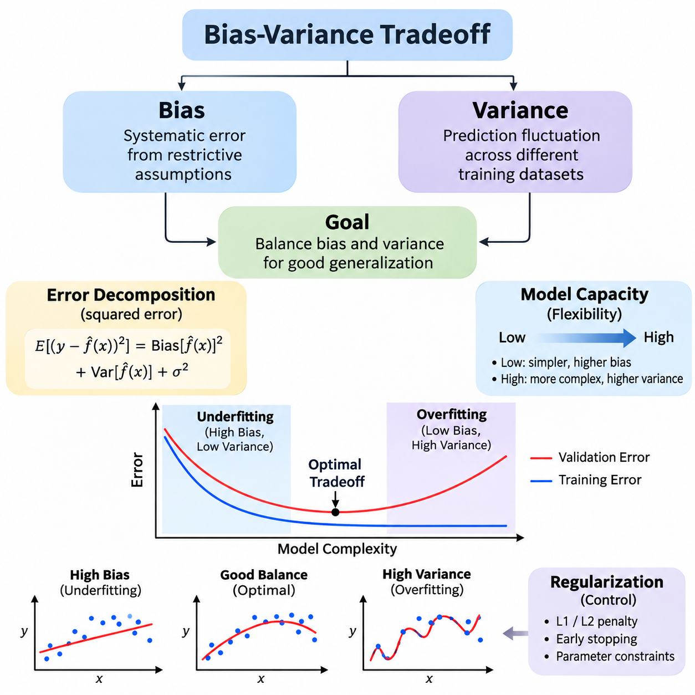
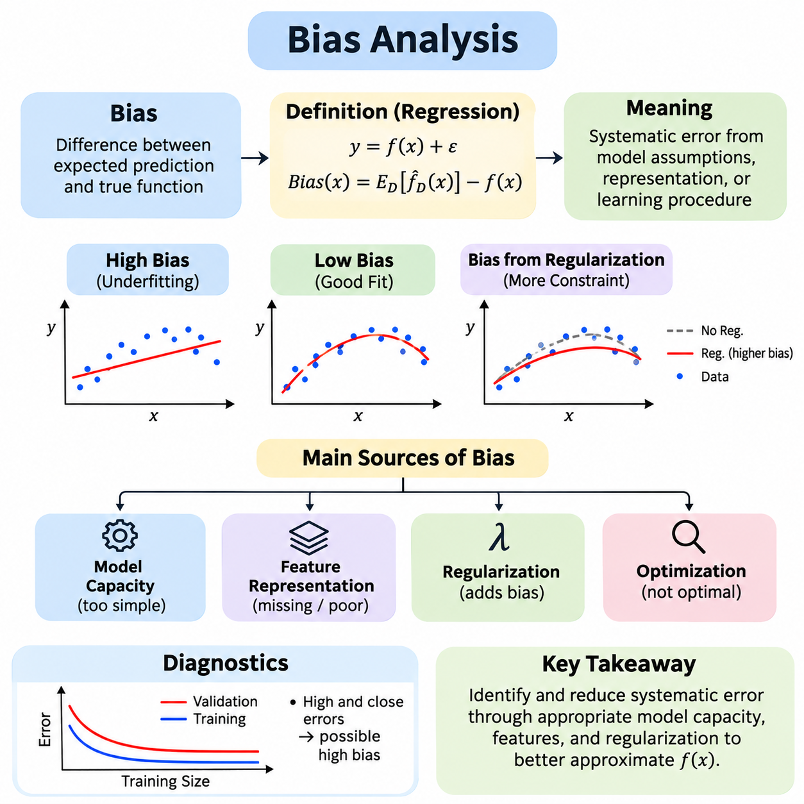
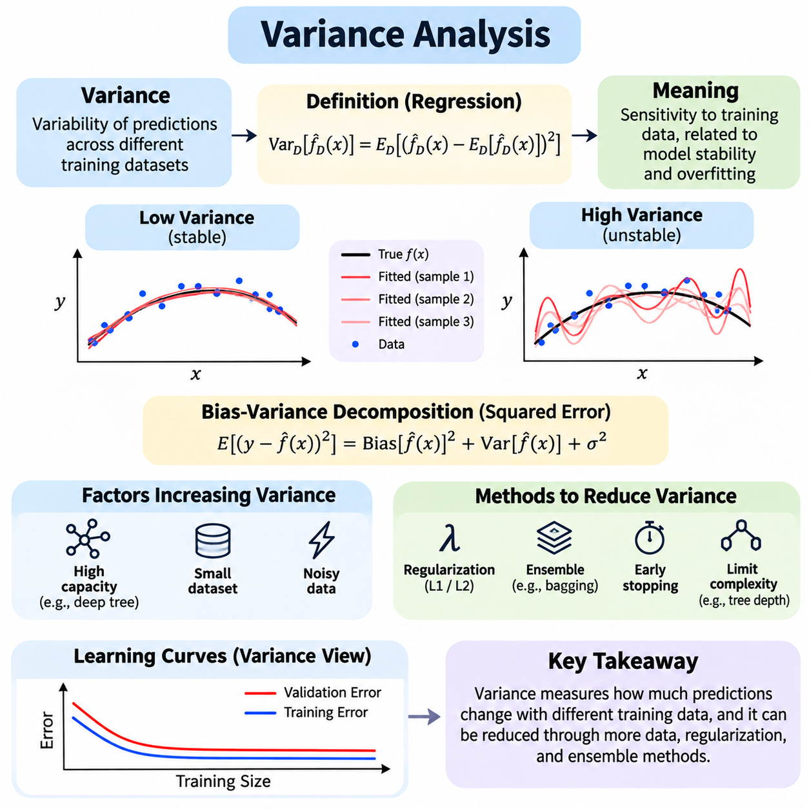
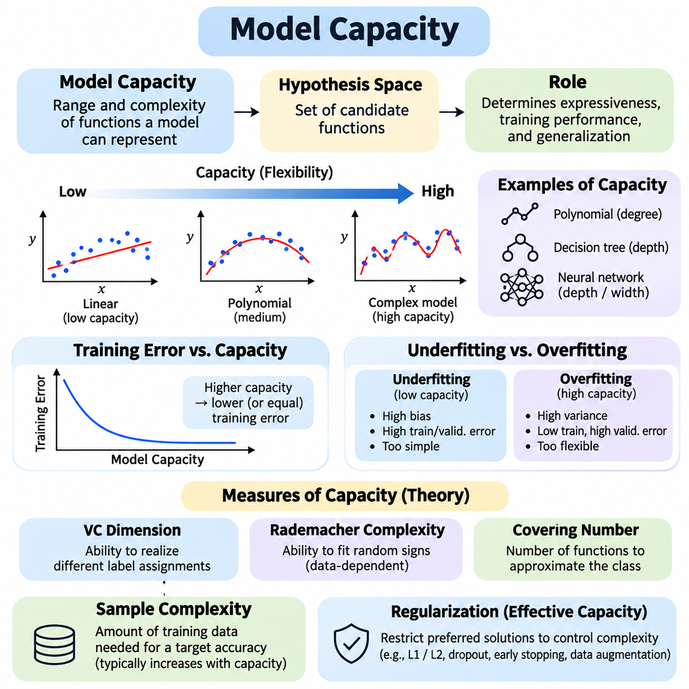
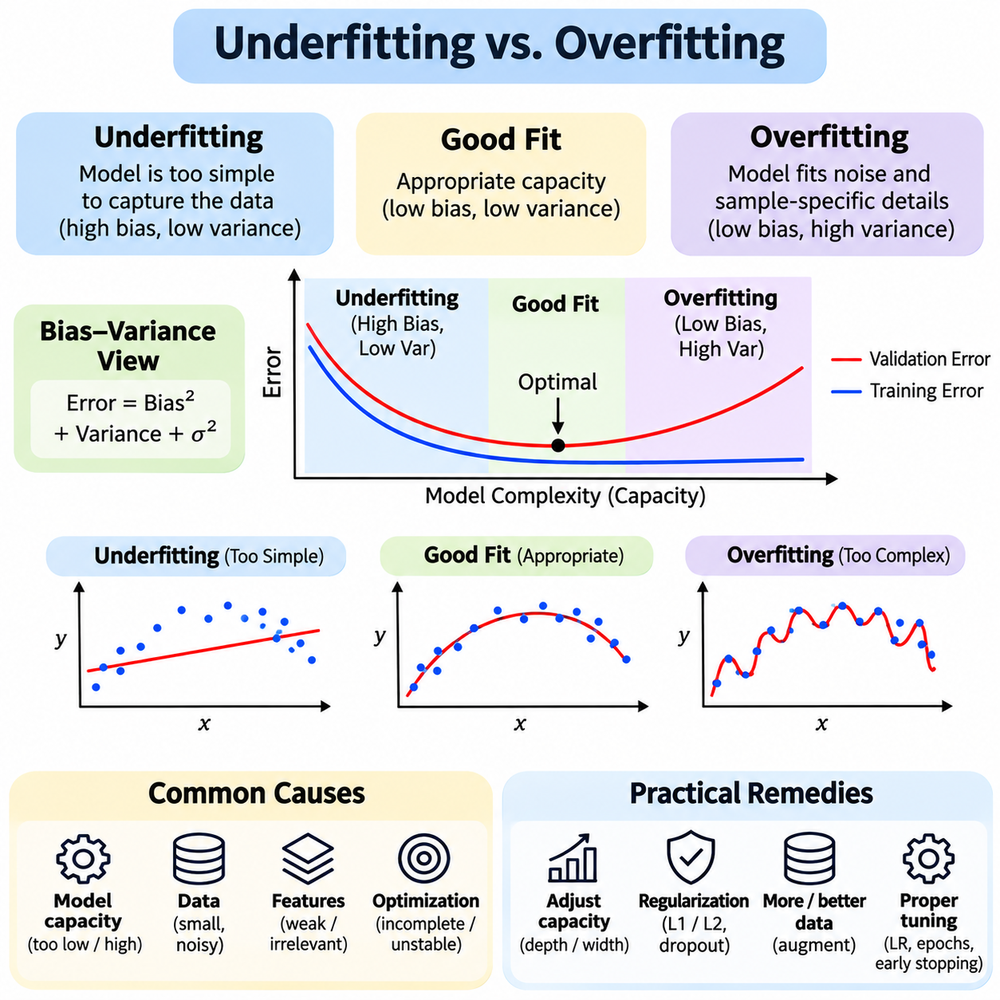
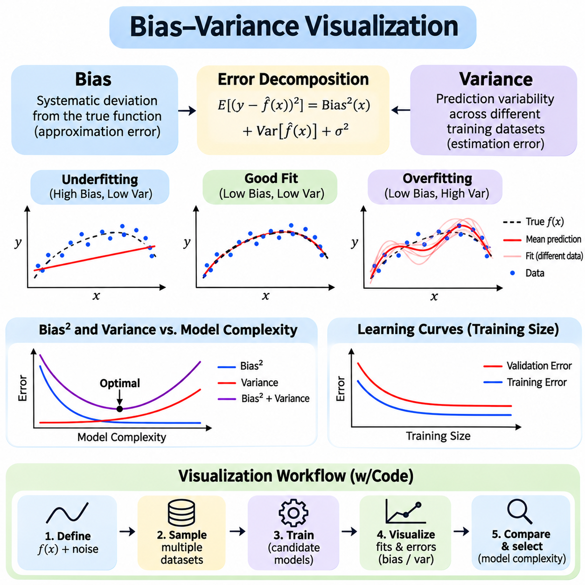
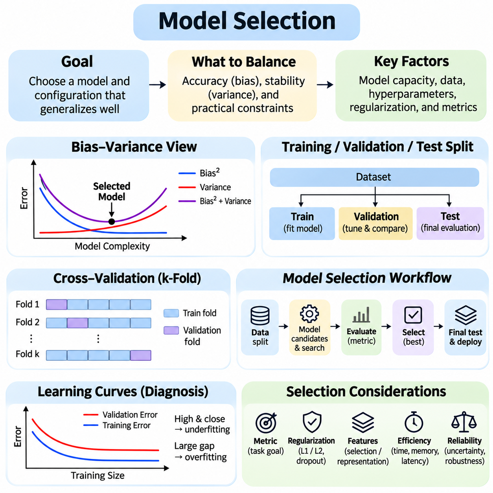
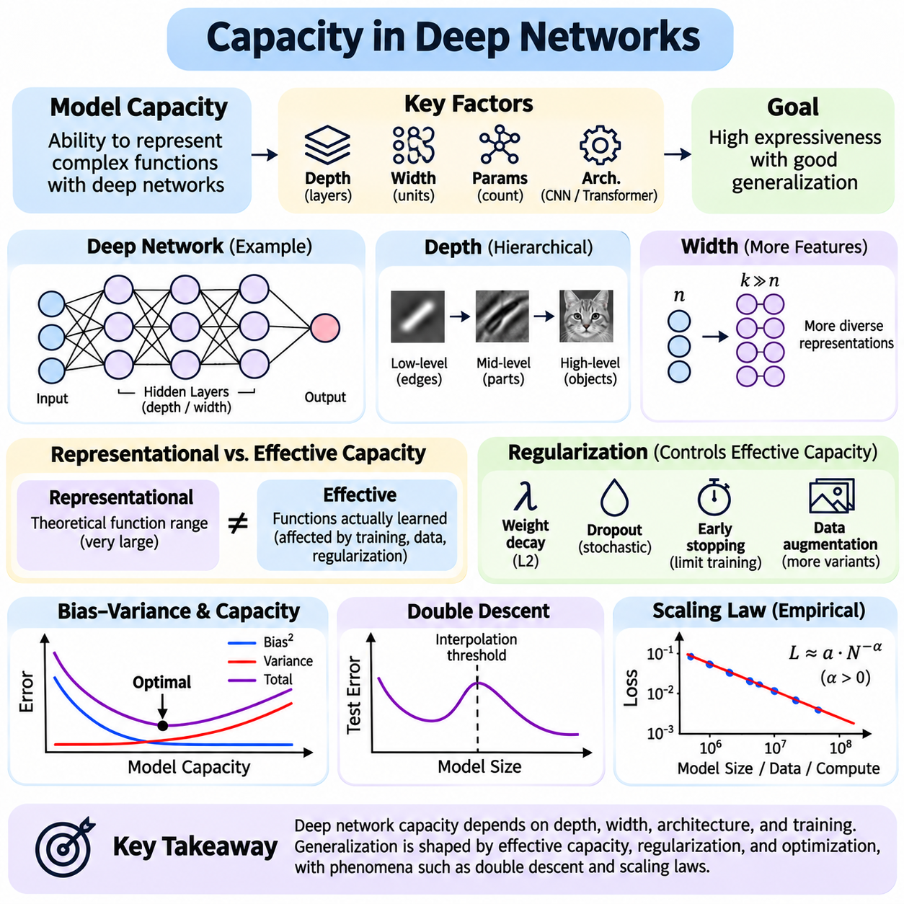
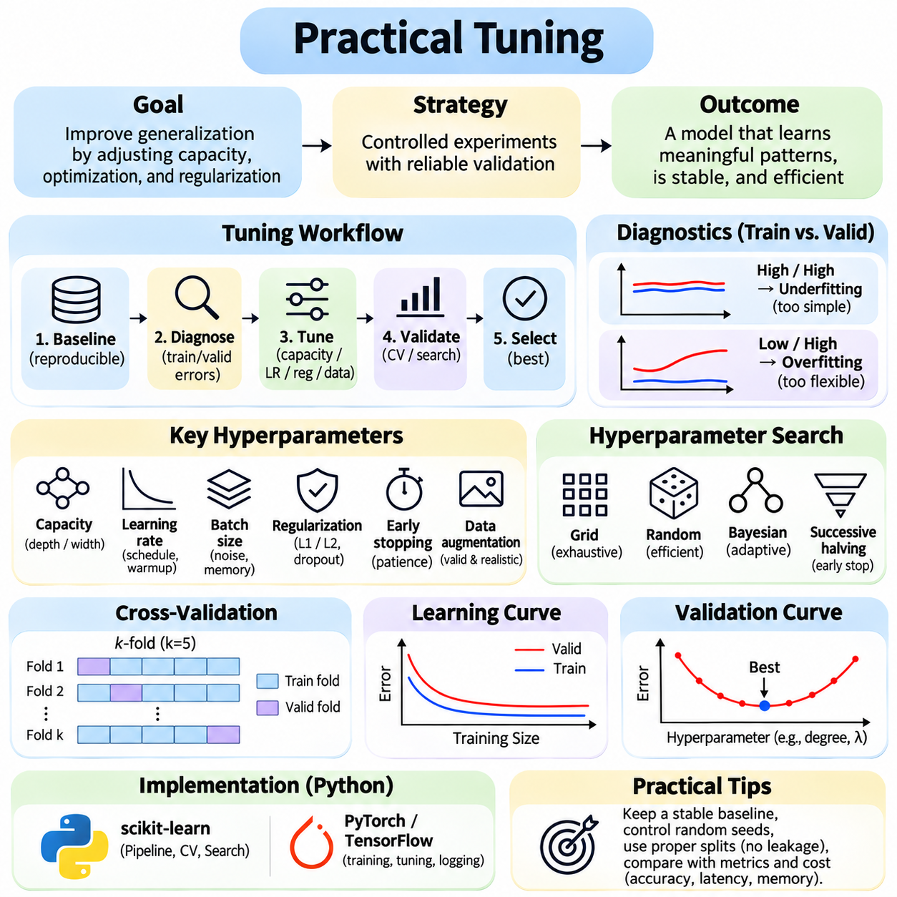

**Volume 06. Optimization and Generalization in ML**

# 05. Bias Variance and Model Capacity

## 05.00 Bias Variance Tradeoff

{width="7.268055555555556in" height="7.268055555555556in"}

The bias-variance tradeoff is a fundamental principle in machine learning that explains how model complexity influences predictive accuracy and generalization. A learning algorithm must identify meaningful patterns from training data while avoiding excessive sensitivity to individual observations. Bias represents systematic prediction errors caused by restrictive assumptions, whereas variance describes fluctuations in predictions across different training datasets.

The central challenge is balancing these two sources of error. Models with strong assumptions often produce stable predictions but may fail to represent complex relationships. Highly flexible models can capture intricate patterns, yet their predictions may change substantially when the training data changes. Effective learning requires sufficient flexibility to represent the underlying relationship without becoming overly dependent on sampling noise.

Consider a supervised regression problem in which observations follow the relationship y = f(x) + ε, where f(x) represents the true underlying function and ε denotes random noise. A learning algorithm estimates a predictive function from a finite training dataset. Because different datasets contain different observations and noise realizations, repeated training can produce different estimates even when the same algorithm and configuration are used.

Under squared-error loss, the expected prediction error at a particular input can be decomposed into squared bias, variance, and irreducible noise. This decomposition provides a mathematical explanation for the tradeoff between systematic approximation errors and sensitivity to training samples. It also clarifies why minimizing training error alone does not necessarily produce the most accurate predictions on previously unseen observations.

The expected squared prediction error can be expressed as E[(y − f̂(x))²] = Bias[f̂(x)]² + Var[f̂(x)] + σ². Here, f̂(x) represents the prediction produced by a model trained on a randomly sampled dataset, and σ² represents the conditional variance of observation noise. This classical decomposition assumes that the noise has zero conditional mean and that its variance is defined at the input being evaluated.

Bias measures the difference between the average prediction across possible training datasets and the true underlying function. A model exhibits high bias when its assumptions prevent it from representing important relationships in the data. For example, fitting a straight line to observations generated by a strongly nonlinear function can produce systematic errors even when the available training dataset is large and representative.

Variance measures how much the learned prediction changes when the training dataset changes. A high-variance model may fit one dataset extremely well while producing noticeably different predictions after training on another sample from the same population. This sensitivity is particularly problematic when datasets are small, noisy, or unrepresentative, because individual observations can exert excessive influence on the learned parameters.

A simple polynomial regression example illustrates the relationship between bias and variance. A first-degree polynomial may be unable to represent a curved relationship, resulting in high bias. Increasing the polynomial degree allows the model to approximate more complicated functions and may reduce bias. However, sufficiently high polynomial degrees can produce unstable predictions, especially near boundaries or in regions containing few observations.

As model flexibility increases, training error generally decreases when models are nested and optimized appropriately. Validation error, however, may initially decrease and subsequently increase because additional flexibility can amplify sensitivity to sampling noise. This familiar behavior motivates the classical bias-variance tradeoff, although modern learning systems do not always follow a simple U-shaped relationship between model complexity and generalization error.

Underfitting occurs when a model cannot adequately capture the structure of the underlying data-generating process. It is commonly associated with high bias and relatively low variance. Both training and validation errors may remain large because the model lacks sufficient representational flexibility. Increasing model capacity, improving feature representations, or reducing excessive regularization can help address this limitation.

Overfitting occurs when a model learns characteristics of the training dataset that do not transfer reliably to unseen observations. It is often associated with high variance, although overfitting cannot always be explained by variance alone. A model may achieve exceptionally low training error while exhibiting substantially worse validation performance because it has captured accidental correlations, measurement noise, or sample-specific irregularities.

Model capacity plays a central role in this relationship because it determines the range of functions that a learning algorithm can represent. Low-capacity models typically impose stronger restrictions on possible solutions, while high-capacity models permit more complex relationships. Nevertheless, representational capacity is not identical to effective learning complexity, which also depends on optimization procedures, regularization, training data, and architectural assumptions.

Regularization provides an important mechanism for controlling the bias-variance balance. Techniques such as L1 and L2 penalties, early stopping, and constraints on model parameters can reduce sensitivity to training observations. Stronger regularization often increases bias while decreasing variance, although the exact effect depends on the learning algorithm. Appropriate regularization can improve generalization by discouraging unnecessarily complicated solutions.

Increasing the amount of representative training data can reduce estimation variance without necessarily requiring a reduction in model capacity. Larger datasets provide more evidence about the underlying relationship and reduce the influence of individual observations. However, additional data cannot automatically eliminate bias caused by an unsuitable model family, missing explanatory variables, incorrect assumptions, or systematic errors in data collection.

Ensemble learning offers another approach to variance reduction. Bagging methods train multiple models using different samples and combine their predictions, reducing variance when prediction errors are not perfectly correlated. Random forests apply this principle to decision trees while introducing additional randomness. Boosting methods can also improve predictive accuracy, although their effects on bias and variance depend on the algorithm and training configuration.

The bias-variance relationship becomes more complicated in deep neural networks. Modern networks frequently contain enough parameters to interpolate training observations while still achieving strong generalization. Architectural inductive biases, stochastic optimization, parameter initialization, implicit regularization, and the geometry of learned solutions influence predictive behavior. Consequently, parameter count alone is insufficient to determine whether a network will generalize successfully.

Double descent further challenges the traditional interpretation of model complexity. In some learning systems, test error initially decreases, increases near an interpolation threshold, and decreases again as capacity grows beyond that threshold. This behavior demonstrates that increasing model capacity does not always lead to monotonically increasing variance or worsening generalization. The observed pattern depends on the data distribution, model family, and training procedure.

In practical model development, the bias-variance tradeoff should be investigated through controlled experiments rather than inferred solely from model size. Training and validation learning curves provide useful diagnostic evidence. Persistently high errors on both datasets may indicate insufficient capacity or inadequate optimization, whereas a substantial generalization gap may suggest excessive sensitivity to the training sample or other sources of distribution mismatch.

Cross-validation helps estimate predictive performance across different partitions of the available data. By repeatedly training and evaluating models on separate subsets, practitioners can assess the stability of performance estimates and compare alternative configurations. However, variation across validation scores is not identical to the formal prediction variance in the bias-variance decomposition, because evaluation samples and training subsets may both change.

Hyperparameter selection should therefore consider predictive accuracy, stability, computational cost, and the reliability of validation results. Model depth, regularization strength, feature selection, learning rate, and training duration can all influence effective model complexity. A carefully designed evaluation process helps distinguish improvements that reflect genuine generalization from apparent gains caused by random sampling or repeated experimentation.

The tradeoff also has important implications for real-world AI systems. In robotics, autonomous navigation, industrial inspection, and predictive maintenance, models must operate under sensor noise, environmental changes, and limited training coverage. Excessive bias may prevent recognition of important operational patterns, while excessive variance may produce unstable predictions. Robust deployment requires evaluating performance across realistic operating conditions.

Ultimately, the bias-variance tradeoff provides a conceptual framework for understanding why learning systems succeed or fail on unseen data. It connects model assumptions, training data, representational flexibility, and statistical uncertainty within a common perspective. Although modern deep learning introduces behaviors beyond the classical framework, understanding bias and variance remains essential for designing reliable models and making informed decisions about model complexity.

## 05.01 Bias Analysis

{width="7.268055555555556in" height="7.268055555555556in"}

Bias analysis is an essential component of machine learning evaluation because it examines systematic errors introduced by model assumptions, representation limitations, and learning procedures. Bias describes the difference between the expected prediction of a learning algorithm and the true underlying relationship. Understanding this difference helps practitioners determine whether a model possesses sufficient flexibility to capture meaningful patterns in the data.

In supervised learning, the objective is to approximate an unknown function that maps input variables to target outputs. A learning algorithm constructs an estimated function using a finite training dataset. Since different training samples may produce different fitted models, bias is defined relative to the average prediction across possible datasets. This perspective separates systematic prediction tendencies from fluctuations caused by random sampling.

For a regression problem, assume that the observed target follows y = f(x) + ε, where f(x) represents the true conditional mean and ε is random noise with zero conditional expectation. The bias of an estimator at input x is defined as Bias(x) = E_D[f̂\\_D(x)] − f(x). Here, E_D represents expectation over possible training datasets, while f̂\\_D(x) denotes the prediction obtained from a model trained on dataset D.

This definition emphasizes that bias is a property of the learning procedure under a specified data-generating distribution rather than merely an error observed in one fitted model. A single training experiment cannot directly reveal the expected prediction across all possible datasets. Consequently, practical bias analysis often relies on repeated sampling, simulation experiments, theoretical assumptions, or indirect evidence obtained from training and validation performance.

High bias occurs when a learning algorithm consistently produces predictions that deviate from the true relationship in a similar direction or pattern. This behavior frequently results from restrictive model assumptions, insufficient feature representations, or excessive regularization. A model with high bias may remain inaccurate even when trained on large datasets because additional observations cannot automatically overcome limitations imposed by its hypothesis space.

Consider a dataset generated by a nonlinear relationship between an input variable and a continuous target. If a linear regression model is used without appropriate nonlinear features, its predictions may systematically underestimate values in some regions and overestimate them in others. These errors arise because the selected model family cannot adequately represent the underlying function, illustrating approximation bias caused by limited model capacity.

Model capacity influences bias by determining the complexity of functions that can be represented. Simple models generally impose stronger structural assumptions and may exhibit greater approximation bias when the true relationship is complex. Increasing capacity can reduce this limitation by allowing richer functional relationships. However, greater capacity does not guarantee lower prediction bias because optimization, regularization, and data quality also affect the learned solution.

Feature engineering provides another important perspective on bias. Even a flexible learning algorithm may produce systematically inaccurate predictions when essential explanatory variables are missing or informative relationships are poorly represented. Transformations, interaction terms, nonlinear mappings, and learned embeddings can improve the representation of relevant patterns. Effective feature design therefore reduces certain sources of bias without necessarily requiring a larger model.

Regularization can introduce bias intentionally to improve predictive reliability. L2 regularization discourages large parameter values, while L1 regularization encourages sparse parameter representations. These constraints may shift estimated parameters away from their unregularized values, increasing systematic estimation error. Nevertheless, the resulting reduction in variance can outweigh the additional bias and improve expected prediction performance.

The relationship between bias and training error requires careful interpretation. A model that exhibits high training error may suffer from insufficient capacity, excessive regularization, inappropriate features, or incomplete optimization. However, training error alone does not measure statistical bias directly. High training error can also result from irreducible noise, incorrect labels, unsuitable loss functions, or optimization failures unrelated to approximation limitations.

Learning curves provide practical evidence for identifying potential high-bias behavior. When both training and validation errors remain relatively high and close together, the model may be unable to represent the underlying relationship adequately. Increasing the training dataset may provide limited improvement if the primary limitation is model expressiveness. More flexible architectures, improved features, or weaker regularization may therefore be appropriate experimental adjustments.

Bias analysis should also distinguish approximation error from estimation error. Approximation error arises when the best function available within a model family cannot represent the true relationship sufficiently well. Estimation error occurs because the learning algorithm must infer parameters from finite observations. Although these concepts are related to bias and variance, they are not identical, and estimation procedures may themselves introduce systematic bias.

Optimization bias represents another potential source of systematic deviation. A model may possess sufficient theoretical capacity but fail to reach an appropriate solution because of optimization constraints, limited training duration, or unfavorable initialization. In deep neural networks, the optimization algorithm and training configuration influence which solutions are obtained. Consequently, observed systematic errors cannot always be attributed solely to insufficient representational capacity.

Bias can vary significantly across different regions of the input space. A regression model may provide accurate predictions near densely sampled observations while exhibiting systematic errors in sparsely represented regions. Global evaluation metrics can conceal these local weaknesses because errors in different regions may offset one another. Conditional error analysis and evaluation across meaningful input subsets help reveal such behavior.

In classification tasks, bias analysis requires additional care because predictions may be discrete labels or estimated class probabilities. Systematic errors can arise from inappropriate decision boundaries, limited feature representations, or incorrect probability estimates. Classification performance should therefore be examined using suitable loss functions, calibration analysis, and class-specific evaluation rather than directly applying regression-based bias formulas to every classification metric.

The distinction between statistical bias and algorithmic fairness is particularly important. Statistical bias describes systematic deviation of an estimator from a defined target, whereas fairness-related bias concerns differences in outcomes or errors across populations. These concepts may interact but are not interchangeable. A statistically well-calibrated model can still exhibit undesirable group-level performance disparities, requiring separate evaluation criteria.

Simulation provides a useful method for studying bias when the true generating function is known. Researchers can generate multiple training datasets from the same distribution, train identical models independently, and average their predictions at selected inputs. Comparing these averages with the known function provides an empirical estimate of prediction bias. Repeated experiments also help distinguish systematic errors from random variations between fitted models.

For example, suppose observations are generated from a quadratic function with additive Gaussian noise. A linear model may consistently fail to reproduce the curvature, producing substantial bias across repeated training samples. A quadratic model can represent the generating relationship more accurately when fitted appropriately. A higher-degree polynomial may offer additional flexibility, but its increased complexity can introduce greater prediction variability.

Deep learning introduces additional considerations because highly overparameterized networks can exhibit low training error and strong generalization despite enormous representational capacity. Architectural inductive biases, data augmentation, optimization dynamics, and implicit regularization influence the functions these networks learn. Therefore, analyzing bias in deep networks requires attention to the complete training procedure rather than treating parameter count as a direct measure of bias.

Dataset characteristics also influence the interpretation of systematic prediction errors. Missing variables, measurement errors, label inconsistencies, and unrepresentative sampling can produce persistent prediction patterns that resemble model bias. Distribution shifts between training and deployment environments may introduce additional systematic deviations. Reliable analysis must therefore examine both model assumptions and the quality and representativeness of the available data.

Practical bias reduction begins with diagnosing the source of systematic error. If the model is too restrictive, increasing capacity or introducing nonlinear features may help. If excessive regularization is responsible, reducing its strength may improve fit. When optimization is incomplete, adjusting learning schedules or training duration may be more effective. Each intervention should be evaluated against independent validation data to detect unintended increases in variance.

Ultimately, bias analysis provides a structured approach to understanding systematic limitations in machine learning models. It connects mathematical expectations, model assumptions, feature representations, optimization behavior, and empirical evaluation. By identifying where and why predictions consistently deviate from the underlying relationship, practitioners can select targeted improvements while preserving the broader objective of reliable generalization to unseen data.

## 05.02 Variance Analysis

{width="7.268055555555556in" height="7.268055555555556in"}

Variance analysis is a fundamental component of machine learning because it examines how sensitive a trained model is to changes in its training dataset. Variance describes the variability of predictions produced by a learning algorithm when trained on different samples drawn from the same underlying distribution. Understanding this behavior is essential for evaluating model stability, identifying overfitting, and improving generalization to unseen observations.

In supervised learning, a model is constructed from a finite collection of input-output observations. Different training datasets contain different samples, even when they originate from the same population. Consequently, repeated applications of an identical learning algorithm can produce different parameter estimates and predictions. Variance analysis quantifies these differences and reveals how strongly the learning procedure depends on the particular observations used during training.

For a regression problem, let f̂\\_D(x) represent the prediction at input x obtained by training a model on dataset D. Prediction variance is defined as Var_D[f̂\\_D(x)] = E_D[(f̂\\_D(x) − E_D[f̂\\_D(x)])²]. The expectation is taken over possible training datasets sampled from the same distribution. This expression measures the expected squared deviation of individual model predictions from their average prediction at a fixed input.

High variance indicates that relatively small changes in the training dataset can produce substantial changes in model predictions. Such sensitivity commonly occurs in highly flexible models trained on limited or noisy data. Although these models may achieve low training error, their predictions can become unstable when evaluated on new samples. This instability contributes to generalization error and frequently appears alongside overfitting.

Low variance indicates that predictions remain relatively consistent across different training datasets. Models with strong structural assumptions or substantial regularization often exhibit this behavior. However, prediction stability does not necessarily imply predictive accuracy. A model may consistently produce incorrect predictions if its assumptions are too restrictive, illustrating why variance must be considered together with bias when evaluating learning performance.

The classical bias-variance decomposition provides a mathematical framework for understanding prediction variance. Under squared-error loss and zero-mean observation noise, expected prediction error consists of squared bias, prediction variance, and irreducible noise. Variance represents the component associated with uncertainty in the fitted model caused by random training samples. Reducing this component can improve expected generalization performance when other error components remain controlled.

Model capacity strongly influences variance because flexible hypothesis spaces permit many possible fitted functions. High-degree polynomial regression, deep decision trees, and certain highly parameterized models can respond strongly to individual training observations. Increasing capacity may reduce approximation bias while increasing estimation sensitivity. Nevertheless, the relationship is not universally monotonic, particularly in modern overparameterized learning systems.

Consider polynomial regression applied to observations generated from a smooth nonlinear function. A low-degree polynomial may produce similar predictions across repeated training samples because its limited flexibility restricts possible fitted curves. A high-degree polynomial may fit each dataset closely but generate substantially different curves between observations. This behavior becomes especially pronounced when the training dataset contains few samples or substantial measurement noise.

Decision trees provide another intuitive example of prediction variance. Small changes in training observations can alter splitting decisions, potentially producing different tree structures and predictions. Deep trees are particularly sensitive because successive partitions may depend on relatively few samples. Restricting tree depth, requiring larger leaf populations, or combining multiple trees can reduce instability while preserving useful nonlinear modeling capabilities.

Training dataset size is a major determinant of estimation variance. When only a small number of observations are available, individual samples may exert considerable influence on learned parameters. Increasing the number of independent and representative observations generally improves estimation stability. However, the magnitude of improvement depends on model structure, data dimensionality, noise characteristics, and the statistical properties of the learning algorithm.

Data quality also affects variance because noisy measurements and inconsistent labels introduce uncertainty into parameter estimation. A flexible model may adapt to accidental fluctuations rather than stable relationships. Improving measurement reliability, removing erroneous records, and establishing consistent labeling procedures can reduce unnecessary sensitivity. Nevertheless, eliminating noise completely is rarely possible, and some uncertainty remains inherent in finite-sample learning.

Regularization is an important mechanism for controlling prediction variance. L2 regularization discourages excessively large parameter values, while L1 regularization can produce sparse representations. Early stopping limits the extent to which iterative training adapts to individual observations. These techniques often reduce sensitivity to sampling fluctuations, although stronger regularization may introduce additional bias and does not guarantee variance reduction in every setting.

Ensemble learning provides a direct strategy for reducing variance through prediction aggregation. Bagging trains multiple models on bootstrap samples and combines their outputs. Averaging can reduce prediction variance when individual model errors are not perfectly correlated. Random forests extend this approach by introducing randomness into feature selection, helping reduce correlations among trees and improving stability compared with individual high-variance decision trees.

The effectiveness of ensemble averaging depends on the correlation structure of prediction errors. If individual estimators have equal variance σ² and pairwise correlation ρ, the variance of their average is σ²[ρ + (1 − ρ)/M], where M denotes the number of estimators. This relationship shows that increasing ensemble size reduces the uncorrelated component of variance, while correlated errors impose a limit on the achievable improvement.

Bootstrap resampling provides a practical method for investigating model variability. Multiple datasets are generated by sampling observations with replacement from the original training dataset. The same learning procedure is applied to each resampled dataset, producing a collection of fitted models. Variation among their predictions can provide an empirical approximation of sampling sensitivity, although bootstrap estimates depend on assumptions about the original sample.

Cross-validation also provides information about model stability, but its interpretation requires care. Performance differences across folds may reflect changes in training samples, evaluation samples, or both. Consequently, the variance of cross-validation scores is not identical to prediction variance in the classical bias-variance decomposition. Repeated cross-validation can nevertheless help assess the robustness of performance estimates and identify unstable model configurations.

Variance analysis can be performed locally across the input space rather than relying exclusively on aggregate statistics. Predictions may remain stable in densely sampled regions while exhibiting substantial variability near boundaries or in sparsely represented areas. Evaluating prediction distributions at selected inputs helps identify these weaknesses. Such analysis is particularly valuable when reliability requirements differ across operating conditions.

In classification problems, prediction variance may be examined through changes in estimated class probabilities, decision boundaries, or predicted labels. Models trained on different samples may assign substantially different probabilities to the same observation. However, discrete classification outputs do not directly follow the same squared-error decomposition used in regression. Appropriate analysis should distinguish probability variability from classification error and calibration quality.

Deep neural networks introduce additional complexity into variance analysis. Their predictions depend on training data, parameter initialization, stochastic optimization, regularization, and architectural design. Variability across random seeds may reflect optimization randomness rather than training-sample variance alone. Separating these sources requires controlled experiments in which dataset sampling and training randomness are varied independently.

Modern overparameterized networks can sometimes achieve strong generalization despite possessing extremely large representational capacity. Phenomena such as double descent demonstrate that prediction variance and test error do not always increase monotonically with model size. Implicit regularization, learned representations, and optimization dynamics influence effective complexity. Therefore, parameter count alone is insufficient for assessing variance in contemporary deep learning systems.

In industrial AI and robotics, prediction variance has direct implications for operational reliability. Models used for visual inspection, sensor fusion, localization, and predictive maintenance must provide consistent behavior under realistic environmental variation. Excessive sensitivity to training samples can produce unstable decisions and unreliable confidence estimates. Variance analysis helps engineers identify vulnerable operating regions and evaluate the benefits of additional data or regularization.

Ultimately, variance analysis provides a systematic framework for understanding model instability and sampling uncertainty. It connects statistical estimation, model capacity, dataset characteristics, regularization, ensemble methods, and empirical evaluation. By measuring how predictions change across plausible training datasets, practitioners can develop models that maintain reliable performance beyond the observations used during training.

## 05.03 Model Capacity

{width="7.268055555555556in" height="7.268055555555556in"}

Model capacity describes the range and complexity of functions that a machine learning model can represent. It determines whether a learning algorithm can capture simple linear relationships, complex nonlinear interactions, or highly structured patterns. Capacity is closely related to the hypothesis space, which contains the candidate functions available to the model. Understanding capacity is essential for balancing expressive power, training performance, and generalization.

A low-capacity model represents a relatively restricted collection of functions, while a high-capacity model can express a broader variety of relationships. Linear regression without nonlinear features has limited capacity compared with polynomial regression or deep neural networks. However, capacity is not determined solely by the number of parameters. Architectural constraints, feature representations, regularization, and learning procedures also influence the functions that can be learned.

The relationship between model capacity and training error is fundamental to statistical learning. When hypothesis spaces are nested and optimization is sufficiently effective, increasing capacity cannot increase the minimum achievable training loss. A more expressive model can reproduce solutions available to a simpler model while potentially representing additional patterns. Nevertheless, lower training error does not necessarily imply improved performance on unseen data.

Insufficient model capacity commonly leads to underfitting, where the model cannot adequately represent the underlying relationship. Such models may exhibit high approximation bias and relatively similar training and validation errors. Increasing capacity can improve performance by introducing nonlinear transformations, additional features, or richer architectures. However, optimization failures and poor data quality can produce similar symptoms, requiring careful diagnosis.

Excessive effective capacity may contribute to overfitting when a model adapts to noise or accidental correlations in the training dataset. Highly flexible functions can reproduce individual observations without learning stable relationships. This behavior may produce low training error but poor validation performance. The risk depends on dataset size, noise, regularization, and optimization, rather than on representational capacity alone.

Polynomial regression illustrates capacity through the degree of the fitted polynomial. A first-degree polynomial represents linear relationships, whereas higher-degree polynomials can approximate increasingly complex curves. As the degree increases, the model gains flexibility but may become sensitive to individual observations. Selecting an appropriate degree requires balancing approximation accuracy against prediction stability on independent data.

Decision trees demonstrate another form of capacity control. A shallow tree represents a limited number of decision regions, while a deep tree can create many partitions and model intricate interactions. Maximum depth, minimum leaf size, and pruning influence effective complexity. Restricting these parameters can improve stability, although overly restrictive trees may fail to capture important nonlinear patterns.

Neural network capacity depends on several architectural characteristics, including depth, width, activation functions, connectivity, and parameter sharing. Deeper networks can construct hierarchical representations, while wider networks provide additional computational units. Convolutional networks exploit spatial structure through shared filters, and transformers use attention mechanisms to represent contextual interactions. These architectural choices shape expressiveness beyond raw parameter count.

Theoretical learning frameworks provide formal measures of model capacity. Vapnik--Chervonenkis dimension, commonly called VC dimension, characterizes the ability of a hypothesis class to realize different binary label assignments. A class with high VC dimension can shatter larger sets of points. This concept connects expressiveness with sample complexity, although classical bounds may be conservative for modern deep learning models.

Rademacher complexity provides another statistical measure by examining how well a function class can correlate with random signs assigned to observed samples. Greater complexity generally indicates a stronger ability to fit arbitrary fluctuations. Unlike measures based solely on the hypothesis class, empirical Rademacher complexity depends on the observed inputs. It therefore provides a data-dependent perspective on generalization and effective model flexibility.

Covering numbers and related complexity measures describe how many representative functions are needed to approximate a hypothesis class within a specified tolerance. These quantities help characterize the richness of function spaces and support theoretical generalization bounds. Their practical computation can be difficult for large neural networks, but they clarify why capacity involves more than simply counting trainable parameters.

Sample complexity describes the amount of training data required to achieve a desired level of predictive accuracy with specified confidence. In classical statistical learning theory, richer hypothesis classes often require more observations to control generalization error. However, sample requirements also depend on the data distribution, noise level, learning algorithm, and structural assumptions. Capacity should therefore be evaluated relative to the available evidence.

Regularization modifies effective capacity by restricting which solutions are preferred or accessible during training. L1 and L2 penalties constrain parameter estimates, while dropout, early stopping, and data augmentation influence learned representations and optimization behavior. These techniques do not necessarily reduce the theoretical function class, but they can reduce the effective flexibility of the training procedure and improve generalization.

The distinction between representational capacity and effective capacity is especially important in deep learning. A network may theoretically represent an enormous collection of functions, yet its training algorithm explores only a limited subset. Initialization, optimization dynamics, architectural inductive biases, and implicit regularization influence the final solution. Consequently, two models with identical parameter counts can exhibit substantially different generalization behavior.

Overparameterization occurs when a model contains more adjustable parameters than might appear necessary for the available observations. Modern neural networks frequently operate in this regime and can sometimes interpolate their training datasets. Surprisingly, interpolation does not always imply poor generalization. Learned representations, optimization preferences, and data structure can enable highly expressive networks to produce stable predictions on unseen samples.

Double descent challenges the traditional assumption that test error always follows a single U-shaped curve as capacity increases. In some systems, test error initially decreases, rises near an interpolation threshold, and decreases again as capacity grows further. This phenomenon demonstrates that capacity and generalization interact through optimization and statistical structure. Its occurrence and shape depend on the model, dataset, and training procedure.

Model capacity can also be examined through learning curves that compare training and validation performance across dataset sizes. Persistently high errors may suggest insufficient capacity, while a large generalization gap may indicate excessive sensitivity to training samples. However, these patterns are diagnostic clues rather than definitive measurements of capacity. Controlled experiments are needed to distinguish model limitations from optimization and distributional problems.

Capacity selection is closely related to hyperparameter optimization. Polynomial degree, tree depth, network width, network depth, embedding dimension, and regularization strength all influence effective complexity. Cross-validation and independent validation datasets help compare candidate configurations. Reliable selection procedures should account for computational cost, performance variability, and the risk of repeatedly adapting decisions to validation results.

In industrial AI and robotics, model capacity must be considered alongside deployment constraints. Autonomous systems may require real-time inference, predictable latency, limited memory consumption, and robust operation under changing conditions. A larger model may provide greater expressive power but also increase computational requirements and operational complexity. Effective engineering therefore balances accuracy, stability, resource consumption, and environmental robustness.

Capacity requirements also vary across application domains. Visual inspection models may need to recognize subtle defects, while localization systems must represent complex relationships between sensor observations and spatial states. Predictive maintenance models may require temporal dependencies and nonlinear interactions. Selecting an appropriate architecture involves understanding the structure of the task rather than assuming that the largest available model is always preferable.

Practical capacity analysis should compare models under consistent data splits, evaluation metrics, and training conditions. Increasing capacity should be accompanied by monitoring training loss, validation performance, calibration, and sensitivity to random initialization. Repeated experiments can reveal whether additional flexibility produces meaningful improvements or merely increases instability. Such evidence supports more reliable architecture and hyperparameter decisions.

Ultimately, model capacity provides a conceptual connection between function approximation, statistical learning theory, optimization, and generalization. Insufficient capacity restricts what a model can learn, while excessive effective flexibility can increase sensitivity to limited observations. Modern deep learning demonstrates that this relationship is more nuanced than a simple tradeoff. Successful model design requires matching expressive power to data, task structure, and deployment requirements.

## 05.04 Underfitting vs Overfitting

{width="7.268055555555556in" height="7.268055555555556in"}

Underfitting and overfitting describe two fundamental failure modes in machine learning that arise when a model does not achieve an appropriate balance between learning capacity and generalization. Underfitting occurs when a model cannot capture important patterns in the training data, whereas overfitting occurs when it learns sample-specific details that do not transfer reliably to unseen observations. Understanding both conditions is essential for developing accurate and robust predictive systems.

Underfitting typically results from insufficient model capacity, overly restrictive assumptions, inadequate feature representations, or incomplete optimization. A model affected by underfitting fails to reproduce meaningful relationships even within its training dataset. Consequently, both training and validation errors may remain relatively high. Increasing the number of training examples alone may not resolve the problem when the primary limitation is the model\'s expressive ability.

Overfitting occurs when a model adapts excessively to the particular observations used during training. It may learn random noise, accidental correlations, or irregularities that are not representative of the underlying population. Such models often achieve very low training error but exhibit substantially worse validation performance. The resulting generalization gap reflects a mismatch between successful memorization and reliable prediction.

The bias-variance framework provides a useful interpretation of these behaviors. Underfitting is frequently associated with high approximation bias because the model cannot represent the true relationship adequately. Overfitting is often associated with high prediction variance because learned functions change substantially across training samples. However, these associations are not universal, especially in modern overparameterized neural networks.

Consider polynomial regression applied to data generated from a nonlinear function. A linear model may underfit because it cannot reproduce the curvature of the underlying relationship. A moderately complex polynomial may approximate the function accurately, while an excessively high-degree polynomial may follow individual noisy observations. This example illustrates how changing model flexibility can shift the balance between systematic error and sensitivity to training data.

Training and validation learning curves are practical tools for diagnosing these conditions. When both errors remain high and relatively close, insufficient capacity or incomplete learning may be responsible. When training error decreases while validation error remains high or begins increasing, overfitting becomes a plausible explanation. These patterns should be interpreted alongside data quality, optimization behavior, and the evaluation procedure.

Model capacity influences the risk of underfitting and overfitting, but it is not the only determining factor. Network depth, parameter count, tree complexity, and feature interactions affect expressiveness. Dataset size, noise levels, regularization, and training duration influence how that capacity is used. A highly expressive model can generalize effectively when its learning procedure favors stable solutions supported by the available data.

Regularization provides an important mechanism for controlling overfitting. L1 and L2 penalties constrain parameter estimates, dropout introduces stochastic perturbations during training, and early stopping limits excessive adaptation to training observations. These techniques can improve validation performance by reducing effective flexibility. However, overly strong regularization may prevent the model from learning important relationships and produce underfitting.

Data augmentation can reduce overfitting by exposing a model to additional variations that preserve relevant target information. Image transformations, controlled noise injection, and domain-specific perturbations can encourage more robust representations. However, augmentation must respect the task\'s semantics. Transformations that alter labels or introduce unrealistic conditions may degrade performance rather than improve generalization.

Increasing the quantity of representative training data can reduce overfitting by limiting the influence of individual observations. Larger datasets provide stronger evidence about stable relationships and may support the use of more expressive models. Nevertheless, additional data cannot automatically correct inappropriate model assumptions, systematic labeling errors, or distribution mismatches. Data quality and representativeness remain essential.

Feature engineering can address both underfitting and overfitting. Introducing meaningful nonlinear transformations or interaction features may reduce approximation error in overly simple models. Conversely, removing irrelevant or redundant features may reduce unnecessary sensitivity to sampling fluctuations. Effective feature selection should preserve predictive information while avoiding representations that encourage learning accidental correlations.

Optimization behavior must also be considered when diagnosing poor model performance. A network may exhibit high training error because its learning rate is inappropriate, gradients are unstable, or training terminates prematurely. These problems can resemble underfitting without indicating insufficient theoretical capacity. Monitoring optimization progress helps distinguish limitations of the model architecture from failures of the training procedure.

Cross-validation supports more reliable model selection by evaluating candidate configurations across multiple data partitions. It helps estimate generalization performance and reduces dependence on a single validation split. However, repeated hyperparameter tuning against the same validation results can itself cause overfitting to the evaluation procedure. Independent test data should therefore remain isolated until final assessment.

Early stopping is particularly useful when training loss continues decreasing after validation performance stops improving. By selecting a checkpoint based on validation results, the learning process can avoid some forms of excessive adaptation. However, validation metrics may fluctuate, and selecting the best checkpoint repeatedly can introduce selection bias. Patience settings and consistent evaluation schedules improve reliability.

Learning curves across increasing dataset sizes offer additional diagnostic information. If training and validation errors converge at a high level, the model may require greater expressiveness or improved optimization. If a large gap persists but decreases as more data becomes available, additional representative observations may improve generalization. Such curves help distinguish data limitations from model limitations.

Deep learning complicates the classical interpretation of overfitting because large neural networks can memorize training data while still generalizing effectively. Implicit regularization, architectural inductive biases, and optimization dynamics influence which solutions are learned. Double descent further demonstrates that test error may decrease again beyond an interpolation threshold. Therefore, parameter count alone cannot reliably classify a model as underfitted or overfitted.

Distribution shift introduces another important consideration. A model may perform well on training and validation data yet fail when deployment conditions differ substantially. This failure is not necessarily conventional overfitting, although reliance on unstable correlations can contribute to it. Robust evaluation should include realistic operating conditions, temporal changes, and relevant variations in the input distribution.

In classification systems, underfitting may appear as consistently poor class separation, while overfitting may produce confident predictions that fail on independent samples. Accuracy alone may conceal these problems, particularly with imbalanced datasets. Calibration, precision, recall, class-specific metrics, and confusion matrices provide additional evidence about prediction reliability and generalization.

Industrial AI and robotics systems require particular attention to these failure modes. An underfitted visual inspection model may miss subtle defects, while an overfitted model may respond unpredictably to lighting changes or sensor noise. Localization and predictive maintenance systems face similar challenges under changing operational conditions. Reliable deployment requires evaluation across representative environments rather than training performance alone.

A practical diagnostic workflow begins by comparing training and validation errors under consistent evaluation conditions. High errors on both datasets suggest examining model expressiveness, features, and optimization. A substantial generalization gap suggests investigating regularization, data augmentation, dataset size, and sampling quality. Controlled experiments should modify one major factor at a time to identify the underlying cause.

Ultimately, underfitting and overfitting represent different ways in which learning systems fail to capture relationships that generalize beyond their training observations. Effective model development requires balancing capacity, data quality, optimization, and regularization. By interpreting learning curves, validating across independent samples, and testing realistic conditions, practitioners can develop models that achieve both accurate fitting and dependable generalization.

## 05.05 Bias Variance Visualization [w/Code]

{width="7.268055555555556in" height="7.268055555555556in"}

Bias-variance visualization provides an intuitive way to understand how model complexity, training data, and statistical uncertainty influence prediction performance. By examining prediction curves, error distributions, and learning behavior, practitioners can identify systematic deviations and unstable estimates. Visualization connects the mathematical bias-variance decomposition with observable model behavior, making abstract concepts easier to interpret.

The classical bias-variance decomposition separates expected squared prediction error into squared bias, variance, and irreducible noise. Bias measures the difference between the average learned prediction and the true function, while variance measures fluctuations around that average. Visual analysis can illustrate these components by comparing predictions from models trained on multiple independently sampled datasets at identical input locations.

A useful experiment begins with a known data-generating function, such as a smooth nonlinear curve. Multiple training datasets are sampled from this function with additive random noise. The same learning algorithm is trained independently on each dataset, producing several fitted prediction curves. Because the true function is known, the experiment allows systematic prediction errors and sampling variability to be examined separately.

Low-capacity models often produce prediction curves that remain similar across repeated training samples but deviate consistently from the true relationship. This pattern indicates relatively low variance and potentially high bias. In a polynomial regression experiment, a linear model fitted to quadratic observations may repeatedly miss the underlying curvature, even when individual training datasets differ.

High-capacity models may produce curves that closely follow their training observations while varying substantially between independently fitted models. Such behavior indicates sensitivity to sampling fluctuations and potentially high prediction variance. High-degree polynomial regression provides a familiar example, particularly when the number of observations is small or measurement noise is substantial.

Intermediate model complexity can provide a useful compromise between approximation accuracy and prediction stability. A moderately flexible model may reproduce the main nonlinear structure without responding excessively to individual noisy observations. Comparing prediction curves across several complexity levels helps reveal this balance, although the best configuration must ultimately be selected using independent validation performance.

A practical visualization can display the true function, individual fitted curves, and their average prediction. The distance between the average prediction and the true function represents bias at each input. The spread of fitted curves around their average represents prediction variability. These quantities are input-dependent, so the model may exhibit low variance in densely sampled regions and higher variance near boundaries.

The squared bias at input x can be estimated as (mean prediction(x) − true function(x))². Prediction variance can be estimated from the squared deviations of individual predictions around their sample mean. Averaging these estimates across selected input locations produces summary measures. Their accuracy depends on the number of repeated datasets and how representative the evaluation inputs are.

Python provides a convenient environment for implementing these experiments with NumPy, scikit-learn, and Matplotlib. NumPy can generate synthetic observations and organize repeated predictions into arrays. Scikit-learn provides polynomial feature transformations, regression estimators, and evaluation utilities. Matplotlib supports visual comparison of fitted functions, uncertainty bands, and error curves without requiring specialized visualization frameworks.

A reproducible experiment should control random number generation and separate dataset variability from optimization randomness. Each repetition should draw a new training dataset from the same specified distribution. When stochastic estimators are used, random initialization and optimization seeds should be controlled or varied independently. This distinction prevents training randomness from being incorrectly interpreted as sampling variance.

Learning curves offer another perspective by displaying training and validation error as the number of training observations increases. High and similar errors may indicate underfitting, whereas a substantial gap between training and validation performance may indicate overfitting. Observing how these curves evolve helps determine whether additional data, greater model flexibility, or stronger regularization deserves investigation.

Validation curves instead examine performance across different hyperparameter values, such as polynomial degree, tree depth, or regularization strength. Training error often decreases as flexibility increases, while validation error may initially improve and later deteriorate. The resulting pattern illustrates the classical tradeoff, although modern overparameterized models can exhibit more complicated behavior, including double descent.

Error decomposition can also be visualized by plotting estimated squared bias, prediction variance, and their sum against model complexity. In classical examples, squared bias tends to decrease as capacity increases, while variance may increase. The combined reducible error may therefore attain a minimum at an intermediate complexity. These patterns are illustrative rather than universal mathematical laws.

Irreducible noise should be distinguished from model-dependent error in such experiments. If observations follow y = f(x) + ε with independent zero-mean noise of variance σ², expected squared prediction error includes this noise contribution. Even a model that predicts the conditional mean perfectly cannot eliminate random observation noise. Visualizations should therefore distinguish error relative to the true function from error relative to noisy targets.

Confidence intervals and prediction intervals require careful interpretation when presenting uncertainty. A confidence interval may quantify uncertainty about an estimated mean, whereas a prediction interval accounts for uncertainty in a future observation. The spread of models trained on resampled datasets represents another form of uncertainty. These quantities should not be labeled interchangeably because they describe different statistical objects.

Bootstrap resampling provides a practical alternative when the true data-generating function is unknown. Multiple bootstrap datasets are constructed by sampling with replacement from the available observations. Models fitted to these datasets generate prediction distributions that can be summarized graphically. Bootstrap variability can approximate estimator instability, although it does not directly reveal true prediction bias without additional assumptions.

Cross-validation results can be visualized using distributions of evaluation scores across folds or repeated partitions. Such displays reveal how performance estimates change under alternative data splits. However, variation in cross-validation scores combines effects from training and evaluation samples. It should not be treated as identical to the prediction variance defined in the classical squared-error decomposition.

Classification models require adapted visualization techniques because their outputs may be class probabilities or discrete labels. Decision boundary plots can reveal how fitted classifiers change across training samples. Probability curves and calibration diagrams provide additional information about predictive behavior. Nevertheless, the regression bias-variance decomposition cannot automatically be transferred to every classification loss or evaluation metric.

In deep learning, visual experiments can compare predictions across independently trained networks, random initializations, and dataset resampling procedures. Model size, regularization, and training duration can be varied systematically. These experiments help distinguish instability caused by sampling from variability caused by optimization. They also demonstrate why parameter count alone is insufficient to explain modern generalization behavior.

Industrial AI and robotics provide practical applications for bias-variance visualization. Sensor-based regression models may exhibit systematic errors in poorly represented operating conditions, while perception systems may show unstable predictions under lighting or environmental changes. Visualizing prediction variability across operating regions helps identify where additional data collection, calibration, or regularization may improve reliability.

A reliable visualization workflow should use consistent evaluation inputs, repeated training experiments, clearly defined uncertainty measures, and independent validation datasets. Experimental results should be interpreted together with model assumptions and data characteristics. Ultimately, bias-variance visualization transforms statistical concepts into measurable patterns, supporting more informed decisions about model complexity, stability, and generalization.

## 05.06 Model Selection

{width="7.268055555555556in" height="7.268055555555556in"}

Model selection is the process of identifying a learning algorithm and configuration that provide reliable predictive performance on unseen data. It involves comparing candidate models with different capacities, assumptions, and computational requirements. The objective is not simply to minimize training error but to select a model that balances approximation accuracy, estimation stability, generalization, and practical deployment constraints.

The bias-variance tradeoff provides a conceptual foundation for model selection. Models with insufficient capacity may exhibit high bias because they cannot represent important relationships. Highly flexible models may become sensitive to training samples and exhibit high variance. Effective selection seeks a suitable balance between these tendencies while recognizing that modern learning systems do not always follow a simple relationship between complexity and generalization.

A reliable model selection procedure begins by separating available observations into training, validation, and test datasets. Training data is used to estimate model parameters, while validation data supports configuration comparisons and hyperparameter tuning. The test dataset is reserved for final evaluation after selection decisions are complete. This separation reduces the risk of reporting performance estimates that have been inflated through repeated optimization.

Data partitioning must reflect the structure of the application. Random splits may be appropriate for independent observations, but temporal data, grouped measurements, and repeated observations require specialized strategies. Time-series evaluation should preserve chronological ordering, while grouped splitting prevents related observations from appearing in both training and validation sets. Improper partitioning can create data leakage and misleading performance estimates.

Cross-validation provides a systematic approach to comparing models when available data is limited. In k-fold cross-validation, the dataset is divided into k subsets, and each candidate model is evaluated repeatedly using different validation folds. The average evaluation score estimates predictive performance under the selected resampling procedure. Score variability provides additional information, although it does not directly measure classical prediction variance.

Hyperparameter optimization extends model selection by searching over configurations such as polynomial degree, regularization strength, tree depth, network width, and learning rate. Grid search evaluates predefined combinations, while random search samples configurations from specified distributions. Bayesian optimization and adaptive search methods can allocate evaluations more efficiently when training is expensive. Every approach must control evaluation leakage.

The choice of evaluation metric strongly influences which model is selected. Regression tasks may use mean squared error, mean absolute error, or task-specific measures. Classification tasks may require accuracy, precision, recall, F1 score, or area under a performance curve. When classes are imbalanced or prediction errors have unequal consequences, selecting an inappropriate metric can favor models that perform poorly on important operational cases.

Model selection should consider uncertainty in estimated performance rather than relying exclusively on a single score. Small differences between candidates may arise from sampling fluctuations or random initialization. Repeated validation, confidence intervals, and paired comparisons can help assess whether improvements are consistent. However, repeated experimentation on the same validation data can introduce selection bias and reduce the reliability of reported results.

Nested cross-validation separates hyperparameter tuning from performance estimation. An inner validation procedure selects configurations, while an outer procedure evaluates the complete selection process on held-out folds. This design reduces optimistic bias when comparing extensively tuned algorithms. Although computationally expensive, nested evaluation is particularly valuable when datasets are small and reliable performance comparisons are important.

Learning curves provide diagnostic evidence during model selection. When training and validation errors remain high, a candidate may lack sufficient capacity or suffer from optimization problems. A large generalization gap may indicate excessive sensitivity to training data. Comparing learning curves across candidate architectures helps determine whether additional observations, stronger regularization, or increased model flexibility should be investigated.

Regularization is an important selection dimension because it influences effective model complexity. L1 and L2 penalties, dropout, early stopping, and data augmentation can alter the solutions preferred during training. Stronger regularization may improve stability but can also increase approximation error. Selecting regularization strength therefore requires empirical validation rather than assuming that more restrictive models always generalize better.

Feature selection and representation design also belong to the model selection process. Different feature subsets, nonlinear transformations, and learned embeddings can substantially change predictive performance. Feature selection must occur within the training portion of each validation split to prevent information leakage. A simpler model with informative features may outperform a larger model trained on poorly represented or irrelevant inputs.

Model selection is closely connected to computational efficiency. Candidate models differ in training time, inference latency, memory requirements, energy consumption, and hardware compatibility. A marginal improvement in predictive accuracy may not justify substantially greater operational cost. Multi-objective evaluation can identify configurations that provide favorable tradeoffs between accuracy, robustness, efficiency, and deployment complexity.

Deep learning introduces additional selection challenges because performance depends on architecture, initialization, optimization schedules, and training duration. Two networks with similar parameter counts may learn substantially different representations. Validation results should therefore be interpreted alongside training stability and sensitivity to random seeds. Comparing models under consistent computational budgets improves the fairness of experimental conclusions.

Early stopping can be incorporated into model selection by monitoring validation performance during iterative training. The checkpoint with favorable validation behavior may be selected instead of the final training iteration. However, repeated checkpoint comparisons increase dependence on the validation dataset. Consistent evaluation schedules, patience parameters, and independent final testing help reduce the resulting selection bias.

Ensemble methods introduce another model selection alternative. Combining multiple estimators can improve predictive stability and reduce variance when their errors are not perfectly correlated. Bagging, random forests, and carefully designed ensembles may outperform individual models. Nevertheless, ensembles increase inference cost and system complexity, so their benefits should be evaluated against resource constraints and operational requirements.

Distribution shift must be considered when selecting models for deployment. Validation data may resemble training observations while future operating conditions differ in lighting, sensor characteristics, environmental conditions, or population structure. A model with the highest conventional validation score may not be the most robust under such changes. Stress testing and domain-specific evaluation provide evidence about reliability beyond the original data distribution.

Calibration and uncertainty estimation provide complementary selection criteria. Classification models with similar accuracy may produce very different probability estimates, while regression models may differ in uncertainty quality. Reliability diagrams, calibration errors, and prediction interval coverage can reveal weaknesses not captured by average accuracy. These properties are particularly important when model outputs influence safety-related or high-cost decisions.

In industrial AI and robotics, model selection must account for real-time constraints and environmental reliability. Perception models may require predictable inference latency, while localization and predictive maintenance systems must remain stable under sensor noise and changing operating conditions. Candidate models should be evaluated using representative deployment data and realistic hardware. Operational robustness may be more valuable than small improvements on benchmark datasets.

A practical selection workflow begins with a simple baseline and progressively evaluates more expressive alternatives. Each experiment should use consistent data partitions, preprocessing procedures, and evaluation metrics. Results should include predictive performance, computational cost, and variability across repeated trials. Maintaining an experiment record supports reproducibility and prevents decisions from depending on isolated favorable outcomes.

Ultimately, model selection connects statistical learning theory with empirical experimentation and engineering requirements. It transforms the bias-variance tradeoff into practical decisions about model capacity, regularization, features, and training procedures. Reliable selection requires independent evaluation, appropriate metrics, careful control of data leakage, and realistic deployment testing. The best model is the one that satisfies the application\'s objectives while maintaining dependable generalization.

## 05.07 Capacity in Deep Networks

{width="7.268055555555556in" height="7.268055555555556in"}

Model capacity in deep neural networks refers to the ability of an architecture to represent and learn complex relationships between inputs and outputs. Unlike simple statistical models, deep networks achieve expressive power through multiple layers of nonlinear transformations. Their capacity depends not only on parameter count but also on depth, width, connectivity, activation functions, and training dynamics. Understanding these factors is essential for explaining generalization in modern deep learning.

Network depth increases representational capacity by composing successive transformations into hierarchical structures. Early layers may capture simple features, while deeper layers combine them into increasingly abstract representations. Certain functions can be represented efficiently by deep architectures but require substantially wider shallow networks. However, increasing depth also introduces optimization challenges, including unstable gradients and difficulties in propagating information across layers.

Network width determines how many computational units participate in each layer. Wider networks can represent more diverse features and may provide greater flexibility during optimization. In sufficiently wide regimes, neural networks can exhibit behavior related to kernel methods and the neural tangent kernel. Nevertheless, width alone does not determine generalization quality because architecture, data distribution, initialization, and regularization influence the solutions ultimately learned.

Parameter count is a convenient but incomplete measure of model capacity. Two networks containing similar numbers of parameters may have different expressive properties because of their connectivity and inductive biases. Convolutional networks exploit spatial locality and parameter sharing, while attention-based architectures model interactions between input elements. These structural differences influence both the functions a model can represent and the efficiency with which it learns them.

Classical statistical learning theory often associates greater model flexibility with increased overfitting risk. However, modern deep networks frequently contain more trainable parameters than available training examples while achieving strong test performance. Such overparameterized models can interpolate training observations without necessarily generalizing poorly. Their behavior demonstrates that parameter count alone is insufficient to predict the relationship between capacity and generalization.

The distinction between representational capacity and effective capacity is particularly important. Representational capacity describes the range of functions an architecture could theoretically express. Effective capacity describes the subset of functions that a particular training procedure is likely to learn. Optimization algorithms, initialization, regularization, and available training data constrain the realized behavior, even when the theoretical hypothesis space is extremely large.

Implicit regularization helps explain why highly expressive networks can generalize successfully. Gradient-based optimization does not explore every possible parameter configuration equally and may favor solutions with particular structural properties. In some settings, gradient descent favors low-norm or maximum-margin solutions. However, these tendencies depend on the model, loss function, optimization procedure, and assumptions, so they should not be treated as universal guarantees.

Explicit regularization further controls effective capacity through constraints imposed during training. Weight decay discourages large parameter magnitudes, dropout introduces stochastic perturbations, and early stopping limits prolonged adaptation to training observations. Data augmentation encourages predictions to remain stable under selected transformations. These techniques influence the learned function rather than simply reducing the number of parameters in the architecture.

Residual connections, normalization layers, and architectural design also influence usable capacity. Residual networks improve information flow and facilitate the optimization of deep architectures. Normalization methods can stabilize training, although their effects depend on implementation and data characteristics. Consequently, two architectures with similar theoretical expressiveness may differ substantially in how effectively their capacity can be exploited during practical training.

Double descent challenges the traditional assumption that test error must increase after model complexity exceeds an optimal intermediate level. In some learning systems, test error initially decreases, increases near an interpolation threshold, and decreases again as capacity grows further. Similar patterns may occur when training duration or dataset size changes. Double descent is not universal, but it demonstrates the limitations of simple bias-variance interpretations.

The interpolation threshold occurs when a model becomes capable of fitting the training observations with very small or zero training error. Near this threshold, some estimators can become sensitive to noise and sampling fluctuations. Beyond it, additional parameters may permit solutions with more favorable implicit regularization properties. The resulting generalization behavior depends strongly on the data distribution, optimization algorithm, and model structure.

Scaling laws provide an empirical perspective on capacity in large neural networks. Across suitable training regimes, predictive loss often follows approximately power-law relationships with model size, dataset size, and computational resources. These relationships help estimate how performance may improve with additional resources. However, scaling behavior depends on architecture, data quality, training objectives, and the range over which measurements are collected.

Increasing model size without sufficient training data can produce inefficient use of capacity. Conversely, increasing data volume without adequate model expressiveness may limit achievable performance. Compute-optimal training seeks an appropriate allocation of resources between parameter count and training tokens or examples. Such decisions are especially important for foundation models, where training cost can dominate experimentation and deployment planning.

Capacity analysis must also consider optimization dynamics. Large networks may be easier to optimize than smaller ones in certain overparameterized regimes because additional parameters create alternative pathways toward low-loss solutions. However, excessive depth, unstable learning rates, or poor initialization can still prevent successful learning. Optimization success and generalization quality are related but distinct properties that require separate evaluation.

Theoretical capacity measures include VC dimension, Rademacher complexity, covering numbers, and norm-based complexity bounds. These frameworks describe different aspects of hypothesis class richness and statistical generalization. For deep networks, bounds based solely on parameter count may be too loose to explain observed performance. More informative analyses often consider weight norms, margins, stability, architecture, or data-dependent properties.

Representation learning changes how capacity should be interpreted. Deep networks do not merely fit fixed input features; they construct intermediate representations adapted to the training objective. Transfer learning and pretrained models can provide useful representations before task-specific optimization begins. Consequently, a large pretrained network may generalize better on a small target dataset than a much smaller network trained entirely from random initialization.

Fine-tuning strategies influence effective capacity by controlling which parameters can change. Freezing most layers restricts adaptation to a smaller subset of trainable parameters, while full fine-tuning allows broader modifications. Parameter-efficient methods such as low-rank adaptation introduce limited trainable updates. The appropriate strategy depends on target dataset size, domain similarity, computational constraints, and the risk of overfitting.

Capacity in deep networks must be evaluated through more than training accuracy. Validation performance, learning curves, calibration, robustness, and sensitivity to random seeds provide complementary evidence. A network that memorizes training observations may still fail under distribution shift or adversarial perturbations. Reliable assessment therefore requires representative test conditions and evaluation metrics aligned with the intended application.

Industrial AI and robotics introduce additional constraints on usable network capacity. Perception, localization, and control systems often require predictable inference latency, limited memory consumption, and reliable operation under changing environmental conditions. Larger models may improve representation quality but increase energy consumption and deployment complexity. Effective architecture selection must balance predictive performance with real-time requirements and hardware limitations.

Ultimately, capacity in deep neural networks is a multidimensional property shaped by architecture, optimization, data, and regularization. Theoretical expressiveness does not automatically determine practical learning behavior or generalization performance. Modern deep learning demonstrates that highly overparameterized models can achieve strong generalization when training dynamics and data support suitable solutions. Understanding effective capacity enables more informed decisions about scaling, fine-tuning, and deployment.

## 05.08 Practical Tuning [w/Code]

{width="7.268055555555556in" height="7.268055555555556in"}

Practical tuning is the systematic process of adjusting model capacity, optimization settings, and regularization to improve generalization performance. Rather than selecting hyperparameters through intuition alone, effective tuning relies on controlled experiments and reliable validation. The central objective is to identify configurations that learn meaningful relationships while avoiding unnecessary sensitivity to training data and maintaining acceptable computational efficiency.

A practical tuning workflow begins with a reproducible baseline model. The baseline should use a clearly defined dataset, consistent preprocessing, fixed evaluation metrics, and documented training settings. Its performance provides a reference for subsequent experiments. Without a stable baseline, improvements may result from changes in data partitioning, random initialization, or evaluation procedures rather than genuine advances in model quality.

Training and validation errors provide the first diagnostic signals. High errors on both datasets may indicate insufficient capacity, inadequate features, or incomplete optimization. Low training error combined with substantially higher validation error suggests possible overfitting. However, these patterns should be interpreted alongside learning curves, data quality, and optimization stability before selecting corrective actions.

When underfitting is suspected, increasing model expressiveness may improve performance. Possible adjustments include adding nonlinear features, increasing network width or depth, and reducing excessive regularization. Training for additional epochs may also help when optimization has not converged. Each adjustment should be evaluated independently because architectural limitations and optimization failures can produce similar symptoms.

When overfitting is suspected, tuning should focus on reducing unnecessary sensitivity to training observations. Weight decay, dropout, early stopping, and appropriate data augmentation may improve generalization. Additional representative training data can also reduce sampling variability. Excessively strong regularization, however, may increase bias and produce underfitting, so validation performance must guide the final configuration.

Learning rate is one of the most influential optimization hyperparameters. An excessively large learning rate may cause unstable updates or divergence, while a very small value can produce slow convergence. Learning rate schedules gradually modify step sizes during training, and warmup can stabilize early optimization. Monitoring training loss and gradient behavior helps determine whether poor results arise from optimization settings rather than model capacity.

Batch size influences gradient noise, memory consumption, throughput, and optimization dynamics. Smaller batches introduce more stochastic variation into parameter updates, while larger batches can improve hardware utilization. However, increasing batch size may require learning rate adjustments and does not guarantee better generalization. Practical tuning should evaluate batch size jointly with optimizer behavior and available computational resources.

Regularization strength directly influences effective model capacity. L2 regularization and weight decay discourage large parameter values, while L1 regularization can encourage sparse parameter estimates. Dropout randomly disables selected activations during training, potentially reducing dependence on specific features. The appropriate strength depends on dataset size, model architecture, noise characteristics, and the optimization procedure.

Early stopping provides a practical method for controlling training duration. Validation performance is monitored periodically, and training stops when improvements remain absent for a specified patience interval. Restoring the best validation checkpoint can prevent excessive adaptation to training observations. Nevertheless, checkpoint selection introduces dependence on validation data, making independent final testing essential.

Data augmentation should be tuned according to the physical and semantic properties of the task. Image classification may benefit from rotations, cropping, or illumination changes when labels remain valid. Sensor-based regression may require carefully bounded noise injection or realistic environmental perturbations. Augmentation that violates task assumptions can introduce systematic errors and degrade predictive performance.

Hyperparameter search can be organized using grid search, random search, Bayesian optimization, or successive halving. Grid search is straightforward but becomes expensive in high-dimensional spaces. Random search often explores influential parameters more efficiently, while adaptive methods prioritize promising configurations. Search ranges should be informed by model behavior, computational budgets, and preliminary experiments.

Cross-validation improves the reliability of tuning when datasets are relatively small. Candidate configurations are evaluated across multiple training and validation partitions, reducing dependence on a single split. For temporal or grouped observations, specialized partitioning prevents leakage between related samples. Repeated tuning on the same validation results can still introduce selection bias, so final test data must remain isolated.

A useful Python implementation can combine scikit-learn pipelines with cross-validation and hyperparameter search. Preprocessing transformations should be fitted only on the training portion of each split. Pipelines ensure that scaling, feature selection, and model estimation follow the correct sequence. This structure reduces accidental data leakage and makes experiments easier to reproduce and compare.

Deep learning experiments commonly use PyTorch or TensorFlow to coordinate model training, validation, and checkpoint management. A tuning script should record hyperparameters, random seeds, training duration, and evaluation metrics. Automated experiment tracking makes it possible to compare runs consistently. Hardware utilization, memory consumption, and inference latency should also be recorded when deployment efficiency matters.

Capacity tuning should consider the interaction between model size and available data. Increasing depth or width may reduce approximation error but can increase training cost and sensitivity to optimization settings. Smaller models may offer better latency and memory efficiency. Comparing candidate architectures under consistent training budgets helps determine whether additional capacity produces meaningful improvements.

Learning curves can guide the allocation of tuning effort. If training and validation errors converge at a high level, increasing capacity or improving optimization may be more useful than collecting additional data alone. If a substantial gap decreases as training data grows, additional representative observations may improve generalization. Such evidence helps prioritize experiments instead of relying on arbitrary parameter changes.

Practical tuning also requires appropriate evaluation metrics. Regression systems may emphasize mean absolute error or root mean squared error, while classification systems may prioritize precision, recall, or F1 score. Safety-sensitive applications may require worst-case performance, calibration, and uncertainty estimates. Hyperparameters should be selected according to operational objectives rather than a convenient benchmark score alone.

Distribution shift should be included in the tuning strategy when deployment conditions differ from training conditions. Models may encounter changes in lighting, sensor calibration, environmental noise, or operating environments. Robustness tests can reveal configurations that maintain stable predictions under realistic perturbations. A slightly lower validation score may be acceptable when a model demonstrates substantially greater operational reliability.

Industrial AI and robotics systems introduce strict requirements for inference latency, memory usage, and energy consumption. A larger perception network may improve accuracy but violate real-time processing deadlines. Practical tuning should therefore consider accuracy and resource consumption together. Techniques such as mixed-precision inference, pruning, and quantization may improve deployment efficiency, although their effects must be validated.

A disciplined tuning workflow changes a limited number of major factors in each experiment and records the resulting behavior. Promising configurations should be repeated with different random seeds to assess stability. Final candidates should undergo independent testing under representative operating conditions. Ultimately, practical tuning transforms bias-variance analysis into reproducible engineering decisions that balance accuracy, generalization, robustness, and computational cost.
