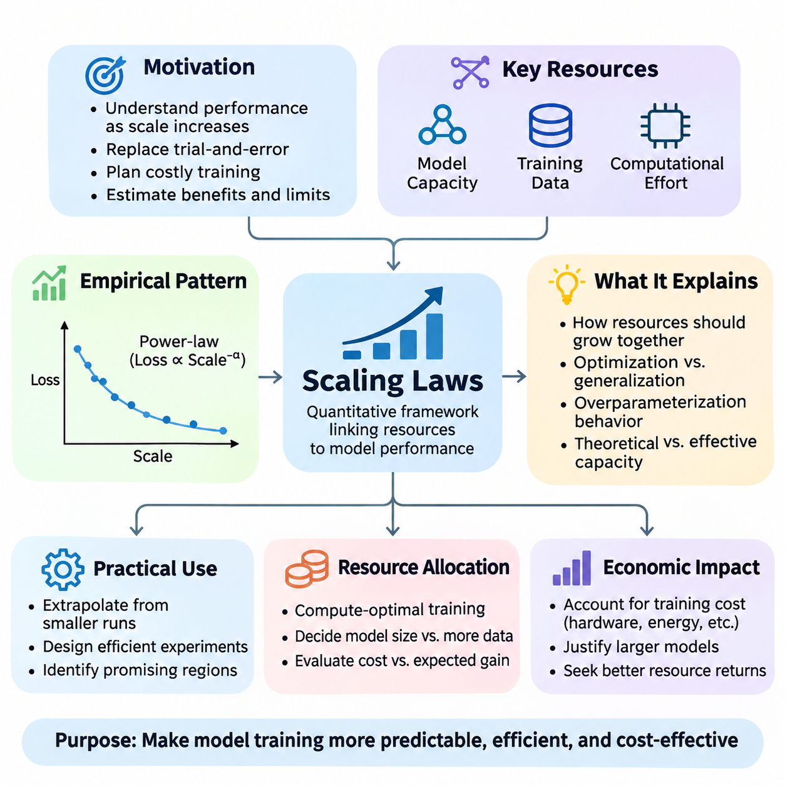
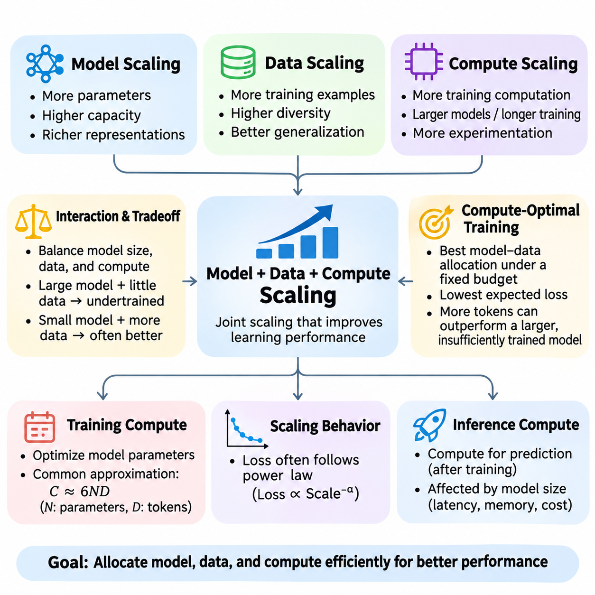
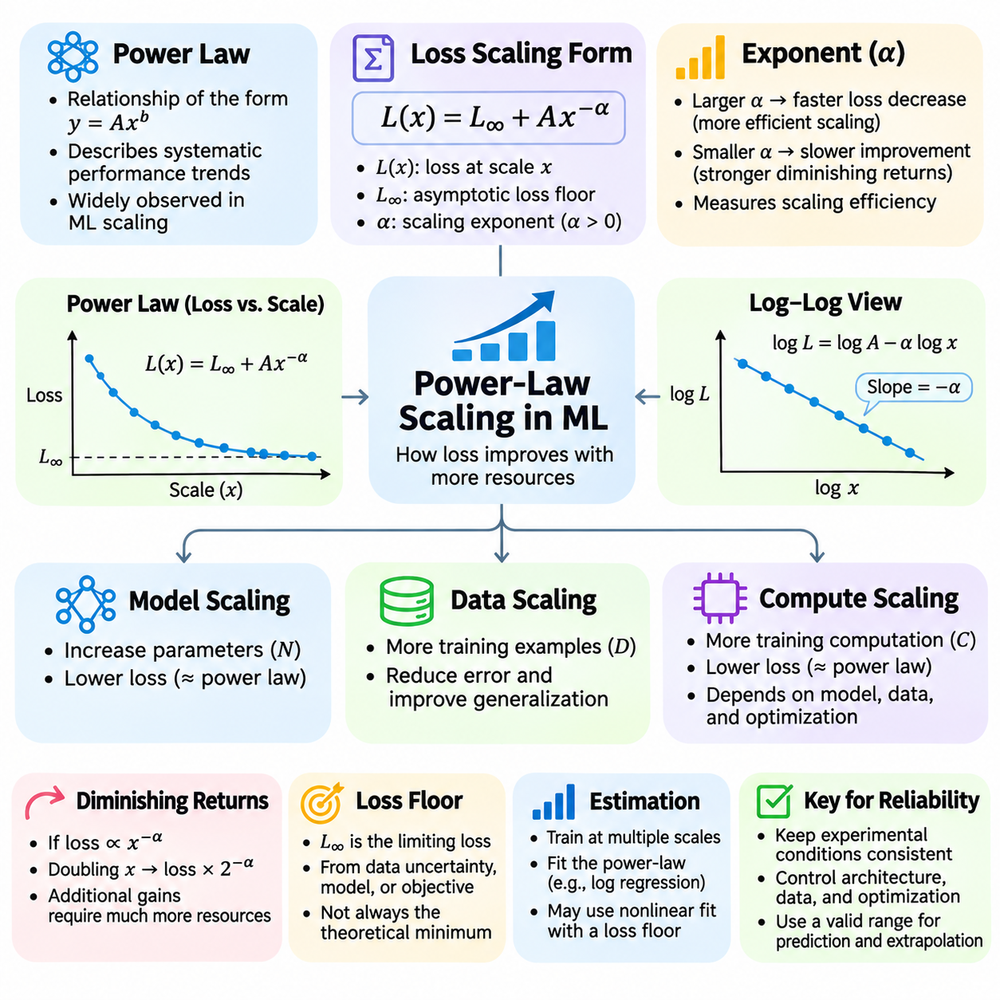
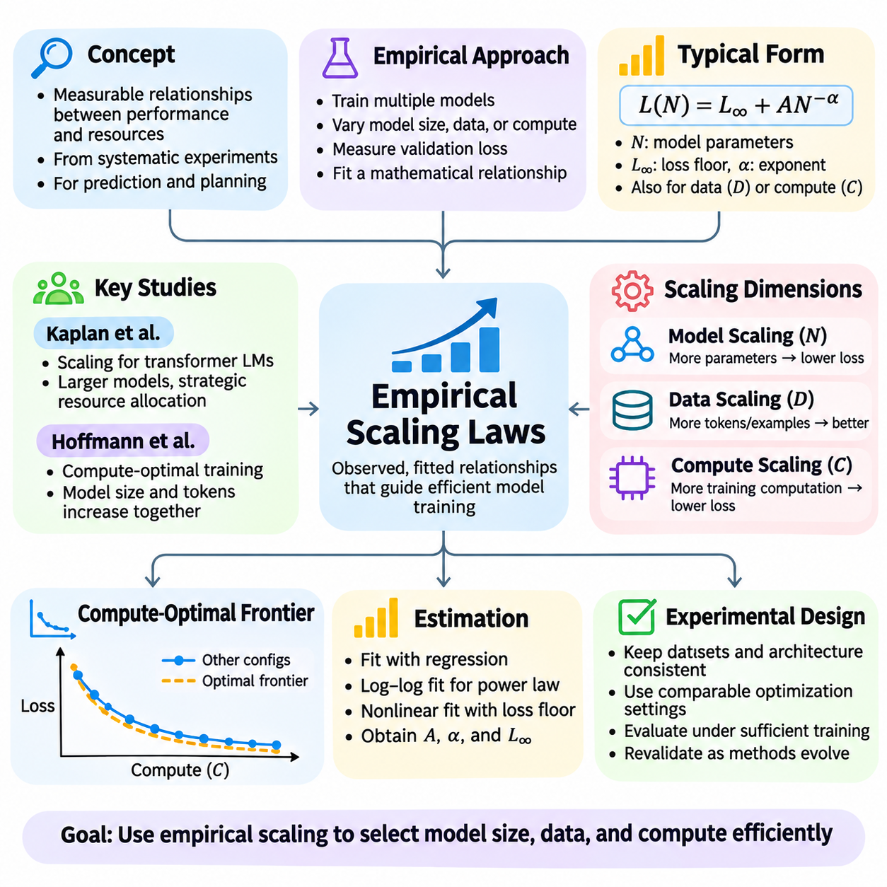
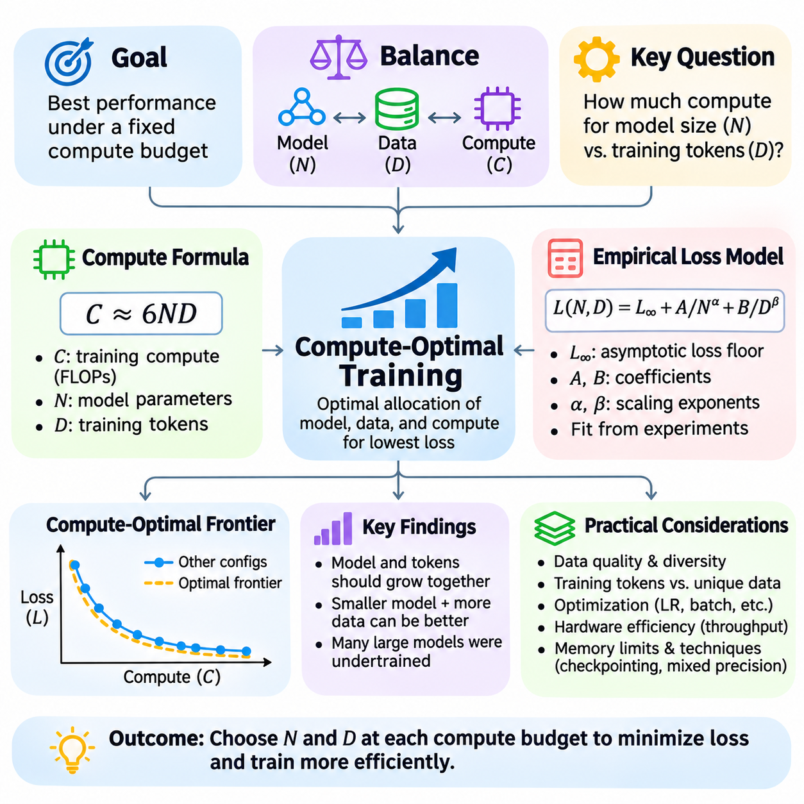
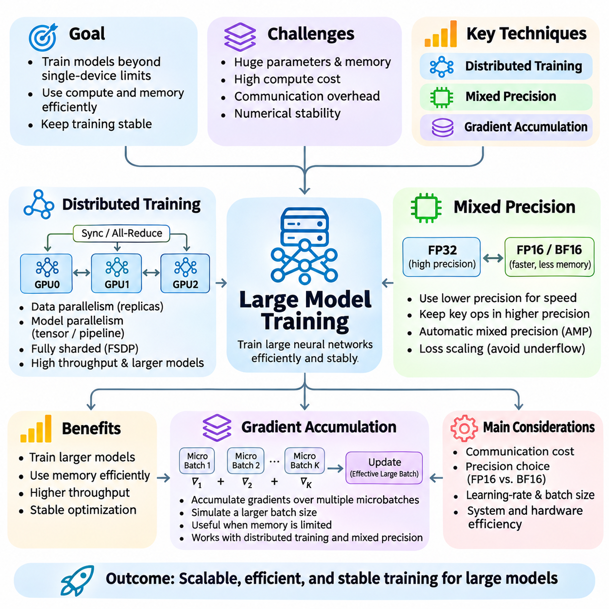
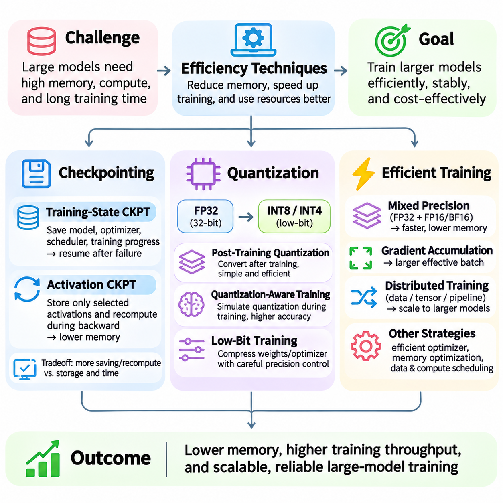
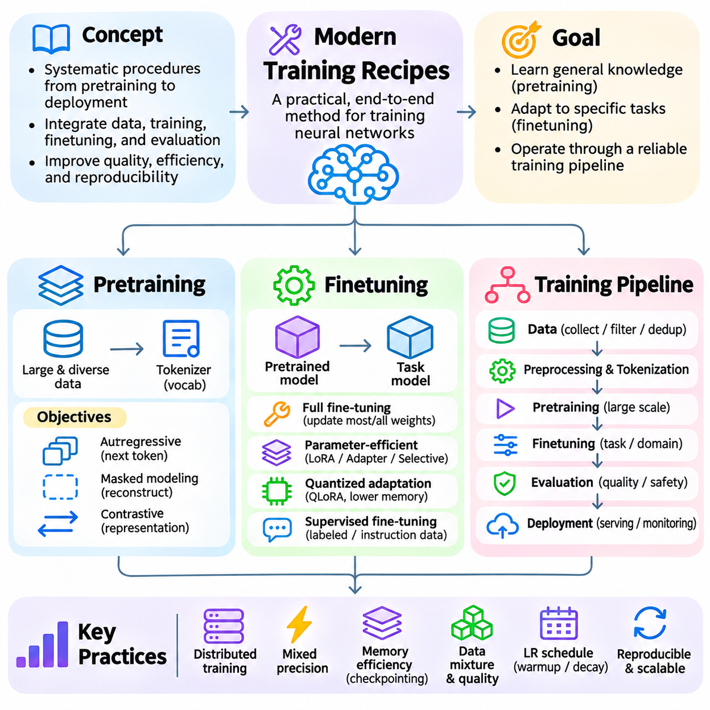
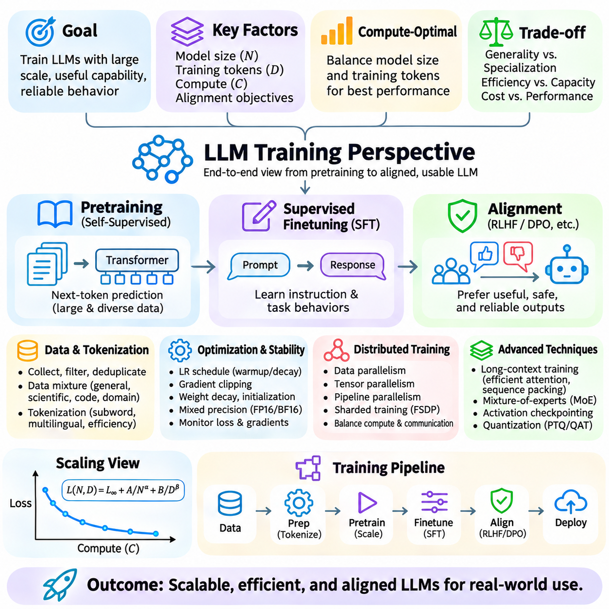

**Volume 06. Optimization and Generalization in ML**

# 06. Scaling Laws and Modern Training

## 06.00 Why Scaling Laws

{width="7.268055555555556in" height="7.268055555555556in"}

Scaling laws provide a systematic framework for understanding how machine learning performance changes as models, datasets, and computational resources increase. Rather than treating model development as a sequence of isolated experiments, scaling laws reveal measurable relationships between resource allocation and predictive performance. These relationships help researchers anticipate the benefits and limitations of larger learning systems.

The importance of scaling laws emerged as deep learning models became increasingly expensive to train. Traditional experimentation often relied on trial and error, requiring numerous architectural modifications and hyperparameter searches. As training costs increased, this approach became less practical. Scaling laws introduced a quantitative perspective that connects model development decisions with expected improvements in learning performance.

Modern machine learning systems depend on three closely related resources: model capacity, training data, and computational effort. Model capacity determines the complexity of functions a neural network can represent, while training data provides information from which useful patterns are learned. Computational effort determines how extensively the model can process that information and update its parameters during optimization.

Increasing model size does not automatically guarantee better performance. A larger neural network may possess greater representational capacity but fail to exploit it when training data or computational resources are insufficient. Similarly, expanding a dataset may provide limited benefits when the model cannot represent its underlying complexity. Scaling laws help identify how these resources should grow together to support effective learning.

One fundamental motivation for studying scaling laws is the observation that model performance often improves predictably as resources increase. Across certain model families and training conditions, empirical studies have identified approximately power-law relationships between validation loss and resource quantities. These patterns suggest that improvements in performance can follow relatively smooth trends rather than occurring through unpredictable architectural breakthroughs alone.

Power-law behavior is particularly valuable because it enables extrapolation from smaller experiments. Researchers can train several models at different scales, measure their performance, and estimate how larger configurations might behave. Although such predictions remain uncertain outside the observed experimental regime, they provide a practical basis for planning expensive training runs before committing substantial computational resources.

Scaling laws also clarify the relationship between optimization and generalization. Optimization concerns how effectively a learning algorithm minimizes its training objective, whereas generalization describes performance on previously unseen data. Increasing model size or training duration may improve optimization, but the resulting generalization depends on data quality, distributional characteristics, regularization, and the training procedure.

In classical statistical learning, increasing model complexity was often associated with a greater risk of overfitting. Modern overparameterized neural networks demonstrate more complicated behavior, including regimes in which larger models generalize better despite containing far more parameters than training examples. Scaling laws provide an empirical framework for examining these phenomena without assuming that parameter count alone determines generalization quality.

Another important motivation is the need to distinguish theoretical capacity from effective learning capacity. A model containing billions of parameters may be capable of representing extremely complex functions, yet its practical performance depends on the optimization process and available training signals. Scaling analysis therefore examines achieved performance under specified training conditions rather than relying exclusively on architectural size.

The economic implications of scaling laws are substantial. Training advanced neural networks requires accelerators, memory, storage, networking infrastructure, electricity, and engineering effort. Each additional increase in model size may introduce significant financial and operational costs. Scaling laws help estimate whether the expected performance improvement justifies the additional investment and whether alternative resource allocations offer better returns.

Compute-optimal training illustrates why resource allocation matters. Under a fixed computational budget, researchers must decide how much computation to devote to increasing model parameters and how much to processing additional training tokens or examples. An excessively large model trained on insufficient data may perform worse than a smaller model trained more extensively, even when both consume similar computational resources.

Scaling laws also support decisions about experimental design. Instead of immediately training the largest possible model, engineers can conduct controlled experiments using smaller configurations. By varying model size, dataset size, and training computation, they can estimate performance trends and identify promising operating regions. This strategy reduces unnecessary experimentation and improves the efficiency of research programs.

However, reliable scaling analysis requires careful experimental control. Comparisons become misleading when architecture, data quality, optimization settings, evaluation procedures, or training objectives change simultaneously. Researchers must distinguish genuine scaling effects from improvements caused by unrelated engineering decisions. Consistent experimental conditions are therefore essential when interpreting observed relationships.

The relevance of scaling laws extends beyond large language models. Similar questions arise in computer vision, speech recognition, generative modeling, reinforcement learning, and multimodal systems. Each domain has different data structures, learning objectives, and computational requirements. Consequently, scaling relationships observed in one domain should not be assumed to transfer directly to another without empirical validation.

In computer vision, scaling decisions may involve image resolution, dataset diversity, network depth, and parameter count. Higher-resolution images can provide additional visual information but also increase memory consumption and computational complexity. Larger vision models may benefit from extensive pretraining datasets, although performance improvements depend on architecture, augmentation strategies, and the characteristics of downstream tasks.

In language modeling, scaling laws have influenced the development of large pretrained transformer systems. Researchers investigate how prediction loss changes with parameter count, training-token quantity, and computational expenditure. These relationships guide decisions about model size and training duration, while downstream evaluations remain necessary to determine whether lower language-modeling loss produces meaningful improvements in specific capabilities.

Scaling laws are equally relevant to foundation models trained across multiple tasks and modalities. Such systems must allocate capacity among language, vision, audio, and potentially action representations. Increasing total parameters may not improve every capability equally. The composition and balance of training data can become as important as its overall quantity, making multidimensional scaling analysis increasingly necessary.

An additional motivation comes from diminishing returns. Many empirical scaling relationships indicate that achieving progressively smaller improvements in loss requires increasingly large resource investments. A model may continue improving as computation increases, but each additional unit of performance improvement can become more expensive. Understanding this behavior helps organizations establish realistic performance targets and computational budgets.

Scaling laws should nevertheless be interpreted as empirical regularities rather than universal guarantees. Their fitted coefficients and exponents depend on the model family, dataset, optimization method, and evaluation metric. Architectural innovations, changes in data distributions, or new training objectives can alter previously observed trends. Predictions beyond the measured range therefore require caution and independent verification.

Data quality introduces another limitation to simple scaling assumptions. Increasing the number of training examples is not equivalent to increasing the amount of useful information. Duplicate samples, incorrect labels, distributional imbalance, and low-quality content can reduce the benefits of larger datasets. Effective scaling requires attention to data diversity, relevance, filtering, and the information contributed by additional samples.

The availability of high-quality training data also influences long-term scaling strategies. When suitable datasets become difficult to expand, researchers may investigate synthetic data, improved sampling, curriculum learning, and more efficient use of existing examples. These approaches can change the relationship between raw dataset size and learning performance, demonstrating that scaling is not exclusively a matter of collecting more data.

Hardware limitations create further challenges. Larger models require greater memory capacity, faster communication, and efficient coordination across multiple accelerators. Distributed training introduces synchronization overhead, while numerical precision and memory-management strategies influence throughput and stability. Consequently, theoretical computational requirements must be distinguished from actual training time and achievable hardware utilization.

Scaling laws connect these practical engineering constraints with broader questions about learning efficiency. A system that achieves a target performance level using fewer parameters, fewer examples, or less computation is more efficient than one requiring substantially greater resources under comparable conditions. This perspective encourages researchers to evaluate algorithmic improvements alongside increases in computational scale.

From a scientific perspective, scaling laws provide evidence about the behavior of learning systems across different operating regimes. They allow researchers to formulate hypotheses about capacity, data efficiency, and optimization dynamics. When observed performance deviates from predicted trends, those deviations may reveal architectural limitations, data bottlenecks, optimization failures, or changes in the underlying learning regime.

For practical AI development, scaling laws transform model training from an exclusively experimental activity into a more predictable engineering process. They support capacity planning, computational budgeting, training configuration, and performance forecasting. Their greatest value lies not in guaranteeing future results, but in providing a quantitative foundation for making informed decisions under limited resources.

Ultimately, understanding why scaling laws matter is essential for modern machine learning engineering. Model capacity, training data, computation, optimization, and generalization must be considered as interconnected elements of a learning system. Scaling laws establish a foundation for studying these relationships and preparing for more advanced topics, including empirical power laws, compute-optimal training, distributed learning, and efficient foundation-model development.

## 06.01 Model Data Compute Scaling

{width="7.268055555555556in" height="7.268055555555556in"}

Model, data, and compute scaling represent three fundamental dimensions of modern machine learning development. Model scaling increases the number of trainable parameters and the representational capacity of neural networks. Data scaling expands the quantity and diversity of training examples, while compute scaling increases the computational resources available for optimization. Their interaction determines how effectively learning systems improve with additional resources.

Model scaling primarily concerns the relationship between neural network capacity and predictive performance. Increasing the number of parameters allows a model to represent more complex functions, capture subtle statistical relationships, and potentially learn richer internal representations. However, larger models also require additional memory, computational operations, and carefully designed optimization strategies to achieve their theoretical capabilities.

The number of parameters is a convenient measure of model scale, but it does not fully describe architectural efficiency. Two neural networks containing similar parameter counts may exhibit different performance because of their connectivity, activation functions, attention mechanisms, or normalization strategies. Consequently, meaningful scaling analysis should distinguish parameter growth from improvements caused by architectural design and computational efficiency.

Data scaling examines how model performance changes as the number of training examples increases. Larger datasets generally expose learning algorithms to more variations, patterns, and statistical relationships. This additional information can reduce estimation errors and improve generalization to unseen observations. Nevertheless, the benefits depend on whether new examples provide meaningful information beyond what the existing dataset already contains.

Dataset diversity is often as important as dataset size. A collection containing millions of nearly identical samples may contribute less useful information than a smaller dataset representing varied environments and conditions. Effective data scaling therefore requires attention to sampling strategies, label accuracy, distributional coverage, and redundancy. These factors determine how efficiently additional data contributes to model improvement.

Compute scaling describes the relationship between computational expenditure and learning performance. Training computation is commonly measured in floating-point operations, although actual execution time also depends on hardware efficiency and system configuration. Increasing computational resources can support larger models, longer training schedules, larger batches, and more extensive experimentation, but these alternatives do not necessarily produce equivalent improvements.

For dense transformer language models, a commonly used approximation expresses training computation as C ≈ 6ND, where N represents the number of model parameters and D represents the number of training tokens. This simplified relationship captures the dominant computational cost of forward and backward propagation under particular assumptions. Actual requirements vary with architecture, sequence length, attention operations, and implementation details.

The interaction between model size and dataset size introduces an important resource allocation problem. A large model trained on relatively few examples may remain undertrained, while a small model exposed to enormous datasets may eventually encounter capacity limitations. Effective scaling therefore requires balancing representational capacity with the amount of information available for learning and the computation required to process it.

Under a fixed computational budget, increasing model parameters generally reduces the amount of training data that can be processed if other conditions remain unchanged. Conversely, choosing a smaller model may allow substantially more optimization steps or training tokens. This tradeoff motivates compute-optimal training, which seeks the combination of model size and training duration that achieves the lowest expected loss within a specified budget.

Empirical research on language models has demonstrated that parameter count and training-token quantity should often increase together when computational resources expand. This observation challenges the assumption that allocating most additional computation to model size is always beneficial. A smaller model trained on more tokens can outperform a larger, insufficiently trained model under comparable training-compute constraints.

The relationship between model capacity and data availability also influences generalization. Larger models can potentially capture more complex relationships, but their performance depends on the quality and representativeness of training examples. Additional data can improve generalization by exposing the model to broader variations, although distribution shifts, noisy labels, and duplicated examples may weaken the expected benefits.

Scaling behavior is frequently characterized through empirical loss functions that depend on model size, dataset size, and computation. Within suitable experimental regimes, prediction loss often decreases approximately according to power-law relationships. Such models enable researchers to estimate the marginal benefits of increasing each resource and identify whether performance improvements are becoming progressively more expensive.

An important distinction exists between training compute and inference compute. Training compute measures the resources required to optimize model parameters, whereas inference compute represents the operations needed to generate predictions after training. Increasing model size may improve predictive quality but also raise inference latency, memory requirements, and deployment costs. These consequences must be considered when selecting practical scaling strategies.

For applications requiring frequent inference, a smaller model trained for longer may provide a favorable balance between training expenditure and operational efficiency. Although additional training tokens increase initial computational costs, the resulting model may require fewer resources during deployment. This consideration becomes especially important when models serve millions of requests or operate continuously on resource-constrained hardware.

Hardware utilization significantly affects the practical interpretation of compute scaling. Theoretical floating-point operation counts do not directly determine elapsed training time. Accelerator throughput, memory bandwidth, communication latency, numerical precision, and parallelization efficiency influence actual performance. Consequently, scaling experiments should report both computational estimates and measured system behavior whenever possible.

Distributed training enables model and compute scaling beyond the capacity of individual accelerators. Data parallelism distributes training examples across devices, while tensor and pipeline parallelism partition model computations. These techniques increase available computational capacity but introduce communication and synchronization overhead. Their efficiency depends on network bandwidth, workload characteristics, and implementation quality.

Data scaling also introduces infrastructure challenges. Large datasets require efficient storage, preprocessing, shuffling, and delivery to training accelerators. When input pipelines cannot supply data quickly enough, expensive computational resources remain underutilized. Effective scaling therefore requires coordinated improvements in data engineering and training infrastructure rather than focusing exclusively on model architecture.

Scaling relationships are not necessarily identical across machine learning domains. Image classification, language modeling, speech recognition, and reinforcement learning differ in their data structures and learning objectives. In reinforcement learning, for example, the quantity of collected experience interacts with exploration and environment dynamics. Domain-specific experiments are essential for determining appropriate scaling behavior.

Modern multimodal models introduce additional complexity because training resources must be distributed across several data modalities. Language tokens, image patches, audio segments, and action trajectories differ in information density and computational cost. A simple measure of total dataset size may therefore be insufficient. Scaling analysis must consider modality balance, representation quality, and the relative importance of different learning objectives.

Practical scaling experiments typically begin with several controlled model configurations and dataset sizes. Researchers measure validation loss, training computation, throughput, and generalization performance while maintaining consistent optimization settings. The resulting measurements can be used to fit empirical relationships and estimate larger configurations. Reliable extrapolation requires sufficient experimental coverage and careful assessment of uncertainty.

Scaling decisions should also account for diminishing returns and resource constraints. Doubling model parameters, training data, or computational expenditure rarely guarantees a proportional improvement in predictive performance. The most effective investment depends on the current operating regime and the bottleneck limiting further progress. Identifying that bottleneck is more valuable than increasing resources indiscriminately.

Data quality, architecture, and optimization algorithms can shift observed scaling relationships. Improved data filtering may increase the value of each training example, while more efficient architectures may achieve comparable performance using fewer parameters. Better optimizers and learning-rate schedules can reduce the computation needed to reach a target loss. These improvements demonstrate that scaling efficiency depends on algorithmic progress as well as resource growth.

For real-world AI systems, model, data, and compute scaling must ultimately be evaluated against deployment requirements. A model achieving excellent benchmark performance may be unsuitable when memory consumption, inference latency, energy usage, or maintenance costs exceed operational limits. Engineering decisions should therefore optimize the complete system rather than treating training loss as the only measure of success.

Understanding the interaction among model size, dataset size, and computational resources establishes the foundation for modern training strategies. These three dimensions jointly influence optimization efficiency, generalization, infrastructure requirements, and economic feasibility. Their balanced allocation enables more predictable model development and provides the conceptual basis for power-law analysis, empirical scaling laws, and compute-optimal training.

## 06.02 Power Law Behavior

{width="7.268055555555556in" height="7.268055555555556in"}

Power-law behavior describes a mathematical relationship in which one quantity changes proportionally to another quantity raised to a constant exponent. In machine learning, such relationships frequently characterize how prediction loss decreases as model parameters, training data, or computational resources increase. Their importance lies in revealing systematic performance trends across different scales and providing a quantitative foundation for understanding modern neural network training.

A general power-law relationship can be expressed as y = Ax\^b, where x represents a scaling variable, A is a proportionality constant, and b determines the rate of change. In learning systems, decreasing loss is often represented by a negative exponent, producing relationships such as L(x) = L∞ + Ax\^(-α). Here, L∞ represents an asymptotic loss floor, while α controls how rapidly performance improves as resources increase.

The exponent of a power law provides important information about scaling efficiency. A larger positive value of α in a decreasing-loss relationship indicates that loss approaches its asymptotic limit more rapidly as the scaling variable increases. A smaller exponent indicates slower improvement and stronger diminishing returns. Consequently, estimating scaling exponents helps researchers compare learning efficiency across model families, datasets, and training configurations.

Power-law relationships become especially visible when measurements are represented on logarithmic scales. Taking logarithms of a simple relationship such as y = Ax\^b produces log(y) = log(A) + b log(x). This transformation converts the power law into a linear relationship, allowing its exponent to be estimated from the slope. When an additive loss floor exists, the logarithmic transformation must instead be applied to the excess loss above that floor.

In neural network scaling studies, researchers frequently examine validation loss as a function of parameter count. Within suitable experimental regimes, larger models tend to achieve lower prediction loss when trained with sufficient data and computation. This relationship can often be approximated by a power law, although its exponent depends on architecture, training procedures, and dataset characteristics. Parameter scaling therefore provides an empirical description rather than a universal guarantee.

Data scaling exhibits related behavior. Increasing the number of training examples can reduce prediction error by exposing models to more statistical information and broader variations. Under controlled conditions, validation loss may decrease approximately according to a power-law relationship with dataset size. However, duplicated examples, noisy labels, limited diversity, and distributional imbalance can change the effective amount of useful information and alter the observed scaling exponent.

Compute scaling examines how performance changes with the total computational effort invested in training. Empirical studies often model the relationship between training compute and achievable loss using power-law approximations. These relationships are useful for estimating the resources required to reach a target performance level. Nevertheless, the measured trend depends on whether model size, training duration, and optimization settings are allocated efficiently.

The interaction among model size, data quantity, and computation complicates simple power-law interpretations. A model may follow a predictable parameter-scaling trend only while sufficient training data and computational resources remain available. Once another resource becomes limiting, performance may deviate from the expected relationship. This demonstrates why scaling laws must be interpreted within the experimental conditions under which they were established.

Power-law behavior also explains why increasing resources produces diminishing improvements in many learning systems. If excess loss decreases as x\^(-α), doubling the scaling variable multiplies that excess loss by 2\^(-α). For small positive values of α, this reduction is modest. Achieving substantial additional improvements may therefore require disproportionately large increases in computational resources, training data, or model capacity.

The distinction between absolute loss and reducible loss is essential when interpreting scaling relationships. An irreducible component may arise from uncertainty in the prediction problem, while additional limitations can reflect the model family or training objective. A fitted asymptotic loss floor represents the limiting value implied by the empirical model, but it should not automatically be interpreted as the theoretical minimum achievable by every possible learning system.

Estimating power-law parameters requires experiments across multiple scales. Researchers train models using controlled configurations, measure performance, and fit mathematical relationships to the resulting observations. Logarithmic regression can provide an initial estimate when the appropriate transformation is valid. More sophisticated nonlinear fitting methods may be necessary when an asymptotic loss floor or multiple interacting scaling variables must be considered.

Reliable estimation depends on experimental consistency. Changes in architecture, optimizer, learning-rate schedule, dataset composition, or evaluation procedures can introduce effects unrelated to scaling. If these factors vary simultaneously, the fitted exponent may reflect several underlying mechanisms rather than the influence of a single resource. Controlled experimental design is therefore necessary to obtain interpretable and reproducible scaling relationships.

The range of observed scales strongly influences prediction reliability. A power law fitted to small models may describe nearby configurations accurately but fail when extrapolated to substantially larger systems. New optimization difficulties, memory limitations, data bottlenecks, or architectural transitions can change the underlying relationship. Scaling predictions should therefore include uncertainty estimates and be updated as larger experimental measurements become available.

Power-law behavior is not restricted to language modeling. Similar empirical patterns have been investigated in computer vision, speech processing, generative modeling, and other machine learning domains. However, the relevant scaling variables and exponents may differ substantially. Image resolution, dataset diversity, model architecture, and task complexity can influence the relationship between resource growth and predictive performance.

Modern foundation models introduce additional challenges because multiple learning objectives and data modalities may interact. A model trained on text, images, audio, and action sequences does not necessarily exhibit one universal scaling exponent. Different capabilities may improve at different rates, while changes in modality balance can alter training dynamics. Multimodal scaling therefore requires more detailed empirical analysis than a single-variable power law.

Power-law relationships also support computational budgeting and strategic planning. By estimating how loss changes with additional resources, engineers can compare alternative training configurations before launching expensive experiments. These estimates help identify whether increasing model parameters, collecting more data, or extending training is likely to provide the greatest benefit under a particular resource constraint.

An important practical application is predicting the computational cost of reaching a target loss. If the fitted relationship remains valid, researchers can invert the power-law expression to estimate the required resource scale. However, predictions become increasingly sensitive to parameter uncertainty when the desired loss approaches the fitted asymptotic floor. Consequently, ambitious performance targets require careful validation of the assumed scaling regime.

Power-law analysis can also reveal changes in learning efficiency. When measured performance improves faster than an established trend, the difference may indicate better architecture, higher-quality data, or more effective optimization. Conversely, unexpectedly slow improvement may suggest insufficient training, numerical instability, or resource bottlenecks. Deviations from scaling predictions can therefore provide valuable diagnostic information.

Scaling exponents should not be treated as intrinsic constants of intelligence or universal properties of neural networks. They are empirical measurements associated with particular tasks, model families, data distributions, and training procedures. Even when two systems exhibit similar exponents, they may differ substantially in their loss floors, computational efficiency, and downstream capabilities. Meaningful comparisons require examining the complete scaling relationship.

Another limitation arises when evaluation metrics behave differently from training loss. Cross-entropy loss may improve smoothly with increasing scale, while classification accuracy, reasoning benchmarks, or task-success rates may exhibit nonlinear or threshold-like behavior. A smooth power-law trend in one metric does not guarantee an equivalent trend in another. Researchers must therefore distinguish the scaling of optimization objectives from the scaling of practical capabilities.

In real-world engineering, power-law behavior provides a useful bridge between theoretical modeling and experimental observation. It transforms performance measurements into interpretable relationships that support forecasting, resource allocation, and experimental planning. Its value depends on careful measurement, appropriate mathematical assumptions, and recognition of the limits of extrapolation beyond observed training conditions.

Ultimately, understanding power-law behavior is essential for interpreting modern scaling laws. It explains why performance can improve predictably with additional resources while also revealing the diminishing returns associated with continued scaling. By combining mathematical relationships with controlled experiments, researchers can develop more efficient training strategies and establish a foundation for empirical scaling laws and compute-optimal learning.

## 06.03 Empirical Scaling Laws

{width="7.268055555555556in" height="7.268055555555556in"}

Empirical scaling laws describe measurable relationships between machine learning performance and the resources used during training. Unlike theoretical guarantees derived from mathematical assumptions, these laws emerge from systematic experiments across model sizes, dataset quantities, and computational budgets. Their purpose is to identify regular patterns that support performance prediction, resource planning, and more efficient development of large neural networks.

The empirical approach begins by training multiple models under controlled conditions. Researchers vary parameter counts, training-token quantities, or computational expenditure while measuring validation loss and other performance indicators. The resulting observations reveal whether learning performance follows a consistent mathematical relationship. Such experiments transform isolated training results into quantitative evidence about how learning systems behave across different scales.

Early influential studies of neural language models identified approximately power-law relationships between cross-entropy loss and model size, dataset size, and training computation. These findings suggested that performance could improve predictably over substantial ranges of scale. However, the fitted relationships depended on experimental assumptions, including architecture, data distribution, optimization procedures, and the range of resources investigated.

A commonly used empirical formulation expresses prediction loss as L(N) = L∞ + AN\^(-α), where N represents model parameters, A is a fitted coefficient, and α is a scaling exponent. The term L∞ represents an asymptotic loss floor. Similar expressions can describe relationships involving dataset size D or computational budget C. These formulations approximate observed behavior rather than establishing universal mathematical laws.

Kaplan and colleagues demonstrated influential scaling relationships for autoregressive transformer language models. Their experiments examined performance across variations in parameter count, dataset size, and training compute. The resulting analysis suggested that larger models could achieve better loss values and that training resources should be allocated strategically. Their conclusions became an important foundation for subsequent research on efficient language-model development.

Later research by Hoffmann and colleagues revisited compute-optimal language-model training. Their findings indicated that many previously developed large language models had been trained on relatively insufficient quantities of data. Under their experimental assumptions, compute-optimal training required model parameters and training tokens to increase at approximately comparable rates as computational budgets expanded.

These studies illustrate why empirical scaling laws must be interpreted in relation to their experimental settings. Different training schedules, data mixtures, architectures, and optimization strategies can produce different fitted relationships. A scaling recommendation obtained from one model family may not remain optimal after substantial changes in training methodology. Empirical laws therefore require continuous validation as machine learning systems evolve.

Model-size scaling investigates how validation loss changes when neural networks contain increasing numbers of trainable parameters. Larger models can represent more complex relationships and potentially achieve lower prediction errors. However, meaningful comparisons require sufficient training for each configuration. If larger models receive inadequate computation or data, the measured relationship may reflect undertraining rather than inherent limitations of model capacity.

Dataset scaling examines performance improvements associated with increasing the number of training examples or tokens. In language modeling, additional tokens can expose models to more linguistic structures, facts, and contextual relationships. Nevertheless, the effective contribution of data depends on quality, diversity, and duplication. Consequently, raw token count alone may not accurately represent the information available for learning.

Compute scaling measures how achievable performance changes with total training computation. Researchers commonly estimate compute using floating-point operations, although practical execution costs also depend on hardware efficiency. Under a fixed computational budget, different combinations of model size and training duration can produce different losses. Empirical scaling analysis helps identify configurations that use available computation more effectively.

A central concept is the compute-optimal frontier, which represents the lowest achievable loss among configurations evaluated under a given computational budget. Models that are excessively large or trained on insufficient data may lie away from this frontier. By estimating the frontier across multiple budgets, researchers can derive practical recommendations for selecting model sizes and training-token quantities.

Empirical scaling laws are often estimated using regression techniques. Researchers collect performance measurements across several resource scales and fit mathematical functions to the observations. Logarithmic transformations can simplify power-law estimation, while nonlinear regression can accommodate additive loss floors. The resulting coefficients and exponents provide compact descriptions of observed performance trends.

Experimental design strongly influences the reliability of fitted scaling relationships. Models should be evaluated using consistent datasets, comparable architectures, and clearly documented optimization procedures. Learning-rate schedules, batch sizes, regularization methods, and stopping criteria can affect measured loss. Without adequate control, apparent scaling effects may reflect unrelated changes in experimental configuration.

Extrapolation is one of the most valuable applications of empirical scaling laws. Researchers can use measurements from smaller training runs to estimate the performance of larger models before committing substantial resources. However, predictions become less reliable as the target scale moves farther beyond observed experiments. Confidence intervals, alternative model fits, and intermediate-scale validation can help quantify uncertainty.

Scaling relationships may also change when training enters a different operating regime. Data scarcity, optimization instability, memory limitations, or architectural modifications can alter previously observed trends. Such changes may produce deviations from fitted power laws or reveal new bottlenecks. Researchers should therefore treat empirical scaling models as conditional approximations rather than permanent descriptions of learning behavior.

The relationship between validation loss and downstream performance introduces another important consideration. A model may exhibit predictable improvements in cross-entropy loss while showing less regular changes in classification accuracy, reasoning performance, or task completion rates. Benchmark scores may also depend on evaluation design and statistical variability. Consequently, scaling laws for training objectives should not automatically be interpreted as laws governing every capability.

Empirical scaling research extends beyond language models into computer vision, speech recognition, and multimodal learning. Larger datasets and model architectures can improve performance across these domains, but scaling exponents and resource requirements differ. Image resolution, modality composition, task difficulty, and data quality influence the observed relationships. Domain-specific experimentation remains essential for reliable conclusions.

Modern multimodal foundation models introduce challenges because training resources are distributed across language, vision, audio, and potentially action representations. Increasing total data volume may improve some capabilities more than others. Different modalities also impose different computational costs. Empirical analysis must therefore examine resource allocation and performance across multiple objectives rather than relying exclusively on aggregate model size.

Data quality can shift empirical scaling curves substantially. Filtering low-quality examples, removing duplicates, improving labels, and balancing data distributions may increase learning efficiency without increasing raw dataset size. Such improvements complicate comparisons between experiments conducted with different data pipelines. Reliable scaling studies should document dataset construction and distinguish quantity-driven gains from quality-driven improvements.

Hardware and implementation efficiency also influence practical scaling decisions. Two training systems with similar theoretical computation may differ in elapsed time, energy consumption, and financial cost. Distributed communication, memory management, numerical precision, and accelerator utilization affect realized throughput. Empirical scaling models based on floating-point operations should therefore be complemented by measurements of operational efficiency.

Empirical scaling laws support research planning by connecting expected performance improvements with resource investments. Organizations can estimate whether additional computation should support larger models, longer training, or better datasets. These estimates reduce uncertainty when planning expensive experiments. Nevertheless, economic decisions must also consider inference costs, deployment constraints, and the expected value of incremental performance improvements.

Ultimately, empirical scaling laws provide a quantitative framework for understanding how machine learning systems respond to increasing resources. Their strength lies in reproducible measurements, mathematical fitting, and carefully validated predictions. By integrating model capacity, data availability, computational budgets, and experimental uncertainty, they establish a practical foundation for compute-optimal training and modern large-scale AI engineering.

## 06.04 Compute Optimal Training

{width="7.268055555555556in" height="7.268055555555556in"}

Compute-optimal training is a resource allocation strategy that seeks the best achievable model performance under a fixed computational budget. Instead of maximizing parameter count or training duration independently, it balances model capacity, dataset size, and optimization effort. This approach is especially important for large neural networks because inefficient resource allocation can substantially increase training costs without producing corresponding improvements in predictive performance.

The central problem is determining how much computation should be devoted to increasing model parameters and how much should be used to process additional training examples. Larger models provide greater representational capacity, while longer training exposes parameters to more information. Under limited resources, increasing one dimension restricts the other. Compute-optimal training identifies the combination that minimizes expected validation loss.

For dense transformer language models, training computation is often approximated by C ≈ 6ND, where C denotes floating-point operations, N represents model parameters, and D represents training tokens. This expression assumes a particular computational structure and primarily captures forward and backward propagation costs. Although simplified, it illustrates how increasing model size reduces the number of tokens that can be processed under a fixed compute budget.

A common empirical loss model is L(N,D) = L∞ + A/N\^α + B/D\^β, where L∞ represents an asymptotic loss floor and the remaining terms approximate limitations associated with model capacity and training data. The coefficients and exponents are estimated experimentally. By minimizing this expression subject to a computational constraint, researchers can derive approximate compute-optimal relationships between parameters and tokens.

The compute-optimal frontier represents the lowest predicted loss attainable at each computational budget within a specified model family and training regime. Configurations located above this frontier use resources less efficiently than available alternatives. The frontier can be estimated through controlled experiments and empirical scaling laws. Its location changes when architectures, datasets, optimization methods, or training objectives improve.

Early scaling studies emphasized the strong benefits of increasing model parameters and suggested particular allocations between model size and training data. Subsequent research demonstrated that many large language models were relatively undertrained. This finding shifted attention toward processing more training tokens rather than allocating most additional computation to increasing parameter counts.

The Chinchilla scaling study by Hoffmann and colleagues provided an influential example of compute-optimal training. Under its experimental assumptions, model parameters and training tokens should increase at approximately comparable rates as training compute grows. The study demonstrated that a smaller model trained on substantially more data could outperform a larger model trained with a similar computational budget.

Compute-optimal recommendations are not universal constants. Their fitted exponents depend on model architecture, dataset composition, optimization settings, and the experimental range. Changes in token quality, sequence length, training objectives, or model structure can alter the optimal allocation. Therefore, scaling relationships should be validated for the target system rather than transferred mechanically from earlier studies.

Data quality plays a fundamental role in compute-optimal training. Processing more tokens does not necessarily improve performance when the additional data contains duplicates, noise, or limited information. High-quality examples can provide stronger learning signals than large quantities of redundant content. Consequently, the effective information contributed by training data matters alongside the total number of processed tokens.

The distinction between training tokens and unique data examples is also important. A dataset may be processed repeatedly across multiple epochs, increasing the number of observed tokens without increasing unique information. Repeated exposure can improve optimization, but its benefits may diminish as examples become familiar. Compute-optimal planning should therefore consider data repetition, diversity, and the availability of new training material.

Optimization efficiency influences the practical compute-optimal frontier. Learning-rate schedules, batch sizes, optimizers, and numerical precision affect how effectively computational operations reduce loss. A poorly configured training process may consume substantial resources without approaching the performance achievable by better optimization. Compute-optimal analysis must therefore distinguish resource allocation problems from optimization failures.

Hardware efficiency introduces another dimension to training decisions. Two configurations requiring similar theoretical floating-point operations may have different execution times because of memory bandwidth, accelerator utilization, and communication overhead. Distributed training can expand available computation but introduces synchronization costs. Practical optimization should consider both theoretical compute and measured training throughput.

Memory constraints can restrict otherwise attractive model configurations. Larger networks require additional storage for parameters, gradients, optimizer states, and intermediate activations. Techniques such as activation checkpointing, mixed-precision training, and parameter sharding reduce memory requirements. However, these methods can introduce additional computation or communication, changing the practical cost of reaching a target loss.

Compute-optimal training also differs from minimizing total lifecycle cost. A model that achieves the lowest training loss under a fixed pretraining budget may be expensive to deploy because of its parameter count and inference requirements. For applications involving extensive inference, smaller models trained on more data may offer better overall economics. Deployment frequency and serving constraints can therefore influence the preferred training configuration.

Inference-aware optimization considers training expenditure together with the cost of generating predictions after deployment. A smaller model may require additional training computation to achieve competitive performance but consume less memory and energy during inference. When the model processes large numbers of requests, these operational savings can outweigh the initial training investment.

Practical compute-optimal analysis begins with controlled experiments across multiple model sizes and training-token budgets. Researchers measure validation loss, computational expenditure, and system throughput while maintaining comparable architectures and optimization procedures. Empirical relationships are fitted to these measurements, allowing the performance of candidate configurations to be estimated before expensive full-scale training begins.

Reliable extrapolation requires attention to uncertainty. A scaling relationship fitted to small experiments may become inaccurate at larger scales because of optimization instability, data limitations, or architectural changes. Researchers can reduce this risk through intermediate-scale experiments and sensitivity analysis. Compute-optimal predictions should be treated as informed estimates rather than guaranteed outcomes.

The optimal allocation of resources can also depend on the evaluation objective. Minimizing language-modeling loss may not produce the best configuration for reasoning, code generation, multimodal understanding, or specialized downstream tasks. Different capabilities may respond differently to additional parameters and training data. Consequently, task-specific evaluations should complement general validation-loss measurements.

Modern foundation-model training often involves several stages, including pretraining, supervised fine-tuning, and preference optimization. Each stage consumes computation and contributes differently to final model behavior. Allocating the entire budget to pretraining may not maximize downstream utility. A broader compute-optimal strategy considers how resources should be distributed across the complete training pipeline.

Multimodal systems further complicate resource allocation because language, images, audio, and action data have different computational requirements and information densities. Increasing one modality may improve certain capabilities while providing limited benefits elsewhere. Compute-optimal multimodal training therefore requires balancing modality-specific datasets, model capacity, and computational expenditure across multiple objectives.

Compute-optimal principles are also relevant to smaller engineering systems. Computer vision models, industrial inspection networks, and robotic perception systems must balance accuracy against limited training and deployment resources. Although their scaling relationships may differ from language models, the underlying principle remains applicable: computational resources should be allocated where they produce the greatest measurable improvement.

Ultimately, compute-optimal training transforms large-scale model development into a constrained optimization problem supported by empirical evidence. It connects scaling laws with practical decisions about parameter counts, training data, optimization methods, and infrastructure. By balancing these factors and accounting for deployment requirements, engineers can improve learning efficiency while reducing unnecessary computational expenditure.

## 06.05 Large Model Training

{width="7.268055555555556in" height="7.268055555555556in"}

Large-model training involves optimizing neural networks whose parameter counts, activation memory, and computational requirements exceed the practical capacity of conventional single-device systems. Modern training infrastructure combines distributed computation, reduced numerical precision, and gradient accumulation to overcome these limitations. These techniques enable larger architectures and datasets while introducing new challenges involving communication, numerical stability, and optimization efficiency.

Distributed training divides computational workloads across multiple accelerators or computing nodes. Its primary objective is to increase available processing capacity and memory while reducing the time required for large-scale optimization. Effective distributed training requires coordinated execution, consistent parameter updates, and efficient communication. The resulting performance depends on how computation and data movement are partitioned across participating devices.

Data parallelism is one of the most widely used distributed training strategies. Each accelerator maintains a replica of the model and processes a different subset of the training batch. After backward propagation, gradients are synchronized across devices, commonly through collective communication operations such as all-reduce. This approach increases aggregate throughput but requires sufficient device memory to store model parameters and associated training states.

Distributed data parallel training typically uses synchronized gradient updates to maintain consistent model replicas. Each worker computes local gradients, which are aggregated before the optimizer updates the parameters. When gradients are averaged correctly, the resulting update can approximate the behavior of training with a larger global batch. However, changes in batch size, learning-rate schedules, and numerical reduction order can influence convergence.

Model parallelism becomes necessary when a neural network cannot fit within the memory of a single accelerator. Instead of replicating the complete model, computation and parameters are distributed across multiple devices. Tensor parallelism partitions operations within individual layers, while pipeline parallelism assigns different groups of layers to separate devices. These strategies enable larger models but introduce additional communication and scheduling complexity.

Pipeline parallelism processes different microbatches through successive model partitions, allowing several accelerators to work concurrently. This overlapping execution can improve utilization, although pipeline bubbles may leave devices temporarily idle. The number of pipeline stages, microbatch count, and scheduling strategy determine efficiency. Balancing computational workloads across stages is essential for minimizing idle time and maintaining high throughput.

Tensor parallelism divides large matrix operations and neural network components across accelerators. For example, transformer attention projections and feedforward layers can be partitioned so that multiple devices jointly execute one layer. This approach reduces per-device parameter storage but requires frequent communication between partitions. High-bandwidth interconnects are therefore especially important for efficient tensor-parallel execution.

Fully sharded data parallelism reduces memory consumption by distributing parameters, gradients, and optimizer states across workers. Rather than storing complete copies of every training component on each device, the system gathers required parameters during computation and redistributes states afterward. This approach can support substantially larger models, although communication overhead and memory scheduling must be carefully managed.

Distributed training efficiency depends on communication bandwidth, latency, and synchronization requirements. As accelerator counts increase, communication can consume a growing fraction of execution time. Techniques such as gradient bucketing, communication overlap, and efficient collective operations reduce this overhead. Strong scaling improves execution time for a fixed workload, while weak scaling maintains efficiency as workload size grows with device count.

Mixed-precision training improves computational efficiency by using numerical formats with different precision levels during optimization. Traditional training often relies on 32-bit floating-point arithmetic, but modern accelerators can execute many operations faster using 16-bit formats. Mixed precision combines lower-precision computation with selected higher-precision operations to reduce memory consumption and improve throughput while preserving acceptable numerical stability.

Two widely used reduced-precision formats are FP16 and BF16. FP16 provides relatively high significand precision but a narrower exponent range, making it more vulnerable to overflow and underflow. BF16 retains the exponent range of FP32 while using fewer significand bits, often improving numerical robustness. The preferred format depends on accelerator support, model characteristics, and the sensitivity of optimization operations.

Automatic mixed precision allows training frameworks to select appropriate numerical formats for different operations. Matrix multiplications and convolutions may execute in reduced precision, while sensitive reductions or normalization operations can use higher precision when required. This selective approach provides much of the performance benefit of low-precision arithmetic without forcing every operation into the same numerical representation.

Loss scaling is commonly used with FP16 training to prevent small gradients from underflowing during backward propagation. The loss is multiplied by a scaling factor before differentiation, and the resulting gradients are unscaled before the optimizer update. Dynamic loss scaling adjusts this factor when numerical overflow is detected. BF16 generally requires less reliance on loss scaling because of its wider exponent range.

Mixed-precision training must be validated for numerical correctness. Reduced precision can introduce rounding errors, unstable gradients, or changes in convergence behavior. Monitoring loss curves, gradient norms, overflow events, and validation performance helps identify problems. Optimizer states and selected accumulations are often maintained in FP32, although exact precision policies depend on the training framework and implementation.

Gradient accumulation enables training with an effective batch size larger than the batch that fits in accelerator memory. Instead of updating parameters after every microbatch, the system accumulates gradients across several forward and backward passes. The optimizer performs an update only after the specified number of accumulation steps. This technique is especially useful when model size or activation memory restricts the physical batch size.

The effective global batch size is commonly calculated as B_effective = B_micro × K × W, where B_micro is the microbatch size per worker, K is the number of accumulation steps, and W is the number of data-parallel workers. This relationship assumes consistent microbatch sizes across workers. The accumulated loss or gradients must be normalized appropriately to reproduce the intended mean-gradient update.

Gradient accumulation does not reduce the total computation required to process a given number of examples. Instead, it exchanges additional sequential execution for lower peak activation-memory requirements. Larger accumulation factors may increase the time between optimizer updates and reduce opportunities for parallel execution. Consequently, accumulation should be selected according to memory constraints, throughput measurements, and optimization behavior.

In distributed environments, gradient accumulation can reduce unnecessary synchronization. Workers may accumulate gradients locally across several microbatches before performing collective communication for an optimizer update. Framework features that temporarily disable gradient synchronization can improve efficiency. However, the final update must correctly aggregate gradients across workers, and synchronization behavior should be verified carefully.

Large effective batch sizes influence optimization dynamics. Increasing batch size reduces the frequency of parameter updates for a fixed number of training examples and may require adjustments to learning rates or scheduling policies. Although larger batches can improve hardware utilization, excessively large batches may reduce optimization efficiency or affect generalization. Gradient accumulation should therefore be evaluated as an optimization choice rather than merely a memory-management technique.

Distributed training, mixed precision, and gradient accumulation are frequently combined within a single training pipeline. Distributed execution expands available hardware resources, mixed precision reduces memory and arithmetic costs, and accumulation controls effective batch size. Their interactions require coordinated configuration because precision settings, synchronization frequency, and microbatch scheduling collectively influence throughput and convergence.

Practical implementation requires monitoring both learning quality and system performance. Important measurements include training loss, validation metrics, tokens processed per second, accelerator utilization, peak memory consumption, and communication overhead. Checkpointing and fault recovery are also essential because long-running distributed jobs may experience interruptions. Reproducibility requires documenting random seeds, software versions, precision policies, and distributed configurations.

Ultimately, large-model training is a systems engineering problem as well as an optimization problem. Distributed training addresses computational scale, mixed precision improves arithmetic efficiency, and gradient accumulation provides flexibility under memory constraints. When these techniques are configured and validated together, they enable reliable training of larger neural networks while balancing numerical stability, hardware utilization, and computational cost.

## 06.06 Efficiency Techniques

{width="7.268055555555556in" height="7.268055555555556in"}

Efficiency techniques are essential for training modern neural networks because model complexity, memory consumption, and computational demands often grow faster than available hardware resources. Checkpointing, quantization, and efficient training strategies address different aspects of these limitations. Together, they reduce memory requirements, improve computational utilization, and support larger experiments without requiring proportional increases in infrastructure investment.

Checkpointing preserves selected information during training so that computation can continue efficiently or recover after interruption. Two important forms are training-state checkpointing and activation checkpointing. Training-state checkpointing saves information required to resume optimization, while activation checkpointing reduces memory usage by recomputing intermediate values. Although they share a name, their objectives and computational tradeoffs are fundamentally different.

Training-state checkpointing periodically stores model parameters, optimizer states, learning-rate scheduler information, and training progress. Depending on the application, checkpoints may also include random-number generator states and data-sampler positions. These components help restore the training process consistently after hardware failures or software interruptions. Reliable checkpointing is particularly important for distributed jobs that operate continuously for days or weeks.

Checkpoint frequency introduces a tradeoff between storage overhead and recovery cost. Saving checkpoints too frequently consumes additional disk bandwidth, storage capacity, and execution time. Saving them too infrequently increases the amount of computation lost when failures occur. Practical systems select checkpoint intervals according to expected failure rates, checkpoint size, storage throughput, and the cost of restarting interrupted training.

Distributed checkpointing becomes more complex when parameters and optimizer states are partitioned across multiple accelerators. Sharded checkpoints allow workers to save their assigned portions without reconstructing the complete model on one device. Asynchronous checkpointing can overlap storage operations with computation, although consistency must be maintained. Robust implementations also verify checkpoint integrity before relying on saved states for recovery.

Activation checkpointing addresses the memory required to store intermediate activations during backpropagation. Conventional training retains many forward-pass activations because they are needed to calculate gradients. Activation checkpointing stores only selected intermediate tensors and recomputes missing activations during the backward pass. This approach reduces peak memory consumption at the expense of additional computational operations.

The effectiveness of activation checkpointing depends on which layers or computational segments are selected. Checkpointing every possible segment can reduce activation storage substantially but may introduce excessive recomputation. Selective checkpointing targets memory-intensive operations while preserving frequently reused activations. The optimal configuration depends on model architecture, available memory, and the relative costs of computation and storage.

Quantization reduces numerical representation costs by expressing model values with fewer bits. Neural networks traditionally use FP32 or other floating-point formats, but lower-precision representations can reduce memory consumption and data movement. Quantization is widely used for efficient inference, although selected approaches also support training. Its practical benefits depend on hardware support, numerical sensitivity, and the operations performed.

Common quantized representations include INT8, INT4, and specialized low-precision floating-point formats. A quantizer maps continuous values into a limited set of representable levels using parameters such as scale factors and zero points. Symmetric and asymmetric quantization provide different mappings depending on the value distribution. Lower bit widths increase compression but can introduce larger approximation errors.

Post-training quantization converts a trained model into a lower-precision representation without repeating the complete training process. Calibration data may be used to estimate suitable numerical ranges for weights and activations. This method can reduce deployment memory and improve inference efficiency with relatively limited additional computation. However, aggressive quantization may degrade accuracy, particularly for numerically sensitive layers.

Quantization-aware training incorporates simulated quantization effects into optimization so that model parameters adapt to reduced precision. Forward computation may include fake-quantization operations, while gradient approximations allow learning to continue. This approach can improve accuracy compared with post-training quantization at the same bit width. Nevertheless, quantization-aware training introduces additional implementation complexity and computational overhead.

Low-bit training requires careful treatment of gradients, optimizer states, and numerical accumulation. Simply replacing every FP32 value with an integer representation is generally insufficient for stable optimization. Practical methods often retain sensitive computations in higher precision while compressing selected weights or optimizer states. Quantized optimizers and low-bit adaptation techniques can reduce memory requirements without requiring complete low-precision arithmetic throughout training.

Quantization is closely related to mixed-precision training, but the two concepts are not identical. Mixed precision combines floating-point formats such as FP32, FP16, and BF16 during computation. Quantization typically introduces explicit mappings between numerical values and reduced representation levels, frequently using integer formats. Both techniques reduce resource demands, but their numerical behavior and implementation requirements differ.

Efficient training extends beyond checkpointing and quantization to encompass optimization algorithms, data pipelines, memory management, and computational kernels. The objective is to maximize useful learning progress per unit of time, energy, or computational expenditure. Achieving this goal requires identifying the dominant bottlenecks in the complete training system rather than optimizing isolated operations without considering their overall impact.

Efficient attention implementations illustrate how algorithmic and systems improvements can reduce training costs. Standard attention mechanisms can require substantial intermediate memory for long sequences. Memory-efficient attention kernels avoid materializing certain large intermediate matrices and improve data locality. These methods can accelerate transformer training while reducing memory traffic, although their effectiveness depends on sequence length and hardware characteristics.

Optimizer selection also affects training efficiency. Adaptive methods such as AdamW provide effective optimization for many transformer architectures but require additional memory for optimizer states. Alternative optimizers and memory-efficient state representations can reduce storage requirements. However, improvements in memory consumption must be evaluated alongside convergence speed, numerical stability, and the quality of the resulting model.

Parameter-efficient fine-tuning reduces the number of trainable parameters when adapting pretrained models to new tasks. Methods such as low-rank adaptation introduce small trainable components while keeping most original parameters fixed. This substantially reduces gradient and optimizer-state memory requirements. Quantized low-rank adaptation can further reduce the storage cost of the frozen base model while retaining useful adaptation capabilities.

Data pipeline optimization is equally important because accelerators cannot operate efficiently when training examples arrive too slowly. Parallel data loading, preprocessing, caching, and asynchronous transfers help maintain a continuous supply of batches. Excessive preprocessing or storage latency can leave expensive accelerators idle. Measuring data-loading time alongside computation time helps reveal bottlenecks that are otherwise difficult to identify.

Batch size, gradient accumulation, and sequence packing influence how efficiently hardware resources are utilized. Appropriate batch sizes improve accelerator occupancy, while gradient accumulation supports larger effective batches under memory constraints. Sequence packing can reduce wasted computation associated with padding variable-length examples. These methods require careful handling of masks, loss normalization, and optimization dynamics to preserve training correctness.

Distributed efficiency depends on minimizing unnecessary communication between accelerators. Gradient synchronization, parameter gathering, and optimizer-state transfers can become major bottlenecks as model size and device count increase. Communication overlap, sharded states, and topology-aware placement help reduce these costs. Effective scaling requires balancing computation, memory capacity, and interconnect performance rather than maximizing accelerator count alone.

Energy efficiency and operational cost are increasingly important evaluation criteria for modern training systems. A faster configuration may consume more power, while a memory-saving method may increase total computation through recomputation. Practical comparisons should consider time to target accuracy, total energy consumption, accelerator utilization, and infrastructure expenses. These measurements provide a more complete view than theoretical floating-point operation counts alone.

Ultimately, efficient neural network training requires coordinated decisions across numerical representation, memory allocation, optimization, and distributed execution. Checkpointing improves recoverability and activation-memory efficiency, quantization reduces representation costs, and efficient training methods address computational and data-processing bottlenecks. Their combined application enables scalable, reliable, and economically sustainable development of modern AI models.

## 06.07 Modern Training Recipes

{width="7.268055555555556in" height="7.268055555555556in"}

Modern training recipes provide systematic procedures for developing neural networks from initial representation learning to task-specific deployment. Rather than relying on isolated optimization techniques, they integrate data preparation, pretraining, fine-tuning, evaluation, and infrastructure management. A well-designed recipe improves reproducibility, computational efficiency, and model quality while adapting the training process to available resources and application requirements.

Pretraining establishes general-purpose representations by exposing a model to large and diverse datasets before specialization. In language modeling, this commonly involves predicting tokens from surrounding context or previous tokens. Through repeated optimization, the network learns statistical relationships, linguistic structures, and reusable features. The resulting parameters provide a foundation that can be adapted to many downstream tasks without training every application from scratch.

The choice of pretraining objective strongly influences learned representations. Autoregressive language models predict subsequent tokens using preceding context, while masked modeling objectives reconstruct selected missing information. Contrastive learning encourages related examples to occupy nearby regions of representation space. Different objectives emphasize different capabilities, and their suitability depends on architecture, data modalities, and intended downstream applications.

Pretraining data quality is as important as dataset scale. Modern pipelines collect information from multiple sources and apply filtering, deduplication, normalization, and quality assessment. Poorly curated datasets may introduce redundant patterns, misleading information, or undesirable biases. Effective data preparation improves learning efficiency and reduces the amount of computation wasted on examples that contribute limited useful information.

Data mixture design determines how different sources contribute to the learning process. General text, scientific documents, programming code, and specialized domain materials provide different forms of knowledge. Sampling proportions influence the resulting model\'s strengths and weaknesses. Modern recipes often adjust mixture weights according to validation performance, domain priorities, and the availability of high-quality examples.

Tokenization converts raw text into discrete units suitable for neural processing. Vocabulary size, segmentation rules, and handling of multilingual or specialized terminology affect sequence length and computational efficiency. For multimodal models, preprocessing also transforms images, audio, and other signals into suitable representations. Consistent preprocessing is essential because changes in data representation can alter training behavior.

Pretraining optimization typically combines an adaptive optimizer, learning-rate scheduling, regularization, and carefully selected batch sizes. Warmup periods gradually increase the learning rate to reduce instability during early updates. Subsequent decay schedules support continued convergence. Weight decay, gradient clipping, and numerical precision policies further influence stability, although their optimal settings depend on architecture and training scale.

Large-scale pretraining requires careful management of computational resources. Distributed data parallelism, tensor parallelism, pipeline parallelism, and sharded optimizer states enable models to use multiple accelerators. Mixed-precision arithmetic and memory-efficient attention reduce computational and memory costs. The training configuration must balance throughput, synchronization overhead, memory capacity, and numerical stability.

Fine-tuning adapts a pretrained model to a particular task, domain, or desired behavior. Instead of learning all representations from random initialization, the process begins with previously acquired parameters. Fine-tuning generally requires less task-specific data and computation than full pretraining. However, its effectiveness depends on the compatibility between the pretrained representations and the target application.

Full-parameter fine-tuning updates most or all model weights using task-specific examples. This provides substantial flexibility but requires memory for gradients and optimizer states throughout the model. It may also cause catastrophic forgetting, where adaptation reduces performance on previously learned capabilities. Learning-rate selection, data mixing, and regularization can help balance specialization with retention of general knowledge.

Parameter-efficient fine-tuning reduces adaptation costs by modifying only a limited subset of parameters. Low-rank adaptation introduces compact trainable matrices while leaving the original model largely frozen. Adapter modules and selected-parameter updates provide related alternatives. These approaches reduce memory requirements and make it practical to maintain multiple specialized variants of a shared foundation model.

Quantized adaptation combines parameter-efficient fine-tuning with compressed representations of pretrained weights. Methods such as quantized low-rank adaptation can substantially reduce the memory required to adapt large models. The base model is stored in reduced precision while selected trainable components use suitable numerical formats. This enables experimentation on more limited hardware, although accuracy and throughput must still be validated.

Supervised fine-tuning uses labeled examples or demonstrations to teach models desired input-output relationships. For instruction-following language models, training examples may contain user requests paired with appropriate responses. The model learns to produce outputs consistent with these demonstrations. Dataset quality, response diversity, and task coverage strongly influence the resulting behavior and generalization.

Preference optimization provides another stage of model adaptation by incorporating comparisons between alternative outputs. Techniques such as reinforcement learning from human feedback and direct preference optimization seek to align responses with selected preferences. Their objectives and computational requirements differ, but both depend on the quality of preference data. Evaluation remains necessary because optimization against imperfect preferences can produce unintended behavior.

A modern training pipeline connects data ingestion, preprocessing, model initialization, optimization, checkpointing, evaluation, and artifact management into a reproducible workflow. Each stage produces outputs consumed by subsequent stages. Versioned datasets, configuration files, and model checkpoints help preserve experimental traceability. Automation reduces manual errors and supports systematic comparisons between training configurations.

Training pipelines benefit from staged validation before full-scale execution. Small pilot runs verify dataset loading, tensor dimensions, loss calculations, gradient propagation, and checkpoint restoration. Intermediate experiments then evaluate numerical stability and expected throughput. Detecting errors early prevents expensive failures during long training jobs and provides evidence that the selected configuration is operationally reliable.

Continuous monitoring is essential throughout pretraining and fine-tuning. Training loss, validation loss, gradient norms, learning rates, memory consumption, and accelerator utilization reveal different aspects of system behavior. Domain-specific benchmarks measure whether improved training objectives translate into useful capabilities. Monitoring should also identify data distribution problems, numerical anomalies, and unexpected performance regressions.

Evaluation must account for both general capabilities and application-specific requirements. Language models may be tested on reasoning, factual accuracy, instruction following, and code generation, while vision models require task-appropriate detection or classification metrics. Robust evaluation separates training, validation, and test datasets to reduce leakage. Performance should be assessed across relevant operating conditions rather than a single benchmark.

Experiment tracking connects model outcomes with the conditions that produced them. Important records include dataset versions, random seeds, optimizer settings, precision formats, hardware configurations, and training durations. Reproducible experiments make it possible to distinguish genuine improvements from statistical variation or configuration changes. This discipline becomes increasingly important as training pipelines grow more complex.

Deployment considerations should influence training recipes from the beginning. Model size, inference latency, memory requirements, and energy consumption determine whether a trained network is suitable for its intended environment. Distillation, quantization, and additional fine-tuning may improve deployment efficiency. A training recipe is successful only when the resulting model satisfies both quality expectations and operational constraints.

Modern training increasingly combines general pretraining with domain adaptation and specialized optimization. Robotics, industrial inspection, and multimodal perception systems may require additional training on sensor data, operational environments, and task-specific observations. Domain adaptation helps bridge differences between general datasets and deployment conditions. Careful validation is necessary to prevent specialization from reducing robustness outside the target distribution.

Ultimately, modern training recipes transform neural network development into a structured engineering process. Pretraining establishes transferable representations, fine-tuning adapts those representations to specific objectives, and integrated pipelines maintain consistency across experimentation and deployment. Their effectiveness depends on coordinated decisions involving data quality, optimization, evaluation, computational efficiency, and long-term model maintenance.

## 06.08 LLM Training Perspective

{width="7.268055555555556in" height="7.268055555555556in"}

Large language model training represents a specialized application of large-scale machine learning in which model capacity, data composition, computational resources, and alignment objectives must be coordinated. Modern LLM development extends beyond minimizing prediction loss because the resulting systems must also demonstrate useful reasoning, instruction following, and reliable behavior. Training decisions therefore influence both the statistical capabilities and practical limitations of deployed models.

Most contemporary large language models rely on transformer architectures trained through self-supervised learning. Autoregressive models commonly predict the next token given preceding context, allowing training on extensive collections of unlabeled text. Repeated prediction develops representations of linguistic structure, factual associations, and contextual dependencies. However, next-token prediction alone does not guarantee factual correctness or reliable reasoning.

The scale of LLM training is often described through three interacting quantities: parameter count, training-token count, and computational expenditure. Increasing parameters expands representational capacity, while additional tokens provide more learning opportunities. Computational budgets constrain how these resources can be combined. Empirical scaling laws help estimate achievable loss and identify resource allocations that improve training efficiency.

Compute-optimal training has significantly influenced modern LLM development. Earlier strategies frequently emphasized increasing model size, sometimes leaving large models relatively undertrained. Subsequent scaling research demonstrated that allocating more computation to additional training tokens could improve performance substantially. The optimal balance nevertheless depends on data quality, architecture, optimization procedures, and deployment requirements.

Data preparation is a foundational component of LLM training because large text collections contain duplication, noise, inconsistent formatting, and potentially harmful or misleading information. Modern pipelines apply filtering, deduplication, document classification, and quality assessment. The resulting data mixture determines which linguistic patterns, knowledge domains, and behavioral tendencies receive greater emphasis during pretraining.

Tokenization affects both learning behavior and computational efficiency. Subword tokenizers convert text into discrete units, but different languages and specialized domains may require different numbers of tokens to represent equivalent information. Tokenization efficiency influences sequence length, memory usage, and training cost. Multilingual LLM development must therefore consider vocabulary coverage and uneven representation across languages.

Training-data composition introduces important tradeoffs between generality and specialization. Scientific literature, programming code, conversational text, and domain-specific documents contribute different forms of information. Excessive concentration on a narrow source may improve selected benchmarks while weakening broader capabilities. Balanced sampling and carefully designed data mixtures help maintain useful performance across diverse tasks.

The pretraining objective typically minimizes cross-entropy loss over predicted tokens. Although this objective provides a scalable learning signal, reduced validation loss does not translate uniformly into improvements across every capability. Reasoning accuracy, factual reliability, and instruction adherence may change differently as training progresses. Evaluation must therefore combine language-modeling metrics with representative downstream tasks.

Optimization stability becomes increasingly important as parameter counts and training durations grow. Learning-rate warmup, decay schedules, gradient clipping, weight decay, and appropriate initialization help control training dynamics. Mixed-precision computation improves throughput but introduces numerical considerations. Monitoring gradient norms, loss spikes, and optimizer behavior is essential for detecting instability before substantial computation is wasted.

Distributed training enables LLMs to exceed the memory and processing capacity of individual accelerators. Data parallelism distributes training examples, tensor parallelism partitions layer computations, and pipeline parallelism divides model stages. Sharded training methods reduce duplicated optimizer and parameter storage. Efficient implementation requires balancing accelerator utilization, communication overhead, and memory availability.

Long-context training introduces additional computational challenges. Standard attention operations can require memory and computation that grow rapidly with sequence length. Memory-efficient attention implementations, sequence packing, and selective activation recomputation help reduce these costs. Nevertheless, extending context length does not automatically ensure that a model can retrieve, integrate, or reason reliably over all available information.

Mixture-of-experts architectures offer another approach to increasing model capacity. Instead of activating every parameter for each token, routing mechanisms select subsets of specialized expert networks. This can increase total parameter capacity without proportionally increasing active computation. However, expert load balancing, communication requirements, and routing stability introduce additional engineering challenges.

After general pretraining, supervised fine-tuning adapts an LLM to instructions, conversational formats, and specialized tasks. Curated examples demonstrate desired relationships between requests and responses. Fine-tuning can improve usability without reproducing the computational expense of pretraining. Its effectiveness depends on demonstration quality, task coverage, and the preservation of useful pretrained capabilities.

Preference optimization further modifies model behavior using comparisons or judgments about alternative responses. Reinforcement learning from human feedback and direct preference optimization are examples of approaches used during post-training. These methods can improve adherence to selected behavioral preferences, but imperfect feedback may introduce reward exploitation or unwanted tradeoffs. Independent evaluation remains necessary.

Parameter-efficient adaptation is particularly important when organizations cannot afford full-model updates. Low-rank adaptation and related methods train compact parameter subsets while preserving most pretrained weights. Quantized adaptation further reduces memory requirements for the base model. These approaches support domain-specific experimentation on limited hardware, although their effectiveness depends on the required degree of adaptation.

Modern LLM training increasingly uses synthetic data generated by existing models. Synthetic examples can expand instruction coverage, create specialized exercises, or provide additional reasoning demonstrations. However, generated data may contain errors, repetitive patterns, or inherited biases. Quality filtering, diversity controls, and evaluation against independently collected data are essential for preventing degradation.

Reasoning-oriented training introduces objectives beyond ordinary next-token prediction. Models may be trained on worked solutions, intermediate reasoning examples, or outcomes verified by external evaluators. Reinforcement learning with verifiable rewards can encourage successful problem solving in domains where correctness can be checked. Nevertheless, improved benchmark performance does not necessarily imply reliable reasoning across unfamiliar tasks.

Training-time computation and inference-time computation provide different mechanisms for improving model performance. Larger models and longer pretraining increase learned capacity, while additional inference computation can support extended deliberation, candidate generation, or verification. Their relative value depends on task difficulty, latency requirements, and deployment economics. Modern system design must consider both resource categories.

Evaluation of LLMs requires more than aggregate benchmark scores. Relevant dimensions include factual accuracy, reasoning consistency, robustness, multilingual performance, safety, and resistance to misleading inputs. Data contamination can inflate measured performance when evaluation examples overlap with training material. Carefully separated datasets and realistic application testing provide stronger evidence of generalization.

The economics of LLM training extend beyond the initial pretraining budget. Model serving, memory requirements, inference latency, energy consumption, and continued adaptation contribute to lifecycle cost. A smaller model trained on additional high-quality data may be preferable when deployment volume is substantial. Distillation, quantization, and caching can further improve operational efficiency without requiring complete retraining.

Multimodal and embodied language models expand the training perspective beyond text. Images, audio, video, sensor observations, and action representations introduce different data distributions and computational requirements. For robotics and physical AI, language understanding must connect with perception, planning, and constrained action execution. Reliable deployment requires grounded evaluation under realistic environmental and safety conditions.

Ultimately, LLM training is an integrated engineering discipline combining scaling laws, data curation, numerical optimization, distributed systems, post-training alignment, and deployment-aware evaluation. No single technique guarantees strong model performance across every dimension. Effective development depends on coordinating these components, measuring their interactions, and selecting training strategies that balance capability, reliability, and computational sustainability.

## 06.09 Future Trends

{width="7.268055555555556in" height="7.268055555555556in"}

The future of neural network training is increasingly shaped by the interaction between scaling laws, computational efficiency, data quality, and emerging model architectures. Although larger models have demonstrated substantial improvements, simply increasing parameter counts is becoming less sufficient as a development strategy. Future training systems will emphasize the effective allocation of computation, improved learning objectives, and greater efficiency across the complete model lifecycle.

Scaling laws are expected to evolve from simple relationships among model size, data volume, and training computation toward more comprehensive performance models. Future approaches may incorporate data quality, architectural efficiency, inference-time computation, and task-specific capabilities. These extensions could improve predictions of training outcomes and help organizations allocate resources according to measurable performance objectives rather than model size alone.

Compute-optimal training will remain important as accelerator costs and energy demands increase. Training strategies must determine how much computation should be assigned to model capacity, data exposure, optimization, and subsequent adaptation. The optimal configuration may differ between models intended for extensive deployment and those designed for specialized research. Lifecycle cost will increasingly influence decisions that were previously dominated by pretraining performance.

High-quality training data is becoming a critical constraint for continued scaling. Large collections of publicly available text contain duplication, inconsistent quality, and limited coverage of specialized knowledge. Future pipelines will increasingly emphasize data provenance, deduplication, targeted collection, and adaptive sampling. Improving the information value of individual examples may provide greater benefits than simply expanding dataset size.

Synthetic data generation offers opportunities to expand training beyond naturally available datasets. Existing models can produce instructions, problem-solving examples, simulations, and specialized domain content. However, synthetic data may propagate errors or reduce diversity when repeatedly generated from similar distributions. Future methods will require stronger verification, controlled generation, and systematic evaluation to maintain useful learning signals.

Curriculum learning and adaptive data selection may become more important in large-scale optimization. Instead of presenting training examples through fixed sampling distributions, systems can adjust data selection according to model progress, uncertainty, or measured learning value. Such approaches may reduce redundant computation and accelerate capability development. Their effectiveness depends on reliable selection criteria and protection against biased sampling.

Model architecture innovation will continue alongside improvements in training algorithms. Mixture-of-experts networks, alternative sequence models, and hybrid architectures offer different ways to increase representational capacity while controlling computational expenditure. Sparse activation can reduce active computation, but routing and communication introduce additional complexity. Future architectures must demonstrate advantages under realistic hardware and deployment constraints.

Long-context modeling will remain an important research direction as applications require reasoning across documents, software repositories, and extended interaction histories. Efficient attention mechanisms, hierarchical memory, and retrieval-augmented architectures provide possible solutions. Increasing nominal context length is insufficient without reliable information utilization. Evaluation must measure retrieval accuracy, reasoning consistency, and computational cost across long sequences.

Training-time and inference-time scaling are likely to become increasingly interconnected. Additional pretraining improves learned representations, while greater inference computation can support search, verification, and iterative problem solving. Future systems may allocate computation dynamically according to task difficulty and confidence. This introduces a broader optimization problem involving training expenditure, response latency, and the value of additional reasoning.

Reasoning-oriented training is expected to expand through reinforcement learning, verifiable rewards, and structured problem-solving objectives. Tasks with automatically checkable outcomes provide opportunities to improve performance beyond conventional supervised demonstrations. Nevertheless, reward design and evaluation remain difficult when correctness is ambiguous. Reliable reasoning requires generalization beyond the distributions represented in training and verification tasks.

Parameter-efficient adaptation will continue reducing the cost of specializing foundation models. Low-rank adaptation, modular components, and selective parameter updates enable multiple applications to share a common pretrained backbone. Quantized adaptation can further reduce memory requirements. Future methods may support more flexible combinations of specialized capabilities while limiting interference between tasks and preserving general knowledge.

Numerical efficiency will remain central to practical training. Lower-precision formats, quantized optimizer states, activation recomputation, and memory-efficient kernels can reduce hardware requirements. However, aggressive precision reduction may introduce instability or accuracy degradation. Future training systems will increasingly select numerical formats according to operation sensitivity, hardware capabilities, and measured convergence behavior.

Distributed training infrastructure must evolve to support larger and more heterogeneous accelerator clusters. Communication overhead, memory imbalance, network topology, and hardware failures can limit scaling efficiency. Improved sharding, asynchronous execution, fault recovery, and topology-aware scheduling may reduce these limitations. Effective system design will prioritize useful training throughput rather than theoretical peak computational performance.

Energy-aware training is likely to become an important engineering objective. Large-scale optimization consumes substantial electricity and requires cooling, networking, and storage infrastructure. Future scheduling methods may consider accelerator efficiency, energy availability, and total carbon impact. Comparisons between training strategies should include time to target quality and total energy consumption rather than relying exclusively on floating-point operation counts.

Automated training pipelines will increasingly integrate data validation, configuration management, distributed execution, monitoring, and model evaluation. Automated checks can detect numerical anomalies, performance regressions, and infrastructure failures before they cause extensive resource waste. Reproducible experiment records will support systematic optimization. Human oversight remains necessary to interpret results and validate important deployment decisions.

Multimodal foundation models will expand training requirements beyond language and static images. Audio, video, spatial information, and sensor observations introduce different temporal structures and representation challenges. Joint training can support interactions between perception, language, and action. However, successful multimodal learning requires careful synchronization, modality balancing, and evaluation of cross-modal consistency.

Physical AI and embodied learning will create additional demands for training systems that connect digital representations with real-world behavior. Robotics models must learn from sensor streams, control actions, environmental interactions, and simulated experiences. Simulation-based training can expand data availability, but discrepancies between simulated and physical environments remain challenging. Robust deployment requires real-world validation and explicit safety constraints.

Continual learning will become increasingly relevant as deployed models encounter changing information and operating conditions. Updating models without complete retraining could reduce computational expense and improve responsiveness. However, catastrophic forgetting, distribution shifts, and unintended behavioral changes complicate continual adaptation. Future methods must combine efficient updates with stability, evaluation, and controlled rollback mechanisms.

Model evaluation will evolve toward broader measurements of reliability, robustness, efficiency, and operational usefulness. Benchmark accuracy alone cannot fully describe performance under distribution shifts, adversarial inputs, or resource limitations. Future evaluation frameworks may incorporate uncertainty calibration, failure recovery, and task completion quality. Strong evaluation practices will become essential for determining whether scaling improvements translate into practical value.

The economics of model development will increasingly favor coordinated optimization across pretraining, adaptation, inference, and maintenance. A model with lower training loss is not necessarily the most economical system when serving costs dominate its lifecycle. Distillation, caching, retrieval, and specialized smaller models may provide attractive alternatives. Training strategies must therefore be evaluated within the broader architecture of the intended application.

Ultimately, future neural network training will move toward integrated optimization of capability, efficiency, reliability, and adaptability. Scaling laws will remain valuable, but progress will increasingly depend on better data, more efficient architectures, improved reasoning objectives, and robust engineering systems. Sustainable advancement requires measuring not only how large models become, but how effectively their learned capabilities translate into useful real-world performance.
