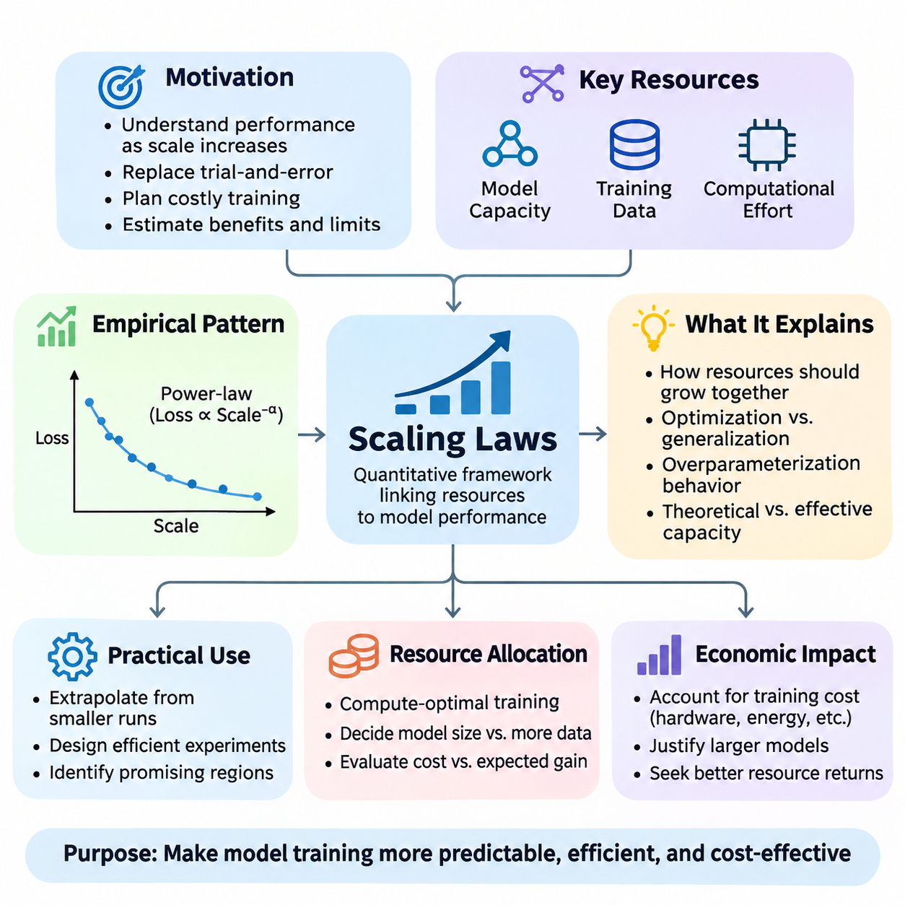
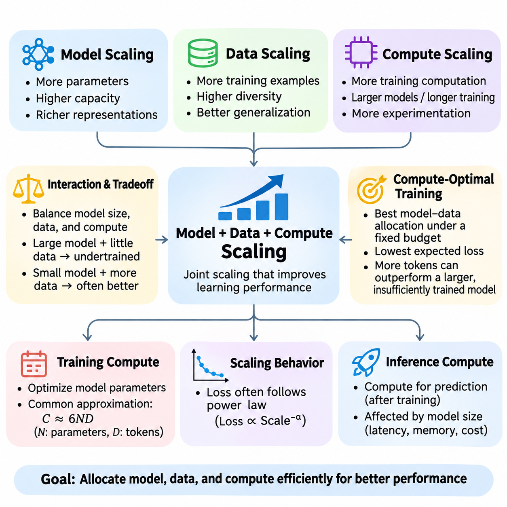
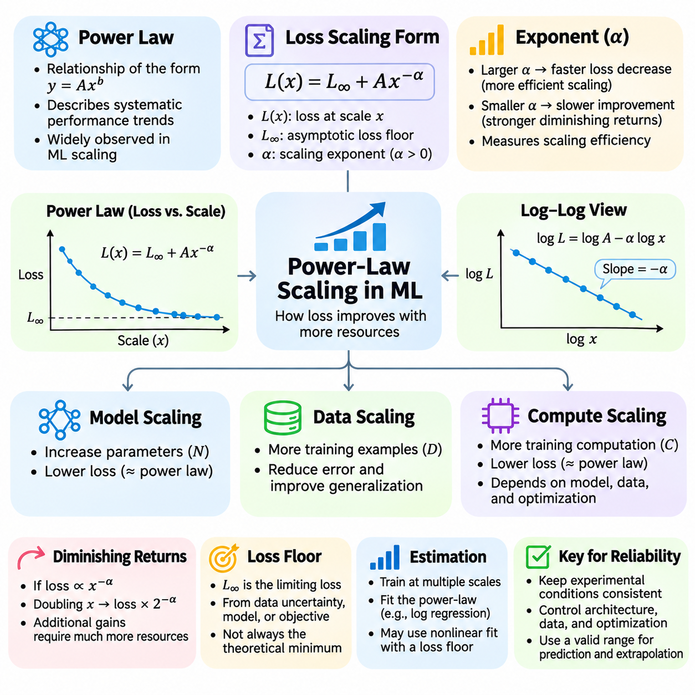
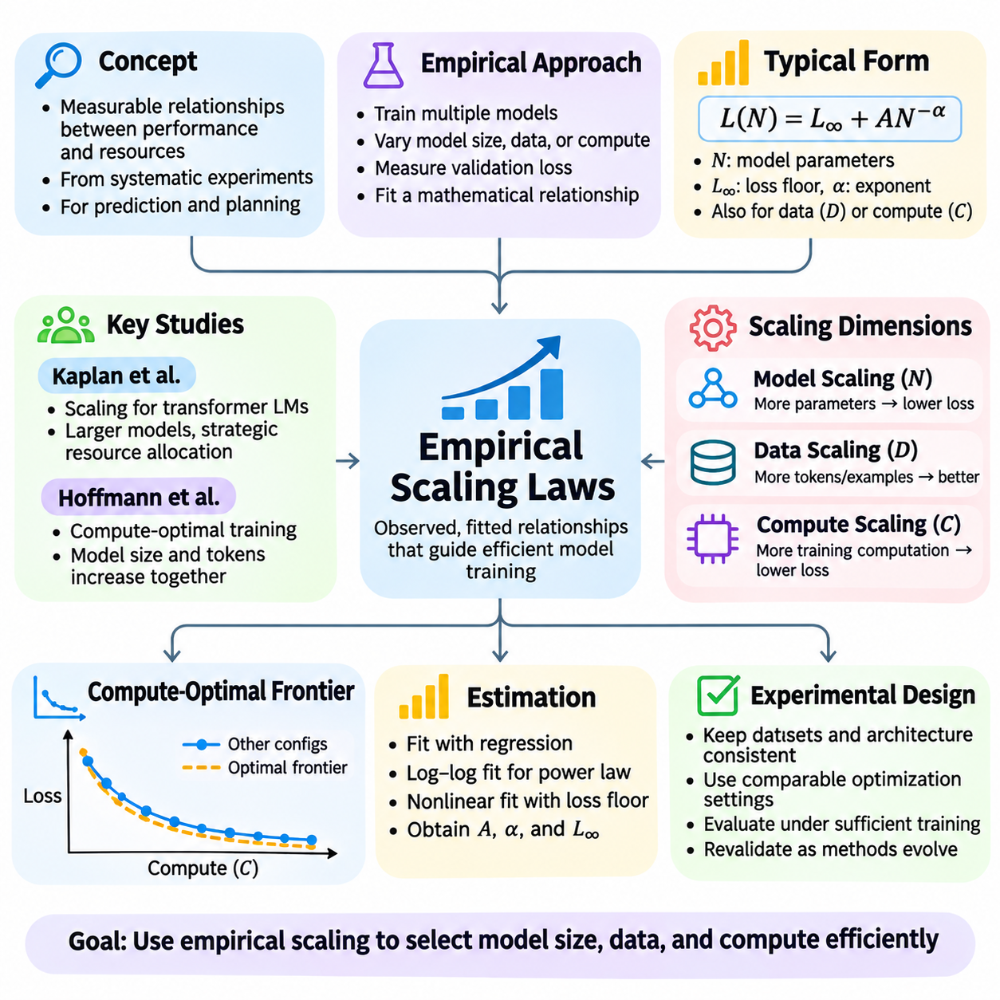
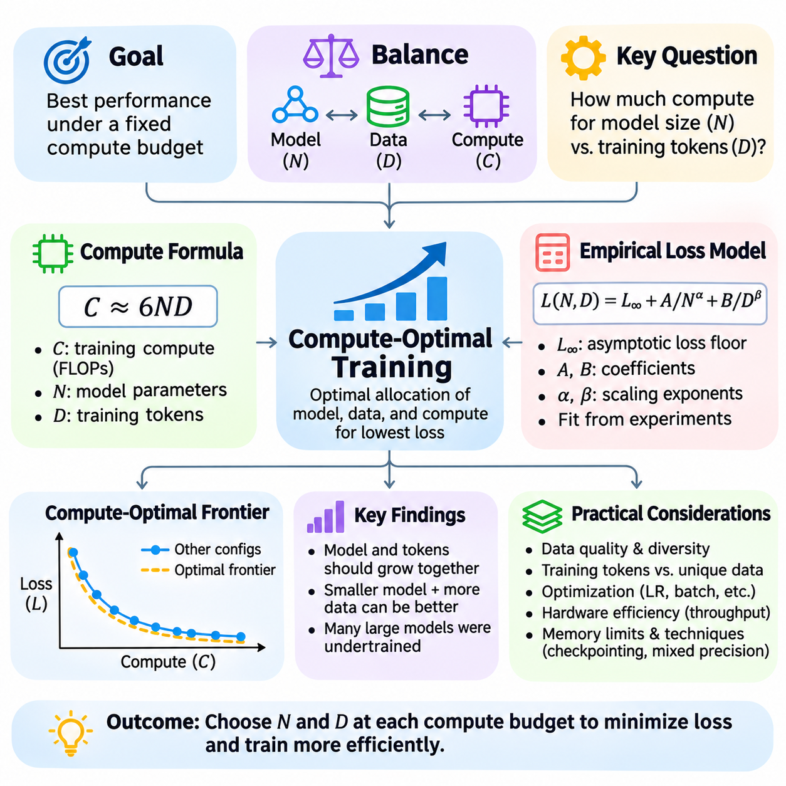
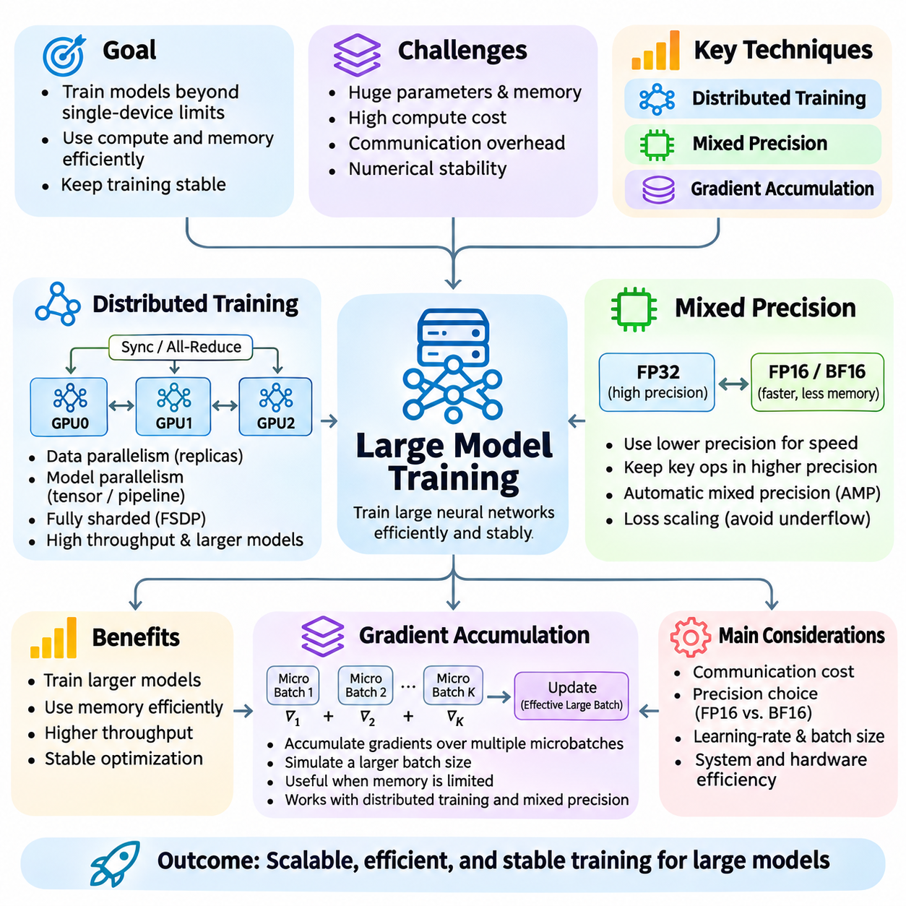
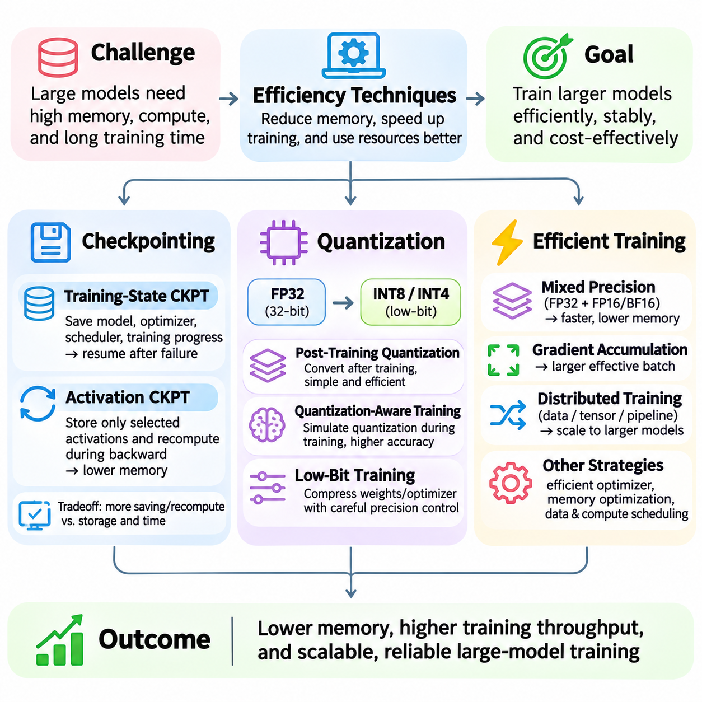
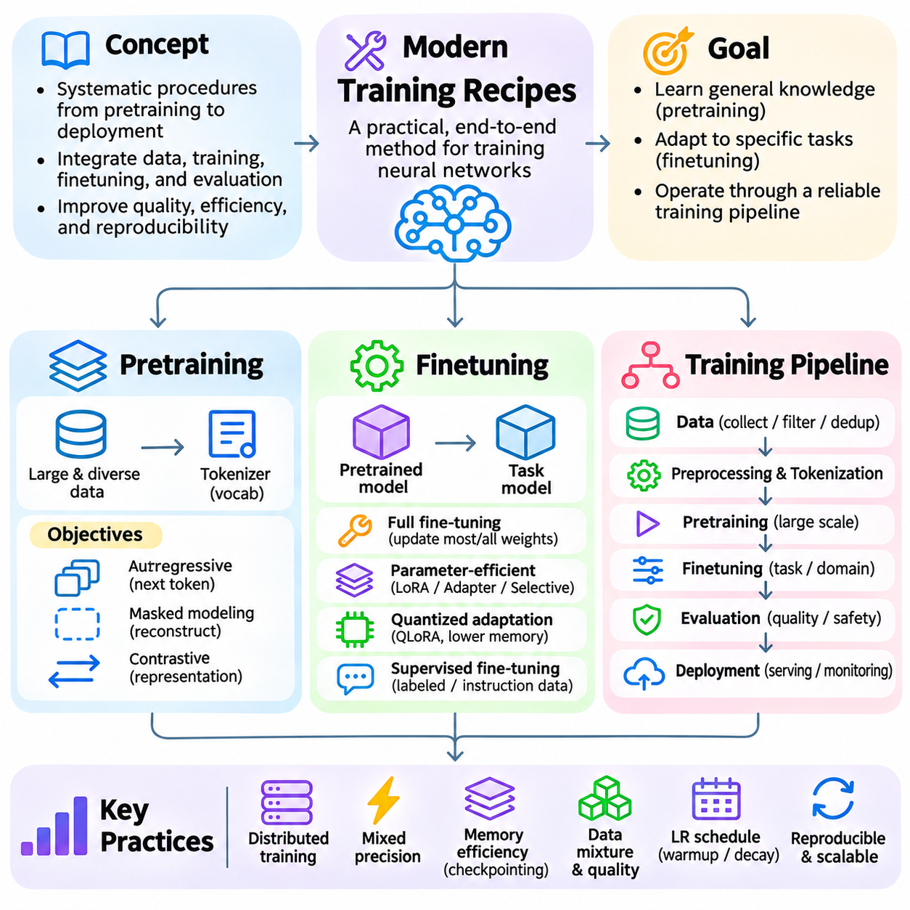
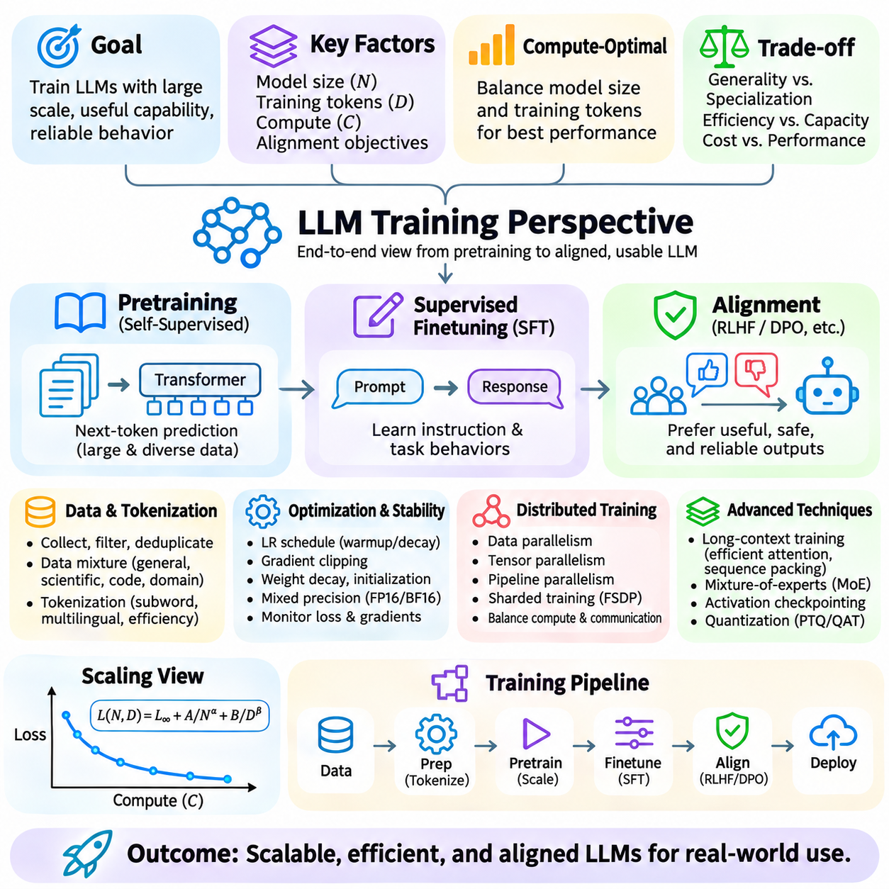
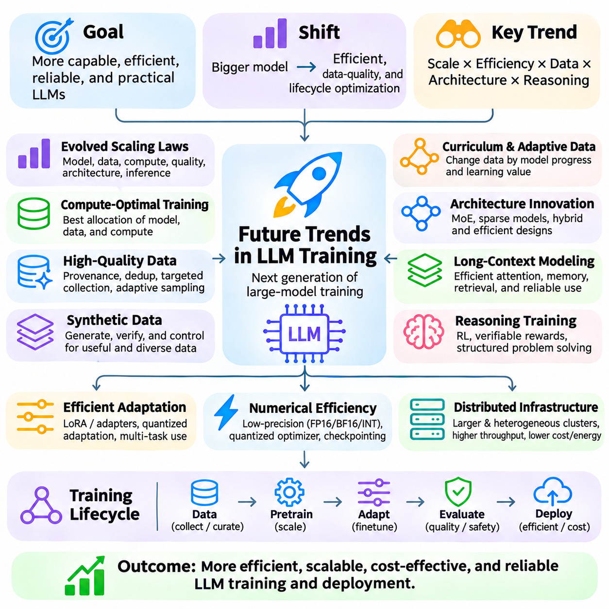

# 06. Scaling Laws and Modern Training

## 06.00 Why Scaling Laws

{width="7.268055555555556in" height="7.268055555555556in"}

스케일링 법칙(Scaling Laws)은 모델(Model), 데이터셋(Dataset), 컴퓨팅 자원(Computational Resources)이 증가함에 따라 기계학습(Machine Learning)의 성능이 어떻게 변화하는지를 이해하기 위한 체계적인 프레임워크(Framework)를 제공한다. 스케일링 법칙은 모델 개발(Model Development)을 개별적인 실험의 연속으로 취급하는 대신, 자원 할당(Resource Allocation)과 예측 성능(Predictive Performance) 사이의 측정 가능한 관계를 밝혀낸다. 이러한 관계는 연구자가 대규모 학습 시스템(Learning System)의 이점과 한계를 예측하는 데 도움을 준다.

스케일링 법칙(Scaling Laws)의 중요성은 딥러닝(Deep Learning) 모델의 학습 비용(Training Cost)이 증가하면서 더욱 부각되었다. 전통적인 실험 방식은 시행착오(Trial and Error)에 의존하는 경우가 많았으며, 수많은 아키텍처 수정(Architectural Modification)과 하이퍼파라미터 탐색(Hyperparameter Search)이 필요했다. 학습 비용이 증가하면서 이러한 접근 방식은 점차 비현실적이 되었다. 스케일링 법칙은 모델 개발 의사결정과 예상 학습 성능 향상을 연결하는 정량적 관점(Quantitative Perspective)을 도입하였다.

현대 기계학습(Machine Learning) 시스템은 모델 용량(Model Capacity), 학습 데이터(Training Data), 계산 노력(Computational Effort)이라는 세 가지 밀접하게 연관된 자원에 의존한다. 모델 용량은 신경망(Neural Network)이 표현할 수 있는 함수의 복잡성을 결정하며, 학습 데이터는 유용한 패턴(Pattern)을 학습하기 위한 정보를 제공한다. 계산 노력은 모델이 해당 정보를 얼마나 광범위하게 처리하고 최적화(Optimization) 과정에서 매개변수(Parameter)를 얼마나 충분히 갱신할 수 있는지를 결정한다.

모델 크기(Model Size)를 증가시킨다고 해서 반드시 더 나은 성능이 보장되는 것은 아니다. 더 큰 신경망(Neural Network)은 높은 표현 용량(Representational Capacity)을 가질 수 있지만, 학습 데이터나 컴퓨팅 자원이 부족하면 이러한 용량을 충분히 활용하지 못할 수 있다. 마찬가지로 모델이 데이터의 근본적인 복잡성을 표현할 수 없다면 데이터셋을 확장하더라도 성능 향상은 제한적일 수 있다. 스케일링 법칙은 효과적인 학습을 위해 이러한 자원들이 어떻게 함께 증가해야 하는지를 파악하도록 돕는다.

스케일링 법칙(Scaling Laws)을 연구하는 근본적인 동기 중 하나는 자원이 증가함에 따라 모델 성능이 예측 가능한 방식으로 향상되는 경우가 많다는 관찰이다. 특정 모델 계열(Model Family)과 학습 조건(Training Conditions)에서 수행된 실증 연구(Empirical Study)는 검증 손실(Validation Loss)과 자원 규모 사이에 근사적인 멱법칙 관계(Power-Law Relationship)가 존재함을 확인하였다. 이러한 패턴은 성능 향상이 예측하기 어려운 아키텍처 혁신에만 의존하지 않고 비교적 연속적인 추세를 따를 수 있음을 시사한다.

멱법칙 거동(Power-Law Behavior)은 작은 규모의 실험 결과를 이용해 외삽(Extrapolation)을 수행할 수 있다는 점에서 특히 중요하다. 연구자는 서로 다른 규모의 여러 모델을 학습시키고 성능을 측정한 다음, 더 큰 모델 구성(Configuration)이 어떤 성능을 보일지 추정할 수 있다. 이러한 예측은 관찰된 실험 범위를 벗어나면 불확실성이 커지지만, 상당한 컴퓨팅 자원을 투입하기 전에 고비용 학습 작업(Training Run)을 계획하는 실용적인 근거를 제공한다.

스케일링 법칙(Scaling Laws)은 최적화(Optimization)와 일반화(Generalization)의 관계를 명확하게 설명하는 데에도 기여한다. 최적화는 학습 알고리즘(Learning Algorithm)이 학습 목적함수(Training Objective)를 얼마나 효과적으로 최소화하는지를 의미하며, 일반화는 이전에 관찰하지 않은 데이터에 대한 성능을 나타낸다. 모델 크기나 학습 시간을 증가시키면 최적화 성능이 개선될 수 있지만, 실제 일반화 성능은 데이터 품질(Data Quality), 분포 특성(Distributional Characteristics), 정규화(Regularization), 학습 절차(Training Procedure)에 따라 달라진다.

고전적인 통계적 학습(Statistical Learning)에서는 모델 복잡도(Model Complexity)가 증가하면 과적합(Overfitting)의 위험도 커지는 것으로 이해하는 경우가 많았다. 그러나 현대의 과매개변수화 신경망(Overparameterized Neural Network)은 학습 예제(Training Example)보다 훨씬 많은 매개변수를 포함하더라도 더 큰 모델이 오히려 우수한 일반화 성능을 보이는 복잡한 현상을 나타낸다. 스케일링 법칙은 매개변수 수(Parameter Count)만으로 일반화 품질을 결정한다고 가정하지 않고 이러한 현상을 실증적으로 분석하는 프레임워크를 제공한다.

또 다른 중요한 연구 동기는 이론적 용량(Theoretical Capacity)과 실효 학습 용량(Effective Learning Capacity)을 구분해야 한다는 점이다. 수십억 개의 매개변수를 포함하는 모델은 매우 복잡한 함수를 표현할 수 있지만, 실제 성능은 최적화 과정과 사용 가능한 학습 신호(Training Signal)에 따라 결정된다. 따라서 스케일링 분석(Scaling Analysis)은 아키텍처의 크기에만 의존하지 않고 특정 학습 조건에서 실제로 달성한 성능을 평가한다.

스케일링 법칙(Scaling Laws)의 경제적 영향(Economic Implications)은 상당하다. 고급 신경망을 학습시키기 위해서는 가속기(Accelerator), 메모리(Memory), 저장장치(Storage), 네트워크 인프라(Networking Infrastructure), 전력(Electricity), 엔지니어링 작업(Engineering Effort)이 필요하다. 모델 크기를 추가로 증가시킬 때마다 상당한 재정적·운영적 비용이 발생할 수 있다. 스케일링 법칙은 예상되는 성능 향상이 추가 투자를 정당화하는지, 다른 자원 배분 방식이 더 나은 결과를 제공하는지를 평가하도록 돕는다.

계산 최적 학습(Compute-Optimal Training)은 자원 할당(Resource Allocation)이 중요한 이유를 보여준다. 고정된 계산 예산(Computational Budget)에서 연구자는 모델 매개변수 증가에 얼마나 많은 계산 자원을 사용할지, 추가 학습 토큰(Training Token)이나 예제 처리에 얼마나 사용할지를 결정해야 한다. 데이터가 부족한 상태에서 지나치게 큰 모델을 학습시키면, 비슷한 계산 자원을 사용하더라도 더 작은 모델을 충분히 학습시킨 경우보다 성능이 낮을 수 있다.

스케일링 법칙(Scaling Laws)은 실험 설계(Experimental Design)에 관한 의사결정도 지원한다. 엔지니어는 처음부터 가장 큰 모델을 학습시키는 대신, 작은 모델 구성으로 통제된 실험(Controlled Experiment)을 수행할 수 있다. 모델 크기, 데이터셋 크기, 학습 계산량(Training Compute)을 변화시키면서 성능 추세(Performance Trend)를 추정하고 유망한 운영 영역(Operating Region)을 식별할 수 있다. 이러한 전략은 불필요한 실험을 줄이고 연구 프로그램(Research Program)의 효율성을 높인다.

그러나 신뢰할 수 있는 스케일링 분석(Scaling Analysis)을 위해서는 엄격한 실험 통제(Experimental Control)가 필요하다. 아키텍처, 데이터 품질, 최적화 설정(Optimization Settings), 평가 절차(Evaluation Procedure), 학습 목적함수(Training Objective)가 동시에 변경되면 비교 결과가 왜곡될 수 있다. 연구자는 실제 스케일링 효과(Scaling Effect)와 무관한 엔지니어링 개선으로 발생한 성능 향상을 구분해야 한다. 따라서 관찰된 관계를 올바르게 해석하려면 일관된 실험 조건이 필수적이다.

스케일링 법칙(Scaling Laws)의 적용 범위는 대규모 언어 모델(Large Language Model)을 넘어선다. 컴퓨터 비전(Computer Vision), 음성 인식(Speech Recognition), 생성 모델링(Generative Modeling), 강화학습(Reinforcement Learning), 멀티모달 시스템(Multimodal System)에서도 유사한 문제가 발생한다. 각 분야는 서로 다른 데이터 구조(Data Structure), 학습 목적함수, 계산 요구사항(Computational Requirements)을 가지므로 한 분야에서 관찰된 스케일링 관계가 다른 분야에도 그대로 적용된다고 가정해서는 안 된다.

컴퓨터 비전(Computer Vision)에서 스케일링 의사결정은 이미지 해상도(Image Resolution), 데이터셋 다양성(Dataset Diversity), 네트워크 깊이(Network Depth), 매개변수 수(Parameter Count)와 관련될 수 있다. 높은 해상도의 이미지는 추가적인 시각 정보를 제공하지만 메모리 사용량과 계산 복잡도(Computational Complexity)도 증가시킨다. 더 큰 비전 모델(Vision Model)은 대규모 사전학습 데이터셋(Pretraining Dataset)의 이점을 얻을 수 있지만, 성능 향상은 아키텍처, 데이터 증강(Data Augmentation), 다운스트림 작업(Downstream Task)의 특성에 따라 달라진다.

언어 모델링(Language Modeling)에서 스케일링 법칙(Scaling Laws)은 대규모 사전학습 트랜스포머(Pretrained Transformer) 시스템의 발전에 영향을 미쳤다. 연구자들은 매개변수 수, 학습 토큰 수, 계산 자원 소비량(Computational Expenditure)에 따라 예측 손실(Prediction Loss)이 어떻게 변화하는지 조사한다. 이러한 관계는 모델 크기와 학습 기간을 결정하는 데 활용되며, 언어 모델링 손실의 감소가 특정 능력의 실질적인 향상으로 이어지는지는 다운스트림 평가(Downstream Evaluation)를 통해 확인해야 한다.

스케일링 법칙(Scaling Laws)은 여러 작업과 모달리티(Modality)에 걸쳐 학습되는 파운데이션 모델(Foundation Model)에도 중요하다. 이러한 시스템은 언어(Language), 비전(Vision), 오디오(Audio), 행동 표현(Action Representation) 사이에 모델 용량을 배분해야 한다. 전체 매개변수 수를 늘리더라도 모든 능력이 동일하게 향상되는 것은 아니다. 학습 데이터의 구성과 균형이 전체 데이터 양만큼 중요해질 수 있으므로 다차원 스케일링 분석(Multidimensional Scaling Analysis)의 필요성이 증가한다.

추가적인 연구 동기는 수익 체감(Diminishing Returns) 현상에서 비롯된다. 많은 실증적 스케일링 관계(Empirical Scaling Relationship)는 손실을 점진적으로 더 작게 감소시키기 위해 점점 더 많은 자원 투자가 필요하다는 사실을 보여준다. 계산량이 증가하면 모델 성능은 계속 개선될 수 있지만, 추가적인 성능 향상에 필요한 비용도 증가할 수 있다. 이러한 특성을 이해하면 조직은 현실적인 성능 목표(Performance Target)와 계산 예산(Computational Budget)을 설정할 수 있다.

그러나 스케일링 법칙(Scaling Laws)은 보편적인 보장(Universal Guarantee)이 아니라 실증적 규칙성(Empirical Regularity)으로 해석해야 한다. 추정된 계수(Coefficient)와 지수(Exponent)는 모델 계열, 데이터셋, 최적화 방법, 평가 지표(Evaluation Metric)에 따라 달라진다. 아키텍처 혁신(Architectural Innovation), 데이터 분포 변화(Data Distribution Shift), 새로운 학습 목적함수는 기존에 관찰된 추세를 변화시킬 수 있다. 따라서 측정 범위를 벗어나는 예측은 신중하게 수행하고 독립적인 검증(Independent Verification)을 거쳐야 한다.

데이터 품질(Data Quality)은 단순한 스케일링 가정(Scaling Assumption)에 또 다른 한계를 부여한다. 학습 예제 수를 증가시키는 것이 유용한 정보량을 동일하게 증가시키는 것은 아니다. 중복 샘플(Duplicate Sample), 잘못된 레이블(Incorrect Label), 분포 불균형(Distributional Imbalance), 저품질 콘텐츠(Low-Quality Content)는 대규모 데이터셋의 이점을 감소시킬 수 있다. 효과적인 스케일링을 위해서는 데이터 다양성, 관련성(Relevance), 필터링(Filtering), 추가 샘플이 제공하는 정보량을 고려해야 한다.

고품질 학습 데이터(High-Quality Training Data)의 가용성(Availability)은 장기적인 스케일링 전략(Scaling Strategy)에도 영향을 미친다. 적절한 데이터셋을 확장하기 어려워지면 연구자는 합성 데이터(Synthetic Data), 개선된 샘플링(Improved Sampling), 커리큘럼 학습(Curriculum Learning), 기존 데이터의 효율적인 활용을 검토할 수 있다. 이러한 접근 방식은 원시 데이터셋 크기(Raw Dataset Size)와 학습 성능 사이의 관계를 변화시킬 수 있으며, 스케일링이 단순히 더 많은 데이터를 수집하는 문제만은 아니라는 점을 보여준다.

하드웨어 제약(Hardware Limitations)도 추가적인 문제를 발생시킨다. 더 큰 모델은 높은 메모리 용량(Memory Capacity), 빠른 통신(Fast Communication), 여러 가속기 사이의 효율적인 협력(Coordination)을 필요로 한다. 분산 학습(Distributed Training)은 동기화 오버헤드(Synchronization Overhead)를 발생시키며, 수치 정밀도(Numerical Precision)와 메모리 관리 전략(Memory Management Strategy)은 처리량(Throughput)과 안정성(Stability)에 영향을 미친다. 따라서 이론적인 계산 요구량과 실제 학습 시간 및 달성 가능한 하드웨어 활용률(Hardware Utilization)을 구분해야 한다.

스케일링 법칙(Scaling Laws)은 이러한 실제 엔지니어링 제약과 학습 효율성(Learning Efficiency)에 관한 폭넓은 문제를 연결한다. 비교 가능한 조건에서 더 적은 매개변수, 더 적은 학습 예제, 더 적은 계산량으로 목표 성능을 달성하는 시스템은 훨씬 많은 자원을 필요로 하는 시스템보다 효율적이다. 이러한 관점은 연구자가 계산 규모의 증가뿐 아니라 알고리즘 개선(Algorithmic Improvement)도 함께 평가하도록 유도한다.

과학적 관점(Scientific Perspective)에서 스케일링 법칙(Scaling Laws)은 서로 다른 운영 영역(Operating Regime)에 걸친 학습 시스템의 동작에 대한 증거를 제공한다. 연구자는 이를 활용하여 모델 용량, 데이터 효율성(Data Efficiency), 최적화 동역학(Optimization Dynamics)에 관한 가설(Hypothesis)을 수립할 수 있다. 관찰된 성능이 예측 추세에서 벗어나면 아키텍처의 한계, 데이터 병목현상(Data Bottleneck), 최적화 실패(Optimization Failure), 학습 영역(Learning Regime)의 변화를 발견할 수 있다.

실용적인 인공지능 개발(Practical AI Development)에서 스케일링 법칙(Scaling Laws)은 모델 학습을 단순한 실험 활동에서 보다 예측 가능한 엔지니어링 프로세스(Engineering Process)로 전환한다. 스케일링 법칙은 용량 계획(Capacity Planning), 계산 예산 수립(Computational Budgeting), 학습 구성(Training Configuration), 성능 예측(Performance Forecasting)을 지원한다. 가장 중요한 가치는 미래 결과를 보장하는 것이 아니라 제한된 자원에서 합리적인 의사결정을 수행할 수 있는 정량적 기반(Quantitative Foundation)을 제공한다는 점이다.

궁극적으로 스케일링 법칙(Scaling Laws)이 중요한 이유를 이해하는 것은 현대 기계학습 엔지니어링(Modern Machine Learning Engineering)의 핵심 요소이다. 모델 용량(Model Capacity), 학습 데이터(Training Data), 계산량(Compute), 최적화(Optimization), 일반화(Generalization)는 학습 시스템의 상호 연결된 요소로 고려되어야 한다. 스케일링 법칙은 이러한 관계를 연구하기 위한 기초를 확립하며, 실증적 멱법칙(Empirical Power Laws), 계산 최적 학습(Compute-Optimal Training), 분산 학습(Distributed Learning), 효율적인 파운데이션 모델 개발(Efficient Foundation-Model Development)과 같은 고급 주제를 이해할 수 있도록 준비시킨다.

## 06.01 Model Data Compute Scaling

{width="7.268055555555556in" height="7.268055555555556in"}

모델 스케일링(Model Scaling), 데이터 스케일링(Data Scaling), 컴퓨팅 스케일링(Compute Scaling)은 현대 기계학습(Machine Learning) 개발의 세 가지 핵심 차원을 나타낸다. 모델 스케일링은 학습 가능한 매개변수(Trainable Parameters)의 수와 신경망(Neural Network)의 표현 용량(Representational Capacity)을 증가시킨다. 데이터 스케일링은 학습 예제(Training Examples)의 양과 다양성을 확장하며, 컴퓨팅 스케일링은 최적화(Optimization)에 사용할 수 있는 계산 자원을 증가시킨다. 이 세 요소의 상호작용은 추가 자원을 활용하여 학습 시스템의 성능을 얼마나 효과적으로 개선할 수 있는지를 결정한다.

모델 스케일링(Model Scaling)은 주로 신경망 용량(Neural Network Capacity)과 예측 성능(Predictive Performance) 사이의 관계를 다룬다. 매개변수(Parameter)의 수를 증가시키면 모델은 더 복잡한 함수를 표현하고, 미묘한 통계적 관계(Statistical Relationships)를 포착하며, 더욱 풍부한 내부 표현(Internal Representations)을 학습할 가능성이 높아진다. 그러나 대규모 모델은 이론적인 능력을 실제로 달성하기 위해 추가적인 메모리(Memory), 계산 연산(Computational Operations), 정교하게 설계된 최적화 전략(Optimization Strategies)을 필요로 한다.

매개변수 수(Parameter Count)는 모델 규모(Model Scale)를 측정하는 편리한 지표이지만, 아키텍처 효율성(Architectural Efficiency)을 완전히 설명하지는 못한다. 비슷한 수의 매개변수를 포함하는 두 신경망도 연결 구조(Connectivity), 활성화 함수(Activation Functions), 어텐션 메커니즘(Attention Mechanisms), 정규화 전략(Normalization Strategies)에 따라 서로 다른 성능을 나타낼 수 있다. 따라서 의미 있는 스케일링 분석(Scaling Analysis)을 위해서는 매개변수 증가에 따른 효과와 아키텍처 설계 및 계산 효율성 개선에 따른 효과를 구분해야 한다.

데이터 스케일링(Data Scaling)은 학습 예제(Training Examples)의 수가 증가함에 따라 모델 성능이 어떻게 변화하는지를 분석한다. 일반적으로 대규모 데이터셋(Dataset)은 학습 알고리즘(Learning Algorithm)이 더 다양한 변형, 패턴(Pattern), 통계적 관계(Statistical Relationships)를 경험하도록 한다. 이러한 추가 정보는 추정 오차(Estimation Error)를 줄이고 관찰하지 않은 데이터에 대한 일반화(Generalization)를 개선할 수 있다. 그러나 새로운 예제가 기존 데이터셋에 없는 의미 있는 정보를 얼마나 제공하는지에 따라 실제 효과는 달라진다.

데이터셋 다양성(Dataset Diversity)은 데이터셋 크기(Dataset Size)만큼 중요한 경우가 많다. 거의 동일한 샘플 수백만 개를 포함하는 데이터셋은 다양한 환경과 조건을 표현하는 더 작은 데이터셋보다 유용한 정보가 적을 수 있다. 따라서 효과적인 데이터 스케일링(Data Scaling)을 위해서는 샘플링 전략(Sampling Strategies), 레이블 정확도(Label Accuracy), 분포 포괄성(Distributional Coverage), 중복성(Redundancy)을 고려해야 한다. 이러한 요소는 추가 데이터가 모델 개선에 얼마나 효율적으로 기여하는지를 결정한다.

컴퓨팅 스케일링(Compute Scaling)은 계산 자원 소비량(Computational Expenditure)과 학습 성능(Learning Performance) 사이의 관계를 설명한다. 학습 계산량(Training Compute)은 일반적으로 부동소수점 연산(Floating-Point Operations)으로 측정되지만, 실제 실행 시간은 하드웨어 효율성(Hardware Efficiency)과 시스템 구성(System Configuration)에 따라서도 달라진다. 계산 자원을 증가시키면 더 큰 모델, 더 긴 학습 일정(Training Schedules), 더 큰 배치(Batch), 광범위한 실험을 지원할 수 있지만, 이러한 선택이 반드시 동일한 수준의 성능 향상을 가져오는 것은 아니다.

밀집 트랜스포머 언어 모델(Dense Transformer Language Model)의 경우, 학습 계산량을 C ≈ 6ND로 표현하는 근사식(Approximation)이 널리 사용된다. 여기서 N은 모델 매개변수 수(Number of Model Parameters)를 나타내며, D는 학습 토큰 수(Number of Training Tokens)를 의미한다. 이 단순화된 관계는 특정 가정하에서 순전파(Forward Propagation)와 역전파(Backward Propagation)의 주요 계산 비용을 나타낸다. 실제 요구량은 아키텍처(Architecture), 시퀀스 길이(Sequence Length), 어텐션 연산(Attention Operations), 구현 세부사항(Implementation Details)에 따라 달라진다.

모델 크기(Model Size)와 데이터셋 크기(Dataset Size)의 상호작용은 중요한 자원 할당 문제(Resource Allocation Problem)를 발생시킨다. 상대적으로 적은 예제로 학습된 대규모 모델은 학습이 충분하지 않은 상태(Undertrained)에 머물 수 있으며, 방대한 데이터셋을 사용한 소규모 모델은 결국 용량 한계(Capacity Limitations)에 도달할 수 있다. 따라서 효과적인 스케일링(Scaling)을 위해서는 표현 용량(Representational Capacity), 학습에 사용할 수 있는 정보량, 해당 정보를 처리하는 데 필요한 계산량 사이의 균형을 유지해야 한다.

고정된 계산 예산(Computational Budget)에서는 다른 조건이 동일할 때 모델 매개변수(Model Parameters)를 증가시키면 처리할 수 있는 학습 데이터의 양이 일반적으로 감소한다. 반대로 더 작은 모델을 선택하면 훨씬 많은 최적화 단계(Optimization Steps)나 학습 토큰(Training Tokens)을 처리할 수 있다. 이러한 절충 관계(Tradeoff)는 주어진 예산에서 예상 손실(Expected Loss)을 최소화하는 모델 크기와 학습 기간의 조합을 찾는 계산 최적 학습(Compute-Optimal Training)의 필요성을 설명한다.

언어 모델(Language Model)에 관한 실증 연구(Empirical Research)는 계산 자원이 증가할 때 매개변수 수(Parameter Count)와 학습 토큰 수(Training-Token Quantity)를 함께 증가시키는 것이 유리한 경우가 많다는 사실을 보여주었다. 이러한 관찰은 추가 계산 자원의 대부분을 모델 크기 증가에 투자하는 것이 항상 최선이라는 가정에 도전한다. 비슷한 학습 계산량 제약(Training-Compute Constraints)에서 더 많은 토큰으로 학습한 소규모 모델이 충분히 학습되지 않은 대규모 모델보다 우수한 성능을 나타낼 수 있다.

모델 용량(Model Capacity)과 데이터 가용성(Data Availability)의 관계는 일반화(Generalization)에도 영향을 미친다. 대규모 모델은 더 복잡한 관계를 포착할 가능성이 있지만, 실제 성능은 학습 예제의 품질(Quality)과 대표성(Representativeness)에 따라 달라진다. 추가 데이터는 모델이 더 폭넓은 변형을 경험하도록 하여 일반화를 개선할 수 있지만, 분포 변화(Distribution Shifts), 노이즈가 포함된 레이블(Noisy Labels), 중복 예제(Duplicated Examples)는 예상되는 이점을 약화시킬 수 있다.

스케일링 거동(Scaling Behavior)은 모델 크기(Model Size), 데이터셋 크기(Dataset Size), 계산량(Compute)에 의존하는 실증적 손실 함수(Empirical Loss Functions)를 통해 표현되는 경우가 많다. 적절한 실험 영역(Experimental Regimes)에서 예측 손실(Prediction Loss)은 멱법칙 관계(Power-Law Relationships)에 따라 근사적으로 감소하는 경향을 보인다. 이러한 모델을 활용하면 연구자는 각 자원을 증가시킬 때 얻는 한계 편익(Marginal Benefits)을 추정하고, 성능 개선에 필요한 비용이 점차 증가하는지를 파악할 수 있다.

학습 계산량(Training Compute)과 추론 계산량(Inference Compute) 사이에는 중요한 차이가 있다. 학습 계산량은 모델 매개변수(Model Parameters)를 최적화하는 데 필요한 자원을 측정하며, 추론 계산량은 학습 이후 예측을 생성하는 데 필요한 연산을 나타낸다. 모델 크기를 증가시키면 예측 품질(Predictive Quality)이 향상될 수 있지만, 추론 지연시간(Inference Latency), 메모리 요구량(Memory Requirements), 배포 비용(Deployment Costs)도 증가할 수 있다. 따라서 실용적인 스케일링 전략을 선택할 때 이러한 영향을 함께 고려해야 한다.

빈번한 추론(Frequent Inference)이 필요한 응용 분야에서는 더 작은 모델을 오랫동안 학습시키는 방식이 학습 비용(Training Expenditure)과 운영 효율성(Operational Efficiency) 사이에서 유리한 균형을 제공할 수 있다. 추가 학습 토큰(Training Tokens)은 초기 계산 비용을 증가시키지만, 학습된 모델은 배포 과정에서 더 적은 자원을 사용할 수 있다. 이러한 특성은 수백만 건의 요청을 처리하거나 자원이 제한된 하드웨어(Resource-Constrained Hardware)에서 지속적으로 동작하는 모델에 특히 중요하다.

하드웨어 활용률(Hardware Utilization)은 컴퓨팅 스케일링(Compute Scaling)의 실제 해석에 상당한 영향을 미친다. 이론적인 부동소수점 연산량(Floating-Point Operation Count)이 실제 학습 경과 시간(Elapsed Training Time)을 직접 결정하는 것은 아니다. 가속기 처리량(Accelerator Throughput), 메모리 대역폭(Memory Bandwidth), 통신 지연시간(Communication Latency), 수치 정밀도(Numerical Precision), 병렬화 효율성(Parallelization Efficiency)이 실제 성능에 영향을 미친다. 따라서 가능한 경우 스케일링 실험에서는 계산량 추정치와 실제 시스템 측정 결과를 함께 보고해야 한다.

분산 학습(Distributed Training)은 개별 가속기(Accelerator)의 용량을 넘어서는 모델 스케일링(Model Scaling)과 컴퓨팅 스케일링(Compute Scaling)을 가능하게 한다. 데이터 병렬화(Data Parallelism)는 학습 예제를 여러 장치에 분산하며, 텐서 병렬화(Tensor Parallelism)와 파이프라인 병렬화(Pipeline Parallelism)는 모델 계산을 분할한다. 이러한 기술은 사용 가능한 계산 용량을 증가시키지만 통신 및 동기화 오버헤드(Communication and Synchronization Overhead)를 발생시킨다. 효율성은 네트워크 대역폭(Network Bandwidth), 작업 부하 특성(Workload Characteristics), 구현 품질(Implementation Quality)에 따라 달라진다.

데이터 스케일링(Data Scaling)은 인프라 문제(Infrastructure Challenges)도 발생시킨다. 대규모 데이터셋은 효율적인 저장(Storage), 전처리(Preprocessing), 셔플링(Shuffling), 학습 가속기로의 데이터 전달(Data Delivery)을 필요로 한다. 입력 파이프라인(Input Pipeline)이 충분히 빠르게 데이터를 공급하지 못하면 고가의 계산 자원이 제대로 활용되지 못한다. 따라서 효과적인 스케일링을 위해서는 모델 아키텍처(Model Architecture)에만 집중하는 대신 데이터 엔지니어링(Data Engineering)과 학습 인프라(Training Infrastructure)를 함께 개선해야 한다.

스케일링 관계(Scaling Relationships)는 모든 기계학습 분야에서 동일하게 나타나는 것은 아니다. 이미지 분류(Image Classification), 언어 모델링(Language Modeling), 음성 인식(Speech Recognition), 강화학습(Reinforcement Learning)은 데이터 구조(Data Structures)와 학습 목적함수(Learning Objectives)가 서로 다르다. 예를 들어 강화학습에서는 수집된 경험(Collected Experience)의 양이 탐색(Exploration) 및 환경 동역학(Environment Dynamics)과 상호작용한다. 따라서 적절한 스케일링 거동을 파악하려면 분야별 실험(Domain-Specific Experiments)이 필수적이다.

현대 멀티모달 모델(Multimodal Models)은 학습 자원을 여러 데이터 모달리티(Data Modalities)에 분배해야 하므로 추가적인 복잡성을 가진다. 언어 토큰(Language Tokens), 이미지 패치(Image Patches), 오디오 세그먼트(Audio Segments), 행동 궤적(Action Trajectories)은 정보 밀도(Information Density)와 계산 비용(Computational Cost)이 서로 다르다. 따라서 전체 데이터셋 크기만으로는 충분하지 않을 수 있다. 스케일링 분석에서는 모달리티 균형(Modality Balance), 표현 품질(Representation Quality), 서로 다른 학습 목적함수의 상대적 중요성을 고려해야 한다.

실용적인 스케일링 실험(Practical Scaling Experiments)은 일반적으로 여러 개의 통제된 모델 구성(Model Configurations)과 데이터셋 크기에서 시작한다. 연구자는 일관된 최적화 설정(Optimization Settings)을 유지하면서 검증 손실(Validation Loss), 학습 계산량(Training Compute), 처리량(Throughput), 일반화 성능(Generalization Performance)을 측정한다. 측정 결과는 실증적 관계(Empirical Relationships)를 추정하고 더 큰 모델 구성을 예측하는 데 활용할 수 있다. 신뢰할 수 있는 외삽(Extrapolation)을 위해서는 충분한 실험 범위와 불확실성(Uncertainty)에 대한 신중한 평가가 필요하다.

스케일링 의사결정(Scaling Decisions)에서는 수익 체감(Diminishing Returns)과 자원 제약(Resource Constraints)도 고려해야 한다. 모델 매개변수, 학습 데이터, 계산 자원을 두 배로 증가시킨다고 해서 예측 성능(Predictive Performance)이 비례적으로 향상되는 것은 아니다. 가장 효과적인 투자는 현재의 운영 영역(Operating Regime)과 추가적인 발전을 제한하는 병목현상(Bottleneck)에 따라 달라진다. 따라서 무분별하게 자원을 증가시키는 것보다 성능 향상을 제한하는 병목현상을 정확하게 식별하는 것이 중요하다.

데이터 품질(Data Quality), 아키텍처(Architecture), 최적화 알고리즘(Optimization Algorithms)은 관찰된 스케일링 관계(Scaling Relationships)를 변화시킬 수 있다. 개선된 데이터 필터링(Data Filtering)은 각 학습 예제의 가치를 높일 수 있으며, 더 효율적인 아키텍처는 적은 매개변수로 비슷한 성능을 달성할 수 있다. 개선된 옵티마이저(Optimizer)와 학습률 스케줄(Learning-Rate Schedule)은 목표 손실(Target Loss)에 도달하는 데 필요한 계산량을 줄일 수 있다. 이러한 개선은 스케일링 효율성(Scaling Efficiency)이 자원 증가뿐 아니라 알고리즘 발전(Algorithmic Progress)에도 의존한다는 사실을 보여준다.

실제 인공지능 시스템(Real-World AI Systems)에서 모델 스케일링(Model Scaling), 데이터 스케일링(Data Scaling), 컴퓨팅 스케일링(Compute Scaling)은 궁극적으로 배포 요구사항(Deployment Requirements)을 기준으로 평가해야 한다. 벤치마크 성능(Benchmark Performance)이 우수한 모델이라도 메모리 사용량(Memory Consumption), 추론 지연시간(Inference Latency), 에너지 소비(Energy Usage), 유지보수 비용(Maintenance Costs)이 운영 한계를 초과하면 적합하지 않을 수 있다. 따라서 엔지니어링 의사결정은 학습 손실(Training Loss)만을 유일한 성공 지표로 삼기보다 전체 시스템을 최적화하는 방향으로 이루어져야 한다.

모델 크기(Model Size), 데이터셋 크기(Dataset Size), 계산 자원(Computational Resources) 사이의 상호작용을 이해하는 것은 현대 학습 전략(Modern Training Strategies)의 기초를 확립한다. 이 세 가지 차원은 최적화 효율성(Optimization Efficiency), 일반화(Generalization), 인프라 요구사항(Infrastructure Requirements), 경제적 실현 가능성(Economic Feasibility)에 공동으로 영향을 미친다. 이러한 자원의 균형 잡힌 배분은 보다 예측 가능한 모델 개발을 가능하게 하며, 멱법칙 분석(Power-Law Analysis), 실증적 스케일링 법칙(Empirical Scaling Laws), 계산 최적 학습(Compute-Optimal Training)을 이해하기 위한 개념적 기반(Conceptual Basis)을 제공한다.

## 06.02 Power Law Behavior

{width="7.268055555555556in" height="7.268055555555556in"}

멱법칙 거동(Power-Law Behavior)은 하나의 수량이 다른 수량의 일정한 지수(Exponent) 거듭제곱에 비례하여 변화하는 수학적 관계(Mathematical Relationship)를 설명한다. 기계학습(Machine Learning)에서는 이러한 관계가 모델 매개변수(Model Parameters), 학습 데이터(Training Data), 계산 자원(Computational Resources)이 증가함에 따라 예측 손실(Prediction Loss)이 감소하는 현상을 나타내는 경우가 많다. 멱법칙의 중요성은 서로 다른 규모에서 나타나는 체계적인 성능 추세(Performance Trends)를 밝혀내고, 현대 신경망 학습(Neural Network Training)을 이해하기 위한 정량적 기반(Quantitative Foundation)을 제공한다는 데 있다.

일반적인 멱법칙 관계(Power-Law Relationship)는 y = Ax\^b로 표현할 수 있으며, 여기서 x는 스케일링 변수(Scaling Variable), A는 비례 상수(Proportionality Constant), b는 변화율을 결정하는 지수(Exponent)를 나타낸다. 학습 시스템(Learning Systems)에서 감소하는 손실은 흔히 음의 지수(Negative Exponent)를 사용하여 L(x) = L∞ + Ax\^(-α)와 같은 관계로 표현된다. 여기서 L∞는 점근적 손실 하한(Asymptotic Loss Floor)을 나타내며, α는 자원이 증가함에 따라 성능이 얼마나 빠르게 개선되는지를 결정한다.

멱법칙의 지수(Power-Law Exponent)는 스케일링 효율성(Scaling Efficiency)에 관한 중요한 정보를 제공한다. 손실이 감소하는 관계에서 α의 양의 값이 클수록 스케일링 변수(Scaling Variable)가 증가할 때 손실이 점근적 한계(Asymptotic Limit)에 더 빠르게 접근한다. 반대로 지수가 작으면 성능 개선 속도가 느리고 수익 체감(Diminishing Returns)이 더욱 뚜렷하게 나타난다. 따라서 스케일링 지수(Scaling Exponents)를 추정하면 연구자는 모델 계열(Model Families), 데이터셋(Datasets), 학습 구성(Training Configurations) 사이의 학습 효율성을 비교할 수 있다.

멱법칙 관계(Power-Law Relationships)는 측정값을 로그 척도(Logarithmic Scale)로 표현할 때 특히 명확하게 나타난다. y = Ax\^b와 같은 단순한 관계에 로그(Logarithm)를 적용하면 log(y) = log(A) + b log(x)가 된다. 이러한 변환은 멱법칙을 선형 관계(Linear Relationship)로 바꾸므로 직선의 기울기(Slope)를 통해 지수를 추정할 수 있다. 다만 가산적인 손실 하한(Additive Loss Floor)이 존재하는 경우에는 전체 손실이 아니라 해당 하한을 초과하는 초과 손실(Excess Loss)에 로그 변환을 적용해야 한다.

신경망 스케일링 연구(Neural Network Scaling Studies)에서는 매개변수 수(Parameter Count)에 따른 검증 손실(Validation Loss)을 자주 분석한다. 적절한 실험 영역(Experimental Regimes)에서 더 큰 모델은 충분한 데이터와 계산 자원으로 학습되었을 때 더 낮은 예측 손실(Prediction Loss)을 달성하는 경향이 있다. 이러한 관계는 멱법칙(Power Law)으로 근사할 수 있지만, 지수는 아키텍처(Architecture), 학습 절차(Training Procedures), 데이터셋 특성(Dataset Characteristics)에 따라 달라진다. 따라서 매개변수 스케일링(Parameter Scaling)은 보편적인 보장이 아니라 실증적 설명(Empirical Description)을 제공한다.

데이터 스케일링(Data Scaling)에서도 이와 관련된 거동이 나타난다. 학습 예제(Training Examples)의 수를 증가시키면 모델이 더 많은 통계적 정보(Statistical Information)와 다양한 변형을 경험하게 되어 예측 오차(Prediction Error)를 줄일 수 있다. 통제된 조건에서 검증 손실(Validation Loss)은 데이터셋 크기(Dataset Size)에 대해 멱법칙 관계에 따라 근사적으로 감소할 수 있다. 그러나 중복 예제(Duplicated Examples), 노이즈가 포함된 레이블(Noisy Labels), 제한된 다양성(Limited Diversity), 분포 불균형(Distributional Imbalance)은 유용한 정보의 실효량을 변화시키고 관찰되는 스케일링 지수(Scaling Exponent)를 바꿀 수 있다.

컴퓨팅 스케일링(Compute Scaling)은 학습에 투입되는 전체 계산 노력(Computational Effort)에 따라 성능이 어떻게 변화하는지를 분석한다. 실증 연구(Empirical Studies)에서는 학습 계산량(Training Compute)과 달성 가능한 손실(Achievable Loss) 사이의 관계를 멱법칙 근사(Power-Law Approximation)로 모델링하는 경우가 많다. 이러한 관계는 목표 성능(Target Performance)에 도달하기 위해 필요한 자원을 추정하는 데 유용하다. 그러나 측정된 추세는 모델 크기(Model Size), 학습 기간(Training Duration), 최적화 설정(Optimization Settings)이 얼마나 효율적으로 배분되었는지에 따라 달라진다.

모델 크기(Model Size), 데이터 양(Data Quantity), 계산량(Compute) 사이의 상호작용은 단순한 멱법칙 해석(Power-Law Interpretation)을 복잡하게 만든다. 모델은 충분한 학습 데이터와 계산 자원이 제공되는 동안에만 예측 가능한 매개변수 스케일링 추세(Parameter-Scaling Trend)를 따를 수 있다. 다른 자원이 제한 요소(Limiting Resource)가 되면 성능은 예상된 관계에서 벗어날 수 있다. 이는 스케일링 법칙(Scaling Laws)을 반드시 해당 법칙이 확립된 실험 조건(Experimental Conditions) 안에서 해석해야 한다는 점을 보여준다.

멱법칙 거동(Power-Law Behavior)은 많은 학습 시스템에서 자원 증가에 따른 성능 개선이 점차 감소하는 이유도 설명한다. 초과 손실(Excess Loss)이 x\^(-α)에 따라 감소한다면 스케일링 변수를 두 배로 증가시킬 때 초과 손실에는 2\^(-α)가 곱해진다. α가 작은 양수일 경우 이러한 감소 폭은 크지 않다. 따라서 상당한 추가 성능 향상을 달성하려면 계산 자원(Computational Resources), 학습 데이터(Training Data), 모델 용량(Model Capacity)을 불균형적으로 크게 증가시켜야 할 수 있다.

스케일링 관계(Scaling Relationships)를 해석할 때는 절대 손실(Absolute Loss)과 감소 가능한 손실(Reducible Loss)을 구분하는 것이 중요하다. 예측 문제에 내재한 불확실성(Uncertainty)으로 인해 제거할 수 없는 손실 성분이 존재할 수 있으며, 모델 계열(Model Family)이나 학습 목적함수(Training Objective)의 제약으로 추가적인 한계가 발생할 수도 있다. 추정된 점근적 손실 하한(Asymptotic Loss Floor)은 실증 모델(Empirical Model)이 암시하는 극한값을 나타내지만, 모든 가능한 학습 시스템이 달성할 수 있는 이론적 최솟값(Theoretical Minimum)으로 자동 해석해서는 안 된다.

멱법칙 매개변수(Power-Law Parameters)를 추정하려면 여러 규모에 걸친 실험이 필요하다. 연구자는 통제된 구성(Controlled Configurations)을 사용하여 모델을 학습시키고 성능을 측정한 다음, 관찰 결과에 수학적 관계(Mathematical Relationships)를 적합시킨다. 적절한 변환이 유효한 경우 로그 회귀(Logarithmic Regression)를 통해 초기 추정값을 얻을 수 있다. 점근적 손실 하한(Asymptotic Loss Floor)이나 여러 스케일링 변수(Scaling Variables)의 상호작용을 고려해야 한다면 더욱 정교한 비선형 적합 방법(Nonlinear Fitting Methods)이 필요할 수 있다.

신뢰할 수 있는 추정(Reliable Estimation)은 실험의 일관성(Experimental Consistency)에 의존한다. 아키텍처(Architecture), 옵티마이저(Optimizer), 학습률 스케줄(Learning-Rate Schedule), 데이터셋 구성(Dataset Composition), 평가 절차(Evaluation Procedures)의 변화는 스케일링과 무관한 영향을 발생시킬 수 있다. 이러한 요소들이 동시에 변화하면 추정된 지수(Fitted Exponent)는 단일 자원의 영향이 아니라 여러 기저 메커니즘(Underlying Mechanisms)을 반영할 수 있다. 따라서 해석 가능하고 재현 가능한 스케일링 관계를 얻으려면 통제된 실험 설계(Controlled Experimental Design)가 필요하다.

관찰된 규모의 범위(Observed Scale Range)는 예측 신뢰성(Prediction Reliability)에 큰 영향을 미친다. 소규모 모델에 적합시킨 멱법칙(Power Law)은 가까운 규모의 구성을 정확하게 설명할 수 있지만, 훨씬 큰 시스템으로 외삽(Extrapolation)하면 실패할 수 있다. 새로운 최적화 문제(Optimization Difficulties), 메모리 제약(Memory Limitations), 데이터 병목현상(Data Bottlenecks), 아키텍처 전환(Architectural Transitions)은 기존 관계를 변화시킬 수 있다. 따라서 스케일링 예측에는 불확실성 추정(Uncertainty Estimates)을 포함하고, 더 큰 규모의 실험 측정값이 확보되면 예측을 갱신해야 한다.

멱법칙 거동(Power-Law Behavior)은 언어 모델링(Language Modeling)에만 국한되지 않는다. 컴퓨터 비전(Computer Vision), 음성 처리(Speech Processing), 생성 모델링(Generative Modeling), 기타 기계학습 분야에서도 유사한 실증적 패턴(Empirical Patterns)이 연구되었다. 그러나 관련 스케일링 변수(Scaling Variables)와 지수(Exponents)는 분야에 따라 크게 달라질 수 있다. 이미지 해상도(Image Resolution), 데이터셋 다양성(Dataset Diversity), 모델 아키텍처(Model Architecture), 작업 복잡도(Task Complexity)는 자원 증가와 예측 성능 사이의 관계에 영향을 미칠 수 있다.

현대 파운데이션 모델(Foundation Models)은 여러 학습 목적함수(Learning Objectives)와 데이터 모달리티(Data Modalities)가 상호작용할 수 있기 때문에 추가적인 문제를 제기한다. 텍스트(Text), 이미지(Image), 오디오(Audio), 행동 시퀀스(Action Sequences)로 학습된 모델이 반드시 하나의 보편적인 스케일링 지수(Universal Scaling Exponent)를 나타내는 것은 아니다. 서로 다른 능력(Capabilities)은 각기 다른 속도로 향상될 수 있으며, 모달리티 균형(Modality Balance)의 변화는 학습 동역학(Training Dynamics)을 바꿀 수 있다. 따라서 멀티모달 스케일링(Multimodal Scaling)은 단일 변수 멱법칙(Single-Variable Power Law)보다 상세한 실증 분석(Empirical Analysis)을 필요로 한다.

멱법칙 관계(Power-Law Relationships)는 계산 예산 수립(Computational Budgeting)과 전략적 계획(Strategic Planning)도 지원한다. 추가 자원에 따라 손실이 어떻게 변화하는지를 추정하면 엔지니어는 고비용 실험을 시작하기 전에 여러 학습 구성(Training Configurations)을 비교할 수 있다. 이러한 추정은 특정 자원 제약(Resource Constraint)에서 모델 매개변수 증가, 추가 데이터 수집, 학습 기간 연장 중 어떤 선택이 가장 큰 이점을 제공할 가능성이 있는지 파악하도록 돕는다.

중요한 실제 응용 사례(Practical Application) 중 하나는 목표 손실(Target Loss)에 도달하는 데 필요한 계산 비용(Computational Cost)을 예측하는 것이다. 추정된 관계가 계속 유효하다면 연구자는 멱법칙 표현식(Power-Law Expression)을 역으로 계산하여 필요한 자원 규모(Resource Scale)를 추정할 수 있다. 그러나 목표 손실이 추정된 점근적 하한(Asymptotic Floor)에 가까워질수록 예측은 매개변수 불확실성(Parameter Uncertainty)에 더욱 민감해진다. 따라서 높은 수준의 성능 목표를 설정할 때는 가정한 스케일링 영역(Scaling Regime)의 타당성을 신중하게 검증해야 한다.

멱법칙 분석(Power-Law Analysis)은 학습 효율성(Learning Efficiency)의 변화도 밝혀낼 수 있다. 측정된 성능이 기존 추세보다 빠르게 개선된다면, 이는 더 나은 아키텍처(Architecture), 높은 품질의 데이터(Higher-Quality Data), 효과적인 최적화(Effective Optimization)를 의미할 수 있다. 반대로 예상보다 느린 개선은 불충분한 학습(Insufficient Training), 수치적 불안정성(Numerical Instability), 자원 병목현상(Resource Bottlenecks)을 시사할 수 있다. 따라서 스케일링 예측에서 벗어나는 현상은 유용한 진단 정보(Diagnostic Information)를 제공할 수 있다.

스케일링 지수(Scaling Exponents)를 지능(Intelligence)의 고유 상수(Intrinsic Constants)나 신경망(Neural Networks)의 보편적인 속성(Universal Properties)으로 취급해서는 안 된다. 스케일링 지수는 특정 작업(Tasks), 모델 계열(Model Families), 데이터 분포(Data Distributions), 학습 절차(Training Procedures)에 연관된 실증적 측정값(Empirical Measurements)이다. 두 시스템이 비슷한 지수를 나타내더라도 손실 하한(Loss Floors), 계산 효율성(Computational Efficiency), 다운스트림 능력(Downstream Capabilities)은 크게 다를 수 있다. 의미 있는 비교를 위해서는 전체 스케일링 관계를 검토해야 한다.

또 다른 한계는 평가 지표(Evaluation Metrics)가 학습 손실(Training Loss)과 다르게 동작할 때 발생한다. 교차 엔트로피 손실(Cross-Entropy Loss)은 규모가 증가함에 따라 부드럽게 개선될 수 있지만, 분류 정확도(Classification Accuracy), 추론 벤치마크(Reasoning Benchmarks), 작업 성공률(Task-Success Rates)은 비선형 거동(Nonlinear Behavior)이나 임계값과 유사한 거동(Threshold-Like Behavior)을 나타낼 수 있다. 하나의 지표에서 부드러운 멱법칙 추세가 나타난다고 해서 다른 지표에서도 동일한 추세가 보장되는 것은 아니다. 따라서 연구자는 최적화 목적함수(Optimization Objectives)의 스케일링과 실제 능력(Practical Capabilities)의 스케일링을 구분해야 한다.

실제 엔지니어링(Real-World Engineering)에서 멱법칙 거동(Power-Law Behavior)은 이론적 모델링(Theoretical Modeling)과 실험적 관찰(Experimental Observation)을 연결하는 유용한 수단을 제공한다. 멱법칙은 성능 측정값(Performance Measurements)을 해석 가능한 관계(Interpretable Relationships)로 변환하여 예측(Forecasting), 자원 할당(Resource Allocation), 실험 계획(Experimental Planning)을 지원한다. 이러한 가치는 신중한 측정(Careful Measurement), 적절한 수학적 가정(Mathematical Assumptions), 관찰된 학습 조건을 벗어나는 외삽(Extrapolation)의 한계를 인식하는 데 달려 있다.

궁극적으로 멱법칙 거동(Power-Law Behavior)을 이해하는 것은 현대 스케일링 법칙(Modern Scaling Laws)을 해석하는 데 필수적이다. 멱법칙은 추가 자원에 따라 성능이 예측 가능한 방식으로 개선되는 이유를 설명하는 동시에 지속적인 스케일링에 수반되는 수익 체감(Diminishing Returns)을 보여준다. 수학적 관계(Mathematical Relationships)와 통제된 실험(Controlled Experiments)을 결합함으로써 연구자는 더욱 효율적인 학습 전략(Training Strategies)을 개발하고, 실증적 스케일링 법칙(Empirical Scaling Laws)과 계산 최적 학습(Compute-Optimal Learning)을 이해하기 위한 기반을 확립할 수 있다.

## 06.03 Empirical Scaling Laws

{width="7.268055555555556in" height="7.268055555555556in"}

실증적 스케일링 법칙(Empirical Scaling Laws)은 기계학습(Machine Learning)의 성능과 학습 과정에서 사용되는 자원 사이의 측정 가능한 관계를 설명한다. 수학적 가정(Mathematical Assumptions)으로부터 도출되는 이론적 보장(Theoretical Guarantees)과 달리, 이러한 법칙은 모델 크기(Model Size), 데이터셋 규모(Dataset Quantity), 계산 예산(Computational Budget)에 걸친 체계적인 실험(Systematic Experiments)에서 도출된다. 그 목적은 성능 예측(Performance Prediction), 자원 계획(Resource Planning), 대규모 신경망(Large Neural Networks)의 효율적인 개발을 지원하는 규칙적인 패턴을 식별하는 것이다.

실증적 접근법(Empirical Approach)은 통제된 조건(Controlled Conditions)에서 여러 모델을 학습시키는 것으로 시작한다. 연구자는 매개변수 수(Parameter Count), 학습 토큰 수(Training-Token Quantity), 계산 자원 소비량(Computational Expenditure)을 변화시키면서 검증 손실(Validation Loss)과 기타 성능 지표(Performance Indicators)를 측정한다. 이러한 관찰 결과는 학습 성능이 일관된 수학적 관계(Mathematical Relationship)를 따르는지 보여준다. 이와 같은 실험은 개별적인 학습 결과를 서로 다른 규모에서 학습 시스템이 어떻게 동작하는지에 관한 정량적 증거(Quantitative Evidence)로 전환한다.

신경망 언어 모델(Neural Language Models)에 관한 초기의 영향력 있는 연구들은 교차 엔트로피 손실(Cross-Entropy Loss)과 모델 크기(Model Size), 데이터셋 크기(Dataset Size), 학습 계산량(Training Compute) 사이에 근사적인 멱법칙 관계(Power-Law Relationships)가 존재한다는 사실을 확인하였다. 이러한 연구 결과는 상당히 넓은 규모 범위에서 성능이 예측 가능한 방식으로 개선될 수 있음을 시사하였다. 그러나 추정된 관계는 아키텍처(Architecture), 데이터 분포(Data Distribution), 최적화 절차(Optimization Procedures), 조사된 자원 범위(Resource Range) 등의 실험적 가정(Experimental Assumptions)에 의존하였다.

일반적으로 사용되는 실증적 수식(Empirical Formulation)은 예측 손실(Prediction Loss)을 L(N) = L∞ + AN\^(-α)로 표현한다. 여기서 N은 모델 매개변수(Model Parameters), A는 추정 계수(Fitted Coefficient), α는 스케일링 지수(Scaling Exponent)를 나타낸다. L∞ 항은 점근적 손실 하한(Asymptotic Loss Floor)을 의미한다. 유사한 수식은 데이터셋 크기(Dataset Size) D 또는 계산 예산(Computational Budget) C와 관련된 관계를 설명하는 데 사용할 수 있다. 이러한 수식은 관찰된 거동을 근사적으로 표현하는 것이며 보편적인 수학 법칙(Universal Mathematical Laws)을 확립하는 것은 아니다.

카플란(Kaplan)과 동료 연구자들은 자기회귀 트랜스포머 언어 모델(Autoregressive Transformer Language Models)에 관한 영향력 있는 스케일링 관계(Scaling Relationships)를 제시하였다. 이들의 실험은 매개변수 수(Parameter Count), 데이터셋 크기(Dataset Size), 학습 계산량(Training Compute)의 변화에 따른 성능을 분석하였다. 분석 결과는 더 큰 모델이 더 낮은 손실값(Loss Values)을 달성할 수 있으며, 학습 자원을 전략적으로 배분해야 한다는 점을 시사하였다. 이러한 결론은 이후 효율적인 언어 모델 개발(Efficient Language-Model Development)에 관한 연구의 중요한 기반이 되었다.

이후 호프만(Hoffmann)과 동료 연구자들은 계산 최적 언어 모델 학습(Compute-Optimal Language-Model Training)을 재검토하였다. 이들의 연구 결과는 이전에 개발된 많은 대규모 언어 모델(Large Language Models)이 모델 크기에 비해 상대적으로 부족한 양의 데이터로 학습되었다는 점을 보여주었다. 해당 연구의 실험적 가정하에서 계산 최적 학습(Compute-Optimal Training)을 달성하려면 계산 예산(Computational Budget)이 증가함에 따라 모델 매개변수(Model Parameters)와 학습 토큰(Training Tokens)을 대략 비슷한 비율로 증가시켜야 했다.

이러한 연구들은 실증적 스케일링 법칙(Empirical Scaling Laws)을 반드시 해당 실험 환경(Experimental Settings)과 연관하여 해석해야 하는 이유를 보여준다. 서로 다른 학습 일정(Training Schedules), 데이터 혼합 구성(Data Mixtures), 아키텍처(Architectures), 최적화 전략(Optimization Strategies)은 서로 다른 추정 관계(Fitted Relationships)를 만들어낼 수 있다. 특정 모델 계열(Model Family)에서 도출된 스케일링 권장사항(Scaling Recommendation)은 학습 방법론(Training Methodology)이 크게 변화하면 더 이상 최적이 아닐 수 있다. 따라서 기계학습 시스템이 발전함에 따라 실증 법칙은 지속적인 검증(Continuous Validation)을 필요로 한다.

모델 크기 스케일링(Model-Size Scaling)은 신경망(Neural Networks)에 포함된 학습 가능한 매개변수(Trainable Parameters)의 수가 증가할 때 검증 손실(Validation Loss)이 어떻게 변화하는지를 분석한다. 더 큰 모델은 복잡한 관계를 표현하고 잠재적으로 더 낮은 예측 오차(Prediction Errors)를 달성할 수 있다. 그러나 의미 있는 비교를 위해서는 각 모델 구성(Configuration)에 충분한 학습이 이루어져야 한다. 대규모 모델에 충분한 계산 자원이나 데이터가 제공되지 않으면 측정된 관계는 모델 용량(Model Capacity)의 본질적인 한계가 아니라 불충분한 학습(Undertraining)을 반영할 수 있다.

데이터셋 스케일링(Dataset Scaling)은 학습 예제(Training Examples) 또는 토큰(Tokens)의 수를 증가시킬 때 발생하는 성능 개선을 분석한다. 언어 모델링(Language Modeling)에서 추가 토큰은 모델이 더 많은 언어 구조(Linguistic Structures), 사실적 정보(Facts), 문맥적 관계(Contextual Relationships)를 경험하도록 한다. 그러나 데이터의 실질적인 기여도(Effective Contribution)는 품질(Quality), 다양성(Diversity), 중복성(Duplication)에 따라 달라진다. 따라서 원시 토큰 수(Raw Token Count)만으로는 학습에 사용할 수 있는 정보량을 정확하게 표현하지 못할 수 있다.

컴퓨팅 스케일링(Compute Scaling)은 전체 학습 계산량(Total Training Computation)에 따라 달성 가능한 성능이 어떻게 변화하는지를 측정한다. 연구자들은 일반적으로 부동소수점 연산(Floating-Point Operations)을 사용하여 계산량을 추정하지만, 실제 실행 비용(Execution Costs)은 하드웨어 효율성(Hardware Efficiency)에 따라서도 달라진다. 고정된 계산 예산(Computational Budget)에서 모델 크기(Model Size)와 학습 기간(Training Duration)의 조합에 따라 서로 다른 손실값이 나타날 수 있다. 실증적 스케일링 분석(Empirical Scaling Analysis)은 사용 가능한 계산 자원을 더욱 효율적으로 활용하는 구성을 식별하도록 돕는다.

핵심 개념 중 하나는 계산 최적 프런티어(Compute-Optimal Frontier)로, 주어진 계산 예산(Computational Budget)에서 평가된 모델 구성들 가운데 달성할 수 있는 가장 낮은 손실을 나타낸다. 지나치게 크거나 충분한 데이터로 학습되지 않은 모델은 이 프런티어에서 벗어난 위치에 존재할 수 있다. 연구자는 여러 계산 예산에 걸쳐 프런티어를 추정함으로써 모델 크기(Model Size)와 학습 토큰 수(Training-Token Quantity)를 선택하기 위한 실용적인 권장사항을 도출할 수 있다.

실증적 스케일링 법칙(Empirical Scaling Laws)은 회귀 기법(Regression Techniques)을 사용하여 추정되는 경우가 많다. 연구자는 여러 자원 규모(Resource Scales)에 걸쳐 성능 측정값(Performance Measurements)을 수집하고 관찰 결과에 수학적 함수(Mathematical Functions)를 적합시킨다. 로그 변환(Logarithmic Transformations)은 멱법칙 추정(Power-Law Estimation)을 단순화할 수 있으며, 비선형 회귀(Nonlinear Regression)는 가산적 손실 하한(Additive Loss Floors)을 고려할 수 있다. 이렇게 얻은 계수(Coefficients)와 지수(Exponents)는 관찰된 성능 추세(Performance Trends)를 간결하게 설명한다.

실험 설계(Experimental Design)는 추정된 스케일링 관계(Fitted Scaling Relationships)의 신뢰성에 큰 영향을 미친다. 모델은 일관된 데이터셋(Datasets), 비교 가능한 아키텍처(Architectures), 명확하게 문서화된 최적화 절차(Optimization Procedures)를 사용하여 평가해야 한다. 학습률 스케줄(Learning-Rate Schedules), 배치 크기(Batch Sizes), 정규화 방법(Regularization Methods), 학습 종료 기준(Stopping Criteria)은 측정된 손실에 영향을 미칠 수 있다. 적절한 통제가 없다면 겉으로 나타나는 스케일링 효과(Scaling Effects)는 실험 구성의 무관한 변화를 반영할 수 있다.

외삽(Extrapolation)은 실증적 스케일링 법칙(Empirical Scaling Laws)의 가장 가치 있는 응용 분야 중 하나이다. 연구자는 소규모 학습 실행(Smaller Training Runs)에서 얻은 측정값을 활용하여 상당한 자원을 투입하기 전에 대규모 모델의 성능을 추정할 수 있다. 그러나 목표 규모(Target Scale)가 관찰된 실험 범위에서 멀어질수록 예측의 신뢰성은 감소한다. 신뢰구간(Confidence Intervals), 대안적인 모델 적합(Alternative Model Fits), 중간 규모 검증(Intermediate-Scale Validation)은 불확실성(Uncertainty)을 정량화하는 데 도움을 줄 수 있다.

학습이 서로 다른 운영 영역(Operating Regime)에 진입하면 스케일링 관계(Scaling Relationships)가 변화할 수도 있다. 데이터 부족(Data Scarcity), 최적화 불안정성(Optimization Instability), 메모리 제약(Memory Limitations), 아키텍처 수정(Architectural Modifications)은 이전에 관찰된 추세를 변화시킬 수 있다. 이러한 변화는 추정된 멱법칙(Fitted Power Laws)에서 벗어나는 현상을 발생시키거나 새로운 병목현상(Bottlenecks)을 드러낼 수 있다. 따라서 연구자는 실증적 스케일링 모델(Empirical Scaling Models)을 학습 거동에 관한 영구적인 설명이 아니라 조건부 근사(Conditional Approximations)로 취급해야 한다.

검증 손실(Validation Loss)과 다운스트림 성능(Downstream Performance) 사이의 관계는 또 다른 중요한 고려사항을 제시한다. 모델은 교차 엔트로피 손실(Cross-Entropy Loss)에서 예측 가능한 개선을 보이면서도 분류 정확도(Classification Accuracy), 추론 성능(Reasoning Performance), 작업 완료율(Task Completion Rates)에서는 덜 규칙적인 변화를 나타낼 수 있다. 벤치마크 점수(Benchmark Scores)는 평가 설계(Evaluation Design)와 통계적 변동성(Statistical Variability)의 영향을 받을 수도 있다. 따라서 학습 목적함수(Training Objectives)에 관한 스케일링 법칙을 모든 능력(Capabilities)에 적용되는 법칙으로 자동 해석해서는 안 된다.

실증적 스케일링 연구(Empirical Scaling Research)는 언어 모델(Language Models)을 넘어 컴퓨터 비전(Computer Vision), 음성 인식(Speech Recognition), 멀티모달 학습(Multimodal Learning)으로 확장된다. 더 큰 데이터셋과 모델 아키텍처(Model Architectures)는 이러한 분야 전반에서 성능을 개선할 수 있지만, 스케일링 지수(Scaling Exponents)와 자원 요구사항(Resource Requirements)은 서로 다르다. 이미지 해상도(Image Resolution), 모달리티 구성(Modality Composition), 작업 난이도(Task Difficulty), 데이터 품질(Data Quality)은 관찰되는 관계에 영향을 미친다. 따라서 신뢰할 수 있는 결론을 위해서는 분야별 실험(Domain-Specific Experimentation)이 필수적이다.

현대 멀티모달 파운데이션 모델(Multimodal Foundation Models)은 학습 자원이 언어(Language), 비전(Vision), 오디오(Audio), 잠재적으로 행동 표현(Action Representations)에 분배되기 때문에 추가적인 문제를 발생시킨다. 전체 데이터 양(Total Data Volume)을 증가시키면 일부 능력은 다른 능력보다 더 크게 향상될 수 있다. 또한 서로 다른 모달리티(Modalities)는 서로 다른 계산 비용(Computational Costs)을 요구한다. 따라서 실증 분석(Empirical Analysis)은 전체 모델 크기(Aggregate Model Size)에만 의존하지 않고 여러 학습 목적함수에 걸친 자원 할당(Resource Allocation)과 성능을 검토해야 한다.

데이터 품질(Data Quality)은 실증적 스케일링 곡선(Empirical Scaling Curves)을 상당히 변화시킬 수 있다. 저품질 예제(Low-Quality Examples)를 필터링하고, 중복 데이터를 제거하며, 레이블(Labels)을 개선하고, 데이터 분포(Data Distributions)의 균형을 맞추면 원시 데이터셋 크기(Raw Dataset Size)를 증가시키지 않고도 학습 효율성(Learning Efficiency)을 높일 수 있다. 이러한 개선은 서로 다른 데이터 파이프라인(Data Pipelines)을 사용한 실험 사이의 비교를 복잡하게 만든다. 신뢰할 수 있는 스케일링 연구에서는 데이터셋 구성(Dataset Construction)을 문서화하고 데이터 양에 따른 성능 향상(Quantity-Driven Gains)과 품질 개선에 따른 성능 향상(Quality-Driven Improvements)을 구분해야 한다.

하드웨어 효율성(Hardware Efficiency)과 구현 효율성(Implementation Efficiency)도 실제 스케일링 의사결정(Scaling Decisions)에 영향을 미친다. 이론적인 계산량(Theoretical Computation)이 비슷한 두 학습 시스템도 실제 경과 시간(Elapsed Time), 에너지 소비(Energy Consumption), 재정적 비용(Financial Cost)에서는 차이를 보일 수 있다. 분산 통신(Distributed Communication), 메모리 관리(Memory Management), 수치 정밀도(Numerical Precision), 가속기 활용률(Accelerator Utilization)은 실제 처리량(Realized Throughput)에 영향을 미친다. 따라서 부동소수점 연산(Floating-Point Operations)에 기반한 실증적 스케일링 모델은 운영 효율성(Operational Efficiency)에 관한 측정값으로 보완해야 한다.

실증적 스케일링 법칙(Empirical Scaling Laws)은 예상되는 성능 향상과 자원 투자(Resource Investments)를 연결함으로써 연구 계획(Research Planning)을 지원한다. 조직은 추가 계산 자원을 더 큰 모델, 더 긴 학습 기간, 더 나은 데이터셋 중 어디에 활용해야 하는지를 추정할 수 있다. 이러한 추정은 고비용 실험(Expensive Experiments)을 계획할 때 불확실성을 줄여준다. 그러나 경제적 의사결정(Economic Decisions)에서는 추론 비용(Inference Costs), 배포 제약(Deployment Constraints), 점진적인 성능 향상의 기대 가치(Expected Value of Incremental Performance Improvements)도 함께 고려해야 한다.

궁극적으로 실증적 스케일링 법칙(Empirical Scaling Laws)은 자원 증가에 따라 기계학습 시스템(Machine Learning Systems)이 어떻게 반응하는지를 이해하기 위한 정량적 프레임워크(Quantitative Framework)를 제공한다. 그 강점은 재현 가능한 측정(Reproducible Measurements), 수학적 적합(Mathematical Fitting), 신중하게 검증된 예측(Carefully Validated Predictions)에 있다. 모델 용량(Model Capacity), 데이터 가용성(Data Availability), 계산 예산(Computational Budgets), 실험적 불확실성(Experimental Uncertainty)을 통합함으로써 계산 최적 학습(Compute-Optimal Training)과 현대 대규모 인공지능 엔지니어링(Modern Large-Scale AI Engineering)을 위한 실용적인 기반을 확립한다.

## 06.04 Compute Optimal Training

{width="7.268055555555556in" height="7.268055555555556in"}

계산 최적 학습(Compute-Optimal Training)은 고정된 계산 예산(Computational Budget) 내에서 달성 가능한 최상의 모델 성능(Model Performance)을 추구하는 자원 할당 전략(Resource Allocation Strategy)이다. 매개변수 수(Parameter Count)나 학습 기간(Training Duration)을 개별적으로 최대화하는 대신, 모델 용량(Model Capacity), 데이터셋 크기(Dataset Size), 최적화 노력(Optimization Effort) 사이의 균형을 유지한다. 이러한 접근법은 비효율적인 자원 배분이 예측 성능(Predictive Performance)의 상응하는 개선 없이 학습 비용(Training Costs)을 크게 증가시킬 수 있기 때문에 대규모 신경망(Large Neural Networks)에서 특히 중요하다.

핵심 문제는 모델 매개변수(Model Parameters)를 증가시키는 데 얼마나 많은 계산 자원을 투입하고, 추가 학습 예제(Training Examples)를 처리하는 데 얼마나 많은 자원을 사용해야 하는지를 결정하는 것이다. 더 큰 모델은 높은 표현 용량(Representational Capacity)을 제공하며, 더 긴 학습은 매개변수가 더 많은 정보를 학습하도록 한다. 제한된 자원에서는 한 차원을 증가시키면 다른 차원에 사용할 수 있는 자원이 줄어든다. 계산 최적 학습(Compute-Optimal Training)은 예상 검증 손실(Expected Validation Loss)을 최소화하는 조합을 식별한다.

밀집 트랜스포머 언어 모델(Dense Transformer Language Models)의 학습 계산량(Training Computation)은 흔히 C ≈ 6ND로 근사된다. 여기서 C는 부동소수점 연산량(Floating-Point Operations), N은 모델 매개변수(Model Parameters), D는 학습 토큰(Training Tokens)을 나타낸다. 이 수식은 특정 계산 구조(Computational Structure)를 가정하며, 주로 순전파(Forward Propagation)와 역전파(Backward Propagation)의 계산 비용을 나타낸다. 단순화된 수식이지만 고정된 계산 예산에서 모델 크기가 증가하면 처리할 수 있는 토큰 수가 감소한다는 사실을 보여준다.

일반적인 실증적 손실 모델(Empirical Loss Model)은 L(N,D) = L∞ + A/N\^α + B/D\^β로 표현된다. 여기서 L∞는 점근적 손실 하한(Asymptotic Loss Floor)을 나타내며, 나머지 항은 모델 용량(Model Capacity)과 학습 데이터(Training Data)에 따른 한계를 근사적으로 설명한다. 계수(Coefficients)와 지수(Exponents)는 실험적으로 추정된다. 연구자는 계산 제약(Computational Constraint)하에서 이 수식을 최소화함으로써 매개변수와 토큰 사이의 근사적인 계산 최적 관계(Compute-Optimal Relationships)를 도출할 수 있다.

계산 최적 프런티어(Compute-Optimal Frontier)는 특정 모델 계열(Model Family)과 학습 영역(Training Regime)에서 각 계산 예산(Computational Budget)으로 달성할 수 있는 가장 낮은 예측 손실(Predicted Loss)을 나타낸다. 이 프런티어 위에 위치한 모델 구성(Configurations)은 사용 가능한 다른 대안보다 자원을 비효율적으로 활용한다. 프런티어는 통제된 실험(Controlled Experiments)과 실증적 스케일링 법칙(Empirical Scaling Laws)을 통해 추정할 수 있다. 아키텍처(Architectures), 데이터셋(Datasets), 최적화 방법(Optimization Methods), 학습 목적함수(Training Objectives)가 개선되면 프런티어의 위치도 변화한다.

초기 스케일링 연구(Early Scaling Studies)는 모델 매개변수(Model Parameters)를 증가시킬 때 얻을 수 있는 상당한 이점을 강조하고, 모델 크기와 학습 데이터 사이의 특정 자원 배분 방식을 제안하였다. 이후 연구에서는 많은 대규모 언어 모델(Large Language Models)이 상대적으로 충분히 학습되지 않았다는 사실이 밝혀졌다. 이러한 발견은 추가 계산 자원의 대부분을 매개변수 수 증가에 투입하기보다 더 많은 학습 토큰(Training Tokens)을 처리하는 방향으로 관심을 전환시켰다.

호프만(Hoffmann)과 동료 연구자들이 수행한 친칠라 스케일링 연구(Chinchilla Scaling Study)는 계산 최적 학습(Compute-Optimal Training)의 영향력 있는 사례를 제시하였다. 해당 연구의 실험적 가정(Experimental Assumptions)하에서는 학습 계산량(Training Compute)이 증가함에 따라 모델 매개변수(Model Parameters)와 학습 토큰(Training Tokens)을 대략 비슷한 비율로 증가시켜야 한다. 이 연구는 훨씬 많은 데이터로 학습한 소규모 모델이 유사한 계산 예산으로 학습한 대규모 모델보다 우수한 성능을 달성할 수 있음을 보여주었다.

계산 최적 권장사항(Compute-Optimal Recommendations)은 보편적인 상수(Universal Constants)가 아니다. 추정된 지수(Fitted Exponents)는 모델 아키텍처(Model Architecture), 데이터셋 구성(Dataset Composition), 최적화 설정(Optimization Settings), 실험 범위(Experimental Range)에 따라 달라진다. 토큰 품질(Token Quality), 시퀀스 길이(Sequence Length), 학습 목적함수(Training Objectives), 모델 구조(Model Structure)의 변화는 최적 자원 배분(Optimal Allocation)을 바꿀 수 있다. 따라서 스케일링 관계(Scaling Relationships)는 이전 연구 결과를 기계적으로 적용하기보다 목표 시스템(Target System)에 맞게 검증해야 한다.

데이터 품질(Data Quality)은 계산 최적 학습(Compute-Optimal Training)에서 근본적인 역할을 한다. 추가 데이터에 중복(Duplicates), 노이즈(Noise), 제한된 정보가 포함되어 있다면 더 많은 토큰을 처리하더라도 반드시 성능이 향상되는 것은 아니다. 고품질 예제(High-Quality Examples)는 대량의 중복 콘텐츠(Redundant Content)보다 강력한 학습 신호(Learning Signals)를 제공할 수 있다. 따라서 학습 데이터가 제공하는 실효 정보량(Effective Information)은 전체 처리 토큰 수(Total Processed Tokens)와 함께 고려해야 한다.

학습 토큰(Training Tokens)과 고유 데이터 예제(Unique Data Examples)의 차이도 중요하다. 하나의 데이터셋을 여러 에포크(Epochs)에 걸쳐 반복 처리하면 관찰된 토큰 수는 증가하지만 고유한 정보량은 증가하지 않는다. 반복 노출(Repeated Exposure)은 최적화(Optimization)를 개선할 수 있지만, 예제가 익숙해질수록 그 효과는 감소할 수 있다. 따라서 계산 최적 계획(Compute-Optimal Planning)에서는 데이터 반복(Data Repetition), 다양성(Diversity), 새로운 학습 자료(Training Material)의 가용성을 고려해야 한다.

최적화 효율성(Optimization Efficiency)은 실제 계산 최적 프런티어(Compute-Optimal Frontier)에 영향을 미친다. 학습률 스케줄(Learning-Rate Schedules), 배치 크기(Batch Sizes), 옵티마이저(Optimizers), 수치 정밀도(Numerical Precision)는 계산 연산이 손실을 얼마나 효과적으로 감소시키는지를 결정한다. 잘못 구성된 학습 과정(Training Process)은 더 나은 최적화를 통해 달성할 수 있는 성능에 접근하지 못하면서 상당한 자원을 소비할 수 있다. 따라서 계산 최적 분석(Compute-Optimal Analysis)에서는 자원 할당 문제(Resource Allocation Problems)와 최적화 실패(Optimization Failures)를 구분해야 한다.

하드웨어 효율성(Hardware Efficiency)은 학습 의사결정(Training Decisions)에 또 다른 차원을 추가한다. 이론적인 부동소수점 연산량(Floating-Point Operations)이 비슷한 두 모델 구성도 메모리 대역폭(Memory Bandwidth), 가속기 활용률(Accelerator Utilization), 통신 오버헤드(Communication Overhead)에 따라 실행 시간이 달라질 수 있다. 분산 학습(Distributed Training)은 사용 가능한 계산 자원을 확장하지만 동기화 비용(Synchronization Costs)을 발생시킨다. 따라서 실제 최적화(Practical Optimization)에서는 이론적인 계산량과 측정된 학습 처리량(Measured Training Throughput)을 모두 고려해야 한다.

메모리 제약(Memory Constraints)은 이론적으로 유리한 모델 구성(Model Configurations)의 사용을 제한할 수 있다. 대규모 신경망(Large Networks)은 매개변수(Parameters), 기울기(Gradients), 옵티마이저 상태(Optimizer States), 중간 활성화값(Intermediate Activations)을 저장하기 위한 추가 메모리가 필요하다. 활성화 체크포인팅(Activation Checkpointing), 혼합 정밀도 학습(Mixed-Precision Training), 매개변수 샤딩(Parameter Sharding)과 같은 기술은 메모리 요구량(Memory Requirements)을 줄인다. 그러나 이러한 방법은 추가 계산이나 통신을 발생시켜 목표 손실(Target Loss)에 도달하는 실제 비용을 변화시킬 수 있다.

계산 최적 학습(Compute-Optimal Training)은 전체 수명주기 비용(Total Lifecycle Cost)을 최소화하는 것과도 다르다. 고정된 사전학습 예산(Pretraining Budget)에서 가장 낮은 학습 손실(Training Loss)을 달성한 모델이라도 매개변수 수와 추론 요구사항(Inference Requirements) 때문에 배포 비용(Deployment Costs)이 높을 수 있다. 추론이 빈번하게 발생하는 응용 분야에서는 더 많은 데이터로 학습한 소규모 모델이 전체 경제성(Overall Economics) 측면에서 유리할 수 있다. 따라서 배포 후 추론 빈도(Deployment Frequency)와 서빙 제약(Serving Constraints)은 선호되는 학습 구성에 영향을 미친다.

추론 인식 최적화(Inference-Aware Optimization)는 학습 비용(Training Expenditure)과 배포 이후 예측을 생성하는 비용을 함께 고려한다. 소규모 모델은 경쟁력 있는 성능을 달성하기 위해 추가적인 학습 계산량이 필요할 수 있지만, 추론 과정에서는 더 적은 메모리와 에너지를 소비할 수 있다. 모델이 대량의 요청(Requests)을 처리하는 경우 이러한 운영 비용 절감(Operational Savings)은 초기 학습 투자(Initial Training Investment)를 초과하는 경제적 이점을 제공할 수 있다.

실용적인 계산 최적 분석(Practical Compute-Optimal Analysis)은 여러 모델 크기(Model Sizes)와 학습 토큰 예산(Training-Token Budgets)에 걸친 통제된 실험(Controlled Experiments)으로 시작한다. 연구자는 비교 가능한 아키텍처(Architectures)와 최적화 절차(Optimization Procedures)를 유지하면서 검증 손실(Validation Loss), 계산 자원 소비량(Computational Expenditure), 시스템 처리량(System Throughput)을 측정한다. 이러한 측정값에 실증적 관계(Empirical Relationships)를 적합시키면 고비용의 전체 규모 학습(Full-Scale Training)을 시작하기 전에 후보 구성(Candidate Configurations)의 성능을 추정할 수 있다.

신뢰할 수 있는 외삽(Reliable Extrapolation)을 위해서는 불확실성(Uncertainty)에 주의를 기울여야 한다. 소규모 실험에서 추정한 스케일링 관계(Scaling Relationship)는 최적화 불안정성(Optimization Instability), 데이터 제약(Data Limitations), 아키텍처 변화(Architectural Changes)로 인해 더 큰 규모에서 부정확해질 수 있다. 연구자는 중간 규모 실험(Intermediate-Scale Experiments)과 민감도 분석(Sensitivity Analysis)을 통해 이러한 위험을 줄일 수 있다. 계산 최적 예측(Compute-Optimal Predictions)은 보장된 결과가 아니라 근거에 기반한 추정(Informed Estimates)으로 취급해야 한다.

최적 자원 할당(Optimal Resource Allocation)은 평가 목적(Evaluation Objective)에 따라서도 달라질 수 있다. 언어 모델링 손실(Language-Modeling Loss)을 최소화하는 구성이 추론(Reasoning), 코드 생성(Code Generation), 멀티모달 이해(Multimodal Understanding), 특화된 다운스트림 작업(Specialized Downstream Tasks)에 반드시 최적인 것은 아니다. 서로 다른 능력(Capabilities)은 추가 매개변수와 학습 데이터에 다르게 반응할 수 있다. 따라서 작업별 평가(Task-Specific Evaluations)를 일반적인 검증 손실(Validation Loss) 측정과 함께 수행해야 한다.

현대 파운데이션 모델 학습(Foundation-Model Training)은 사전학습(Pretraining), 지도 미세조정(Supervised Fine-Tuning), 선호도 최적화(Preference Optimization)를 포함한 여러 단계로 구성되는 경우가 많다. 각 단계는 계산 자원을 소비하며 최종 모델 거동(Final Model Behavior)에 서로 다르게 기여한다. 전체 예산을 사전학습에만 할당하는 것이 다운스트림 유용성(Downstream Utility)을 최대화하지는 않을 수 있다. 따라서 더 넓은 의미의 계산 최적 전략(Compute-Optimal Strategy)은 전체 학습 파이프라인(Training Pipeline)에 자원을 어떻게 배분할지 고려한다.

멀티모달 시스템(Multimodal Systems)은 언어(Language), 이미지(Images), 오디오(Audio), 행동 데이터(Action Data)가 서로 다른 계산 요구사항(Computational Requirements)과 정보 밀도(Information Densities)를 가지므로 자원 할당(Resource Allocation)을 더욱 복잡하게 만든다. 특정 모달리티(Modality)를 증가시키면 일부 능력은 향상되지만 다른 능력에는 제한적인 이점만 제공할 수 있다. 따라서 계산 최적 멀티모달 학습(Compute-Optimal Multimodal Training)은 여러 목적함수(Objectives)에 걸쳐 모달리티별 데이터셋(Modality-Specific Datasets), 모델 용량(Model Capacity), 계산 자원 소비량(Computational Expenditure)의 균형을 유지해야 한다.

계산 최적 원칙(Compute-Optimal Principles)은 소규모 엔지니어링 시스템(Smaller Engineering Systems)에도 적용할 수 있다. 컴퓨터 비전 모델(Computer Vision Models), 산업 검사 네트워크(Industrial Inspection Networks), 로봇 인지 시스템(Robotic Perception Systems)은 제한된 학습 및 배포 자원(Training and Deployment Resources) 내에서 정확도(Accuracy)의 균형을 유지해야 한다. 이러한 시스템의 스케일링 관계(Scaling Relationships)는 언어 모델과 다를 수 있지만, 기본 원칙은 동일하다. 계산 자원은 측정 가능한 성능 개선(Measurable Improvement)을 가장 크게 제공하는 영역에 배분해야 한다.

궁극적으로 계산 최적 학습(Compute-Optimal Training)은 대규모 모델 개발(Large-Scale Model Development)을 실증적 증거(Empirical Evidence)에 기반한 제약 최적화 문제(Constrained Optimization Problem)로 전환한다. 계산 최적 학습은 스케일링 법칙(Scaling Laws)을 매개변수 수(Parameter Counts), 학습 데이터(Training Data), 최적화 방법(Optimization Methods), 인프라(Infrastructure)에 관한 실제 의사결정과 연결한다. 이러한 요소의 균형을 유지하고 배포 요구사항(Deployment Requirements)을 고려함으로써 엔지니어는 불필요한 계산 자원 소비(Computational Expenditure)를 줄이면서 학습 효율성(Learning Efficiency)을 향상시킬 수 있다.

## 06.05 Large Model Training

{width="7.268055555555556in" height="7.268055555555556in"}

대규모 모델 학습(Large-Model Training)은 매개변수 수(Parameter Count), 활성화 메모리(Activation Memory), 계산 요구사항(Computational Requirements)이 기존 단일 장치 시스템(Single-Device Systems)의 실용적인 처리 용량을 초과하는 신경망(Neural Networks)을 최적화하는 과정이다. 현대 학습 인프라(Training Infrastructure)는 이러한 한계를 극복하기 위해 분산 계산(Distributed Computation), 낮은 수치 정밀도(Reduced Numerical Precision), 기울기 누적(Gradient Accumulation)을 결합한다. 이러한 기술은 더 큰 아키텍처(Architecture)와 데이터셋(Dataset)의 학습을 가능하게 하지만, 통신(Communication), 수치적 안정성(Numerical Stability), 최적화 효율성(Optimization Efficiency)에 관한 새로운 문제도 발생시킨다.

분산 학습(Distributed Training)은 계산 작업 부하(Computational Workloads)를 여러 가속기(Accelerators) 또는 컴퓨팅 노드(Computing Nodes)에 분할하여 처리한다. 주요 목적은 사용 가능한 처리 용량(Processing Capacity)과 메모리(Memory)를 증가시키면서 대규모 최적화(Large-Scale Optimization)에 필요한 시간을 줄이는 것이다. 효과적인 분산 학습을 위해서는 조정된 실행(Coordinated Execution), 일관된 매개변수 갱신(Consistent Parameter Updates), 효율적인 통신(Efficient Communication)이 필요하다. 실제 성능은 참여 장치들 사이에서 계산과 데이터 이동(Data Movement)이 어떻게 분할되는지에 따라 달라진다.

데이터 병렬화(Data Parallelism)는 가장 널리 사용되는 분산 학습 전략(Distributed Training Strategies) 중 하나이다. 각 가속기(Accelerator)는 모델 복제본(Model Replica)을 유지하면서 학습 배치(Training Batch)의 서로 다른 부분집합(Subset)을 처리한다. 역전파(Backward Propagation) 이후에는 일반적으로 전체 축약(All-Reduce)과 같은 집합 통신 연산(Collective Communication Operations)을 통해 장치 간 기울기(Gradients)를 동기화한다. 이러한 접근법은 전체 처리량(Aggregate Throughput)을 증가시키지만, 각 장치가 모델 매개변수(Model Parameters)와 관련 학습 상태(Training States)를 저장할 수 있는 충분한 메모리를 필요로 한다.

분산 데이터 병렬 학습(Distributed Data Parallel Training)은 일반적으로 동기화된 기울기 갱신(Synchronized Gradient Updates)을 사용하여 모델 복제본(Model Replicas)의 일관성을 유지한다. 각 작업자(Worker)는 로컬 기울기(Local Gradients)를 계산하며, 이러한 기울기는 옵티마이저(Optimizer)가 매개변수를 갱신하기 전에 집계된다. 기울기를 올바르게 평균화하면 결과적인 갱신은 더 큰 전역 배치(Global Batch)로 학습하는 동작을 근사할 수 있다. 그러나 배치 크기(Batch Size), 학습률 스케줄(Learning-Rate Schedules), 수치 연산의 축약 순서(Numerical Reduction Order)의 변화는 수렴(Convergence)에 영향을 미칠 수 있다.

모델 병렬화(Model Parallelism)는 신경망(Neural Network)이 단일 가속기(Accelerator)의 메모리에 저장될 수 없을 때 필요하다. 전체 모델을 복제하는 대신 계산과 매개변수(Parameters)를 여러 장치에 분산한다. 텐서 병렬화(Tensor Parallelism)는 개별 계층(Layer) 내부의 연산을 분할하며, 파이프라인 병렬화(Pipeline Parallelism)는 서로 다른 계층 그룹(Layer Groups)을 별도의 장치에 할당한다. 이러한 전략은 더 큰 모델의 학습을 가능하게 하지만 추가적인 통신(Communication)과 스케줄링 복잡성(Scheduling Complexity)을 발생시킨다.

파이프라인 병렬화(Pipeline Parallelism)는 연속적인 모델 분할 영역(Model Partitions)을 통해 서로 다른 마이크로배치(Microbatches)를 처리하므로 여러 가속기가 동시에 작업할 수 있다. 이러한 중첩 실행(Overlapping Execution)은 활용률(Utilization)을 높일 수 있지만, 파이프라인 버블(Pipeline Bubbles)로 인해 일부 장치가 일시적으로 유휴 상태(Idle State)에 머물 수 있다. 파이프라인 단계(Pipeline Stages)의 수, 마이크로배치 수(Microbatch Count), 스케줄링 전략(Scheduling Strategy)이 효율성을 결정한다. 유휴 시간을 최소화하고 높은 처리량(Throughput)을 유지하려면 단계 간 계산 작업 부하의 균형을 맞추는 것이 필수적이다.

텐서 병렬화(Tensor Parallelism)는 대규모 행렬 연산(Matrix Operations)과 신경망 구성요소(Neural Network Components)를 여러 가속기에 분할한다. 예를 들어 트랜스포머(Transformer)의 어텐션 투영(Attention Projections)과 순방향 전달 계층(Feedforward Layers)을 분할하여 여러 장치가 하나의 계층을 공동으로 실행하도록 할 수 있다. 이러한 접근법은 장치별 매개변수 저장량(Per-Device Parameter Storage)을 줄이지만 분할 영역 사이에 빈번한 통신이 필요하다. 따라서 효율적인 텐서 병렬 실행(Tensor-Parallel Execution)을 위해서는 고대역폭 상호연결(High-Bandwidth Interconnects)이 특히 중요하다.

완전 샤딩 데이터 병렬화(Fully Sharded Data Parallelism)는 매개변수(Parameters), 기울기(Gradients), 옵티마이저 상태(Optimizer States)를 여러 작업자(Workers)에 분산하여 메모리 소비량(Memory Consumption)을 줄인다. 각 장치에 모든 학습 구성요소의 완전한 복사본을 저장하는 대신, 계산 중 필요한 매개변수를 수집하고 이후 상태를 다시 분산한다. 이러한 접근법은 훨씬 큰 모델을 지원할 수 있지만 통신 오버헤드(Communication Overhead)와 메모리 스케줄링(Memory Scheduling)을 신중하게 관리해야 한다.

분산 학습 효율성(Distributed Training Efficiency)은 통신 대역폭(Communication Bandwidth), 지연시간(Latency), 동기화 요구사항(Synchronization Requirements)에 따라 달라진다. 가속기 수가 증가하면 통신이 전체 실행 시간에서 차지하는 비율이 커질 수 있다. 기울기 버케팅(Gradient Bucketing), 통신 중첩(Communication Overlap), 효율적인 집합 연산(Collective Operations)과 같은 기술은 이러한 오버헤드를 줄인다. 강한 스케일링(Strong Scaling)은 고정된 작업 부하의 실행 시간을 개선하며, 약한 스케일링(Weak Scaling)은 장치 수에 비례하여 작업 부하가 증가할 때 효율성을 유지하는 것을 의미한다.

혼합 정밀도 학습(Mixed-Precision Training)은 최적화(Optimization) 과정에서 서로 다른 정밀도 수준(Precision Levels)의 수치 형식(Numerical Formats)을 사용하여 계산 효율성(Computational Efficiency)을 개선한다. 전통적인 학습은 주로 32비트 부동소수점 연산(32-Bit Floating-Point Arithmetic)에 의존하지만, 현대 가속기(Accelerators)는 16비트 형식(16-Bit Formats)을 사용하여 많은 연산을 더 빠르게 실행할 수 있다. 혼합 정밀도는 낮은 정밀도 연산(Lower-Precision Computation)과 선택적인 높은 정밀도 연산(Higher-Precision Operations)을 결합하여 메모리 소비를 줄이고 처리량을 높이면서 허용 가능한 수치적 안정성(Numerical Stability)을 유지한다.

널리 사용되는 두 가지 저정밀도 형식(Reduced-Precision Formats)은 FP16과 BF16이다. FP16은 상대적으로 높은 가수부 정밀도(Significand Precision)를 제공하지만 지수 범위(Exponent Range)가 좁아 오버플로(Overflow)와 언더플로(Underflow)에 더 취약하다. BF16은 FP32의 지수 범위를 유지하면서 더 적은 가수부 비트(Significand Bits)를 사용하므로 수치적 견고성(Numerical Robustness)을 개선하는 경우가 많다. 적절한 형식은 가속기 지원(Accelerator Support), 모델 특성(Model Characteristics), 최적화 연산(Optimization Operations)의 민감도에 따라 결정된다.

자동 혼합 정밀도(Automatic Mixed Precision)는 학습 프레임워크(Training Frameworks)가 서로 다른 연산에 적절한 수치 형식(Numerical Formats)을 선택하도록 한다. 행렬 곱셈(Matrix Multiplications)과 합성곱(Convolutions)은 낮은 정밀도로 실행할 수 있으며, 민감한 축약 연산(Reductions)이나 정규화 연산(Normalization Operations)은 필요할 때 더 높은 정밀도를 사용할 수 있다. 이러한 선택적 접근법(Selective Approach)은 모든 연산을 동일한 수치 표현(Numerical Representation)으로 강제하지 않으면서 저정밀도 연산(Low-Precision Arithmetic)의 성능상 이점을 상당 부분 제공한다.

손실 스케일링(Loss Scaling)은 FP16 학습에서 역전파(Backward Propagation) 중 작은 기울기(Gradients)가 언더플로(Underflow)되는 현상을 방지하기 위해 일반적으로 사용된다. 미분(Differentiation) 전에 손실(Loss)에 스케일링 계수(Scaling Factor)를 곱하고, 옵티마이저 갱신(Optimizer Update) 전에 계산된 기울기를 다시 원래 크기로 조정한다. 동적 손실 스케일링(Dynamic Loss Scaling)은 수치적 오버플로(Numerical Overflow)가 감지되면 이 계수를 조정한다. BF16은 더 넓은 지수 범위(Exponent Range)를 가지므로 일반적으로 손실 스케일링에 대한 의존도가 낮다.

혼합 정밀도 학습(Mixed-Precision Training)은 수치적 정확성(Numerical Correctness)을 검증해야 한다. 낮은 정밀도(Reduced Precision)는 반올림 오차(Rounding Errors), 불안정한 기울기(Unstable Gradients), 수렴 거동(Convergence Behavior)의 변화를 발생시킬 수 있다. 손실 곡선(Loss Curves), 기울기 노름(Gradient Norms), 오버플로 발생(Overflow Events), 검증 성능(Validation Performance)을 모니터링하면 문제를 식별하는 데 도움이 된다. 옵티마이저 상태(Optimizer States)와 일부 누적 연산(Accumulations)은 FP32로 유지되는 경우가 많지만, 정확한 정밀도 정책(Precision Policies)은 학습 프레임워크와 구현 방식에 따라 달라진다.

기울기 누적(Gradient Accumulation)은 가속기 메모리에 한 번에 저장할 수 있는 배치보다 더 큰 유효 배치 크기(Effective Batch Size)로 학습할 수 있도록 한다. 매 마이크로배치(Microbatch) 이후 매개변수를 갱신하는 대신, 여러 차례의 순전파(Forward Pass)와 역전파(Backward Pass)에 걸쳐 기울기(Gradients)를 누적한다. 옵티마이저(Optimizer)는 지정된 누적 단계(Accumulation Steps)가 완료된 후에만 갱신을 수행한다. 이 기술은 모델 크기나 활성화 메모리(Activation Memory) 때문에 실제 배치 크기(Physical Batch Size)가 제한되는 경우 특히 유용하다.

유효 전역 배치 크기(Effective Global Batch Size)는 일반적으로 B_effective = B_micro × K × W로 계산한다. 여기서 B_micro는 작업자별 마이크로배치 크기(Microbatch Size per Worker), K는 누적 단계 수(Number of Accumulation Steps), W는 데이터 병렬 작업자 수(Number of Data-Parallel Workers)를 의미한다. 이 관계는 작업자 사이에서 마이크로배치 크기가 일관되게 유지된다고 가정한다. 의도한 평균 기울기 갱신(Mean-Gradient Update)을 재현하려면 누적된 손실이나 기울기를 적절하게 정규화(Normalization)해야 한다.

기울기 누적(Gradient Accumulation)은 주어진 수의 학습 예제(Training Examples)를 처리하는 데 필요한 전체 계산량(Total Computation)을 감소시키지 않는다. 대신 순차적 실행(Sequential Execution)을 추가하는 대가로 최대 활성화 메모리 요구량(Peak Activation-Memory Requirements)을 낮춘다. 누적 계수(Accumulation Factor)가 커지면 옵티마이저 갱신(Optimizer Updates) 사이의 시간이 증가하고 병렬 실행(Parallel Execution)의 기회가 줄어들 수 있다. 따라서 누적 설정은 메모리 제약(Memory Constraints), 처리량 측정값(Throughput Measurements), 최적화 거동(Optimization Behavior)을 기준으로 선택해야 한다.

분산 환경(Distributed Environments)에서 기울기 누적(Gradient Accumulation)은 불필요한 동기화(Synchronization)를 줄일 수 있다. 작업자(Workers)는 옵티마이저 갱신을 위한 집합 통신(Collective Communication)을 수행하기 전에 여러 마이크로배치(Microbatches)에 걸쳐 로컬 기울기(Local Gradients)를 누적할 수 있다. 기울기 동기화(Gradient Synchronization)를 일시적으로 비활성화하는 프레임워크 기능(Framework Features)은 효율성을 개선할 수 있다. 그러나 최종 갱신에서는 작업자 사이의 기울기를 올바르게 집계해야 하며, 동기화 동작(Synchronization Behavior)을 신중하게 검증해야 한다.

큰 유효 배치 크기(Large Effective Batch Sizes)는 최적화 동역학(Optimization Dynamics)에 영향을 미친다. 배치 크기(Batch Size)가 증가하면 고정된 학습 예제 수에 대한 매개변수 갱신 빈도(Parameter Update Frequency)가 감소하며, 학습률(Learning Rates)이나 스케줄링 정책(Scheduling Policies)을 조정해야 할 수 있다. 더 큰 배치는 하드웨어 활용률(Hardware Utilization)을 개선할 수 있지만, 지나치게 큰 배치는 최적화 효율성(Optimization Efficiency)을 낮추거나 일반화(Generalization)에 영향을 미칠 수 있다. 따라서 기울기 누적은 단순한 메모리 관리 기술(Memory-Management Technique)이 아니라 최적화 선택(Optimization Choice)으로 평가해야 한다.

분산 학습(Distributed Training), 혼합 정밀도(Mixed Precision), 기울기 누적(Gradient Accumulation)은 하나의 학습 파이프라인(Training Pipeline)에서 함께 사용되는 경우가 많다. 분산 실행(Distributed Execution)은 사용 가능한 하드웨어 자원을 확장하고, 혼합 정밀도는 메모리 및 산술 연산 비용(Arithmetic Costs)을 줄이며, 기울기 누적은 유효 배치 크기(Effective Batch Size)를 제어한다. 이 기술들의 상호작용에는 조정된 설정(Coordinated Configuration)이 필요하다. 정밀도 설정(Precision Settings), 동기화 빈도(Synchronization Frequency), 마이크로배치 스케줄링(Microbatch Scheduling)이 함께 처리량(Throughput)과 수렴(Convergence)에 영향을 미치기 때문이다.

실제 구현(Practical Implementation)에서는 학습 품질(Learning Quality)과 시스템 성능(System Performance)을 모두 모니터링해야 한다. 중요한 측정 지표에는 학습 손실(Training Loss), 검증 지표(Validation Metrics), 초당 처리 토큰 수(Tokens Processed per Second), 가속기 활용률(Accelerator Utilization), 최대 메모리 소비량(Peak Memory Consumption), 통신 오버헤드(Communication Overhead)가 포함된다. 장시간 실행되는 분산 작업(Distributed Jobs)은 중단될 수 있으므로 체크포인팅(Checkpointing)과 장애 복구(Fault Recovery)도 필수적이다. 재현성(Reproducibility)을 확보하려면 난수 시드(Random Seeds), 소프트웨어 버전(Software Versions), 정밀도 정책(Precision Policies), 분산 구성(Distributed Configurations)을 문서화해야 한다.

궁극적으로 대규모 모델 학습(Large-Model Training)은 최적화 문제(Optimization Problem)이면서 동시에 시스템 엔지니어링 문제(Systems Engineering Problem)이다. 분산 학습(Distributed Training)은 계산 규모(Computational Scale)의 문제를 해결하고, 혼합 정밀도(Mixed Precision)는 산술 연산 효율성(Arithmetic Efficiency)을 개선하며, 기울기 누적(Gradient Accumulation)은 메모리 제약(Memory Constraints)하에서 유연성을 제공한다. 이러한 기술을 함께 구성하고 검증하면 수치적 안정성(Numerical Stability), 하드웨어 활용률(Hardware Utilization), 계산 비용(Computational Cost)의 균형을 유지하면서 더 큰 신경망을 안정적으로 학습시킬 수 있다.

## 06.06 Efficiency Techniques

{width="7.268055555555556in" height="7.268055555555556in"}

효율성 기술(Efficiency Techniques)은 모델 복잡도(Model Complexity), 메모리 소비량(Memory Consumption), 계산 요구사항(Computational Demands)이 사용 가능한 하드웨어 자원(Hardware Resources)보다 빠르게 증가하는 경우가 많기 때문에 현대 신경망(Neural Networks)의 학습에서 필수적이다. 체크포인팅(Checkpointing), 양자화(Quantization), 효율적 학습 전략(Efficient Training Strategies)은 이러한 한계의 서로 다른 측면을 해결한다. 이 기술들을 함께 사용하면 메모리 요구량을 줄이고 계산 자원 활용률(Computational Utilization)을 높이며, 인프라 투자(Infrastructure Investment)를 비례적으로 늘리지 않고도 더 큰 규모의 실험을 수행할 수 있다.

체크포인팅(Checkpointing)은 학습 과정에서 선택된 정보를 보존하여 계산을 효율적으로 계속하거나 중단 이후 복구할 수 있도록 하는 기술이다. 중요한 두 가지 형태는 학습 상태 체크포인팅(Training-State Checkpointing)과 활성화 체크포인팅(Activation Checkpointing)이다. 학습 상태 체크포인팅은 최적화(Optimization)를 재개하는 데 필요한 정보를 저장하며, 활성화 체크포인팅은 중간 계산값을 재계산하여 메모리 사용량을 줄인다. 두 기술은 동일한 명칭을 사용하지만 목적과 계산상의 절충관계(Computational Tradeoffs)는 근본적으로 다르다.

학습 상태 체크포인팅(Training-State Checkpointing)은 모델 매개변수(Model Parameters), 옵티마이저 상태(Optimizer States), 학습률 스케줄러 정보(Learning-Rate Scheduler Information), 학습 진행 상태(Training Progress)를 주기적으로 저장한다. 응용 분야에 따라 체크포인트(Checkpoint)에는 난수 생성기 상태(Random-Number Generator States)와 데이터 샘플러 위치(Data-Sampler Positions)도 포함될 수 있다. 이러한 구성요소는 하드웨어 장애(Hardware Failures)나 소프트웨어 중단(Software Interruptions) 이후 학습 과정을 일관되게 복원하는 데 도움을 준다. 안정적인 체크포인팅은 며칠 또는 몇 주 동안 연속적으로 실행되는 분산 작업(Distributed Jobs)에서 특히 중요하다.

체크포인트 저장 주기(Checkpoint Frequency)는 저장 오버헤드(Storage Overhead)와 복구 비용(Recovery Cost) 사이의 절충관계를 발생시킨다. 체크포인트를 지나치게 자주 저장하면 추가적인 디스크 대역폭(Disk Bandwidth), 저장 용량(Storage Capacity), 실행 시간(Execution Time)이 소비된다. 반대로 저장 간격이 지나치게 길면 장애가 발생했을 때 손실되는 계산량이 증가한다. 실제 시스템에서는 예상 장애 발생률(Expected Failure Rates), 체크포인트 크기(Checkpoint Size), 저장장치 처리량(Storage Throughput), 중단된 학습의 재시작 비용(Restarting Cost)을 고려하여 저장 간격을 결정한다.

분산 체크포인팅(Distributed Checkpointing)은 매개변수(Parameters)와 옵티마이저 상태(Optimizer States)가 여러 가속기(Accelerators)에 분할되어 있을 때 더욱 복잡해진다. 샤딩 체크포인트(Sharded Checkpoints)는 하나의 장치에서 전체 모델을 재구성하지 않고도 각 작업자(Worker)가 자신에게 할당된 부분을 저장하도록 한다. 비동기 체크포인팅(Asynchronous Checkpointing)은 저장 작업(Storage Operations)과 계산을 중첩할 수 있지만 데이터 일관성(Consistency)을 유지해야 한다. 견고한 구현(Robust Implementations)에서는 저장된 상태를 복구에 사용하기 전에 체크포인트 무결성(Checkpoint Integrity)도 검증한다.

활성화 체크포인팅(Activation Checkpointing)은 역전파(Backpropagation) 과정에서 필요한 중간 활성화값(Intermediate Activations)의 저장 메모리 문제를 해결한다. 일반적인 학습에서는 기울기(Gradients)를 계산하기 위해 순전파(Forward Pass) 과정의 많은 활성화값을 유지한다. 활성화 체크포인팅은 선택된 중간 텐서(Intermediate Tensors)만 저장하고, 역전파 과정에서 누락된 활성화값을 다시 계산한다. 이러한 접근법은 추가적인 계산 연산(Computational Operations)을 수행하는 대신 최대 메모리 소비량(Peak Memory Consumption)을 감소시킨다.

활성화 체크포인팅(Activation Checkpointing)의 효과는 어떤 계층(Layers)이나 계산 구간(Computational Segments)을 선택하는지에 따라 달라진다. 가능한 모든 구간에 체크포인팅을 적용하면 활성화값 저장량(Activation Storage)을 크게 줄일 수 있지만 과도한 재계산(Recomputation)이 발생할 수 있다. 선택적 체크포인팅(Selective Checkpointing)은 자주 재사용되는 활성화값을 유지하면서 메모리 사용량이 많은 연산을 대상으로 한다. 최적 구성(Optimal Configuration)은 모델 아키텍처(Model Architecture), 사용 가능한 메모리(Available Memory), 계산과 저장의 상대적 비용(Relative Costs)에 따라 결정된다.

양자화(Quantization)는 모델 값을 더 적은 비트(Bits)로 표현하여 수치 표현 비용(Numerical Representation Costs)을 줄이는 기술이다. 신경망(Neural Networks)은 전통적으로 FP32 또는 다른 부동소수점 형식(Floating-Point Formats)을 사용하지만, 저정밀도 표현(Lower-Precision Representations)은 메모리 소비량과 데이터 이동량(Data Movement)을 감소시킬 수 있다. 양자화는 효율적인 추론(Efficient Inference)에 널리 사용되지만 일부 접근법은 학습에도 활용된다. 실제 효과는 하드웨어 지원(Hardware Support), 수치적 민감도(Numerical Sensitivity), 수행되는 연산(Operations)에 따라 달라진다.

일반적인 양자화 표현(Quantized Representations)에는 INT8, INT4, 특수 저정밀도 부동소수점 형식(Specialized Low-Precision Floating-Point Formats)이 포함된다. 양자화기(Quantizer)는 스케일 계수(Scale Factors)와 영점(Zero Points) 같은 매개변수를 사용하여 연속적인 값(Continuous Values)을 제한된 표현 수준(Representable Levels)으로 변환한다. 대칭 양자화(Symmetric Quantization)와 비대칭 양자화(Asymmetric Quantization)는 값의 분포(Value Distribution)에 따라 서로 다른 매핑(Mapping)을 제공한다. 비트 폭(Bit Width)이 작아질수록 압축률(Compression)은 증가하지만 근사 오차(Approximation Errors)가 커질 수 있다.

학습 후 양자화(Post-Training Quantization)는 전체 학습 과정을 반복하지 않고 학습된 모델을 저정밀도 표현(Lower-Precision Representation)으로 변환한다. 보정 데이터(Calibration Data)는 가중치(Weights)와 활성화값(Activations)에 적합한 수치 범위(Numerical Ranges)를 추정하는 데 사용할 수 있다. 이 방법은 비교적 적은 추가 계산량으로 배포 메모리(Deployment Memory)를 줄이고 추론 효율성(Inference Efficiency)을 개선할 수 있다. 그러나 공격적인 양자화(Aggressive Quantization)는 특히 수치적으로 민감한 계층(Numerically Sensitive Layers)에서 정확도(Accuracy)를 저하시킬 수 있다.

양자화 인식 학습(Quantization-Aware Training)은 시뮬레이션된 양자화 효과(Simulated Quantization Effects)를 최적화 과정에 포함하여 모델 매개변수(Model Parameters)가 낮은 정밀도에 적응하도록 한다. 순전파 계산(Forward Computation)에는 가짜 양자화 연산(Fake-Quantization Operations)이 포함될 수 있으며, 기울기 근사(Gradient Approximations)를 통해 학습을 계속할 수 있다. 이 접근법은 동일한 비트 폭(Bit Width)에서 학습 후 양자화보다 높은 정확도를 달성할 수 있다. 그러나 양자화 인식 학습은 추가적인 구현 복잡성(Implementation Complexity)과 계산 오버헤드(Computational Overhead)를 발생시킨다.

저비트 학습(Low-Bit Training)에서는 기울기(Gradients), 옵티마이저 상태(Optimizer States), 수치 누적(Numerical Accumulation)을 신중하게 처리해야 한다. 모든 FP32 값을 단순히 정수 표현(Integer Representation)으로 대체하는 것만으로는 일반적으로 안정적인 최적화(Stable Optimization)를 달성하기 어렵다. 실제 방법에서는 민감한 계산을 높은 정밀도(Higher Precision)로 유지하면서 일부 가중치(Weights)나 옵티마이저 상태를 압축하는 경우가 많다. 양자화 옵티마이저(Quantized Optimizers)와 저비트 적응 기술(Low-Bit Adaptation Techniques)은 학습 전체에 완전한 저정밀도 연산을 적용하지 않고도 메모리 요구량을 줄일 수 있다.

양자화(Quantization)는 혼합 정밀도 학습(Mixed-Precision Training)과 밀접하게 관련되어 있지만 두 개념이 동일한 것은 아니다. 혼합 정밀도는 계산 과정에서 FP32, FP16, BF16과 같은 부동소수점 형식(Floating-Point Formats)을 결합한다. 반면 양자화는 일반적으로 수치값과 축소된 표현 수준(Reduced Representation Levels) 사이의 명시적인 매핑(Explicit Mappings)을 도입하며, 정수 형식(Integer Formats)을 자주 사용한다. 두 기술 모두 자원 요구량(Resource Demands)을 줄이지만 수치적 거동(Numerical Behavior)과 구현 요구사항(Implementation Requirements)은 서로 다르다.

효율적 학습(Efficient Training)은 체크포인팅과 양자화를 넘어 최적화 알고리즘(Optimization Algorithms), 데이터 파이프라인(Data Pipelines), 메모리 관리(Memory Management), 계산 커널(Computational Kernels)을 포괄한다. 목표는 단위 시간(Time), 에너지(Energy), 계산 자원 소비량(Computational Expenditure)당 유용한 학습 진전(Useful Learning Progress)을 최대화하는 것이다. 이를 달성하려면 개별 연산만 최적화하기보다 전체 학습 시스템(Training System)에서 지배적인 병목현상(Dominant Bottlenecks)을 식별하고 전체적인 영향을 고려해야 한다.

효율적인 어텐션 구현(Efficient Attention Implementations)은 알고리즘(Algorithmic)과 시스템 개선(Systems Improvements)이 학습 비용을 줄이는 방법을 보여준다. 표준 어텐션 메커니즘(Standard Attention Mechanisms)은 긴 시퀀스(Long Sequences)를 처리할 때 상당한 중간 메모리(Intermediate Memory)를 필요로 할 수 있다. 메모리 효율적 어텐션 커널(Memory-Efficient Attention Kernels)은 일부 대규모 중간 행렬(Intermediate Matrices)의 명시적인 생성을 피하고 데이터 지역성(Data Locality)을 개선한다. 이러한 방법은 메모리 트래픽(Memory Traffic)을 줄이면서 트랜스포머 학습(Transformer Training)을 가속할 수 있지만 효과는 시퀀스 길이와 하드웨어 특성에 따라 달라진다.

옵티마이저 선택(Optimizer Selection)도 학습 효율성(Training Efficiency)에 영향을 미친다. AdamW와 같은 적응형 방법(Adaptive Methods)은 많은 트랜스포머 아키텍처(Transformer Architectures)에서 효과적인 최적화를 제공하지만 옵티마이저 상태(Optimizer States)를 위한 추가 메모리가 필요하다. 대안적인 옵티마이저(Alternative Optimizers)와 메모리 효율적인 상태 표현(Memory-Efficient State Representations)은 저장 요구량을 줄일 수 있다. 그러나 메모리 소비량의 개선은 수렴 속도(Convergence Speed), 수치적 안정성(Numerical Stability), 결과 모델의 품질(Model Quality)과 함께 평가해야 한다.

매개변수 효율적 미세조정(Parameter-Efficient Fine-Tuning)은 사전학습 모델(Pretrained Models)을 새로운 작업에 적응시킬 때 학습 가능한 매개변수(Trainable Parameters)의 수를 줄인다. 저랭크 적응(Low-Rank Adaptation)과 같은 방법은 대부분의 기존 매개변수를 고정한 상태에서 작은 학습 가능 구성요소(Trainable Components)를 도입한다. 이를 통해 기울기(Gradients)와 옵티마이저 상태(Optimizer States)에 필요한 메모리를 크게 줄일 수 있다. 양자화 저랭크 적응(Quantized Low-Rank Adaptation)은 유용한 적응 능력(Adaptation Capabilities)을 유지하면서 고정된 기본 모델(Frozen Base Model)의 저장 비용을 추가로 줄일 수 있다.

데이터 파이프라인 최적화(Data Pipeline Optimization)도 중요하다. 학습 예제(Training Examples)가 너무 느리게 공급되면 가속기(Accelerators)가 효율적으로 작동할 수 없기 때문이다. 병렬 데이터 로딩(Parallel Data Loading), 전처리(Preprocessing), 캐싱(Caching), 비동기 전송(Asynchronous Transfers)은 배치(Batches)가 지속적으로 공급되도록 돕는다. 과도한 전처리나 저장장치 지연(Storage Latency)은 고가의 가속기를 유휴 상태(Idle State)로 만들 수 있다. 계산 시간(Computation Time)과 데이터 로딩 시간(Data-Loading Time)을 함께 측정하면 발견하기 어려운 병목현상을 식별하는 데 도움이 된다.

배치 크기(Batch Size), 기울기 누적(Gradient Accumulation), 시퀀스 패킹(Sequence Packing)은 하드웨어 자원(Hardware Resources)의 활용 효율성에 영향을 미친다. 적절한 배치 크기는 가속기 점유율(Accelerator Occupancy)을 높이며, 기울기 누적은 메모리 제약(Memory Constraints)하에서 더 큰 유효 배치(Effective Batches)를 지원한다. 시퀀스 패킹은 길이가 서로 다른 예제(Variable-Length Examples)의 패딩(Padding)으로 인해 낭비되는 계산량을 줄일 수 있다. 이러한 방법은 학습 정확성(Training Correctness)을 유지하기 위해 마스크(Masks), 손실 정규화(Loss Normalization), 최적화 동역학(Optimization Dynamics)을 신중하게 처리해야 한다.

분산 효율성(Distributed Efficiency)은 가속기 사이의 불필요한 통신(Unnecessary Communication)을 최소화하는 데 달려 있다. 기울기 동기화(Gradient Synchronization), 매개변수 수집(Parameter Gathering), 옵티마이저 상태 전송(Optimizer-State Transfers)은 모델 크기와 장치 수가 증가할수록 주요 병목현상이 될 수 있다. 통신 중첩(Communication Overlap), 샤딩된 상태(Sharded States), 토폴로지 인식 배치(Topology-Aware Placement)는 이러한 비용을 줄이는 데 도움이 된다. 효과적인 스케일링(Effective Scaling)을 위해서는 단순히 가속기 수를 최대화하는 대신 계산량(Computation), 메모리 용량(Memory Capacity), 상호연결 성능(Interconnect Performance)의 균형을 유지해야 한다.

에너지 효율성(Energy Efficiency)과 운영 비용(Operational Cost)은 현대 학습 시스템(Modern Training Systems)에서 점점 더 중요한 평가 기준(Evaluation Criteria)이 되고 있다. 더 빠른 구성(Configuration)이 더 많은 전력을 소비할 수 있으며, 메모리 절약 방법(Memory-Saving Method)은 재계산(Recomputation)으로 인해 전체 계산량을 증가시킬 수 있다. 실제 비교에서는 목표 정확도 도달 시간(Time to Target Accuracy), 총에너지 소비량(Total Energy Consumption), 가속기 활용률(Accelerator Utilization), 인프라 비용(Infrastructure Expenses)을 고려해야 한다. 이러한 측정값은 이론적인 부동소수점 연산량(Floating-Point Operation Counts)만으로 평가하는 것보다 더 완전한 관점을 제공한다.

궁극적으로 효율적인 신경망 학습(Efficient Neural Network Training)을 위해서는 수치 표현(Numerical Representation), 메모리 할당(Memory Allocation), 최적화(Optimization), 분산 실행(Distributed Execution)에 걸친 조정된 의사결정이 필요하다. 체크포인팅(Checkpointing)은 복구 가능성(Recoverability)과 활성화 메모리 효율성(Activation-Memory Efficiency)을 개선하고, 양자화(Quantization)는 표현 비용(Representation Costs)을 줄이며, 효율적 학습 방법(Efficient Training Methods)은 계산 및 데이터 처리 병목현상(Computational and Data-Processing Bottlenecks)을 해결한다. 이러한 기술을 통합적으로 적용하면 확장 가능하고(Scalable), 신뢰할 수 있으며(Reliable), 경제적으로 지속 가능한(Economically Sustainable) 현대 인공지능 모델 개발이 가능해진다.

## 06.07 Modern Training Recipes

{width="7.268055555555556in" height="7.268055555555556in"}

현대 학습 레시피(Modern Training Recipes)는 초기 표현 학습(Representation Learning)부터 작업별 배포(Task-Specific Deployment)에 이르기까지 신경망(Neural Networks)을 개발하기 위한 체계적인 절차를 제공한다. 개별적인 최적화 기술(Optimization Techniques)에만 의존하는 대신 데이터 준비(Data Preparation), 사전학습(Pretraining), 미세조정(Fine-Tuning), 평가(Evaluation), 인프라 관리(Infrastructure Management)를 통합한다. 잘 설계된 학습 레시피는 사용 가능한 자원과 응용 요구사항(Application Requirements)에 맞게 학습 과정을 조정하면서 재현성(Reproducibility), 계산 효율성(Computational Efficiency), 모델 품질(Model Quality)을 향상시킨다.

사전학습(Pretraining)은 모델을 특화하기 전에 대규모의 다양한 데이터셋(Datasets)에 노출하여 범용 표현(General-Purpose Representations)을 형성하는 과정이다. 언어 모델링(Language Modeling)에서는 일반적으로 주변 문맥(Surrounding Context)이나 이전 토큰(Previous Tokens)을 바탕으로 토큰을 예측한다. 반복적인 최적화(Optimization)를 통해 신경망은 통계적 관계(Statistical Relationships), 언어 구조(Linguistic Structures), 재사용 가능한 특징(Reusable Features)을 학습한다. 이렇게 얻은 매개변수(Parameters)는 모든 응용 프로그램을 처음부터 학습하지 않고도 다양한 다운스트림 작업(Downstream Tasks)에 적응할 수 있는 기반을 제공한다.

사전학습 목적함수(Pretraining Objective)의 선택은 학습된 표현(Learned Representations)에 큰 영향을 미친다. 자기회귀 언어 모델(Autoregressive Language Models)은 이전 문맥(Preceding Context)을 사용하여 다음 토큰(Subsequent Tokens)을 예측하며, 마스킹 모델링 목적함수(Masked Modeling Objectives)는 선택적으로 누락된 정보를 복원한다. 대조 학습(Contrastive Learning)은 관련된 예제들이 표현 공간(Representation Space)에서 가까운 영역에 위치하도록 유도한다. 서로 다른 목적함수는 서로 다른 능력(Capabilities)을 강조하며, 적합성은 아키텍처(Architecture), 데이터 모달리티(Data Modalities), 의도된 다운스트림 응용(Downstream Applications)에 따라 달라진다.

사전학습 데이터 품질(Pretraining Data Quality)은 데이터셋 규모(Dataset Scale)만큼 중요하다. 현대 데이터 파이프라인(Data Pipelines)은 여러 출처에서 정보를 수집하고 필터링(Filtering), 중복 제거(Deduplication), 정규화(Normalization), 품질 평가(Quality Assessment)를 수행한다. 적절하게 정제되지 않은 데이터셋은 중복 패턴(Redundant Patterns), 잘못된 정보(Misleading Information), 바람직하지 않은 편향(Undesirable Biases)을 포함할 수 있다. 효과적인 데이터 준비는 학습 효율성(Learning Efficiency)을 높이고 유용한 정보가 제한적인 예제에 낭비되는 계산량을 줄인다.

데이터 혼합 설계(Data Mixture Design)는 서로 다른 데이터 출처가 학습 과정(Learning Process)에 어떻게 기여하는지를 결정한다. 일반 텍스트(General Text), 과학 문서(Scientific Documents), 프로그래밍 코드(Programming Code), 전문 도메인 자료(Specialized Domain Materials)는 서로 다른 형태의 지식을 제공한다. 샘플링 비율(Sampling Proportions)은 결과 모델의 강점과 약점에 영향을 미친다. 현대 학습 레시피에서는 검증 성능(Validation Performance), 도메인 우선순위(Domain Priorities), 고품질 예제(High-Quality Examples)의 가용성에 따라 혼합 가중치(Mixture Weights)를 조정하는 경우가 많다.

토큰화(Tokenization)는 원시 텍스트(Raw Text)를 신경망 처리(Neural Processing)에 적합한 이산 단위(Discrete Units)로 변환한다. 어휘 크기(Vocabulary Size), 분할 규칙(Segmentation Rules), 다국어 또는 전문 용어(Multilingual or Specialized Terminology)의 처리 방식은 시퀀스 길이(Sequence Length)와 계산 효율성(Computational Efficiency)에 영향을 미친다. 멀티모달 모델(Multimodal Models)에서는 전처리(Preprocessing)를 통해 이미지(Images), 오디오(Audio), 기타 신호(Signals)를 적절한 표현으로 변환한다. 데이터 표현(Data Representation)의 변화는 학습 거동(Training Behavior)을 바꿀 수 있으므로 일관된 전처리가 필수적이다.

사전학습 최적화(Pretraining Optimization)는 일반적으로 적응형 옵티마이저(Adaptive Optimizer), 학습률 스케줄링(Learning-Rate Scheduling), 정규화(Regularization), 신중하게 선택된 배치 크기(Batch Sizes)를 결합한다. 워밍업 기간(Warmup Periods)에는 초기 갱신 과정의 불안정성을 줄이기 위해 학습률(Learning Rate)을 점진적으로 증가시킨다. 이후의 감쇠 스케줄(Decay Schedules)은 지속적인 수렴(Convergence)을 지원한다. 가중치 감쇠(Weight Decay), 기울기 클리핑(Gradient Clipping), 수치 정밀도 정책(Numerical Precision Policies)도 안정성에 영향을 미치지만 최적 설정은 아키텍처와 학습 규모에 따라 달라진다.

대규모 사전학습(Large-Scale Pretraining)에서는 계산 자원(Computational Resources)을 신중하게 관리해야 한다. 분산 데이터 병렬화(Distributed Data Parallelism), 텐서 병렬화(Tensor Parallelism), 파이프라인 병렬화(Pipeline Parallelism), 샤딩된 옵티마이저 상태(Sharded Optimizer States)를 통해 여러 가속기(Accelerators)를 활용할 수 있다. 혼합 정밀도 연산(Mixed-Precision Arithmetic)과 메모리 효율적 어텐션(Memory-Efficient Attention)은 계산 및 메모리 비용을 줄인다. 학습 구성(Training Configuration)은 처리량(Throughput), 동기화 오버헤드(Synchronization Overhead), 메모리 용량(Memory Capacity), 수치적 안정성(Numerical Stability) 사이의 균형을 유지해야 한다.

미세조정(Fine-Tuning)은 사전학습된 모델(Pretrained Model)을 특정 작업(Task), 도메인(Domain), 원하는 동작(Desired Behavior)에 맞게 적응시키는 과정이다. 모든 표현을 무작위 초기화(Random Initialization)부터 학습하는 대신 이전에 획득한 매개변수(Parameters)를 출발점으로 사용한다. 미세조정은 일반적으로 전체 사전학습(Full Pretraining)보다 적은 작업별 데이터(Task-Specific Data)와 계산 자원을 필요로 한다. 그러나 효과는 사전학습 표현(Pretrained Representations)과 목표 응용(Target Application) 사이의 적합성(Compatibility)에 따라 달라진다.

전체 매개변수 미세조정(Full-Parameter Fine-Tuning)은 작업별 예제(Task-Specific Examples)를 사용하여 모델 가중치(Model Weights)의 대부분 또는 전체를 갱신한다. 이 방법은 높은 유연성(Flexibility)을 제공하지만 모델 전체의 기울기(Gradients)와 옵티마이저 상태(Optimizer States)를 저장할 메모리가 필요하다. 또한 적응 과정에서 이전에 학습한 능력의 성능이 감소하는 파국적 망각(Catastrophic Forgetting)이 발생할 수 있다. 학습률 선택(Learning-Rate Selection), 데이터 혼합(Data Mixing), 정규화(Regularization)는 특화(Specialization)와 일반 지식(General Knowledge)의 유지 사이에서 균형을 맞추는 데 도움이 된다.

매개변수 효율적 미세조정(Parameter-Efficient Fine-Tuning)은 제한된 일부 매개변수만 수정하여 적응 비용(Adaptation Costs)을 줄인다. 저랭크 적응(Low-Rank Adaptation)은 원래 모델의 대부분을 고정한 상태에서 작은 학습 가능 행렬(Trainable Matrices)을 도입한다. 어댑터 모듈(Adapter Modules)과 선택적 매개변수 갱신(Selected-Parameter Updates)도 관련된 대안이다. 이러한 접근법은 메모리 요구량(Memory Requirements)을 줄이고 공통 파운데이션 모델(Foundation Model)을 기반으로 여러 특화 모델(Specialized Variants)을 유지할 수 있도록 한다.

양자화 적응(Quantized Adaptation)은 매개변수 효율적 미세조정(Parameter-Efficient Fine-Tuning)과 사전학습 가중치(Pretrained Weights)의 압축 표현(Compressed Representations)을 결합한다. 양자화 저랭크 적응(Quantized Low-Rank Adaptation)과 같은 방법은 대규모 모델을 적응시키는 데 필요한 메모리를 크게 줄일 수 있다. 기본 모델(Base Model)은 낮은 정밀도(Reduced Precision)로 저장하고, 선택된 학습 가능 구성요소(Trainable Components)는 적절한 수치 형식(Numerical Formats)을 사용한다. 이를 통해 제한된 하드웨어에서도 실험할 수 있지만 정확도(Accuracy)와 처리량(Throughput)은 여전히 검증해야 한다.

지도 미세조정(Supervised Fine-Tuning)은 레이블이 지정된 예제(Labeled Examples)나 시연 데이터(Demonstrations)를 사용하여 모델에 원하는 입력과 출력 사이의 관계(Input-Output Relationships)를 학습시킨다. 지시 수행 언어 모델(Instruction-Following Language Models)의 학습 예제에는 사용자 요청(User Requests)과 적절한 응답(Appropriate Responses)이 쌍으로 포함될 수 있다. 모델은 이러한 시연과 일치하는 출력을 생성하도록 학습한다. 데이터셋 품질(Dataset Quality), 응답 다양성(Response Diversity), 작업 포괄 범위(Task Coverage)는 결과 모델의 동작과 일반화(Generalization)에 큰 영향을 미친다.

선호도 최적화(Preference Optimization)는 대안적인 출력(Alternative Outputs) 사이의 비교를 반영하여 모델을 적응시키는 또 다른 단계이다. 인간 피드백 기반 강화학습(Reinforcement Learning from Human Feedback)과 직접 선호도 최적화(Direct Preference Optimization) 같은 기술은 선택된 선호도(Selected Preferences)에 맞게 응답을 정렬(Alignment)하는 것을 목표로 한다. 두 기술의 목적함수(Objectives)와 계산 요구사항(Computational Requirements)은 다르지만 모두 선호도 데이터(Preference Data)의 품질에 의존한다. 불완전한 선호도에 대한 최적화는 의도하지 않은 동작(Unintended Behavior)을 발생시킬 수 있으므로 평가(Evaluation)가 계속 필요하다.

현대 학습 파이프라인(Modern Training Pipeline)은 데이터 수집(Data Ingestion), 전처리(Preprocessing), 모델 초기화(Model Initialization), 최적화(Optimization), 체크포인팅(Checkpointing), 평가(Evaluation), 산출물 관리(Artifact Management)를 재현 가능한 워크플로(Reproducible Workflow)로 연결한다. 각 단계는 후속 단계에서 사용되는 결과물을 생성한다. 버전 관리된 데이터셋(Versioned Datasets), 구성 파일(Configuration Files), 모델 체크포인트(Model Checkpoints)는 실험 추적성(Experimental Traceability)을 유지하는 데 도움이 된다. 자동화(Automation)는 수작업 오류(Manual Errors)를 줄이고 학습 구성 간 체계적인 비교를 지원한다.

학습 파이프라인(Training Pipelines)은 전체 규모 실행(Full-Scale Execution)에 앞서 단계별 검증(Staged Validation)을 수행할 때 효과적이다. 소규모 시험 실행(Small Pilot Runs)은 데이터셋 로딩(Dataset Loading), 텐서 차원(Tensor Dimensions), 손실 계산(Loss Calculations), 기울기 전파(Gradient Propagation), 체크포인트 복원(Checkpoint Restoration)을 검증한다. 이후 중간 규모 실험(Intermediate Experiments)에서는 수치적 안정성(Numerical Stability)과 예상 처리량(Expected Throughput)을 평가한다. 오류를 조기에 발견하면 장시간 학습 작업(Long Training Jobs)에서 발생할 수 있는 고비용 실패를 방지하고 선택한 구성이 운영상 신뢰할 수 있다는 근거를 제공한다.

사전학습(Pretraining)과 미세조정(Fine-Tuning) 전반에 걸쳐 지속적인 모니터링(Continuous Monitoring)은 필수적이다. 학습 손실(Training Loss), 검증 손실(Validation Loss), 기울기 노름(Gradient Norms), 학습률(Learning Rates), 메모리 소비량(Memory Consumption), 가속기 활용률(Accelerator Utilization)은 시스템 동작(System Behavior)의 서로 다른 측면을 보여준다. 도메인별 벤치마크(Domain-Specific Benchmarks)는 학습 목적함수의 개선이 실제로 유용한 능력(Capabilities)으로 이어지는지를 측정한다. 모니터링은 데이터 분포 문제(Data Distribution Problems), 수치적 이상(Numerical Anomalies), 예상하지 못한 성능 저하(Performance Regressions)도 식별해야 한다.

평가(Evaluation)에서는 일반적인 능력(General Capabilities)과 응용별 요구사항(Application-Specific Requirements)을 모두 고려해야 한다. 언어 모델(Language Models)은 추론(Reasoning), 사실적 정확성(Factual Accuracy), 지시 수행(Instruction Following), 코드 생성(Code Generation)을 기준으로 평가할 수 있으며, 비전 모델(Vision Models)은 작업에 적합한 객체 감지(Detection) 또는 분류 지표(Classification Metrics)가 필요하다. 견고한 평가(Robust Evaluation)는 데이터 누출(Data Leakage)을 줄이기 위해 학습 데이터셋(Training Dataset), 검증 데이터셋(Validation Dataset), 테스트 데이터셋(Test Dataset)을 분리한다. 성능은 단일 벤치마크가 아니라 관련된 다양한 운영 조건(Operating Conditions)에서 평가해야 한다.

실험 추적(Experiment Tracking)은 모델 결과(Model Outcomes)와 해당 결과를 만들어낸 조건을 연결한다. 중요한 기록에는 데이터셋 버전(Dataset Versions), 난수 시드(Random Seeds), 옵티마이저 설정(Optimizer Settings), 정밀도 형식(Precision Formats), 하드웨어 구성(Hardware Configurations), 학습 기간(Training Durations)이 포함된다. 재현 가능한 실험(Reproducible Experiments)은 실제 성능 개선(Genuine Improvements)을 통계적 변동(Statistical Variation)이나 구성 변경(Configuration Changes)과 구분할 수 있도록 한다. 이러한 체계적인 관리(Discipline)는 학습 파이프라인이 복잡해질수록 더욱 중요해진다.

배포 고려사항(Deployment Considerations)은 학습 레시피(Training Recipes)를 설계하는 초기 단계부터 반영되어야 한다. 모델 크기(Model Size), 추론 지연시간(Inference Latency), 메모리 요구량(Memory Requirements), 에너지 소비량(Energy Consumption)은 학습된 신경망이 목표 환경(Intended Environment)에 적합한지를 결정한다. 지식 증류(Distillation), 양자화(Quantization), 추가 미세조정(Additional Fine-Tuning)은 배포 효율성(Deployment Efficiency)을 개선할 수 있다. 학습 레시피는 결과 모델이 품질 기대치(Quality Expectations)와 운영 제약(Operational Constraints)을 모두 충족할 때 성공적이라고 평가할 수 있다.

현대 학습(Modern Training)은 범용 사전학습(General Pretraining)에 도메인 적응(Domain Adaptation)과 특화된 최적화(Specialized Optimization)를 결합하는 방향으로 발전하고 있다. 로보틱스(Robotics), 산업 검사(Industrial Inspection), 멀티모달 인지 시스템(Multimodal Perception Systems)에서는 센서 데이터(Sensor Data), 운영 환경(Operational Environments), 작업별 관측 데이터(Task-Specific Observations)에 대한 추가 학습이 필요할 수 있다. 도메인 적응은 일반 데이터셋(General Datasets)과 배포 조건(Deployment Conditions) 사이의 차이를 줄이는 데 도움이 된다. 특화 과정이 목표 분포(Target Distribution) 밖에서의 강건성(Robustness)을 감소시키지 않도록 신중하게 검증해야 한다.

궁극적으로 현대 학습 레시피(Modern Training Recipes)는 신경망 개발(Neural Network Development)을 구조화된 엔지니어링 프로세스(Structured Engineering Process)로 전환한다. 사전학습(Pretraining)은 전이 가능한 표현(Transferable Representations)을 형성하고, 미세조정(Fine-Tuning)은 이러한 표현을 특정 목적(Specific Objectives)에 맞게 적응시키며, 통합 파이프라인(Integrated Pipelines)은 실험(Experimentation)부터 배포(Deployment)까지 일관성을 유지한다. 그 효과는 데이터 품질(Data Quality), 최적화(Optimization), 평가(Evaluation), 계산 효율성(Computational Efficiency), 장기적인 모델 유지관리(Long-Term Model Maintenance)에 관한 조정된 의사결정에 달려 있다.

## 06.08 LLM Training Perspective

{width="7.268055555555556in" height="7.268055555555556in"}

대규모 언어 모델 학습(Large Language Model Training)은 모델 용량(Model Capacity), 데이터 구성(Data Composition), 계산 자원(Computational Resources), 정렬 목적함수(Alignment Objectives)를 조화롭게 관리해야 하는 대규모 기계학습(Large-Scale Machine Learning)의 특수한 응용 분야이다. 현대 대규모 언어 모델(LLM) 개발은 결과 시스템이 유용한 추론(Reasoning), 지시 수행(Instruction Following), 신뢰할 수 있는 동작(Reliable Behavior)을 보여야 하므로 예측 손실(Prediction Loss)의 최소화를 넘어선다. 따라서 학습 과정의 의사결정은 배포된 모델의 통계적 능력(Statistical Capabilities)과 실질적인 한계(Practical Limitations)에 모두 영향을 미친다.

현대의 대부분 대규모 언어 모델(Large Language Models)은 자기지도 학습(Self-Supervised Learning)으로 학습된 트랜스포머 아키텍처(Transformer Architectures)를 기반으로 한다. 자기회귀 모델(Autoregressive Models)은 일반적으로 이전 문맥(Preceding Context)을 바탕으로 다음 토큰(Next Token)을 예측하며, 이를 통해 레이블이 없는 대규모 텍스트(Unlabeled Text)를 학습에 활용할 수 있다. 반복적인 예측 과정은 언어 구조(Linguistic Structure), 사실적 연관성(Factual Associations), 문맥적 의존성(Contextual Dependencies)에 관한 표현을 형성한다. 그러나 다음 토큰 예측만으로 사실적 정확성(Factual Correctness)이나 신뢰할 수 있는 추론(Reliable Reasoning)이 보장되지는 않는다.

대규모 언어 모델 학습(LLM Training)의 규모는 일반적으로 매개변수 수(Parameter Count), 학습 토큰 수(Training-Token Count), 계산 자원 소비량(Computational Expenditure)이라는 세 가지 상호작용하는 요소로 설명된다. 매개변수 수가 증가하면 표현 용량(Representational Capacity)이 확장되며, 추가 토큰은 더 많은 학습 기회(Learning Opportunities)를 제공한다. 계산 예산(Computational Budgets)은 이러한 자원을 결합할 수 있는 범위를 제한한다. 실증적 스케일링 법칙(Empirical Scaling Laws)은 달성 가능한 손실(Achievable Loss)을 추정하고 학습 효율성(Training Efficiency)을 개선하는 자원 배분(Resource Allocation)을 식별하는 데 도움을 준다.

계산 최적 학습(Compute-Optimal Training)은 현대 대규모 언어 모델 개발(LLM Development)에 상당한 영향을 미쳤다. 초기 전략은 모델 크기(Model Size)를 증가시키는 데 집중하는 경우가 많았으며, 이로 인해 일부 대규모 모델은 상대적으로 충분히 학습되지 않았다. 이후 스케일링 연구(Scaling Research)는 추가 학습 토큰(Training Tokens)에 더 많은 계산 자원을 할당하면 성능을 크게 개선할 수 있음을 보여주었다. 그러나 최적 균형(Optimal Balance)은 데이터 품질(Data Quality), 아키텍처(Architecture), 최적화 절차(Optimization Procedures), 배포 요구사항(Deployment Requirements)에 따라 달라진다.

데이터 준비(Data Preparation)는 대규모 텍스트 모음(Text Collections)에 중복(Duplication), 노이즈(Noise), 일관되지 않은 형식(Inconsistent Formatting), 잠재적으로 유해하거나 잘못된 정보(Harmful or Misleading Information)가 포함되므로 대규모 언어 모델 학습의 핵심 구성요소이다. 현대 데이터 파이프라인(Data Pipelines)은 필터링(Filtering), 중복 제거(Deduplication), 문서 분류(Document Classification), 품질 평가(Quality Assessment)를 적용한다. 이렇게 구성된 데이터 혼합(Data Mixture)은 사전학습(Pretraining) 과정에서 어떤 언어 패턴(Linguistic Patterns), 지식 도메인(Knowledge Domains), 행동 경향(Behavioral Tendencies)이 더 강조되는지를 결정한다.

토큰화(Tokenization)는 학습 거동(Learning Behavior)과 계산 효율성(Computational Efficiency)에 모두 영향을 미친다. 서브워드 토크나이저(Subword Tokenizers)는 텍스트를 이산 단위(Discrete Units)로 변환하지만, 언어나 전문 분야에 따라 동일한 정보를 표현하는 데 필요한 토큰 수가 달라질 수 있다. 토큰화 효율성(Tokenization Efficiency)은 시퀀스 길이(Sequence Length), 메모리 사용량(Memory Usage), 학습 비용(Training Cost)에 영향을 미친다. 따라서 다국어 대규모 언어 모델(Multilingual LLM) 개발에서는 어휘 포괄 범위(Vocabulary Coverage)와 언어 간 불균형한 표현(Uneven Representation)을 고려해야 한다.

학습 데이터 구성(Training-Data Composition)은 범용성(Generality)과 전문화(Specialization) 사이의 중요한 절충관계를 발생시킨다. 과학 문헌(Scientific Literature), 프로그래밍 코드(Programming Code), 대화형 텍스트(Conversational Text), 도메인 특화 문서(Domain-Specific Documents)는 서로 다른 형태의 정보를 제공한다. 특정 출처에 지나치게 집중하면 일부 벤치마크(Benchmarks)의 성능은 개선되지만 더 넓은 범위의 능력(Broader Capabilities)은 약화될 수 있다. 균형 잡힌 샘플링(Balanced Sampling)과 신중하게 설계된 데이터 혼합(Data Mixtures)은 다양한 작업에서 유용한 성능을 유지하는 데 도움이 된다.

사전학습 목적함수(Pretraining Objective)는 일반적으로 예측된 토큰에 대한 교차 엔트로피 손실(Cross-Entropy Loss)을 최소화한다. 이러한 목적함수는 확장 가능한 학습 신호(Scalable Learning Signal)를 제공하지만, 검증 손실(Validation Loss)의 감소가 모든 능력(Capabilities)의 개선으로 균일하게 이어지지는 않는다. 추론 정확도(Reasoning Accuracy), 사실적 신뢰성(Factual Reliability), 지시 준수(Instruction Adherence)는 학습 진행에 따라 서로 다르게 변화할 수 있다. 따라서 평가(Evaluation)에서는 언어 모델링 지표(Language-Modeling Metrics)와 대표적인 다운스트림 작업(Downstream Tasks)을 함께 고려해야 한다.

최적화 안정성(Optimization Stability)은 매개변수 수(Parameter Counts)와 학습 기간(Training Durations)이 증가할수록 더욱 중요해진다. 학습률 워밍업(Learning-Rate Warmup), 감쇠 스케줄(Decay Schedules), 기울기 클리핑(Gradient Clipping), 가중치 감쇠(Weight Decay), 적절한 초기화(Initialization)는 학습 동역학(Training Dynamics)을 제어하는 데 도움이 된다. 혼합 정밀도 계산(Mixed-Precision Computation)은 처리량(Throughput)을 개선하지만 수치적 고려사항(Numerical Considerations)을 수반한다. 상당한 계산 자원이 낭비되기 전에 불안정성을 발견하려면 기울기 노름(Gradient Norms), 손실 급증(Loss Spikes), 옵티마이저 동작(Optimizer Behavior)을 모니터링하는 것이 필수적이다.

분산 학습(Distributed Training)은 대규모 언어 모델이 개별 가속기(Individual Accelerators)의 메모리와 처리 용량을 초과하는 규모로 확장될 수 있도록 한다. 데이터 병렬화(Data Parallelism)는 학습 예제(Training Examples)를 분산하고, 텐서 병렬화(Tensor Parallelism)는 계층 연산(Layer Computations)을 분할하며, 파이프라인 병렬화(Pipeline Parallelism)는 모델 단계(Model Stages)를 나눈다. 샤딩 학습 방법(Sharded Training Methods)은 중복된 옵티마이저 및 매개변수 저장량(Optimizer and Parameter Storage)을 줄인다. 효율적인 구현을 위해서는 가속기 활용률(Accelerator Utilization), 통신 오버헤드(Communication Overhead), 메모리 가용성(Memory Availability) 사이의 균형을 유지해야 한다.

장문맥 학습(Long-Context Training)은 추가적인 계산 문제(Computational Challenges)를 발생시킨다. 표준 어텐션 연산(Standard Attention Operations)은 시퀀스 길이(Sequence Length)가 증가함에 따라 메모리와 계산 요구량이 빠르게 증가할 수 있다. 메모리 효율적 어텐션 구현(Memory-Efficient Attention Implementations), 시퀀스 패킹(Sequence Packing), 선택적 활성화 재계산(Selective Activation Recomputation)은 이러한 비용을 줄이는 데 도움이 된다. 그러나 문맥 길이(Context Length)를 확장한다고 해서 모델이 사용 가능한 모든 정보에 대해 안정적으로 검색(Retrieval), 통합(Integration), 추론(Reasoning)을 수행할 수 있는 것은 아니다.

전문가 혼합 아키텍처(Mixture-of-Experts Architectures)는 모델 용량(Model Capacity)을 증가시키는 또 다른 접근법을 제공한다. 각 토큰에 대해 모든 매개변수를 활성화하는 대신 라우팅 메커니즘(Routing Mechanisms)이 특화된 전문가 네트워크(Expert Networks)의 일부를 선택한다. 이를 통해 활성 계산량(Active Computation)을 비례적으로 증가시키지 않으면서 전체 매개변수 용량(Total Parameter Capacity)을 확장할 수 있다. 그러나 전문가 부하 분산(Expert Load Balancing), 통신 요구사항(Communication Requirements), 라우팅 안정성(Routing Stability)은 추가적인 엔지니어링 문제를 발생시킨다.

일반 사전학습(General Pretraining) 이후 지도 미세조정(Supervised Fine-Tuning)은 대규모 언어 모델을 지시문(Instructions), 대화 형식(Conversational Formats), 특화된 작업(Specialized Tasks)에 적응시킨다. 정제된 예제(Curated Examples)는 요청과 응답 사이의 바람직한 관계(Desired Relationships)를 보여준다. 미세조정은 사전학습의 계산 비용(Computational Expense)을 반복하지 않고도 사용성(Usability)을 개선할 수 있다. 그 효과는 시연 데이터 품질(Demonstration Quality), 작업 포괄 범위(Task Coverage), 유용한 사전학습 능력(Pretrained Capabilities)의 유지에 따라 달라진다.

선호도 최적화(Preference Optimization)는 대안적인 응답(Alternative Responses)에 대한 비교나 판단을 활용하여 모델 동작(Model Behavior)을 추가로 수정한다. 인간 피드백 기반 강화학습(Reinforcement Learning from Human Feedback)과 직접 선호도 최적화(Direct Preference Optimization)는 사후학습(Post-Training)에서 사용되는 대표적인 접근법이다. 이러한 방법은 선택된 행동 선호도(Behavioral Preferences)에 대한 준수도를 개선할 수 있지만, 불완전한 피드백(Imperfect Feedback)은 보상 악용(Reward Exploitation)이나 바람직하지 않은 절충관계(Unwanted Tradeoffs)를 발생시킬 수 있다. 따라서 독립적인 평가(Independent Evaluation)가 계속 필요하다.

매개변수 효율적 적응(Parameter-Efficient Adaptation)은 전체 모델을 갱신할 비용을 감당하기 어려운 조직에서 특히 중요하다. 저랭크 적응(Low-Rank Adaptation)과 관련 방법은 사전학습된 가중치(Pretrained Weights)의 대부분을 유지하면서 작은 매개변수 부분집합(Parameter Subsets)만 학습한다. 양자화 적응(Quantized Adaptation)은 기본 모델(Base Model)의 메모리 요구량을 추가로 줄인다. 이러한 접근법은 제한된 하드웨어에서도 도메인 특화 실험(Domain-Specific Experimentation)을 지원하지만, 효과는 필요한 적응 수준(Degree of Adaptation)에 따라 달라진다.

현대 대규모 언어 모델 학습(LLM Training)에서는 기존 모델이 생성한 합성 데이터(Synthetic Data)를 점점 더 많이 활용하고 있다. 합성 예제(Synthetic Examples)는 지시문 포괄 범위(Instruction Coverage)를 확장하고, 특화된 연습 문제(Specialized Exercises)를 생성하거나, 추가적인 추론 시연(Reasoning Demonstrations)을 제공할 수 있다. 그러나 생성된 데이터에는 오류(Errors), 반복적인 패턴(Repetitive Patterns), 기존 모델에서 물려받은 편향(Inherited Biases)이 포함될 수 있다. 성능 저하(Degradation)를 방지하려면 품질 필터링(Quality Filtering), 다양성 제어(Diversity Controls), 독립적으로 수집한 데이터(Independently Collected Data)에 대한 평가가 필수적이다.

추론 지향 학습(Reasoning-Oriented Training)은 일반적인 다음 토큰 예측(Next-Token Prediction)을 넘어서는 목적함수(Objectives)를 도입한다. 모델은 단계별 풀이(Worked Solutions), 중간 추론 예제(Intermediate Reasoning Examples), 외부 평가자(External Evaluators)가 검증한 결과를 기반으로 학습할 수 있다. 검증 가능한 보상 기반 강화학습(Reinforcement Learning with Verifiable Rewards)은 정답 여부를 확인할 수 있는 분야에서 성공적인 문제 해결(Problem Solving)을 장려할 수 있다. 그러나 벤치마크 성능(Benchmark Performance)의 향상이 익숙하지 않은 작업(Unfamiliar Tasks) 전반에서 신뢰할 수 있는 추론을 의미하는 것은 아니다.

학습 시 계산량(Training-Time Computation)과 추론 시 계산량(Inference-Time Computation)은 모델 성능을 개선하는 서로 다른 메커니즘을 제공한다. 더 큰 모델과 더 긴 사전학습은 학습된 능력(Learned Capacity)을 증가시키며, 추가적인 추론 계산(Inference Computation)은 확장된 숙고(Extended Deliberation), 후보 생성(Candidate Generation), 검증(Verification)을 지원할 수 있다. 두 자원의 상대적 가치(Relative Value)는 작업 난이도(Task Difficulty), 지연시간 요구사항(Latency Requirements), 배포 경제성(Deployment Economics)에 따라 달라진다. 따라서 현대 시스템 설계(Modern System Design)에서는 두 계산 자원 범주를 모두 고려해야 한다.

대규모 언어 모델 평가(LLM Evaluation)는 종합 벤치마크 점수(Aggregate Benchmark Scores) 이상의 기준을 필요로 한다. 관련 평가 차원(Evaluation Dimensions)에는 사실적 정확성(Factual Accuracy), 추론 일관성(Reasoning Consistency), 강건성(Robustness), 다국어 성능(Multilingual Performance), 안전성(Safety), 오해를 유발하는 입력(Misleading Inputs)에 대한 저항성이 포함된다. 평가 예제(Evaluation Examples)가 학습 자료(Training Material)와 중복되면 데이터 오염(Data Contamination)으로 인해 측정 성능이 부풀려질 수 있다. 신중하게 분리된 데이터셋과 실제 응용 테스트(Realistic Application Testing)는 일반화(Generalization)에 관한 더 강력한 근거를 제공한다.

대규모 언어 모델 학습의 경제성(Economics of LLM Training)은 초기 사전학습 예산(Pretraining Budget)을 넘어선다. 모델 서빙(Model Serving), 메모리 요구사항(Memory Requirements), 추론 지연시간(Inference Latency), 에너지 소비량(Energy Consumption), 지속적인 적응(Continued Adaptation)은 전체 수명주기 비용(Lifecycle Cost)에 기여한다. 배포 규모(Deployment Volume)가 상당한 경우 추가적인 고품질 데이터(High-Quality Data)로 학습한 소규모 모델이 더 적합할 수 있다. 지식 증류(Distillation), 양자화(Quantization), 캐싱(Caching)은 전체 재학습(Complete Retraining) 없이도 운영 효율성(Operational Efficiency)을 추가로 개선할 수 있다.

멀티모달 및 체화 언어 모델(Multimodal and Embodied Language Models)은 학습 관점(Training Perspective)을 텍스트 이외의 영역으로 확장한다. 이미지(Images), 오디오(Audio), 비디오(Video), 센서 관측(Sensor Observations), 행동 표현(Action Representations)은 서로 다른 데이터 분포(Data Distributions)와 계산 요구사항(Computational Requirements)을 도입한다. 로보틱스(Robotics)와 피지컬 인공지능(Physical AI)에서는 언어 이해(Language Understanding)가 인지(Perception), 계획(Planning), 제약된 행동 실행(Constrained Action Execution)과 연결되어야 한다. 신뢰할 수 있는 배포(Reliable Deployment)를 위해서는 현실적인 환경 조건(Environmental Conditions)과 안전 조건(Safety Conditions)에서 실제 기반 평가(Grounded Evaluation)를 수행해야 한다.

궁극적으로 대규모 언어 모델 학습(LLM Training)은 스케일링 법칙(Scaling Laws), 데이터 정제(Data Curation), 수치 최적화(Numerical Optimization), 분산 시스템(Distributed Systems), 사후학습 정렬(Post-Training Alignment), 배포 인식 평가(Deployment-Aware Evaluation)를 결합하는 통합 엔지니어링 분야(Integrated Engineering Discipline)이다. 어떤 단일 기술도 모든 차원에서 우수한 모델 성능을 보장하지 않는다. 효과적인 개발을 위해서는 이러한 구성요소를 조정하고 상호작용(Interactions)을 측정하며, 능력(Capability), 신뢰성(Reliability), 계산 자원의 지속 가능성(Computational Sustainability) 사이에서 균형을 유지하는 학습 전략(Training Strategies)을 선택해야 한다.

## 06.09 Future Trends

{width="7.268055555555556in" height="7.268055555555556in"}

신경망 학습(Neural Network Training)의 미래는 스케일링 법칙(Scaling Laws), 계산 효율성(Computational Efficiency), 데이터 품질(Data Quality), 새로운 모델 아키텍처(Emerging Model Architectures) 사이의 상호작용에 의해 점점 더 크게 영향을 받고 있다. 대규모 모델(Larger Models)은 상당한 성능 향상을 보여주었지만, 단순히 매개변수 수(Parameter Counts)를 증가시키는 것만으로는 충분한 개발 전략(Development Strategy)이 되기 어려워지고 있다. 미래의 학습 시스템(Training Systems)은 계산 자원의 효과적인 배분(Effective Allocation of Computation), 개선된 학습 목적함수(Learning Objectives), 전체 모델 수명주기(Model Lifecycle)에 걸친 효율성 향상을 더욱 강조할 것이다.

스케일링 법칙(Scaling Laws)은 모델 크기(Model Size), 데이터 규모(Data Volume), 학습 계산량(Training Computation) 사이의 단순한 관계에서 더욱 포괄적인 성능 모델(Performance Models)로 발전할 것으로 예상된다. 미래의 접근법은 데이터 품질(Data Quality), 아키텍처 효율성(Architectural Efficiency), 추론 시 계산량(Inference-Time Computation), 작업별 능력(Task-Specific Capabilities)을 포함할 수 있다. 이러한 확장은 학습 결과(Training Outcomes)의 예측 정확도를 개선하고, 조직이 모델 크기만이 아니라 측정 가능한 성능 목표(Measurable Performance Objectives)에 따라 자원을 배분하도록 지원할 수 있다.

계산 최적 학습(Compute-Optimal Training)은 가속기 비용(Accelerator Costs)과 에너지 요구량(Energy Demands)이 증가함에 따라 계속 중요하게 유지될 것이다. 학습 전략(Training Strategies)은 모델 용량(Model Capacity), 데이터 학습량(Data Exposure), 최적화(Optimization), 후속 적응(Subsequent Adaptation)에 얼마나 많은 계산 자원을 할당할지 결정해야 한다. 최적 구성(Optimal Configuration)은 대규모 배포(Extensive Deployment)를 목적으로 하는 모델과 전문 연구(Specialized Research)를 위해 설계된 모델 사이에서 달라질 수 있다. 전체 수명주기 비용(Lifecycle Cost)은 과거에 사전학습 성능(Pretraining Performance)이 지배했던 의사결정에 점점 더 큰 영향을 미칠 것이다.

고품질 학습 데이터(High-Quality Training Data)는 지속적인 스케일링(Continued Scaling)을 위한 핵심 제약조건(Critical Constraint)이 되고 있다. 공개적으로 이용 가능한 대규모 텍스트 모음(Publicly Available Text Collections)에는 중복(Duplication), 일관되지 않은 품질(Inconsistent Quality), 전문 지식(Specialized Knowledge)에 대한 제한적인 포괄 범위(Limited Coverage)가 존재한다. 미래의 데이터 파이프라인(Data Pipelines)은 데이터 출처 추적(Data Provenance), 중복 제거(Deduplication), 목표 지향적 데이터 수집(Targeted Collection), 적응형 샘플링(Adaptive Sampling)을 더욱 강조할 것이다. 개별 예제의 정보 가치(Information Value)를 높이는 것이 단순히 데이터셋 크기(Dataset Size)를 확장하는 것보다 더 큰 이점을 제공할 수 있다.

합성 데이터 생성(Synthetic Data Generation)은 자연적으로 확보할 수 있는 데이터셋을 넘어 학습을 확장할 기회를 제공한다. 기존 모델(Existing Models)은 지시문(Instructions), 문제 해결 예제(Problem-Solving Examples), 시뮬레이션(Simulations), 전문 도메인 콘텐츠(Specialized Domain Content)를 생성할 수 있다. 그러나 합성 데이터(Synthetic Data)는 유사한 분포(Similar Distributions)에서 반복적으로 생성될 경우 오류(Errors)를 전파하거나 다양성(Diversity)을 감소시킬 수 있다. 미래의 방법에는 유용한 학습 신호(Useful Learning Signals)를 유지하기 위한 더욱 강력한 검증(Verification), 제어된 생성(Controlled Generation), 체계적인 평가(Systematic Evaluation)가 필요하다.

교육과정 학습(Curriculum Learning)과 적응형 데이터 선택(Adaptive Data Selection)은 대규모 최적화(Large-Scale Optimization)에서 더욱 중요해질 수 있다. 고정된 샘플링 분포(Fixed Sampling Distributions)에 따라 학습 예제(Training Examples)를 제공하는 대신, 시스템은 모델의 학습 진행 상태(Model Progress), 불확실성(Uncertainty), 측정된 학습 가치(Measured Learning Value)에 따라 데이터 선택을 조정할 수 있다. 이러한 접근법은 중복 계산(Redundant Computation)을 줄이고 능력 개발(Capability Development)을 가속할 수 있다. 그 효과는 신뢰할 수 있는 선택 기준(Reliable Selection Criteria)과 편향된 샘플링(Biased Sampling)을 방지하는 방법에 따라 달라진다.

모델 아키텍처 혁신(Model Architecture Innovation)은 학습 알고리즘(Training Algorithms)의 개선과 함께 지속될 것이다. 전문가 혼합 네트워크(Mixture-of-Experts Networks), 대안적 시퀀스 모델(Alternative Sequence Models), 하이브리드 아키텍처(Hybrid Architectures)는 계산 자원 소비량(Computational Expenditure)을 제어하면서 표현 용량(Representational Capacity)을 증가시키는 다양한 방법을 제공한다. 희소 활성화(Sparse Activation)는 실제 활성 계산량(Active Computation)을 줄일 수 있지만 라우팅(Routing)과 통신(Communication)은 추가적인 복잡성을 발생시킨다. 미래의 아키텍처는 현실적인 하드웨어 및 배포 제약조건(Hardware and Deployment Constraints)에서 이점을 입증해야 한다.

장문맥 모델링(Long-Context Modeling)은 응용 프로그램이 문서(Documents), 소프트웨어 저장소(Software Repositories), 확장된 상호작용 기록(Extended Interaction Histories)에 걸친 추론을 요구함에 따라 중요한 연구 방향으로 유지될 것이다. 효율적인 어텐션 메커니즘(Efficient Attention Mechanisms), 계층적 메모리(Hierarchical Memory), 검색 증강 아키텍처(Retrieval-Augmented Architectures)는 가능한 해결책을 제공한다. 명목상 문맥 길이(Nominal Context Length)를 증가시키는 것만으로는 신뢰할 수 있는 정보 활용(Reliable Information Utilization)이 보장되지 않는다. 평가(Evaluation)에서는 긴 시퀀스(Long Sequences)에 걸친 검색 정확도(Retrieval Accuracy), 추론 일관성(Reasoning Consistency), 계산 비용(Computational Cost)을 측정해야 한다.

학습 시 스케일링(Training-Time Scaling)과 추론 시 스케일링(Inference-Time Scaling)은 점점 더 밀접하게 연결될 가능성이 높다. 추가적인 사전학습(Additional Pretraining)은 학습된 표현(Learned Representations)을 개선하며, 더 많은 추론 계산량(Inference Computation)은 탐색(Search), 검증(Verification), 반복적인 문제 해결(Iterative Problem Solving)을 지원할 수 있다. 미래 시스템은 작업 난이도(Task Difficulty)와 신뢰도(Confidence)에 따라 계산 자원을 동적으로 할당할 수 있다. 이는 학습 비용(Training Expenditure), 응답 지연시간(Response Latency), 추가 추론의 가치(Value of Additional Reasoning)를 포함하는 더욱 광범위한 최적화 문제(Optimization Problem)를 도입한다.

추론 지향 학습(Reasoning-Oriented Training)은 강화학습(Reinforcement Learning), 검증 가능한 보상(Verifiable Rewards), 구조화된 문제 해결 목적함수(Structured Problem-Solving Objectives)를 통해 확장될 것으로 예상된다. 결과를 자동으로 검증할 수 있는 작업(Automatically Checkable Tasks)은 기존의 지도학습 시연(Supervised Demonstrations)을 넘어 성능을 개선할 기회를 제공한다. 그러나 정답 여부(Correctness)가 모호한 경우 보상 설계(Reward Design)와 평가(Evaluation)는 여전히 어렵다. 신뢰할 수 있는 추론(Reliable Reasoning)을 위해서는 학습 및 검증 작업(Training and Verification Tasks)에 포함된 분포를 넘어서는 일반화(Generalization)가 필요하다.

매개변수 효율적 적응(Parameter-Efficient Adaptation)은 파운데이션 모델(Foundation Models)을 특화하는 비용을 계속 줄일 것이다. 저랭크 적응(Low-Rank Adaptation), 모듈형 구성요소(Modular Components), 선택적 매개변수 갱신(Selective Parameter Updates)을 통해 여러 응용 프로그램이 공통 사전학습 백본(Common Pretrained Backbone)을 공유할 수 있다. 양자화 적응(Quantized Adaptation)은 메모리 요구량(Memory Requirements)을 추가로 줄일 수 있다. 미래의 방법은 작업 간 간섭(Interference Between Tasks)을 제한하고 일반 지식(General Knowledge)을 유지하면서 특화된 능력(Specialized Capabilities)을 더욱 유연하게 결합하도록 지원할 수 있다.

수치 효율성(Numerical Efficiency)은 실제 학습(Practical Training)에서 계속 핵심적인 요소로 유지될 것이다. 저정밀도 형식(Lower-Precision Formats), 양자화된 옵티마이저 상태(Quantized Optimizer States), 활성화 재계산(Activation Recomputation), 메모리 효율적 커널(Memory-Efficient Kernels)은 하드웨어 요구량(Hardware Requirements)을 줄일 수 있다. 그러나 과도한 정밀도 축소(Aggressive Precision Reduction)는 불안정성(Instability)이나 정확도 저하(Accuracy Degradation)를 발생시킬 수 있다. 미래의 학습 시스템은 연산 민감도(Operation Sensitivity), 하드웨어 성능(Hardware Capabilities), 측정된 수렴 특성(Measured Convergence Behavior)에 따라 수치 형식(Numerical Formats)을 선택하는 방향으로 발전할 것이다.

분산 학습 인프라(Distributed Training Infrastructure)는 더욱 크고 이질적인 가속기 클러스터(Heterogeneous Accelerator Clusters)를 지원하도록 발전해야 한다. 통신 오버헤드(Communication Overhead), 메모리 불균형(Memory Imbalance), 네트워크 토폴로지(Network Topology), 하드웨어 장애(Hardware Failures)는 스케일링 효율성(Scaling Efficiency)을 제한할 수 있다. 개선된 샤딩(Sharding), 비동기 실행(Asynchronous Execution), 장애 복구(Fault Recovery), 토폴로지 인식 스케줄링(Topology-Aware Scheduling)은 이러한 한계를 줄일 수 있다. 효과적인 시스템 설계(Effective System Design)는 이론적인 최대 계산 성능(Theoretical Peak Computational Performance)보다 실제로 유용한 학습 처리량(Useful Training Throughput)을 우선시할 것이다.

에너지 인식 학습(Energy-Aware Training)은 중요한 엔지니어링 목표(Engineering Objective)가 될 가능성이 높다. 대규모 최적화(Large-Scale Optimization)는 상당한 전력을 소비하며 냉각(Cooling), 네트워킹(Networking), 저장장치 인프라(Storage Infrastructure)를 필요로 한다. 미래의 스케줄링 방법(Scheduling Methods)은 가속기 효율성(Accelerator Efficiency), 에너지 가용성(Energy Availability), 전체 탄소 영향(Total Carbon Impact)을 고려할 수 있다. 학습 전략(Training Strategies)을 비교할 때는 부동소수점 연산량(Floating-Point Operation Counts)에만 의존하지 않고 목표 품질 도달 시간(Time to Target Quality)과 총에너지 소비량(Total Energy Consumption)을 포함해야 한다.

자동화된 학습 파이프라인(Automated Training Pipelines)은 데이터 검증(Data Validation), 구성 관리(Configuration Management), 분산 실행(Distributed Execution), 모니터링(Monitoring), 모델 평가(Model Evaluation)를 점점 더 통합할 것이다. 자동화된 검사(Automated Checks)는 수치적 이상(Numerical Anomalies), 성능 저하(Performance Regressions), 인프라 장애(Infrastructure Failures)가 광범위한 자원 낭비를 초래하기 전에 이를 감지할 수 있다. 재현 가능한 실험 기록(Reproducible Experiment Records)은 체계적인 최적화(Systematic Optimization)를 지원할 것이다. 결과를 해석하고 중요한 배포 의사결정(Deployment Decisions)을 검증하기 위해서는 여전히 인간의 감독(Human Oversight)이 필요하다.

멀티모달 파운데이션 모델(Multimodal Foundation Models)은 언어와 정적 이미지(Static Images)를 넘어 학습 요구사항(Training Requirements)을 확장할 것이다. 오디오(Audio), 비디오(Video), 공간 정보(Spatial Information), 센서 관측(Sensor Observations)은 서로 다른 시간적 구조(Temporal Structures)와 표현 문제(Representation Challenges)를 도입한다. 공동 학습(Joint Training)은 인지(Perception), 언어(Language), 행동(Action) 사이의 상호작용을 지원할 수 있다. 그러나 성공적인 멀티모달 학습(Multimodal Learning)을 위해서는 신중한 동기화(Synchronization), 모달리티 균형(Modality Balancing), 교차 모달 일관성(Cross-Modal Consistency)에 대한 평가가 필요하다.

피지컬 인공지능(Physical AI)과 체화 학습(Embodied Learning)은 디지털 표현(Digital Representations)을 실제 세계의 동작(Real-World Behavior)과 연결하는 학습 시스템에 추가적인 요구사항을 발생시킬 것이다. 로보틱스 모델(Robotics Models)은 센서 스트림(Sensor Streams), 제어 행동(Control Actions), 환경 상호작용(Environmental Interactions), 시뮬레이션 경험(Simulated Experiences)으로부터 학습해야 한다. 시뮬레이션 기반 학습(Simulation-Based Training)은 데이터 가용성(Data Availability)을 확대할 수 있지만 시뮬레이션 환경과 실제 물리 환경 사이의 차이(Discrepancies)는 여전히 해결하기 어려운 문제이다. 강건한 배포(Robust Deployment)를 위해서는 실제 환경 검증(Real-World Validation)과 명시적인 안전 제약조건(Explicit Safety Constraints)이 필요하다.

지속 학습(Continual Learning)은 배포된 모델이 변화하는 정보(Changing Information)와 운영 조건(Operating Conditions)을 경험함에 따라 점점 더 중요해질 것이다. 전체 재학습(Complete Retraining) 없이 모델을 갱신하면 계산 비용(Computational Expense)을 줄이고 대응성(Responsiveness)을 개선할 수 있다. 그러나 파국적 망각(Catastrophic Forgetting), 분포 변화(Distribution Shifts), 의도하지 않은 행동 변화(Unintended Behavioral Changes)는 지속적인 적응(Continual Adaptation)을 복잡하게 만든다. 미래의 방법은 효율적인 갱신(Efficient Updates)과 안정성(Stability), 평가(Evaluation), 통제된 롤백 메커니즘(Controlled Rollback Mechanisms)을 결합해야 한다.

모델 평가(Model Evaluation)는 신뢰성(Reliability), 강건성(Robustness), 효율성(Efficiency), 운영상 유용성(Operational Usefulness)에 대한 더욱 광범위한 측정으로 발전할 것이다. 벤치마크 정확도(Benchmark Accuracy)만으로는 분포 변화(Distribution Shifts), 적대적 입력(Adversarial Inputs), 자원 제약(Resource Limitations)하에서의 성능을 완전히 설명할 수 없다. 미래의 평가 프레임워크(Evaluation Frameworks)는 불확실성 보정(Uncertainty Calibration), 장애 복구(Failure Recovery), 작업 완료 품질(Task Completion Quality)을 포함할 수 있다. 강력한 평가 체계(Strong Evaluation Practices)는 스케일링을 통한 개선(Scaling Improvements)이 실제 가치(Practical Value)로 이어지는지를 판단하는 데 필수적일 것이다.

모델 개발의 경제성(Economics of Model Development)은 사전학습(Pretraining), 적응(Adaptation), 추론(Inference), 유지관리(Maintenance) 전반에 걸친 통합 최적화(Coordinated Optimization)를 점점 더 선호하게 될 것이다. 모델 서빙 비용(Serving Costs)이 전체 수명주기(Lifecycle)를 지배하는 경우, 학습 손실(Training Loss)이 더 낮은 모델이 반드시 가장 경제적인 시스템은 아니다. 지식 증류(Distillation), 캐싱(Caching), 검색(Retrieval), 특화된 소규모 모델(Specialized Smaller Models)은 매력적인 대안을 제공할 수 있다. 따라서 학습 전략(Training Strategies)은 목표 응용 프로그램(Intended Application)의 더 넓은 아키텍처(Broader Architecture) 안에서 평가되어야 한다.

궁극적으로 미래의 신경망 학습(Future Neural Network Training)은 능력(Capability), 효율성(Efficiency), 신뢰성(Reliability), 적응성(Adaptability)의 통합 최적화(Integrated Optimization)를 지향할 것이다. 스케일링 법칙(Scaling Laws)은 계속 중요한 가치를 지니겠지만, 발전은 점점 더 우수한 데이터(Better Data), 효율적인 아키텍처(Efficient Architectures), 개선된 추론 목적함수(Improved Reasoning Objectives), 견고한 엔지니어링 시스템(Robust Engineering Systems)에 의존하게 될 것이다. 지속 가능한 발전(Sustainable Advancement)을 위해서는 모델이 얼마나 커지는지만 측정하는 것이 아니라 학습된 능력(Learned Capabilities)이 실제 세계에서 유용한 성능(Useful Real-World Performance)으로 얼마나 효과적으로 전환되는지를 평가해야 한다.
